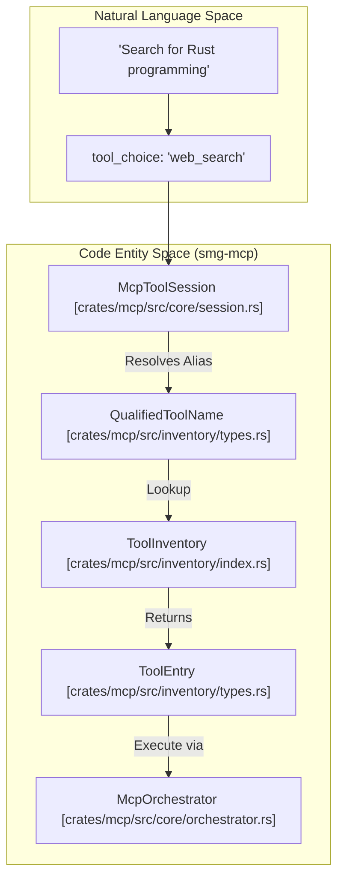
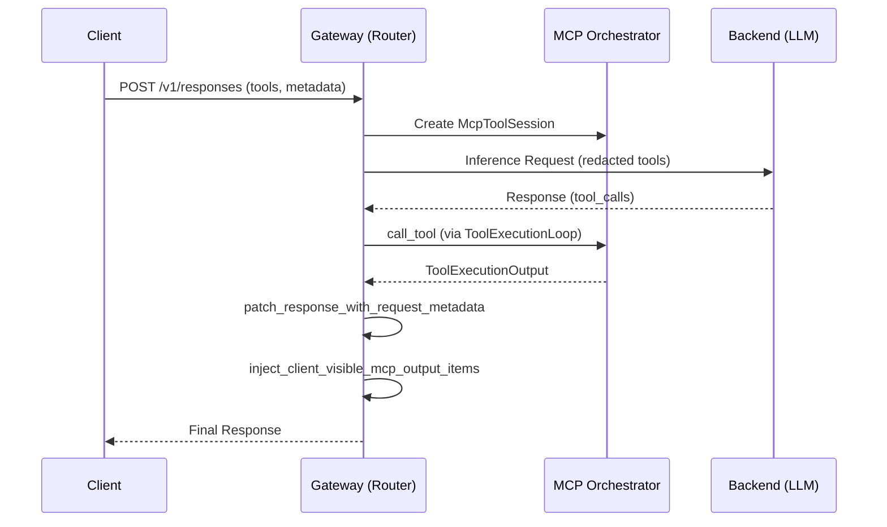

<!-- source: DeepWiki mcp.deepwiki.com · repo smg-project/smg · page 6.1 MCP Orchestrator and Tool Sessions · fetched 2026-10-21 -->

# MCP Orchestrator and Tool Sessions

Relevant source files

The following files were used as context for generating this wiki page:

- [crates/mcp/src/annotations.rs](crates/mcp/src/annotations.rs)
- [crates/mcp/src/core/config.rs](crates/mcp/src/core/config.rs)
- [crates/mcp/src/core/handler.rs](crates/mcp/src/core/handler.rs)
- [crates/mcp/src/core/mod.rs](crates/mcp/src/core/mod.rs)
- [crates/mcp/src/core/orchestrator.rs](crates/mcp/src/core/orchestrator.rs)
- [crates/mcp/src/core/pool.rs](crates/mcp/src/core/pool.rs)
- [crates/mcp/src/core/proxy.rs](crates/mcp/src/core/proxy.rs)
- [crates/mcp/src/core/session.rs](crates/mcp/src/core/session.rs)
- [crates/mcp/src/inventory/index.rs](crates/mcp/src/inventory/index.rs)
- [crates/mcp/src/inventory/types.rs](crates/mcp/src/inventory/types.rs)
- [crates/mcp/src/lib.rs](crates/mcp/src/lib.rs)
- [crates/protocols/src/responses.rs](crates/protocols/src/responses.rs)
- [crates/protocols/tests/responses.rs](crates/protocols/tests/responses.rs)
- [docs/reference/mcp-internal-servers.md](docs/reference/mcp-internal-servers.md)
- [model_gateway/benches/routing_allocation_bench.rs](model_gateway/benches/routing_allocation_bench.rs)
- [model_gateway/src/routers/common/openai_bridge/format_registry.rs](model_gateway/src/routers/common/openai_bridge/format_registry.rs)
- [model_gateway/src/routers/common/openai_bridge/tool_descriptors.rs](model_gateway/src/routers/common/openai_bridge/tool_descriptors.rs)
- [model_gateway/src/routers/grpc/harmony/builder.rs](model_gateway/src/routers/grpc/harmony/builder.rs)
- [model_gateway/src/routers/grpc/regular/responses/conversions.rs](model_gateway/src/routers/grpc/regular/responses/conversions.rs)
- [model_gateway/src/routers/openai/responses/utils.rs](model_gateway/src/routers/openai/responses/utils.rs)

The Model Context Protocol (MCP) integration in SMG provides a standardized way to connect inference models to external tools and data sources. This system is managed by the `McpOrchestrator`, which handles server lifecycles and tool inventories, and the `McpToolSession`, which manages the state and security boundaries for individual requests.

## McpOrchestrator

The `McpOrchestrator` is the central coordination point for all MCP operations. It manages a pool of connections to MCP servers, maintains a global tool inventory, and enforces approval policies.

### Key Responsibilities
*   **Connection Management**: Coordinates static servers (loaded at startup) and dynamic connections via a `McpConnectionPool` [crates/mcp/src/core/orchestrator.rs:54-56]().
*   **Tool Inventory**: Maintains a `ToolInventory` that handles qualified naming (e.g., `server:tool_name`) and aliasing [crates/mcp/src/core/orchestrator.rs:63-66]().
*   **Execution**: Executes tools via `call_tool`, which integrates with the `ApprovalManager` for safety checks [crates/mcp/src/core/orchestrator.rs:19-27]().

### Data Flow: Natural Language to Code Entities

The following diagram illustrates how a request for a tool (natural language intent) maps to internal code entities within the Orchestrator.

**Sources:** [crates/mcp/src/core/orchestrator.rs:1-68](), [crates/mcp/src/core/session.rs:68-86](), [crates/mcp/src/inventory/types.rs:23-24]().

---

## McpToolSession Lifecycle

A `McpToolSession` bundles all MCP execution state for a single request. It eliminates the need to thread the orchestrator and request context through every function [crates/mcp/src/core/session.rs:1-7]().

### Session Initialization
1.  **Creation**: Initialized via `McpToolSession::new` or `new_with_headers` [crates/mcp/src/core/session.rs:93-108]().
2.  **Tool Collection**: It calls `collect_visible_mcp_tools` to gather all tools available to the specific servers requested [crates/mcp/src/core/session.rs:112]().
3.  **Filtering**: Applies `allowed_tools` filtering if the request specifies a restricted set of tools for a server [crates/mcp/src/core/session.rs:115-136]().
4.  **Binding**: Maps internal tool names to "exposed" names used by the LLM, handling disambiguation if multiple servers provide tools with the same name [crates/mcp/src/core/session.rs:138-139]().

### Server Classification
Sessions distinguish between different types of servers to enforce privacy and routing rules:
*   **Internal Servers**: Servers defined in the gateway configuration as internal [crates/mcp/src/core/session.rs:142-151]().
*   **Builtin Servers**: Servers that handle specific hosted tool types like `web_search_preview` [crates/mcp/src/core/session.rs:152-161]().

**Sources:** [crates/mcp/src/core/session.rs:88-170]().

---

## Tool Inventory and Lookup

Tools are stored as `ToolEntry` objects, which include the raw MCP `Tool` definition, its `QualifiedToolName`, and metadata like `ToolCategory` [crates/mcp/src/inventory/types.rs:23-24]().

### Qualified Names and Aliasing
To prevent name collisions, tools are internally identified by a `QualifiedToolName` (server + tool name). However, the model usually sees a simplified alias.
*   **Alias Resolution**: The `FormatRegistry` and `McpToolSession` map exposed names (like `web_search`) back to qualified names (like `brave:brave_web_search`) [model_gateway/src/routers/common/openai_bridge/format_registry.rs:26-33]().
*   **Registry Population**: The `FormatRegistry` is populated from `McpServerConfig`, mirroring formats across both direct and aliased keys [model_gateway/src/routers/common/openai_bridge/format_registry.rs:90-115]().

**Sources:** [crates/mcp/src/inventory/types.rs:23-24](), [model_gateway/src/routers/common/openai_bridge/format_registry.rs:1-132]().

---

## Built-in Routed Tools

SMG supports "built-in" tools (e.g., `web_search_preview`, `image_generation`) which are handled specially by the gateway.

### Routing Logic
When a request uses a built-in tool type, the `McpToolSession` routes it to the configured MCP server instead of treating it as a generic function call [crates/mcp/src/core/config.rs:192-213]().

| Builtin Type | Description | Internal MCP Tool |
| :--- | :--- | :--- |
| `web_search_preview` | Hosted web search | e.g., `brave_web_search` |
| `code_interpreter` | Secure code execution | e.g., `execute` |
| `file_search` | RAG / Vector search | e.g., `search` |

### Conversion to Harmony
For models using the Harmony protocol (like `gpt-oss`), built-in tools are advertised in the system message preamble. Tools like `web_search_preview` and `file_search` are treated as "built-in" and emitted with specific channel tags, while others like `image_generation` are rendered as standard function tools because the model wasn't trained on their specific tags [model_gateway/src/routers/grpc/harmony/builder.rs:108-136](), [model_gateway/src/routers/grpc/harmony/builder.rs:188-195]().

**Sources:** [crates/mcp/src/core/config.rs:192-213](), [model_gateway/src/routers/grpc/harmony/builder.rs:108-195]().

---

## Tool Redaction and Restoration

In the Responses API, SMG ensures that sensitive internal tool information is redacted before returning the response to the client, while preserving metadata for the tool execution loop.

### Visibility Policy
The `inject_client_visible_mcp_output_items` function filters the `ResponseOutputItem` array:
*   **Redacted**: Internal non-builtin `mcp_list_tools`, `mcp_call`, and `mcp_approval_request` items are hidden [model_gateway/src/routers/common/openai_bridge/tool_descriptors.rs:168-173]().
*   **Visible**: Builtin-routed call items and user-defined function calls remain visible [model_gateway/src/routers/common/openai_bridge/tool_descriptors.rs:166-167]().

### Metadata Patching
The gateway patches response JSON with original request metadata (like `previous_response_id`, `instructions`, and `metadata`) that might be missing from the raw backend inference response [model_gateway/src/routers/openai/responses/utils.rs:45-49]().

**Sources:** [model_gateway/src/routers/common/openai_bridge/tool_descriptors.rs:168-173](), [model_gateway/src/routers/openai/responses/utils.rs:45-109]().

---

