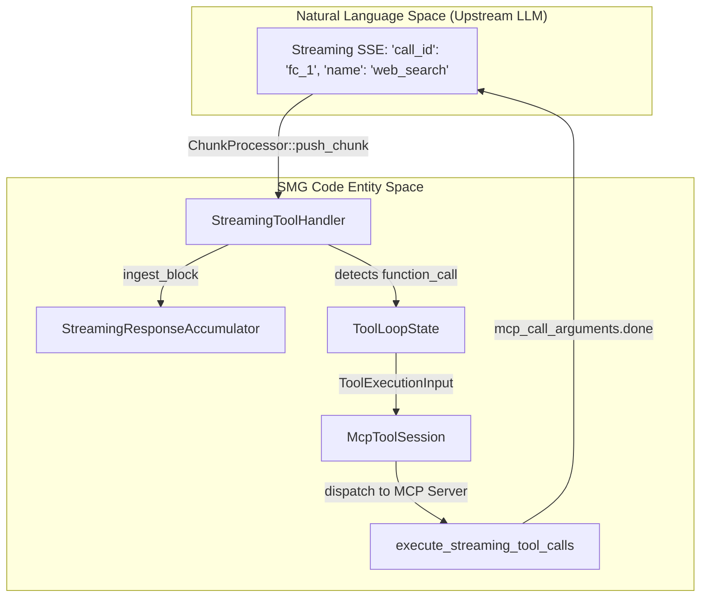
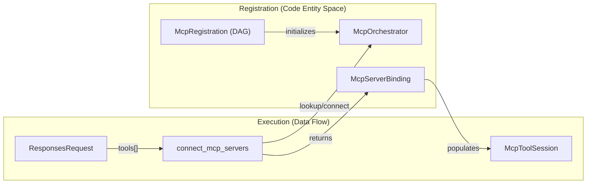

<!-- source: DeepWiki mcp.deepwiki.com · repo smg-project/smg · page 6.2 MCP Tool Loop (OpenAI and Anthropic) · fetched 2026-10-21 -->

# MCP Tool Loop (OpenAI and Anthropic)

Relevant source files

The following files were used as context for generating this wiki page:

- [crates/protocols/src/builders/responses/response.rs](crates/protocols/src/builders/responses/response.rs)
- [model_gateway/src/routers/common/mcp_utils.rs](model_gateway/src/routers/common/mcp_utils.rs)
- [model_gateway/src/routers/common/openai_bridge/connect.rs](model_gateway/src/routers/common/openai_bridge/connect.rs)
- [model_gateway/src/routers/common/openai_bridge/format_descriptor.rs](model_gateway/src/routers/common/openai_bridge/format_descriptor.rs)
- [model_gateway/src/routers/common/openai_bridge/mod.rs](model_gateway/src/routers/common/openai_bridge/mod.rs)
- [model_gateway/src/routers/common/persistence_utils.rs](model_gateway/src/routers/common/persistence_utils.rs)
- [model_gateway/src/routers/openai/mcp/tool_handler.rs](model_gateway/src/routers/openai/mcp/tool_handler.rs)
- [model_gateway/src/routers/openai/mcp/tool_loop.rs](model_gateway/src/routers/openai/mcp/tool_loop.rs)
- [model_gateway/src/routers/openai/responses/accumulator.rs](model_gateway/src/routers/openai/responses/accumulator.rs)
- [model_gateway/src/routers/openai/responses/common.rs](model_gateway/src/routers/openai/responses/common.rs)
- [model_gateway/src/routers/openai/responses/non_streaming.rs](model_gateway/src/routers/openai/responses/non_streaming.rs)
- [model_gateway/src/routers/openai/responses/streaming.rs](model_gateway/src/routers/openai/responses/streaming.rs)
- [model_gateway/src/workflow/mcp_registration.rs](model_gateway/src/workflow/mcp_registration.rs)
- [model_gateway/tests/api/responses_api_test.rs](model_gateway/tests/api/responses_api_test.rs)
- [model_gateway/tests/spec/responses.rs](model_gateway/tests/spec/responses.rs)

The SMG (Shepherd Model Gateway) implements a sophisticated agentic tool execution loop that intercepts model-generated tool calls and executes them against Model Context Protocol (MCP) servers. This loop supports both the OpenAI Responses API (stateful, multi-turn) and the Anthropic Messages API, handling streaming events, result transformation, and conversation persistence.

## 1. Tool Loop Architecture

The tool loop is designed to bridge the "Natural Language Space" (where the model decides to use a tool) and the "Code Entity Space" (where the gateway executes MCP calls and manages state).

### Logic Flow: Natural Language to Code Entities

The following diagram illustrates how a model's textual intent to call a tool is intercepted and handled by SMG's internal components.

**Diagram: Tool Interception and Dispatch**

**Sources:** [model_gateway/src/routers/openai/responses/streaming.rs:6-8](), [model_gateway/src/routers/openai/mcp/tool_handler.rs:142-161](), [model_gateway/src/routers/openai/mcp/tool_loop.rs:42-55]()

## 2. OpenAI Responses API Loop

The OpenAI Responses API is stateful. SMG manages this state using a `ToolLoopState` struct which tracks iterations and conversation history to allow the model to continue the conversation after tool execution.

### 2.1. Tool Loop State Management
The `ToolLoopState` tracks the lifecycle of a multi-turn interaction:
- **Iteration**: The current turn count (capped by `DEFAULT_MAX_ITERATIONS` = 10) [model_gateway/src/routers/common/mcp_utils.rs:19]().
- **Conversation History**: A vector of `function_call` and `function_call_output` items required to build "resume" payloads for the upstream model [model_gateway/src/routers/openai/mcp/tool_loop.rs:48-52]().
- **MCP Call Items**: Transformed items (e.g., `mcp_call`, `web_search_call`) stored to avoid re-transformation [model_gateway/src/routers/openai/mcp/tool_loop.rs:53-55]().

### 2.2. Non-Streaming Workflow
In non-streaming mode, `handle_non_streaming_response` coordinates the entire loop:
1. **MCP Client Setup**: Ensures an `McpToolSession` is created if the request uses MCP routing [model_gateway/src/routers/openai/responses/non_streaming.rs:64-83]().
2. **Tool Masking**: `prepare_mcp_tools_as_functions` converts MCP tool definitions into standard OpenAI function definitions before forwarding to the worker [model_gateway/src/routers/openai/responses/non_streaming.rs:102]().
3. **Execution Loop**: `execute_tool_loop` handles the recursive calls until the model provides a final answer or the iteration limit is reached [model_gateway/src/routers/openai/responses/non_streaming.rs:104-117]().
4. **Restoration**: `restore_original_tools` replaces the internal function definitions with the original MCP tool definitions in the final JSON response [model_gateway/src/routers/openai/responses/non_streaming.rs:129]().

**Sources:** [model_gateway/src/routers/openai/responses/non_streaming.rs:30-130](), [model_gateway/src/routers/openai/mcp/tool_loop.rs:57-71]()

### 2.3. Streaming Workflow and Event Interception
Streaming requires real-time interception of Server-Sent Events (SSE). The `StreamingToolHandler` manages this via `apply_event_transformations_inplace` [model_gateway/src/routers/openai/responses/streaming.rs:69-72]().

| Event Type | Action | Description |
| :--- | :--- | :--- |
| `function_call` | **Buffer** | Accumulates tool name and arguments in `FunctionCallInProgress` [model_gateway/src/routers/openai/mcp/tool_handler.rs:109-117](). |
| `output_item.done` | **Execute** | Triggers `execute_streaming_tool_calls` when a tool call is complete [model_gateway/src/routers/openai/mcp/tool_handler.rs:65](). |
| `response.created` | **Patch** | Injects SMG-specific metadata and masks tools [model_gateway/src/routers/openai/responses/streaming.rs:107-110](). |

**Sources:** [model_gateway/src/routers/openai/responses/streaming.rs:69-130](), [model_gateway/src/routers/openai/mcp/tool_handler.rs:28-66]()

## 3. MCP Registration and Dispatch

The registration workflow bridges the configuration to the execution engine.

**Diagram: MCP Registration Workflow**

**Sources:** [model_gateway/src/routers/common/mcp_utils.rs:69-73](), [model_gateway/src/routers/openai/responses/non_streaming.rs:87-98]()

### 3.1. Key Dispatch Functions
- **`connect_mcp_servers`**: Protocol-agnostic utility that connects to dynamic (URL-based) or static (pre-configured) MCP servers [model_gateway/src/routers/common/mcp_utils.rs:69-73]().
- **`execute_streaming_tool_calls`**: The core async loop that iterates through `pending_calls`, executes them via the `McpToolSession`, and streams the results back to the client [model_gateway/src/routers/openai/mcp/tool_loop.rs:170-180]().
- **`lookup_tool_format`**: Consults the `FormatRegistry` to determine if a tool call should be transformed into a specific output type like `web_search_call` or `image_generation_call` [model_gateway/src/routers/openai/mcp/tool_loop.rs:201-203]().

**Sources:** [model_gateway/src/routers/common/mcp_utils.rs:69-155](), [model_gateway/src/routers/openai/mcp/tool_loop.rs:170-210]()

## 4. Response Persistence

SMG ensures that agentic turns are persisted to conversation storage. The `StreamingResponseAccumulator` is used during streaming to reconstruct the full response object once the stream ends [model_gateway/src/routers/openai/responses/accumulator.rs:11-21]().

### Persistence Data Flow
1. **Ingestion**: `ingest_block` processes every SSE frame [model_gateway/src/routers/openai/responses/accumulator.rs:34-39]().
2. **Aggregation**: Output items are collected and keyed by their `output_index` [model_gateway/src/routers/openai/responses/accumulator.rs:117-123]().
3. **Finalization**: `into_final_response` builds a complete JSON object, synthesizing fields if the upstream `response.completed` event is missing [model_gateway/src/routers/openai/responses/accumulator.rs:42-48]().
4. **Storage**: `persist_conversation_items` writes the result to the `ConversationItemStorage` [model_gateway/src/routers/common/persistence_utils.rs:186-194]().

**Sources:** [model_gateway/src/routers/openai/responses/accumulator.rs:9-48](), [model_gateway/src/routers/common/persistence_utils.rs:145-180]()

---

