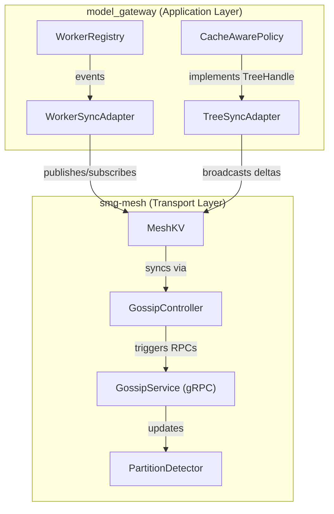
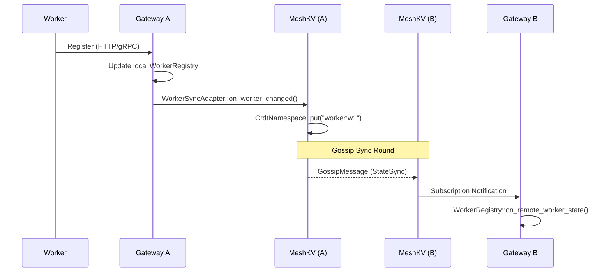

<!-- source: DeepWiki mcp.deepwiki.com · repo smg-project/smg · page 7 High Availability Mesh · fetched 2026-10-21 -->

# High Availability Mesh

Relevant source files

The following files were used as context for generating this wiki page:

- [crates/kv_index/src/path_hash.rs](crates/kv_index/src/path_hash.rs)
- [crates/mesh/src/kv.rs](crates/mesh/src/kv.rs)
- [crates/mesh/src/lib.rs](crates/mesh/src/lib.rs)
- [crates/mesh/src/metrics.rs](crates/mesh/src/metrics.rs)
- [crates/mesh/src/service.rs](crates/mesh/src/service.rs)
- [crates/mesh/src/types.rs](crates/mesh/src/types.rs)
- [model_gateway/src/lib.rs](model_gateway/src/lib.rs)
- [model_gateway/src/mesh/adapters/mod.rs](model_gateway/src/mesh/adapters/mod.rs)
- [model_gateway/src/mesh/adapters/tree_sync.rs](model_gateway/src/mesh/adapters/tree_sync.rs)
- [model_gateway/src/mesh/adapters/worker_sync.rs](model_gateway/src/mesh/adapters/worker_sync.rs)
- [model_gateway/src/mesh/mod.rs](model_gateway/src/mesh/mod.rs)
- [model_gateway/src/mesh/wiring.rs](model_gateway/src/mesh/wiring.rs)

The High Availability (HA) Mesh provides the networking and synchronization layer required for multi-gateway SMG deployments. It enables distributed cluster state management, including node discovery, failure detection, and the synchronization of global state such as worker availability, rate-limit counters, and prefix-cache indices.

The mesh is implemented primarily in the `smg-mesh` crate, providing an application-agnostic transport layer used by the gateway to maintain a consistent view of the cluster [crates/mesh/src/lib.rs:1-6]().

## System Architecture

The mesh layer operates as a background service within each SMG gateway instance. It bridges the local `WorkerRegistry` and routing policies to the rest of the cluster using two primary mechanisms: a Gossip Protocol for membership and a Distributed Key-Value store (`MeshKV`) for state.

### Mesh Logic to Code Mapping
The following diagram illustrates how high-level mesh concepts map to specific code entities within the `smg-mesh` and `model_gateway` crates.

Mesh Architecture Entity Mapping

Sources: [crates/mesh/src/lib.rs:8-17](), [model_gateway/src/mesh/adapters/mod.rs:1-12](), [model_gateway/src/mesh/wiring.rs:20-24]()

## Core Subsystems

### Gossip Protocol and Node Discovery
The mesh uses a SWIM-like gossip protocol to maintain cluster membership. Each node periodically pings a subset of peers to exchange `NodeState` (Alive, Leaving, or Down) and propagate metadata [crates/mesh/src/service.rs:25-29]().

*   **Discovery:** Nodes join the mesh by connecting to an initial peer (`init_peer`) [crates/mesh/src/service.rs:160-167]().
*   **Failure Detection:** The `GossipController` tracks peer health and triggers status updates [crates/mesh/src/service.rs:31-32]().
*   **Split-Brain Protection:** The `PartitionDetector` monitors quorum to ensure the gateway only serves requests when it is part of the majority partition [crates/mesh/src/service.rs:68-74]().

For details, see [Gossip Protocol and Node Discovery](#7.1).

### CRDT State Synchronization
Distributed state is managed via `MeshKV`, which supports two primary synchronization modes [crates/mesh/src/kv.rs:1-6]():

1.  **CRDT Namespaces:** Used for durable, mergeable state like `WorkerState` and rate limits. It supports conflict-free resolution strategies such as `LastWriterWins` and `EpochMaxWins` [crates/mesh/src/kv.rs:24-31](), [model_gateway/src/mesh/wiring.rs:46-47]().
2.  **Stream Namespaces:** Used for ephemeral, high-frequency traffic like `TreeDelta` updates for prefix-cache routing [model_gateway/src/mesh/adapters/tree_sync.rs:1-13]().

For details, see [CRDT State Synchronization](#7.2).

## Gateway Integration

The `MeshAdapters` serve as the composition root, bridging the generic `MeshKV` to specific gateway components [model_gateway/src/mesh/wiring.rs:1-8]().

| Adapter | Namespace | Strategy | Purpose |
| :--- | :--- | :--- | :--- |
| `WorkerSyncAdapter` | `worker:` | `LastWriterWins` | Synchronizes backend worker availability and load across gateways [model_gateway/src/mesh/adapters/worker_sync.rs:1-9](). |
| `RateLimitSyncAdapter` | `rl:` | `EpochMaxWins` | Global tracking of tenant request quotas [model_gateway/src/mesh/wiring.rs:47](). |
| `TreeSyncAdapter` | `td:` | `Stream` | Propagates radix-tree cache updates for `cache_aware` routing [model_gateway/src/mesh/adapters/tree_sync.rs:38](). |

### Request Flow and Synchronization
This diagram shows how a state change (e.g., a new worker registration) flows from one gateway node to the entire mesh.

State Propagation Flow

Sources: [model_gateway/src/mesh/adapters/worker_sync.rs:78-93](), [crates/mesh/src/kv.rs:152-163](), [crates/mesh/src/service.rs:25-28]()

## Observability

The mesh layer exports several Prometheus metrics to monitor cluster health and synchronization performance [crates/mesh/src/metrics.rs:1-9]():

*   `router_mesh_peer_connections`: Number of active peer connections [crates/mesh/src/metrics.rs:18-21]().
*   `router_mesh_sync_round_duration_seconds`: Histogram of gossip round latencies [crates/mesh/src/metrics.rs:44-47]().
*   `router_mesh_store_cardinality`: Number of entries in the distributed KV store [crates/mesh/src/metrics.rs:34-37]().
*   `router_rl_drift_ratio`: Drift between local and global rate limit counters [crates/mesh/src/metrics.rs:50-53]().

Sources: [crates/mesh/src/metrics.rs:16-58]()

---

