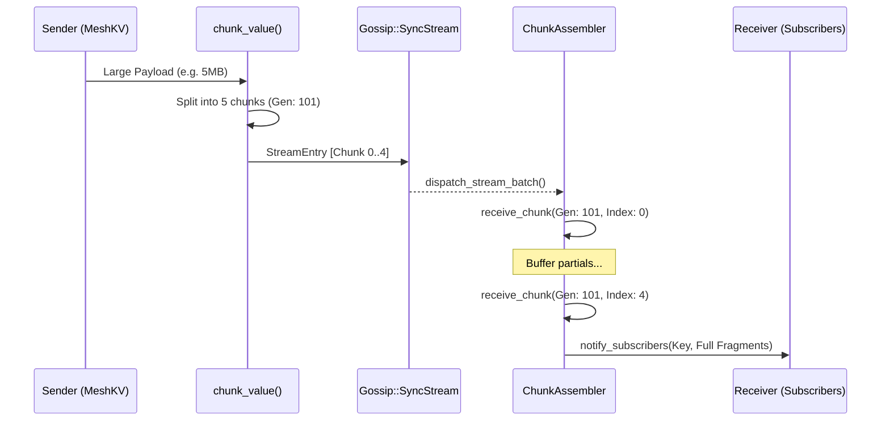

<!-- source: DeepWiki mcp.deepwiki.com · repo smg-project/smg · page 7.1 Gossip Protocol and Node Discovery · fetched 2026-10-21 -->

# Gossip Protocol and Node Discovery

<details>
<summary>Relevant source files</summary>

The following files were used as context for generating this wiki page:

- [crates/mesh/src/gossip_controller.rs](crates/mesh/src/gossip_controller.rs)
- [crates/mesh/src/gossip_service.rs](crates/mesh/src/gossip_service.rs)
- [crates/mesh/src/kv.rs](crates/mesh/src/kv.rs)
- [crates/mesh/src/lib.rs](crates/mesh/src/lib.rs)
- [crates/mesh/src/metrics.rs](crates/mesh/src/metrics.rs)
- [crates/mesh/src/mtls.rs](crates/mesh/src/mtls.rs)
- [crates/mesh/src/service.rs](crates/mesh/src/service.rs)
- [crates/mesh/src/tests/chunking_integration.rs](crates/mesh/src/tests/chunking_integration.rs)
- [crates/mesh/src/tests/crdt_integration.rs](crates/mesh/src/tests/crdt_integration.rs)
- [crates/mesh/src/tests/mod.rs](crates/mesh/src/tests/mod.rs)
- [crates/mesh/src/transport/chunk_assembler.rs](crates/mesh/src/transport/chunk_assembler.rs)
- [crates/mesh/src/transport/chunking.rs](crates/mesh/src/transport/chunking.rs)
- [crates/mesh/src/transport/mod.rs](crates/mesh/src/transport/mod.rs)
- [crates/mesh/src/transport/sync_stream.rs](crates/mesh/src/transport/sync_stream.rs)

</details>


The High Availability (HA) mesh in SMG utilizes a SWIM-like gossip protocol to maintain cluster membership, detect node failures, and synchronize state across multiple gateway instances. This protocol ensures that every node in the mesh has a consistent view of the cluster topology without requiring a centralized coordinator.

## Architecture Overview

The gossip system is implemented in the `mesh` crate and consists of several interacting components that manage membership, logical clocks, and data transport.

### Key Components

| Component | Role | File Reference |
| :--- | :--- | :--- |
| `GossipController` | Drives the per-node event loop (1 Hz tick), peer probing, and outbound stream management. | [crates/mesh/src/gossip_controller.rs:77-93]() |
| `GossipService` | Implements the gRPC `Gossip` service for inbound pings and state synchronization. | [crates/mesh/src/gossip_service.rs:80-97]() |
| `MeshKV` | A generic, application-agnostic mesh transport for durable (CRDT) and ephemeral (Stream) data. | [crates/mesh/src/kv.rs:198-215]() |
| `PartitionDetector` | Prevents split-brain scenarios by monitoring quorum and connectivity. | [crates/mesh/src/partition.rs:1-10]() |
| `MTLSManager` | Handles peer authentication using mutual TLS. | [crates/mesh/src/mtls.rs:1-10]() |

### Node Lifecycle and Code Entities
The following diagram illustrates how natural language node states map to specific code entities and transitions.

**Node State Machine**
```mermaid
graph TD
    "NodeStatus::Alive" -- "No response to Ping" --> "NodeStatus::Suspected"
    "NodeStatus::Suspected" -- "Ping success" --> "NodeStatus::Alive"
    "NodeStatus::Suspected" -- "Timeout" --> "NodeStatus::Down"
    "NodeStatus::Alive" -- "graceful_shutdown()" --> "NodeStatus::Leaving"
    "NodeStatus::Leaving" -- "Broadcast complete" --> "Shutdown"

    subgraph "Code Entities"
        "NodeStatus"["enum NodeStatus (service.rs)"]
        "GossipController"["GossipController::event_loop"]
        "MeshServerHandler"["MeshServerHandler::graceful_shutdown"]
    end

    "GossipController" --> "NodeStatus"
    "MeshServerHandler" --> "NodeStatus"
```
Sources: [crates/mesh/src/service.rs:25-28](), [crates/mesh/src/gossip_controller.rs:161-167](), [crates/mesh/src/service.rs:83-150]()

## SWIM-like Gossip Protocol

The protocol operates on a periodic tick (nominally 1 Hz) driven by the `GossipController::event_loop` [crates/mesh/src/gossip_controller.rs:132-158]().

### Peer Probing and Discovery
1.  **Direct Probe**: Every round, the node selects a random peer from the `ClusterState` and sends a `Ping` [crates/mesh/src/gossip_controller.rs:179-190]().
2.  **Indirect Probe**: If a direct ping fails, the node requests other peers to ping the target via `PingReq` to avoid false positives caused by local network congestion [crates/mesh/src/gossip_controller.rs:49-53]().
3.  **State Sync**: Every ping carries a `StateSync` payload containing the sender's view of other nodes' statuses and versions [crates/mesh/src/service.rs:25-28]().

### Security (mTLS)
Peer-to-peer communication is secured via `MTLSManager`. The `MeshServerBuilder` configures the gRPC server and clients with `MTLSConfig` to ensure only authorized nodes can join the mesh [crates/mesh/src/service.rs:196-199]().

Sources: [crates/mesh/src/gossip_controller.rs:1-26](), [crates/mesh/src/mtls.rs:1-10]()

## Data Transport and Chunking

For payloads exceeding gRPC message limits (defined by `MAX_MESSAGE_SIZE` [crates/mesh/src/transport/limits.rs]()), SMG implements a custom chunking and reassembly layer.

### Outbound: Chunking and Batching
The `chunk_value` function splits large `Bytes` into fragments based on `MAX_STREAM_CHUNK_BYTES` (typically 1MB) [crates/mesh/src/transport/chunking.rs:53-91](). These chunks are assigned a `next_generation()` monotonic tag to prevent collisions between concurrent updates to the same key [crates/mesh/src/transport/chunking.rs:42-44]().

### Inbound: Chunk Assembly
The `ChunkAssembler` on the receiving node manages partial assemblies.
- **Scoping**: Assemblies are scoped by `(peer_id, key)` to allow different peers to update the same key simultaneously without interference [crates/mesh/src/transport/chunk_assembler.rs:120-128]().
- **Memory Management**: The assembler enforces `DEFAULT_MAX_ASSEMBLER_BYTES` (512MB) and `DEFAULT_MAX_CONCURRENT_ASSEMBLIES` (20) to prevent OOM attacks [crates/mesh/src/transport/chunk_assembler.rs:24-28]().

**Data Flow: Payload Assembly**

Sources: [crates/mesh/src/transport/sync_stream.rs:118-145](), [crates/mesh/src/transport/chunk_assembler.rs:120-180](), [crates/mesh/src/transport/chunking.rs:53-91]()

## Partition Detection and Split-Brain Prevention

The `PartitionDetector` is responsible for ensuring the node only serves requests if it is part of a healthy quorum.

- **Quorum Check**: Before serving, `MeshServerHandler::should_serve()` queries the `PartitionDetector` [crates/mesh/src/service.rs:69-74]().
- **State Integration**: It monitors the `ClusterState` (a `BTreeMap<String, NodeState>`) to calculate the ratio of `Alive` vs `Down` nodes [crates/mesh/src/service.rs:37-38]().

## MeshKV Namespaces

The `MeshKV` struct provides two distinct communication patterns for application state:

1.  **CrdtNamespace**: For durable state like worker registrations or rate limits. Uses Lamport timestamps and merge strategies (e.g., `LastWriterWins`, `EpochMaxWins`) [crates/mesh/src/kv.rs:53-55]().
2.  **StreamNamespace**: For ephemeral, lossy traffic such as radix tree repair pages or tenant deltas. Supports `Broadcast` or `Targeted` routing [crates/mesh/src/kv.rs:31-38]().

Sources: [crates/mesh/src/kv.rs:1-38](), [crates/mesh/src/kv.rs:198-215](), [crates/mesh/src/partition.rs:1-10]()

---

