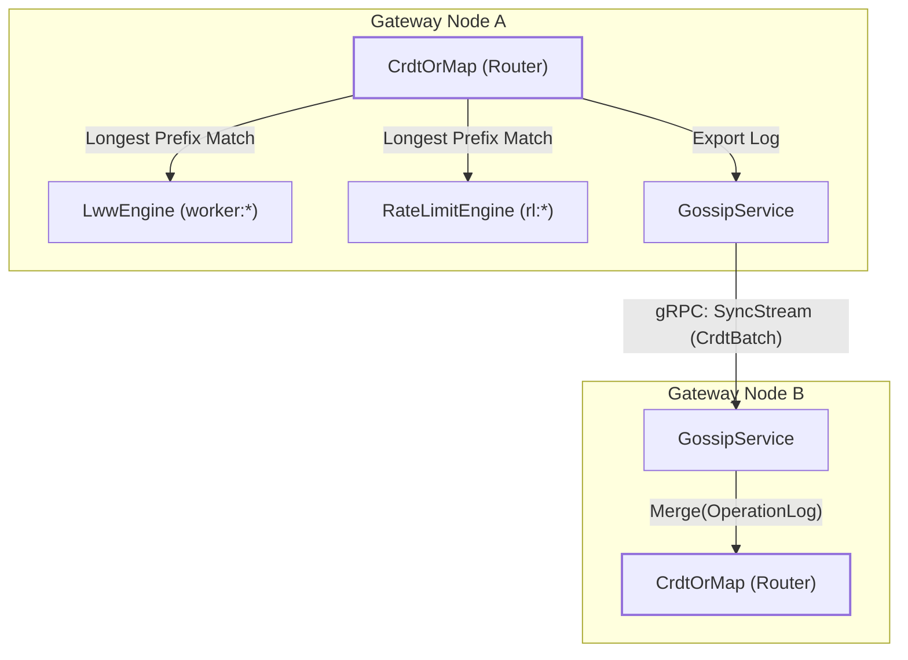
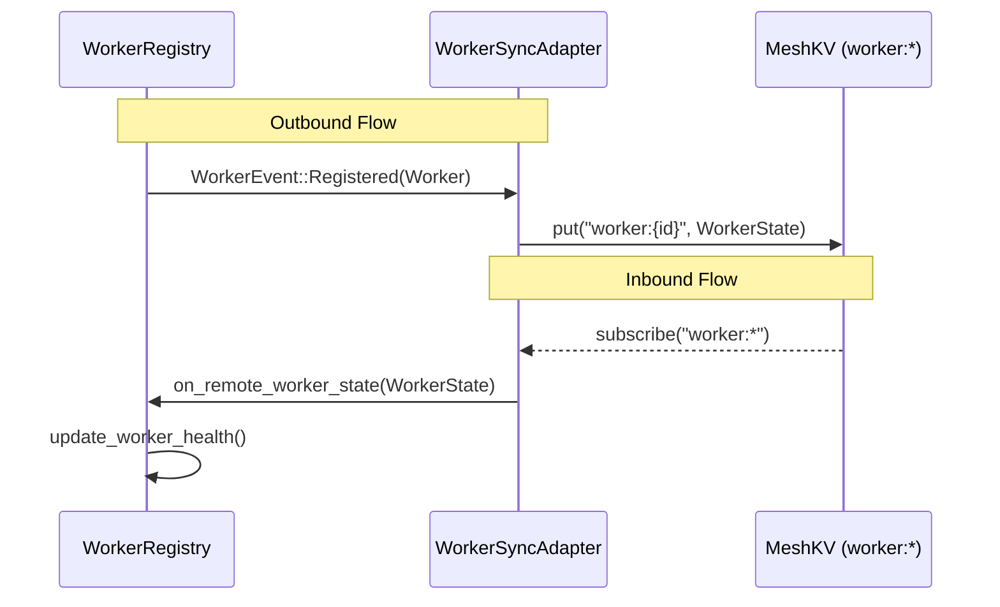

<!-- source: DeepWiki mcp.deepwiki.com · repo smg-project/smg · page 7.2 CRDT State Synchronization · fetched 2026-10-21 -->

# CRDT State Synchronization

Relevant source files

The following files were used as context for generating this wiki page:

- [crates/kv_index/src/path_hash.rs](crates/kv_index/src/path_hash.rs)
- [crates/mesh/src/crdt_kv/crdt.rs](crates/mesh/src/crdt_kv/crdt.rs)
- [crates/mesh/src/crdt_kv/engine/lww.rs](crates/mesh/src/crdt_kv/engine/lww.rs)
- [crates/mesh/src/crdt_kv/engine/mod.rs](crates/mesh/src/crdt_kv/engine/mod.rs)
- [crates/mesh/src/crdt_kv/engine/rate_limit.rs](crates/mesh/src/crdt_kv/engine/rate_limit.rs)
- [crates/mesh/src/crdt_kv/epoch_max_wins.rs](crates/mesh/src/crdt_kv/epoch_max_wins.rs)
- [crates/mesh/src/crdt_kv/kv_store.rs](crates/mesh/src/crdt_kv/kv_store.rs)
- [crates/mesh/src/crdt_kv/merge_strategy.rs](crates/mesh/src/crdt_kv/merge_strategy.rs)
- [crates/mesh/src/crdt_kv/mod.rs](crates/mesh/src/crdt_kv/mod.rs)
- [crates/mesh/src/crdt_kv/operation.rs](crates/mesh/src/crdt_kv/operation.rs)
- [crates/mesh/src/crdt_kv/replica.rs](crates/mesh/src/crdt_kv/replica.rs)
- [crates/mesh/src/crdt_kv/tests.rs](crates/mesh/src/crdt_kv/tests.rs)
- [crates/mesh/src/crdt_kv/watermark.rs](crates/mesh/src/crdt_kv/watermark.rs)
- [crates/mesh/src/proto/gossip.proto](crates/mesh/src/proto/gossip.proto)
- [crates/mesh/src/transport/crdt_batch.rs](crates/mesh/src/transport/crdt_batch.rs)
- [crates/mesh/src/types.rs](crates/mesh/src/types.rs)
- [model_gateway/src/lib.rs](model_gateway/src/lib.rs)
- [model_gateway/src/mesh/adapters/mod.rs](model_gateway/src/mesh/adapters/mod.rs)
- [model_gateway/src/mesh/adapters/rate_limit_sync.rs](model_gateway/src/mesh/adapters/rate_limit_sync.rs)
- [model_gateway/src/mesh/adapters/tree_sync.rs](model_gateway/src/mesh/adapters/tree_sync.rs)
- [model_gateway/src/mesh/adapters/worker_sync.rs](model_gateway/src/mesh/adapters/worker_sync.rs)
- [model_gateway/src/mesh/mod.rs](model_gateway/src/mesh/mod.rs)
- [model_gateway/src/mesh/wiring.rs](model_gateway/src/mesh/wiring.rs)

The High Availability (HA) Mesh in SMG relies on a distributed key-value store, **MeshKV**, to synchronize critical state across gateway peers. MeshKV uses Conflict-free Replicated Data Types (CRDTs) to ensure eventual consistency without requiring centralized consensus. State is partitioned into namespaces, each utilizing a specific merge strategy (e.g., Last-Writer-Wins, Epoch-Max-Wins) tailored to the data's consistency requirements.

## Architecture Overview

MeshKV is implemented as a thin router (`CrdtOrMap`) that delegates operations to specialized per-namespace engines based on key prefixes `[crates/mesh/src/crdt_kv/crdt.rs:9-15]()`.

### Component Relationship

The following diagram illustrates the relationship between the mesh transport layer and the CRDT engines.

**Mesh State Synchronization Data Flow**

**Sources:** `[crates/mesh/src/crdt_kv/crdt.rs:35-55]()`, `[crates/mesh/src/proto/gossip.proto:7-9]()`

## MeshKV Core Components

### CrdtOrMap (Router)
The `CrdtOrMap` struct acts as the primary entry point for all CRDT operations. It maintains a table of `EngineHandle`s sorted by prefix length to perform longest-prefix matching `[crates/mesh/src/crdt_kv/crdt.rs:37-55]()`.
*   **Clock Management:** It owns a shared `LamportClock` used by all engines to ensure that op-ids `(replica_id, timestamp)` are unique across the entire node `[crates/mesh/src/crdt_kv/crdt.rs:45-50]()`.
*   **Snapshotting:** It provides an `operation_log_snapshot` for the gossip layer, which caches the combined logs of all engines to avoid expensive deep-cloning during frequent gossip rounds `[crates/mesh/src/crdt_kv/crdt.rs:57-58]()`.

### Operation Log
State changes are captured as `Operation` variants: `Insert` and `Remove` `[crates/mesh/src/crdt_kv/operation.rs:13-27]()`. Each engine maintains an `OperationLog`, which is an append-only sequence of these changes.
*   **Compaction:** To prevent unbounded memory growth, engines run `compact_by_key`, which folds operations for the same key into a single "winner" based on the engine's specific merge strategy `[crates/mesh/src/crdt_kv/operation.rs:189-200]()`.
*   **Watermarks:** Peers exchange `CrdtAck` messages containing `CrdtKeyVersion` (highest Lamport timestamp per key) to advance send watermarks and prune acknowledged operations from the log `[crates/mesh/src/proto/gossip.proto:107-118]()`.

**Sources:** `[crates/mesh/src/crdt_kv/crdt.rs:1-130]()`, `[crates/mesh/src/crdt_kv/operation.rs:7-100]()`

## Merge Strategies and Engines

SMG supports multiple merge strategies via the `MergeStrategy` enum `[crates/mesh/src/crdt_kv/merge_strategy.rs]()`.

| Strategy | Engine | Use Case | Implementation Logic |
| :--- | :--- | :--- | :--- |
| **Last-Writer-Wins (LWW)** | `LwwEngine` | Worker state, metadata | Strictly higher `(timestamp, replica_id)` wins `[crates/mesh/src/crdt_kv/engine/lww.rs:3-4]()`. |
| **Epoch-Max-Wins** | `RateLimitEngine` | Distributed rate limiting | Merges `RateLimitState` (live points + tombstone version) to handle concurrent decrements/refills `[crates/mesh/src/crdt_kv/engine/rate_limit.rs:3-6]()`. |

### LwwEngine Implementation
The `LwwEngine` manages live data in a `KvStore` and metadata in a `DashMap<String, Vec<ValueMetadata>>` `[crates/mesh/src/crdt_kv/engine/lww.rs:89-99]()`. 
*   **Conflict Resolution:** When a remote `Operation` is merged, `record_insert_metadata` compares the incoming version against the local winner. If the incoming is newer, it updates the `KvStore` `[crates/mesh/src/crdt_kv/engine/lww.rs:158-178]()`.
*   **Tombstones:** Removals are stored as metadata with `is_tombstone: true`. A tombstone with a higher version than an insert will cause the key to be reported as missing `[crates/mesh/src/crdt_kv/engine/lww.rs:128-135]()`.

### RateLimitEngine Implementation
Designed for the `rl:` prefix, this engine manages `RateLimitState` shards `[crates/mesh/src/crdt_kv/engine/rate_limit.rs:34-41]()`.
*   **State Merging:** It uses `ratelimit::state_from_insert_value` to decode binary payloads into typed frontiers. The `merge_insert` function then applies CRDT merge logic to combine local and remote counters `[crates/mesh/src/crdt_kv/engine/rate_limit.rs:128-161]()`.

**Sources:** `[crates/mesh/src/crdt_kv/engine/lww.rs:1-112]()`, `[crates/mesh/src/crdt_kv/engine/rate_limit.rs:1-66]()`

## Prefix Tree (Radix) Synchronization

For cache-aware routing, gateways must synchronize the state of the prefix radix tree (which worker has which tokens cached). This uses a specialized `TreeSyncAdapter` rather than standard CRDT KV for performance reasons.

### Tree Delta Propagation
1.  **Outbound:** When a local worker reports a cache event, `on_local_insert` generates a `TreeDelta` `[model_gateway/src/mesh/adapters/tree_sync.rs:4-6]()`.
2.  **Batching:** Deltas are batched into `td:{model_id}` stream entries per gossip round `[model_gateway/src/mesh/adapters/tree_sync.rs:38]()`.
3.  **Inbound:** Receivers hand deltas to a `TreeHandle`. If the prefix path is unknown (e.g., due to missing parent nodes), the adapter triggers a repair flow `[model_gateway/src/mesh/adapters/tree_sync.rs:7-13]()`.

### Tree Repair Mechanism
If a node receives a `TreeDelta` with an `UnknownHash`, it initiates a repair session:
*   **Request:** Sends a `TreeRepairRequest` (`tree:req:`) to a random `ALIVE` peer `[model_gateway/src/mesh/adapters/tree_sync.rs:134-145]()`.
*   **Response:** The target peer responds with `TreeRepairPage` fragments (`tree:page:`) containing the full prefix paths and tenant lists `[model_gateway/src/mesh/adapters/tree_sync.rs:169-178]()`.
*   **Constraints:** To ensure stability, `tree:page:` messages are restricted to a single gossip chunk (approx 1MB) and do not use the multi-chunk reassembly path `[model_gateway/src/mesh/adapters/tree_sync.rs:78-84]()`.

**Sources:** `[model_gateway/src/mesh/adapters/tree_sync.rs:1-178]()`

## Worker State Replication

The `WorkerSyncAdapter` bridges the mesh `worker:` namespace to the local `WorkerRegistry` `[model_gateway/src/mesh/adapters/worker_sync.rs:47-50]()`.

**Worker Synchronization Logic**

### Sync Details
*   **Origin Filtering:** The adapter ignores `WorkerEvent`s for workers that were originally imported from the mesh to prevent infinite gossip loops `[model_gateway/src/mesh/adapters/worker_sync.rs:3-9]()`.
*   **Reconciliation:** A periodic task (`RECONCILE_INTERVAL = 30s`) scans the `WorkerRegistry` and `MeshKV` to ensure that locally-owned workers are correctly published and that orphaned remote workers are removed `[model_gateway/src/mesh/adapters/worker_sync.rs:40-43, 105-119]()`.
*   **Idempotency:** `WorkerRegistry::on_remote_worker_state` is idempotent based on the worker URL; if a key is seen via both backfill and live subscription, it only results in a health refresh `[model_gateway/src/mesh/adapters/worker_sync.rs:88-90]()`.

**Sources:** `[model_gateway/src/mesh/adapters/worker_sync.rs:1-143]()`

---

