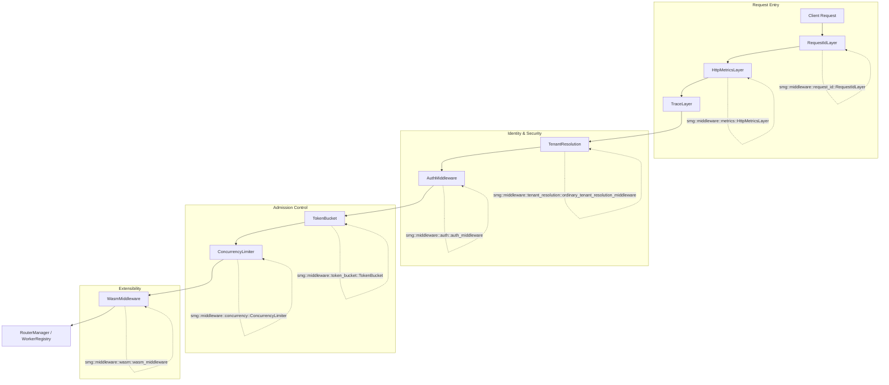
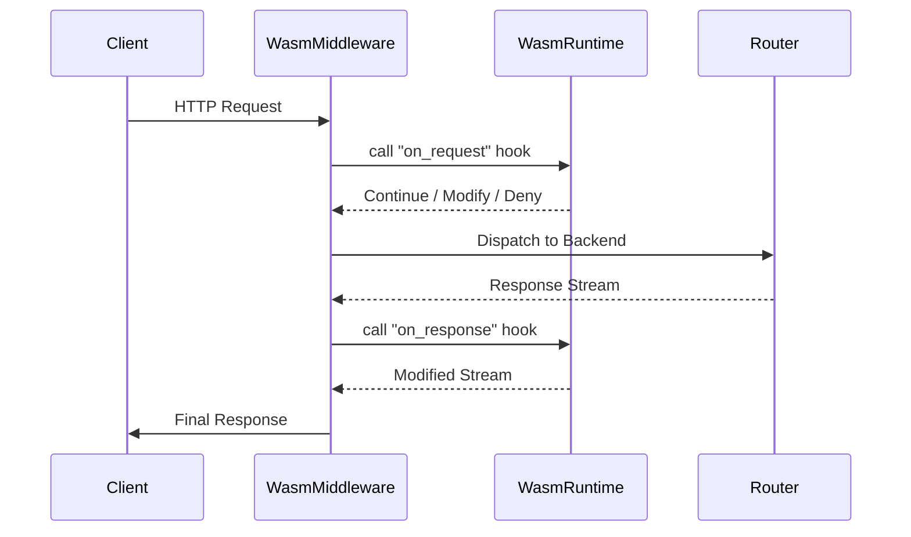

<!-- source: DeepWiki mcp.deepwiki.com · repo smg-project/smg · page 8 Middleware and Extensibility · fetched 2026-10-21 -->

# Middleware and Extensibility

Relevant source files

The following files were used as context for generating this wiki page:

- [docs/reference/api/openai.md](docs/reference/api/openai.md)
- [model_gateway/benches/wasm_middleware_latency.rs](model_gateway/benches/wasm_middleware_latency.rs)
- [model_gateway/src/middleware/auth.rs](model_gateway/src/middleware/auth.rs)
- [model_gateway/src/middleware/concurrency.rs](model_gateway/src/middleware/concurrency.rs)
- [model_gateway/src/middleware/logging.rs](model_gateway/src/middleware/logging.rs)
- [model_gateway/src/middleware/metrics.rs](model_gateway/src/middleware/metrics.rs)
- [model_gateway/src/middleware/mod.rs](model_gateway/src/middleware/mod.rs)
- [model_gateway/src/middleware/storage_context.rs](model_gateway/src/middleware/storage_context.rs)
- [model_gateway/src/middleware/token_bucket.rs](model_gateway/src/middleware/token_bucket.rs)
- [model_gateway/src/middleware/wasm.rs](model_gateway/src/middleware/wasm.rs)
- [model_gateway/src/observability/gauge_histogram.rs](model_gateway/src/observability/gauge_histogram.rs)
- [model_gateway/src/observability/otel_trace.rs](model_gateway/src/observability/otel_trace.rs)
- [model_gateway/tests/common/mod.rs](model_gateway/tests/common/mod.rs)
- [model_gateway/tests/common/test_app.rs](model_gateway/tests/common/test_app.rs)
- [model_gateway/tests/routing/test_pd_routing.rs](model_gateway/tests/routing/test_pd_routing.rs)
- [model_gateway/tests/wasm_test.rs](model_gateway/tests/wasm_test.rs)

The SMG middleware stack provides a unified request processing pipeline for both HTTP and gRPC traffic. It handles cross-cutting concerns such as authentication, observability, admission control, and dynamic extensibility via WebAssembly (WASM). The stack is built using the `tower` and `axum` ecosystems, allowing for modular and composable request handling.

## Middleware Pipeline Architecture

The middleware stack is organized into layers that wrap the core routing logic. These layers handle the request lifecycle from initial entry to final response streaming.

### Natural Language to Code Entity Space

The following diagram maps high-level middleware concepts to their specific implementation entities within the `smg` codebase.

**Middleware Entity Mapping**

**Sources:** [model_gateway/src/middleware/mod.rs:7-30](), [model_gateway/src/server.rs:133-143]()

---

## Core Middleware Components

### 1. Identity and Tenant Resolution
SMG uses a multi-tenant architecture where every request is associated with a `TenantIdentity`. The `ordinary_tenant_resolution_middleware` resolves the caller's identity, which is then used for rate limiting and routing policies.
*   **Tenant Resolution**: Maps API keys or headers to a specific tenant ID.
*   **Authentication**: Validates credentials using constant-time safe lookups via SHA-256 hashing.
*   **Principal Model**: The `DataPlaneCaller` extension is injected into the request context to carry identity information through the stack.

For details, see [Authentication and Authorization](#8.2).

**Sources:** [model_gateway/src/middleware/auth.rs:25-74](), [model_gateway/src/middleware/tenant_resolution.rs:26-28]()

### 2. Admission Control and Scheduling
SMG implements a two-tier system to protect backend workers from overload and ensure fair resource distribution.
*   **Rate Limiting**: Uses a `TokenBucket` algorithm to enforce per-tenant and per-model request rates.
*   **Concurrency Management**: The `ConcurrencyLimiter` and `PriorityScheduler` manage active request slots, supporting different priority classes (System, Interactive, Default, Bulk).

For details, see [Rate Limiting and Priority Scheduler](#8.3).

**Sources:** [model_gateway/src/middleware/token_bucket.rs:1-10](), [model_gateway/src/middleware/concurrency.rs:19-21]()

### 3. Observability and Logging
The middleware stack integrates deeply with SMG's observability suite to provide high-cardinality metrics and distributed tracing.
*   **Metrics**: `HttpMetricsLayer` records request duration, status codes, and in-flight counts. It uses `matched_path_label` to collapse dynamic routes (e.g., `/v1/responses/{id}`) into static templates to prevent metric cardinality explosion.
*   **Tracing**: Wires `tower_http::trace::TraceLayer` to propagate W3C trace contexts and record HTTP-level events in OpenTelemetry.
*   **Request ID**: `RequestIdLayer` ensures every request has a unique identifier (e.g., `x-request-id`) for log correlation across the mesh.

**Sources:** [model_gateway/src/middleware/metrics.rs:29-50](), [model_gateway/src/middleware/logging.rs:20-49](), [model_gateway/src/middleware/request_id.rs:24-25]()

---

## Extensibility via WASM

SMG provides a powerful plugin system based on WebAssembly (WASM). This allows users to inject custom logic into the request/response pipeline without recompiling the gateway.

**WASM Plugin Integration**

*   **Attach Points**: Plugins can hook into `OnRequest`, `OnResponse`, `OnError`, and `StorageHook`.
*   **Isolation**: Plugins run in a sandboxed environment managed by `WasmModuleManager`, utilizing `wasmtime` with epoch-based interruption for safety.
*   **Dynamic Loading**: Modules can be added or removed at runtime via the Control Plane API.

For details, see [WASM Middleware Plugins](#8.1).

**Sources:** [model_gateway/src/middleware/wasm.rs:1-30](), [model_gateway/tests/wasm_test.rs:26-33]()

---

## Summary Table: Middleware Stack

| Layer | Component | Responsibility |
| :--- | :--- | :--- |
| **Observability** | `RequestIdLayer` | Assigns/propagates unique request correlation IDs. |
| **Observability** | `HttpMetricsLayer` | Records L1 metrics (latency, status, throughput). |
| **Security** | `AuthMiddleware` | Validates API keys/JWTs; populates `DataPlaneCaller`. |
| **Admission** | `TokenBucket` | Enforces tenant-level rate limits (RPS/RPM). |
| **Admission** | `ConcurrencyLimiter` | Prevents gateway exhaustion via slot-based queuing. |
| **Extensibility** | `WasmMiddleware` | Executes user-defined logic at specific lifecycle hooks. |
| **Context** | `StorageContext` | Injects database handles for chat history persistence. |

**Sources:** [model_gateway/src/middleware/mod.rs:18-30](), [model_gateway/src/server.rs:133-143]()

---

