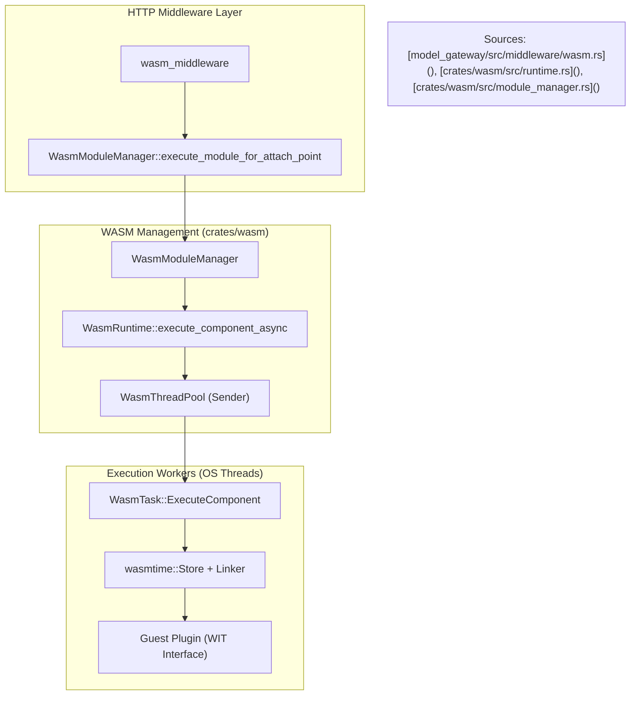

<!-- source: DeepWiki mcp.deepwiki.com · repo smg-project/smg · page 8.1 WASM Middleware Plugins · fetched 2026-10-21 -->

# WASM Middleware Plugins

<details>
<summary>Relevant source files</summary>

The following files were used as context for generating this wiki page:

- [crates/auth/src/config.rs](crates/auth/src/config.rs)
- [crates/auth/src/jwt.rs](crates/auth/src/jwt.rs)
- [crates/auth/src/middleware.rs](crates/auth/src/middleware.rs)
- [crates/wasm/src/module.rs](crates/wasm/src/module.rs)
- [crates/wasm/src/module_manager.rs](crates/wasm/src/module_manager.rs)
- [crates/wasm/src/runtime.rs](crates/wasm/src/runtime.rs)
- [crates/wasm/src/storage_hook.rs](crates/wasm/src/storage_hook.rs)
- [crates/wasm/src/types.rs](crates/wasm/src/types.rs)
- [docs/reference/api/openai.md](docs/reference/api/openai.md)
- [model_gateway/benches/wasm_instantiation.rs](model_gateway/benches/wasm_instantiation.rs)
- [model_gateway/benches/wasm_middleware_latency.rs](model_gateway/benches/wasm_middleware_latency.rs)
- [model_gateway/src/middleware/auth.rs](model_gateway/src/middleware/auth.rs)
- [model_gateway/src/middleware/mod.rs](model_gateway/src/middleware/mod.rs)
- [model_gateway/src/workflow/wasm_module_registration.rs](model_gateway/src/workflow/wasm_module_registration.rs)
- [model_gateway/tests/common/mod.rs](model_gateway/tests/common/mod.rs)
- [model_gateway/tests/common/test_app.rs](model_gateway/tests/common/test_app.rs)
- [model_gateway/tests/routing/test_pd_routing.rs](model_gateway/tests/routing/test_pd_routing.rs)
- [model_gateway/tests/wasm_test.rs](model_gateway/tests/wasm_test.rs)

</details>


The SMG (Shepherd Model Gateway) WASM extensibility system provides a high-performance, sandboxed environment for executing custom logic at various stages of the request lifecycle. By leveraging the **WebAssembly Component Model**, SMG allows developers to inject middleware for authentication, logging, rate-limiting, and data persistence without modifying the core Rust codebase.

## System Architecture

The WASM subsystem is built around a multi-threaded execution environment using `wasmtime` with a pooling allocator to minimize instantiation overhead.

### WasmRuntime and Pooling
The `WasmRuntime` manages a dedicated `WasmThreadPool` to isolate WASM execution from the main Tokio request-handling threads [crates/wasm/src/runtime.rs:37-56](). 

Key features include:
*   **Pooling Allocation**: Uses `PoolingAllocationConfig` to pre-allocate memory for instances, significantly reducing the cost of `instantiate_async` [model_gateway/benches/wasm_instantiation.rs:60-74]().
*   **Epoch Interruption**: Implements cooperative multi-tasking and timeout enforcement via WASM epochs. If a plugin exceeds its execution deadline, the runtime triggers a `Trap::Interrupt` [crates/wasm/src/runtime.rs:162-171]().
*   **LRU Component Caching**: Compiled `wasmtime::component::Component` objects are cached by their SHA256 hash to avoid redundant compilation of the same module [crates/wasm/src/runtime.rs:58-70]().

### WasmModuleManager
The `WasmModuleManager` acts as the central registry for all active plugins. It maps `Uuid` identifiers to `WasmModule` objects and routes requests to the `WasmRuntime` based on configured attach points [crates/wasm/src/module_manager.rs:22-31]().

### Diagram: WASM Execution Flow
This diagram maps the high-level request flow to the internal code entities responsible for WASM execution.



## Attach Points

Plugins can be attached to specific hooks in the request lifecycle, defined by the `WasmModuleAttachPoint` enum [crates/wasm/src/module.rs]().

| Attach Point | Description | Data Passed to Plugin |
| :--- | :--- | :--- |
| `OnRequest` | Triggered before routing. Can modify headers or reject requests. | Headers, Method, URI, Body (if enabled) |
| `OnResponse` | Triggered after the backend returns a response. | Status Code, Headers, Response Body |
| `OnError` | Triggered when a request fails (e.g., backend timeout). | Error Message, Status Code |
| `StorageHook` | Triggered during chat history persistence. | Conversation Metadata, Message Content |

**Sources:** [crates/wasm/src/module.rs](), [crates/wasm/src/runtime.rs:104-111]()

## The WIT Interface

SMG uses the **WebAssembly Interface Type (WIT)** to define the contract between the gateway (host) and the plugin (guest). The interface is defined in `crates/wasm/wit/smg.wit`.

Plugins must implement functions corresponding to their attach points. For example, a middleware plugin implements the `smg:gateway/middleware` interface, which returns an `Action`:
*   **Continue**: Proceed to the next middleware or backend.
*   **Reject**: Terminate the request with a specific status code and body.
*   **Transform**: Modify the request/1response and proceed.

**Sources:** [crates/wasm/src/module_manager.rs:18-20](), [crates/wasm/src/types.rs]()

## Registration Workflow

Adding a WASM plugin to a running SMG instance involves a multi-step registration workflow managed by the `WasmRegistrationWorkflow` [model_gateway/src/workflow/wasm_module_registration.rs]().

### Diagram: Module Registration Steps
This diagram shows the sequence of `StepExecutor` implementations that validate and load a new module.

```mermaid
sequenceDiagram
    participant API as "POST /wasm"
    participant WF as "WasmRegistrationWorkflow"
    participant V as "ValidateDescriptorStep"
    participant L as "LoadModuleStep"
    participant R as "RegisterModuleStep"
    participant M as "WasmModuleManager"

    API->>WF: WasmModuleAddRequest
    WF->>V: execute()
    Note over V: Check absolute path, .wasm extension,<br/>and blocked prefixes (/etc, /proc)
    V-->>WF: Success
    WF->>L: execute()
    Note over L: Read bytes, calculate SHA256,<br/>pre-compile Component
    L-->>WF: Success
    WF->>R: execute()
    R->>M: register_module_internal()
    M-->>WF: Success
    WF-->>API: WasmModuleAddResponse (UUID)

    Sources["Sources: [model_gateway/src/workflow/wasm_module_registration.rs](), [crates/wasm/src/module_manager.rs:52-59]()"]
```

### Security Constraints
The `ValidateDescriptorStep` enforces strict security boundaries for loading local files:
*   **Absolute Paths Only**: Prevents ambiguity in file location [model_gateway/src/workflow/wasm_module_registration.rs:97-105]().
*   **Path Traversal Prevention**: Rejects any path containing `..` or `.` [model_gateway/src/workflow/wasm_module_registration.rs:108-129]().
*   **Blocked Prefixes**: Prevents reading sensitive system files like `/etc/passwd` or `/proc/self/environ` [model_gateway/src/workflow/wasm_module_registration.rs:32-50]().
*   **Symlink Resolution**: Re-validates the path after `canonicalize()` to ensure symlinks don't point to blocked directories [model_gateway/src/workflow/wasm_module_registration.rs:167-188]().

## Performance and Latency

WASM middleware introduces minimal overhead due to the pooling strategy.

*   **Cold Start**: The first request for a module includes compilation time via `Component::new` [model_gateway/benches/wasm_instantiation.rs:120-146]().
*   **Steady State**: Subsequent requests only pay for `Store` creation and `instantiate_async`, which are microsecond-scale operations when using the pooling allocator [model_gateway/benches/wasm_instantiation.rs:150-173]().
*   **Memory Limits**: Each module is constrained by a configurable memory limit (default 64MB) to prevent resource exhaustion [model_gateway/benches/wasm_instantiation.rs:84-97]().

**Sources:** [model_gateway/benches/wasm_middleware_latency.rs](), [model_gateway/benches/wasm_instantiation.rs]()

## Example Plugin Implementations

### 1. Custom Auth Plugin
Attached to `OnRequest`. It inspects the `Authorization` header and compares it against an external database or service. If invalid, it returns `Action::Reject(401)`.

### 2. Storage Hook
Attached to `StorageHook`. This plugin intercepts chat completions before they are saved to the `ConversationStorage`. It can be used for PII redacting or logging messages to an external audit trail [crates/wasm/src/storage_hook.rs]().

### 3. Rate Limiting
Attached to `OnRequest`. It tracks usage per `TenantIdentity` and returns `Action::Reject(429)` if the quota is exceeded, allowing for more complex logic than the standard token-bucket limiter.

**Sources:** [model_gateway/tests/wasm_test.rs](), [crates/wasm/src/module.rs]()

---

