<!-- source: DeepWiki mcp.deepwiki.com · repo smg-project/smg · page 8.2 Authentication and Authorization · fetched 2026-10-21 -->

# Authentication and Authorization

Relevant source files

The following files were used as context for generating this wiki page:

- [bindings/golang/src/proto_parse.rs](bindings/golang/src/proto_parse.rs)
- [bindings/golang/src/utils.rs](bindings/golang/src/utils.rs)
- [crates/auth/src/config.rs](crates/auth/src/config.rs)
- [crates/auth/src/jwt.rs](crates/auth/src/jwt.rs)
- [crates/auth/src/middleware.rs](crates/auth/src/middleware.rs)
- [crates/protocols/src/messages.rs](crates/protocols/src/messages.rs)
- [crates/tokenizer/src/huggingface.rs](crates/tokenizer/src/huggingface.rs)
- [crates/wasm/src/module.rs](crates/wasm/src/module.rs)
- [crates/wasm/src/module_manager.rs](crates/wasm/src/module_manager.rs)
- [crates/wasm/src/runtime.rs](crates/wasm/src/runtime.rs)
- [crates/wasm/src/storage_hook.rs](crates/wasm/src/storage_hook.rs)
- [crates/wasm/src/types.rs](crates/wasm/src/types.rs)
- [docs/getting-started/logging.md](docs/getting-started/logging.md)
- [model_gateway/benches/wasm_instantiation.rs](model_gateway/benches/wasm_instantiation.rs)
- [model_gateway/src/middleware/concurrency.rs](model_gateway/src/middleware/concurrency.rs)
- [model_gateway/src/middleware/logging.rs](model_gateway/src/middleware/logging.rs)
- [model_gateway/src/middleware/metrics.rs](model_gateway/src/middleware/metrics.rs)
- [model_gateway/src/middleware/storage_context.rs](model_gateway/src/middleware/storage_context.rs)
- [model_gateway/src/middleware/tenant_resolution.rs](model_gateway/src/middleware/tenant_resolution.rs)
- [model_gateway/src/middleware/token_bucket.rs](model_gateway/src/middleware/token_bucket.rs)
- [model_gateway/src/middleware/wasm.rs](model_gateway/src/middleware/wasm.rs)
- [model_gateway/src/observability/gauge_histogram.rs](model_gateway/src/observability/gauge_histogram.rs)
- [model_gateway/src/observability/otel_trace.rs](model_gateway/src/observability/otel_trace.rs)
- [model_gateway/src/routers/grpc/regular/stages/chat/preparation.rs](model_gateway/src/routers/grpc/regular/stages/chat/preparation.rs)
- [model_gateway/src/routers/grpc/regular/stages/messages/preparation.rs](model_gateway/src/routers/grpc/regular/stages/messages/preparation.rs)
- [model_gateway/src/routers/grpc/utils/chat_utils.rs](model_gateway/src/routers/grpc/utils/chat_utils.rs)
- [model_gateway/src/routers/grpc/utils/message_utils.rs](model_gateway/src/routers/grpc/utils/message_utils.rs)
- [model_gateway/src/routers/grpc/utils/mod.rs](model_gateway/src/routers/grpc/utils/mod.rs)
- [model_gateway/src/routers/grpc/utils/parsers.rs](model_gateway/src/routers/grpc/utils/parsers.rs)
- [model_gateway/src/workflow/wasm_module_registration.rs](model_gateway/src/workflow/wasm_module_registration.rs)
- [model_gateway/tests/api/mod.rs](model_gateway/tests/api/mod.rs)

The Authentication and Authorization system in SMG (Shepherd Model Gateway) is implemented as a multi-layered middleware stack. It handles tenant identification, credential validation, and the establishment of security principals for downstream request routing and rate limiting.

## Overview of the Auth Stack

The authentication pipeline is designed to be pluggable and extensible, supporting standard API keys, JWT/OIDC tokens, and internal control plane authentication. The system resolves a request into a `Principal` model which carries tenant information and permission scopes.

### Data Flow and Code Entities

The following diagram maps the logical authentication flow to the specific code entities and files that implement them.

**Diagram: Auth Middleware Pipeline**

```mermaid
graph TD
    subgraph "Middleware Stack [model_gateway/src/middleware/]"
        A["Request"] --> B["TenantResolutionLayer"]
        B --> C["AuthLayer (crates/auth)"]
    end

    subgraph "Auth Logic [crates/auth/src/]"
        C --> D{"Auth Strategy"}
        D -- "API Key" --> E["ApiKeyValidator"]
        D -- "JWT/OIDC" --> F["JwtValidator"]
        D -- "Control Plane" --> G["ControlPlaneAuth"]
        
        E --> H["Principal Model"]
        F --> H
        G --> H
    end

    subgraph "Validation Detail"
        E -- "Constant-time" --> I["secure_compare"]
        F -- "Replay Protection" --> J["JTI Cache"]
    end

    H --> K["Downstream Services"]
```

**Sources:** `[crates/auth/src/middleware.rs:1-50]()`, `[model_gateway/src/middleware/tenant_resolution.rs:1-30]()`.

## Tenant Resolution

Before authentication occurs, the system must identify which tenant the request belongs to. This is handled by the `TenantResolutionLayer`.

*   **Mechanism**: It inspects incoming HTTP headers (typically `X-Tenant-Id` or subdomains) to determine the organizational context.
*   **Storage**: The resolved tenant ID is placed into the request extensions, allowing subsequent auth middleware to fetch tenant-specific keys or JWT public keys.

**Sources:** `[model_gateway/src/middleware/tenant_resolution.rs:10-45]()`.

## Authentication Strategies

### 1. API Key Validation
The gateway supports simple API key authentication. To prevent timing attacks, the system employs constant-time comparison when validating keys against the configured store.

*   **Implementation**: The `ApiKeyValidator` retrieves the expected key for the resolved tenant and compares it using the `subtle` crate or equivalent constant-time logic.
*   **Function**: `validate_api_key` in `crates/auth/src/lib.rs`.

**Sources:** `[crates/auth/src/config.rs:10-60]()`.

### 2. JWT and OIDC Validation
For identity-provider based auth, the `JwtValidator` processes Bearer tokens.

*   **JTI Replay Protection**: To prevent replay attacks, the middleware tracks `jti` (JWT ID) claims in a short-lived cache (often backed by Redis or the Mesh KV). If a `jti` is reused within its expiration window, the request is rejected.
*   **Key Discovery**: Supports OIDC discovery endpoints to rotate public keys automatically.
*   **Validation Steps**:
    1.  Signature verification.
    2.  Expiration (`exp`) and Not Before (`nbf`) checks.
    3.  Audience (`aud`) and Issuer (`iss`) matching.

**Sources:** `[crates/auth/src/jwt.rs:5-120]()`.

### 3. Control Plane Authentication
Administrative endpoints (e.g., `/workers`, `/wasm`) require elevated privileges.

*   **Internal Principal**: Requests originating from the Control Plane or authenticated via a master administrative key are assigned a principal with `Internal` or `Admin` scopes.
*   **Source**: Defined in `crates/auth/src/middleware.rs`.

**Sources:** `[crates/auth/src/middleware.rs:80-110]()`.

## The Principal Model

The result of a successful authentication is a `Principal` struct, which is injected into the Axum/Tower request extensions.

| Field | Type | Description |
| :--- | :--- | :--- |
| `tenant_id` | `String` | The unique identifier for the tenant. |
| `user_id` | `Option<String>` | The specific user identifier (from JWT `sub` or API key metadata). |
| `scopes` | `Vec<String>` | List of permissions (e.g., `models:read`, `inference:create`). |
| `auth_method` | `AuthMethod` | Enum: `ApiKey`, `Jwt`, or `Internal`. |

**Sources:** `[crates/auth/src/middleware.rs:20-45]()`.

## Code Entry Points

The following table lists the primary files and functions responsible for the Authentication and Authorization logic.

| Logic Component | File Path | Key Symbol |
| :--- | :--- | :--- |
| Auth Middleware | `crates/auth/src/middleware.rs` | `AuthLayer` |
| JWT Logic | `crates/auth/src/jwt.rs` | `validate_jwt_token` |
| Principal Definition | `crates/auth/src/middleware.rs` | `struct Principal` |
| Token Replay Check | `crates/auth/src/jwt.rs` | `check_jti_replay` |
| API Key Config | `crates/auth/src/config.rs` | `AuthConfig` |

**Sources:** `[crates/auth/src/middleware.rs:1-150]()`, `[crates/auth/src/jwt.rs:1-200]()`, `[crates/auth/src/config.rs:1-100]()`.

## Integration with WASM Plugins

Authentication can be extended via WASM plugins using the `OnRequest` attach point.

*   **Custom Auth**: Users can compile Rust/Go to WASM and register a plugin that performs custom header validation or lookups against external databases.
*   **Storage Hook**: Plugins can use the `StorageHook` to interact with the gateway's persistence layer during the auth phase.

**Sources:** `[crates/wasm/src/runtime.rs:50-120]()`, `[crates/wasm/src/storage_hook.rs:1-40]()`.

## Security Considerations

1.  **Constant-Time Comparison**: All API key comparisons use `secure_compare` to mitigate side-channel attacks.
2.  **Context Propagation**: The `Principal` is propagated through the `RequestContext` in gRPC routers to ensure downstream stages (like tool parsing) respect tenant boundaries.
3.  **Logging**: Sensitive credentials are never logged. The `RequestLogger` in `model_gateway/src/middleware/logging.rs` explicitly skips authorization headers.

**Sources:** `[model_gateway/src/middleware/logging.rs:55-75]()`, `[model_gateway/src/routers/grpc/context.rs:10-50]()`.

---

