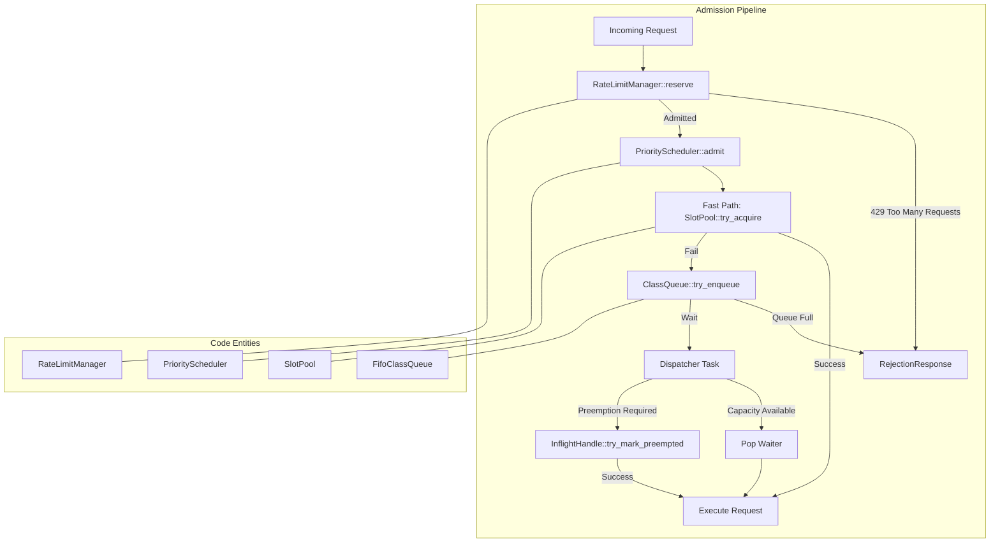
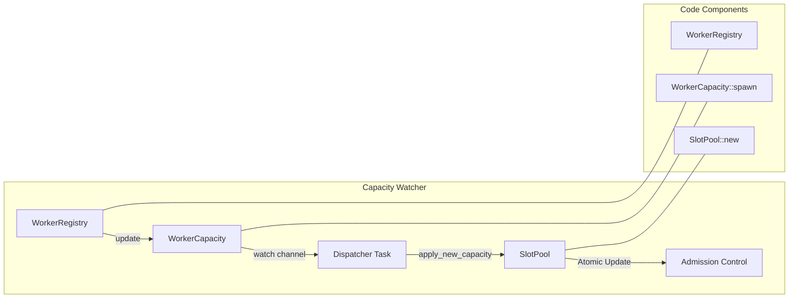

<!-- source: DeepWiki mcp.deepwiki.com · repo smg-project/smg · page 8.3 Rate Limiting and Priority Scheduler · fetched 2026-10-21 -->

# Rate Limiting and Priority Scheduler

Relevant source files

The following files were used as context for generating this wiki page:

- [crates/auth/src/lib.rs](crates/auth/src/lib.rs)
- [docs/concepts/reliability/index.md](docs/concepts/reliability/index.md)
- [docs/concepts/reliability/priority-scheduling.md](docs/concepts/reliability/priority-scheduling.md)
- [docs/reference/priority-scheduler.md](docs/reference/priority-scheduler.md)
- [model_gateway/benches/scheduler_admission.rs](model_gateway/benches/scheduler_admission.rs)
- [model_gateway/benches/scheduler_load.rs](model_gateway/benches/scheduler_load.rs)
- [model_gateway/src/middleware/scheduler/admission.rs](model_gateway/src/middleware/scheduler/admission.rs)
- [model_gateway/src/middleware/scheduler/body.rs](model_gateway/src/middleware/scheduler/body.rs)
- [model_gateway/src/middleware/scheduler/class.rs](model_gateway/src/middleware/scheduler/class.rs)
- [model_gateway/src/middleware/scheduler/config.rs](model_gateway/src/middleware/scheduler/config.rs)
- [model_gateway/src/middleware/scheduler/engine.rs](model_gateway/src/middleware/scheduler/engine.rs)
- [model_gateway/src/middleware/scheduler/error.rs](model_gateway/src/middleware/scheduler/error.rs)
- [model_gateway/src/middleware/scheduler/extract.rs](model_gateway/src/middleware/scheduler/extract.rs)
- [model_gateway/src/middleware/scheduler/inflight.rs](model_gateway/src/middleware/scheduler/inflight.rs)
- [model_gateway/src/middleware/scheduler/metrics.rs](model_gateway/src/middleware/scheduler/metrics.rs)
- [model_gateway/src/middleware/scheduler/mod.rs](model_gateway/src/middleware/scheduler/mod.rs)
- [model_gateway/src/middleware/scheduler/policy.rs](model_gateway/src/middleware/scheduler/policy.rs)
- [model_gateway/src/middleware/scheduler/queue.rs](model_gateway/src/middleware/scheduler/queue.rs)
- [model_gateway/src/middleware/scheduler/slots.rs](model_gateway/src/middleware/scheduler/slots.rs)
- [model_gateway/src/middleware/scheduler/state.rs](model_gateway/src/middleware/scheduler/state.rs)
- [model_gateway/src/rate_limit/backend.rs](model_gateway/src/rate_limit/backend.rs)
- [model_gateway/src/rate_limit/bucket.rs](model_gateway/src/rate_limit/bucket.rs)
- [model_gateway/src/rate_limit/config.rs](model_gateway/src/rate_limit/config.rs)
- [model_gateway/src/rate_limit/local_backend.rs](model_gateway/src/rate_limit/local_backend.rs)
- [model_gateway/src/rate_limit/manager.rs](model_gateway/src/rate_limit/manager.rs)
- [model_gateway/src/rate_limit/mod.rs](model_gateway/src/rate_limit/mod.rs)
- [model_gateway/src/rate_limit/policy.rs](model_gateway/src/rate_limit/policy.rs)
- [model_gateway/src/rate_limit/rejection.rs](model_gateway/src/rate_limit/rejection.rs)
- [model_gateway/src/rate_limit/reservation.rs](model_gateway/src/rate_limit/reservation.rs)
- [model_gateway/tests/scheduler_admission_test.rs](model_gateway/tests/scheduler_admission_test.rs)

SMG implements a two-layer admission control system designed to protect backend inference engines from overload while ensuring fair access and strict prioritization of critical traffic. The system consists of a per-tenant/per-model **Rate Limiter** and a global **Priority Scheduler**.

## 1. Rate Limiting

The Rate Limiting layer provides multi-tenant quota management based on Tokens-Per-Minute (TPM) and Requests-Per-Minute (RPM) [model_gateway/src/rate_limit/config.rs:20-32](). It is designed to be the first line of defense, rejecting traffic before it consumes scheduling resources.

### 1.1. Policy Hierarchy and Matching
Policies are defined in a YAML configuration and compiled into an immutable `CompiledPolicySet` for $O(1)$ lookup [model_gateway/src/rate_limit/policy.rs:96-99]().
1.  **Tenant Lookup**: The system resolves a `TenantKey` (e.g., `auth:team-red`) and fetches the associated `CompiledTenantPolicy`. If not found, it falls back to the `default` policy [model_gateway/src/rate_limit/policy.rs:121-124]().
2.  **Model Rules**: Within a tenant, specific rules can be applied based on the `model` field of the request.
    *   **Exact Match**: Highest priority [model_gateway/src/rate_limit/policy.rs:45-47]().
    *   **Prefix Match**: Longest prefix wins among multiple matches [model_gateway/src/rate_limit/policy.rs:48-52]().
3.  **Non-Stacking**: Rules do not stack; only the most specific matching rule (or the tenant global limit) applies to a request [model_gateway/src/rate_limit/policy.rs:41-43]().

### 1.2. Token-Bucket Implementation
The `ScopeBucket` uses continuous-refill float counters [model_gateway/src/rate_limit/bucket.rs:30-41](). Unlike standard rate limiters, SMG supports a **Reserve/Settle** workflow:
*   **Reserve**: Before admission, SMG reserves a estimated amount of tokens (e.g., based on `max_tokens`) [model_gateway/src/rate_limit/backend.rs:16-24]().
*   **Settle**: Once the inference completes, the `SharedReservationHandle` trues up the actual usage, allowing for "debt" if the completion exceeded the reservation [model_gateway/src/rate_limit/reservation.rs:56-62]().
*   **Abandonment**: If a client disconnects during streaming, the `ReservationAttachment` RAII guard ensures the reservation is not leaked [model_gateway/src/rate_limit/reservation.rs:95-109]().

**Sources:** [model_gateway/src/rate_limit/config.rs](), [model_gateway/src/rate_limit/policy.rs](), [model_gateway/src/rate_limit/bucket.rs](), [model_gateway/src/rate_limit/reservation.rs]()

---

## 2. Priority Scheduler

The `PriorityScheduler` manages the gateway's total concurrency capacity. It organizes traffic into four priority classes: `System`, `Interactive`, `Default`, and `Bulk` [model_gateway/src/middleware/scheduler/class.rs:1-15]().

### 2.1. SlotPool and Capacity Management
The `SlotPool` tracks available concurrency using packed atomics. Capacity is dynamic and scales based on the live worker fleet reported by the `WorkerRegistry` [model_gateway/src/middleware/scheduler/state.rs:92-97]().

| Class | Purpose | Default Floor | Default Share | Preempts? |
| :--- | :--- | :--- | :--- | :--- |
| **System** | Internal probes, high-priority admin | 32 | 0% | Yes |
| **Interactive** | UI-driven, low-latency requests | 128 | 25% | Yes |
| **Default** | Standard API traffic | 0 | 10% | No |
| **Bulk** | Offline processing, batch jobs | 0 | 0% | No |

*Table data sourced from [model_gateway/src/middleware/scheduler/config.rs:50-85]().*

### 2.2. Preemption and TTFT Awareness
Higher-priority classes (`System`, `Interactive`) can preempt lower-priority requests to acquire slots immediately [model_gateway/src/middleware/scheduler/config.rs:40-44]().
*   **TTFT Guard**: A request is only "preemptible" if it has not yet emitted its first byte (Time-To-First-Token) [model_gateway/src/middleware/scheduler/inflight.rs:99-101]().
*   **Race Resolution**: The `InflightHandle` uses a sentinel value (`u64::MAX`) in an `AtomicU64` to resolve races between the scheduler attempting preemption and the response body starting to stream [model_gateway/src/middleware/scheduler/inflight.rs:110-119]().
*   **Victim Selection**: The scheduler prefers preempting the most recently admitted request in a lower class to minimize wasted compute [model_gateway/src/middleware/scheduler/inflight.rs:36-38]().

### 2.3. Starvation Prevention
To prevent low-priority `Bulk` requests from being indefinitely delayed, the scheduler implements a starvation threshold. If the head of a queue exceeds its `starvation_threshold_secs`, the dispatcher promotes it out of normal priority order [model_gateway/src/middleware/scheduler/config.rs:36-39]().

**Sources:** [model_gateway/src/middleware/scheduler/engine.rs](), [model_gateway/src/middleware/scheduler/slots.rs](), [model_gateway/src/middleware/scheduler/inflight.rs](), [model_gateway/src/middleware/scheduler/config.rs]()

---

## 3. System Architecture and Data Flow

### 3.1. Request Admission Flow
The following diagram traces a request through the admission middleware.

**Sources:** [model_gateway/src/middleware/scheduler/engine.rs:173-180](), [model_gateway/src/rate_limit/manager.rs](), [model_gateway/src/middleware/scheduler/queue.rs]()

### 3.2. Dynamic Capacity Scaling
The scheduler maintains a background task that watches the worker fleet for changes in total concurrency.

**Sources:** [model_gateway/src/middleware/scheduler/state.rs:92-114](), [model_gateway/src/middleware/scheduler/slots.rs]()

## 4. Key Implementation Details

### 4.1. The Inflight Registry
The scheduler maintains a `HashMap<RequestId, Arc<InflightHandle>>` protected by a `RwLock` [model_gateway/src/middleware/scheduler/engine.rs:81](). This registry allows the dispatcher to iterate over active requests during preemption events or capacity dips.

### 4.2. SlotPool Atomic Packing
To ensure high-performance admission, the `SlotPool` uses a packed atomic representation of class counters. This allows the scheduler to check multiple reservation floors and the global capacity limit in a single `compare_exchange` loop, minimizing lock contention [model_gateway/src/middleware/scheduler/slots.rs]().

### 4.3. Middleware Integration
The scheduler is injected into the Axum pipeline via `priority_admission_middleware` [model_gateway/src/middleware/scheduler/admission.rs](). It attaches a `SchedulerPermit` to the request extensions, which contains the `InflightHandle` used for TTFT tracking and eventual slot release [model_gateway/src/middleware/scheduler/engine.rs:50]().

**Sources:** [model_gateway/src/middleware/scheduler/engine.rs](), [model_gateway/src/middleware/scheduler/inflight.rs](), [model_gateway/src/middleware/scheduler/admission.rs]()

---

