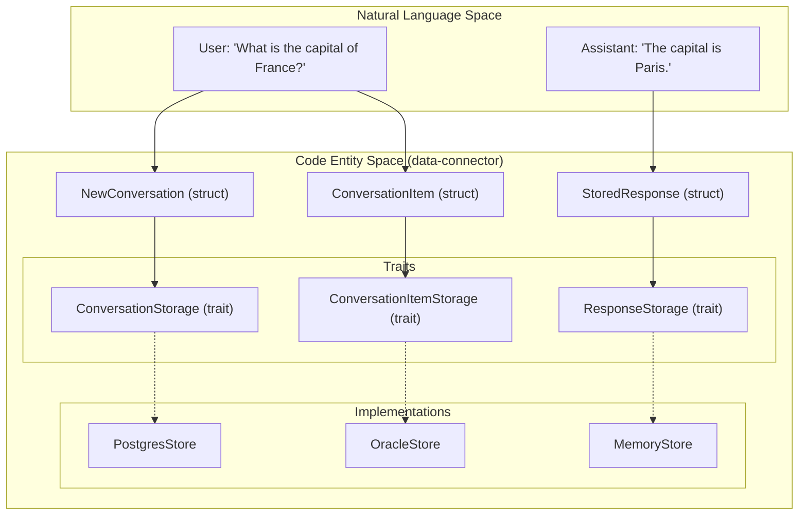
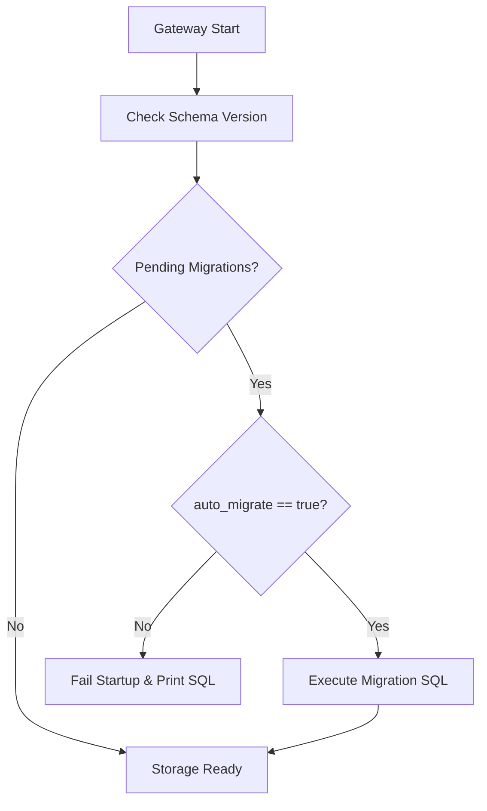

<!-- source: DeepWiki mcp.deepwiki.com · repo smg-project/smg · page 9 Data Persistence (Chat History) · fetched 2026-10-21 -->

# Data Persistence (Chat History)

<details>
<summary>Relevant source files</summary>

The following files were used as context for generating this wiki page:

- [crates/data_connector/Cargo.toml](crates/data_connector/Cargo.toml)
- [crates/data_connector/README.md](crates/data_connector/README.md)
- [crates/data_connector/src/common.rs](crates/data_connector/src/common.rs)
- [crates/data_connector/src/core.rs](crates/data_connector/src/core.rs)
- [crates/data_connector/src/hooked.rs](crates/data_connector/src/hooked.rs)
- [crates/data_connector/src/lib.rs](crates/data_connector/src/lib.rs)
- [crates/data_connector/src/memory.rs](crates/data_connector/src/memory.rs)
- [crates/data_connector/src/noop.rs](crates/data_connector/src/noop.rs)
- [crates/data_connector/src/oracle.rs](crates/data_connector/src/oracle.rs)
- [crates/data_connector/src/oracle_migrations.rs](crates/data_connector/src/oracle_migrations.rs)
- [crates/data_connector/src/postgres.rs](crates/data_connector/src/postgres.rs)
- [crates/data_connector/src/postgres_migrations.rs](crates/data_connector/src/postgres_migrations.rs)
- [crates/data_connector/src/redis.rs](crates/data_connector/src/redis.rs)
- [crates/data_connector/src/schema.rs](crates/data_connector/src/schema.rs)
- [crates/data_connector/tests/postgres_integration.rs](crates/data_connector/tests/postgres_integration.rs)
- [crates/kv_index/Cargo.toml](crates/kv_index/Cargo.toml)
- [scripts/ci_agentic_svc_deps.sh](scripts/ci_agentic_svc_deps.sh)
- [scripts/k8s-runner-resources/agentic-services.yaml](scripts/k8s-runner-resources/agentic-services.yaml)
- [scripts/oracle_flyway/schema-config.yaml](scripts/oracle_flyway/schema-config.yaml)
- [scripts/tests/test_ci_agentic_svc_deps.sh](scripts/tests/test_ci_agentic_svc_deps.sh)

</details>


The `data-connector` crate provides a pluggable abstraction layer for persisting chat history, conversation state, and model responses. It supports multiple backends ranging from ephemeral in-memory storage for testing to production-grade relational databases like PostgreSQL and Oracle.

## Architecture Overview

The persistence layer is built around three core traits that define the CRUD operations for different data entities. This design allows the rest of the gateway to remain agnostic of the underlying storage technology.

### Core Storage Traits

| Trait | Responsibility | Key Entities |
| :--- | :--- | :--- |
| `ConversationStorage` | Manages top-level conversation containers and metadata. | `Conversation`, `ConversationId` |
| `ConversationItemStorage` | Manages individual messages or events within a conversation. | `ConversationItem`, `ConversationItemId` |
| `ResponseStorage` | Persists raw model outputs, tool calls, and execution metadata. | `StoredResponse`, `ResponseId` |

Sources: [crates/data_connector/src/core.rs:132-148](), [crates/data_connector/src/core.rs:225-250](), [crates/data_connector/src/core.rs:324-345]()

### Storage Data Flow

The following diagram illustrates how a request flows from the "Natural Language Space" (User Input) into the "Code Entity Space" (Persistence Layer).

**Diagram: Request to Persistence Mapping**



Sources: [crates/data_connector/src/core.rs:85-91](), [crates/data_connector/src/core.rs:176-184](), [crates/data_connector/src/core.rs:294-307](), [crates/data_connector/src/factory.rs:12-45]()

---

## Supported Backends

SMG supports five primary backends, configured via the `HistoryBackend` enum.

| Backend | Implementation Class | Use Case |
| :--- | :--- | :--- |
| **Memory** | `MemoryConversationStorage` | Local development, CI testing, and ephemeral sessions. |
| **Postgres** | `PostgresStore` | Production-grade relational storage with JSONB support. |
| **Oracle** | `OracleStore` | Enterprise-grade storage, often used with Oracle ATP. |
| **Redis** | `RedisStore` | High-performance, low-latency key-value storage. |
| **None** | `NoopStorage` | Disables persistence entirely for privacy or performance. |

Sources: [crates/data_connector/src/lib.rs:8-14](), [crates/data_connector/src/config.rs:12-25]()

### Backend Initialization
The `StorageBundle` is the primary container for the three storage implementations. It is typically created using the `create_storage` factory function, which consumes a `StorageFactoryConfig`.

Sources: [crates/data_connector/src/factory.rs:12-25](), [crates/data_connector/src/factory.rs:47-60]()

---

## Schema Configuration and Remapping

The `SchemaConfig` allows users to map logical code entities to physical database tables and columns. This is particularly useful when integrating SMG into existing database schemas.

### TableConfig and Column Mapping
Each table (Conversations, Responses, etc.) can be customized via `TableConfig`.

*   **`table`**: The physical table name.
*   **`columns`**: A map of `logical_name -> db_column_name`.
*   **`skip_columns`**: Columns to omit from SQL generation (e.g., if a legacy schema lacks a specific field).
*   **`extra_columns`**: Definitions for custom columns not present in the standard SMG schema.

Sources: [crates/data_connector/src/schema.rs:47-69](), [crates/data_connector/src/schema.rs:125-127]()

### Example: Oracle Flyway Integration
In environments where schemas are managed by external tools like Flyway, `SchemaConfig` can be used to align SMG with the managed names.

```yaml
# Example schema-config.yaml for Oracle
version: 3
auto_migrate: false
conversations:
  table: CONVERSATIONS
  columns:
    id: CONVERSATION_ID
  extra_columns:
    EXPIRES_AT:
      sql_type: "TIMESTAMP WITH TIME ZONE"
```

Sources: [scripts/oracle_flyway/schema-config.yaml:1-17]()

---

## Database Migration Management

SMG includes a built-in migration system for SQL backends (Postgres and Oracle).

1.  **Version Tracking**: The gateway tracks the current schema version in the database.
2.  **Idempotency**: Migrations use `IF NOT EXISTS` (Postgres) or PL/SQL exception handling (Oracle) to ensure they can be safely re-run.
3.  **Automatic vs. Manual**: Controlled by the `auto_migrate` flag. If `false`, the gateway will fail to start if pending migrations are detected, printing the required SQL.

**Migration Logic Flow**



Sources: [crates/data_connector/src/schema.rs:32-38](), [crates/data_connector/src/postgres.rs:54-68](), [crates/data_connector/src/oracle_migrations.rs:10-28](), [crates/data_connector/src/postgres_migrations.rs:10-29]()

---

## Advanced Extensibility

### Extra Columns
Users can define `extra_columns` in the `SchemaConfig`. These columns are populated at runtime via `RequestContext`. This is commonly used for auditing (e.g., `tenant_id`, `request_source`).

Sources: [crates/data_connector/src/schema.rs:72-81](), [crates/data_connector/src/context.rs:17-30]()

### WASM Storage Hooks
The `HookedStorage` wrapper allows WASM plugins to intercept storage operations.
*   **`BeforeHook`**: Executed before the database operation. Can modify data or abort the operation.
*   **`AfterHook`**: Executed after a successful database operation. Useful for logging or triggering external events.

Sources: [crates/data_connector/src/hooks.rs:48-60](), [crates/data_connector/src/hooked.rs:15-30]()

### Connection Pooling
For Postgres and Redis, SMG uses `deadpool` to manage connection pools, ensuring efficient resource utilization under high concurrency.

Sources: [crates/data_connector/Cargo.toml:30-35](), [crates/data_connector/src/postgres.rs:33-51]()

---

