# Page: Overview

# Overview

<details>
<summary>Relevant source files</summary>

The following files were used as context for generating this wiki page:

- [.github/workflows/release-sglang-docker.yml](.github/workflows/release-sglang-docker.yml)
- [.github/workflows/release-trtllm-docker.yml](.github/workflows/release-trtllm-docker.yml)
- [.github/workflows/release-vllm-docker.yml](.github/workflows/release-vllm-docker.yml)
- [Cargo.toml](Cargo.toml)
- [README.md](README.md)
- [bindings/golang/Cargo.toml](bindings/golang/Cargo.toml)
- [bindings/python/Cargo.toml](bindings/python/Cargo.toml)
- [bindings/python/pyproject.toml](bindings/python/pyproject.toml)
- [bindings/python/src/lib.rs](bindings/python/src/lib.rs)
- [bindings/python/src/smg/router_args.py](bindings/python/src/smg/router_args.py)
- [bindings/python/tests/test_arg_parser.py](bindings/python/tests/test_arg_parser.py)
- [crates/grpc_client/Cargo.toml](crates/grpc_client/Cargo.toml)
- [crates/multimodal/Cargo.toml](crates/multimodal/Cargo.toml)
- [crates/protocols/Cargo.toml](crates/protocols/Cargo.toml)
- [crates/reasoning_parser/Cargo.toml](crates/reasoning_parser/Cargo.toml)
- [crates/tokenizer/Cargo.toml](crates/tokenizer/Cargo.toml)
- [crates/tool_parser/Cargo.toml](crates/tool_parser/Cargo.toml)
- [docs/assets/images/architecture-animated.svg](docs/assets/images/architecture-animated.svg)
- [docs/assets/images/concepts-overview.svg](docs/assets/images/concepts-overview.svg)
- [docs/assets/images/mcp-architecture.svg](docs/assets/images/mcp-architecture.svg)
- [docs/assets/images/wasm-plugins.svg](docs/assets/images/wasm-plugins.svg)
- [docs/assets/stylesheets/extra.css](docs/assets/stylesheets/extra.css)
- [docs/concepts/index.md](docs/concepts/index.md)
- [docs/concepts/routing/load-balancing.md](docs/concepts/routing/load-balancing.md)
- [docs/contributing/index.md](docs/contributing/index.md)
- [docs/getting-started/index.md](docs/getting-started/index.md)
- [docs/index.md](docs/index.md)
- [docs/reference/api/admin.md](docs/reference/api/admin.md)
- [docs/reference/api/extensions.md](docs/reference/api/extensions.md)
- [docs/reference/api/responses.md](docs/reference/api/responses.md)
- [docs/reference/configuration.md](docs/reference/configuration.md)
- [mkdocs.yml](mkdocs.yml)
- [model_gateway/Cargo.toml](model_gateway/Cargo.toml)
- [model_gateway/src/app_context.rs](model_gateway/src/app_context.rs)
- [model_gateway/src/config/builder.rs](model_gateway/src/config/builder.rs)
- [model_gateway/src/config/types.rs](model_gateway/src/config/types.rs)
- [model_gateway/src/config/validation.rs](model_gateway/src/config/validation.rs)
- [model_gateway/src/main.rs](model_gateway/src/main.rs)
- [model_gateway/src/policies/factory.rs](model_gateway/src/policies/factory.rs)
- [model_gateway/src/policies/mod.rs](model_gateway/src/policies/mod.rs)
- [model_gateway/src/policies/registry.rs](model_gateway/src/policies/registry.rs)
- [model_gateway/src/server.rs](model_gateway/src/server.rs)

</details>


Shepherd Model Gateway (SMG) is a high-performance, engine-agnostic inference gateway written in Rust. It is designed to centralize the management of large-scale LLM (Large Language Model) deployments by providing a unified, OpenAI-compatible API layer over diverse backend engines such as **vLLM**, **SGLang**, **TensorRT-LLM**, and various cloud providers [README.md:19-33]().

SMG specializes in maximizing GPU utilization through **cache-aware routing**, which tracks the KV cache state of inference engines to reuse prefixes and minimize redundant computation [README.md:27-29]().

## Key Capabilities

*   **Multi-Backend Support**: Connects to self-hosted engines (vLLM, SGLang, TRT-LLM) and cloud providers (OpenAI, Anthropic, Gemini, Bedrock) [README.md:76-85]().
*   **Advanced Load Balancing**: Supports 8+ routing policies, including `cache_aware`, `least_load`, and `consistent_hashing` [bindings/python/src/lib.rs:11-22]().
*   **Protocol Disaggregation**: Implements PD (Prefill-Decode) and EPD (Encode-Prefill-Decode) disaggregation to optimize resource usage for different inference stages [model_gateway/src/main.rs:116-123]().
*   **Resilience**: Built-in circuit breakers, retries with exponential backoff, and multi-tenant rate limiting [model_gateway/src/config/types.rs:109-110]().
*   **Extensibility**: Middleware support via **WebAssembly (WASM)** and integration with the **Model Context Protocol (MCP)** for agentic tool use [model_gateway/src/config/types.rs:155-159]().

## System Architecture

SMG operates as a high-throughput data plane between clients and inference workers. The core logic is encapsulated in the `smg` crate (located in `model_gateway/`), which orchestrates several specialized workspace crates.

### Codebase Topology

The workspace is organized into functional crates that handle specific aspects of the LLM request lifecycle:

| Crate | Purpose |
| :--- | :--- |
| `model_gateway` | The main `smg` binary and core routing logic [model_gateway/Cargo.toml:2-5](). |
| `llm-tokenizer` | Zero-copy tokenization and Jinja2 template rendering [Cargo.toml:12-12](). |
| `reasoning-parser` | Extracts "thinking" blocks from models like DeepSeek-R1 [Cargo.toml:9-9](). |
| `tool-parser` | Detects and parses function-call syntax from model streams [Cargo.toml:10-10](). |
| `smg-mesh` | SWIM-based gossip protocol for High Availability [Cargo.toml:19-19](). |
| `smg-wasm` | Runtime for custom middleware plugins [Cargo.toml:18-18](). |

### Request Flow: Natural Language to Code Entities

The following diagram illustrates how a request transitions from a network packet to a routed inference task within the codebase.

**Request Processing Pipeline**
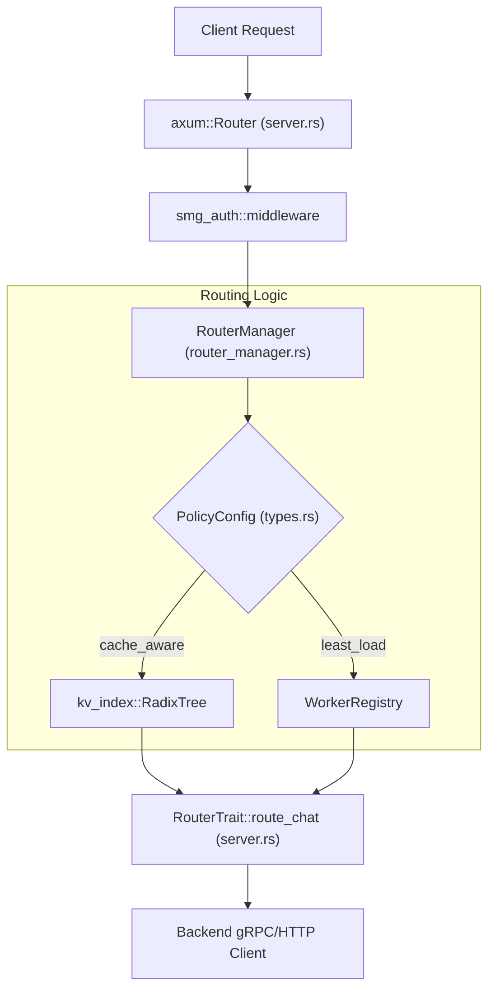
Sources: [model_gateway/src/server.rs:156-170](), [model_gateway/src/config/types.rs:20-21](), [Cargo.toml:15-15]()

## Core Subsystems

### 1. Router and Policy Engine
The `RouterManager` is the central coordinator for routing decisions. It uses the `PolicyConfig` to determine which `Worker` should handle a request. For details on how traffic is distributed, see [Request Routing](#2).

### 2. Worker Management
SMG tracks the health and load of backend workers through a `WorkerRegistry`. It supports dynamic discovery via Kubernetes or manual registration via the Control Plane API. For details on worker lifecycles, see [Worker Management](#4).

### 3. High Availability Mesh
In multi-gateway deployments, SMG instances form a mesh using `smg-mesh`. This allows gateways to share KV cache state and worker load information via a gossip protocol. For details, see [High Availability Mesh](#7).

**Mesh State Synchronization**
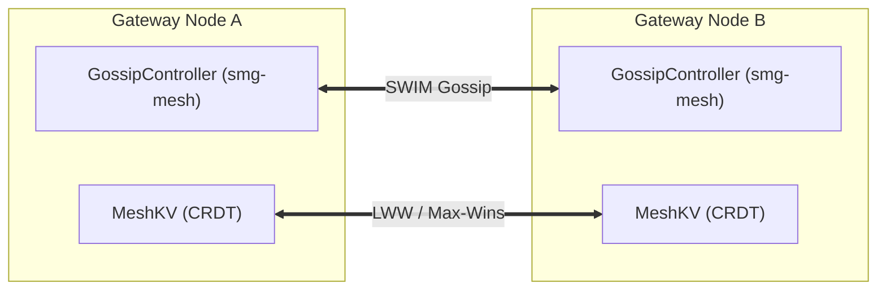
Sources: [Cargo.toml:19-19](), [model_gateway/src/server.rs:75-76]()

## Navigation

*   [Getting Started](#1.1) — Installation, configuration, and first-run setup.
*   [Architecture Overview](#1.2) — Deep dive into the internal request lifecycle and crate relationships.
*   [Request Routing](#2) — Detailed exploration of routing policies and disaggregated modes.
*   [API Reference](#3) — Documentation for OpenAI-compatible and administrative endpoints.
*   [Worker Management](#4) — Discovery, health checks, and backend servicers.
*   [MCP (Model Context Protocol) Integration](#6) — Connecting agentic workflows to external tools.

Sources: [README.md:103-108](), [model_gateway/src/server.rs:13-14](), [model_gateway/src/main.rs:142-149]()

---

# Page: Getting Started

# Getting Started

<details>
<summary>Relevant source files</summary>

The following files were used as context for generating this wiki page:

- [README.md](README.md)
- [bindings/python/README.md](bindings/python/README.md)
- [bindings/python/src/lib.rs](bindings/python/src/lib.rs)
- [bindings/python/src/smg/cli.py](bindings/python/src/smg/cli.py)
- [bindings/python/src/smg/launch_router.py](bindings/python/src/smg/launch_router.py)
- [bindings/python/src/smg/router.py](bindings/python/src/smg/router.py)
- [bindings/python/src/smg/router_args.py](bindings/python/src/smg/router_args.py)
- [bindings/python/src/smg/serve.py](bindings/python/src/smg/serve.py)
- [bindings/python/tests/conftest.py](bindings/python/tests/conftest.py)
- [bindings/python/tests/test_arg_parser.py](bindings/python/tests/test_arg_parser.py)
- [bindings/python/tests/test_cli.py](bindings/python/tests/test_cli.py)
- [bindings/python/tests/test_router_config.py](bindings/python/tests/test_router_config.py)
- [bindings/python/tests/test_serve.py](bindings/python/tests/test_serve.py)
- [bindings/python/tests/test_startup_sequence.py](bindings/python/tests/test_startup_sequence.py)
- [bindings/python/tests/test_validation.py](bindings/python/tests/test_validation.py)
- [docs/assets/images/architecture-animated.svg](docs/assets/images/architecture-animated.svg)
- [docs/assets/images/concepts-overview.svg](docs/assets/images/concepts-overview.svg)
- [docs/assets/images/mcp-architecture.svg](docs/assets/images/mcp-architecture.svg)
- [docs/assets/images/wasm-plugins.svg](docs/assets/images/wasm-plugins.svg)
- [docs/assets/stylesheets/extra.css](docs/assets/stylesheets/extra.css)
- [docs/concepts/index.md](docs/concepts/index.md)
- [docs/concepts/routing/load-balancing.md](docs/concepts/routing/load-balancing.md)
- [docs/contributing/index.md](docs/contributing/index.md)
- [docs/getting-started/index.md](docs/getting-started/index.md)
- [docs/index.md](docs/index.md)
- [docs/reference/api/admin.md](docs/reference/api/admin.md)
- [docs/reference/api/extensions.md](docs/reference/api/extensions.md)
- [docs/reference/api/responses.md](docs/reference/api/responses.md)
- [docs/reference/configuration.md](docs/reference/configuration.md)
- [mkdocs.yml](mkdocs.yml)
- [model_gateway/src/app_context.rs](model_gateway/src/app_context.rs)
- [model_gateway/src/config/builder.rs](model_gateway/src/config/builder.rs)
- [model_gateway/src/config/types.rs](model_gateway/src/config/types.rs)
- [model_gateway/src/config/validation.rs](model_gateway/src/config/validation.rs)
- [model_gateway/src/main.rs](model_gateway/src/main.rs)
- [model_gateway/src/policies/factory.rs](model_gateway/src/policies/factory.rs)
- [model_gateway/src/policies/mod.rs](model_gateway/src/policies/mod.rs)
- [model_gateway/src/policies/registry.rs](model_gateway/src/policies/registry.rs)
- [model_gateway/src/server.rs](model_gateway/src/server.rs)

</details>


The Shepherd Model Gateway (SMG) is a high-performance, engine-agnostic model-routing gateway designed for large-scale LLM deployments. It centralizes worker lifecycle management and provides a unified OpenAI-compatible API across diverse backends like vLLM, SGLang, and TensorRT-LLM [README.md:19-23]().

## Installation

SMG can be installed via Docker, Python (PyPI), or Rust (Cargo).

| Method | Command |
| :--- | :--- |
| **Docker** | `docker pull lightseekorg/smg:latest` |
| **Python** | `pip install smg` |
| **Rust** | `cargo install smg` |

**Sources:** [README.md:39-50]()

---

## Launching SMG

SMG provides two primary CLI entry points for starting the gateway: `smg launch` and `smg serve`.

### 1. `smg launch` (Gateway Only)
The `launch` command starts the Rust gateway process. It assumes inference workers (e.g., vLLM instances) are already running and reachable via network URLs [model_gateway/src/main.rs:108-115]().

**Basic Usage:**
```bash
smg launch --worker-urls http://localhost:8000 --policy cache_aware
```

### 2. `smg serve` (All-in-One)
The `serve` command is a Python-based orchestrator that simplifies local development and single-node scaling. It performs a "two-pass" argument parse:
1.  **Orchestrator Pass**: Configures the number of workers (`--dp-size`), GPU partitioning, and gateway settings [bindings/python/src/smg/serve.py:1-5]().
2.  **Backend Pass**: Lazily imports and validates arguments for the specific inference engine (vLLM, SGLang, or TRT-LLM) [bindings/python/src/smg/serve.py:246-260]().

**Basic Usage:**
```bash
# Launch 2 vLLM workers, automatically partitioned across available GPUs
smg serve --backend vllm --model /path/to/model --dp-size 2
```

**Sources:** [README.md:52-64](), [model_gateway/src/main.rs:108-132](), [bindings/python/src/smg/serve.py:1-22]()

---

## Configuration Overview

SMG uses a hierarchical configuration system where CLI arguments override environment variables, which in turn override defaults [docs/reference/configuration.md:11-18]().

### Key Global Options
Defined in `RouterConfig` [model_gateway/src/config/types.rs:15-17]():

| Parameter | CLI Flag | Default | Description |
| :--- | :--- | :--- | :--- |
| **Host** | `--host` | `0.0.0.0` | Interface to bind the gateway [model_gateway/src/main.rs:161-162](). |
| **Port** | `--port` | `30000` | Port for the OpenAI-compatible API [model_gateway/src/main.rs:165-166](). |
| **Policy** | `--policy` | `cache_aware` | Load balancing strategy [model_gateway/src/main.rs:187-188](). |
| **Health Port** | `--health-check-port`| `None` | Isolated port for K8s probes to prevent starvation [model_gateway/src/main.rs:178-179](). |

### Load Balancing Policies
SMG supports 8+ routing policies. The `cache_aware` policy is recommended for LLM workloads to maximize KV cache reuse [docs/reference/configuration.md:81-92]().

*   `cache_aware`: Routes based on Radix-tree prefix matching of the prompt [model_gateway/src/config/builder.rs:120-137]().
*   `power_of_two`: Selects two random workers and picks the one with the least load [model_gateway/src/config/builder.rs:141-146]().
*   `consistent_hashing`: Ensures session affinity for specific request keys [bindings/python/src/lib.rs:20]().

**Sources:** [model_gateway/src/config/types.rs:15-149](), [model_gateway/src/main.rs:158-200](), [docs/reference/configuration.md:68-92]()

---

## Backend Setup (smg serve)

The `ServeOrchestrator` manages the lifecycle of backend subprocesses and partitions GPUs using `CUDA_VISIBLE_DEVICES` [bindings/python/src/smg/serve.py:58-88]().

### Data Flow: `smg serve` Initialization
This diagram bridges the CLI command to the internal Python launcher classes and the Rust gateway startup.

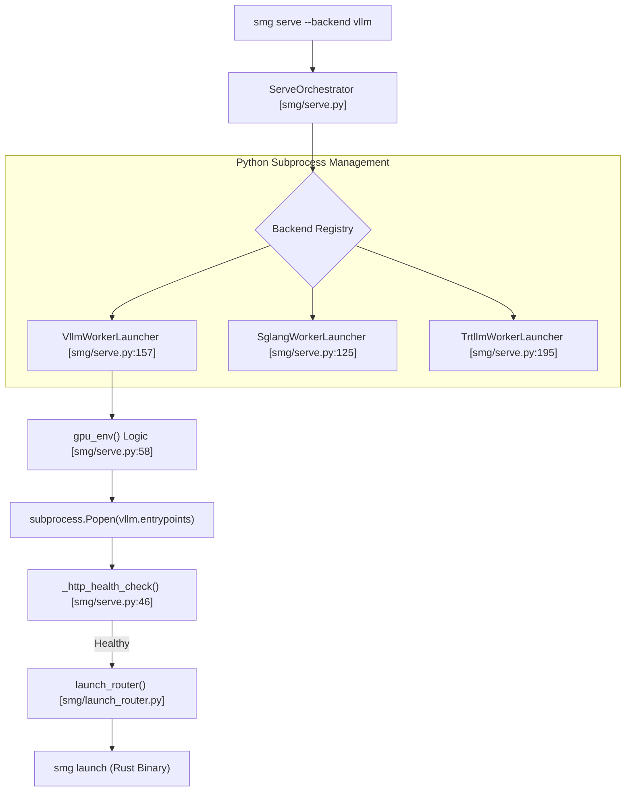
**Sources:** [bindings/python/src/smg/serve.py:32-200](), [bindings/python/src/smg/launch_router.py:21]()

### Backend-Specific Details

| Backend | Connection | Command Implementation |
| :--- | :--- | :--- |
| **vLLM** | HTTP/gRPC | `vllm.entrypoints.openai.api_server` [bindings/python/src/smg/serve.py:169-170]() |
| **SGLang** | HTTP/gRPC | `sglang.launch_server` [bindings/python/src/smg/serve.py:137]() |
| **TRT-LLM** | gRPC Only | `tensorrt_llm.commands.serve` [bindings/python/src/smg/serve.py:204]() |

---

## First Run Setup

### Prefill-Decode (PD) Disaggregation
SMG supports disaggregating Prefill and Decode phases to different GPU clusters. Use the `--pd-disaggregation` flag along with specific worker lists [model_gateway/src/main.rs:117-122]().

```bash
smg launch --pd-disaggregation \
  --prefill http://prefill-gpu:8000 \
  --decode http://decode-gpu-1:8000 http://decode-gpu-2:8000 \
  --policy cache_aware
```

### AppContext Initialization
Internally, SMG initializes an `AppContext` which holds the shared state, including the `WorkerRegistry`, `TokenizerRegistry`, and `RouterManager` [model_gateway/src/app_context.rs:52-83]().

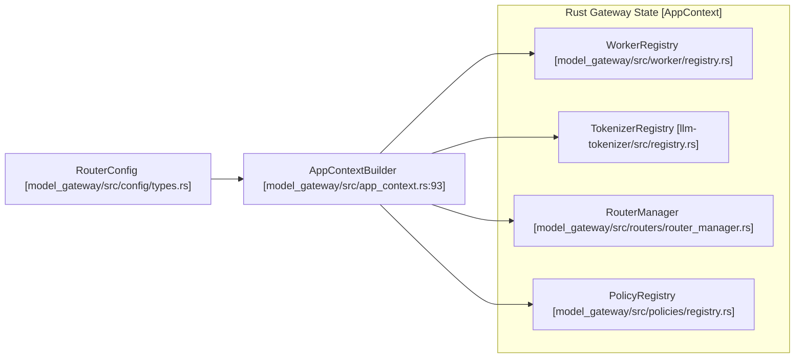

**Sources:** [model_gateway/src/app_context.rs:52-143](), [model_gateway/src/server.rs:70-81](), [model_gateway/src/main.rs:117-130]()

---

# Page: Architecture Overview

# Architecture Overview

<details>
<summary>Relevant source files</summary>

The following files were used as context for generating this wiki page:

- [.github/workflows/release-sglang-docker.yml](.github/workflows/release-sglang-docker.yml)
- [.github/workflows/release-trtllm-docker.yml](.github/workflows/release-trtllm-docker.yml)
- [.github/workflows/release-vllm-docker.yml](.github/workflows/release-vllm-docker.yml)
- [Cargo.toml](Cargo.toml)
- [README.md](README.md)
- [bindings/golang/Cargo.toml](bindings/golang/Cargo.toml)
- [bindings/python/Cargo.toml](bindings/python/Cargo.toml)
- [bindings/python/pyproject.toml](bindings/python/pyproject.toml)
- [bindings/python/src/lib.rs](bindings/python/src/lib.rs)
- [bindings/python/src/smg/router_args.py](bindings/python/src/smg/router_args.py)
- [bindings/python/tests/test_arg_parser.py](bindings/python/tests/test_arg_parser.py)
- [crates/grpc_client/Cargo.toml](crates/grpc_client/Cargo.toml)
- [crates/multimodal/Cargo.toml](crates/multimodal/Cargo.toml)
- [crates/protocols/Cargo.toml](crates/protocols/Cargo.toml)
- [crates/reasoning_parser/Cargo.toml](crates/reasoning_parser/Cargo.toml)
- [crates/tokenizer/Cargo.toml](crates/tokenizer/Cargo.toml)
- [crates/tool_parser/Cargo.toml](crates/tool_parser/Cargo.toml)
- [docs/assets/images/architecture-animated.svg](docs/assets/images/architecture-animated.svg)
- [docs/assets/images/architecture-detailed.svg](docs/assets/images/architecture-detailed.svg)
- [docs/assets/images/concepts-overview.svg](docs/assets/images/concepts-overview.svg)
- [docs/assets/images/mcp-architecture.svg](docs/assets/images/mcp-architecture.svg)
- [docs/assets/images/wasm-plugins.svg](docs/assets/images/wasm-plugins.svg)
- [docs/assets/stylesheets/extra.css](docs/assets/stylesheets/extra.css)
- [docs/concepts/architecture/grpc-pipeline.md](docs/concepts/architecture/grpc-pipeline.md)
- [docs/concepts/architecture/high-availability.md](docs/concepts/architecture/high-availability.md)
- [docs/concepts/architecture/overview.md](docs/concepts/architecture/overview.md)
- [docs/concepts/architecture/service-discovery.md](docs/concepts/architecture/service-discovery.md)
- [docs/concepts/extensibility/mcp.md](docs/concepts/extensibility/mcp.md)
- [docs/concepts/extensibility/wasm-plugins.md](docs/concepts/extensibility/wasm-plugins.md)
- [docs/concepts/index.md](docs/concepts/index.md)
- [docs/concepts/performance/tokenizer-caching.md](docs/concepts/performance/tokenizer-caching.md)
- [docs/concepts/reliability/circuit-breakers.md](docs/concepts/reliability/circuit-breakers.md)
- [docs/concepts/reliability/graceful-shutdown.md](docs/concepts/reliability/graceful-shutdown.md)
- [docs/concepts/reliability/health-checks.md](docs/concepts/reliability/health-checks.md)
- [docs/concepts/reliability/rate-limiting.md](docs/concepts/reliability/rate-limiting.md)
- [docs/concepts/routing/cache-aware.md](docs/concepts/routing/cache-aware.md)
- [docs/concepts/routing/load-balancing.md](docs/concepts/routing/load-balancing.md)
- [docs/concepts/routing/pd-disaggregation.md](docs/concepts/routing/pd-disaggregation.md)
- [docs/contributing/index.md](docs/contributing/index.md)
- [docs/getting-started/index.md](docs/getting-started/index.md)
- [docs/getting-started/pd-disaggregation.md](docs/getting-started/pd-disaggregation.md)
- [docs/index.md](docs/index.md)
- [docs/reference/api/admin.md](docs/reference/api/admin.md)
- [docs/reference/api/extensions.md](docs/reference/api/extensions.md)
- [docs/reference/api/responses.md](docs/reference/api/responses.md)
- [docs/reference/configuration.md](docs/reference/configuration.md)
- [docs/reference/index.md](docs/reference/index.md)
- [mkdocs.yml](mkdocs.yml)
- [model_gateway/Cargo.toml](model_gateway/Cargo.toml)
- [model_gateway/src/app_context.rs](model_gateway/src/app_context.rs)
- [model_gateway/src/config/builder.rs](model_gateway/src/config/builder.rs)
- [model_gateway/src/config/types.rs](model_gateway/src/config/types.rs)
- [model_gateway/src/config/validation.rs](model_gateway/src/config/validation.rs)
- [model_gateway/src/main.rs](model_gateway/src/main.rs)
- [model_gateway/src/policies/factory.rs](model_gateway/src/policies/factory.rs)
- [model_gateway/src/policies/mod.rs](model_gateway/src/policies/mod.rs)
- [model_gateway/src/policies/registry.rs](model_gateway/src/policies/registry.rs)
- [model_gateway/src/server.rs](model_gateway/src/server.rs)

</details>


Shepherd Model Gateway (SMG) is a high-performance, engine-agnostic inference gateway written in Rust. It serves as a centralized control and data plane for large-scale LLM deployments, providing unified OpenAI-compatible APIs while managing complex backend topologies like Prefill-Decode (PD) disaggregation and multi-node mesh networking.

## System Topology

SMG is architected as a transparent proxy that sits between clients and inference engines (vLLM, SGLang, TensorRT-LLM). It separates concerns into a **Control Plane** for management and a **Data Plane** for high-throughput request routing.

### Data Plane vs. Control Plane

| Plane | Responsibility | Key Components |
|:---|:---|:---|
| **Data Plane** | Request routing, protocol translation, streaming response processing, and load balancing. | `RouterManager`, `RouterTrait`, `PriorityScheduler`, `TokenizerRegistry` |
| **Control Plane** | Worker registration, health monitoring, service discovery, and configuration management. | `WorkerManager`, `WorkerRegistry`, `ServiceDiscovery`, `GossipController` |

### Request Lifecycle

The lifecycle of a request follows a pipeline designed for minimum latency and zero-copy where possible:

1.  **Ingress**: Requests arrive via `axum` (HTTP) or `tonic` (gRPC).
2.  **Middleware**: Authentication via `smg-auth` [crates/auth/Cargo.toml:13-13](), followed by admission control in the `PriorityScheduler` [model_gateway/src/config/types.rs:84-85]().
3.  **Routing**: The `RouterManager` [model_gateway/src/server.rs:59-59]() selects a `Router` based on the `RoutingMode` (Regular, PD, or EPD).
4.  **Load Balancing**: A `Policy` (e.g., `cache_aware`) selects the optimal `Worker` from the `WorkerRegistry`.
5.  **Dispatch**: The request is forwarded via the `smg-grpc-client` [model_gateway/src/config/types.rs:81-81]() or HTTP.
6.  **Egress Processing**: Streaming outputs are parsed for reasoning blocks (`reasoning-parser`) or tool calls (`tool-parser`) before being returned to the client.

### Request Flow Diagram

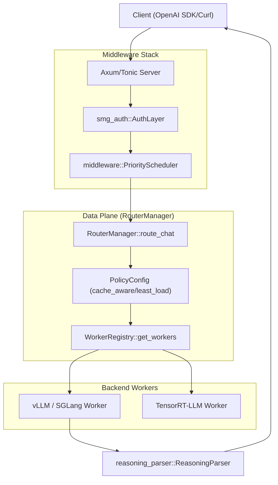
**Sources:** [model_gateway/src/server.rs:156-170](), [model_gateway/src/config/types.rs:20-20](), [model_gateway/src/app_context.rs:1-1]()

---

## Connection Modes: gRPC vs. HTTP

SMG supports two primary modes of operation for interacting with backends, configured via `ConnectionMode` [model_gateway/src/config/types.rs:19-19]().

### 1. HTTP Mode
In HTTP mode, SMG acts as a standard Layer 7 proxy. It is best suited for routing to cloud providers (OpenAI, Anthropic) or legacy inference servers.
*   **Implementation**: Uses `reqwest` [model_gateway/Cargo.toml:61-61]() for backend communication.
*   **Protocol**: Standard OpenAI REST API.

### 2. gRPC Mode (Harmony)
The gRPC mode uses a native high-performance pipeline. This mode is required for advanced features like PD disaggregation and cache-aware routing.
*   **Implementation**: Uses `smg-grpc-client` [model_gateway/Cargo.toml:81-81]() and the `openai-harmony` protocol [model_gateway/Cargo.toml:119-119]().
*   **Capabilities**: Supports `GetLoads` RPCs for real-time KV cache pressure monitoring and `SubscribeKvEvents` for prefix-matching synchronization.

**Sources:** [model_gateway/src/config/builder.rs:150-163](), [model_gateway/src/config/types.rs:18-20]()

---

## Workspace Crate Architecture

The SMG codebase is organized into a modular Rust workspace to separate protocol logic from the core gateway.

| Crate | Path | Description |
|:---|:---|:---|
| `smg` | `model_gateway/` | The main binary and orchestration logic. |
| `openai-protocol` | `crates/protocols/` | Shared types for OpenAI-compatible requests/responses. |
| `kv-index` | `crates/kv_index/` | Radix-tree implementation for cache-aware routing. |
| `llm-tokenizer` | `crates/tokenizer/` | Multi-backend tokenizer (HuggingFace, tiktoken). |
| `smg-mesh` | `crates/mesh/` | SWIM-based gossip protocol for High Availability. |
| `smg-wasm` | `crates/wasm/` | Runtime for WebAssembly middleware plugins. |
| `llm-multimodal` | `crates/multimodal/` | Tensor processing for images/video/audio. |

### Crate Dependency Diagram

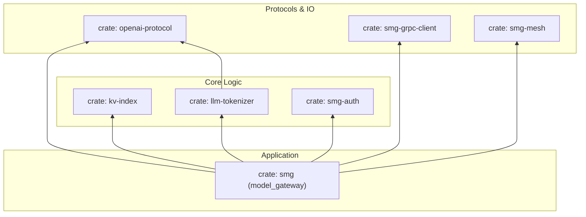
**Sources:** [Cargo.toml:1-20](), [model_gateway/Cargo.toml:67-81]()

---

## High Availability and Mesh

For multi-gateway deployments, SMG implements a mesh networking layer using `smg-mesh` [model_gateway/Cargo.toml:80-80](). This allows multiple SMG instances to synchronize state without a centralized database.

*   **Gossip Protocol**: Uses a SWIM-like protocol via `MeshServerBuilder` [model_gateway/src/server.rs:42-42]() to discover peers and monitor node health.
*   **State Sync**: Propagates worker registrations and KV cache state across the cluster using CRDT-based synchronization in `MeshAdapters` [model_gateway/src/server.rs:50-50]().
*   **Isolation**: A dedicated `health_check_port` [model_gateway/src/main.rs:178-179]() can be used to isolate Kubernetes liveness/readiness probes from the main request runtime, preventing false negatives during high load.

**Sources:** [model_gateway/src/server.rs:75-76](), [model_gateway/src/config/types.rs:26-30](), [README.md:61-64]()

---

# Page: Request Routing

# Request Routing

<details>
<summary>Relevant source files</summary>

The following files were used as context for generating this wiki page:

- [model_gateway/src/routers/factory.rs](model_gateway/src/routers/factory.rs)
- [model_gateway/src/routers/grpc/common/stages/dispatch_metadata.rs](model_gateway/src/routers/grpc/common/stages/dispatch_metadata.rs)
- [model_gateway/src/routers/grpc/context.rs](model_gateway/src/routers/grpc/context.rs)
- [model_gateway/src/routers/grpc/pipeline.rs](model_gateway/src/routers/grpc/pipeline.rs)
- [model_gateway/src/routers/grpc/router.rs](model_gateway/src/routers/grpc/router.rs)
- [model_gateway/src/routers/http/mod.rs](model_gateway/src/routers/http/mod.rs)
- [model_gateway/src/routers/http/pd_router.rs](model_gateway/src/routers/http/pd_router.rs)
- [model_gateway/src/routers/http/router.rs](model_gateway/src/routers/http/router.rs)
- [model_gateway/src/routers/mod.rs](model_gateway/src/routers/mod.rs)
- [model_gateway/src/routers/router_manager.rs](model_gateway/src/routers/router_manager.rs)
- [model_gateway/tests/common/mock_worker.rs](model_gateway/tests/common/mock_worker.rs)
- [model_gateway/tests/routing/mod.rs](model_gateway/tests/routing/mod.rs)
- [model_gateway/tests/routing/model_alias_test.rs](model_gateway/tests/routing/model_alias_test.rs)
- [model_gateway/tests/routing/pd_routing_test.rs](model_gateway/tests/routing/pd_routing_test.rs)

</details>


SMG (Shepherd Model Gateway) employs a multi-layered routing architecture designed to handle high-throughput inference requests across heterogeneous worker fleets. The routing system abstracts backend complexities—such as engine-specific protocols (vLLM, SGLang) and hardware topologies—providing a unified OpenAI-compatible interface to clients.

## Router Architecture

The central coordinator for all traffic is the `RouterManager` [model_gateway/src/routers/router_manager.rs:55-67](). It operates in two primary modes based on the `enable_igw` (Intelligent Gateway) configuration:

1.  **Single Router Mode**: The gateway acts as a direct proxy to a specific fleet using a single `RouterId` [model_gateway/src/routers/router_manager.rs:128-140]().
2.  **Multi-Router Mode (IGW)**: The manager coordinates multiple specialized routers (e.g., separate routers for OpenAI, Anthropic, and native gRPC traffic) [model_gateway/src/routers/router_manager.rs:114-127]().

### Router Selection Logic
The `RouterManager` determines which internal router implementation to invoke based on the `ConnectionMode` (HTTP vs. gRPC) and the `RoutingMode` (Regular, Prefill-Decode, etc.) [model_gateway/src/routers/router_manager.rs:149-168]().

| Connection | Routing Mode | Router ID |
| :--- | :--- | :--- |
| HTTP | Regular | `http-regular` |
| HTTP | Prefill-Decode | `http-pd` |
| Grpc | Regular | `grpc-regular` |
| Grpc | Encode-Prefill-Decode | `grpc-epd` |

**Sources:** [model_gateway/src/routers/router_manager.rs:1-168](), [model_gateway/src/routers/factory.rs:37-48]()

---

## Routing Modes

SMG supports various routing strategies to optimize for different hardware and performance requirements.

### HTTP Routing Layer
The HTTP layer handles standard RESTful requests. It includes logic for model alias resolution, where a request addressed to an alias (e.g., `gpt-4-coding`) is mapped to a canonical ID (e.g., `gpt-4-0613`) before being dispatched to a worker [model_gateway/tests/routing/model_alias_test.rs:72-96]().

*   **Standard Router**: Proxies requests to healthy workers using standard load-balancing policies [model_gateway/src/routers/http/router.rs:67-75]().
*   **PDRouter**: Implements Prefill-Decode disaggregation for HTTP, splitting the prefill phase from the decoding phase across different worker sets [model_gateway/src/routers/http/pd_router.rs:50-56]().

For details, see [HTTP Routing Layer](#2.1).

### gRPC Routing Layer
The gRPC layer uses a structured `RequestPipeline` to process requests through distinct stages: Preparation, Worker Selection, Client Acquisition, Request Building, and Execution [model_gateway/src/routers/grpc/pipeline.rs:192-196]().

*   **Pipeline Orchestration**: Uses a `RequestContext` as a single source of truth that flows through all stages [model_gateway/src/routers/grpc/context.rs:43-47]().
*   **EPD Disaggregation**: Supports Encode-Prefill-Decode disaggregation, specifically designed for multimodal and high-throughput scenarios [model_gateway/src/routers/factory.rs:72-83]().

For details, see [gRPC Routing Layer](#2.2).

**Sources:** [model_gateway/src/routers/http/router.rs:1-121](), [model_gateway/src/routers/grpc/pipeline.rs:1-70](), [model_gateway/src/routers/grpc/context.rs:1-177]()

---

## Load Balancing and Policies

Routing decisions are governed by a `PolicyRegistry` which holds the active load-balancing strategies [model_gateway/src/routers/factory.rs:140-146]().

*   **Standard Policies**: Includes `round_robin`, `least_load`, `consistent_hashing`, and `power_of_two` [model_gateway/src/routers/factory.rs:18-21]().
*   **Cache-Aware Routing**: Leverages a Radix tree and KV-cache event monitoring to route requests to workers that already have the prompt prefix in their cache, significantly reducing TTFT (Time to First Token).

For details, see [Load Balancing Policies](#2.3).

**Sources:** [model_gateway/src/routers/factory.rs:140-161](), [model_gateway/src/routers/http/pd_router.rs:35-47]()

---

## Multimodal Handling

Requests containing images, video, or audio are routed through the `MultimodalComponents` [model_gateway/src/routers/grpc/context.rs:137-148](). This layer handles:
*   **Tensor Assembly**: Converting base64 or URL inputs into tensors for the inference engine.
*   **Model-Specific Processing**: Specialized logic for models like Qwen3-ASR [model_gateway/src/routers/grpc/router.rs:145-168]().

For details, see [Multimodal Request Handling](#2.4).

**Sources:** [model_gateway/src/routers/grpc/context.rs:137-159](), [model_gateway/src/routers/grpc/router.rs:191-216]()

---

## Code Entity Space Mapping

The following diagrams map the high-level routing concepts to the specific structs and traits defined in the codebase.

### Router Implementation Hierarchy
```mermaid
graph TD
    subgraph "Router Traits & Factories"
        RouterTrait["RouterTrait (Trait)"]
        RouterFactory["RouterFactory (Struct)"]
        RouterManager["RouterManager (Struct)"]
    end

    subgraph "HTTP Implementations"
        Router["Router (HTTP Regular)"]
        PDRouter["PDRouter (HTTP PD)"]
        OpenAIRouter["OpenAIRouter"]
    end

    subgraph "gRPC Implementations"
        GrpcRouter["GrpcRouter (gRPC Regular/PD/EPD)"]
    end

    RouterManager -->|owns| RouterTrait
    RouterFactory -->|creates| RouterTrait
    RouterTrait <|-- Router
    RouterTrait <|-- PDRouter
    RouterTrait <|-- GrpcRouter
    RouterTrait <|-- OpenAIRouter
```
**Sources:** [model_gateway/src/routers/mod.rs:54-56](), [model_gateway/src/routers/router_manager.rs:55-67](), [model_gateway/src/routers/factory.rs:5-15]()

### gRPC Pipeline Execution Flow
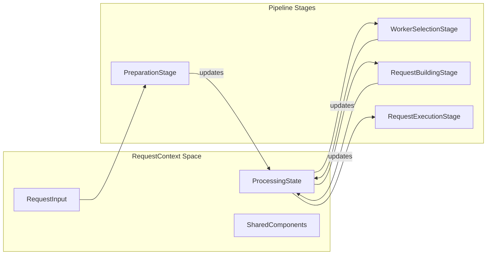
**Sources:** [model_gateway/src/routers/grpc/context.rs:43-47](), [model_gateway/src/routers/grpc/pipeline.rs:192-198](), [model_gateway/src/routers/grpc/common/stages/dispatch_metadata.rs:19-21]()

---

# Page: HTTP Routing Layer

# HTTP Routing Layer

<details>
<summary>Relevant source files</summary>

The following files were used as context for generating this wiki page:

- [model_gateway/src/routers/anthropic/context.rs](model_gateway/src/routers/anthropic/context.rs)
- [model_gateway/src/routers/anthropic/mcp.rs](model_gateway/src/routers/anthropic/mcp.rs)
- [model_gateway/src/routers/anthropic/mod.rs](model_gateway/src/routers/anthropic/mod.rs)
- [model_gateway/src/routers/anthropic/non_streaming.rs](model_gateway/src/routers/anthropic/non_streaming.rs)
- [model_gateway/src/routers/anthropic/router.rs](model_gateway/src/routers/anthropic/router.rs)
- [model_gateway/src/routers/anthropic/sse.rs](model_gateway/src/routers/anthropic/sse.rs)
- [model_gateway/src/routers/anthropic/streaming.rs](model_gateway/src/routers/anthropic/streaming.rs)
- [model_gateway/src/routers/anthropic/utils.rs](model_gateway/src/routers/anthropic/utils.rs)
- [model_gateway/src/routers/anthropic/worker.rs](model_gateway/src/routers/anthropic/worker.rs)
- [model_gateway/src/routers/common/header_utils.rs](model_gateway/src/routers/common/header_utils.rs)
- [model_gateway/src/routers/gemini/context.rs](model_gateway/src/routers/gemini/context.rs)
- [model_gateway/src/routers/gemini/driver.rs](model_gateway/src/routers/gemini/driver.rs)
- [model_gateway/src/routers/gemini/mod.rs](model_gateway/src/routers/gemini/mod.rs)
- [model_gateway/src/routers/gemini/router.rs](model_gateway/src/routers/gemini/router.rs)
- [model_gateway/src/routers/gemini/state.rs](model_gateway/src/routers/gemini/state.rs)
- [model_gateway/src/routers/gemini/steps/mod.rs](model_gateway/src/routers/gemini/steps/mod.rs)
- [model_gateway/src/routers/gemini/steps/non_stream_execution.rs](model_gateway/src/routers/gemini/steps/non_stream_execution.rs)
- [model_gateway/src/routers/gemini/steps/previous_interaction_loading.rs](model_gateway/src/routers/gemini/steps/previous_interaction_loading.rs)
- [model_gateway/src/routers/gemini/steps/request_building.rs](model_gateway/src/routers/gemini/steps/request_building.rs)
- [model_gateway/src/routers/gemini/steps/response_processing.rs](model_gateway/src/routers/gemini/steps/response_processing.rs)
- [model_gateway/src/routers/gemini/steps/stream_execution.rs](model_gateway/src/routers/gemini/steps/stream_execution.rs)
- [model_gateway/src/routers/gemini/steps/worker_selection.rs](model_gateway/src/routers/gemini/steps/worker_selection.rs)
- [model_gateway/src/routers/grpc/common/responses/handlers.rs](model_gateway/src/routers/grpc/common/responses/handlers.rs)
- [model_gateway/src/routers/http/pd_router.rs](model_gateway/src/routers/http/pd_router.rs)
- [model_gateway/src/routers/http/router.rs](model_gateway/src/routers/http/router.rs)
- [model_gateway/src/routers/mod.rs](model_gateway/src/routers/mod.rs)
- [model_gateway/src/routers/openai/chat.rs](model_gateway/src/routers/openai/chat.rs)
- [model_gateway/src/routers/openai/context.rs](model_gateway/src/routers/openai/context.rs)
- [model_gateway/src/routers/openai/health.rs](model_gateway/src/routers/openai/health.rs)
- [model_gateway/src/routers/openai/responses/history.rs](model_gateway/src/routers/openai/responses/history.rs)
- [model_gateway/src/routers/openai/responses/mod.rs](model_gateway/src/routers/openai/responses/mod.rs)
- [model_gateway/src/routers/openai/responses/route.rs](model_gateway/src/routers/openai/responses/route.rs)
- [model_gateway/src/routers/openai/router.rs](model_gateway/src/routers/openai/router.rs)
- [model_gateway/src/routers/responses/handlers.rs](model_gateway/src/routers/responses/handlers.rs)
- [model_gateway/src/routers/responses/mod.rs](model_gateway/src/routers/responses/mod.rs)
- [model_gateway/src/routers/router_manager.rs](model_gateway/src/routers/router_manager.rs)
- [model_gateway/tests/common/mock_worker.rs](model_gateway/tests/common/mock_worker.rs)
- [model_gateway/tests/routing/model_alias_test.rs](model_gateway/tests/routing/model_alias_test.rs)
- [model_gateway/tests/routing/pd_routing_test.rs](model_gateway/tests/routing/pd_routing_test.rs)

</details>


The HTTP Routing Layer is responsible for orchestrating the lifecycle of inference requests arriving via HTTP. It manages worker selection, protocol-specific transformations (OpenAI, Anthropic, Gemini), and specialized routing modes like Prefill-Decode (PD) disaggregation.

## Router Management and Selection

The `RouterManager` acts as the central coordinator for all router instances. Depending on the configuration, it operates in two modes:
1.  **Single-Router Mode**: A single router instance (e.g., `Router`, `PDRouter`, or `OpenAIRouter`) is created based on the `RoutingMode` and `ConnectionMode` [model_gateway/src/routers/router_manager.rs:128-140]().
2.  **Multi-Router Mode (IGW)**: Multiple routers are initialized to support various upstream protocols and routing strategies simultaneously [model_gateway/src/routers/router_manager.rs:114-127]().

### Router Selection Logic
The `RouterManager` determines the appropriate `RouterId` by mapping the `RoutingMode` and `ConnectionMode` [model_gateway/src/routers/router_manager.rs:149-168]().

| Connection Mode | Routing Mode | Resulting Router ID |
| :--- | :--- | :--- |
| HTTP | Regular | `HTTP_REGULAR` |
| HTTP | PrefillDecode | `HTTP_PD` |
| HTTP | OpenAI | `HTTP_OPENAI` |
| HTTP | Anthropic | `HTTP_ANTHROPIC` |
| HTTP | Gemini | `HTTP_GEMINI` |

**Sources:** [model_gateway/src/routers/router_manager.rs:55-67](), [model_gateway/src/routers/router_manager.rs:149-168]()

---

## Standard Router (`Router`)

The standard `Router` is the default implementation for general HTTP-based inference. It supports standard OpenAI-compatible endpoints like `/v1/chat/completions`, `/v1/embeddings`, and `/v1/audio/transcriptions` [model_gateway/src/routers/http/router.rs:67-75]().

### Request Lifecycle
1.  **Model Resolution**: Resolves the target `model_id` from the request body.
2.  **Worker Selection**: Uses the `WorkerSelector` to find a healthy worker serving the requested model [model_gateway/src/routers/http/router.rs:195-200]().
3.  **Proxying**: Forwards the request to the worker's URL. It handles both standard JSON payloads and `multipart/form-data` for audio tasks [model_gateway/src/routers/http/router.rs:151-190]().
4.  **Realtime Support**: Manages WebSocket and WebRTC connections for `/v1/realtime` endpoints [model_gateway/src/routers/http/router.rs:48-51]().

**Sources:** [model_gateway/src/routers/http/router.rs:67-75](), [model_gateway/src/routers/http/router.rs:151-190]()

---

## Prefill-Decode Disaggregated Routing (`PDRouter`)

The `PDRouter` implements disaggregated routing, splitting the LLM inference process into two distinct phases: **Prefill** (processing input tokens) and **Decode** (generating output tokens).

### Routing Logic
The `PDRouter` selects a pair consisting of one Prefill worker and one Decode worker [model_gateway/src/routers/http/pd_router.rs:50-56]().
*   **Prefill Selection**: Targeted at workers with `WorkerType::Prefill`.
*   **Decode Selection**: Targeted at workers with `WorkerType::Decode`.
*   **Session Management**: It ensures that the KV cache generated during the prefill phase is available to the decode worker, often utilizing `prefill_metadata` passed in headers [model_gateway/src/routers/http/pd_router.rs:70-83]().

### Diagram: PD Routing Data Flow
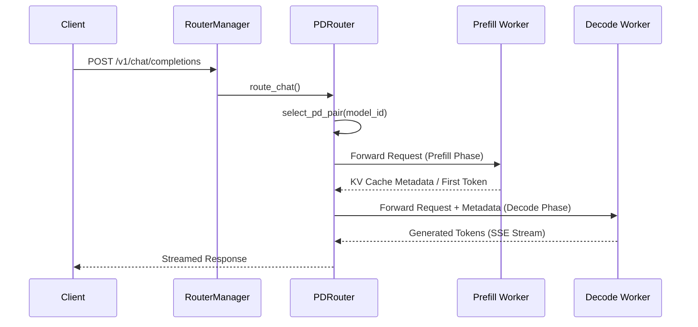
**Sources:** [model_gateway/src/routers/http/pd_router.rs:50-56](), [model_gateway/src/routers/http/pd_router.rs:70-83]()

---

## Protocol-Specific Routers

### OpenAIRouter
The `OpenAIRouter` provides deep integration for OpenAI-compatible backends and internal "Responses" workflows.
*   **Model Alias Resolution**: Resolves aliases to canonical model IDs before worker selection [model_gateway/src/routers/openai/router.rs:51-63]().
*   **Responses API**: Handles stateful agentic workflows via `/v1/responses`, including history loading from `ConversationStorage` [model_gateway/src/routers/openai/responses/history.rs:34-39]().
*   **BYOK (Bring Your Own Key)**: Supports forwarding client-provided API keys to upstream providers if the gateway's internal authentication is bypassed or configured for passthrough [model_gateway/src/routers/router_manager.rs:58-63]().

### AnthropicRouter
Handles the Anthropic Messages API (`/v1/messages`).
*   **Tool Loop Interception**: If MCP (Model Context Protocol) is enabled, the router intercepts `tool_use` blocks from the model, executes the tool via the `McpOrchestrator`, and feeds the result back to the model in a loop [model_gateway/src/routers/anthropic/streaming.rs:188-195]().
*   **SSE Transformation**: Converts Anthropic's specific SSE event format into a standardized stream [model_gateway/src/routers/anthropic/sse.rs:109-115]().

**Sources:** [model_gateway/src/routers/openai/router.rs:65-74](), [model_gateway/src/routers/anthropic/router.rs:41-44](), [model_gateway/src/routers/anthropic/streaming.rs:188-195]()

---

## Resilience: Retries and Circuit Breakers

The HTTP layer integrates with the gateway's reliability mechanisms:
*   **RetryExecutor**: Routers wrap worker calls in a `RetryExecutor`. If a worker returns a retryable status code (e.g., 429 or 503), the router selects a *different* worker and retries the request [model_gateway/src/routers/http/router.rs:52](), [model_gateway/src/routers/http/pd_router.rs:39]().
*   **Circuit Breaker**: Worker health is tracked. If a worker consistently fails, the `WorkerSelector` filters it out of the available pool until it passes health checks again [model_gateway/src/routers/http/router.rs:195-200]().
*   **WorkerLoadGuard**: An RAII guard that increments the active request count on a worker upon selection and decrements it when the response stream closes [model_gateway/src/routers/http/router.rs:60]().

### Entity Mapping: Routing Components
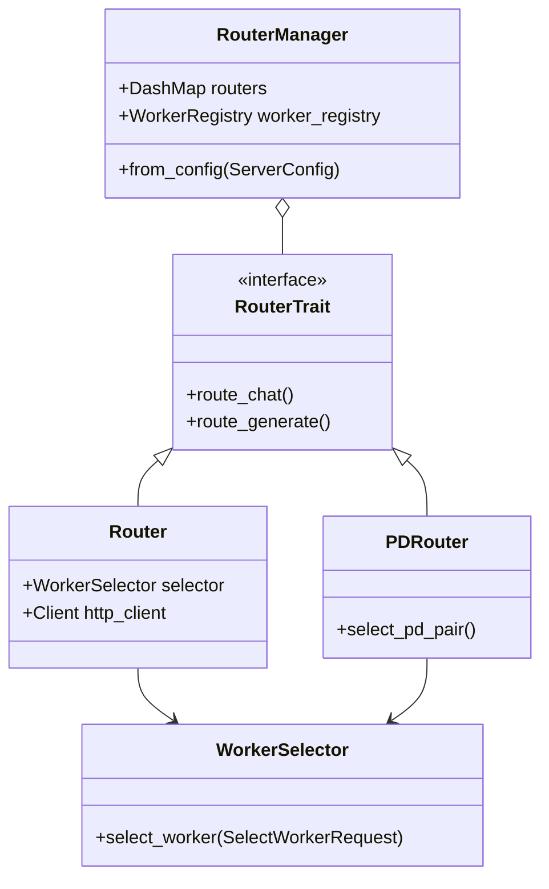

**Sources:** [model_gateway/src/routers/router_manager.rs:55-67](), [model_gateway/src/routers/mod.rs:54-56](), [model_gateway/src/routers/http/router.rs:67-75](), [model_gateway/src/routers/http/pd_router.rs:50-56]()

---

# Page: gRPC Routing Layer

# gRPC Routing Layer

<details>
<summary>Relevant source files</summary>

The following files were used as context for generating this wiki page:

- [bindings/golang/src/proto_parse.rs](bindings/golang/src/proto_parse.rs)
- [bindings/golang/src/utils.rs](bindings/golang/src/utils.rs)
- [crates/protocols/src/messages.rs](crates/protocols/src/messages.rs)
- [crates/tokenizer/src/huggingface.rs](crates/tokenizer/src/huggingface.rs)
- [docs/getting-started/logging.md](docs/getting-started/logging.md)
- [e2e_test/completions/test_basic.py](e2e_test/completions/test_basic.py)
- [model_gateway/src/middleware/request_id.rs](model_gateway/src/middleware/request_id.rs)
- [model_gateway/src/middleware/tenant_resolution.rs](model_gateway/src/middleware/tenant_resolution.rs)
- [model_gateway/src/routers/factory.rs](model_gateway/src/routers/factory.rs)
- [model_gateway/src/routers/grpc/common/response_collection.rs](model_gateway/src/routers/grpc/common/response_collection.rs)
- [model_gateway/src/routers/grpc/common/responses/streaming.rs](model_gateway/src/routers/grpc/common/responses/streaming.rs)
- [model_gateway/src/routers/grpc/common/responses/utils.rs](model_gateway/src/routers/grpc/common/responses/utils.rs)
- [model_gateway/src/routers/grpc/common/stages/dispatch_metadata.rs](model_gateway/src/routers/grpc/common/stages/dispatch_metadata.rs)
- [model_gateway/src/routers/grpc/common/stages/helpers.rs](model_gateway/src/routers/grpc/common/stages/helpers.rs)
- [model_gateway/src/routers/grpc/common/stages/request_execution.rs](model_gateway/src/routers/grpc/common/stages/request_execution.rs)
- [model_gateway/src/routers/grpc/context.rs](model_gateway/src/routers/grpc/context.rs)
- [model_gateway/src/routers/grpc/harmony/responses/common.rs](model_gateway/src/routers/grpc/harmony/responses/common.rs)
- [model_gateway/src/routers/grpc/harmony/responses/execution.rs](model_gateway/src/routers/grpc/harmony/responses/execution.rs)
- [model_gateway/src/routers/grpc/harmony/responses/non_streaming.rs](model_gateway/src/routers/grpc/harmony/responses/non_streaming.rs)
- [model_gateway/src/routers/grpc/harmony/responses/streaming.rs](model_gateway/src/routers/grpc/harmony/responses/streaming.rs)
- [model_gateway/src/routers/grpc/harmony/stages/request_building.rs](model_gateway/src/routers/grpc/harmony/stages/request_building.rs)
- [model_gateway/src/routers/grpc/harmony/stages/response_processing.rs](model_gateway/src/routers/grpc/harmony/stages/response_processing.rs)
- [model_gateway/src/routers/grpc/harmony/streaming.rs](model_gateway/src/routers/grpc/harmony/streaming.rs)
- [model_gateway/src/routers/grpc/pipeline.rs](model_gateway/src/routers/grpc/pipeline.rs)
- [model_gateway/src/routers/grpc/regular/processor.rs](model_gateway/src/routers/grpc/regular/processor.rs)
- [model_gateway/src/routers/grpc/regular/responses/common.rs](model_gateway/src/routers/grpc/regular/responses/common.rs)
- [model_gateway/src/routers/grpc/regular/responses/non_streaming.rs](model_gateway/src/routers/grpc/regular/responses/non_streaming.rs)
- [model_gateway/src/routers/grpc/regular/responses/streaming.rs](model_gateway/src/routers/grpc/regular/responses/streaming.rs)
- [model_gateway/src/routers/grpc/regular/stages/chat/preparation.rs](model_gateway/src/routers/grpc/regular/stages/chat/preparation.rs)
- [model_gateway/src/routers/grpc/regular/stages/chat/request_building.rs](model_gateway/src/routers/grpc/regular/stages/chat/request_building.rs)
- [model_gateway/src/routers/grpc/regular/stages/completion/preparation.rs](model_gateway/src/routers/grpc/regular/stages/completion/preparation.rs)
- [model_gateway/src/routers/grpc/regular/stages/completion/request_building.rs](model_gateway/src/routers/grpc/regular/stages/completion/request_building.rs)
- [model_gateway/src/routers/grpc/regular/stages/completion/response_processing.rs](model_gateway/src/routers/grpc/regular/stages/completion/response_processing.rs)
- [model_gateway/src/routers/grpc/regular/stages/embedding/preparation.rs](model_gateway/src/routers/grpc/regular/stages/embedding/preparation.rs)
- [model_gateway/src/routers/grpc/regular/stages/embedding/request_building.rs](model_gateway/src/routers/grpc/regular/stages/embedding/request_building.rs)
- [model_gateway/src/routers/grpc/regular/stages/generate/preparation.rs](model_gateway/src/routers/grpc/regular/stages/generate/preparation.rs)
- [model_gateway/src/routers/grpc/regular/stages/generate/request_building.rs](model_gateway/src/routers/grpc/regular/stages/generate/request_building.rs)
- [model_gateway/src/routers/grpc/regular/stages/messages/mod.rs](model_gateway/src/routers/grpc/regular/stages/messages/mod.rs)
- [model_gateway/src/routers/grpc/regular/stages/messages/preparation.rs](model_gateway/src/routers/grpc/regular/stages/messages/preparation.rs)
- [model_gateway/src/routers/grpc/regular/stages/messages/request_building.rs](model_gateway/src/routers/grpc/regular/stages/messages/request_building.rs)
- [model_gateway/src/routers/grpc/regular/stages/messages/response_processing.rs](model_gateway/src/routers/grpc/regular/stages/messages/response_processing.rs)
- [model_gateway/src/routers/grpc/regular/stages/mod.rs](model_gateway/src/routers/grpc/regular/stages/mod.rs)
- [model_gateway/src/routers/grpc/regular/stages/preparation.rs](model_gateway/src/routers/grpc/regular/stages/preparation.rs)
- [model_gateway/src/routers/grpc/regular/stages/request_building.rs](model_gateway/src/routers/grpc/regular/stages/request_building.rs)
- [model_gateway/src/routers/grpc/regular/stages/response_processing.rs](model_gateway/src/routers/grpc/regular/stages/response_processing.rs)
- [model_gateway/src/routers/grpc/regular/streaming.rs](model_gateway/src/routers/grpc/regular/streaming.rs)
- [model_gateway/src/routers/grpc/router.rs](model_gateway/src/routers/grpc/router.rs)
- [model_gateway/src/routers/grpc/utils/chat_utils.rs](model_gateway/src/routers/grpc/utils/chat_utils.rs)
- [model_gateway/src/routers/grpc/utils/message_utils.rs](model_gateway/src/routers/grpc/utils/message_utils.rs)
- [model_gateway/src/routers/grpc/utils/mod.rs](model_gateway/src/routers/grpc/utils/mod.rs)
- [model_gateway/src/routers/grpc/utils/parsers.rs](model_gateway/src/routers/grpc/utils/parsers.rs)
- [model_gateway/src/routers/http/mod.rs](model_gateway/src/routers/http/mod.rs)
- [model_gateway/src/routers/tokenize/handlers.rs](model_gateway/src/routers/tokenize/handlers.rs)
- [model_gateway/tests/api/mod.rs](model_gateway/tests/api/mod.rs)
- [model_gateway/tests/routing/grpc_completion_batch_test.rs](model_gateway/tests/routing/grpc_completion_batch_test.rs)
- [model_gateway/tests/routing/mod.rs](model_gateway/tests/routing/mod.rs)

</details>


The gRPC routing layer provides a high-performance, stage-based pipeline for processing inference requests. Unlike the HTTP router which often handles JSON-to-JSON transformations, the gRPC layer manages complex internal state across multiple execution stages, including multimodal tensor assembly, tokenizer-driven prompt preparation, and advanced disaggregation strategies like **EPD (Encode-Prefill-Decode)**.

## Pipeline Architecture

The gRPC router is built around a `RequestPipeline` [model_gateway/src/routers/grpc/pipeline.rs:31-31]() that executes a sequence of `PipelineStage` [model_gateway/src/routers/grpc/common/stages/helpers.rs:11-11]() implementations. This design ensures a clean separation of concerns and allows the router to support various protocols (Regular, Harmony) and execution modes (Single, PD, EPD).

### Request Lifecycle
1.  **Preparation**: Resolves tokenizers, renders chat templates, and processes multimodal inputs [model_gateway/src/routers/grpc/regular/stages/chat/preparation.rs:23-23]().
2.  **Worker Selection**: Picks optimal backend workers based on load and cache affinity [model_gateway/src/routers/grpc/context.rs:171-171]().
3.  **Client Acquisition**: Establishes gRPC connections to the selected workers [model_gateway/src/routers/grpc/context.rs:174-174]().
4.  **Request Building**: Constructs backend-specific protobuf messages (e.g., `ProtoGenerateRequest`) [model_gateway/src/routers/grpc/regular/stages/chat/request_building.rs:23-23]().
5.  **Dispatch**: Executes the gRPC calls, managing parallel streams for disaggregated modes [model_gateway/src/routers/grpc/common/stages/request_execution.rs:122-122]().
6.  **Response Processing**: Parses streaming tokens, extracts reasoning blocks, and handles tool-call syntax [model_gateway/src/routers/grpc/regular/processor.rs:38-38]().

### Code-to-Entity Mapping: Pipeline Flow
This diagram maps the logical stages to the specific Rust structs that implement them.

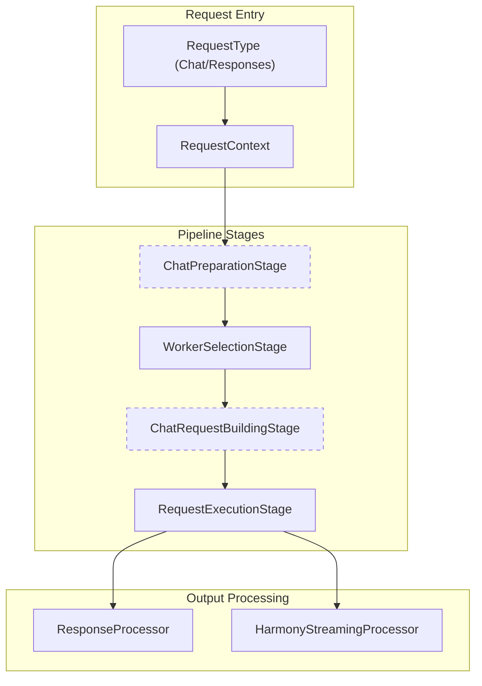
Sources: [model_gateway/src/routers/grpc/context.rs:43-47](), [model_gateway/src/routers/grpc/common/stages/request_execution.rs:122-122](), [model_gateway/src/routers/grpc/regular/stages/chat/preparation.rs:23-23](), [model_gateway/src/routers/grpc/regular/stages/chat/request_building.rs:23-23]().

## Context and State Management

The `RequestContext` [model_gateway/src/routers/grpc/context.rs:43-47]() is the primary data structure flowing through the pipeline. It holds:
*   **Input**: The original request and tenant metadata [model_gateway/src/routers/grpc/context.rs:50-56]().
*   **Shared Components**: Access to registries (Tokenizer, Worker) and parsers [model_gateway/src/routers/grpc/context.rs:137-148]().
*   **Processing State**: Mutable state that evolves, such as `multimodal_intermediate` [model_gateway/src/routers/grpc/context.rs:159-159]() and `execution_plan` [model_gateway/src/routers/grpc/context.rs:177-177]().

Sources: [model_gateway/src/routers/grpc/context.rs:43-180]()

## Disaggregated Execution (PD & EPD)

SMG supports splitting requests across different worker types to optimize for throughput and latency.

### Prefill-Decode (PD) Disaggregation
The router can split a request into a **Prefill** leg and a **Decode** leg. The `RequestExecutionStage` manages the KV-cache transfer between these workers using specific connectors:
*   **Mooncake**: A push-based connector where the prefill worker pins blocks and the gateway relays rendezvous info to the decode worker [model_gateway/src/routers/grpc/common/stages/request_execution.rs:43-47]().
*   **Nixl**: Tags the prefill leg with `do_remote_decode` and relays returned parameters to the decode leg [model_gateway/src/routers/grpc/common/stages/request_execution.rs:48-49]().

### Encode-Prefill-Decode (EPD)
For multimodal requests, SMG introduces an **Encode** stage. This stage handles the heavy lifting of vision/audio encoding on specialized workers before passing the resulting tensors to the Prefill worker [model_gateway/src/routers/grpc/regular/stages/chat/request_building.rs:91-107]().

| Feature | Single Mode | PD Mode | EPD Mode |
| :--- | :--- | :--- | :--- |
| **Worker Count** | 1 | 2 (Prefill + Decode) | 3 (Encode + Prefill + Decode) |
| **KV Transfer** | Local | Remote (Nixl/Mooncake) | Remote |
| **Multimodal** | Inline | Inline | Disaggregated (Encode) |

Sources: [model_gateway/src/routers/grpc/common/stages/request_execution.rs:33-80](), [model_gateway/src/routers/grpc/regular/stages/chat/request_building.rs:91-114]()

## Harmony Protocol Support

The **Harmony Protocol** is a specialized gRPC interface used for high-efficiency, multi-channel communication between the gateway and backend engines.

### Streaming Harmony Responses
The `HarmonyStreamingProcessor` [model_gateway/src/routers/grpc/harmony/streaming.rs:81-81]() handles the complex task of parsing incremental Harmony tokens. It supports multi-channel streaming where different parts of the response (e.g., thought blocks, tool calls, and final text) can arrive asynchronously [model_gateway/src/routers/grpc/harmony/streaming.rs:103-108]().

### Multi-turn Tool Loops
For the `Responses` API, the router implements an automated tool execution loop. If the model emits a tool call (detected in the Harmony commentary channel), the gateway:
1.  Intercepts the call [model_gateway/src/routers/grpc/harmony/responses/non_streaming.rs:48-52]().
2.  Executes the tool via the `McpToolSession` [model_gateway/src/routers/grpc/harmony/responses/non_streaming.rs:124-124]().
3.  Injects the results back into a new request and re-runs the pipeline [model_gateway/src/routers/grpc/harmony/responses/non_streaming.rs:207-215]().

Sources: [model_gateway/src/routers/grpc/harmony/streaming.rs:81-174](), [model_gateway/src/routers/grpc/harmony/responses/non_streaming.rs:54-100]()

## Response Processing & Parsing

The `ResponseProcessor` [model_gateway/src/routers/grpc/regular/processor.rs:38-43]() is responsible for transforming raw backend outputs into OpenAI-compatible formats.

### Reasoning and Tool Parsing
*   **Reasoning Extraction**: Uses a `ReasoningParser` to identify `<think>` blocks or similar markers, separating them from the final user-facing text [model_gateway/src/routers/grpc/regular/processor.rs:102-135]().
*   **Tool Call Parsing**: Detects structured tool-use syntax. It supports both JSON-schema-based constraints and model-specific XML/Markdown parsing via the `ToolParserFactory` [model_gateway/src/routers/grpc/regular/processor.rs:144-178]().

### Stop Sequence Decoding
The router implements a `StopSequenceDecoder` [model_gateway/src/routers/grpc/regular/processor.rs:68-68]() to handle client-defined stop sequences. This ensures that even if a backend engine doesn't natively support a specific stop string, the gateway can terminate the stream and trim the output correctly [model_gateway/src/routers/grpc/regular/processor.rs:73-96]().

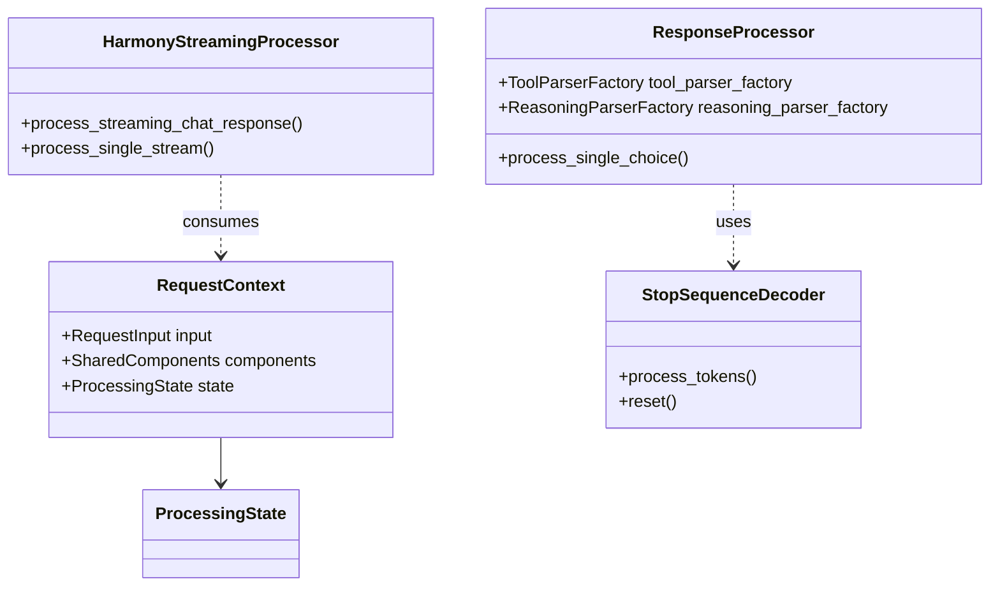
Sources: [model_gateway/src/routers/grpc/regular/processor.rs:38-72](), [model_gateway/src/routers/grpc/harmony/streaming.rs:81-108](), [model_gateway/src/routers/grpc/context.rs:43-47]().

## Reliability Features

### Load Guards
The router uses RAII-based `LoadGuards` [model_gateway/src/routers/grpc/common/stages/request_execution.rs:174-178]() to track inflight requests per worker. The load is incremented when the guard is created and automatically decremented when the `RequestContext` (or the streaming response) is dropped [model_gateway/src/routers/grpc/common/stages/request_execution.rs:157-158]().

### Retries
The gRPC router integrates with a `RetryExecutor` [model_gateway/src/routers/grpc/router.rs:40-40]() that can re-run the entire pipeline if a backend returns a retryable status (e.g., `UNAVAILABLE` or `RESOURCE_EXHAUSTED`). Because the pipeline is stage-based, it can intelligently skip or re-execute preparation steps during a retry.

Sources: [model_gateway/src/routers/grpc/common/stages/request_execution.rs:157-179](), [model_gateway/src/routers/grpc/router.rs:34-44]()

---

# Page: Load Balancing Policies

# Load Balancing Policies

<details>
<summary>Relevant source files</summary>

The following files were used as context for generating this wiki page:

- [bindings/golang/src/policy.rs](bindings/golang/src/policy.rs)
- [clients/rust/Cargo.toml](clients/rust/Cargo.toml)
- [crates/auth/Cargo.toml](crates/auth/Cargo.toml)
- [crates/grpc_client/src/tokenizer_bundle.rs](crates/grpc_client/src/tokenizer_bundle.rs)
- [crates/kv_index/benches/throughput_bench.rs](crates/kv_index/benches/throughput_bench.rs)
- [crates/kv_index/src/lib.rs](crates/kv_index/src/lib.rs)
- [crates/kv_index/src/snapshot.rs](crates/kv_index/src/snapshot.rs)
- [crates/kv_index/src/string_tree.rs](crates/kv_index/src/string_tree.rs)
- [crates/kv_index/src/token_tree.rs](crates/kv_index/src/token_tree.rs)
- [crates/protocols/src/worker.rs](crates/protocols/src/worker.rs)
- [crates/tokenizer/src/cache/l0.rs](crates/tokenizer/src/cache/l0.rs)
- [crates/tokenizer/src/cache/l1.rs](crates/tokenizer/src/cache/l1.rs)
- [crates/tokenizer/src/cache/mod.rs](crates/tokenizer/src/cache/mod.rs)
- [crates/tokenizer/src/stop.rs](crates/tokenizer/src/stop.rs)
- [crates/wasm/Cargo.toml](crates/wasm/Cargo.toml)
- [model_gateway/benches/manual_policy_benchmark.rs](model_gateway/benches/manual_policy_benchmark.rs)
- [model_gateway/benches/radix_tree_benchmark.rs](model_gateway/benches/radix_tree_benchmark.rs)
- [model_gateway/src/config/mod.rs](model_gateway/src/config/mod.rs)
- [model_gateway/src/policies/bucket.rs](model_gateway/src/policies/bucket.rs)
- [model_gateway/src/policies/cache_aware.rs](model_gateway/src/policies/cache_aware.rs)
- [model_gateway/src/policies/consistent_hashing.rs](model_gateway/src/policies/consistent_hashing.rs)
- [model_gateway/src/policies/least_load.rs](model_gateway/src/policies/least_load.rs)
- [model_gateway/src/policies/manual.rs](model_gateway/src/policies/manual.rs)
- [model_gateway/src/policies/power_of_two.rs](model_gateway/src/policies/power_of_two.rs)
- [model_gateway/src/policies/prefix_hash.rs](model_gateway/src/policies/prefix_hash.rs)
- [model_gateway/src/policies/random.rs](model_gateway/src/policies/random.rs)
- [model_gateway/src/policies/round_robin.rs](model_gateway/src/policies/round_robin.rs)
- [model_gateway/src/routers/common/retry.rs](model_gateway/src/routers/common/retry.rs)
- [model_gateway/src/service_discovery.rs](model_gateway/src/service_discovery.rs)
- [model_gateway/src/worker/builder.rs](model_gateway/src/worker/builder.rs)
- [model_gateway/src/worker/capacity.rs](model_gateway/src/worker/capacity.rs)
- [model_gateway/src/worker/manager.rs](model_gateway/src/worker/manager.rs)
- [model_gateway/src/worker/mod.rs](model_gateway/src/worker/mod.rs)
- [model_gateway/src/worker/monitor.rs](model_gateway/src/worker/monitor.rs)
- [model_gateway/src/worker/registry.rs](model_gateway/src/worker/registry.rs)
- [model_gateway/src/worker/service.rs](model_gateway/src/worker/service.rs)
- [model_gateway/src/worker/worker.rs](model_gateway/src/worker/worker.rs)
- [model_gateway/src/workflow/data.rs](model_gateway/src/workflow/data.rs)
- [model_gateway/src/workflow/job_queue.rs](model_gateway/src/workflow/job_queue.rs)
- [model_gateway/src/workflow/mod.rs](model_gateway/src/workflow/mod.rs)
- [model_gateway/src/workflow/steps/local/create_worker.rs](model_gateway/src/workflow/steps/local/create_worker.rs)
- [model_gateway/src/workflow/steps/mod.rs](model_gateway/src/workflow/steps/mod.rs)
- [model_gateway/src/workflow/steps/shared/activate.rs](model_gateway/src/workflow/steps/shared/activate.rs)
- [model_gateway/src/workflow/steps/shared/register.rs](model_gateway/src/workflow/steps/shared/register.rs)
- [model_gateway/tests/harmony_encoding_test.rs](model_gateway/tests/harmony_encoding_test.rs)
- [model_gateway/tests/routing/worker_management_test.rs](model_gateway/tests/routing/worker_management_test.rs)

</details>


SMG (Shepherd Model Gateway) provides a suite of load-balancing policies designed to optimize inference performance, specifically focusing on KV cache affinity and system stability. The system supports standard algorithms (Round Robin, Least Load) alongside advanced cache-aware routing that utilizes prefix matching via radix trees and event-driven KV monitoring.

## Policy Overview

All policies implement the `LoadBalancingPolicy` trait, which requires a `select_worker` method to return an `Arc<dyn Worker>` based on the request context and current fleet state.

| Policy | Logic | Best Use Case |
| :--- | :--- | :--- |
| `cache_aware` | Radix tree prefix matching + KV event scoring | Maximizing KV cache hits in SGLang/vLLM. |
| `least_load` | Selects worker with lowest active request count | General purpose load balancing. |
| `power_of_two` | Samples 2 workers, picks the one with least load | High-throughput low-contention balancing. |
| `prefix_hash` | Hashes a specific prefix length to a worker | Simple sticky routing for shared prefixes. |
| `consistent_hashing` | Uses a hash ring for stable worker mapping | Minimizing cache churn during fleet changes. |
| `manual` | Uses `X-Worker-Id` or `X-Routing-Key` | Sticky sessions / Debugging. |
| `round_robin` | Cyclic selection | Simple testing / Uniform distribution. |

**Sources:**
- `model_gateway/src/policies/cache_aware.rs:85-124`
- `model_gateway/src/worker/registry.rs:109-112`
- `bindings/golang/src/policy.rs:25-37`

---

## Cache-Aware Routing

The `CacheAwarePolicy` is the most sophisticated router in SMG. It attempts to route requests to workers that already contain the request's prefix in their KV cache. It operates in three distinct modes based on the connection type and available telemetry.

### 1. Event-Driven (gRPC + KV Events)
For backends that stream KV cache events (like SGLang or vLLM with Mooncake), the policy uses a `KvEventMonitor` [model_gateway/src/worker/kv_event_monitor.rs]().
- **Logic**: It uses a `PositionalIndexer` to score workers based on actual block-level overlap [model_gateway/src/policies/cache_aware.rs:11-17]().
- **Tie-breaking**: Highest overlap count $\rightarrow$ Lower load $\rightarrow$ Smaller tree size [model_gateway/src/policies/cache_aware.rs:15-16]().

### 2. Approximate Token Tree (gRPC)
When KV events are unavailable but the input is tokenized, SMG maintains a `TokenTree` per model [model_gateway/src/policies/cache_aware.rs:18-23]().
- **Mechanism**: Tracks which token prefixes were previously routed to which worker.
- **Threshold**: If the `match_rate` exceeds `cache_threshold`, the best-matching worker is selected. Otherwise, it routes to the worker with the smallest tree to encourage cache growth [model_gateway/src/policies/cache_aware.rs:21-23]().

### 3. Approximate String Tree (HTTP)
Used for raw text requests to avoid the overhead of tokenization before routing decisions [model_gateway/src/policies/cache_aware.rs:24-28]().
- **Mechanism**: Uses a `StringTree` [crates/kv_index/src/string_tree.rs:143-150]() for character-level prefix matching.

### Imbalance Trigger
To prevent "hot-spotting" where one worker handles all requests due to cache affinity, the policy switches to **Shortest Queue** routing if the system is imbalanced [model_gateway/src/policies/cache_aware.rs:29-33]():
- $(max\_load - min\_load) > balance\_abs\_threshold$ **AND**
- $max\_load > balance\_rel\_threshold \times min\_load$

### Cache-Aware Routing Data Flow
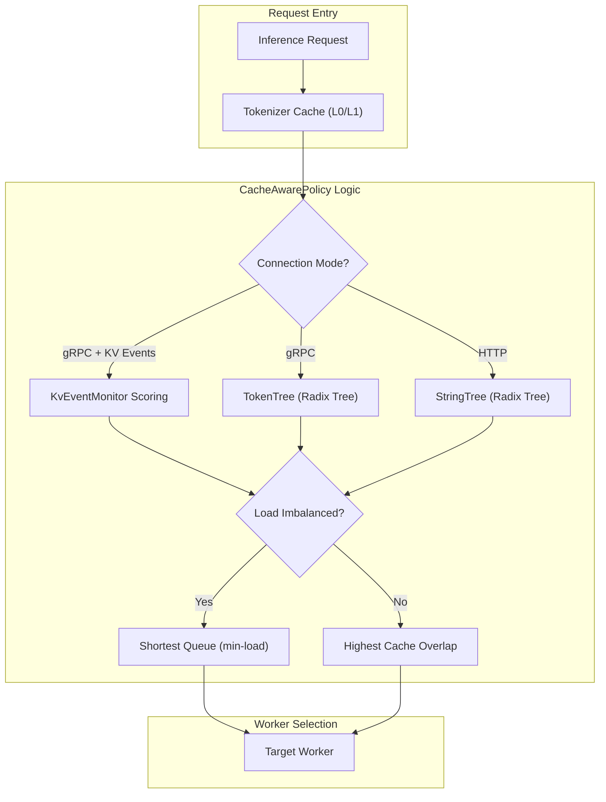

**Sources:**
- `model_gateway/src/policies/cache_aware.rs:1-42`
- `crates/kv_index/src/string_tree.rs:1-31`
- `model_gateway/src/worker/kv_event_monitor.rs:1-20`

---

## Tokenizer Caching (L0 & L1)

Cache-aware routing relies on efficient tokenization. The `CachedTokenizer` provides two layers of caching to reduce CPU latency.

### L0 Cache: Whole-String Match
A simple `DashMap` that stores exact matches for full input strings. This captures ~90% of hits for static system prompts [crates/tokenizer/src/cache/mod.rs:7-8]().

### L1 Cache: Prefix Matching
Matches prefixes at fixed boundaries (e.g., special tokens like `<|user|>`).
- **Hit**: Splices the cached prefix tokens with a fresh encoding of the remaining suffix [crates/tokenizer/src/cache/mod.rs:185-200]().
- **Miss**: Tokenizes the input and seeds new boundary entries into the cache [crates/tokenizer/src/cache/mod.rs:177-178]().

**Sources:**
- `crates/tokenizer/src/cache/mod.rs:1-60`
- `crates/tokenizer/src/cache/mod.rs:166-200`

---

## Load Balancing Implementations

### Consistent Hashing
Maintains a `HashRing` per model [model_gateway/src/worker/registry.rs:10-13](). The ring is rebuilt only when workers are added or removed (copy-on-write). This ensures that a request with the same `routing_key` consistently hits the same worker, preserving local caches.

### Least Load & Power of Two
- **Least Load**: Iterates through all `Ready` workers in the `WorkerRegistry` and selects the one where `worker.load()` is minimal [model_gateway/src/policies/least_load.rs]().
- **Power of Two**: Samples two random workers and picks the one with the lower load, reducing the "herd effect" in high-concurrency environments [model_gateway/src/policies/power_of_two.rs]().

### Manual (Sticky Sessions)
Allows clients to bypass balancing logic by providing specific headers:
- `X-Worker-Id`: Targets a specific UUID in the `WorkerRegistry` [model_gateway/src/policies/manual.rs]().
- `X-Routing-Key`: Used by the `ConsistentHashing` policy to determine ring position.

### Implementation Mapping
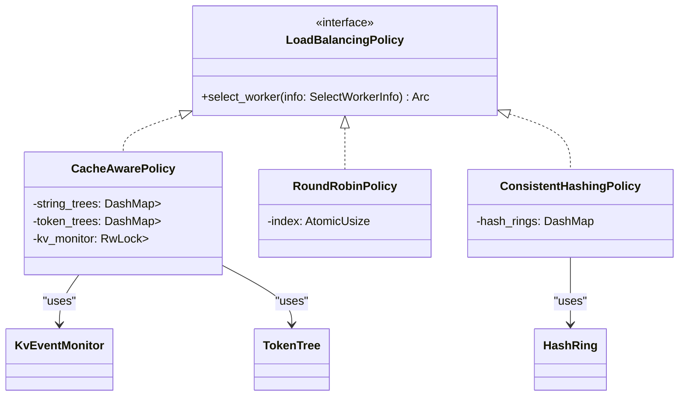

**Sources:**
- `model_gateway/src/worker/registry.rs:9-13`
- `model_gateway/src/worker/worker.rs:164-174`
- `model_gateway/src/policies/cache_aware.rs:85-124`
- `bindings/golang/src/policy.rs:25-37`

---

## Performance Considerations

Prefix matching is optimized for high-concurrency via:
1. **Lock-Free Reads**: The `WorkerRegistry` uses `Arc` snapshots for `ModelIndex` to allow reads without contention [model_gateway/src/worker/registry.rs:6-8]().
2. **Radix Tree Sharding**: `StringTree` uses `DashMap` with custom shard counts (32 for root, 8 for nodes) to balance memory vs. contention [crates/kv_index/src/string_tree.rs:23-31]().
3. **Identity Hashing**: Character-based trees use a fast identity hasher for single-character keys to avoid cryptographic overhead [crates/kv_index/src/string_tree.rs:70-74]().

**Sources:**
- `model_gateway/src/worker/registry.rs:5-13`
- `crates/kv_index/src/string_tree.rs:23-37`
- `model_gateway/benches/radix_tree_benchmark.rs:1-8`

---

# Page: Multimodal Request Handling

# Multimodal Request Handling

<details>
<summary>Relevant source files</summary>

The following files were used as context for generating this wiki page:

- [crates/mm_rdma/Cargo.toml](crates/mm_rdma/Cargo.toml)
- [crates/mm_rdma/src/lib.rs](crates/mm_rdma/src/lib.rs)
- [crates/mm_rdma/src/nixl.rs](crates/mm_rdma/src/nixl.rs)
- [crates/mm_rdma/src/slot_pool.rs](crates/mm_rdma/src/slot_pool.rs)
- [crates/mm_rdma/src/stub.rs](crates/mm_rdma/src/stub.rs)
- [crates/multimodal/src/audio/mod.rs](crates/multimodal/src/audio/mod.rs)
- [crates/multimodal/src/audio/processor.rs](crates/multimodal/src/audio/processor.rs)
- [crates/multimodal/src/audio/processors/mod.rs](crates/multimodal/src/audio/processors/mod.rs)
- [crates/multimodal/src/audio/processors/qwen3_audio.rs](crates/multimodal/src/audio/processors/qwen3_audio.rs)
- [crates/multimodal/src/audio/transforms.rs](crates/multimodal/src/audio/transforms.rs)
- [crates/multimodal/src/error.rs](crates/multimodal/src/error.rs)
- [crates/multimodal/src/lib.rs](crates/multimodal/src/lib.rs)
- [crates/multimodal/src/media.rs](crates/multimodal/src/media.rs)
- [crates/multimodal/src/registry/llama4.rs](crates/multimodal/src/registry/llama4.rs)
- [crates/multimodal/src/registry/phi3_v.rs](crates/multimodal/src/registry/phi3_v.rs)
- [crates/multimodal/src/registry/qwen3_asr.rs](crates/multimodal/src/registry/qwen3_asr.rs)
- [crates/multimodal/src/registry/qwen3_omni.rs](crates/multimodal/src/registry/qwen3_omni.rs)
- [crates/multimodal/src/registry/qwen3_vl.rs](crates/multimodal/src/registry/qwen3_vl.rs)
- [crates/multimodal/src/registry/qwen_vl.rs](crates/multimodal/src/registry/qwen_vl.rs)
- [crates/multimodal/src/types.rs](crates/multimodal/src/types.rs)
- [crates/multimodal/src/vision/execution.rs](crates/multimodal/src/vision/execution.rs)
- [crates/multimodal/src/vision/mod.rs](crates/multimodal/src/vision/mod.rs)
- [crates/multimodal/src/vision/preprocessor_config.rs](crates/multimodal/src/vision/preprocessor_config.rs)
- [crates/multimodal/src/vision/processors/kimi_k25.rs](crates/multimodal/src/vision/processors/kimi_k25.rs)
- [crates/multimodal/src/vision/processors/kimi_k3.rs](crates/multimodal/src/vision/processors/kimi_k3.rs)
- [crates/multimodal/src/vision/processors/mod.rs](crates/multimodal/src/vision/processors/mod.rs)
- [crates/multimodal/src/vision/processors/moonvit.rs](crates/multimodal/src/vision/processors/moonvit.rs)
- [crates/multimodal/src/vision/processors/qwen2_vl.rs](crates/multimodal/src/vision/processors/qwen2_vl.rs)
- [crates/multimodal/src/vision/processors/qwen3_omni_vision.rs](crates/multimodal/src/vision/processors/qwen3_omni_vision.rs)
- [crates/multimodal/src/vision/processors/qwen3_vl.rs](crates/multimodal/src/vision/processors/qwen3_vl.rs)
- [crates/multimodal/src/vision/processors/qwen_vl_base.rs](crates/multimodal/src/vision/processors/qwen_vl_base.rs)
- [crates/multimodal/src/vision/transforms.rs](crates/multimodal/src/vision/transforms.rs)
- [crates/multimodal/tests/qwen_preprocess_golden.rs](crates/multimodal/tests/qwen_preprocess_golden.rs)
- [e2e_test/router/test_mmmu.py](e2e_test/router/test_mmmu.py)
- [model_gateway/src/routers/grpc/common/stages/worker_selection.rs](model_gateway/src/routers/grpc/common/stages/worker_selection.rs)
- [model_gateway/src/routers/grpc/mod.rs](model_gateway/src/routers/grpc/mod.rs)
- [model_gateway/src/routers/grpc/multimodal/assemble.rs](model_gateway/src/routers/grpc/multimodal/assemble.rs)
- [model_gateway/src/routers/grpc/multimodal/config.rs](model_gateway/src/routers/grpc/multimodal/config.rs)
- [model_gateway/src/routers/grpc/multimodal/mod.rs](model_gateway/src/routers/grpc/multimodal/mod.rs)
- [model_gateway/src/routers/grpc/multimodal/process.rs](model_gateway/src/routers/grpc/multimodal/process.rs)
- [model_gateway/src/routers/grpc/multimodal/serialize.rs](model_gateway/src/routers/grpc/multimodal/serialize.rs)
- [model_gateway/src/routers/grpc/multimodal/transport.rs](model_gateway/src/routers/grpc/multimodal/transport.rs)
- [scripts/ci_install_vllm.sh](scripts/ci_install_vllm.sh)

</details>


SMG (Shepherd Model Gateway) provides a high-performance, protocol-agnostic pipeline for processing multimodal inputs (images, video, and audio). The system is designed to handle complex operations such as media fetching, aspect-ratio-aware preprocessing, placeholder token expansion, and efficient tensor transport to backend workers via Shared Memory (SHM) or RDMA.

## System Architecture

The multimodal subsystem is divided into the `llm-multimodal` crate, which handles pure media processing and model-specific logic, and the `model_gateway` gRPC router integration, which manages the request lifecycle and data transport.

### Data Flow: From Request to Tensor

The following diagram illustrates how a multimodal request is transformed from an OpenAI-compatible JSON payload into backend-specific tensors.

**Multimodal Processing Pipeline**
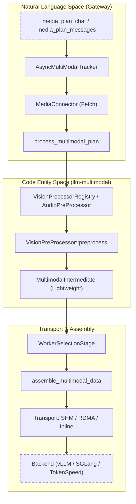
Sources: [model_gateway/src/routers/grpc/multimodal/mod.rs:1-15](), [model_gateway/src/routers/grpc/multimodal/process.rs:39-62](), [model_gateway/src/routers/grpc/multimodal/assemble.rs:45-51]()

## Media Fetching and Tracking

Media processing begins with the `AsyncMultiModalTracker` [crates/multimodal/src/tracker.rs](), which uses a `MediaConnector` [crates/multimodal/src/media.rs:121-126]() to fetch content concurrently.

- **MediaConnector**: Supports fetching from HTTP(S) URLs, Base64 Data URLs, and local file paths (if permitted by `allowed_local_media_path`) [crates/multimodal/src/media.rs:151-181]().
- **Concurrency**: Fetching is performed asynchronously using `tokio` and `reqwest`.
- **Validation**: The system enforces limits on input bytes and decoded sizes (e.g., `DEFAULT_VIDEO_MAX_DECODED_BYTES` at 1 GiB) [crates/multimodal/src/media.rs:27-32]().

Sources: [crates/multimodal/src/media.rs:121-181](), [model_gateway/src/routers/grpc/multimodal/process.rs:51-62]()

## Preprocessing and Model Registries

Once media is fetched, SMG identifies the correct preprocessor using the `ModelRegistry` [crates/multimodal/src/registry/mod.rs](). Preprocessors are implemented in Rust to avoid Python dependency overhead.

### Vision Processors
Vision processors handle tasks like "Smart Resize" (preserving aspect ratio while fitting pixel bounds) and normalization.

- **Qwen-VL Family**: Implements a `QwenVLProcessorBase` [crates/multimodal/src/vision/processors/qwen_vl_base.rs:61-85]() used by Qwen2-VL, Qwen2.5-VL, and Qwen3-VL. It calculates grid dimensions `(T, H, W)` for position encoding [crates/multimodal/src/vision/processors/qwen2_vl.rs:195-202]().
- **LLaVA / LLaVA-Next**: Implements multi-patch processing for high-resolution images.
- **Kimi / Phi3-V**: Model-specific implementations registered in the `VisionProcessorRegistry` [crates/multimodal/src/vision/mod.rs]().

### Audio Processors
Audio inputs are decoded into mono `f32` PCM data at a target sample rate (e.g., 16kHz or 24kHz) [crates/multimodal/src/audio/mod.rs:25]().

Sources: [crates/multimodal/src/vision/processors/qwen_vl_base.rs:1-22](), [crates/multimodal/src/vision/processors/qwen2_vl.rs:60-95](), [model_gateway/src/routers/grpc/multimodal/process.rs:164-183]()

## Placeholder Token Expansion

Models represent media as special placeholder tokens in the text prompt. SMG dynamically expands these tokens based on the preprocessed output (e.g., number of patches or video frames).

- **Token Expansion**: The `prepare_placeholder_tokens` function [model_gateway/src/routers/grpc/multimodal/plan.rs]() calculates the required number of tokens for each media item.
- **Prompt Binding**: Each media item is associated with a `PromptBinding` [model_gateway/src/routers/grpc/multimodal/mod.rs:147-157]() which tracks its position in the expanded prompt.

Sources: [model_gateway/src/routers/grpc/multimodal/mod.rs:66-72](), [model_gateway/src/routers/grpc/multimodal/plan.rs]()

## Tensor Assembly and Transport

After a worker is selected in the `WorkerSelectionStage` [model_gateway/src/routers/grpc/common/stages/worker_selection.rs](), the `MultimodalIntermediate` is converted into backend-specific `MultimodalData` [model_gateway/src/routers/grpc/multimodal/assemble.rs:45-51]().

### Backend Registries
| Backend | Assembly Implementation | Key Proto Wrappers |
| :--- | :--- | :--- |
| **vLLM** | `assemble_vllm` | `VllmMultimodalData` |
| **SGLang** | `assemble_sglang` | `SglangMultimodalData` |
| **TokenSpeed** | `assemble_tokenspeed_batches` | `TokenSpeedMultimodalData` |

Sources: [model_gateway/src/routers/grpc/multimodal/assemble.rs:74-106]()

### High-Performance Transport
For large tensors (high-res images or video), SMG avoids gRPC serialization overhead using advanced transport modes resolved in `transport.rs` [model_gateway/src/routers/grpc/multimodal/transport.rs]().

1.  **Shared Memory (SHM)**: Used when the gateway and worker share a `/dev/shm` volume. SMG writes the raw tensors to a memory-mapped file and passes the file descriptor/name to the worker [model_gateway/src/routers/grpc/multimodal/transport.rs:135-149]().
2.  **RDMA (NIXL)**: For disaggregated prefill-decode (PD) clusters, SMG uses the `smg-mm-rdma` crate to export tensors directly to remote worker memory using RDMA [model_gateway/src/routers/grpc/multimodal/transport.rs:157-167]().
3.  **Inline**: The default mode, where tensors are serialized into the gRPC message as `TensorBytes`.

**Transport Selection Logic**
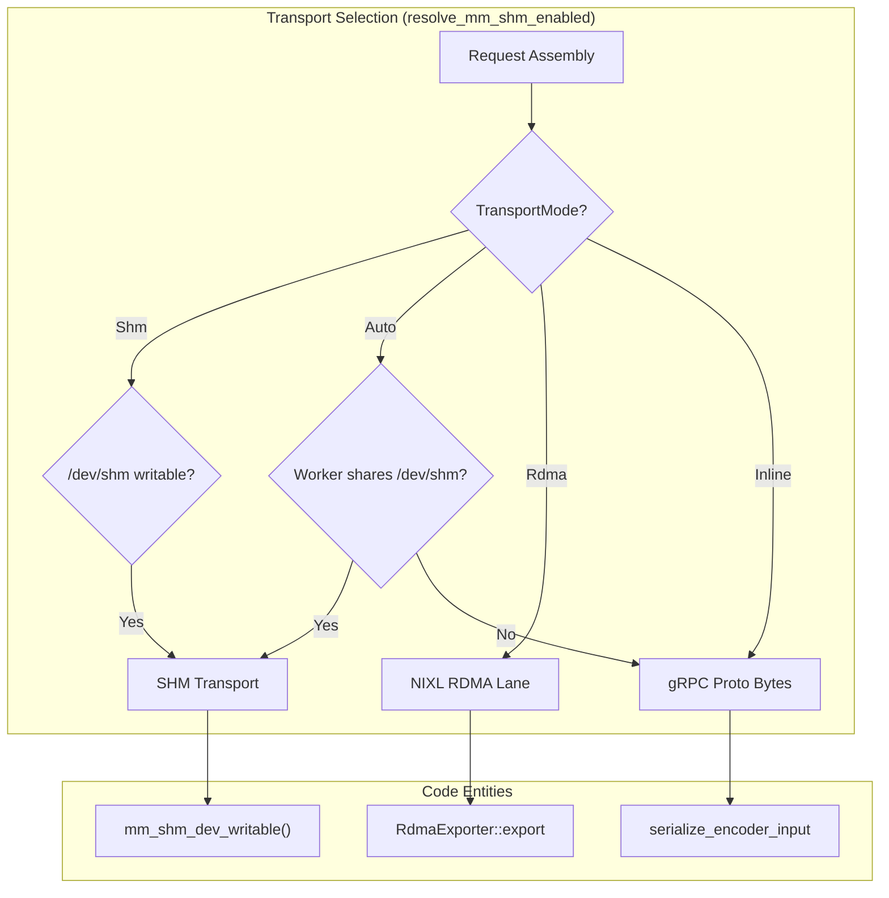
Sources: [model_gateway/src/routers/grpc/multimodal/transport.rs:135-149](), [model_gateway/src/routers/grpc/multimodal/serialize.rs]()

---

# Page: API Reference

# API Reference

<details>
<summary>Relevant source files</summary>

The following files were used as context for generating this wiki page:

- [README.md](README.md)
- [crates/protocols/src/chat.rs](crates/protocols/src/chat.rs)
- [crates/protocols/src/common.rs](crates/protocols/src/common.rs)
- [crates/protocols/src/completion.rs](crates/protocols/src/completion.rs)
- [crates/protocols/src/realtime_conversation.rs](crates/protocols/src/realtime_conversation.rs)
- [crates/protocols/src/rerank.rs](crates/protocols/src/rerank.rs)
- [crates/protocols/src/tokenize.rs](crates/protocols/src/tokenize.rs)
- [docs/assets/images/architecture-animated.svg](docs/assets/images/architecture-animated.svg)
- [docs/assets/images/concepts-overview.svg](docs/assets/images/concepts-overview.svg)
- [docs/assets/images/mcp-architecture.svg](docs/assets/images/mcp-architecture.svg)
- [docs/assets/images/wasm-plugins.svg](docs/assets/images/wasm-plugins.svg)
- [docs/assets/stylesheets/extra.css](docs/assets/stylesheets/extra.css)
- [docs/concepts/index.md](docs/concepts/index.md)
- [docs/concepts/routing/load-balancing.md](docs/concepts/routing/load-balancing.md)
- [docs/contributing/index.md](docs/contributing/index.md)
- [docs/getting-started/index.md](docs/getting-started/index.md)
- [docs/index.md](docs/index.md)
- [docs/reference/api/admin.md](docs/reference/api/admin.md)
- [docs/reference/api/extensions.md](docs/reference/api/extensions.md)
- [docs/reference/api/responses.md](docs/reference/api/responses.md)
- [mkdocs.yml](mkdocs.yml)
- [model_gateway/tests/spec/chat_completion.rs](model_gateway/tests/spec/chat_completion.rs)

</details>


Shepherd Model Gateway (SMG) exposes a multi-layered API designed to provide a unified interface for LLM inference, agentic orchestration, and infrastructure management. The gateway acts as a high-performance intermediary, abstracting the complexities of diverse backends like vLLM, SGLang, and TensorRT-LLM into a single, standardized set of endpoints [README.md:19-35]().

The API surface is categorized into three primary domains:
1.  **Inference APIs**: Industry-standard interfaces for text generation, embeddings, and multimodal processing.
2.  **Responses (Agentic) API**: A stateful, tool-enabled interface for complex multi-turn workflows.
3.  **Control Plane API**: Administrative endpoints for managing the gateway's internal state, workers, and plugins.

### API Architecture Overview

SMG routes requests based on the requested endpoint and the configured `connection_mode` (HTTP or gRPC) of the backend workers [docs/getting-started/index.md:118-126](). In **gRPC Mode**, the gateway serves as a full server handling tokenization and template rendering, whereas in **HTTP Mode**, it acts as a smart load-balancing proxy [docs/index.md:107-124]().

**Logical Request Flow**
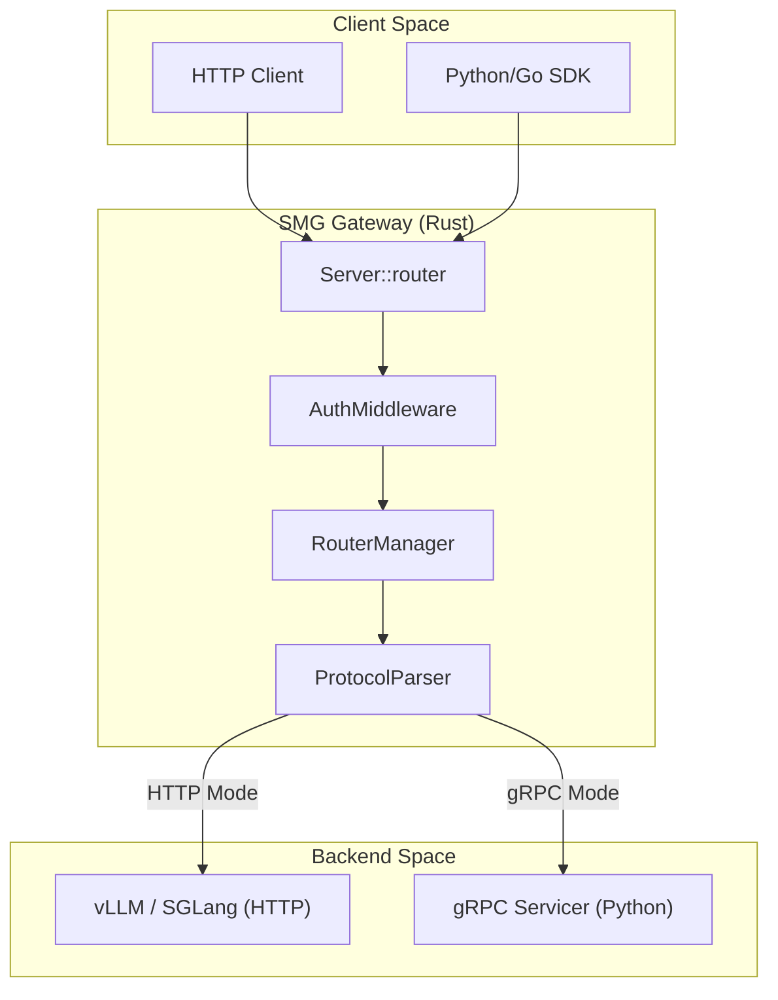
Sources: [model_gateway/src/server.rs:7-20](), [docs/index.md:107-124](), [README.md:25-35]()

---

### 1. OpenAI-Compatible Inference API
The primary interface for standard LLM tasks. SMG provides 100% compatibility with the OpenAI specification, allowing users to drop SMG into existing application stacks by simply changing the `base_url` [docs/index.md:35-38]().

*   **Chat Completions**: `/v1/chat/completions` supports streaming (SSE), tool calling, and multimodal inputs [crates/protocols/src/chat.rs:140-150]().
*   **Legacy Completions**: `/v1/completions` for base model text generation [crates/protocols/src/completion.rs:17-22]().
*   **Embeddings**: `/v1/embeddings` for vector generation.
*   **Utility**: `/v1/tokenize` and `/v1/detokenize` for gateway-side text processing [docs/reference/api/extensions.md:48-49]().

For detailed request/response schemas and streaming behavior, see [OpenAI-Compatible Inference API](#3.1).

### 2. Responses API (Agentic Workflows)
The `/v1/responses` endpoint is designed for stateful agentic interactions. Unlike standard inference, this API manages the execution loop for tools and Model Context Protocol (MCP) servers [docs/getting-started/index.md:172-181]().

*   **Tool Execution**: Automatically detects and executes tool calls (e.g., web search, computer use) before returning the final response to the client [README.md:93-95]().
*   **Multi-turn Logic**: Handles conversation history and state persistence across multiple steps of a task.

For details on tool types and the execution loop, see [Responses API (Agentic Workflows)](#3.2).

### 3. Control Plane (Admin) API
The Control Plane provides endpoints for operational maintenance and dynamic configuration. These routes are typically protected by administrative credentials [docs/reference/api/admin.md:14-16]().

*   **Worker Management**: Dynamic registration and removal of inference backends via `POST /workers` [docs/reference/api/admin.md:157-171]().
*   **Tokenizer Management**: Loading HuggingFace or local tokenizers via `/v1/tokenizers` [docs/reference/api/admin.md:17-21]().
*   **Cache Control**: System-wide KV cache flushing via `/flush_cache` [docs/reference/api/admin.md:267-270]().
*   **Health & Metrics**: Liveness, readiness, and detailed Prometheus metrics [docs/reference/api/extensions.md:29-35]().

For administrative command references, see [Control Plane (Admin) API](#3.3).

---

### Code Entity Mapping

The following diagram maps high-level API concepts to the specific Rust structs and traits used in the `crates/protocols` and `model_gateway` crates.

**API to Code Entity Mapping**
```mermaid
classDiagram
    class "GenerationRequest" {
        <<trait>>
        +is_stream() bool
        +get_model() Option
        +extract_text_for_routing() String
    }
    class "ChatCompletionRequest" {
        +messages Vec~ChatMessage~
        +model String
        +tools Option~Vec~Tool~~
    }
    class "CompletionRequest" {
        +prompt StringOrArray
        +max_tokens Option~u32~
    }
    class "WorkerSpec" {
        +url String
        +worker_type String
        +runtime_type String
    }

    "GenerationRequest" <|-- "ChatCompletionRequest"
    "GenerationRequest" <|-- "CompletionRequest"
    "ChatCompletionRequest" ..> "ChatMessage" : uses
    "WorkerSpec" --o "WorkerRegistry" : registered in
```
Sources: [crates/protocols/src/common.rs:40-49](), [crates/protocols/src/chat.rs:140-150](), [crates/protocols/src/completion.rs:17-22](), [docs/reference/api/admin.md:174-183]()

### API Route Summary

| Group | Method | Path | Description |
| :--- | :--- | :--- | :--- |
| **Inference** | `POST` | `/v1/chat/completions` | Standard chat interface |
| **Inference** | `POST` | `/v1/embeddings` | Vector embeddings |
| **Agentic** | `POST` | `/v1/responses` | Stateful tool-use loop |
| **Admin** | `POST` | `/workers` | Register new backend |
| **Admin** | `POST` | `/v1/tokenizers` | Load new tokenizer |
| **System** | `GET` | `/health` | Gateway health check |

Sources: [docs/reference/api/extensions.md:29-54](), [docs/reference/api/admin.md:17-21]()

---

# Page: OpenAI-Compatible Inference API

# OpenAI-Compatible Inference API

<details>
<summary>Relevant source files</summary>

The following files were used as context for generating this wiki page:

- [crates/protocols/src/chat.rs](crates/protocols/src/chat.rs)
- [crates/protocols/src/common.rs](crates/protocols/src/common.rs)
- [crates/protocols/src/completion.rs](crates/protocols/src/completion.rs)
- [crates/protocols/src/generate.rs](crates/protocols/src/generate.rs)
- [crates/protocols/src/interactions.rs](crates/protocols/src/interactions.rs)
- [crates/protocols/src/lib.rs](crates/protocols/src/lib.rs)
- [crates/protocols/src/multipart.rs](crates/protocols/src/multipart.rs)
- [crates/protocols/src/realtime_conversation.rs](crates/protocols/src/realtime_conversation.rs)
- [crates/protocols/src/rerank.rs](crates/protocols/src/rerank.rs)
- [crates/protocols/src/tokenize.rs](crates/protocols/src/tokenize.rs)
- [crates/protocols/src/transcription.rs](crates/protocols/src/transcription.rs)
- [model_gateway/benches/request_processing.rs](model_gateway/benches/request_processing.rs)
- [model_gateway/benches/router_registry_bench.rs](model_gateway/benches/router_registry_bench.rs)
- [model_gateway/benches/tokenizer_benchmark.rs](model_gateway/benches/tokenizer_benchmark.rs)
- [model_gateway/benches/tool_parser_benchmark.rs](model_gateway/benches/tool_parser_benchmark.rs)
- [model_gateway/src/routers/common/header_utils.rs](model_gateway/src/routers/common/header_utils.rs)
- [model_gateway/src/routers/grpc/common/responses/handlers.rs](model_gateway/src/routers/grpc/common/responses/handlers.rs)
- [model_gateway/src/routers/grpc/utils/metrics.rs](model_gateway/src/routers/grpc/utils/metrics.rs)
- [model_gateway/src/routers/openai/chat.rs](model_gateway/src/routers/openai/chat.rs)
- [model_gateway/src/routers/openai/context.rs](model_gateway/src/routers/openai/context.rs)
- [model_gateway/src/routers/openai/health.rs](model_gateway/src/routers/openai/health.rs)
- [model_gateway/src/routers/openai/responses/history.rs](model_gateway/src/routers/openai/responses/history.rs)
- [model_gateway/src/routers/openai/responses/mod.rs](model_gateway/src/routers/openai/responses/mod.rs)
- [model_gateway/src/routers/openai/responses/route.rs](model_gateway/src/routers/openai/responses/route.rs)
- [model_gateway/src/routers/openai/router.rs](model_gateway/src/routers/openai/router.rs)
- [model_gateway/src/routers/responses/handlers.rs](model_gateway/src/routers/responses/handlers.rs)
- [model_gateway/src/routers/responses/mod.rs](model_gateway/src/routers/responses/mod.rs)
- [model_gateway/tests/api/api_endpoints_test.rs](model_gateway/tests/api/api_endpoints_test.rs)
- [model_gateway/tests/routing/test_openai_routing.rs](model_gateway/tests/routing/test_openai_routing.rs)
- [model_gateway/tests/spec/chat_completion.rs](model_gateway/tests/spec/chat_completion.rs)

</details>


The OpenAI-Compatible Inference API serves as the primary HTTP interface for the Shepherd Model Gateway (SMG). It provides a high-fidelity implementation of the OpenAI REST API specification, allowing clients to swap standard OpenAI endpoints for SMG with minimal configuration changes. The API supports chat completions, legacy completions, embeddings, tokenization, and stateful agentic "Responses" workflows.

## Architecture and Request Lifecycle

The `OpenAIRouter` is the central coordinator for all OpenAI-compatible HTTP traffic. It manages a `ProviderRegistry` to handle cross-provider transformations (e.g., converting OpenAI requests to Anthropic or Gemini formats) and interacts with the `WorkerRegistry` to select backend execution targets [model_gateway/src/routers/openai/router.rs:65-74]().

### Request Flow Diagram

The following diagram illustrates the data flow from an incoming HTTP request to an upstream worker.

**Title: OpenAI Request Processing Pipeline**
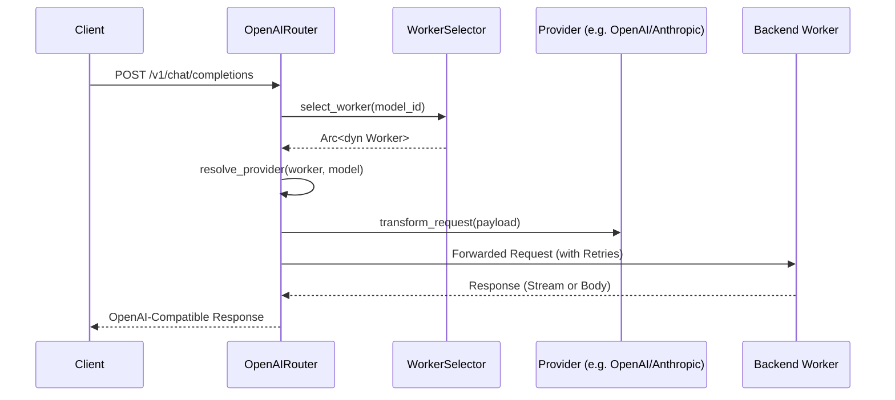
Sources: [model_gateway/src/routers/openai/router.rs:157-177](), [model_gateway/src/routers/openai/chat.rs:45-87](), [model_gateway/src/routers/openai/router.rs:51-63]()

## Supported Endpoints

### Chat Completions (`/v1/chat/completions`)
The primary endpoint for conversational AI. It supports the full `ChatCompletionRequest` schema, including system, user, assistant, and tool messages [crates/protocols/src/chat.rs:28-60]().

*   **Streaming**: Supported via Server-Sent Events (SSE) [model_gateway/src/routers/openai/chat.rs:170-171]().
*   **Reasoning Content**: Extension for O1-style models, allowing extraction of chain-of-thought blocks [crates/protocols/src/chat.rs:45-45]().
*   **Normalization**: Automatically migrates deprecated fields (e.g., `max_tokens` to `max_completion_tokens`, `functions` to `tools`) to ensure backend compatibility [model_gateway/tests/spec/chat_completion.rs:15-45]().

### Completions (`/v1/completions`)
Supports legacy text completion workflows. While deprecated in the OpenAI spec, SMG maintains support for compatibility with older tools and specific base model prompting [crates/protocols/src/completion.rs:20-149]().

### Responses API (`/v1/responses`)
A stateful, agentic extension of the chat API. It handles conversation history management and Model Context Protocol (MCP) tool execution [model_gateway/src/routers/openai/responses/mod.rs:1-10]().

*   **History Loading**: Automatically fetches previous messages from `ConversationStorage` or `ResponseStorage` based on `conversation_id` or `previous_response_id` [model_gateway/src/routers/openai/responses/history.rs:34-43]().
*   **MCP Integration**: Intercepts tool calls to execute local or remote MCP tools before returning the final response to the user [model_gateway/src/routers/openai/responses/mod.rs:5-8]().

### Utility Endpoints
*   **/v1/embeddings**: Generates vector representations of input text.
*   **/v1/tokenize**: Returns token IDs for a given string using the model's specific tokenizer.
*   **/v1/detokenize**: Converts token IDs back into human-readable text.
*   **/v1/audio/transcriptions**: Speech-to-text processing.
*   **/v1/realtime**: WebSocket and WebRTC based low-latency interaction [model_gateway/src/routers/openai/router.rs:194-208]().

Sources: [crates/protocols/src/chat.rs:143-180](), [model_gateway/src/routers/openai/responses/route.rs:42-48](), [model_gateway/src/routers/openai/router.rs:13-20]()

## Implementation Details

### Provider Transformation
The `resolve_provider` function determines which transformation logic to apply to a request [model_gateway/src/routers/openai/router.rs:51-63](). If a worker targets a non-OpenAI backend (like Anthropic), the `Provider` trait implementation handles:
1.  **Request Mapping**: Translating JSON fields (e.g., mapping `max_completion_tokens` to `max_tokens` for specific backends) [model_gateway/src/routers/openai/chat.rs:111-121]().
2.  **Header Injection**: Applying provider-specific authentication headers (e.g., `x-api-key` for Anthropic or `x-goog-api-key` for Gemini) [model_gateway/src/routers/common/header_utils.rs:158-180]().

### Resilience and Retries
Chat requests are wrapped in a `RetryExecutor`. If an upstream worker returns a retryable status code (e.g., 429 or 503), SMG will attempt to re-route the request to a different healthy worker [model_gateway/src/routers/openai/chat.rs:154-164]().

### Entity Mapping
The following diagram maps the API concepts to their internal Rust implementations.

**Title: API to Code Entity Mapping**
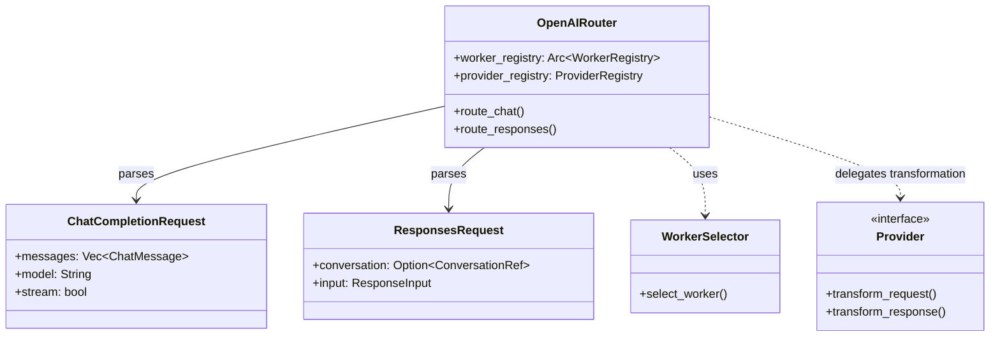
Sources: [model_gateway/src/routers/openai/router.rs:65-74](), [crates/protocols/src/chat.rs:143-180](), [model_gateway/src/routers/openai/chat.rs:65-66](), [model_gateway/src/routers/openai/context.rs:14-18]()

## Data Schemas and Validation

SMG enforces strict validation on incoming requests using the `validator` crate.

| Feature | Logic | Source |
| :--- | :--- | :--- |
| **Stop Sequences** | Max 4 sequences, non-empty strings required. | [crates/protocols/src/common.rs:156-181]() |
| **Sampling Params** | Temperature [0, 2], Top-p [0, 1], Presence Penalty [-2, 2]. | [crates/protocols/src/chat.rs:152-198]() |
| **Multimodal** | Supports `image_url`, `audio_url`, `video_url`, and `input_audio` parts. | [crates/protocols/src/common.rs:189-200]() |
| **Normalization** | Merges `functions` into `tools` and `function_call` into `tool_choice`. | [model_gateway/tests/spec/chat_completion.rs:74-143]() |

Sources: [crates/protocols/src/chat.rs:141-143](), [crates/protocols/src/completion.rs:18-20](), [crates/protocols/src/common.rs:187-200]()

---

# Page: Responses API (Agentic Workflows)

# Responses API (Agentic Workflows)

<details>
<summary>Relevant source files</summary>

The following files were used as context for generating this wiki page:

- [crates/mcp/src/core/session.rs](crates/mcp/src/core/session.rs)
- [crates/protocols/src/builders/responses/response.rs](crates/protocols/src/builders/responses/response.rs)
- [crates/protocols/src/responses.rs](crates/protocols/src/responses.rs)
- [crates/protocols/tests/responses.rs](crates/protocols/tests/responses.rs)
- [model_gateway/benches/routing_allocation_bench.rs](model_gateway/benches/routing_allocation_bench.rs)
- [model_gateway/src/routers/common/header_utils.rs](model_gateway/src/routers/common/header_utils.rs)
- [model_gateway/src/routers/common/mcp_utils.rs](model_gateway/src/routers/common/mcp_utils.rs)
- [model_gateway/src/routers/common/openai_bridge/connect.rs](model_gateway/src/routers/common/openai_bridge/connect.rs)
- [model_gateway/src/routers/common/openai_bridge/format_descriptor.rs](model_gateway/src/routers/common/openai_bridge/format_descriptor.rs)
- [model_gateway/src/routers/common/openai_bridge/mod.rs](model_gateway/src/routers/common/openai_bridge/mod.rs)
- [model_gateway/src/routers/common/persistence_utils.rs](model_gateway/src/routers/common/persistence_utils.rs)
- [model_gateway/src/routers/grpc/common/responses/handlers.rs](model_gateway/src/routers/grpc/common/responses/handlers.rs)
- [model_gateway/src/routers/grpc/harmony/builder.rs](model_gateway/src/routers/grpc/harmony/builder.rs)
- [model_gateway/src/routers/grpc/regular/responses/conversions.rs](model_gateway/src/routers/grpc/regular/responses/conversions.rs)
- [model_gateway/src/routers/openai/chat.rs](model_gateway/src/routers/openai/chat.rs)
- [model_gateway/src/routers/openai/context.rs](model_gateway/src/routers/openai/context.rs)
- [model_gateway/src/routers/openai/health.rs](model_gateway/src/routers/openai/health.rs)
- [model_gateway/src/routers/openai/mcp/tool_handler.rs](model_gateway/src/routers/openai/mcp/tool_handler.rs)
- [model_gateway/src/routers/openai/mcp/tool_loop.rs](model_gateway/src/routers/openai/mcp/tool_loop.rs)
- [model_gateway/src/routers/openai/responses/accumulator.rs](model_gateway/src/routers/openai/responses/accumulator.rs)
- [model_gateway/src/routers/openai/responses/common.rs](model_gateway/src/routers/openai/responses/common.rs)
- [model_gateway/src/routers/openai/responses/history.rs](model_gateway/src/routers/openai/responses/history.rs)
- [model_gateway/src/routers/openai/responses/mod.rs](model_gateway/src/routers/openai/responses/mod.rs)
- [model_gateway/src/routers/openai/responses/non_streaming.rs](model_gateway/src/routers/openai/responses/non_streaming.rs)
- [model_gateway/src/routers/openai/responses/route.rs](model_gateway/src/routers/openai/responses/route.rs)
- [model_gateway/src/routers/openai/responses/streaming.rs](model_gateway/src/routers/openai/responses/streaming.rs)
- [model_gateway/src/routers/openai/responses/utils.rs](model_gateway/src/routers/openai/responses/utils.rs)
- [model_gateway/src/routers/openai/router.rs](model_gateway/src/routers/openai/router.rs)
- [model_gateway/src/routers/responses/handlers.rs](model_gateway/src/routers/responses/handlers.rs)
- [model_gateway/src/routers/responses/mod.rs](model_gateway/src/routers/responses/mod.rs)
- [model_gateway/src/workflow/mcp_registration.rs](model_gateway/src/workflow/mcp_registration.rs)
- [model_gateway/tests/api/responses_api_test.rs](model_gateway/tests/api/responses_api_test.rs)
- [model_gateway/tests/spec/responses.rs](model_gateway/tests/spec/responses.rs)

</details>


The `/v1/responses` endpoint facilitates stateful, multi-turn agentic workflows. Unlike the stateless chat completions API, the Responses API manages conversation history internally, supports complex tool execution loops (including Model Context Protocol integration), and handles specialized output items like reasoning and file searches.

## 1. Request and Response Schemas

The Responses API utilizes a distinct set of types designed for structured agentic interactions, primarily defined in `crates/protocols/src/responses.rs`.

### Tool Choice and Built-in Tools
The API supports standard options (`none`, `auto`, `required`) and specific tool types. A key difference from the Chat API is the flat structure for function tool choice: `{"type": "function", "name": "..."}` [crates/protocols/src/responses.rs:105-124]().

Supported built-in tools include:
*   `web_search` / `web_search_preview`
*   `image_generation`
*   `computer_use_preview`
*   `file_search`
*   `code_interpreter`

### Input and Output Items
Requests can provide input as raw text or a sequence of `ResponseInputOutputItem` objects [crates/protocols/src/responses.rs:46-54](). Output items include:
*   `message`: Standard assistant responses.
*   `reasoning`: Chain-of-thought blocks [crates/protocols/tests/responses.rs:14-23]().
*   `function_call` / `function_call_output`: Tool interaction records.
*   `mcp_call`: Specialized Model Context Protocol tool calls [model_gateway/src/routers/openai/mcp/tool_loop.rs:160-170]().

### Data Flow: Request Orchestration
The following diagram illustrates the lifecycle of a request to the `/v1/responses` endpoint.

**Responses Request Flow**
```mermaid
sequenceDiagram
    participant C as Client
    participant R as OpenAIRouter
    participant H as HistoryManager
    participant W as WorkerSelector
    participant P as Provider
    participant BE as BackendWorker

    C->>R: POST /v1/responses
    R->>R: Metrics::record_router_request()
    R->>W: select_worker(model_id)
    W-->>R: Worker Instance
    R->>H: load_input_history(conversation_id)
    H-->>R: PreviousResponseID + HistoryItems
    R->>P: transform_request(payload)
    R->>BE: Forwarded Request (Non-streaming or SSE)
    BE-->>R: Response Stream / JSON
    R->>C: Transformed Response
```
**Sources:** [model_gateway/src/routers/openai/router.rs:179-192](), [model_gateway/src/routers/openai/responses/route.rs:42-186]().

---

## 2. Tool Execution Loop and MCP Integration

SMG implements a stateful tool execution loop that allows the model to perform multiple tool calls in a single request turn. This is particularly relevant for **Model Context Protocol (MCP)** tools.

### The Tool Loop Logic
When a request includes MCP tools, SMG intercepts the model's function calls and executes them locally or via remote MCP servers before potentially "resuming" the conversation with the model using the tool results.

1.  **Interception**: Function calls from the backend are checked against the `McpToolSession` [model_gateway/src/routers/openai/mcp/tool_loop.rs:170-180]().
2.  **Execution**: The `McpOrchestrator` executes the tool [crates/mcp/src/core/session.rs:112-135]().
3.  **Transformation**: Results are transformed into the appropriate `ResponseFormat` (e.g., `web_search_call`, `mcp_call`) [model_gateway/src/routers/openai/mcp/tool_loop.rs:201-210]().
4.  **Iteration**: If `max_iterations` is not reached, SMG may send the results back to the LLM to continue the response [model_gateway/src/routers/openai/responses/non_streaming.rs:104-117]().

**Entity Mapping: Tool Loop Components**
```mermaid
graph TD
    subgraph "Natural Language / API Space"
        API["/v1/responses Request"]
        Tools["Tool Choice (auto/required)"]
    end

    subgraph "Code Entity Space"
        Session["McpToolSession (crates/mcp/src/core/session.rs)"]
        Loop["execute_tool_loop (model_gateway/src/routers/openai/mcp/tool_loop.rs)"]
        Handler["StreamingToolHandler (model_gateway/src/routers/openai/mcp/tool_handler.rs)"]
        Registry["FormatRegistry (model_gateway/src/routers/common/openai_bridge/mod.rs)"]
    end

    API --> Session
    Tools --> Registry
    Session --> Loop
    Loop --> Handler
```
**Sources:** [crates/mcp/src/core/session.rs:68-86](), [model_gateway/src/routers/openai/mcp/tool_loop.rs:42-55](), [model_gateway/src/routers/openai/responses/non_streaming.rs:87-102]().

---

## 3. Streaming and SSE Events

Streaming in the Responses API uses Server-Sent Events (SSE). SMG manages the complexity of multi-turn tool calls by injecting intermediate events into the stream.

### Key Streaming Functions
*   `handle_streaming_response`: The entry point for SSE requests [model_gateway/src/routers/openai/responses/streaming.rs:1-9]().
*   `apply_event_transformations_inplace`: Efficiently modifies JSON payloads in the stream to mask internal tool formats or inject metadata like `previous_response_id` [model_gateway/src/routers/openai/responses/streaming.rs:69-83]().
*   `StreamingResponseAccumulator`: Collects chunks to allow persistence of the full conversation even when streamed [model_gateway/src/routers/openai/responses/accumulator.rs:1-10]().

### Event Transformation
SMG rewrites `function_call` events into `mcp_call` or `web_search_call` based on the `McpToolSession` configuration [model_gateway/src/routers/openai/responses/streaming.rs:133-150]().

**Sources:** [model_gateway/src/routers/openai/responses/streaming.rs:69-130](), [model_gateway/src/routers/openai/responses/utils.rs:135-150]().

---

## 4. Conversation History Management

The Responses API is stateful. SMG handles the resolution of `conversation_id` and `previous_response_id` to provide the backend with the necessary context.

### History Resolution Logic
1.  **Conflict Validation**: The API ensures that `conversation` and `previous_response_id` are mutually exclusive in a single request [model_gateway/src/routers/openai/responses/route.rs:92-110]().
2.  **Loading**: `load_input_history` queries the `ConversationStorage` and `ConversationItemStorage` to reconstruct the thread [model_gateway/src/routers/openai/responses/route.rs:116-126]().
3.  **Persistence**: After a successful turn, `persist_conversation_items` saves new messages, tool calls, and reasoning blocks to the database [model_gateway/src/routers/openai/responses/non_streaming.rs:186-194]().

**History Entity Mapping**
```mermaid
graph LR
    subgraph "API Fields"
        ConvRef["conversation (ConversationRef)"]
        PrevID["previous_response_id"]
    end

    subgraph "Persistence Logic"
        Loader["load_input_history (model_gateway/src/routers/openai/responses/history.rs)"]
        Persister["persist_conversation_items (model_gateway/src/routers/common/persistence_utils.rs)"]
    end

    subgraph "Storage Traits"
        ConvStore["ConversationStorage"]
        ItemStore["ConversationItemStorage"]
    end

    ConvRef --> Loader
    PrevID --> Loader
    Loader --> ConvStore
    Persister --> ItemStore
```
**Sources:** [model_gateway/src/routers/openai/responses/route.rs:88-110](), [model_gateway/src/routers/openai/responses/non_streaming.rs:181-194]().

---

## 5. Protocol Conversions (gRPC Harmony)

For backends using the Harmony protocol (e.g., `gpt-oss`), SMG performs deep translation between OpenAI Responses types and Harmony's internal representation.

*   **Request Conversion**: `responses_to_chat` maps Response items (messages, tool calls, reasoning) into a flat chat message list suitable for backend processing [model_gateway/src/routers/grpc/regular/responses/conversions.rs:34-54]().
*   **Harmony Encoding**: Uses `openai-harmony` to encode content into specific channel tags for tools like `web_search` or `code_interpreter` [model_gateway/src/routers/grpc/harmony/builder.rs:108-136]().
*   **Reasoning Extraction**: Extracts reasoning content from the Harmony stream and packages it into `ResponseOutputItem::Reasoning` [model_gateway/src/routers/grpc/regular/responses/conversions.rs:119-135]().

**Sources:** [model_gateway/src/routers/grpc/regular/responses/conversions.rs:10-34](), [model_gateway/src/routers/grpc/harmony/builder.rs:178-195]().

---

# Page: Control Plane (Admin) API

# Control Plane (Admin) API

<details>
<summary>Relevant source files</summary>

The following files were used as context for generating this wiki page:

- [README.md](README.md)
- [docs/assets/images/architecture-animated.svg](docs/assets/images/architecture-animated.svg)
- [docs/assets/images/concepts-overview.svg](docs/assets/images/concepts-overview.svg)
- [docs/assets/images/mcp-architecture.svg](docs/assets/images/mcp-architecture.svg)
- [docs/assets/images/service-discovery.svg](docs/assets/images/service-discovery.svg)
- [docs/assets/images/wasm-plugins.svg](docs/assets/images/wasm-plugins.svg)
- [docs/assets/stylesheets/extra.css](docs/assets/stylesheets/extra.css)
- [docs/concepts/data/chat-history.md](docs/concepts/data/chat-history.md)
- [docs/concepts/index.md](docs/concepts/index.md)
- [docs/concepts/routing/load-balancing.md](docs/concepts/routing/load-balancing.md)
- [docs/concepts/security/authentication.md](docs/concepts/security/authentication.md)
- [docs/contributing/index.md](docs/contributing/index.md)
- [docs/getting-started/control-plane-auth.md](docs/getting-started/control-plane-auth.md)
- [docs/getting-started/control-plane-operations.md](docs/getting-started/control-plane-operations.md)
- [docs/getting-started/data-connections.md](docs/getting-started/data-connections.md)
- [docs/getting-started/index.md](docs/getting-started/index.md)
- [docs/getting-started/mcp.md](docs/getting-started/mcp.md)
- [docs/getting-started/monitoring.md](docs/getting-started/monitoring.md)
- [docs/getting-started/reliability-controls.md](docs/getting-started/reliability-controls.md)
- [docs/index.md](docs/index.md)
- [docs/reference/api/admin.md](docs/reference/api/admin.md)
- [docs/reference/api/extensions.md](docs/reference/api/extensions.md)
- [docs/reference/api/responses.md](docs/reference/api/responses.md)
- [docs/reference/metrics.md](docs/reference/metrics.md)
- [mkdocs.yml](mkdocs.yml)
- [model_gateway/src/config/mod.rs](model_gateway/src/config/mod.rs)
- [model_gateway/src/health.rs](model_gateway/src/health.rs)
- [model_gateway/src/observability/metrics.rs](model_gateway/src/observability/metrics.rs)
- [model_gateway/src/observability/metrics_server.rs](model_gateway/src/observability/metrics_server.rs)
- [model_gateway/src/observability/mod.rs](model_gateway/src/observability/mod.rs)
- [model_gateway/src/observability/runtime_metrics.rs](model_gateway/src/observability/runtime_metrics.rs)
- [model_gateway/src/service_discovery.rs](model_gateway/src/service_discovery.rs)
- [model_gateway/src/worker/registry.rs](model_gateway/src/worker/registry.rs)
- [model_gateway/src/worker/service.rs](model_gateway/src/worker/service.rs)
- [model_gateway/src/workflow/data.rs](model_gateway/src/workflow/data.rs)
- [model_gateway/src/workflow/job_queue.rs](model_gateway/src/workflow/job_queue.rs)
- [model_gateway/src/workflow/mod.rs](model_gateway/src/workflow/mod.rs)
- [model_gateway/src/workflow/steps/local/create_worker.rs](model_gateway/src/workflow/steps/local/create_worker.rs)
- [model_gateway/src/workflow/steps/mod.rs](model_gateway/src/workflow/steps/mod.rs)
- [model_gateway/src/workflow/steps/shared/register.rs](model_gateway/src/workflow/steps/shared/register.rs)
- [model_gateway/tests/harmony_encoding_test.rs](model_gateway/tests/harmony_encoding_test.rs)
- [model_gateway/tests/routing/worker_management_test.rs](model_gateway/tests/routing/worker_management_test.rs)

</details>


The Control Plane (Admin) API provides administrative endpoints for managing the lifecycle of the Shepherd Model Gateway (SMG). It enables dynamic worker registration, tokenizer management, WASM plugin deployment, and real-time observability of the system's load and health status.

## Overview and Data Flow

The Control Plane operates as an asynchronous management layer. When a request is made to an administrative endpoint, the gateway typically validates the input and then submits a `Job` to the `JobQueue`. This ensures that long-running operations—such as worker health probing or tokenizer downloading—do not block the API response.

### Administrative Data Flow

The following diagram illustrates how a worker registration request flows from the Admin API through the system's internal components.

**Admin API Workflow Execution**
```mermaid
sequenceDiagram
    participant Admin as "Admin Client"
    participant Router as "Admin Router (Axum)"
    participant Service as "WorkerService"
    participant Queue as "JobQueue"
    participant Workflow as "WorkerRegistration Workflow"
    participant Registry as "WorkerRegistry"

    Admin->>Router: POST /workers (WorkerSpec)
    Router->>Service: create_worker(spec)
    Service->>Service: validate_worker_url_request()
    Service->>Queue: submit(Job::AddWorker)
    Queue-->>Admin: 202 Accepted (Job Status)
    
    Note over Queue, Workflow: Background Processing
    Queue->>Workflow: execute(Job::AddWorker)
    Workflow->>Workflow: CreateLocalWorkerStep
    Workflow->>Registry: register(Arc<dyn Worker>)
    Registry->>Registry: Rebuild HashRing
```
Sources: [model_gateway/src/worker/service.rs:112-136](), [model_gateway/src/workflow/job_queue.rs:175-194](), [model_gateway/src/worker/registry.rs:9-13]()

---

## Worker Management

Worker management endpoints allow for the dynamic scaling and reconfiguration of the inference fleet without restarting the gateway.

### Endpoints
*   **POST /workers**: Registers a new backend worker. Triggers the `AddWorker` job [model_gateway/src/workflow/job_queue.rs:36-39]().
*   **PATCH /workers/{id}**: Partially updates worker configuration (e.g., priority, cost, or API keys) [docs/reference/api/admin.md:197-228]().
*   **PUT /workers/{id}**: Re-runs the full registration workflow for an existing worker ID [docs/reference/api/admin.md:232-242]().
*   **DELETE /workers/{id}**: Removes a worker from the pool and stops its health checks [model_gateway/src/worker/service.rs:138-154]().

### Implementation Details
The `WorkerService` acts as the business logic layer, translating HTTP requests into `Job` objects [model_gateway/src/worker/service.rs:1-5](). Validations are performed against the `RouterConfig` to ensure URL safety and prevent orphaned reservations [model_gateway/src/worker/service.rs:24-32]().

**Worker Entity Mapping**
```mermaid
classDiagram
    class WorkerSpec {
        +String url
        +WorkerType worker_type
        +ConnectionMode connection_mode
        +RuntimeType runtime_type
    }
    class WorkerService {
        +create_worker(WorkerSpec)
        +delete_worker(WorkerId)
    }
    class JobQueue {
        +submit(Job)
        -process_job(Job)
    }
    class WorkerRegistry {
        +DashMap workers
        +DashMap model_index
        +register(Worker)
    }

    WorkerService --> JobQueue : "Submits Job::AddWorker"
    JobQueue --> WorkerRegistry : "Finalizes registration"
    WorkerSpec --* WorkerService : "Input Validation"
```
Sources: [model_gateway/src/worker/service.rs:18-22](), [model_gateway/src/worker/registry.rs:91-139](), [model_gateway/src/workflow/job_queue.rs:124-133]()

---

## Tokenizer and WASM Management

SMG supports dynamic management of tokenizers and WebAssembly (WASM) plugins to extend gateway functionality.

### Tokenizer Management (`POST /v1/tokenizers`)
Tokenizers are used for gateway-side tokenization (essential for gRPC mode).
*   **Job Type**: `Job::AddTokenizer` [model_gateway/src/workflow/job_queue.rs:63-65]().
*   **Capabilities**: Supports loading from HuggingFace IDs or local paths [docs/reference/api/admin.md:23-32]().
*   **Lifecycle**: Jobs transition through `pending`, `processing`, and `completed` states [docs/reference/api/admin.md:123-129]().

### WASM Plugin Management (`POST /wasm`)
WASM modules can be dynamically injected into the request/response pipeline.
*   **Job Type**: `Job::AddWasmModule` [model_gateway/src/workflow/job_queue.rs:57-59]().
*   **Workflow**: Handled via `create_wasm_registration_workflow_data` which prepares the runtime environment for the module [model_gateway/src/workflow/job_queue.rs:25-26]().

Sources: [docs/reference/api/admin.md:10-148](), [model_gateway/src/workflow/job_queue.rs:57-68]()

---

## Observability and Cache Control

The Control Plane provides deep insights into the current state of the inference fleet.

### Load Monitoring (`GET /get_loads`)
This endpoint fans out requests to all registered workers to aggregate current KV-cache utilization [docs/reference/api/admin.md:290-296]().
*   **Logic**: Queries every backend (HTTP or gRPC) for their specific load metrics [docs/reference/api/admin.md:296-300]().
*   **Usage**: Critical for verifying the effectiveness of the `cache_aware` routing policy.

### Cache Management (`POST /flush_cache`)
Forces a KV-cache eviction across the fleet.
*   **HTTP Workers**: Sends a flush command to all HTTP-based backends [docs/reference/api/admin.md:269-273]().
*   **Partial Success**: If only a subset of workers succeed, it returns `206 Partial Content` with a list of failed worker URLs [docs/reference/api/admin.md:273-287]().

### Metrics Server
SMG runs a dedicated Prometheus metrics server, typically on port `29000`.
*   **Endpoint**: `GET /metrics` [model_gateway/src/observability/metrics_server.rs:2]().
*   **Implementation**: Uses `PrometheusHandle` to render interner-optimized metrics [model_gateway/src/observability/metrics_server.rs:18-29]().
*   **Upkeep**: A background task runs every 5 minutes to maintain histogram buckets [model_gateway/src/observability/metrics_server.rs:66-71]().

Sources: [docs/reference/api/admin.md:263-300](), [model_gateway/src/observability/metrics_server.rs:1-47]()

---

## Health and Mesh Status

SMG implements standard Kubernetes-compatible health endpoints and mesh synchronization checks.

### Liveness and Readiness
*   **GET /health**: Basic gateway health check.
*   **GET /liveness**: Indicates if the process is running.
*   **GET /readiness**: Indicates if the gateway has initialized its worker pool and is ready to route traffic [docs/reference/api/admin.md:6-7]().

### High Availability (HA) Mesh Status
In a multi-gateway deployment, SMG uses a gossip protocol to synchronize state.
*   **Service Discovery**: The gateway can watch Kubernetes `Pod` resources to automatically register workers based on labels or annotations [model_gateway/src/service_discovery.rs:11-19]().
*   **Mesh Sync**: Node status (Alive/Leaving/Down) is tracked via `NodeState` and published across the cluster [model_gateway/src/service_discovery.rs:22-25]().

Sources: [model_gateway/src/service_discovery.rs:89-107](), [docs/reference/api/admin.md:1-7]()

---

# Page: Worker Management

# Worker Management

<details>
<summary>Relevant source files</summary>

The following files were used as context for generating this wiki page:

- [bindings/golang/src/policy.rs](bindings/golang/src/policy.rs)
- [crates/protocols/src/worker.rs](crates/protocols/src/worker.rs)
- [model_gateway/src/config/mod.rs](model_gateway/src/config/mod.rs)
- [model_gateway/src/policies/least_load.rs](model_gateway/src/policies/least_load.rs)
- [model_gateway/src/policies/power_of_two.rs](model_gateway/src/policies/power_of_two.rs)
- [model_gateway/src/service_discovery.rs](model_gateway/src/service_discovery.rs)
- [model_gateway/src/worker/builder.rs](model_gateway/src/worker/builder.rs)
- [model_gateway/src/worker/capacity.rs](model_gateway/src/worker/capacity.rs)
- [model_gateway/src/worker/manager.rs](model_gateway/src/worker/manager.rs)
- [model_gateway/src/worker/mod.rs](model_gateway/src/worker/mod.rs)
- [model_gateway/src/worker/monitor.rs](model_gateway/src/worker/monitor.rs)
- [model_gateway/src/worker/registry.rs](model_gateway/src/worker/registry.rs)
- [model_gateway/src/worker/service.rs](model_gateway/src/worker/service.rs)
- [model_gateway/src/worker/worker.rs](model_gateway/src/worker/worker.rs)
- [model_gateway/src/workflow/data.rs](model_gateway/src/workflow/data.rs)
- [model_gateway/src/workflow/job_queue.rs](model_gateway/src/workflow/job_queue.rs)
- [model_gateway/src/workflow/mod.rs](model_gateway/src/workflow/mod.rs)
- [model_gateway/src/workflow/steps/local/create_worker.rs](model_gateway/src/workflow/steps/local/create_worker.rs)
- [model_gateway/src/workflow/steps/mod.rs](model_gateway/src/workflow/steps/mod.rs)
- [model_gateway/src/workflow/steps/shared/register.rs](model_gateway/src/workflow/steps/shared/register.rs)
- [model_gateway/tests/harmony_encoding_test.rs](model_gateway/tests/harmony_encoding_test.rs)
- [model_gateway/tests/routing/worker_management_test.rs](model_gateway/tests/routing/worker_management_test.rs)

</details>


The Worker Management subsystem is responsible for the full lifecycle of backend inference engines (workers) within SMG. This includes discovery via Kubernetes or manual API registration, health monitoring through a state-machine-driven probe system, and dynamic load tracking for advanced routing policies.

SMG treats workers as abstract entities that implement the `Worker` trait [model_gateway/src/worker/worker.rs:193-193](), allowing the gateway to manage diverse backends like vLLM, SGLang, and TensorRT-LLM through a unified interface.

### Worker Discovery and Lifecycle

Workers enter the system either via the **Control Plane API** (manual registration) or through **Service Discovery** (Kubernetes pod watching). Every registration triggers a background **Workflow DAG** that validates the worker's connection, detects its runtime type, and populates its metadata before adding it to the registry.

#### Registration Workflow DAG
When a worker is added, SMG executes a multi-step workflow [model_gateway/src/workflow/steps/mod.rs:36-65]() to ensure the worker is ready for traffic:

```mermaid
graph TD
    Start["Job::AddWorker"] --> Classify["classify_worker_type"]
    Classify --> Local["LOCAL Branch"]
    Classify --> External["EXTERNAL Branch"]
    
    subgraph "Local Processing"
    Local --> DetectConn["detect_connection_mode"]
    DetectConn --> DetectBackend["detect_backend"]
    DetectBackend --> DiscoverMeta["discover_metadata"]
    DiscoverMeta --> DiscoverDP["discover_dp_info"]
    DiscoverDP --> CreateWorker["create_local_worker"]
    end
    
    subgraph "External Processing"
    External --> DiscoverModels["discover_models"]
    DiscoverModels --> CreateExt["create_external_workers"]
    end
    
    CreateWorker --> Register["register_workers (Shared)"]
    CreateExt --> Register
    
    Register --> UpdatePol["update_policies"]
    Register --> SubmitTok["submit_tokenizer_job"]
    Register --> Activate["activate_workers"]
```
*Sources: [model_gateway/src/workflow/steps/mod.rs:36-65](), [model_gateway/src/workflow/job_queue.rs:35-69]()*

For details on the registration process and Kubernetes integration, see **[Service Discovery and Worker Registry](#4.1)**.

### Centralized Management Entities

The subsystem is built around three core components that coordinate to maintain fleet health:

| Component | Role | File Reference |
| :--- | :--- | :--- |
| `WorkerRegistry` | Lock-free storage for all active workers, indexed by ID and Model. | [model_gateway/src/worker/registry.rs:92-92]() |
| `WorkerManager` | Background coordinator for health check probes and lifecycle transitions. | [model_gateway/src/worker/manager.rs:118-118]() |
| `WorkerMonitor` | High-frequency load monitoring for data-parallel (DP) ranks and policies. | [model_gateway/src/worker/monitor.rs:3-6]() |

#### Worker State Machine
The `WorkerManager` moves workers through a lifecycle inspired by Kubernetes pod conditions [crates/protocols/src/worker.rs:98-130]():

```mermaid
stateDiagram-v2
    [*] --> Pending: Registration
    Pending --> Ready: First Health Check Success
    Ready --> NotReady: Health Check Failure
    NotReady --> Ready: Health Check Success
    NotReady --> Failed: Sustained Failure
    Ready --> Draining: Deletion Requested
    Draining --> [*]: Removed
    Failed --> [*]: Cleanup (if enabled)
```
*Sources: [crates/protocols/src/worker.rs:110-130](), [model_gateway/src/worker/manager.rs:138-153]()*

### Backend Abstraction and Communication

SMG supports both HTTP and gRPC communication with workers. The `Worker` trait abstracts these details, allowing the router to interact with backends without knowing the underlying protocol.

*   **HTTP Workers**: Standard OpenAI-compatible backends.
*   **gRPC Workers**: Optimized for high-throughput inference engines like SGLang and vLLM. These utilize specialized **Servicers** to handle advanced features like KV-cache event streaming and multimodal tensor transport.

For details on backend-specific implementations, see **[Backend gRPC Servicers](#4.2)**.

### Reliability and Resilience

To ensure high availability, SMG implements several per-worker resilience mechanisms:
*   **Circuit Breakers**: Prevents cascading failures by "tripping" when a worker's error rate exceeds a threshold [model_gateway/src/worker/circuit_breaker.rs:5-13]().
*   **Health Polling**: Periodic async probes verify backend readiness [model_gateway/src/worker/manager.rs:186-195]().
*   **Load Balancing Integration**: The `WorkerMonitor` tracks real-time metrics (e.g., KV cache usage, request queues) to inform load-aware routing [model_gateway/src/worker/monitor.rs:139-145]().

For details on these mechanisms, see **[Reliability: Circuit Breakers, Health Checks, and Retries](#4.3)**.

### Related Pages
*   **[Service Discovery and Worker Registry](#4.1)**: Deep dive into how workers are found and indexed.
*   **[Backend gRPC Servicers](#4.2)**: Technical details on the Python-side gRPC bridge.
*   **[Reliability: Circuit Breakers, Health Checks, and Retries](#4.3)**: Detailed breakdown of the resilience stack.

**Sources:**
*   `Worker` trait and status: [model_gateway/src/worker/worker.rs:193-210](), [crates/protocols/src/worker.rs:110-130]()
*   `WorkerRegistry` architecture: [model_gateway/src/worker/registry.rs:92-139]()
*   `WorkerManager` lifecycle: [model_gateway/src/worker/manager.rs:107-153]()
*   `WorkerMonitor` load tracking: [model_gateway/src/worker/monitor.rs:1-46]()
*   Workflow DAG: [model_gateway/src/workflow/steps/mod.rs:36-65]()

---

# Page: Service Discovery and Worker Registry

# Service Discovery and Worker Registry

<details>
<summary>Relevant source files</summary>

The following files were used as context for generating this wiki page:

- [bindings/golang/src/policy.rs](bindings/golang/src/policy.rs)
- [crates/grpc_client/build.rs](crates/grpc_client/build.rs)
- [crates/protocols/src/worker.rs](crates/protocols/src/worker.rs)
- [model_gateway/src/config/mod.rs](model_gateway/src/config/mod.rs)
- [model_gateway/src/policies/least_load.rs](model_gateway/src/policies/least_load.rs)
- [model_gateway/src/policies/power_of_two.rs](model_gateway/src/policies/power_of_two.rs)
- [model_gateway/src/routers/openai/mod.rs](model_gateway/src/routers/openai/mod.rs)
- [model_gateway/src/routers/openai/provider/mod.rs](model_gateway/src/routers/openai/provider/mod.rs)
- [model_gateway/src/routers/openai/provider/tests.rs](model_gateway/src/routers/openai/provider/tests.rs)
- [model_gateway/src/routers/openai/provider/types.rs](model_gateway/src/routers/openai/provider/types.rs)
- [model_gateway/src/service_discovery.rs](model_gateway/src/service_discovery.rs)
- [model_gateway/src/worker/builder.rs](model_gateway/src/worker/builder.rs)
- [model_gateway/src/worker/capacity.rs](model_gateway/src/worker/capacity.rs)
- [model_gateway/src/worker/manager.rs](model_gateway/src/worker/manager.rs)
- [model_gateway/src/worker/mod.rs](model_gateway/src/worker/mod.rs)
- [model_gateway/src/worker/monitor.rs](model_gateway/src/worker/monitor.rs)
- [model_gateway/src/worker/registry.rs](model_gateway/src/worker/registry.rs)
- [model_gateway/src/worker/service.rs](model_gateway/src/worker/service.rs)
- [model_gateway/src/worker/worker.rs](model_gateway/src/worker/worker.rs)
- [model_gateway/src/workflow/data.rs](model_gateway/src/workflow/data.rs)
- [model_gateway/src/workflow/job_queue.rs](model_gateway/src/workflow/job_queue.rs)
- [model_gateway/src/workflow/mod.rs](model_gateway/src/workflow/mod.rs)
- [model_gateway/src/workflow/steps/classify.rs](model_gateway/src/workflow/steps/classify.rs)
- [model_gateway/src/workflow/steps/local/create_worker.rs](model_gateway/src/workflow/steps/local/create_worker.rs)
- [model_gateway/src/workflow/steps/local/detect_backend.rs](model_gateway/src/workflow/steps/local/detect_backend.rs)
- [model_gateway/src/workflow/steps/local/discover_dp.rs](model_gateway/src/workflow/steps/local/discover_dp.rs)
- [model_gateway/src/workflow/steps/local/discover_metadata.rs](model_gateway/src/workflow/steps/local/discover_metadata.rs)
- [model_gateway/src/workflow/steps/mod.rs](model_gateway/src/workflow/steps/mod.rs)
- [model_gateway/src/workflow/steps/shared/register.rs](model_gateway/src/workflow/steps/shared/register.rs)
- [model_gateway/src/workflow/steps/util.rs](model_gateway/src/workflow/steps/util.rs)
- [model_gateway/tests/harmony_encoding_test.rs](model_gateway/tests/harmony_encoding_test.rs)
- [model_gateway/tests/routing/worker_management_test.rs](model_gateway/tests/routing/worker_management_test.rs)

</details>


The **Service Discovery and Worker Registry** subsystem is responsible for the lifecycle management of backend inference workers. It provides mechanisms for automatic discovery via Kubernetes, manual registration via the Control Plane API, and a high-performance, lock-free registry for routing lookups.

## Kubernetes Service Discovery

SMG supports native Kubernetes pod watching to automatically discover and register workers. The `ServiceDiscoveryConfig` [model_gateway/src/service_discovery.rs:89-107]() defines how SMG interacts with the Kubernetes API.

### Pod Watching and Filtering
The `build_watcher_config` function [model_gateway/src/service_discovery.rs:170-180]() creates a `kube::runtime::watcher` that filters pods based on label selectors. SMG supports both regular and disaggregated (PD/EPD) modes:
- **Regular Mode**: Uses a single `selector` to find all workers [model_gateway/src/service_discovery.rs:133-139]().
- **Disaggregated Mode**: Aggregates `encode_selector`, `prefill_selector`, and `decode_selector` to monitor specialized roles [model_gateway/src/service_discovery.rs:117-132]().

### Model ID Resolution
Workers discovered via K8s can derive their `model_id` from pod metadata using the `ModelIdSource` enum [model_gateway/src/service_discovery.rs:36-44]():
- `Namespace`: Uses the pod's K8s namespace.
- `Label(key)`: Extracts the value of a specific pod label.
- `Annotation(key)`: Extracts the value of a specific pod annotation.

**Sources:** [model_gateway/src/service_discovery.rs:35-86](), [model_gateway/src/service_discovery.rs:89-164]()

---

## Worker Registry Implementation

The `WorkerRegistry` [model_gateway/src/worker/registry.rs:92-139]() is the central source of truth for all known workers. It is optimized for high-concurrency read access during request routing.

### Lock-Free Read Design
To minimize contention, the registry uses **Copy-on-Write (CoW) snapshots** for its primary indices:
- **`model_index`**: Maps a `model_id` to an `Arc<[Arc<dyn Worker>]>`. Routers can acquire a snapshot of all workers for a model without holding a long-lived lock [model_gateway/src/worker/registry.rs:82-85]().
- **`model_alias_index`**: Maps aliases to canonical model IDs, allowing for transparent model redirection [model_gateway/src/worker/registry.rs:88-88]().
- **`hash_rings`**: Maintains pre-computed `HashRing` structures per model for O(log n) consistent hashing [model_gateway/src/worker/registry.rs:109-111]().

### Worker Status State Machine
Workers transition through several states defined in `WorkerStatus` [crates/protocols/src/worker.rs:110-130]():
- `Pending`: Newly registered; awaiting first health check.
- `Ready`: Health check passed; routable.
- `NotReady`: Failed a readiness probe; temporarily non-routable.
- `Draining`: Marked for removal; handles in-flight requests but accepts no new ones.

**Sources:** [model_gateway/src/worker/registry.rs:92-168](), [crates/protocols/src/worker.rs:98-161]()

---

## Worker Registration Workflow (DAG)

Worker registration is handled asynchronously via a Directed Acyclic Graph (DAG) managed by the `wfaas` (Workflow as a Service) engine. This ensures that complex detection and configuration steps are performed reliably.

### Workflow Steps
The `create_worker_registration_workflow` [model_gateway/src/workflow/steps/mod.rs:66-178]() defines the execution order:

| Step ID | Responsibility |
| :--- | :--- |
| `classify_worker_type` | Determines if the worker is `Local` (managed by SMG) or `External` (e.g., OpenAI API) [model_gateway/src/workflow/steps/classify.rs:1-20](). |
| `detect_connection_mode` | Probes the worker to determine if it uses `HTTP` or `gRPC` [model_gateway/src/workflow/steps/local/detect_connection_mode.rs:1-30](). |
| `detect_backend` | Identifies the inference engine (vLLM, SGLang, TRT-LLM) [model_gateway/src/workflow/steps/local/detect_backend.rs:1-40](). |
| `discover_metadata` | Fetches model names, chat templates, and engine-specific features [model_gateway/src/workflow/steps/local/discover_metadata.rs:1-50](). |
| `discover_dp_info` | Detects Data-Parallel (DP) ranks for engine-internal load balancing [model_gateway/src/workflow/steps/local/discover_dp.rs:1-35](). |
| `create_local_worker` | Instantiates the `Worker` trait object with the gathered configuration [model_gateway/src/workflow/steps/local/create_worker.rs:20-20](). |
| `register_workers` | Commits the worker(s) to the `WorkerRegistry` [model_gateway/src/workflow/steps/shared/register.rs:1-25](). |

### Data-Parallel (DP) Expansion
If `dp_aware` is enabled in the configuration, the `CreateLocalWorkerStep` [model_gateway/src/workflow/steps/local/create_worker.rs:124-136]() expands a single registration request into multiple worker instances, one for each DP rank detected by the `DiscoverDPInfoStep`.

**Sources:** [model_gateway/src/workflow/steps/mod.rs:36-178](), [model_gateway/src/workflow/steps/local/create_worker.rs:19-178]()

---

## Technical Architecture Diagrams

### Worker Registration Data Flow
This diagram traces a registration request from the API/K8s into the `WorkerRegistry`.

```mermaid
graph TD
    subgraph "Entry Points"
        K8s["K8s Watcher (service_discovery.rs)"]
        API["Admin API (POST /workers)"]
    end

    subgraph "Workflow Engine (workflow/mod.rs)"
        JQ["JobQueue (job_queue.rs)"]
        DAG["WorkerRegistration Workflow (steps/mod.rs)"]
    end

    subgraph "Worker Registry (worker/registry.rs)"
        WR["WorkerRegistry Struct"]
        MI["ModelIndex (Lock-free CoW)"]
        HR["HashRings (Consistent Hashing)"]
    end

    K8s -->|Job::AddWorker| JQ
    API -->|Job::AddWorker| JQ
    JQ -->|Execute| DAG
    DAG -->|Step: register_workers| WR
    WR -->|Update| MI
    WR -->|Rebuild| HR
```
**Sources:** [model_gateway/src/workflow/job_queue.rs:34-69](), [model_gateway/src/worker/registry.rs:92-139](), [model_gateway/src/workflow/steps/mod.rs:38-65]()

### Code Entity Relationship
Associating system concepts with specific Rust structs and traits.

```mermaid
classDiagram
    class Worker {
        <<trait>>
        url() String
        status() WorkerStatus
        load() usize
    }
    class BasicWorker {
        <<struct>>
        metadata: WorkerMetadata
        circuit_breaker: CircuitBreaker
    }
    class WorkerRegistry {
        <<struct>>
        workers: DashMap~WorkerId, Arc~Worker~~
        model_index: ModelIndex
        hash_rings: DashMap~String, HashRing~
    }
    class WorkerManager {
        <<struct>>
        handle: JoinHandle
        run_health_loop()
    }
    class JobQueue {
        <<struct>>
        status_map: DashMap~String, JobStatus~
        process_job()
    }

    Worker <|-- BasicWorker : Implements
    WorkerRegistry "1" *-- "many" Worker : Manages
    WorkerManager --> WorkerRegistry : Probes Health
    WorkerManager --> JobQueue : Submits Removal Jobs
```
**Sources:** [model_gateway/src/worker/worker.rs:193-215](), [model_gateway/src/worker/registry.rs:92-139](), [model_gateway/src/worker/manager.rs:118-136](), [model_gateway/src/workflow/job_queue.rs:124-133]()

---

# Page: Backend gRPC Servicers

# Backend gRPC Servicers

<details>
<summary>Relevant source files</summary>

The following files were used as context for generating this wiki page:

- [crates/grpc_client/proto/common.proto](crates/grpc_client/proto/common.proto)
- [crates/grpc_client/proto/tokenspeed_scheduler.proto](crates/grpc_client/proto/tokenspeed_scheduler.proto)
- [crates/grpc_client/proto/trtllm_service.proto](crates/grpc_client/proto/trtllm_service.proto)
- [crates/grpc_client/proto/vllm_engine.proto](crates/grpc_client/proto/vllm_engine.proto)
- [crates/grpc_client/python/README.md](crates/grpc_client/python/README.md)
- [crates/grpc_client/python/pyproject.toml](crates/grpc_client/python/pyproject.toml)
- [crates/grpc_client/src/abort_on_drop.rs](crates/grpc_client/src/abort_on_drop.rs)
- [crates/grpc_client/src/channel.rs](crates/grpc_client/src/channel.rs)
- [crates/grpc_client/src/lib.rs](crates/grpc_client/src/lib.rs)
- [crates/grpc_client/src/mlx_engine.rs](crates/grpc_client/src/mlx_engine.rs)
- [crates/grpc_client/src/sglang_scheduler.rs](crates/grpc_client/src/sglang_scheduler.rs)
- [crates/grpc_client/src/tokenspeed_scheduler.rs](crates/grpc_client/src/tokenspeed_scheduler.rs)
- [crates/grpc_client/src/trtllm_service.rs](crates/grpc_client/src/trtllm_service.rs)
- [crates/grpc_client/src/vllm_engine.rs](crates/grpc_client/src/vllm_engine.rs)
- [docs/getting-started/kv-events-cache-aware.md](docs/getting-started/kv-events-cache-aware.md)
- [e2e_test/responses/test_sampling_params.py](e2e_test/responses/test_sampling_params.py)
- [grpc_servicer/DEVELOPMENT.md](grpc_servicer/DEVELOPMENT.md)
- [grpc_servicer/README.md](grpc_servicer/README.md)
- [grpc_servicer/pyproject.toml](grpc_servicer/pyproject.toml)
- [grpc_servicer/smg_grpc_servicer/__init__.py](grpc_servicer/smg_grpc_servicer/__init__.py)
- [grpc_servicer/smg_grpc_servicer/kv_events.py](grpc_servicer/smg_grpc_servicer/kv_events.py)
- [grpc_servicer/smg_grpc_servicer/mlx/__init__.py](grpc_servicer/smg_grpc_servicer/mlx/__init__.py)
- [grpc_servicer/smg_grpc_servicer/mlx/health_servicer.py](grpc_servicer/smg_grpc_servicer/mlx/health_servicer.py)
- [grpc_servicer/smg_grpc_servicer/mlx/server.py](grpc_servicer/smg_grpc_servicer/mlx/server.py)
- [grpc_servicer/smg_grpc_servicer/mlx/servicer.py](grpc_servicer/smg_grpc_servicer/mlx/servicer.py)
- [grpc_servicer/smg_grpc_servicer/sglang/__init__.py](grpc_servicer/smg_grpc_servicer/sglang/__init__.py)
- [grpc_servicer/smg_grpc_servicer/sglang/health_servicer.py](grpc_servicer/smg_grpc_servicer/sglang/health_servicer.py)
- [grpc_servicer/smg_grpc_servicer/sglang/request_manager.py](grpc_servicer/smg_grpc_servicer/sglang/request_manager.py)
- [grpc_servicer/smg_grpc_servicer/sglang/scheduler_launcher.py](grpc_servicer/smg_grpc_servicer/sglang/scheduler_launcher.py)
- [grpc_servicer/smg_grpc_servicer/sglang/servicer.py](grpc_servicer/smg_grpc_servicer/sglang/servicer.py)
- [grpc_servicer/smg_grpc_servicer/sglang/utils.py](grpc_servicer/smg_grpc_servicer/sglang/utils.py)
- [grpc_servicer/smg_grpc_servicer/tokenspeed/encoder_servicer.py](grpc_servicer/smg_grpc_servicer/tokenspeed/encoder_servicer.py)
- [grpc_servicer/smg_grpc_servicer/tokenspeed/kv_events.py](grpc_servicer/smg_grpc_servicer/tokenspeed/kv_events.py)
- [grpc_servicer/smg_grpc_servicer/tokenspeed/servicer.py](grpc_servicer/smg_grpc_servicer/tokenspeed/servicer.py)
- [grpc_servicer/smg_grpc_servicer/vllm/__init__.py](grpc_servicer/smg_grpc_servicer/vllm/__init__.py)
- [grpc_servicer/smg_grpc_servicer/vllm/health_servicer.py](grpc_servicer/smg_grpc_servicer/vllm/health_servicer.py)
- [grpc_servicer/smg_grpc_servicer/vllm/kv_events.py](grpc_servicer/smg_grpc_servicer/vllm/kv_events.py)
- [grpc_servicer/smg_grpc_servicer/vllm/servicer.py](grpc_servicer/smg_grpc_servicer/vllm/servicer.py)
- [grpc_servicer/tests/conftest.py](grpc_servicer/tests/conftest.py)
- [grpc_servicer/tests/test_token_id_array.py](grpc_servicer/tests/test_token_id_array.py)
- [grpc_servicer/tests/test_tokenspeed_encoder_import.py](grpc_servicer/tests/test_tokenspeed_encoder_import.py)
- [grpc_servicer/tests/test_tokenspeed_kv_events.py](grpc_servicer/tests/test_tokenspeed_kv_events.py)
- [grpc_servicer/tests/test_tokenspeed_kv_events_stream.py](grpc_servicer/tests/test_tokenspeed_kv_events_stream.py)
- [grpc_servicer/tests/test_vllm_kv_events.py](grpc_servicer/tests/test_vllm_kv_events.py)
- [grpc_servicer/tests/test_vllm_kv_events_stream.py](grpc_servicer/tests/test_vllm_kv_events_stream.py)
- [model_gateway/src/routers/grpc/client.rs](model_gateway/src/routers/grpc/client.rs)
- [model_gateway/src/routers/grpc/proto_wrapper.rs](model_gateway/src/routers/grpc/proto_wrapper.rs)
- [model_gateway/src/workflow/steps/local/detect_connection.rs](model_gateway/src/workflow/steps/local/detect_connection.rs)
- [scripts/ci_install_sglang.sh](scripts/ci_install_sglang.sh)
- [scripts/ci_install_tokenspeed.sh](scripts/ci_install_tokenspeed.sh)

</details>


Backend gRPC Servicers are Python-side components that bridge the SMG Rust gateway to various inference engines. They implement engine-specific gRPC services defined in the `smg-grpc-proto` package, allowing the gateway to interact with vLLM, SGLang, TokenSpeed, and MLX through a unified interface while supporting advanced features like multimodal tensor handling and KV-cache event bridging.

## Architecture and Data Flow

The servicers act as a translation layer. They receive gRPC requests from the Rust gateway, convert them into the internal request structures required by the specific inference engine, and stream responses back.

### Request Lifecycle Diagram

The following diagram illustrates how a `Generate` request flows from the Rust `GrpcClient` to the Python `VllmEngineServicer` and finally into the vLLM `EngineClient`.

```mermaid
graph TD
    subgraph "Rust Gateway (Code Entity Space)"
        A["GrpcClient::generate()"] -- "vllm.grpc.engine.GenerateRequest" --> B["gRPC Transport"]
    end

    subgraph "Python Servicer (Code Entity Space)"
        B -- "Network" --> C["VllmEngineServicer.Generate()"]
        C --> D["_build_preprocessed_prompt()"]
        D --> E["EngineClient.generate()"]
        E -- "AsyncIterator[RequestOutput]" --> C
        C -- "vllm.grpc.engine.GenerateResponse" --> B
    end

    subgraph "vLLM Engine"
        E --> F["Scheduler/Executor"]
    end
```
Sources: [model_gateway/src/routers/grpc/client.rs:56-76](), [grpc_servicer/smg_grpc_servicer/vllm/servicer.py:156-200]()

## Supported Servicers

### VllmEngineServicer
Implements the `VllmEngine` service on top of vLLM's `EngineClient` [grpc_servicer/smg_grpc_servicer/vllm/servicer.py:126-141]().
*   **Generate/Embed**: Supports pre-tokenized inputs and preprocessed multimodal tensors.
*   **GetLoads**: Aggregates `SchedulerStats` from vLLM's internal loggers [grpc_servicer/smg_grpc_servicer/vllm/servicer.py:92-123]().
*   **KV Events**: Bridges vLLM `KVEventBatch` to ZMQ for cache-aware routing [grpc_servicer/smg_grpc_servicer/vllm/kv_events.py:42-46]().

### SglangSchedulerServicer
Exposes SGLang's `GrpcRequestManager` via gRPC [grpc_servicer/smg_grpc_servicer/sglang/servicer.py:196-200]().
*   **Orchestration**: Manages requests without local tokenization (tokenization happens in the gateway).
*   **Disaggregation**: Supports `EncodeItemBootstrapInfo` for EPD (Encode-Prefill-Decode) flows [model_gateway/src/routers/grpc/proto_wrapper.rs:48-53]().

### TokenSpeedSchedulerServicer
A minimal servicer implementation for the TokenSpeed engine [grpc_servicer/smg_grpc_servicer/tokenspeed/servicer.py:120-134]().
*   **SHM Transport**: Utilizes `ShmTensorHandle` for high-performance tensor transfer on the same host [grpc_servicer/smg_grpc_servicer/tokenspeed/servicer.py:41-41]().
*   **RDMA Support**: Integrates `RdmaPixelPuller` for remote multimodal data fetching [grpc_servicer/smg_grpc_servicer/tokenspeed/servicer.py:139-145]().

## Multimodal Tensor Handling

SMG uses a specialized transport mechanism to move large multimodal tensors (images/videos) from the gateway to the servicers without the overhead of standard gRPC protobuf serialization when possible.

### Transport Modes
1.  **Inline**: Tensors are sent as `bytes` within the gRPC message [crates/grpc_client/proto/vllm_engine.proto:107-107]().
2.  **SHM (Shared Memory)**: Tensors are written to `/dev/shm` by the gateway, and a `ShmHandle` (file descriptor/path) is sent via gRPC. The servicer then maps this memory [model_gateway/src/routers/grpc/proto_wrapper.rs:107-108]().
3.  **RDMA**: For cross-node transfers, the gateway exports tensors via `RdmaExporter`, and the servicer pulls them using a `RemoteTensorHandle` [model_gateway/src/routers/grpc/proto_wrapper.rs:40-42]().

### Multimodal Data Mapping

```mermaid
classDiagram
    class MultimodalData {
        <<enumeration>>
        Sglang
        Vllm
        Trtllm
        TokenSpeed
    }
    class VllmMultimodalData {
        +pixel_values: Vec~u8~
        +mm_placeholders: Vec~u32, u32~
        +shm_enabled: bool
        +rdma_enabled: bool
    }
    class TokenSpeedMultimodalData {
        +items: Vec~TokenSpeedMultimodalItem~
        +shm_enabled: bool
    }
    MultimodalData *-- VllmMultimodalData
    MultimodalData *-- TokenSpeedMultimodalData
```
Sources: [model_gateway/src/routers/grpc/proto_wrapper.rs:67-132]()

## KV Event Bridging

To support cache-aware routing, the gateway needs to know which KV cache prefixes are present on which worker. The servicers implement `SubscribeKvEvents` to stream these updates.

*   **Mechanism**: The servicer subscribes to the engine's internal event bus (e.g., vLLM's ZMQ publisher or SGLang's `ZmqEventPublisher`) [grpc_servicer/smg_grpc_servicer/sglang/servicer.py:36-37]().
*   **Translation**: Internal events like `BlockStored` or `BlockRemoved` are batched into `common.KvEventBatch` messages [grpc_servicer/smg_grpc_servicer/vllm/kv_events.py:26-26]().
*   **Gateway Consumption**: The Rust gateway receives these streams to update its local Radix tree index for load balancing.

Sources: [crates/grpc_client/proto/common.proto:123-145](), [grpc_servicer/smg_grpc_servicer/kv_events.py:44-46]()

## Key Classes and Functions

| Entity | File Path | Description |
| :--- | :--- | :--- |
| `VllmEngineServicer` | [grpc_servicer/smg_grpc_servicer/vllm/servicer.py:126]() | Main gRPC servicer for vLLM backend. |
| `SglangSchedulerServicer` | [grpc_servicer/smg_grpc_servicer/sglang/servicer.py:196]() | Main gRPC servicer for SGLang backend. |
| `TokenSpeedSchedulerServicer` | [grpc_servicer/smg_grpc_servicer/tokenspeed/servicer.py:120]() | Main gRPC servicer for TokenSpeed backend. |
| `_tensor_from_proto` | [grpc_servicer/smg_grpc_servicer/vllm/servicer.py:77]() | Deserializes `TensorData` (Inline/SHM) into `torch.Tensor`. |
| `resolve_kv_events_config` | [grpc_servicer/smg_grpc_servicer/vllm/kv_events.py:42]() | Detects if the engine is configured to emit KV events. |
| `build_tokenizer_zip` | [grpc_servicer/smg_grpc_servicer/tokenizer_bundle.py:41]() | Bundles tokenizer files for the `GetTokenizer` RPC. |

Sources: [grpc_servicer/smg_grpc_servicer/vllm/servicer.py](), [grpc_servicer/smg_grpc_servicer/sglang/servicer.py](), [grpc_servicer/smg_grpc_servicer/tokenspeed/servicer.py]()

---

# Page: Reliability: Circuit Breakers, Health Checks, and Retries

# Reliability: Circuit Breakers, Health Checks, and Retries

<details>
<summary>Relevant source files</summary>

The following files were used as context for generating this wiki page:

- [crates/kv_index/src/event_tree.rs](crates/kv_index/src/event_tree.rs)
- [docs/assets/images/architecture-detailed.svg](docs/assets/images/architecture-detailed.svg)
- [docs/concepts/architecture/grpc-pipeline.md](docs/concepts/architecture/grpc-pipeline.md)
- [docs/concepts/architecture/high-availability.md](docs/concepts/architecture/high-availability.md)
- [docs/concepts/architecture/overview.md](docs/concepts/architecture/overview.md)
- [docs/concepts/architecture/service-discovery.md](docs/concepts/architecture/service-discovery.md)
- [docs/concepts/extensibility/mcp.md](docs/concepts/extensibility/mcp.md)
- [docs/concepts/extensibility/wasm-plugins.md](docs/concepts/extensibility/wasm-plugins.md)
- [docs/concepts/performance/tokenizer-caching.md](docs/concepts/performance/tokenizer-caching.md)
- [docs/concepts/reliability/circuit-breakers.md](docs/concepts/reliability/circuit-breakers.md)
- [docs/concepts/reliability/graceful-shutdown.md](docs/concepts/reliability/graceful-shutdown.md)
- [docs/concepts/reliability/health-checks.md](docs/concepts/reliability/health-checks.md)
- [docs/concepts/reliability/rate-limiting.md](docs/concepts/reliability/rate-limiting.md)
- [docs/concepts/routing/cache-aware.md](docs/concepts/routing/cache-aware.md)
- [docs/concepts/routing/pd-disaggregation.md](docs/concepts/routing/pd-disaggregation.md)
- [docs/getting-started/pd-disaggregation.md](docs/getting-started/pd-disaggregation.md)
- [docs/reference/index.md](docs/reference/index.md)
- [model_gateway/src/worker/circuit_breaker.rs](model_gateway/src/worker/circuit_breaker.rs)
- [model_gateway/src/worker/error.rs](model_gateway/src/worker/error.rs)
- [model_gateway/src/worker/hash_ring.rs](model_gateway/src/worker/hash_ring.rs)
- [model_gateway/src/worker/kv_event_monitor.rs](model_gateway/src/worker/kv_event_monitor.rs)

</details>


This page details the per-worker resilience mechanisms implemented in SMG to ensure high availability and fault tolerance within the inference fleet. These mechanisms proactively monitor worker health, reactively isolate failing nodes, and manage request lifecycle safety through RAII-based load tracking.

## Circuit Breaker State Machine

SMG implements a per-worker circuit breaker to prevent "cascade failures" where a single failing worker slows down the entire system or triggers a retry storm [docs/concepts/reliability/circuit-breakers.md:7-10](). The circuit breaker follows a standard three-state machine logic.

### State Transitions
The state machine transitions based on consecutive success/failure counters rather than a sliding time window [docs/concepts/reliability/circuit-breakers.md:126-127]().

| State | Description | Traffic Flow |
| :--- | :--- | :--- |
| **Closed** | Normal operation. Every request is forwarded to the worker. | Full |
| **Open** | Triggered after `consecutive_failures >= failure_threshold`. Requests are rejected immediately. | None |
| **Half-Open** | Triggered after `cb-timeout-duration-secs`. Allows a limited number of probe requests. | Limited (Probes) |

### Transition Logic
*   **Closed → Open**: Occurs when the `failure_threshold` (default: 10) is reached [docs/concepts/reliability/circuit-breakers.md:122-124, 157]().
*   **Open → Half-Open**: Occurs after a cooling-off period defined by `cb-timeout-duration-secs` (default: 60s) [docs/concepts/reliability/circuit-breakers.md:130, 159]().
*   **Half-Open → Closed**: Occurs if `cb-success-threshold` (default: 3) consecutive requests succeed [docs/concepts/reliability/circuit-breakers.md:132-134, 158]().
*   **Half-Open → Open**: If *any* request fails during the Half-Open state, the circuit immediately trips back to Open [docs/concepts/reliability/circuit-breakers.md:137-138]().

### Configuration Reference
The circuit breaker is configured via the following CLI parameters:
*   `--cb-failure-threshold`: Number of failures to trip the circuit [docs/concepts/reliability/circuit-breakers.md:157]().
*   `--cb-success-threshold`: Number of successes to close the circuit [docs/concepts/reliability/circuit-breakers.md:158]().
*   `--cb-timeout-duration-secs`: Time spent in `Open` state before testing recovery [docs/concepts/reliability/circuit-breakers.md:159]().

Sources: [docs/concepts/reliability/circuit-breakers.md:116-162](), [model_gateway/src/worker/circuit_breaker.rs:1-100]()

## Proactive Health Checks

While circuit breakers are reactive (triggered by real request failures), health checks are proactive background tasks that monitor worker availability [docs/concepts/reliability/health-checks.md:7-10]().

### Worker Lifecycle States
Health checks manage a more granular set of states for workers within the `WorkerRegistry` [docs/concepts/reliability/health-checks.md:77-85]().

*   **Pending**: Newly registered; waiting for first successful probe.
*   **Ready**: Passing health checks; eligible for traffic.
*   **NotReady**: Failed consecutive probes; removed from the active routing pool.
*   **Failed**: Terminal state. Reached after `3 × health-failure-threshold`. Requires manual re-registration or the `--remove-unhealthy-workers` flag [docs/concepts/reliability/health-checks.md:98-100]().

### Logic Flow: Natural Language to Code
The following diagram maps the health check conceptual flow to the internal state management.

Title: Health Check State Management
```mermaid
graph TD
    subgraph "Logic Space"
        P[Pending] -->|Success x Threshold| R[Ready]
        R -->|Failure x Threshold| NR[NotReady]
        NR -->|Success x Threshold| R
        NR -->|3x Failure Threshold| F[Failed]
    end

    subgraph "Code Entity Space"
        direction LR
        Registry["WorkerRegistry"]
        Probe["HealthCheckLoop"]
        Gauge["smg_worker_health"]
    end

    Probe -- "polls /health" --> R
    Probe -- "updates" --> Registry
    Registry -- "exports" --> Gauge
```
Sources: [docs/concepts/reliability/health-checks.md:67-101](), [docs/concepts/architecture/service-discovery.md:59-66]()

## Retry Logic and Load Guarding

SMG employs two primary mechanisms to handle transient failures and ensure load accuracy: `WorkerLoadGuard` and retry policies.

### WorkerLoadGuard (RAII Tracking)
To prevent "herding" and ensure load-balancing policies (like `least_load`) have accurate data, SMG uses an RAII-based `WorkerLoadGuard`.
1.  **Acquisition**: When a worker is selected, the guard increments the worker's active request count.
2.  **Release**: When the guard is dropped (at the end of the request scope, even on error), it automatically decrements the count.

### Exponential Backoff Retries
Retries are implemented at the router level. If a request fails with a transient error (e.g., 503 Service Unavailable or a connection timeout), the router selects a *different* worker and retries the request [docs/concepts/architecture/overview.md:230-232]().
*   **Strategy**: Exponential backoff is used to avoid overwhelming the remaining healthy workers [docs/concepts/reliability/rate-limiting.md:276-278]().
*   **Idempotency**: Retries are generally safe for inference requests but are tracked to prevent infinite loops.

Sources: [docs/concepts/architecture/overview.md:226-235](), [docs/concepts/reliability/rate-limiting.md:274-278](), [model_gateway/src/worker/error.rs:1-50]()

## KV Event Monitor

For `cache_aware` routing, SMG must maintain a "mirrored" state of the KV cache present on each worker [docs/concepts/routing/cache-aware.md:7-8]().

### The Event Monitor Loop
The `KvEventMonitor` subscribes to a gRPC stream (or polls an HTTP endpoint) on the backend worker to receive cache events [model_gateway/src/worker/kv_event_monitor.rs:1-20]().
1.  **Event Types**: `CacheHit`, `CacheEvict`, or `CacheFill`.
2.  **Synchronization**: These events are applied to the local `EventTree` (a multi-tenant radix tree) [crates/kv_index/src/event_tree.rs:1-30]().
3.  **Routing Impact**: The `Router` queries this tree to find the worker with the longest prefix match for a new request [docs/concepts/routing/cache-aware.md:156-160]().

Title: KV State Synchronization Flow
```mermaid
sequenceDiagram
    participant W as Backend Worker (vLLM/SGLang)
    participant M as KvEventMonitor
    participant T as EventTree (Radix Tree)
    participant R as Router

    W->>M: gRPC Stream: [CacheFill: Prefix A]
    M->>T: insert(Prefix A, Worker_ID)
    Note over T: Radix Tree updated
    R->>T: find_longest_match(New Request Prompt)
    T-->>R: Returns Worker_ID (Prefix A match)
    R->>W: Dispatches Request
```
Sources: [docs/concepts/routing/cache-aware.md:97-140](), [model_gateway/src/worker/kv_event_monitor.rs:1-50](), [crates/kv_index/src/event_tree.rs:1-50]()

## Graceful Shutdown and Draining

SMG supports graceful shutdown to ensure in-flight requests are not truncated during deployments [docs/concepts/reliability/graceful-shutdown.md:7-8]().

### Shutdown Sequence
1.  **Signal**: Receives `SIGTERM` [docs/concepts/reliability/graceful-shutdown.md:79]().
2.  **Health State**: `/readiness` immediately flips to `503` (reason: "draining"), signaling load balancers to stop sending new traffic [docs/concepts/reliability/graceful-shutdown.md:80, 266]().
3.  **Drain**: The server waits for the `InFlightTracker` (managed by `WorkerLoadGuard`s) to reach zero [docs/concepts/reliability/graceful-shutdown.md:81]().
4.  **Timeout**: If requests exceed `--shutdown-grace-period-secs` (default 180s), the server forces exit [docs/concepts/reliability/graceful-shutdown.md:82, 99]().

Sources: [docs/concepts/reliability/graceful-shutdown.md:71-84, 96-100]()

---

# Page: Protocol Parsing and Output Processing

# Protocol Parsing and Output Processing

<details>
<summary>Relevant source files</summary>

The following files were used as context for generating this wiki page:

- [.github/workflows/release-sglang-docker.yml](.github/workflows/release-sglang-docker.yml)
- [.github/workflows/release-trtllm-docker.yml](.github/workflows/release-trtllm-docker.yml)
- [.github/workflows/release-vllm-docker.yml](.github/workflows/release-vllm-docker.yml)
- [Cargo.toml](Cargo.toml)
- [bindings/golang/Cargo.toml](bindings/golang/Cargo.toml)
- [bindings/python/Cargo.toml](bindings/python/Cargo.toml)
- [bindings/python/pyproject.toml](bindings/python/pyproject.toml)
- [crates/grpc_client/Cargo.toml](crates/grpc_client/Cargo.toml)
- [crates/multimodal/Cargo.toml](crates/multimodal/Cargo.toml)
- [crates/multimodal/src/vision/processor.rs](crates/multimodal/src/vision/processor.rs)
- [crates/protocols/Cargo.toml](crates/protocols/Cargo.toml)
- [crates/reasoning_parser/Cargo.toml](crates/reasoning_parser/Cargo.toml)
- [crates/reasoning_parser/src/factory.rs](crates/reasoning_parser/src/factory.rs)
- [crates/reasoning_parser/src/lib.rs](crates/reasoning_parser/src/lib.rs)
- [crates/reasoning_parser/src/parsers/mod.rs](crates/reasoning_parser/src/parsers/mod.rs)
- [crates/tokenizer/Cargo.toml](crates/tokenizer/Cargo.toml)
- [crates/tool_parser/Cargo.toml](crates/tool_parser/Cargo.toml)
- [crates/tool_parser/src/factory.rs](crates/tool_parser/src/factory.rs)
- [crates/tool_parser/src/lib.rs](crates/tool_parser/src/lib.rs)
- [crates/tool_parser/src/parsers/mod.rs](crates/tool_parser/src/parsers/mod.rs)
- [model_gateway/Cargo.toml](model_gateway/Cargo.toml)

</details>


This page provides a high-level overview of the SMG (Shepherd Model Gateway) subsystems responsible for transforming raw model outputs into structured, protocol-compliant data. These components bridge the gap between the "Natural Language Space" (unstructured text streams from LLMs) and the "Code Entity Space" (structured API responses, tool calls, and reasoning blocks).

The processing pipeline typically involves three main stages:
1.  **Tokenization**: Converting text to tokens for routing and cache matching, or rendering chat templates into model-specific prompt formats.
2.  **Reasoning Extraction**: Identifying and isolating "Chain of Thought" or "thinking" blocks (e.g., ``) from the output stream.
3.  **Tool/Function Parsing**: Detecting and extracting structured tool calls (JSON, XML, or custom formats) from the stream to trigger external actions.

## Subsystem Architecture

The following diagram illustrates how raw output from a model (e.g., via `tonic` gRPC) is processed through various parsers before being returned to the client.

### Data Transformation Pipeline
```mermaid
graph TD
    subgraph "Inference Backend"
        A["Model Output Stream"]
    end

    subgraph "smg-gateway (Code Entity Space)"
        B["ReasoningParser (Factory)"]
        C["ToolParser (Factory)"]
        D["llm-tokenizer"]
    end

    subgraph "API Protocol"
        E["OpenAI /v1/chat/completions"]
        F["Responses API (Agentic)"]
    end

    A --> B
    B --> C
    C --> E
    C --> F
    D -.->|"Prefix Matching"| A
```
**Sources:** [model_gateway/Cargo.toml:67-82](), [crates/reasoning_parser/src/factory.rs:115-185](), [crates/tool_parser/src/factory.rs:1-50]()

---

## Tokenizer

The `llm-tokenizer` crate is the foundational utility for text-to-token conversion. It supports multiple encoding standards and provides the necessary logic for Jinja2-based chat template rendering.

*   **Capabilities**: Support for HuggingFace `tokenizers`, OpenAI `tiktoken`, and custom encoders for models like Kimi (K2/K3) and DeepSeek.
*   **Caching**: Implements L0/L1 tokenizer caches to support high-performance prefix matching in the `kv-index` for cache-aware routing.
*   **Prompting**: Uses `minijinja` to render complex chat histories into the exact string format expected by the underlying model.

For details, see [Tokenizer](#5.1).

**Sources:** [crates/tokenizer/Cargo.toml:30-39](), [model_gateway/Cargo.toml:72]()

---

## Reasoning Parser

The `reasoning-parser` crate identifies and extracts internal "thinking" content from streaming model outputs. This allows SMG to separate a model's reasoning process from its final answer, which is often required for modern "Reasoning" models (e.g., DeepSeek R1).

*   **Factory Pattern**: The `ParserFactory` [crates/reasoning_parser/src/factory.rs:111-114]() creates specific implementations like `DeepSeekR1Parser`, `Qwen3Parser`, or `KimiK3Parser` based on the model ID.
*   **Stream Handling**: Parsers maintain state to detect start/end tokens (like `<|START_THINKING|>`) and can either buffer or stream reasoning content to the client.

### Reasoning Parser Mapping
| Model Pattern | Parser Implementation | Behavior |
| :--- | :--- | :--- |
| `deepseek_r1` | `DeepSeekR1Parser` | Starts in reasoning mode by default |
| `qwen3` | `Qwen3Parser` | Detects `<thought>` tags |
| `cohere_cmd` | `CohereCmdParser` | Uses `<|START_THINKING|>` tokens |

For details, see [Reasoning Parser](#5.2).

**Sources:** [crates/reasoning_parser/src/factory.rs:120-150](), [crates/reasoning_parser/src/traits.rs:1-15]()

---

## Tool Parser

The `tool-parser` crate is responsible for detecting function-calling syntax. Since different model families use different formats (XML, JSON, or Markdown blocks), this crate provides a unified interface for the gateway to extract tool intents.

*   **Multi-Format Support**: Includes specific parsers for Qwen (XML), MiniMax (M2), GLM4, and standard OpenAI-style JSON.
*   **Integration**: The output of the `ToolParser` is fed into the `smg-mcp` orchestrator or returned via the `/v1/chat/completions` endpoint as `tool_calls`.
*   **API Endpoint**: SMG exposes a standalone `/parse` endpoint to allow external systems to use its parsing logic on arbitrary text.

### Tool Parsing Logic
```mermaid
graph LR
    subgraph "Natural Language Space"
        Input["'I will use the search tool: <call:web_search>...'"]
    end

    subgraph "Code Entity Space"
        Parser["ToolParser (Qwen/MiniMax/etc)"]
        Output["Structured ToolCall Object"]
    end

    Input --> Parser
    Parser --> Output
```

For details, see [Tool Parser](#5.3).

**Sources:** [model_gateway/Cargo.toml:70](), [crates/tool_parser/src/factory.rs:1-50](), [Cargo.toml:9-10]()

---

# Page: Tokenizer

# Tokenizer

<details>
<summary>Relevant source files</summary>

The following files were used as context for generating this wiki page:

- [clients/rust/Cargo.toml](clients/rust/Cargo.toml)
- [crates/auth/Cargo.toml](crates/auth/Cargo.toml)
- [crates/grpc_client/src/tokenizer_bundle.rs](crates/grpc_client/src/tokenizer_bundle.rs)
- [crates/kv_index/benches/throughput_bench.rs](crates/kv_index/benches/throughput_bench.rs)
- [crates/kv_index/src/lib.rs](crates/kv_index/src/lib.rs)
- [crates/kv_index/src/snapshot.rs](crates/kv_index/src/snapshot.rs)
- [crates/kv_index/src/string_tree.rs](crates/kv_index/src/string_tree.rs)
- [crates/kv_index/src/token_tree.rs](crates/kv_index/src/token_tree.rs)
- [crates/multimodal/src/audio/processors/inkling.rs](crates/multimodal/src/audio/processors/inkling.rs)
- [crates/multimodal/src/registry/inkling.rs](crates/multimodal/src/registry/inkling.rs)
- [crates/multimodal/src/registry/kimi_k25.rs](crates/multimodal/src/registry/kimi_k25.rs)
- [crates/multimodal/src/registry/kimi_k3.rs](crates/multimodal/src/registry/kimi_k3.rs)
- [crates/multimodal/src/registry/llava.rs](crates/multimodal/src/registry/llava.rs)
- [crates/multimodal/src/registry/mod.rs](crates/multimodal/src/registry/mod.rs)
- [crates/multimodal/src/registry/traits.rs](crates/multimodal/src/registry/traits.rs)
- [crates/multimodal/src/vision/processors/inkling.rs](crates/multimodal/src/vision/processors/inkling.rs)
- [crates/multimodal/src/vision/processors/llava.rs](crates/multimodal/src/vision/processors/llava.rs)
- [crates/tokenizer/src/cache/l0.rs](crates/tokenizer/src/cache/l0.rs)
- [crates/tokenizer/src/cache/l1.rs](crates/tokenizer/src/cache/l1.rs)
- [crates/tokenizer/src/cache/mod.rs](crates/tokenizer/src/cache/mod.rs)
- [crates/tokenizer/src/chat_template.rs](crates/tokenizer/src/chat_template.rs)
- [crates/tokenizer/src/encoders/deepseek_v32.rs](crates/tokenizer/src/encoders/deepseek_v32.rs)
- [crates/tokenizer/src/encoders/deepseek_v4.rs](crates/tokenizer/src/encoders/deepseek_v4.rs)
- [crates/tokenizer/src/encoders/kimi_k3_xtml.rs](crates/tokenizer/src/encoders/kimi_k3_xtml.rs)
- [crates/tokenizer/src/encoders/mod.rs](crates/tokenizer/src/encoders/mod.rs)
- [crates/tokenizer/src/json_dumps.rs](crates/tokenizer/src/json_dumps.rs)
- [crates/tokenizer/src/kimi_k2_tokenizer.rs](crates/tokenizer/src/kimi_k2_tokenizer.rs)
- [crates/tokenizer/src/lib.rs](crates/tokenizer/src/lib.rs)
- [crates/tokenizer/src/stop.rs](crates/tokenizer/src/stop.rs)
- [crates/tokenizer/src/tiktoken.rs](crates/tokenizer/src/tiktoken.rs)
- [crates/tokenizer/tests/chat_template_integration.rs](crates/tokenizer/tests/chat_template_integration.rs)
- [crates/tokenizer/tests/deepseek_renderer_detection.rs](crates/tokenizer/tests/deepseek_renderer_detection.rs)
- [crates/tokenizer/tests/kimi_k3_renderer.rs](crates/tokenizer/tests/kimi_k3_renderer.rs)
- [crates/wasm/Cargo.toml](crates/wasm/Cargo.toml)
- [model_gateway/benches/radix_tree_benchmark.rs](model_gateway/benches/radix_tree_benchmark.rs)
- [model_gateway/src/policies/cache_aware.rs](model_gateway/src/policies/cache_aware.rs)

</details>


The `llm-tokenizer` crate provides a unified interface for tokenization, chat template rendering, and multi-layer caching. It supports standard HuggingFace tokenizers, OpenAI-style `tiktoken` encodings, and specialized native encoders for models like DeepSeek and Kimi.

## Architecture and Data Flow

The tokenizer system is designed to handle the transition from raw request strings and message lists into tokenized sequences suitable for inference engines. It integrates closely with the `kv_index` crate to support cache-aware routing by providing prefix matching capabilities.

### Tokenization Pipeline
The following diagram illustrates the flow from a request to a tokenized output, including template rendering and caching layers.

**Diagram: Request Tokenization Pipeline**
```mermaid
graph TD
    subgraph "Natural Language Space"
        REQ["/v1/chat/completions Request"]
        MSG["Vec<ChatMessage>"]
    end

    subgraph "llm-tokenizer (Code Entity Space)"
        CT["ChatTemplate::render"]
        CTD["detect_thinking_toggle"]
        CA["CachedTokenizer::encode"]
        L0["L0Cache (Whole-string)"]
        L1["L1Cache (Prefix)"]
        TK["TiktokenTokenizer / HFTokenizer"]
    end

    subgraph "Output Space"
        TOK["Vec<u32> Token IDs"]
    end

    REQ --> MSG
    MSG --> CT
    CTD -.-> CT
    CT --> CA
    CA --> L0
    L0 -- "Hit" --> TOK
    L0 -- "Miss" --> L1
    L1 -- "Partial Hit" --> TK
    TK --> TOK
```
**Sources:** [crates/tokenizer/src/cache/mod.rs:166-210](), [crates/tokenizer/src/chat_template.rs:80-112](), [crates/tokenizer/src/tiktoken.rs:147-156]()

## Supported Encoders

SMG supports multiple encoding backends to ensure compatibility with both OpenAI and open-source ecosystems.

### Tiktoken Support
The `TiktokenTokenizer` supports standard OpenAI encodings (`o200k_base`, `cl100k_base`, `p50k_base`) and specialized variants [crates/tokenizer/src/tiktoken.rs:160-171](). It also handles `tokenizer_config.json` parsing to extract special tokens and chat templates [crates/tokenizer/src/tiktoken.rs:59-68]().

### Custom Model Encoders
For models that deviate from standard Jinja2 templates, SMG implements native Rust encoders:
*   **DeepSeek V3/V3.2**: Implements the `DSML` function-calling protocol and specialized `<think>` block handling [crates/tokenizer/src/encoders/deepseek_v32.rs:74-82]().
*   **Kimi K2/K3**: Includes the `KimiK3Xtml` renderer which bypasses Jinja2 for a native XTML-based prompt construction [crates/tokenizer/src/tiktoken.rs:29-35]().

**Sources:** [crates/tokenizer/src/tiktoken.rs:174-191](), [crates/tokenizer/src/encoders/deepseek_v32.rs:1-23]()

## Chat Template Rendering

SMG uses `minijinja` to process Jinja2 chat templates. The system automatically detects template features to optimize performance and support advanced model capabilities.

| Feature | Function / Logic | Description |
| :--- | :--- | :--- |
| **Thinking Toggle** | `detect_thinking_toggle` | Identifies if a template supports `enable_thinking` or `thinking` variables (e.g., Qwen3, DeepSeek) [crates/tokenizer/src/chat_template.rs:80-112](). |
| **Content Format** | `detect_chat_template_content_format` | Uses AST parsing to determine if a template expects a flat string or OpenAI-style structured parts [crates/tokenizer/src/chat_template.rs:122-125](). |
| **Media Ordering** | `MediaPartOrder` | Determines if media parts (images/audio) should be prepended or kept in authored order [crates/multimodal/src/registry/traits.rs:46-52](). |

**Sources:** [crates/tokenizer/src/chat_template.rs:9-20](), [crates/tokenizer/src/chat_template.rs:22-30]()

## Tokenizer Caching (L0/L1)

To reduce CPU overhead and latency, SMG implements a two-layer caching strategy within the `CachedTokenizer` [crates/tokenizer/src/cache/mod.rs:62-73]().

### L0: Whole-String Cache
The L0 cache performs exact string matching on the entire input. This captures repeated system prompts and common user queries, providing a ~90% win rate for recurring traffic [crates/tokenizer/src/cache/mod.rs:7-8]().

### L1: Prefix Cache
The L1 cache matches prefixes at fixed boundaries, such as special tokens (e.g., `<|im_start|>`). If a prefix is found, SMG only tokenizes the remaining suffix and splices the results [crates/tokenizer/src/cache/mod.rs:178-199]().

**Sources:** [crates/tokenizer/src/cache/mod.rs:39-49](), [crates/tokenizer/src/cache/l0.rs:1-10](), [crates/tokenizer/src/cache/l1.rs:1-15]()

## Cache-Aware Routing Integration

The tokenizer is a critical dependency for the `CacheAwarePolicy` load balancer. It provides the token sequences used to populate radix trees for prefix-based routing.

**Diagram: Tokenizer to Radix Tree Association**
```mermaid
graph LR
    subgraph "Tokenizer Crate"
        CT["CachedTokenizer"]
        ENC["Encoding::Plain"]
    end

    subgraph "kv_index Crate"
        TT["TokenTree (Radix Tree)"]
        PI["PositionalIndexer"]
    end

    subgraph "model_gateway Crate"
        CAP["CacheAwarePolicy"]
    end

    CT -- "generates" --> ENC
    ENC -- "Vec<u32>" --> TT
    ENC -- "content_hash" --> PI
    TT -- "prefix_match" --> CAP
    PI -- "overlap_score" --> CAP
```
**Sources:** [model_gateway/src/policies/cache_aware.rs:81-84](), [model_gateway/src/policies/cache_aware.rs:138-147](), [crates/kv_index/src/lib.rs:1-20]()

### Radix Tree Implementations
*   **StringTree**: Used for HTTP connections to perform character-based prefix matching without requiring full tokenization [model_gateway/src/policies/cache_aware.rs:87-88](), [crates/kv_index/src/string_tree.rs:47-54]().
*   **TokenTree**: Used for gRPC connections where token-based matching is required for KV cache alignment [model_gateway/src/policies/cache_aware.rs:89-90]().

**Sources:** [model_gateway/src/policies/cache_aware.rs:24-27](), [model_gateway/benches/radix_tree_benchmark.rs:1-6]()

---

# Page: Reasoning Parser

# Reasoning Parser

<details>
<summary>Relevant source files</summary>

The following files were used as context for generating this wiki page:

- [crates/multimodal/src/vision/processor.rs](crates/multimodal/src/vision/processor.rs)
- [crates/reasoning_parser/src/factory.rs](crates/reasoning_parser/src/factory.rs)
- [crates/reasoning_parser/src/lib.rs](crates/reasoning_parser/src/lib.rs)
- [crates/reasoning_parser/src/parsers/base.rs](crates/reasoning_parser/src/parsers/base.rs)
- [crates/reasoning_parser/src/parsers/cohere_cmd.rs](crates/reasoning_parser/src/parsers/cohere_cmd.rs)
- [crates/reasoning_parser/src/parsers/deepseek_r1.rs](crates/reasoning_parser/src/parsers/deepseek_r1.rs)
- [crates/reasoning_parser/src/parsers/glm45.rs](crates/reasoning_parser/src/parsers/glm45.rs)
- [crates/reasoning_parser/src/parsers/kimi.rs](crates/reasoning_parser/src/parsers/kimi.rs)
- [crates/reasoning_parser/src/parsers/kimi_k3.rs](crates/reasoning_parser/src/parsers/kimi_k3.rs)
- [crates/reasoning_parser/src/parsers/minimax.rs](crates/reasoning_parser/src/parsers/minimax.rs)
- [crates/reasoning_parser/src/parsers/mod.rs](crates/reasoning_parser/src/parsers/mod.rs)
- [crates/reasoning_parser/src/parsers/nano_v3.rs](crates/reasoning_parser/src/parsers/nano_v3.rs)
- [crates/reasoning_parser/src/parsers/qwen3.rs](crates/reasoning_parser/src/parsers/qwen3.rs)
- [crates/reasoning_parser/src/parsers/step3.rs](crates/reasoning_parser/src/parsers/step3.rs)
- [crates/tool_parser/src/factory.rs](crates/tool_parser/src/factory.rs)
- [crates/tool_parser/src/lib.rs](crates/tool_parser/src/lib.rs)
- [crates/tool_parser/src/parsers/kimi_k3.rs](crates/tool_parser/src/parsers/kimi_k3.rs)
- [crates/tool_parser/src/parsers/mod.rs](crates/tool_parser/src/parsers/mod.rs)

</details>


The `reasoning-parser` crate is responsible for identifying, isolating, and extracting Chain-of-Thought (CoT) "thinking" blocks from LLM output streams. As modern models (such as DeepSeek R1 and Kimi K3) increasingly use explicit reasoning phases, this subsystem ensures that reasoning content is correctly separated from the final response content, allowing SMG to populate the `reasoning_content` field in OpenAI-compatible API responses [crates/reasoning_parser/src/traits.rs:11-13]().

## Architecture and Design

The crate follows a factory pattern, utilizing a central `ParserRegistry` to manage model-specific implementations. The system is designed for high-performance streaming, using buffering techniques to handle partial tokens and markers that might be split across multiple network packets.

### Core Traits and Types

The behavior of all reasoning parsers is defined by the `ReasoningParser` trait [crates/reasoning_parser/src/traits.rs:46-75]().

| Entity | Description |
|:---|:---|
| `ReasoningParser` | Trait defining methods for full-text detection, incremental streaming, and state management [crates/reasoning_parser/src/traits.rs:46-75](). |
| `ParserResult` | Struct containing `normal_text` and `reasoning_text` extracted from a chunk [crates/reasoning_parser/src/traits.rs:11-13](). |
| `ParserConfig` | Configuration for delimiters (`think_start_token`, `think_end_token`) and streaming behavior [crates/reasoning_parser/src/traits.rs:13-14](). |
| `BaseReasoningParser` | A reusable implementation for standard delimiter-based parsing (e.g., ``) [crates/reasoning_parser/src/parsers/base.rs:11-17](). |

**Sources:** [crates/reasoning_parser/src/traits.rs:1-75](), [crates/reasoning_parser/src/parsers/base.rs:1-17]()

### Data Flow: Streaming Extraction

When a stream of tokens arrives from an inference backend, the `ReasoningParser` processes the text through `parse_reasoning_streaming_incremental` [crates/reasoning_parser/src/parsers/base.rs:77-80]().

1.  **Buffering**: Incoming text is appended to an internal buffer to handle cases where a delimiter (e.g., `</think>`) is split across chunks [crates/reasoning_parser/src/parsers/base.rs:87-93]().
2.  **State Tracking**: The parser tracks if it is currently `in_reasoning` [crates/reasoning_parser/src/parsers/base.rs:13-14]().
3.  **Marker Detection**:
    *   If `in_reasoning` is false and a start token is detected, it switches state and strips the marker [crates/reasoning_parser/src/parsers/base.rs:96-101]().
    *   If `in_reasoning` is true and an end token is detected, it splits the buffer into reasoning and normal text, then resets the state [crates/reasoning_parser/src/parsers/base.rs:112-126]().
4.  **Emission**: Validated text is returned as a `ParserResult`, and the buffer is cleared of emitted content [crates/reasoning_parser/src/parsers/base.rs:132-139]().

### Code Entity Space: Reasoning Pipeline

```mermaid
graph TD
    subgraph "Natural Language Space"
        A["Raw Stream: '... Hello!'"]
    end

    subgraph "Code Entity Space"
        B["ParserFactory::create_for_model()"]
        C["ReasoningParser::parse_reasoning_streaming_incremental()"]
        D["BaseReasoningParser::buffer"]
        E["ParserResult"]
    end

    A --> B
    B -- "Instantiates" --> C
    C -- "Appends to" --> D
    D -- "State Transition" --> E
    E -- "reasoning_text" --> F["'I should...'"]
    E -- "normal_text" --> G["'Hello!'"]

    style B stroke-dasharray: 5 5
    style C stroke-width:2px
```
**Sources:** [crates/reasoning_parser/src/factory.rs:83-93](), [crates/reasoning_parser/src/parsers/base.rs:77-144](), [crates/reasoning_parser/src/traits.rs:11-13]()

## Model-Specific Parsers

The `ParserFactory` registers specialized parsers for various model families to handle their unique framing and special tokens [crates/reasoning_parser/src/factory.rs:115-185]().

| Parser Name | Model Family | Logic Description |
|:---|:---|:---|
| `DeepSeekR1Parser` | DeepSeek R1 | Starts with `always_in_reasoning=true`; uses `` [crates/reasoning_parser/src/parsers/deepseek_r1.rs:14-32](). |
| `KimiK3Parser` | Kimi K3 | Uses XTML tags: `<\|open\|>think<\|sep\|>` and `<\|close\|>think<\|sep\|>` [crates/reasoning_parser/src/parsers/kimi_k3.rs:15-22](). |
| `MiniMaxParser` | MiniMax M2 | Prefilled with `<think>`; assumes reasoning from start [crates/reasoning_parser/src/parsers/minimax.rs:14-32](). |
| `CohereCmdParser` | Cohere Command | Uses `<\|START_THINKING\|>` and `<\|END_THINKING\|>` markers [crates/reasoning_parser/src/factory.rs:147-147](). |
| `Qwen3Parser` | Qwen 2.5/3 | Starts with `in_reasoning=false` and detects start tokens [crates/reasoning_parser/src/factory.rs:131-131](). |
| `PassthroughParser` | Generic | Default fallback that treats all text as normal content [crates/reasoning_parser/src/factory.rs:125-125](). |

### Kimi K3 (XTML) Implementation Details

The `KimiK3Parser` is significantly more complex than the base parser because it handles the Kimi-specific XTML format, which involves multiple channels (`think`, `response`, `message`, `tools`) [crates/reasoning_parser/src/parsers/kimi_k3.rs:1-9]().

*   **Marker Detection**: Uses compiled regexes to tolerate whitespace within markers (e.g., `<|open|> think <|sep|>`) [crates/reasoning_parser/src/parsers/kimi_k3.rs:58-77]().
*   **Channel Management**: It identifies the end of the `think` channel not just by a closing marker, but also by the appearance of sibling openers like `response` or `tools` [crates/reasoning_parser/src/parsers/kimi_k3.rs:123-155]().
*   **Content Stripping**: It provides `strip_content_wrapper` to remove `<|open|>response<|sep|>` and similar markers from the final text while preserving the inner content [crates/reasoning_parser/src/parsers/kimi_k3.rs:96-101]().

**Sources:** [crates/reasoning_parser/src/parsers/kimi_k3.rs:1-155](), [crates/reasoning_parser/src/factory.rs:120-185]()

## Factory and Registry

The `ParserRegistry` provides the mapping between model identifiers (strings) and parser implementations [crates/reasoning_parser/src/factory.rs:19-26]().

### Parser Selection Logic

The selection process uses pattern matching against the `model_id` provided in the request:

```mermaid
graph LR
    subgraph "Registry Logic"
        A["model_id: 'deepseek-ai/DeepSeek-R1'"] --> B["ParserRegistry::create_for_model()"]
        B --> C{"Pattern Match?"}
        C -- "contains('deepseek_r1')" --> D["Return DeepSeekR1Parser"]
        C -- "No Match" --> E["Return PassthroughParser"]
    end
```
**Sources:** [crates/reasoning_parser/src/factory.rs:68-93](), [crates/reasoning_parser/src/factory.rs:125-128]()

### Key Functions

*   `register_parser`: Adds a new parser creator function to the registry [crates/reasoning_parser/src/factory.rs:38-44]().
*   `register_pattern`: Maps a substring pattern (e.g., "qwen") to a registered parser name [crates/reasoning_parser/src/factory.rs:48-51]().
*   `create_for_model`: The primary entry point that takes a model ID, iterates through patterns, and returns a fresh parser instance [crates/reasoning_parser/src/factory.rs:83-93]().

**Sources:** [crates/reasoning_parser/src/factory.rs:1-101]()

---

# Page: Tool Parser

# Tool Parser

<details>
<summary>Relevant source files</summary>

The following files were used as context for generating this wiki page:

- [crates/multimodal/src/vision/processor.rs](crates/multimodal/src/vision/processor.rs)
- [crates/reasoning_parser/src/factory.rs](crates/reasoning_parser/src/factory.rs)
- [crates/reasoning_parser/src/lib.rs](crates/reasoning_parser/src/lib.rs)
- [crates/reasoning_parser/src/parsers/mod.rs](crates/reasoning_parser/src/parsers/mod.rs)
- [crates/tool_parser/README.md](crates/tool_parser/README.md)
- [crates/tool_parser/src/factory.rs](crates/tool_parser/src/factory.rs)
- [crates/tool_parser/src/lib.rs](crates/tool_parser/src/lib.rs)
- [crates/tool_parser/src/parsers/glm4_moe.rs](crates/tool_parser/src/parsers/glm4_moe.rs)
- [crates/tool_parser/src/parsers/helpers.rs](crates/tool_parser/src/parsers/helpers.rs)
- [crates/tool_parser/src/parsers/minimax_m2.rs](crates/tool_parser/src/parsers/minimax_m2.rs)
- [crates/tool_parser/src/parsers/mod.rs](crates/tool_parser/src/parsers/mod.rs)
- [crates/tool_parser/src/parsers/qwen_xml.rs](crates/tool_parser/src/parsers/qwen_xml.rs)
- [crates/tool_parser/src/traits.rs](crates/tool_parser/src/traits.rs)
- [crates/tool_parser/tests/tool_parser_minimax_m2.rs](crates/tool_parser/tests/tool_parser_minimax_m2.rs)
- [crates/tool_parser/tests/tool_parser_qwen_xml.rs](crates/tool_parser/tests/tool_parser_qwen_xml.rs)
- [crates/tool_parser/tests/tool_parser_step3.rs](crates/tool_parser/tests/tool_parser_step3.rs)
- [model_gateway/src/routers/parse/handlers.rs](model_gateway/src/routers/parse/handlers.rs)

</details>


The `tool-parser` crate is responsible for detecting, extracting, and normalizing function-call or tool-use syntax from model output streams. Since different model families (e.g., Qwen, MiniMax, GLM) utilize disparate formats—ranging from structured XML to specialized Markdown blocks—this crate provides a unified interface to transform these model-specific representations into standard OpenAI-compatible tool call objects.

## Architecture and Design

The Tool Parser subsystem is built around the `ToolParser` trait and a central `ParserFactory` that manages model-to-parser mapping.

### Core Traits and Types

The system relies on the `ToolParser` trait to define the behavior for both complete (non-streaming) and incremental (streaming) parsing.

*   **`ToolParser` Trait**: Defines methods for checking if a string contains tool markers, parsing complete responses, and handling incremental chunks during inference [crates/tool_parser/src/traits.rs:1-24]().
*   **`StreamingParseResult`**: A struct containing a list of `ToolCallItem`s and a flag indicating if the model is currently in a tool-calling state [crates/tool_parser/src/types.rs:1-25]().
*   **`ToolCallItem`**: Represents a delta in a tool call, including the tool index, optional function name, and parameter fragments [crates/tool_parser/src/types.rs:27-40]().

### Parser Factory and Registry

The `ParserRegistry` serves as a central repository for all parser implementations. It supports:
1.  **Creator Functions**: Logic to instantiate specific parsers [crates/tool_parser/src/factory.rs:24-28]().
2.  **Structural Tag Builders**: Optional functions that generate JSON constraints for engines supporting XGrammar or similar structural steering [crates/tool_parser/src/factory.rs:26-39]().
3.  **Pooling**: The registry can maintain a pool of parser instances to reduce allocation overhead during high-concurrency inference [crates/tool_parser/src/factory.rs:65-76]().

### Data Flow: Natural Language to Code Entities

The following diagram illustrates how raw model output is transformed into structured tool calls through the registry and specific parser implementations.

**Tool Parsing Pipeline**

```mermaid
graph TD
    subgraph "Natural Language Space (Model Output)"
        RawOutput["Raw String Stream"]
    end

    subgraph "Code Entity Space (tool-parser crate)"
        Registry["ParserRegistry"]
        Factory["ParserFactory"]
        ParserTrait["Box<dyn ToolParser>"]
        
        subgraph "Implementations"
            Qwen["QwenXmlParser"]
            MiniMax["MinimaxM2Parser"]
            Step3["Step3Parser"]
        end
    end

    RawOutput -->|model_id| Factory
    Factory -->|lookup| Registry
    Registry -->|instantiate| ParserTrait
    ParserTrait -.-> Qwen
    ParserTrait -.-> MiniMax
    ParserTrait -.-> Step3
    
    Qwen -->|parse_incremental| Result["StreamingParseResult"]
    Result -->|contains| TCI["ToolCallItem"]
```

Sources: [crates/tool_parser/src/factory.rs:67-101](), [crates/tool_parser/src/traits.rs:1-24](), [crates/tool_parser/src/types.rs:1-40]()

---

## Model-Specific Parsers

The crate implements several specialized parsers to handle the unique "dialects" of various LLM providers.

### Qwen XML Parser
Handles the format used by Qwen3 and Qwen-Coder models. It looks for `<tool_call>` wrappers containing `<function=name>` and `<parameter=key>value</parameter>` tags [crates/tool_parser/src/parsers/qwen_xml.rs:13-23]().
*   **Literal Parsing**: Unlike standard XML, Qwen parameters are often treated literally without HTML-entity decoding to match DashScope API behavior [crates/tool_parser/src/parsers/qwen_xml.rs:57-70]().

### MiniMax M2 Parser
Supports the MiniMax M2 namespaced XML format: `<minimax:tool_call><invoke name="func">...</invoke></minimax:tool_call>` [crates/tool_parser/src/parsers/minimax_m2.rs:15-26]().
*   **Parallel Invocation**: It can extract multiple `<invoke>` blocks from a single tool-call wrapper [crates/tool_parser/src/parsers/minimax_m2.rs:150-174]().

### Type Coercion Logic
A critical feature across parsers is the ability to coerce string-based XML/Markdown values into proper JSON types (integers, booleans) based on the tool's JSON schema [crates/tool_parser/src/parsers/helpers.rs:41-64](). This prevents issues where a model outputs `<param>42</param>` but the function expects a numeric `42` rather than a string `"42"` [crates/tool_parser/tests/tool_parser_minimax_m2.rs:38-56]().

| Parser Name | Format Example | Key Implementation File |
| :--- | :--- | :--- |
| `qwen_xml` | `<tool_call><function=...>` | `qwen_xml.rs` |
| `minimax_m2` | `<minimax:tool_call><invoke ...>` | `minimax_m2.rs` |
| `glm4_moe` | Specific MoE Tool Tags | `glm4_moe.rs` |
| `json` | Pure JSON Markdown Blocks | `json.rs` |

Sources: [crates/tool_parser/src/parsers/qwen_xml.rs:100-132](), [crates/tool_parser/src/parsers/minimax_m2.rs:81-108](), [crates/tool_parser/src/parsers/helpers.rs:17-35]()

---

## API and Integration

### The /parse Endpoint
The gateway exposes a `/parse` API (typically handled in `model_gateway/src/routers/parse/handlers.rs`) that allows external callers to utilize the `tool-parser` logic independently of the full inference pipeline.

### Integration with Reasoning
The `tool-parser` often works in tandem with the `reasoning-parser`. While the reasoning parser extracts "Chain of Thought" blocks (e.g., ``), the tool parser focuses on the executable actions that follow or are interleaved with reasoning [crates/reasoning_parser/src/factory.rs:109-152]().

**Streaming State Management**

```mermaid
sequenceDiagram
    participant G as Gateway (Inference Loop)
    participant P as ToolParser (Incremental)
    participant H as ParserHelpers
    
    G->>P: parse_incremental(chunk, tools)
    P->>P: append to internal buffer
    P->>H: ends_with_partial_token(buffer, end_tag)
    Note over P,H: Prevent premature parsing of partial tags
    H-->>P: partial_match_len
    P->>P: extract complete tags
    P->>H: coerce_by_schema_type(value, type)
    H-->>P: JsonValue
    P-->>G: StreamingParseResult { calls, in_tool_call }
```

Sources: [crates/tool_parser/src/traits.rs:15-22](), [crates/tool_parser/src/parsers/helpers.rs:129-140](), [crates/tool_parser/src/parsers/helpers.rs:41-64]()

## Implementation Details

### Incremental JSON Handling
For models that stream tool arguments as JSON fragments, the `tool-parser` uses a `partial_json` module to attempt parsing of incomplete strings [crates/tool_parser/src/lib.rs:7-9](). This allows the gateway to stream tool arguments to the client as they are generated, rather than waiting for the entire block to finish.

### Helper Functions
The `helpers.rs` file contains shared utilities used by multiple parsers:
*   `param_types_for_function`: Extracts expected types from the `Tool` definition [crates/tool_parser/src/parsers/helpers.rs:17-35]().
*   `get_unstreamed_args`: Identifies remaining argument fragments that need to be flushed at the end of a stream [crates/tool_parser/src/parsers/helpers.rs:88-125]().
*   `ensure_capacity`: Manages the internal vectors used to track parallel tool calls [crates/tool_parser/src/parsers/helpers.rs:177-193]().

Sources: [crates/tool_parser/src/parsers/helpers.rs:1-193](), [crates/tool_parser/src/types.rs:1-40]()

---

# Page: MCP (Model Context Protocol) Integration

# MCP (Model Context Protocol) Integration

<details>
<summary>Relevant source files</summary>

The following files were used as context for generating this wiki page:

- [crates/mcp/src/annotations.rs](crates/mcp/src/annotations.rs)
- [crates/mcp/src/core/config.rs](crates/mcp/src/core/config.rs)
- [crates/mcp/src/core/handler.rs](crates/mcp/src/core/handler.rs)
- [crates/mcp/src/core/mod.rs](crates/mcp/src/core/mod.rs)
- [crates/mcp/src/core/orchestrator.rs](crates/mcp/src/core/orchestrator.rs)
- [crates/mcp/src/core/pool.rs](crates/mcp/src/core/pool.rs)
- [crates/mcp/src/core/proxy.rs](crates/mcp/src/core/proxy.rs)
- [crates/mcp/src/inventory/index.rs](crates/mcp/src/inventory/index.rs)
- [crates/mcp/src/inventory/types.rs](crates/mcp/src/inventory/types.rs)
- [crates/mcp/src/lib.rs](crates/mcp/src/lib.rs)
- [docs/reference/mcp-internal-servers.md](docs/reference/mcp-internal-servers.md)
- [model_gateway/src/routers/common/openai_bridge/format_registry.rs](model_gateway/src/routers/common/openai_bridge/format_registry.rs)
- [model_gateway/src/routers/common/openai_bridge/tool_descriptors.rs](model_gateway/src/routers/common/openai_bridge/tool_descriptors.rs)

</details>


The Model Context Protocol (MCP) integration in SMG enables agentic workflows by connecting LLMs to external tool servers. This subsystem manages server connections, tool discovery (inventory), and the execution loop required for multi-turn tool interactions. SMG acts as an MCP client, orchestrating communication between the gateway, the inference backends, and various MCP tool servers.

## High-Level Architecture

The integration is centered around the `McpOrchestrator`, which manages a fleet of `McpToolSession` instances. Each session provides a filtered, namespaced view of available tools for a specific request context.

### Bridging Natural Language to Code Entities

The following diagram illustrates how high-level MCP concepts map to internal code structures during a tool execution request.

**MCP Entity Mapping**
```mermaid
graph TD
    subgraph "Natural Language Space (LLM/User)"
        A["'web_search' (Exposed Name)"]
        B["'brave' (Server Label)"]
    end

    subgraph "Code Entity Space (smg-mcp crate)"
        A --> C["QualifiedToolName ('brave:brave_web_search')"]
        B --> D["McpServerConfig (name: 'brave')"]
        C --> E["ToolEntry"]
        D --> F["McpConnectionPool / PoolKey"]
        E --> G["rmcp::model::Tool"]
    end

    [crates/mcp/src/inventory/types.rs:32-35]()
    [crates/mcp/src/core/config.rs:172-175]()
    [crates/mcp/src/inventory/types.rs:135-145]()
    [crates/mcp/src/core/pool.rs:26-30]()
```
*Sources: [crates/mcp/src/inventory/types.rs:32-35](), [crates/mcp/src/core/config.rs:172-175](), [crates/mcp/src/inventory/types.rs:135-145](), [crates/mcp/src/core/pool.rs:26-30]()*

## Core Components

### McpOrchestrator
The `McpOrchestrator` is the primary entry point for all MCP operations. It coordinates server connections (both static and dynamic), maintains the `ToolInventory`, and interfaces with the `ApprovalManager` for policy-based execution.
*   **Inventory Management**: Uses `ToolInventory` to handle tool registration, aliasing (e.g., mapping `web_search` to a specific provider), and collision resolution [crates/mcp/src/inventory/index.rs:32-40]().
*   **Connection Pooling**: Manages an LRU cache of connections via `McpConnectionPool` to optimize performance for dynamic tool servers [crates/mcp/src/core/pool.rs:107-114]().
*   **For details, see [MCP Orchestrator and Tool Sessions](#6.1)**.

### Tool Execution Loop
SMG supports an agentic tool loop for both OpenAI and Anthropic protocol families. When a model generates a tool call, the gateway intercepts it, executes the tool via the MCP transport, and feeds the results back to the model.
*   **Response Transformation**: The `openai_bridge` transforms raw MCP outputs into protocol-specific formats using the `FormatRegistry` [model_gateway/src/routers/common/openai_bridge/format_registry.rs:48-50]().
*   **Streaming Support**: Handles tool events in real-time for streaming API responses.
*   **For details, see [MCP Tool Loop (OpenAI and Anthropic)](#6.2)**.

## Tool Discovery and Inventory

Tools are indexed by a `QualifiedToolName`, which consists of a `server_key` and a `tool_name` [crates/mcp/src/inventory/types.rs:32-35](). This allows SMG to handle multiple servers providing tools with the same name without ambiguity.

| Concept | Description | Code Reference |
| :--- | :--- | :--- |
| **ToolEntry** | Contains tool schema, metadata, and lifecycle info (TTL). | [crates/mcp/src/inventory/types.rs:135-145]() |
| **Alias** | Maps a simple name (e.g., `web_search`) to a qualified target. | [crates/mcp/src/inventory/index.rs:152-154]() |
| **Builtin Tools** | Tools like `code_interpreter` that are routed to internal MCP servers. | [crates/mcp/src/core/config.rs:207-213]() |

## Security and Approvals

SMG implements a multi-layer approval system for tool execution. Decisions are based on `ToolAnnotations` (e.g., `destructive`, `read_only`) and configured policies [crates/mcp/src/annotations.rs:12-17]().

**Tool Execution Flow**
```mermaid
sequenceDiagram
    participant LLM as "Inference Backend"
    participant OAI as "OpenAI Bridge"
    participant ORCH as "McpOrchestrator"
    participant POL as "PolicyEngine"
    participant MCP as "MCP Server"

    LLM->>OAI: Tool Call (e.g. 'delete_file')
    OAI->>ORCH: call_tool(QualifiedName)
    ORCH->>POL: check_approval(ToolAnnotations)
    POL-->>ORCH: ApprovalDecision::Allow
    ORCH->>MCP: CallToolRequest
    MCP-->>ORCH: CallToolResult
    ORCH-->>OAI: ToolExecutionOutput
    OAI->>LLM: Tool Response Message
```
*Sources: [crates/mcp/src/core/orchestrator.rs:20-26](), [crates/mcp/src/annotations.rs:57-60](), [crates/mcp/src/core/orchestrator.rs:175-196]()*

## Configuration

MCP is configured via the `McpConfig` struct, which defines static servers, proxy settings, and global policies [crates/mcp/src/core/config.rs:11-36]().

```yaml
# Example MCP Configuration
servers:
  - name: "brave"
    protocol: "streamable"
    url: "https://mcp.brave.com/search"
    builtin_type: "web_search_preview"
    builtin_tool_name: "brave_web_search"
    tools:
      brave_web_search:
        alias: "web_search"
        response_format: "web_search_call"
```
*Sources: [crates/mcp/src/core/config.rs:172-213](), [model_gateway/src/routers/common/openai_bridge/format_registry.rs:90-131]()*

## Child Pages
*   [MCP Orchestrator and Tool Sessions](#6.1) — Details on `McpOrchestrator` logic, tool inventory lookup, and session lifecycle.
*   [MCP Tool Loop (OpenAI and Anthropic)](#6.2) — Documentation on the agentic tool execution loop and protocol-specific dispatch.

---

# Page: MCP Orchestrator and Tool Sessions

# MCP Orchestrator and Tool Sessions

<details>
<summary>Relevant source files</summary>

The following files were used as context for generating this wiki page:

- [crates/mcp/src/annotations.rs](crates/mcp/src/annotations.rs)
- [crates/mcp/src/core/config.rs](crates/mcp/src/core/config.rs)
- [crates/mcp/src/core/handler.rs](crates/mcp/src/core/handler.rs)
- [crates/mcp/src/core/mod.rs](crates/mcp/src/core/mod.rs)
- [crates/mcp/src/core/orchestrator.rs](crates/mcp/src/core/orchestrator.rs)
- [crates/mcp/src/core/pool.rs](crates/mcp/src/core/pool.rs)
- [crates/mcp/src/core/proxy.rs](crates/mcp/src/core/proxy.rs)
- [crates/mcp/src/core/session.rs](crates/mcp/src/core/session.rs)
- [crates/mcp/src/inventory/index.rs](crates/mcp/src/inventory/index.rs)
- [crates/mcp/src/inventory/types.rs](crates/mcp/src/inventory/types.rs)
- [crates/mcp/src/lib.rs](crates/mcp/src/lib.rs)
- [crates/protocols/src/responses.rs](crates/protocols/src/responses.rs)
- [crates/protocols/tests/responses.rs](crates/protocols/tests/responses.rs)
- [docs/reference/mcp-internal-servers.md](docs/reference/mcp-internal-servers.md)
- [model_gateway/benches/routing_allocation_bench.rs](model_gateway/benches/routing_allocation_bench.rs)
- [model_gateway/src/routers/common/openai_bridge/format_registry.rs](model_gateway/src/routers/common/openai_bridge/format_registry.rs)
- [model_gateway/src/routers/common/openai_bridge/tool_descriptors.rs](model_gateway/src/routers/common/openai_bridge/tool_descriptors.rs)
- [model_gateway/src/routers/grpc/harmony/builder.rs](model_gateway/src/routers/grpc/harmony/builder.rs)
- [model_gateway/src/routers/grpc/regular/responses/conversions.rs](model_gateway/src/routers/grpc/regular/responses/conversions.rs)
- [model_gateway/src/routers/openai/responses/utils.rs](model_gateway/src/routers/openai/responses/utils.rs)

</details>


The Model Context Protocol (MCP) integration in SMG provides a standardized way to connect inference models to external tools and data sources. This system is managed by the `McpOrchestrator`, which handles server lifecycles and tool inventories, and the `McpToolSession`, which manages the state and security boundaries for individual requests.

## McpOrchestrator

The `McpOrchestrator` is the central coordination point for all MCP operations. It manages a pool of connections to MCP servers, maintains a global tool inventory, and enforces approval policies.

### Key Responsibilities
*   **Connection Management**: Coordinates static servers (loaded at startup) and dynamic connections via a `McpConnectionPool` [crates/mcp/src/core/orchestrator.rs:54-56]().
*   **Tool Inventory**: Maintains a `ToolInventory` that handles qualified naming (e.g., `server:tool_name`) and aliasing [crates/mcp/src/core/orchestrator.rs:63-66]().
*   **Execution**: Executes tools via `call_tool`, which integrates with the `ApprovalManager` for safety checks [crates/mcp/src/core/orchestrator.rs:19-27]().

### Data Flow: Natural Language to Code Entities

The following diagram illustrates how a request for a tool (natural language intent) maps to internal code entities within the Orchestrator.

```mermaid
graph TD
    subgraph "Natural Language Space"
        UserIntent["'Search for Rust programming'"]
        ToolChoice["tool_choice: 'web_search'"]
    end

    subgraph "Code Entity Space (smg-mcp)"
        Orchestrator["McpOrchestrator [crates/mcp/src/core/orchestrator.rs]"]
        Inventory["ToolInventory [crates/mcp/src/inventory/index.rs]"]
        Session["McpToolSession [crates/mcp/src/core/session.rs]"]
        QualifiedName["QualifiedToolName [crates/mcp/src/inventory/types.rs]"]
        ToolEntry["ToolEntry [crates/mcp/src/inventory/types.rs]"]
    end

    UserIntent --> ToolChoice
    ToolChoice --> Session
    Session -- "Resolves Alias" --> QualifiedName
    QualifiedName -- "Lookup" --> Inventory
    Inventory -- "Returns" --> ToolEntry
    ToolEntry -- "Execute via" --> Orchestrator
```
**Sources:** [crates/mcp/src/core/orchestrator.rs:1-68](), [crates/mcp/src/core/session.rs:68-86](), [crates/mcp/src/inventory/types.rs:23-24]().

---

## McpToolSession Lifecycle

A `McpToolSession` bundles all MCP execution state for a single request. It eliminates the need to thread the orchestrator and request context through every function [crates/mcp/src/core/session.rs:1-7]().

### Session Initialization
1.  **Creation**: Initialized via `McpToolSession::new` or `new_with_headers` [crates/mcp/src/core/session.rs:93-108]().
2.  **Tool Collection**: It calls `collect_visible_mcp_tools` to gather all tools available to the specific servers requested [crates/mcp/src/core/session.rs:112]().
3.  **Filtering**: Applies `allowed_tools` filtering if the request specifies a restricted set of tools for a server [crates/mcp/src/core/session.rs:115-136]().
4.  **Binding**: Maps internal tool names to "exposed" names used by the LLM, handling disambiguation if multiple servers provide tools with the same name [crates/mcp/src/core/session.rs:138-139]().

### Server Classification
Sessions distinguish between different types of servers to enforce privacy and routing rules:
*   **Internal Servers**: Servers defined in the gateway configuration as internal [crates/mcp/src/core/session.rs:142-151]().
*   **Builtin Servers**: Servers that handle specific hosted tool types like `web_search_preview` [crates/mcp/src/core/session.rs:152-161]().

**Sources:** [crates/mcp/src/core/session.rs:88-170]().

---

## Tool Inventory and Lookup

Tools are stored as `ToolEntry` objects, which include the raw MCP `Tool` definition, its `QualifiedToolName`, and metadata like `ToolCategory` [crates/mcp/src/inventory/types.rs:23-24]().

### Qualified Names and Aliasing
To prevent name collisions, tools are internally identified by a `QualifiedToolName` (server + tool name). However, the model usually sees a simplified alias.
*   **Alias Resolution**: The `FormatRegistry` and `McpToolSession` map exposed names (like `web_search`) back to qualified names (like `brave:brave_web_search`) [model_gateway/src/routers/common/openai_bridge/format_registry.rs:26-33]().
*   **Registry Population**: The `FormatRegistry` is populated from `McpServerConfig`, mirroring formats across both direct and aliased keys [model_gateway/src/routers/common/openai_bridge/format_registry.rs:90-115]().

**Sources:** [crates/mcp/src/inventory/types.rs:23-24](), [model_gateway/src/routers/common/openai_bridge/format_registry.rs:1-132]().

---

## Built-in Routed Tools

SMG supports "built-in" tools (e.g., `web_search_preview`, `image_generation`) which are handled specially by the gateway.

### Routing Logic
When a request uses a built-in tool type, the `McpToolSession` routes it to the configured MCP server instead of treating it as a generic function call [crates/mcp/src/core/config.rs:192-213]().

| Builtin Type | Description | Internal MCP Tool |
| :--- | :--- | :--- |
| `web_search_preview` | Hosted web search | e.g., `brave_web_search` |
| `code_interpreter` | Secure code execution | e.g., `execute` |
| `file_search` | RAG / Vector search | e.g., `search` |

### Conversion to Harmony
For models using the Harmony protocol (like `gpt-oss`), built-in tools are advertised in the system message preamble. Tools like `web_search_preview` and `file_search` are treated as "built-in" and emitted with specific channel tags, while others like `image_generation` are rendered as standard function tools because the model wasn't trained on their specific tags [model_gateway/src/routers/grpc/harmony/builder.rs:108-136](), [model_gateway/src/routers/grpc/harmony/builder.rs:188-195]().

**Sources:** [crates/mcp/src/core/config.rs:192-213](), [model_gateway/src/routers/grpc/harmony/builder.rs:108-195]().

---

## Tool Redaction and Restoration

In the Responses API, SMG ensures that sensitive internal tool information is redacted before returning the response to the client, while preserving metadata for the tool execution loop.

### Visibility Policy
The `inject_client_visible_mcp_output_items` function filters the `ResponseOutputItem` array:
*   **Redacted**: Internal non-builtin `mcp_list_tools`, `mcp_call`, and `mcp_approval_request` items are hidden [model_gateway/src/routers/common/openai_bridge/tool_descriptors.rs:168-173]().
*   **Visible**: Builtin-routed call items and user-defined function calls remain visible [model_gateway/src/routers/common/openai_bridge/tool_descriptors.rs:166-167]().

### Metadata Patching
The gateway patches response JSON with original request metadata (like `previous_response_id`, `instructions`, and `metadata`) that might be missing from the raw backend inference response [model_gateway/src/routers/openai/responses/utils.rs:45-49]().

```mermaid
sequenceDiagram
    participant C as Client
    participant G as Gateway (Router)
    participant M as MCP Orchestrator
    participant B as Backend (LLM)

    C->>G: POST /v1/responses (tools, metadata)
    G->>M: Create McpToolSession
    G->>B: Inference Request (redacted tools)
    B-->>G: Response (tool_calls)
    G->>M: call_tool (via ToolExecutionLoop)
    M-->>G: ToolExecutionOutput
    G->>G: patch_response_with_request_metadata
    G->>G: inject_client_visible_mcp_output_items
    G-->>C: Final Response
```
**Sources:** [model_gateway/src/routers/common/openai_bridge/tool_descriptors.rs:168-173](), [model_gateway/src/routers/openai/responses/utils.rs:45-109]().

---

# Page: MCP Tool Loop (OpenAI and Anthropic)

# MCP Tool Loop (OpenAI and Anthropic)

<details>
<summary>Relevant source files</summary>

The following files were used as context for generating this wiki page:

- [crates/protocols/src/builders/responses/response.rs](crates/protocols/src/builders/responses/response.rs)
- [model_gateway/src/routers/common/mcp_utils.rs](model_gateway/src/routers/common/mcp_utils.rs)
- [model_gateway/src/routers/common/openai_bridge/connect.rs](model_gateway/src/routers/common/openai_bridge/connect.rs)
- [model_gateway/src/routers/common/openai_bridge/format_descriptor.rs](model_gateway/src/routers/common/openai_bridge/format_descriptor.rs)
- [model_gateway/src/routers/common/openai_bridge/mod.rs](model_gateway/src/routers/common/openai_bridge/mod.rs)
- [model_gateway/src/routers/common/persistence_utils.rs](model_gateway/src/routers/common/persistence_utils.rs)
- [model_gateway/src/routers/openai/mcp/tool_handler.rs](model_gateway/src/routers/openai/mcp/tool_handler.rs)
- [model_gateway/src/routers/openai/mcp/tool_loop.rs](model_gateway/src/routers/openai/mcp/tool_loop.rs)
- [model_gateway/src/routers/openai/responses/accumulator.rs](model_gateway/src/routers/openai/responses/accumulator.rs)
- [model_gateway/src/routers/openai/responses/common.rs](model_gateway/src/routers/openai/responses/common.rs)
- [model_gateway/src/routers/openai/responses/non_streaming.rs](model_gateway/src/routers/openai/responses/non_streaming.rs)
- [model_gateway/src/routers/openai/responses/streaming.rs](model_gateway/src/routers/openai/responses/streaming.rs)
- [model_gateway/src/workflow/mcp_registration.rs](model_gateway/src/workflow/mcp_registration.rs)
- [model_gateway/tests/api/responses_api_test.rs](model_gateway/tests/api/responses_api_test.rs)
- [model_gateway/tests/spec/responses.rs](model_gateway/tests/spec/responses.rs)

</details>


The SMG (Shepherd Model Gateway) implements a sophisticated agentic tool execution loop that intercepts model-generated tool calls and executes them against Model Context Protocol (MCP) servers. This loop supports both the OpenAI Responses API (stateful, multi-turn) and the Anthropic Messages API, handling streaming events, result transformation, and conversation persistence.

## 1. Tool Loop Architecture

The tool loop is designed to bridge the "Natural Language Space" (where the model decides to use a tool) and the "Code Entity Space" (where the gateway executes MCP calls and manages state).

### Logic Flow: Natural Language to Code Entities

The following diagram illustrates how a model's textual intent to call a tool is intercepted and handled by SMG's internal components.

**Diagram: Tool Interception and Dispatch**
```mermaid
graph TD
    subgraph "Natural Language Space (Upstream LLM)"
        LLM_OUT["Streaming SSE: 'call_id': 'fc_1', 'name': 'web_search'"]
    end

    subgraph "SMG Code Entity Space"
        STH["StreamingToolHandler"]
        AC["StreamingResponseAccumulator"]
        TLS["ToolLoopState"]
        MTS["McpToolSession"]
        TH["execute_streaming_tool_calls"]
    end

    LLM_OUT -- "ChunkProcessor::push_chunk" --> STH
    STH -- "ingest_block" --> AC
    STH -- "detects function_call" --> TLS
    TLS -- "ToolExecutionInput" --> MTS
    MTS -- "dispatch to MCP Server" --> TH
    TH -- "mcp_call_arguments.done" --> LLM_OUT
```
**Sources:** [model_gateway/src/routers/openai/responses/streaming.rs:6-8](), [model_gateway/src/routers/openai/mcp/tool_handler.rs:142-161](), [model_gateway/src/routers/openai/mcp/tool_loop.rs:42-55]()

## 2. OpenAI Responses API Loop

The OpenAI Responses API is stateful. SMG manages this state using a `ToolLoopState` struct which tracks iterations and conversation history to allow the model to continue the conversation after tool execution.

### 2.1. Tool Loop State Management
The `ToolLoopState` tracks the lifecycle of a multi-turn interaction:
- **Iteration**: The current turn count (capped by `DEFAULT_MAX_ITERATIONS` = 10) [model_gateway/src/routers/common/mcp_utils.rs:19]().
- **Conversation History**: A vector of `function_call` and `function_call_output` items required to build "resume" payloads for the upstream model [model_gateway/src/routers/openai/mcp/tool_loop.rs:48-52]().
- **MCP Call Items**: Transformed items (e.g., `mcp_call`, `web_search_call`) stored to avoid re-transformation [model_gateway/src/routers/openai/mcp/tool_loop.rs:53-55]().

### 2.2. Non-Streaming Workflow
In non-streaming mode, `handle_non_streaming_response` coordinates the entire loop:
1. **MCP Client Setup**: Ensures an `McpToolSession` is created if the request uses MCP routing [model_gateway/src/routers/openai/responses/non_streaming.rs:64-83]().
2. **Tool Masking**: `prepare_mcp_tools_as_functions` converts MCP tool definitions into standard OpenAI function definitions before forwarding to the worker [model_gateway/src/routers/openai/responses/non_streaming.rs:102]().
3. **Execution Loop**: `execute_tool_loop` handles the recursive calls until the model provides a final answer or the iteration limit is reached [model_gateway/src/routers/openai/responses/non_streaming.rs:104-117]().
4. **Restoration**: `restore_original_tools` replaces the internal function definitions with the original MCP tool definitions in the final JSON response [model_gateway/src/routers/openai/responses/non_streaming.rs:129]().

**Sources:** [model_gateway/src/routers/openai/responses/non_streaming.rs:30-130](), [model_gateway/src/routers/openai/mcp/tool_loop.rs:57-71]()

### 2.3. Streaming Workflow and Event Interception
Streaming requires real-time interception of Server-Sent Events (SSE). The `StreamingToolHandler` manages this via `apply_event_transformations_inplace` [model_gateway/src/routers/openai/responses/streaming.rs:69-72]().

| Event Type | Action | Description |
| :--- | :--- | :--- |
| `function_call` | **Buffer** | Accumulates tool name and arguments in `FunctionCallInProgress` [model_gateway/src/routers/openai/mcp/tool_handler.rs:109-117](). |
| `output_item.done` | **Execute** | Triggers `execute_streaming_tool_calls` when a tool call is complete [model_gateway/src/routers/openai/mcp/tool_handler.rs:65](). |
| `response.created` | **Patch** | Injects SMG-specific metadata and masks tools [model_gateway/src/routers/openai/responses/streaming.rs:107-110](). |

**Sources:** [model_gateway/src/routers/openai/responses/streaming.rs:69-130](), [model_gateway/src/routers/openai/mcp/tool_handler.rs:28-66]()

## 3. MCP Registration and Dispatch

The registration workflow bridges the configuration to the execution engine.

**Diagram: MCP Registration Workflow**
```mermaid
graph LR
    subgraph "Registration (Code Entity Space)"
        ORCH["McpOrchestrator"]
        REG["McpRegistration (DAG)"]
        BIND["McpServerBinding"]
    end

    subgraph "Execution (Data Flow)"
        REQ["ResponsesRequest"]
        UTIL["connect_mcp_servers"]
        SESS["McpToolSession"]
    end

    REG -- "initializes" --> ORCH
    REQ -- "tools[]" --> UTIL
    UTIL -- "lookup/connect" --> ORCH
    UTIL -- "returns" --> BIND
    BIND -- "populates" --> SESS
```
**Sources:** [model_gateway/src/routers/common/mcp_utils.rs:69-73](), [model_gateway/src/routers/openai/responses/non_streaming.rs:87-98]()

### 3.1. Key Dispatch Functions
- **`connect_mcp_servers`**: Protocol-agnostic utility that connects to dynamic (URL-based) or static (pre-configured) MCP servers [model_gateway/src/routers/common/mcp_utils.rs:69-73]().
- **`execute_streaming_tool_calls`**: The core async loop that iterates through `pending_calls`, executes them via the `McpToolSession`, and streams the results back to the client [model_gateway/src/routers/openai/mcp/tool_loop.rs:170-180]().
- **`lookup_tool_format`**: Consults the `FormatRegistry` to determine if a tool call should be transformed into a specific output type like `web_search_call` or `image_generation_call` [model_gateway/src/routers/openai/mcp/tool_loop.rs:201-203]().

**Sources:** [model_gateway/src/routers/common/mcp_utils.rs:69-155](), [model_gateway/src/routers/openai/mcp/tool_loop.rs:170-210]()

## 4. Response Persistence

SMG ensures that agentic turns are persisted to conversation storage. The `StreamingResponseAccumulator` is used during streaming to reconstruct the full response object once the stream ends [model_gateway/src/routers/openai/responses/accumulator.rs:11-21]().

### Persistence Data Flow
1. **Ingestion**: `ingest_block` processes every SSE frame [model_gateway/src/routers/openai/responses/accumulator.rs:34-39]().
2. **Aggregation**: Output items are collected and keyed by their `output_index` [model_gateway/src/routers/openai/responses/accumulator.rs:117-123]().
3. **Finalization**: `into_final_response` builds a complete JSON object, synthesizing fields if the upstream `response.completed` event is missing [model_gateway/src/routers/openai/responses/accumulator.rs:42-48]().
4. **Storage**: `persist_conversation_items` writes the result to the `ConversationItemStorage` [model_gateway/src/routers/common/persistence_utils.rs:186-194]().

**Sources:** [model_gateway/src/routers/openai/responses/accumulator.rs:9-48](), [model_gateway/src/routers/common/persistence_utils.rs:145-180]()

---

# Page: High Availability Mesh

# High Availability Mesh

<details>
<summary>Relevant source files</summary>

The following files were used as context for generating this wiki page:

- [crates/kv_index/src/path_hash.rs](crates/kv_index/src/path_hash.rs)
- [crates/mesh/src/kv.rs](crates/mesh/src/kv.rs)
- [crates/mesh/src/lib.rs](crates/mesh/src/lib.rs)
- [crates/mesh/src/metrics.rs](crates/mesh/src/metrics.rs)
- [crates/mesh/src/service.rs](crates/mesh/src/service.rs)
- [crates/mesh/src/types.rs](crates/mesh/src/types.rs)
- [model_gateway/src/lib.rs](model_gateway/src/lib.rs)
- [model_gateway/src/mesh/adapters/mod.rs](model_gateway/src/mesh/adapters/mod.rs)
- [model_gateway/src/mesh/adapters/tree_sync.rs](model_gateway/src/mesh/adapters/tree_sync.rs)
- [model_gateway/src/mesh/adapters/worker_sync.rs](model_gateway/src/mesh/adapters/worker_sync.rs)
- [model_gateway/src/mesh/mod.rs](model_gateway/src/mesh/mod.rs)
- [model_gateway/src/mesh/wiring.rs](model_gateway/src/mesh/wiring.rs)

</details>


The High Availability (HA) Mesh provides the networking and synchronization layer required for multi-gateway SMG deployments. It enables distributed cluster state management, including node discovery, failure detection, and the synchronization of global state such as worker availability, rate-limit counters, and prefix-cache indices.

The mesh is implemented primarily in the `smg-mesh` crate, providing an application-agnostic transport layer used by the gateway to maintain a consistent view of the cluster [crates/mesh/src/lib.rs:1-6]().

## System Architecture

The mesh layer operates as a background service within each SMG gateway instance. It bridges the local `WorkerRegistry` and routing policies to the rest of the cluster using two primary mechanisms: a Gossip Protocol for membership and a Distributed Key-Value store (`MeshKV`) for state.

### Mesh Logic to Code Mapping
The following diagram illustrates how high-level mesh concepts map to specific code entities within the `smg-mesh` and `model_gateway` crates.

Mesh Architecture Entity Mapping
```mermaid
graph TD
    subgraph "model_gateway (Application Layer)"
        WA["WorkerSyncAdapter"]
        TA["TreeSyncAdapter"]
        WR["WorkerRegistry"]
        CP["CacheAwarePolicy"]
    end

    subgraph "smg-mesh (Transport Layer)"
        MKV["MeshKV"]
        GC["GossipController"]
        GS["GossipService (gRPC)"]
        PD["PartitionDetector"]
    end

    WA -- "publishes/subscribes" --> MKV
    TA -- "broadcasts deltas" --> MKV
    WR -- "events" --> WA
    CP -- "implements TreeHandle" --> TA
    MKV -- "syncs via" --> GC
    GC -- "triggers RPCs" --> GS
    GS -- "updates" --> PD
```
Sources: [crates/mesh/src/lib.rs:8-17](), [model_gateway/src/mesh/adapters/mod.rs:1-12](), [model_gateway/src/mesh/wiring.rs:20-24]()

## Core Subsystems

### Gossip Protocol and Node Discovery
The mesh uses a SWIM-like gossip protocol to maintain cluster membership. Each node periodically pings a subset of peers to exchange `NodeState` (Alive, Leaving, or Down) and propagate metadata [crates/mesh/src/service.rs:25-29]().

*   **Discovery:** Nodes join the mesh by connecting to an initial peer (`init_peer`) [crates/mesh/src/service.rs:160-167]().
*   **Failure Detection:** The `GossipController` tracks peer health and triggers status updates [crates/mesh/src/service.rs:31-32]().
*   **Split-Brain Protection:** The `PartitionDetector` monitors quorum to ensure the gateway only serves requests when it is part of the majority partition [crates/mesh/src/service.rs:68-74]().

For details, see [Gossip Protocol and Node Discovery](#7.1).

### CRDT State Synchronization
Distributed state is managed via `MeshKV`, which supports two primary synchronization modes [crates/mesh/src/kv.rs:1-6]():

1.  **CRDT Namespaces:** Used for durable, mergeable state like `WorkerState` and rate limits. It supports conflict-free resolution strategies such as `LastWriterWins` and `EpochMaxWins` [crates/mesh/src/kv.rs:24-31](), [model_gateway/src/mesh/wiring.rs:46-47]().
2.  **Stream Namespaces:** Used for ephemeral, high-frequency traffic like `TreeDelta` updates for prefix-cache routing [model_gateway/src/mesh/adapters/tree_sync.rs:1-13]().

For details, see [CRDT State Synchronization](#7.2).

## Gateway Integration

The `MeshAdapters` serve as the composition root, bridging the generic `MeshKV` to specific gateway components [model_gateway/src/mesh/wiring.rs:1-8]().

| Adapter | Namespace | Strategy | Purpose |
| :--- | :--- | :--- | :--- |
| `WorkerSyncAdapter` | `worker:` | `LastWriterWins` | Synchronizes backend worker availability and load across gateways [model_gateway/src/mesh/adapters/worker_sync.rs:1-9](). |
| `RateLimitSyncAdapter` | `rl:` | `EpochMaxWins` | Global tracking of tenant request quotas [model_gateway/src/mesh/wiring.rs:47](). |
| `TreeSyncAdapter` | `td:` | `Stream` | Propagates radix-tree cache updates for `cache_aware` routing [model_gateway/src/mesh/adapters/tree_sync.rs:38](). |

### Request Flow and Synchronization
This diagram shows how a state change (e.g., a new worker registration) flows from one gateway node to the entire mesh.

State Propagation Flow
```mermaid
sequenceDiagram
    participant W as Worker
    participant G1 as Gateway A
    participant M1 as MeshKV (A)
    participant M2 as MeshKV (B)
    participant G2 as Gateway B

    W->>G1: Register (HTTP/gRPC)
    G1->>G1: Update local WorkerRegistry
    G1->>M1: WorkerSyncAdapter::on_worker_changed()
    M1->>M1: CrdtNamespace::put("worker:w1")
    Note over M1, M2: Gossip Sync Round
    M1-->>M2: GossipMessage (StateSync)
    M2->>G2: Subscription Notification
    G2->>G2: WorkerRegistry::on_remote_worker_state()
```
Sources: [model_gateway/src/mesh/adapters/worker_sync.rs:78-93](), [crates/mesh/src/kv.rs:152-163](), [crates/mesh/src/service.rs:25-28]()

## Observability

The mesh layer exports several Prometheus metrics to monitor cluster health and synchronization performance [crates/mesh/src/metrics.rs:1-9]():

*   `router_mesh_peer_connections`: Number of active peer connections [crates/mesh/src/metrics.rs:18-21]().
*   `router_mesh_sync_round_duration_seconds`: Histogram of gossip round latencies [crates/mesh/src/metrics.rs:44-47]().
*   `router_mesh_store_cardinality`: Number of entries in the distributed KV store [crates/mesh/src/metrics.rs:34-37]().
*   `router_rl_drift_ratio`: Drift between local and global rate limit counters [crates/mesh/src/metrics.rs:50-53]().

Sources: [crates/mesh/src/metrics.rs:16-58]()

---

# Page: Gossip Protocol and Node Discovery

# Gossip Protocol and Node Discovery

<details>
<summary>Relevant source files</summary>

The following files were used as context for generating this wiki page:

- [crates/mesh/src/gossip_controller.rs](crates/mesh/src/gossip_controller.rs)
- [crates/mesh/src/gossip_service.rs](crates/mesh/src/gossip_service.rs)
- [crates/mesh/src/kv.rs](crates/mesh/src/kv.rs)
- [crates/mesh/src/lib.rs](crates/mesh/src/lib.rs)
- [crates/mesh/src/metrics.rs](crates/mesh/src/metrics.rs)
- [crates/mesh/src/mtls.rs](crates/mesh/src/mtls.rs)
- [crates/mesh/src/service.rs](crates/mesh/src/service.rs)
- [crates/mesh/src/tests/chunking_integration.rs](crates/mesh/src/tests/chunking_integration.rs)
- [crates/mesh/src/tests/crdt_integration.rs](crates/mesh/src/tests/crdt_integration.rs)
- [crates/mesh/src/tests/mod.rs](crates/mesh/src/tests/mod.rs)
- [crates/mesh/src/transport/chunk_assembler.rs](crates/mesh/src/transport/chunk_assembler.rs)
- [crates/mesh/src/transport/chunking.rs](crates/mesh/src/transport/chunking.rs)
- [crates/mesh/src/transport/mod.rs](crates/mesh/src/transport/mod.rs)
- [crates/mesh/src/transport/sync_stream.rs](crates/mesh/src/transport/sync_stream.rs)

</details>


The High Availability (HA) mesh in SMG utilizes a SWIM-like gossip protocol to maintain cluster membership, detect node failures, and synchronize state across multiple gateway instances. This protocol ensures that every node in the mesh has a consistent view of the cluster topology without requiring a centralized coordinator.

## Architecture Overview

The gossip system is implemented in the `mesh` crate and consists of several interacting components that manage membership, logical clocks, and data transport.

### Key Components

| Component | Role | File Reference |
| :--- | :--- | :--- |
| `GossipController` | Drives the per-node event loop (1 Hz tick), peer probing, and outbound stream management. | [crates/mesh/src/gossip_controller.rs:77-93]() |
| `GossipService` | Implements the gRPC `Gossip` service for inbound pings and state synchronization. | [crates/mesh/src/gossip_service.rs:80-97]() |
| `MeshKV` | A generic, application-agnostic mesh transport for durable (CRDT) and ephemeral (Stream) data. | [crates/mesh/src/kv.rs:198-215]() |
| `PartitionDetector` | Prevents split-brain scenarios by monitoring quorum and connectivity. | [crates/mesh/src/partition.rs:1-10]() |
| `MTLSManager` | Handles peer authentication using mutual TLS. | [crates/mesh/src/mtls.rs:1-10]() |

### Node Lifecycle and Code Entities
The following diagram illustrates how natural language node states map to specific code entities and transitions.

**Node State Machine**
```mermaid
graph TD
    "NodeStatus::Alive" -- "No response to Ping" --> "NodeStatus::Suspected"
    "NodeStatus::Suspected" -- "Ping success" --> "NodeStatus::Alive"
    "NodeStatus::Suspected" -- "Timeout" --> "NodeStatus::Down"
    "NodeStatus::Alive" -- "graceful_shutdown()" --> "NodeStatus::Leaving"
    "NodeStatus::Leaving" -- "Broadcast complete" --> "Shutdown"

    subgraph "Code Entities"
        "NodeStatus"["enum NodeStatus (service.rs)"]
        "GossipController"["GossipController::event_loop"]
        "MeshServerHandler"["MeshServerHandler::graceful_shutdown"]
    end

    "GossipController" --> "NodeStatus"
    "MeshServerHandler" --> "NodeStatus"
```
Sources: [crates/mesh/src/service.rs:25-28](), [crates/mesh/src/gossip_controller.rs:161-167](), [crates/mesh/src/service.rs:83-150]()

## SWIM-like Gossip Protocol

The protocol operates on a periodic tick (nominally 1 Hz) driven by the `GossipController::event_loop` [crates/mesh/src/gossip_controller.rs:132-158]().

### Peer Probing and Discovery
1.  **Direct Probe**: Every round, the node selects a random peer from the `ClusterState` and sends a `Ping` [crates/mesh/src/gossip_controller.rs:179-190]().
2.  **Indirect Probe**: If a direct ping fails, the node requests other peers to ping the target via `PingReq` to avoid false positives caused by local network congestion [crates/mesh/src/gossip_controller.rs:49-53]().
3.  **State Sync**: Every ping carries a `StateSync` payload containing the sender's view of other nodes' statuses and versions [crates/mesh/src/service.rs:25-28]().

### Security (mTLS)
Peer-to-peer communication is secured via `MTLSManager`. The `MeshServerBuilder` configures the gRPC server and clients with `MTLSConfig` to ensure only authorized nodes can join the mesh [crates/mesh/src/service.rs:196-199]().

Sources: [crates/mesh/src/gossip_controller.rs:1-26](), [crates/mesh/src/mtls.rs:1-10]()

## Data Transport and Chunking

For payloads exceeding gRPC message limits (defined by `MAX_MESSAGE_SIZE` [crates/mesh/src/transport/limits.rs]()), SMG implements a custom chunking and reassembly layer.

### Outbound: Chunking and Batching
The `chunk_value` function splits large `Bytes` into fragments based on `MAX_STREAM_CHUNK_BYTES` (typically 1MB) [crates/mesh/src/transport/chunking.rs:53-91](). These chunks are assigned a `next_generation()` monotonic tag to prevent collisions between concurrent updates to the same key [crates/mesh/src/transport/chunking.rs:42-44]().

### Inbound: Chunk Assembly
The `ChunkAssembler` on the receiving node manages partial assemblies.
- **Scoping**: Assemblies are scoped by `(peer_id, key)` to allow different peers to update the same key simultaneously without interference [crates/mesh/src/transport/chunk_assembler.rs:120-128]().
- **Memory Management**: The assembler enforces `DEFAULT_MAX_ASSEMBLER_BYTES` (512MB) and `DEFAULT_MAX_CONCURRENT_ASSEMBLIES` (20) to prevent OOM attacks [crates/mesh/src/transport/chunk_assembler.rs:24-28]().

**Data Flow: Payload Assembly**
```mermaid
sequenceDiagram
    participant S as Sender (MeshKV)
    participant C as chunk_value()
    participant G as Gossip::SyncStream
    participant A as ChunkAssembler
    participant R as Receiver (Subscribers)

    S->>C: Large Payload (e.g. 5MB)
    C->>C: Split into 5 chunks (Gen: 101)
    C->>G: StreamEntry [Chunk 0..4]
    G-->>A: dispatch_stream_batch()
    A->>A: receive_chunk(Gen: 101, Index: 0)
    Note over A: Buffer partials...
    A->>A: receive_chunk(Gen: 101, Index: 4)
    A->>R: notify_subscribers(Key, Full Fragments)
```
Sources: [crates/mesh/src/transport/sync_stream.rs:118-145](), [crates/mesh/src/transport/chunk_assembler.rs:120-180](), [crates/mesh/src/transport/chunking.rs:53-91]()

## Partition Detection and Split-Brain Prevention

The `PartitionDetector` is responsible for ensuring the node only serves requests if it is part of a healthy quorum.

- **Quorum Check**: Before serving, `MeshServerHandler::should_serve()` queries the `PartitionDetector` [crates/mesh/src/service.rs:69-74]().
- **State Integration**: It monitors the `ClusterState` (a `BTreeMap<String, NodeState>`) to calculate the ratio of `Alive` vs `Down` nodes [crates/mesh/src/service.rs:37-38]().

## MeshKV Namespaces

The `MeshKV` struct provides two distinct communication patterns for application state:

1.  **CrdtNamespace**: For durable state like worker registrations or rate limits. Uses Lamport timestamps and merge strategies (e.g., `LastWriterWins`, `EpochMaxWins`) [crates/mesh/src/kv.rs:53-55]().
2.  **StreamNamespace**: For ephemeral, lossy traffic such as radix tree repair pages or tenant deltas. Supports `Broadcast` or `Targeted` routing [crates/mesh/src/kv.rs:31-38]().

Sources: [crates/mesh/src/kv.rs:1-38](), [crates/mesh/src/kv.rs:198-215](), [crates/mesh/src/partition.rs:1-10]()

---

# Page: CRDT State Synchronization

# CRDT State Synchronization

<details>
<summary>Relevant source files</summary>

The following files were used as context for generating this wiki page:

- [crates/kv_index/src/path_hash.rs](crates/kv_index/src/path_hash.rs)
- [crates/mesh/src/crdt_kv/crdt.rs](crates/mesh/src/crdt_kv/crdt.rs)
- [crates/mesh/src/crdt_kv/engine/lww.rs](crates/mesh/src/crdt_kv/engine/lww.rs)
- [crates/mesh/src/crdt_kv/engine/mod.rs](crates/mesh/src/crdt_kv/engine/mod.rs)
- [crates/mesh/src/crdt_kv/engine/rate_limit.rs](crates/mesh/src/crdt_kv/engine/rate_limit.rs)
- [crates/mesh/src/crdt_kv/epoch_max_wins.rs](crates/mesh/src/crdt_kv/epoch_max_wins.rs)
- [crates/mesh/src/crdt_kv/kv_store.rs](crates/mesh/src/crdt_kv/kv_store.rs)
- [crates/mesh/src/crdt_kv/merge_strategy.rs](crates/mesh/src/crdt_kv/merge_strategy.rs)
- [crates/mesh/src/crdt_kv/mod.rs](crates/mesh/src/crdt_kv/mod.rs)
- [crates/mesh/src/crdt_kv/operation.rs](crates/mesh/src/crdt_kv/operation.rs)
- [crates/mesh/src/crdt_kv/replica.rs](crates/mesh/src/crdt_kv/replica.rs)
- [crates/mesh/src/crdt_kv/tests.rs](crates/mesh/src/crdt_kv/tests.rs)
- [crates/mesh/src/crdt_kv/watermark.rs](crates/mesh/src/crdt_kv/watermark.rs)
- [crates/mesh/src/proto/gossip.proto](crates/mesh/src/proto/gossip.proto)
- [crates/mesh/src/transport/crdt_batch.rs](crates/mesh/src/transport/crdt_batch.rs)
- [crates/mesh/src/types.rs](crates/mesh/src/types.rs)
- [model_gateway/src/lib.rs](model_gateway/src/lib.rs)
- [model_gateway/src/mesh/adapters/mod.rs](model_gateway/src/mesh/adapters/mod.rs)
- [model_gateway/src/mesh/adapters/rate_limit_sync.rs](model_gateway/src/mesh/adapters/rate_limit_sync.rs)
- [model_gateway/src/mesh/adapters/tree_sync.rs](model_gateway/src/mesh/adapters/tree_sync.rs)
- [model_gateway/src/mesh/adapters/worker_sync.rs](model_gateway/src/mesh/adapters/worker_sync.rs)
- [model_gateway/src/mesh/mod.rs](model_gateway/src/mesh/mod.rs)
- [model_gateway/src/mesh/wiring.rs](model_gateway/src/mesh/wiring.rs)

</details>


The High Availability (HA) Mesh in SMG relies on a distributed key-value store, **MeshKV**, to synchronize critical state across gateway peers. MeshKV uses Conflict-free Replicated Data Types (CRDTs) to ensure eventual consistency without requiring centralized consensus. State is partitioned into namespaces, each utilizing a specific merge strategy (e.g., Last-Writer-Wins, Epoch-Max-Wins) tailored to the data's consistency requirements.

## Architecture Overview

MeshKV is implemented as a thin router (`CrdtOrMap`) that delegates operations to specialized per-namespace engines based on key prefixes `[crates/mesh/src/crdt_kv/crdt.rs:9-15]()`.

### Component Relationship

The following diagram illustrates the relationship between the mesh transport layer and the CRDT engines.

**Mesh State Synchronization Data Flow**
```mermaid
graph TD
    subgraph "Gateway Node A"
        A_KV["CrdtOrMap (Router)"]
        A_LWW["LwwEngine (worker:*)"]
        A_RL["RateLimitEngine (rl:*)"]
        A_Gossip["GossipService"]
        
        A_KV -- "Longest Prefix Match" --> A_LWW
        A_KV -- "Longest Prefix Match" --> A_RL
        A_KV -- "Export Log" --> A_Gossip
    end

    subgraph "Gateway Node B"
        B_Gossip["GossipService"]
        B_KV["CrdtOrMap (Router)"]
        
        B_Gossip -- "Merge(OperationLog)" --> B_KV
    end

    A_Gossip -- "gRPC: SyncStream (CrdtBatch)" --> B_Gossip
    
    style A_KV stroke-width:2px
    style B_KV stroke-width:2px
```
**Sources:** `[crates/mesh/src/crdt_kv/crdt.rs:35-55]()`, `[crates/mesh/src/proto/gossip.proto:7-9]()`

## MeshKV Core Components

### CrdtOrMap (Router)
The `CrdtOrMap` struct acts as the primary entry point for all CRDT operations. It maintains a table of `EngineHandle`s sorted by prefix length to perform longest-prefix matching `[crates/mesh/src/crdt_kv/crdt.rs:37-55]()`.
*   **Clock Management:** It owns a shared `LamportClock` used by all engines to ensure that op-ids `(replica_id, timestamp)` are unique across the entire node `[crates/mesh/src/crdt_kv/crdt.rs:45-50]()`.
*   **Snapshotting:** It provides an `operation_log_snapshot` for the gossip layer, which caches the combined logs of all engines to avoid expensive deep-cloning during frequent gossip rounds `[crates/mesh/src/crdt_kv/crdt.rs:57-58]()`.

### Operation Log
State changes are captured as `Operation` variants: `Insert` and `Remove` `[crates/mesh/src/crdt_kv/operation.rs:13-27]()`. Each engine maintains an `OperationLog`, which is an append-only sequence of these changes.
*   **Compaction:** To prevent unbounded memory growth, engines run `compact_by_key`, which folds operations for the same key into a single "winner" based on the engine's specific merge strategy `[crates/mesh/src/crdt_kv/operation.rs:189-200]()`.
*   **Watermarks:** Peers exchange `CrdtAck` messages containing `CrdtKeyVersion` (highest Lamport timestamp per key) to advance send watermarks and prune acknowledged operations from the log `[crates/mesh/src/proto/gossip.proto:107-118]()`.

**Sources:** `[crates/mesh/src/crdt_kv/crdt.rs:1-130]()`, `[crates/mesh/src/crdt_kv/operation.rs:7-100]()`

## Merge Strategies and Engines

SMG supports multiple merge strategies via the `MergeStrategy` enum `[crates/mesh/src/crdt_kv/merge_strategy.rs]()`.

| Strategy | Engine | Use Case | Implementation Logic |
| :--- | :--- | :--- | :--- |
| **Last-Writer-Wins (LWW)** | `LwwEngine` | Worker state, metadata | Strictly higher `(timestamp, replica_id)` wins `[crates/mesh/src/crdt_kv/engine/lww.rs:3-4]()`. |
| **Epoch-Max-Wins** | `RateLimitEngine` | Distributed rate limiting | Merges `RateLimitState` (live points + tombstone version) to handle concurrent decrements/refills `[crates/mesh/src/crdt_kv/engine/rate_limit.rs:3-6]()`. |

### LwwEngine Implementation
The `LwwEngine` manages live data in a `KvStore` and metadata in a `DashMap<String, Vec<ValueMetadata>>` `[crates/mesh/src/crdt_kv/engine/lww.rs:89-99]()`. 
*   **Conflict Resolution:** When a remote `Operation` is merged, `record_insert_metadata` compares the incoming version against the local winner. If the incoming is newer, it updates the `KvStore` `[crates/mesh/src/crdt_kv/engine/lww.rs:158-178]()`.
*   **Tombstones:** Removals are stored as metadata with `is_tombstone: true`. A tombstone with a higher version than an insert will cause the key to be reported as missing `[crates/mesh/src/crdt_kv/engine/lww.rs:128-135]()`.

### RateLimitEngine Implementation
Designed for the `rl:` prefix, this engine manages `RateLimitState` shards `[crates/mesh/src/crdt_kv/engine/rate_limit.rs:34-41]()`.
*   **State Merging:** It uses `ratelimit::state_from_insert_value` to decode binary payloads into typed frontiers. The `merge_insert` function then applies CRDT merge logic to combine local and remote counters `[crates/mesh/src/crdt_kv/engine/rate_limit.rs:128-161]()`.

**Sources:** `[crates/mesh/src/crdt_kv/engine/lww.rs:1-112]()`, `[crates/mesh/src/crdt_kv/engine/rate_limit.rs:1-66]()`

## Prefix Tree (Radix) Synchronization

For cache-aware routing, gateways must synchronize the state of the prefix radix tree (which worker has which tokens cached). This uses a specialized `TreeSyncAdapter` rather than standard CRDT KV for performance reasons.

### Tree Delta Propagation
1.  **Outbound:** When a local worker reports a cache event, `on_local_insert` generates a `TreeDelta` `[model_gateway/src/mesh/adapters/tree_sync.rs:4-6]()`.
2.  **Batching:** Deltas are batched into `td:{model_id}` stream entries per gossip round `[model_gateway/src/mesh/adapters/tree_sync.rs:38]()`.
3.  **Inbound:** Receivers hand deltas to a `TreeHandle`. If the prefix path is unknown (e.g., due to missing parent nodes), the adapter triggers a repair flow `[model_gateway/src/mesh/adapters/tree_sync.rs:7-13]()`.

### Tree Repair Mechanism
If a node receives a `TreeDelta` with an `UnknownHash`, it initiates a repair session:
*   **Request:** Sends a `TreeRepairRequest` (`tree:req:`) to a random `ALIVE` peer `[model_gateway/src/mesh/adapters/tree_sync.rs:134-145]()`.
*   **Response:** The target peer responds with `TreeRepairPage` fragments (`tree:page:`) containing the full prefix paths and tenant lists `[model_gateway/src/mesh/adapters/tree_sync.rs:169-178]()`.
*   **Constraints:** To ensure stability, `tree:page:` messages are restricted to a single gossip chunk (approx 1MB) and do not use the multi-chunk reassembly path `[model_gateway/src/mesh/adapters/tree_sync.rs:78-84]()`.

**Sources:** `[model_gateway/src/mesh/adapters/tree_sync.rs:1-178]()`

## Worker State Replication

The `WorkerSyncAdapter` bridges the mesh `worker:` namespace to the local `WorkerRegistry` `[model_gateway/src/mesh/adapters/worker_sync.rs:47-50]()`.

**Worker Synchronization Logic**
```mermaid
sequenceDiagram
    participant WR as WorkerRegistry
    participant WA as WorkerSyncAdapter
    participant M as MeshKV (worker:*)
    
    Note over WR, WA: Outbound Flow
    WR->>WA: WorkerEvent::Registered(Worker)
    WA->>M: put("worker:{id}", WorkerState)
    
    Note over M, WA: Inbound Flow
    M-->>WA: subscribe("worker:*")
    WA->>WR: on_remote_worker_state(WorkerState)
    WR->>WR: update_worker_health()
```

### Sync Details
*   **Origin Filtering:** The adapter ignores `WorkerEvent`s for workers that were originally imported from the mesh to prevent infinite gossip loops `[model_gateway/src/mesh/adapters/worker_sync.rs:3-9]()`.
*   **Reconciliation:** A periodic task (`RECONCILE_INTERVAL = 30s`) scans the `WorkerRegistry` and `MeshKV` to ensure that locally-owned workers are correctly published and that orphaned remote workers are removed `[model_gateway/src/mesh/adapters/worker_sync.rs:40-43, 105-119]()`.
*   **Idempotency:** `WorkerRegistry::on_remote_worker_state` is idempotent based on the worker URL; if a key is seen via both backfill and live subscription, it only results in a health refresh `[model_gateway/src/mesh/adapters/worker_sync.rs:88-90]()`.

**Sources:** `[model_gateway/src/mesh/adapters/worker_sync.rs:1-143]()`

---

# Page: Middleware and Extensibility

# Middleware and Extensibility

<details>
<summary>Relevant source files</summary>

The following files were used as context for generating this wiki page:

- [docs/reference/api/openai.md](docs/reference/api/openai.md)
- [model_gateway/benches/wasm_middleware_latency.rs](model_gateway/benches/wasm_middleware_latency.rs)
- [model_gateway/src/middleware/auth.rs](model_gateway/src/middleware/auth.rs)
- [model_gateway/src/middleware/concurrency.rs](model_gateway/src/middleware/concurrency.rs)
- [model_gateway/src/middleware/logging.rs](model_gateway/src/middleware/logging.rs)
- [model_gateway/src/middleware/metrics.rs](model_gateway/src/middleware/metrics.rs)
- [model_gateway/src/middleware/mod.rs](model_gateway/src/middleware/mod.rs)
- [model_gateway/src/middleware/storage_context.rs](model_gateway/src/middleware/storage_context.rs)
- [model_gateway/src/middleware/token_bucket.rs](model_gateway/src/middleware/token_bucket.rs)
- [model_gateway/src/middleware/wasm.rs](model_gateway/src/middleware/wasm.rs)
- [model_gateway/src/observability/gauge_histogram.rs](model_gateway/src/observability/gauge_histogram.rs)
- [model_gateway/src/observability/otel_trace.rs](model_gateway/src/observability/otel_trace.rs)
- [model_gateway/tests/common/mod.rs](model_gateway/tests/common/mod.rs)
- [model_gateway/tests/common/test_app.rs](model_gateway/tests/common/test_app.rs)
- [model_gateway/tests/routing/test_pd_routing.rs](model_gateway/tests/routing/test_pd_routing.rs)
- [model_gateway/tests/wasm_test.rs](model_gateway/tests/wasm_test.rs)

</details>


The SMG middleware stack provides a unified request processing pipeline for both HTTP and gRPC traffic. It handles cross-cutting concerns such as authentication, observability, admission control, and dynamic extensibility via WebAssembly (WASM). The stack is built using the `tower` and `axum` ecosystems, allowing for modular and composable request handling.

## Middleware Pipeline Architecture

The middleware stack is organized into layers that wrap the core routing logic. These layers handle the request lifecycle from initial entry to final response streaming.

### Natural Language to Code Entity Space

The following diagram maps high-level middleware concepts to their specific implementation entities within the `smg` codebase.

**Middleware Entity Mapping**
```mermaid
graph TD
    subgraph "Request Entry"
        A["Client Request"] --> B["RequestIdLayer"]
        B --> C["HttpMetricsLayer"]
        C --> D["TraceLayer"]
    end

    subgraph "Identity & Security"
        D --> E["TenantResolution"]
        E --> F["AuthMiddleware"]
    end

    subgraph "Admission Control"
        F --> G["TokenBucket"]
        G --> H["ConcurrencyLimiter"]
    end

    subgraph "Extensibility"
        H --> I["WasmMiddleware"]
    end

    I --> J["RouterManager / WorkerRegistry"]

    %% Code Entity Links
    B-."smg::middleware::request_id::RequestIdLayer".->B
    C-."smg::middleware::metrics::HttpMetricsLayer".->C
    E-."smg::middleware::tenant_resolution::ordinary_tenant_resolution_middleware".->E
    F-."smg::middleware::auth::auth_middleware".->F
    G-."smg::middleware::token_bucket::TokenBucket".->G
    H-."smg::middleware::concurrency::ConcurrencyLimiter".->H
    I-."smg::middleware::wasm::wasm_middleware".->I
```
**Sources:** [model_gateway/src/middleware/mod.rs:7-30](), [model_gateway/src/server.rs:133-143]()

---

## Core Middleware Components

### 1. Identity and Tenant Resolution
SMG uses a multi-tenant architecture where every request is associated with a `TenantIdentity`. The `ordinary_tenant_resolution_middleware` resolves the caller's identity, which is then used for rate limiting and routing policies.
*   **Tenant Resolution**: Maps API keys or headers to a specific tenant ID.
*   **Authentication**: Validates credentials using constant-time safe lookups via SHA-256 hashing.
*   **Principal Model**: The `DataPlaneCaller` extension is injected into the request context to carry identity information through the stack.

For details, see [Authentication and Authorization](#8.2).

**Sources:** [model_gateway/src/middleware/auth.rs:25-74](), [model_gateway/src/middleware/tenant_resolution.rs:26-28]()

### 2. Admission Control and Scheduling
SMG implements a two-tier system to protect backend workers from overload and ensure fair resource distribution.
*   **Rate Limiting**: Uses a `TokenBucket` algorithm to enforce per-tenant and per-model request rates.
*   **Concurrency Management**: The `ConcurrencyLimiter` and `PriorityScheduler` manage active request slots, supporting different priority classes (System, Interactive, Default, Bulk).

For details, see [Rate Limiting and Priority Scheduler](#8.3).

**Sources:** [model_gateway/src/middleware/token_bucket.rs:1-10](), [model_gateway/src/middleware/concurrency.rs:19-21]()

### 3. Observability and Logging
The middleware stack integrates deeply with SMG's observability suite to provide high-cardinality metrics and distributed tracing.
*   **Metrics**: `HttpMetricsLayer` records request duration, status codes, and in-flight counts. It uses `matched_path_label` to collapse dynamic routes (e.g., `/v1/responses/{id}`) into static templates to prevent metric cardinality explosion.
*   **Tracing**: Wires `tower_http::trace::TraceLayer` to propagate W3C trace contexts and record HTTP-level events in OpenTelemetry.
*   **Request ID**: `RequestIdLayer` ensures every request has a unique identifier (e.g., `x-request-id`) for log correlation across the mesh.

**Sources:** [model_gateway/src/middleware/metrics.rs:29-50](), [model_gateway/src/middleware/logging.rs:20-49](), [model_gateway/src/middleware/request_id.rs:24-25]()

---

## Extensibility via WASM

SMG provides a powerful plugin system based on WebAssembly (WASM). This allows users to inject custom logic into the request/response pipeline without recompiling the gateway.

**WASM Plugin Integration**
```mermaid
sequenceDiagram
    participant C as Client
    participant M as WasmMiddleware
    participant W as WasmRuntime
    participant R as Router

    C->>M: HTTP Request
    M->>W: call "on_request" hook
    W-->>M: Continue / Modify / Deny
    M->>R: Dispatch to Backend
    R-->>M: Response Stream
    M->>W: call "on_response" hook
    W-->>M: Modified Stream
    M->>C: Final Response
```

*   **Attach Points**: Plugins can hook into `OnRequest`, `OnResponse`, `OnError`, and `StorageHook`.
*   **Isolation**: Plugins run in a sandboxed environment managed by `WasmModuleManager`, utilizing `wasmtime` with epoch-based interruption for safety.
*   **Dynamic Loading**: Modules can be added or removed at runtime via the Control Plane API.

For details, see [WASM Middleware Plugins](#8.1).

**Sources:** [model_gateway/src/middleware/wasm.rs:1-30](), [model_gateway/tests/wasm_test.rs:26-33]()

---

## Summary Table: Middleware Stack

| Layer | Component | Responsibility |
| :--- | :--- | :--- |
| **Observability** | `RequestIdLayer` | Assigns/propagates unique request correlation IDs. |
| **Observability** | `HttpMetricsLayer` | Records L1 metrics (latency, status, throughput). |
| **Security** | `AuthMiddleware` | Validates API keys/JWTs; populates `DataPlaneCaller`. |
| **Admission** | `TokenBucket` | Enforces tenant-level rate limits (RPS/RPM). |
| **Admission** | `ConcurrencyLimiter` | Prevents gateway exhaustion via slot-based queuing. |
| **Extensibility** | `WasmMiddleware` | Executes user-defined logic at specific lifecycle hooks. |
| **Context** | `StorageContext` | Injects database handles for chat history persistence. |

**Sources:** [model_gateway/src/middleware/mod.rs:18-30](), [model_gateway/src/server.rs:133-143]()

---

# Page: WASM Middleware Plugins

# WASM Middleware Plugins

<details>
<summary>Relevant source files</summary>

The following files were used as context for generating this wiki page:

- [crates/auth/src/config.rs](crates/auth/src/config.rs)
- [crates/auth/src/jwt.rs](crates/auth/src/jwt.rs)
- [crates/auth/src/middleware.rs](crates/auth/src/middleware.rs)
- [crates/wasm/src/module.rs](crates/wasm/src/module.rs)
- [crates/wasm/src/module_manager.rs](crates/wasm/src/module_manager.rs)
- [crates/wasm/src/runtime.rs](crates/wasm/src/runtime.rs)
- [crates/wasm/src/storage_hook.rs](crates/wasm/src/storage_hook.rs)
- [crates/wasm/src/types.rs](crates/wasm/src/types.rs)
- [docs/reference/api/openai.md](docs/reference/api/openai.md)
- [model_gateway/benches/wasm_instantiation.rs](model_gateway/benches/wasm_instantiation.rs)
- [model_gateway/benches/wasm_middleware_latency.rs](model_gateway/benches/wasm_middleware_latency.rs)
- [model_gateway/src/middleware/auth.rs](model_gateway/src/middleware/auth.rs)
- [model_gateway/src/middleware/mod.rs](model_gateway/src/middleware/mod.rs)
- [model_gateway/src/workflow/wasm_module_registration.rs](model_gateway/src/workflow/wasm_module_registration.rs)
- [model_gateway/tests/common/mod.rs](model_gateway/tests/common/mod.rs)
- [model_gateway/tests/common/test_app.rs](model_gateway/tests/common/test_app.rs)
- [model_gateway/tests/routing/test_pd_routing.rs](model_gateway/tests/routing/test_pd_routing.rs)
- [model_gateway/tests/wasm_test.rs](model_gateway/tests/wasm_test.rs)

</details>


The SMG (Shepherd Model Gateway) WASM extensibility system provides a high-performance, sandboxed environment for executing custom logic at various stages of the request lifecycle. By leveraging the **WebAssembly Component Model**, SMG allows developers to inject middleware for authentication, logging, rate-limiting, and data persistence without modifying the core Rust codebase.

## System Architecture

The WASM subsystem is built around a multi-threaded execution environment using `wasmtime` with a pooling allocator to minimize instantiation overhead.

### WasmRuntime and Pooling
The `WasmRuntime` manages a dedicated `WasmThreadPool` to isolate WASM execution from the main Tokio request-handling threads [crates/wasm/src/runtime.rs:37-56](). 

Key features include:
*   **Pooling Allocation**: Uses `PoolingAllocationConfig` to pre-allocate memory for instances, significantly reducing the cost of `instantiate_async` [model_gateway/benches/wasm_instantiation.rs:60-74]().
*   **Epoch Interruption**: Implements cooperative multi-tasking and timeout enforcement via WASM epochs. If a plugin exceeds its execution deadline, the runtime triggers a `Trap::Interrupt` [crates/wasm/src/runtime.rs:162-171]().
*   **LRU Component Caching**: Compiled `wasmtime::component::Component` objects are cached by their SHA256 hash to avoid redundant compilation of the same module [crates/wasm/src/runtime.rs:58-70]().

### WasmModuleManager
The `WasmModuleManager` acts as the central registry for all active plugins. It maps `Uuid` identifiers to `WasmModule` objects and routes requests to the `WasmRuntime` based on configured attach points [crates/wasm/src/module_manager.rs:22-31]().

### Diagram: WASM Execution Flow
This diagram maps the high-level request flow to the internal code entities responsible for WASM execution.

```mermaid
graph TD
    subgraph "HTTP Middleware Layer"
        A["wasm_middleware"] --> B["WasmModuleManager::execute_module_for_attach_point"]
    end

    subgraph "WASM Management (crates/wasm)"
        B --> C["WasmModuleManager"]
        C --> D["WasmRuntime::execute_component_async"]
        D --> E["WasmThreadPool (Sender)"]
    end

    subgraph "Execution Workers (OS Threads)"
        E --> F["WasmTask::ExecuteComponent"]
        F --> G["wasmtime::Store + Linker"]
        G --> H["Guest Plugin (WIT Interface)"]
    end

    Sources["Sources: [model_gateway/src/middleware/wasm.rs](), [crates/wasm/src/runtime.rs](), [crates/wasm/src/module_manager.rs]()"]
```

## Attach Points

Plugins can be attached to specific hooks in the request lifecycle, defined by the `WasmModuleAttachPoint` enum [crates/wasm/src/module.rs]().

| Attach Point | Description | Data Passed to Plugin |
| :--- | :--- | :--- |
| `OnRequest` | Triggered before routing. Can modify headers or reject requests. | Headers, Method, URI, Body (if enabled) |
| `OnResponse` | Triggered after the backend returns a response. | Status Code, Headers, Response Body |
| `OnError` | Triggered when a request fails (e.g., backend timeout). | Error Message, Status Code |
| `StorageHook` | Triggered during chat history persistence. | Conversation Metadata, Message Content |

**Sources:** [crates/wasm/src/module.rs](), [crates/wasm/src/runtime.rs:104-111]()

## The WIT Interface

SMG uses the **WebAssembly Interface Type (WIT)** to define the contract between the gateway (host) and the plugin (guest). The interface is defined in `crates/wasm/wit/smg.wit`.

Plugins must implement functions corresponding to their attach points. For example, a middleware plugin implements the `smg:gateway/middleware` interface, which returns an `Action`:
*   **Continue**: Proceed to the next middleware or backend.
*   **Reject**: Terminate the request with a specific status code and body.
*   **Transform**: Modify the request/1response and proceed.

**Sources:** [crates/wasm/src/module_manager.rs:18-20](), [crates/wasm/src/types.rs]()

## Registration Workflow

Adding a WASM plugin to a running SMG instance involves a multi-step registration workflow managed by the `WasmRegistrationWorkflow` [model_gateway/src/workflow/wasm_module_registration.rs]().

### Diagram: Module Registration Steps
This diagram shows the sequence of `StepExecutor` implementations that validate and load a new module.

```mermaid
sequenceDiagram
    participant API as "POST /wasm"
    participant WF as "WasmRegistrationWorkflow"
    participant V as "ValidateDescriptorStep"
    participant L as "LoadModuleStep"
    participant R as "RegisterModuleStep"
    participant M as "WasmModuleManager"

    API->>WF: WasmModuleAddRequest
    WF->>V: execute()
    Note over V: Check absolute path, .wasm extension,<br/>and blocked prefixes (/etc, /proc)
    V-->>WF: Success
    WF->>L: execute()
    Note over L: Read bytes, calculate SHA256,<br/>pre-compile Component
    L-->>WF: Success
    WF->>R: execute()
    R->>M: register_module_internal()
    M-->>WF: Success
    WF-->>API: WasmModuleAddResponse (UUID)

    Sources["Sources: [model_gateway/src/workflow/wasm_module_registration.rs](), [crates/wasm/src/module_manager.rs:52-59]()"]
```

### Security Constraints
The `ValidateDescriptorStep` enforces strict security boundaries for loading local files:
*   **Absolute Paths Only**: Prevents ambiguity in file location [model_gateway/src/workflow/wasm_module_registration.rs:97-105]().
*   **Path Traversal Prevention**: Rejects any path containing `..` or `.` [model_gateway/src/workflow/wasm_module_registration.rs:108-129]().
*   **Blocked Prefixes**: Prevents reading sensitive system files like `/etc/passwd` or `/proc/self/environ` [model_gateway/src/workflow/wasm_module_registration.rs:32-50]().
*   **Symlink Resolution**: Re-validates the path after `canonicalize()` to ensure symlinks don't point to blocked directories [model_gateway/src/workflow/wasm_module_registration.rs:167-188]().

## Performance and Latency

WASM middleware introduces minimal overhead due to the pooling strategy.

*   **Cold Start**: The first request for a module includes compilation time via `Component::new` [model_gateway/benches/wasm_instantiation.rs:120-146]().
*   **Steady State**: Subsequent requests only pay for `Store` creation and `instantiate_async`, which are microsecond-scale operations when using the pooling allocator [model_gateway/benches/wasm_instantiation.rs:150-173]().
*   **Memory Limits**: Each module is constrained by a configurable memory limit (default 64MB) to prevent resource exhaustion [model_gateway/benches/wasm_instantiation.rs:84-97]().

**Sources:** [model_gateway/benches/wasm_middleware_latency.rs](), [model_gateway/benches/wasm_instantiation.rs]()

## Example Plugin Implementations

### 1. Custom Auth Plugin
Attached to `OnRequest`. It inspects the `Authorization` header and compares it against an external database or service. If invalid, it returns `Action::Reject(401)`.

### 2. Storage Hook
Attached to `StorageHook`. This plugin intercepts chat completions before they are saved to the `ConversationStorage`. It can be used for PII redacting or logging messages to an external audit trail [crates/wasm/src/storage_hook.rs]().

### 3. Rate Limiting
Attached to `OnRequest`. It tracks usage per `TenantIdentity` and returns `Action::Reject(429)` if the quota is exceeded, allowing for more complex logic than the standard token-bucket limiter.

**Sources:** [model_gateway/tests/wasm_test.rs](), [crates/wasm/src/module.rs]()

---

# Page: Authentication and Authorization

# Authentication and Authorization

<details>
<summary>Relevant source files</summary>

The following files were used as context for generating this wiki page:

- [bindings/golang/src/proto_parse.rs](bindings/golang/src/proto_parse.rs)
- [bindings/golang/src/utils.rs](bindings/golang/src/utils.rs)
- [crates/auth/src/config.rs](crates/auth/src/config.rs)
- [crates/auth/src/jwt.rs](crates/auth/src/jwt.rs)
- [crates/auth/src/middleware.rs](crates/auth/src/middleware.rs)
- [crates/protocols/src/messages.rs](crates/protocols/src/messages.rs)
- [crates/tokenizer/src/huggingface.rs](crates/tokenizer/src/huggingface.rs)
- [crates/wasm/src/module.rs](crates/wasm/src/module.rs)
- [crates/wasm/src/module_manager.rs](crates/wasm/src/module_manager.rs)
- [crates/wasm/src/runtime.rs](crates/wasm/src/runtime.rs)
- [crates/wasm/src/storage_hook.rs](crates/wasm/src/storage_hook.rs)
- [crates/wasm/src/types.rs](crates/wasm/src/types.rs)
- [docs/getting-started/logging.md](docs/getting-started/logging.md)
- [model_gateway/benches/wasm_instantiation.rs](model_gateway/benches/wasm_instantiation.rs)
- [model_gateway/src/middleware/concurrency.rs](model_gateway/src/middleware/concurrency.rs)
- [model_gateway/src/middleware/logging.rs](model_gateway/src/middleware/logging.rs)
- [model_gateway/src/middleware/metrics.rs](model_gateway/src/middleware/metrics.rs)
- [model_gateway/src/middleware/storage_context.rs](model_gateway/src/middleware/storage_context.rs)
- [model_gateway/src/middleware/tenant_resolution.rs](model_gateway/src/middleware/tenant_resolution.rs)
- [model_gateway/src/middleware/token_bucket.rs](model_gateway/src/middleware/token_bucket.rs)
- [model_gateway/src/middleware/wasm.rs](model_gateway/src/middleware/wasm.rs)
- [model_gateway/src/observability/gauge_histogram.rs](model_gateway/src/observability/gauge_histogram.rs)
- [model_gateway/src/observability/otel_trace.rs](model_gateway/src/observability/otel_trace.rs)
- [model_gateway/src/routers/grpc/regular/stages/chat/preparation.rs](model_gateway/src/routers/grpc/regular/stages/chat/preparation.rs)
- [model_gateway/src/routers/grpc/regular/stages/messages/preparation.rs](model_gateway/src/routers/grpc/regular/stages/messages/preparation.rs)
- [model_gateway/src/routers/grpc/utils/chat_utils.rs](model_gateway/src/routers/grpc/utils/chat_utils.rs)
- [model_gateway/src/routers/grpc/utils/message_utils.rs](model_gateway/src/routers/grpc/utils/message_utils.rs)
- [model_gateway/src/routers/grpc/utils/mod.rs](model_gateway/src/routers/grpc/utils/mod.rs)
- [model_gateway/src/routers/grpc/utils/parsers.rs](model_gateway/src/routers/grpc/utils/parsers.rs)
- [model_gateway/src/workflow/wasm_module_registration.rs](model_gateway/src/workflow/wasm_module_registration.rs)
- [model_gateway/tests/api/mod.rs](model_gateway/tests/api/mod.rs)

</details>


The Authentication and Authorization system in SMG (Shepherd Model Gateway) is implemented as a multi-layered middleware stack. It handles tenant identification, credential validation, and the establishment of security principals for downstream request routing and rate limiting.

## Overview of the Auth Stack

The authentication pipeline is designed to be pluggable and extensible, supporting standard API keys, JWT/OIDC tokens, and internal control plane authentication. The system resolves a request into a `Principal` model which carries tenant information and permission scopes.

### Data Flow and Code Entities

The following diagram maps the logical authentication flow to the specific code entities and files that implement them.

**Diagram: Auth Middleware Pipeline**
```mermaid
graph TD
    subgraph "Middleware Stack [model_gateway/src/middleware/]"
        A["Request"] --> B["TenantResolutionLayer"]
        B --> C["AuthLayer (crates/auth)"]
    end

    subgraph "Auth Logic [crates/auth/src/]"
        C --> D{"Auth Strategy"}
        D -- "API Key" --> E["ApiKeyValidator"]
        D -- "JWT/OIDC" --> F["JwtValidator"]
        D -- "Control Plane" --> G["ControlPlaneAuth"]
        
        E --> H["Principal Model"]
        F --> H
        G --> H
    end

    subgraph "Validation Detail"
        E -- "Constant-time" --> I["secure_compare"]
        F -- "Replay Protection" --> J["JTI Cache"]
    end

    H --> K["Downstream Services"]
```
**Sources:** `[crates/auth/src/middleware.rs:1-50]()`, `[model_gateway/src/middleware/tenant_resolution.rs:1-30]()`.

## Tenant Resolution

Before authentication occurs, the system must identify which tenant the request belongs to. This is handled by the `TenantResolutionLayer`.

*   **Mechanism**: It inspects incoming HTTP headers (typically `X-Tenant-Id` or subdomains) to determine the organizational context.
*   **Storage**: The resolved tenant ID is placed into the request extensions, allowing subsequent auth middleware to fetch tenant-specific keys or JWT public keys.

**Sources:** `[model_gateway/src/middleware/tenant_resolution.rs:10-45]()`.

## Authentication Strategies

### 1. API Key Validation
The gateway supports simple API key authentication. To prevent timing attacks, the system employs constant-time comparison when validating keys against the configured store.

*   **Implementation**: The `ApiKeyValidator` retrieves the expected key for the resolved tenant and compares it using the `subtle` crate or equivalent constant-time logic.
*   **Function**: `validate_api_key` in `crates/auth/src/lib.rs`.

**Sources:** `[crates/auth/src/config.rs:10-60]()`.

### 2. JWT and OIDC Validation
For identity-provider based auth, the `JwtValidator` processes Bearer tokens.

*   **JTI Replay Protection**: To prevent replay attacks, the middleware tracks `jti` (JWT ID) claims in a short-lived cache (often backed by Redis or the Mesh KV). If a `jti` is reused within its expiration window, the request is rejected.
*   **Key Discovery**: Supports OIDC discovery endpoints to rotate public keys automatically.
*   **Validation Steps**:
    1.  Signature verification.
    2.  Expiration (`exp`) and Not Before (`nbf`) checks.
    3.  Audience (`aud`) and Issuer (`iss`) matching.

**Sources:** `[crates/auth/src/jwt.rs:5-120]()`.

### 3. Control Plane Authentication
Administrative endpoints (e.g., `/workers`, `/wasm`) require elevated privileges.

*   **Internal Principal**: Requests originating from the Control Plane or authenticated via a master administrative key are assigned a principal with `Internal` or `Admin` scopes.
*   **Source**: Defined in `crates/auth/src/middleware.rs`.

**Sources:** `[crates/auth/src/middleware.rs:80-110]()`.

## The Principal Model

The result of a successful authentication is a `Principal` struct, which is injected into the Axum/Tower request extensions.

| Field | Type | Description |
| :--- | :--- | :--- |
| `tenant_id` | `String` | The unique identifier for the tenant. |
| `user_id` | `Option<String>` | The specific user identifier (from JWT `sub` or API key metadata). |
| `scopes` | `Vec<String>` | List of permissions (e.g., `models:read`, `inference:create`). |
| `auth_method` | `AuthMethod` | Enum: `ApiKey`, `Jwt`, or `Internal`. |

**Sources:** `[crates/auth/src/middleware.rs:20-45]()`.

## Code Entry Points

The following table lists the primary files and functions responsible for the Authentication and Authorization logic.

| Logic Component | File Path | Key Symbol |
| :--- | :--- | :--- |
| Auth Middleware | `crates/auth/src/middleware.rs` | `AuthLayer` |
| JWT Logic | `crates/auth/src/jwt.rs` | `validate_jwt_token` |
| Principal Definition | `crates/auth/src/middleware.rs` | `struct Principal` |
| Token Replay Check | `crates/auth/src/jwt.rs` | `check_jti_replay` |
| API Key Config | `crates/auth/src/config.rs` | `AuthConfig` |

**Sources:** `[crates/auth/src/middleware.rs:1-150]()`, `[crates/auth/src/jwt.rs:1-200]()`, `[crates/auth/src/config.rs:1-100]()`.

## Integration with WASM Plugins

Authentication can be extended via WASM plugins using the `OnRequest` attach point.

*   **Custom Auth**: Users can compile Rust/Go to WASM and register a plugin that performs custom header validation or lookups against external databases.
*   **Storage Hook**: Plugins can use the `StorageHook` to interact with the gateway's persistence layer during the auth phase.

**Sources:** `[crates/wasm/src/runtime.rs:50-120]()`, `[crates/wasm/src/storage_hook.rs:1-40]()`.

## Security Considerations

1.  **Constant-Time Comparison**: All API key comparisons use `secure_compare` to mitigate side-channel attacks.
2.  **Context Propagation**: The `Principal` is propagated through the `RequestContext` in gRPC routers to ensure downstream stages (like tool parsing) respect tenant boundaries.
3.  **Logging**: Sensitive credentials are never logged. The `RequestLogger` in `model_gateway/src/middleware/logging.rs` explicitly skips authorization headers.

**Sources:** `[model_gateway/src/middleware/logging.rs:55-75]()`, `[model_gateway/src/routers/grpc/context.rs:10-50]()`.

---

# Page: Rate Limiting and Priority Scheduler

# Rate Limiting and Priority Scheduler

<details>
<summary>Relevant source files</summary>

The following files were used as context for generating this wiki page:

- [crates/auth/src/lib.rs](crates/auth/src/lib.rs)
- [docs/concepts/reliability/index.md](docs/concepts/reliability/index.md)
- [docs/concepts/reliability/priority-scheduling.md](docs/concepts/reliability/priority-scheduling.md)
- [docs/reference/priority-scheduler.md](docs/reference/priority-scheduler.md)
- [model_gateway/benches/scheduler_admission.rs](model_gateway/benches/scheduler_admission.rs)
- [model_gateway/benches/scheduler_load.rs](model_gateway/benches/scheduler_load.rs)
- [model_gateway/src/middleware/scheduler/admission.rs](model_gateway/src/middleware/scheduler/admission.rs)
- [model_gateway/src/middleware/scheduler/body.rs](model_gateway/src/middleware/scheduler/body.rs)
- [model_gateway/src/middleware/scheduler/class.rs](model_gateway/src/middleware/scheduler/class.rs)
- [model_gateway/src/middleware/scheduler/config.rs](model_gateway/src/middleware/scheduler/config.rs)
- [model_gateway/src/middleware/scheduler/engine.rs](model_gateway/src/middleware/scheduler/engine.rs)
- [model_gateway/src/middleware/scheduler/error.rs](model_gateway/src/middleware/scheduler/error.rs)
- [model_gateway/src/middleware/scheduler/extract.rs](model_gateway/src/middleware/scheduler/extract.rs)
- [model_gateway/src/middleware/scheduler/inflight.rs](model_gateway/src/middleware/scheduler/inflight.rs)
- [model_gateway/src/middleware/scheduler/metrics.rs](model_gateway/src/middleware/scheduler/metrics.rs)
- [model_gateway/src/middleware/scheduler/mod.rs](model_gateway/src/middleware/scheduler/mod.rs)
- [model_gateway/src/middleware/scheduler/policy.rs](model_gateway/src/middleware/scheduler/policy.rs)
- [model_gateway/src/middleware/scheduler/queue.rs](model_gateway/src/middleware/scheduler/queue.rs)
- [model_gateway/src/middleware/scheduler/slots.rs](model_gateway/src/middleware/scheduler/slots.rs)
- [model_gateway/src/middleware/scheduler/state.rs](model_gateway/src/middleware/scheduler/state.rs)
- [model_gateway/src/rate_limit/backend.rs](model_gateway/src/rate_limit/backend.rs)
- [model_gateway/src/rate_limit/bucket.rs](model_gateway/src/rate_limit/bucket.rs)
- [model_gateway/src/rate_limit/config.rs](model_gateway/src/rate_limit/config.rs)
- [model_gateway/src/rate_limit/local_backend.rs](model_gateway/src/rate_limit/local_backend.rs)
- [model_gateway/src/rate_limit/manager.rs](model_gateway/src/rate_limit/manager.rs)
- [model_gateway/src/rate_limit/mod.rs](model_gateway/src/rate_limit/mod.rs)
- [model_gateway/src/rate_limit/policy.rs](model_gateway/src/rate_limit/policy.rs)
- [model_gateway/src/rate_limit/rejection.rs](model_gateway/src/rate_limit/rejection.rs)
- [model_gateway/src/rate_limit/reservation.rs](model_gateway/src/rate_limit/reservation.rs)
- [model_gateway/tests/scheduler_admission_test.rs](model_gateway/tests/scheduler_admission_test.rs)

</details>


SMG implements a two-layer admission control system designed to protect backend inference engines from overload while ensuring fair access and strict prioritization of critical traffic. The system consists of a per-tenant/per-model **Rate Limiter** and a global **Priority Scheduler**.

## 1. Rate Limiting

The Rate Limiting layer provides multi-tenant quota management based on Tokens-Per-Minute (TPM) and Requests-Per-Minute (RPM) [model_gateway/src/rate_limit/config.rs:20-32](). It is designed to be the first line of defense, rejecting traffic before it consumes scheduling resources.

### 1.1. Policy Hierarchy and Matching
Policies are defined in a YAML configuration and compiled into an immutable `CompiledPolicySet` for $O(1)$ lookup [model_gateway/src/rate_limit/policy.rs:96-99]().
1.  **Tenant Lookup**: The system resolves a `TenantKey` (e.g., `auth:team-red`) and fetches the associated `CompiledTenantPolicy`. If not found, it falls back to the `default` policy [model_gateway/src/rate_limit/policy.rs:121-124]().
2.  **Model Rules**: Within a tenant, specific rules can be applied based on the `model` field of the request.
    *   **Exact Match**: Highest priority [model_gateway/src/rate_limit/policy.rs:45-47]().
    *   **Prefix Match**: Longest prefix wins among multiple matches [model_gateway/src/rate_limit/policy.rs:48-52]().
3.  **Non-Stacking**: Rules do not stack; only the most specific matching rule (or the tenant global limit) applies to a request [model_gateway/src/rate_limit/policy.rs:41-43]().

### 1.2. Token-Bucket Implementation
The `ScopeBucket` uses continuous-refill float counters [model_gateway/src/rate_limit/bucket.rs:30-41](). Unlike standard rate limiters, SMG supports a **Reserve/Settle** workflow:
*   **Reserve**: Before admission, SMG reserves a estimated amount of tokens (e.g., based on `max_tokens`) [model_gateway/src/rate_limit/backend.rs:16-24]().
*   **Settle**: Once the inference completes, the `SharedReservationHandle` trues up the actual usage, allowing for "debt" if the completion exceeded the reservation [model_gateway/src/rate_limit/reservation.rs:56-62]().
*   **Abandonment**: If a client disconnects during streaming, the `ReservationAttachment` RAII guard ensures the reservation is not leaked [model_gateway/src/rate_limit/reservation.rs:95-109]().

**Sources:** [model_gateway/src/rate_limit/config.rs](), [model_gateway/src/rate_limit/policy.rs](), [model_gateway/src/rate_limit/bucket.rs](), [model_gateway/src/rate_limit/reservation.rs]()

---

## 2. Priority Scheduler

The `PriorityScheduler` manages the gateway's total concurrency capacity. It organizes traffic into four priority classes: `System`, `Interactive`, `Default`, and `Bulk` [model_gateway/src/middleware/scheduler/class.rs:1-15]().

### 2.1. SlotPool and Capacity Management
The `SlotPool` tracks available concurrency using packed atomics. Capacity is dynamic and scales based on the live worker fleet reported by the `WorkerRegistry` [model_gateway/src/middleware/scheduler/state.rs:92-97]().

| Class | Purpose | Default Floor | Default Share | Preempts? |
| :--- | :--- | :--- | :--- | :--- |
| **System** | Internal probes, high-priority admin | 32 | 0% | Yes |
| **Interactive** | UI-driven, low-latency requests | 128 | 25% | Yes |
| **Default** | Standard API traffic | 0 | 10% | No |
| **Bulk** | Offline processing, batch jobs | 0 | 0% | No |

*Table data sourced from [model_gateway/src/middleware/scheduler/config.rs:50-85]().*

### 2.2. Preemption and TTFT Awareness
Higher-priority classes (`System`, `Interactive`) can preempt lower-priority requests to acquire slots immediately [model_gateway/src/middleware/scheduler/config.rs:40-44]().
*   **TTFT Guard**: A request is only "preemptible" if it has not yet emitted its first byte (Time-To-First-Token) [model_gateway/src/middleware/scheduler/inflight.rs:99-101]().
*   **Race Resolution**: The `InflightHandle` uses a sentinel value (`u64::MAX`) in an `AtomicU64` to resolve races between the scheduler attempting preemption and the response body starting to stream [model_gateway/src/middleware/scheduler/inflight.rs:110-119]().
*   **Victim Selection**: The scheduler prefers preempting the most recently admitted request in a lower class to minimize wasted compute [model_gateway/src/middleware/scheduler/inflight.rs:36-38]().

### 2.3. Starvation Prevention
To prevent low-priority `Bulk` requests from being indefinitely delayed, the scheduler implements a starvation threshold. If the head of a queue exceeds its `starvation_threshold_secs`, the dispatcher promotes it out of normal priority order [model_gateway/src/middleware/scheduler/config.rs:36-39]().

**Sources:** [model_gateway/src/middleware/scheduler/engine.rs](), [model_gateway/src/middleware/scheduler/slots.rs](), [model_gateway/src/middleware/scheduler/inflight.rs](), [model_gateway/src/middleware/scheduler/config.rs]()

---

## 3. System Architecture and Data Flow

### 3.1. Request Admission Flow
The following diagram traces a request through the admission middleware.

```mermaid
graph TD
    subgraph "Admission Pipeline"
        REQ["Incoming Request"] --> RL["RateLimitManager::reserve"]
        RL -- "429 Too Many Requests" --> REJ["RejectionResponse"]
        RL -- "Admitted" --> PS["PriorityScheduler::admit"]
        
        PS --> FP["Fast Path: SlotPool::try_acquire"]
        FP -- "Success" --> EXEC["Execute Request"]
        FP -- "Fail" --> QUEUE["ClassQueue::try_enqueue"]
        
        QUEUE -- "Queue Full" --> REJ
        QUEUE -- "Wait" --> DISP["Dispatcher Task"]
        
        DISP -- "Capacity Available" --> DEQ["Pop Waiter"]
        DISP -- "Preemption Required" --> PRE["InflightHandle::try_mark_preempted"]
        
        DEQ --> EXEC
        PRE -- "Success" --> EXEC
    end

    subgraph "Code Entities"
        RL_MGR["RateLimitManager"]
        P_SCHED["PriorityScheduler"]
        S_POOL["SlotPool"]
        C_QUEUE["FifoClassQueue"]
    end

    RL --- RL_MGR
    PS --- P_SCHED
    FP --- S_POOL
    QUEUE --- C_QUEUE
```
**Sources:** [model_gateway/src/middleware/scheduler/engine.rs:173-180](), [model_gateway/src/rate_limit/manager.rs](), [model_gateway/src/middleware/scheduler/queue.rs]()

### 3.2. Dynamic Capacity Scaling
The scheduler maintains a background task that watches the worker fleet for changes in total concurrency.

```mermaid
graph LR
    subgraph "Capacity Watcher"
        WR["WorkerRegistry"] -- "update" --> CT["WorkerCapacity"]
        CT -- "watch channel" --> DISP["Dispatcher Task"]
        DISP -- "apply_new_capacity" --> SP["SlotPool"]
        SP -- "Atomic Update" --> AC["Admission Control"]
    end

    subgraph "Code Components"
        WR_C["WorkerRegistry"]
        CT_C["WorkerCapacity::spawn"]
        SP_C["SlotPool::new"]
    end

    WR --- WR_C
    CT --- CT_C
    SP --- SP_C
```
**Sources:** [model_gateway/src/middleware/scheduler/state.rs:92-114](), [model_gateway/src/middleware/scheduler/slots.rs]()

## 4. Key Implementation Details

### 4.1. The Inflight Registry
The scheduler maintains a `HashMap<RequestId, Arc<InflightHandle>>` protected by a `RwLock` [model_gateway/src/middleware/scheduler/engine.rs:81](). This registry allows the dispatcher to iterate over active requests during preemption events or capacity dips.

### 4.2. SlotPool Atomic Packing
To ensure high-performance admission, the `SlotPool` uses a packed atomic representation of class counters. This allows the scheduler to check multiple reservation floors and the global capacity limit in a single `compare_exchange` loop, minimizing lock contention [model_gateway/src/middleware/scheduler/slots.rs]().

### 4.3. Middleware Integration
The scheduler is injected into the Axum pipeline via `priority_admission_middleware` [model_gateway/src/middleware/scheduler/admission.rs](). It attaches a `SchedulerPermit` to the request extensions, which contains the `InflightHandle` used for TTFT tracking and eventual slot release [model_gateway/src/middleware/scheduler/engine.rs:50]().

**Sources:** [model_gateway/src/middleware/scheduler/engine.rs](), [model_gateway/src/middleware/scheduler/inflight.rs](), [model_gateway/src/middleware/scheduler/admission.rs]()

---

# Page: Data Persistence (Chat History)

# Data Persistence (Chat History)

<details>
<summary>Relevant source files</summary>

The following files were used as context for generating this wiki page:

- [crates/data_connector/Cargo.toml](crates/data_connector/Cargo.toml)
- [crates/data_connector/README.md](crates/data_connector/README.md)
- [crates/data_connector/src/common.rs](crates/data_connector/src/common.rs)
- [crates/data_connector/src/core.rs](crates/data_connector/src/core.rs)
- [crates/data_connector/src/hooked.rs](crates/data_connector/src/hooked.rs)
- [crates/data_connector/src/lib.rs](crates/data_connector/src/lib.rs)
- [crates/data_connector/src/memory.rs](crates/data_connector/src/memory.rs)
- [crates/data_connector/src/noop.rs](crates/data_connector/src/noop.rs)
- [crates/data_connector/src/oracle.rs](crates/data_connector/src/oracle.rs)
- [crates/data_connector/src/oracle_migrations.rs](crates/data_connector/src/oracle_migrations.rs)
- [crates/data_connector/src/postgres.rs](crates/data_connector/src/postgres.rs)
- [crates/data_connector/src/postgres_migrations.rs](crates/data_connector/src/postgres_migrations.rs)
- [crates/data_connector/src/redis.rs](crates/data_connector/src/redis.rs)
- [crates/data_connector/src/schema.rs](crates/data_connector/src/schema.rs)
- [crates/data_connector/tests/postgres_integration.rs](crates/data_connector/tests/postgres_integration.rs)
- [crates/kv_index/Cargo.toml](crates/kv_index/Cargo.toml)
- [scripts/ci_agentic_svc_deps.sh](scripts/ci_agentic_svc_deps.sh)
- [scripts/k8s-runner-resources/agentic-services.yaml](scripts/k8s-runner-resources/agentic-services.yaml)
- [scripts/oracle_flyway/schema-config.yaml](scripts/oracle_flyway/schema-config.yaml)
- [scripts/tests/test_ci_agentic_svc_deps.sh](scripts/tests/test_ci_agentic_svc_deps.sh)

</details>


The `data-connector` crate provides a pluggable abstraction layer for persisting chat history, conversation state, and model responses. It supports multiple backends ranging from ephemeral in-memory storage for testing to production-grade relational databases like PostgreSQL and Oracle.

## Architecture Overview

The persistence layer is built around three core traits that define the CRUD operations for different data entities. This design allows the rest of the gateway to remain agnostic of the underlying storage technology.

### Core Storage Traits

| Trait | Responsibility | Key Entities |
| :--- | :--- | :--- |
| `ConversationStorage` | Manages top-level conversation containers and metadata. | `Conversation`, `ConversationId` |
| `ConversationItemStorage` | Manages individual messages or events within a conversation. | `ConversationItem`, `ConversationItemId` |
| `ResponseStorage` | Persists raw model outputs, tool calls, and execution metadata. | `StoredResponse`, `ResponseId` |

Sources: [crates/data_connector/src/core.rs:132-148](), [crates/data_connector/src/core.rs:225-250](), [crates/data_connector/src/core.rs:324-345]()

### Storage Data Flow

The following diagram illustrates how a request flows from the "Natural Language Space" (User Input) into the "Code Entity Space" (Persistence Layer).

**Diagram: Request to Persistence Mapping**

```mermaid
graph TD
    subgraph "Natural Language Space"
        UserMsg["User: 'What is the capital of France?'"]
        ModelResp["Assistant: 'The capital is Paris.'"]
    end

    subgraph "Code Entity Space (data-connector)"
        direction TB
        NewConv["NewConversation (struct)"]
        ConvItem["ConversationItem (struct)"]
        StoreResp["StoredResponse (struct)"]
        
        subgraph "Traits"
            CStorage["ConversationStorage (trait)"]
            IStorage["ConversationItemStorage (trait)"]
            RStorage["ResponseStorage (trait)"]
        end

        subgraph "Implementations"
            PG["PostgresStore"]
            Ora["OracleStore"]
            Mem["MemoryStore"]
        end
    end

    UserMsg --> NewConv
    NewConv --> CStorage
    UserMsg --> ConvItem
    ConvItem --> IStorage
    ModelResp --> StoreResp
    StoreResp --> RStorage

    CStorage -.-> PG
    IStorage -.-> Ora
    RStorage -.-> Mem
```

Sources: [crates/data_connector/src/core.rs:85-91](), [crates/data_connector/src/core.rs:176-184](), [crates/data_connector/src/core.rs:294-307](), [crates/data_connector/src/factory.rs:12-45]()

---

## Supported Backends

SMG supports five primary backends, configured via the `HistoryBackend` enum.

| Backend | Implementation Class | Use Case |
| :--- | :--- | :--- |
| **Memory** | `MemoryConversationStorage` | Local development, CI testing, and ephemeral sessions. |
| **Postgres** | `PostgresStore` | Production-grade relational storage with JSONB support. |
| **Oracle** | `OracleStore` | Enterprise-grade storage, often used with Oracle ATP. |
| **Redis** | `RedisStore` | High-performance, low-latency key-value storage. |
| **None** | `NoopStorage` | Disables persistence entirely for privacy or performance. |

Sources: [crates/data_connector/src/lib.rs:8-14](), [crates/data_connector/src/config.rs:12-25]()

### Backend Initialization
The `StorageBundle` is the primary container for the three storage implementations. It is typically created using the `create_storage` factory function, which consumes a `StorageFactoryConfig`.

Sources: [crates/data_connector/src/factory.rs:12-25](), [crates/data_connector/src/factory.rs:47-60]()

---

## Schema Configuration and Remapping

The `SchemaConfig` allows users to map logical code entities to physical database tables and columns. This is particularly useful when integrating SMG into existing database schemas.

### TableConfig and Column Mapping
Each table (Conversations, Responses, etc.) can be customized via `TableConfig`.

*   **`table`**: The physical table name.
*   **`columns`**: A map of `logical_name -> db_column_name`.
*   **`skip_columns`**: Columns to omit from SQL generation (e.g., if a legacy schema lacks a specific field).
*   **`extra_columns`**: Definitions for custom columns not present in the standard SMG schema.

Sources: [crates/data_connector/src/schema.rs:47-69](), [crates/data_connector/src/schema.rs:125-127]()

### Example: Oracle Flyway Integration
In environments where schemas are managed by external tools like Flyway, `SchemaConfig` can be used to align SMG with the managed names.

```yaml
# Example schema-config.yaml for Oracle
version: 3
auto_migrate: false
conversations:
  table: CONVERSATIONS
  columns:
    id: CONVERSATION_ID
  extra_columns:
    EXPIRES_AT:
      sql_type: "TIMESTAMP WITH TIME ZONE"
```

Sources: [scripts/oracle_flyway/schema-config.yaml:1-17]()

---

## Database Migration Management

SMG includes a built-in migration system for SQL backends (Postgres and Oracle).

1.  **Version Tracking**: The gateway tracks the current schema version in the database.
2.  **Idempotency**: Migrations use `IF NOT EXISTS` (Postgres) or PL/SQL exception handling (Oracle) to ensure they can be safely re-run.
3.  **Automatic vs. Manual**: Controlled by the `auto_migrate` flag. If `false`, the gateway will fail to start if pending migrations are detected, printing the required SQL.

**Migration Logic Flow**

```mermaid
graph TD
    Start["Gateway Start"] --> CheckMig["Check Schema Version"]
    CheckMig --> Pending{Pending Migrations?}
    Pending -- No --> Ready["Storage Ready"]
    Pending -- Yes --> Auto{auto_migrate == true?}
    Auto -- Yes --> Run["Execute Migration SQL"]
    Auto -- No --> Fail["Fail Startup & Print SQL"]
    Run --> Ready
```

Sources: [crates/data_connector/src/schema.rs:32-38](), [crates/data_connector/src/postgres.rs:54-68](), [crates/data_connector/src/oracle_migrations.rs:10-28](), [crates/data_connector/src/postgres_migrations.rs:10-29]()

---

## Advanced Extensibility

### Extra Columns
Users can define `extra_columns` in the `SchemaConfig`. These columns are populated at runtime via `RequestContext`. This is commonly used for auditing (e.g., `tenant_id`, `request_source`).

Sources: [crates/data_connector/src/schema.rs:72-81](), [crates/data_connector/src/context.rs:17-30]()

### WASM Storage Hooks
The `HookedStorage` wrapper allows WASM plugins to intercept storage operations.
*   **`BeforeHook`**: Executed before the database operation. Can modify data or abort the operation.
*   **`AfterHook`**: Executed after a successful database operation. Useful for logging or triggering external events.

Sources: [crates/data_connector/src/hooks.rs:48-60](), [crates/data_connector/src/hooked.rs:15-30]()

### Connection Pooling
For Postgres and Redis, SMG uses `deadpool` to manage connection pools, ensuring efficient resource utilization under high concurrency.

Sources: [crates/data_connector/Cargo.toml:30-35](), [crates/data_connector/src/postgres.rs:33-51]()

---

# Page: Observability

# Observability

<details>
<summary>Relevant source files</summary>

The following files were used as context for generating this wiki page:

- [docs/assets/images/service-discovery.svg](docs/assets/images/service-discovery.svg)
- [docs/concepts/data/chat-history.md](docs/concepts/data/chat-history.md)
- [docs/concepts/security/authentication.md](docs/concepts/security/authentication.md)
- [docs/getting-started/control-plane-auth.md](docs/getting-started/control-plane-auth.md)
- [docs/getting-started/control-plane-operations.md](docs/getting-started/control-plane-operations.md)
- [docs/getting-started/data-connections.md](docs/getting-started/data-connections.md)
- [docs/getting-started/mcp.md](docs/getting-started/mcp.md)
- [docs/getting-started/monitoring.md](docs/getting-started/monitoring.md)
- [docs/getting-started/reliability-controls.md](docs/getting-started/reliability-controls.md)
- [docs/reference/metrics.md](docs/reference/metrics.md)
- [model_gateway/src/health.rs](model_gateway/src/health.rs)
- [model_gateway/src/middleware/concurrency.rs](model_gateway/src/middleware/concurrency.rs)
- [model_gateway/src/middleware/logging.rs](model_gateway/src/middleware/logging.rs)
- [model_gateway/src/middleware/metrics.rs](model_gateway/src/middleware/metrics.rs)
- [model_gateway/src/middleware/storage_context.rs](model_gateway/src/middleware/storage_context.rs)
- [model_gateway/src/middleware/token_bucket.rs](model_gateway/src/middleware/token_bucket.rs)
- [model_gateway/src/middleware/wasm.rs](model_gateway/src/middleware/wasm.rs)
- [model_gateway/src/observability/gauge_histogram.rs](model_gateway/src/observability/gauge_histogram.rs)
- [model_gateway/src/observability/metrics.rs](model_gateway/src/observability/metrics.rs)
- [model_gateway/src/observability/metrics_server.rs](model_gateway/src/observability/metrics_server.rs)
- [model_gateway/src/observability/mod.rs](model_gateway/src/observability/mod.rs)
- [model_gateway/src/observability/otel_trace.rs](model_gateway/src/observability/otel_trace.rs)
- [model_gateway/src/observability/runtime_metrics.rs](model_gateway/src/observability/runtime_metrics.rs)

</details>


SMG's observability infrastructure is designed for high-throughput LLM gateway operations, providing deep visibility into the request lifecycle, system health, and runtime performance. The system utilizes a multi-layered Prometheus metrics strategy, distributed tracing via OpenTelemetry, and isolated health monitoring to ensure reliability under heavy load.

## Metrics Infrastructure

SMG implements a 6-layer metric hierarchy that tracks a request from the initial HTTP handshake down to individual model pipeline stages and tool invocations [docs/reference/metrics.md:7-8]().

### Performance Optimizations
To handle high-concurrency environments without becoming a bottleneck, the metrics system uses several optimization techniques:
*   **String Interning**: Low-cardinality labels (model IDs, worker URLs) are stored in a global `STRING_INTERNER` using `DashMap` for lock-free concurrent access [model_gateway/src/observability/metrics.rs:13-15]().
*   **Static Constants**: Common HTTP methods and status codes are mapped to static strings to avoid allocations during metric recording [model_gateway/src/observability/metrics.rs:57-105]().
*   **Gauge Histograms**: For Grafana heatmap visualizations, SMG uses a custom non-cumulative gauge histogram that performs zero-allocation updates via pre-registered atomic handles [model_gateway/src/observability/gauge_histogram.rs:6-10]().

### Metric Layers
| Layer | Focus | Key Metrics |
| :--- | :--- | :--- |
| **Layer 1: HTTP** | Edge requests | `smg_http_requests_total`, `smg_http_request_duration_seconds` [model_gateway/src/observability/metrics.rs:139-146]() |
| **Layer 2: Router** | Routing logic | `smg_router_ttft_seconds`, `smg_router_tpot_seconds`, `smg_router_tokens_total` [model_gateway/src/observability/metrics.rs:187-198]() |
| **Layer 3: Worker** | Backend health | `smg_worker_health`, `smg_worker_cb_state` (Circuit Breaker) [docs/getting-started/monitoring.md:146-153]() |
| **Layer 4: Mesh** | HA Coordination | Gossip and CRDT sync metrics [docs/reference/metrics.md:330-345]() |
| **Layer 5: MCP** | Tool Execution | `smg_mcp_tool_calls_total`, `smg_mcp_tool_duration_seconds` [model_gateway/src/observability/metrics.rs:260-267]() |
| **Layer 6: System** | Runtime | `smg_tokio_event_loop_stalls_total`, `smg_tokio_worker_busy_ratio` [model_gateway/src/observability/runtime_metrics.rs:78-83]() |

**Sources:** [model_gateway/src/observability/metrics.rs:13-105](), [model_gateway/src/observability/gauge_histogram.rs:1-10](), [docs/reference/metrics.md:7-10](), [model_gateway/src/observability/runtime_metrics.rs:77-83]()

---

## Distributed Tracing (OpenTelemetry)

SMG integrates with OpenTelemetry (OTEL) to provide distributed tracing. It supports W3C TraceContext propagation, allowing spans to be correlated across the gateway and upstream workers [model_gateway/src/middleware/logging.rs:26-28]().

### Trace Lifecycle
1.  **Context Extraction**: `RequestSpan` extracts `traceparent` and `tracestate` headers from incoming HTTP requests [model_gateway/src/middleware/logging.rs:24-28]().
2.  **Span Creation**: An `http_request` span is created with metadata including method, URI, and a unique `request_id` [model_gateway/src/middleware/logging.rs:32-43]().
3.  **Filtering**: A `CustomOtelFilter` ensures only relevant SMG internal modules export spans to the collector to minimize overhead [model_gateway/src/observability/otel_trace.rs:54-68]().
4.  **Export**: Spans are batched and exported via gRPC to the configured OTLP endpoint (default: `localhost:4317`) [model_gateway/src/observability/otel_trace.rs:105-117]().

**Sources:** [model_gateway/src/middleware/logging.rs:21-49](), [model_gateway/src/observability/otel_trace.rs:89-135]()

---

## Health and Readiness Pattern

SMG implements a high-performance health check system designed to prevent "false negative" probes caused by CPU starvation on the main request runtime [model_gateway/src/health.rs:10-14]().

### Readiness Snapshot Pattern
Instead of scanning the worker fleet for every probe, SMG uses a background task to maintain a `ReadinessSnapshot` [model_gateway/src/health.rs:16-18]().
*   **O(1) Reads**: Probe handlers perform a single atomic pointer load from an `ArcSwap<ReadinessSnapshot>` [model_gateway/src/health.rs:127-130]().
*   **Maintenance**: The snapshot is recomputed whenever a `WorkerEvent` occurs or at a fixed `CHECKPOINT_INTERVAL` (1s) [model_gateway/src/health.rs:78-80]().

### Isolated Probe Listener
For critical deployments, SMG can launch a **Dedicated Probe Listener** on a separate port (configured via `--health-check-port`) [model_gateway/src/health.rs:27-30](). This listener runs on its own OS thread and a minimal `axum` router with no middleware, ensuring that liveness/readiness checks remain responsive even if the main request runtime is saturated [model_gateway/src/health.rs:30-35]().

### System Architecture: Health & Metrics Flow
Title: Health Monitoring and Metrics Data Flow
```mermaid
graph TD
    subgraph "Request Runtime"
        HTTP_MW["HttpMetricsLayer"]
        Router["RouterManager"]
        WorkerReg["WorkerRegistry"]
    end

    subgraph "Observability System"
        Metrics["Metrics Registry"]
        Interner["STRING_INTERNER"]
        Snapshot["ReadinessSnapshot (ArcSwap)"]
    end

    subgraph "Isolated Runtime (Optional)"
        ProbeSrv["Probe Listener (Port: 29001)"]
    end

    subgraph "Metrics Server"
        PromSrv["Prometheus Server (Port: 29000)"]
    end

    HTTP_MW -- "record_http_request" --> Metrics
    Router -- "record_router_ttft" --> Metrics
    Metrics -- "intern labels" --> Interner
    WorkerReg -- "WorkerEvent" --> Snapshot
    Snapshot -- "O(1) read" --> ProbeSrv
    Metrics -- "render /metrics" --> PromSrv
```
**Sources:** [model_gateway/src/health.rs:5-43](), [model_gateway/src/middleware/metrics.rs:29-50](), [model_gateway/src/observability/metrics_server.rs:43-52]()

---

## Runtime Self-Monitoring

SMG monitors its own `tokio` runtime to distinguish between gateway starvation and slow backends [model_gateway/src/observability/runtime_metrics.rs:13-14]().

*   **Event-Loop Canary**: A task sleeps for 10ms and measures wake drift. Drift exceeding 5ms increments `smg_tokio_event_loop_stalls_total`, indicating that worker threads are blocked by synchronous I/O or CPU-heavy tasks [model_gateway/src/observability/runtime_metrics.rs:10-14]().
*   **Runtime Sampler**: Every 1 second, the system samples `tokio::runtime::RuntimeMetrics` to export:
    *   `global_queue_depth`: Number of tasks waiting for a thread [model_gateway/src/observability/runtime_metrics.rs:102-104]().
    *   `worker_busy_ratio`: Percentage of time worker threads spend polling tasks [model_gateway/src/observability/runtime_metrics.rs:107-110]().
    *   `alive_tasks`: Total number of spawned tasks [model_gateway/src/observability/runtime_metrics.rs:105]().

### Runtime Monitoring Entities
Title: Tokio Runtime Monitoring Mapping
```mermaid
graph LR
    subgraph "Code Entities"
        SO["spawn_observer()"]
        RS["RuntimeSampler"]
        CT["canary_tick()"]
    end

    subgraph "Prometheus Metrics"
        M1["smg_tokio_event_loop_delay_seconds"]
        M2["smg_tokio_event_loop_stalls_total"]
        M3["smg_tokio_worker_busy_ratio"]
        M4["smg_tokio_global_queue_depth"]
    end

    SO --> CT
    SO --> RS
    CT -- "measures drift" --> M1
    CT -- "> 5ms" --> M2
    RS -- "Handle::current().metrics()" --> M3
    RS -- "Handle::current().metrics()" --> M4
```
**Sources:** [model_gateway/src/observability/runtime_metrics.rs:65-115](), [model_gateway/src/observability/runtime_metrics.rs:122-138]()

---

# Page: Language Bindings and Clients

# Language Bindings and Clients

<details>
<summary>Relevant source files</summary>

The following files were used as context for generating this wiki page:

- [.gitignore](.gitignore)
- [LICENSE](LICENSE)
- [bindings/golang/README.md](bindings/golang/README.md)
- [bindings/golang/src/client.rs](bindings/golang/src/client.rs)
- [bindings/golang/src/grpc_converter.rs](bindings/golang/src/grpc_converter.rs)
- [bindings/golang/src/lib.rs](bindings/golang/src/lib.rs)
- [bindings/golang/src/postprocessor.rs](bindings/golang/src/postprocessor.rs)
- [bindings/golang/src/preprocessor.rs](bindings/golang/src/preprocessor.rs)
- [bindings/golang/src/stream.rs](bindings/golang/src/stream.rs)
- [bindings/golang/src/tokenizer.rs](bindings/golang/src/tokenizer.rs)
- [bindings/golang/src/tool_parser.rs](bindings/golang/src/tool_parser.rs)
- [bindings/python/README.md](bindings/python/README.md)
- [bindings/python/src/smg/cli.py](bindings/python/src/smg/cli.py)
- [bindings/python/src/smg/launch_router.py](bindings/python/src/smg/launch_router.py)
- [bindings/python/src/smg/router.py](bindings/python/src/smg/router.py)
- [bindings/python/src/smg/serve.py](bindings/python/src/smg/serve.py)
- [bindings/python/tests/conftest.py](bindings/python/tests/conftest.py)
- [bindings/python/tests/test_cli.py](bindings/python/tests/test_cli.py)
- [bindings/python/tests/test_router_config.py](bindings/python/tests/test_router_config.py)
- [bindings/python/tests/test_serve.py](bindings/python/tests/test_serve.py)
- [bindings/python/tests/test_startup_sequence.py](bindings/python/tests/test_startup_sequence.py)
- [bindings/python/tests/test_validation.py](bindings/python/tests/test_validation.py)
- [clients/java/.openapi-generator-ignore](clients/java/.openapi-generator-ignore)
- [clients/java/pom.xml](clients/java/pom.xml)
- [clients/python/smg_client/api/parser.py](clients/python/smg_client/api/parser.py)
- [clients/python/smg_client/api/responses.py](clients/python/smg_client/api/responses.py)
- [clients/python/smg_client/api/workers.py](clients/python/smg_client/api/workers.py)
- [model_gateway/src/routers/grpc/common/response_formatting.rs](model_gateway/src/routers/grpc/common/response_formatting.rs)
- [scripts/fix_java_codegen.sh](scripts/fix_java_codegen.sh)

</details>


SMG (Shepherd Model Gateway) is designed as a language-agnostic core written in Rust, exposed to the broader ecosystem through high-performance language bindings and generated API clients. This architecture allows SMG to integrate deeply with Python-based ML workflows while providing low-latency FFI (Foreign Function Interface) options for Go and other systems languages.

## Multi-Language Architecture

The binding ecosystem follows a tiered approach:
1.  **Core Rust Engine**: The foundational logic for routing, state management, and protocol parsing.
2.  **FFI Layer**: Specialized crates that expose C-compatible symbols or PyO3 interfaces.
3.  **Language-Specific Packages**: Idiomatic wrappers like the `smg` Python package and the Go SDK.
4.  **Generated Clients**: OpenAPI-based clients for remote interaction via HTTP.

### System Mapping

The following diagram illustrates how high-level language concepts map to specific code entities within the binding layer.

**Binding Layer Entity Map**
```mermaid
graph TD
    subgraph "Python Space"
        PY_CLI["smg CLI (smg.cli:main)"]
        PY_SERVE["ServeOrchestrator (smg.serve:ServeOrchestrator)"]
        PY_ROUTER["Router Class (smg.router:Router)"]
    end

    subgraph "FFI / Bridge Layer"
        PYO3["smg_rs (bindings/python/src/lib.rs)"]
        GOLANG_FFI["SglangClientHandle (bindings/golang/src/client.rs)"]
    end

    subgraph "Rust Core Space"
        RUST_ROUTER["RouterManager (model_gateway/src/router_manager.rs)"]
        RUST_WORKER["WorkerRegistry (model_gateway/src/worker_registry.rs)"]
    end

    PY_CLI --> PY_SERVE
    PY_SERVE --> PY_ROUTER
    PY_ROUTER -- "PyO3 Calls" --> PYO3
    PYO3 -- "Wraps" --> RUST_ROUTER
    GOLANG_FFI -- "FFI Calls" --> RUST_ROUTER
```
Sources: [bindings/python/src/smg/cli.py:55-96](), [bindings/python/src/smg/serve.py:214-230](), [bindings/python/src/smg/router.py:133-176](), [bindings/golang/src/client.rs:30-33]().

---

## Python Bindings (`smg-python`)

The Python package is the primary entry point for users. It provides the `smg` CLI and a high-level API for orchestrating both the gateway and the underlying inference workers (e.g., vLLM, SGLang).

*   **Orchestration**: The `ServeOrchestrator` manages the lifecycle of multiple worker processes, handling GPU partitioning via `CUDA_VISIBLE_DEVICES` and performing health checks before the router begins traffic dispatch [bindings/python/src/smg/serve.py:58-88]().
*   **CLI Subcommands**:
    *   `smg launch`: Starts only the Rust router, connecting to existing worker URLs [bindings/python/src/smg/cli.py:77-83]().
    *   `smg serve`: A "one-command" experience that launches both the inference engine workers and the SMG router [bindings/python/src/smg/serve.py:1-5]().
*   **Native Integration**: Uses `PyO3` to expose the Rust `Router` struct directly to Python, allowing for zero-overhead configuration and management [bindings/python/src/smg/router.py:16-17]().

For details, see [Python Bindings (smg-python)](#11.1).

Sources: [bindings/python/src/smg/cli.py:1-11](), [bindings/python/src/smg/serve.py:32-46](), [bindings/python/src/smg/router.py:133-180]().

---

## Go Bindings and gRPC Client

The Go ecosystem interacts with SMG through a specialized FFI layer that enables high-performance gRPC client capabilities and tokenizer integration.

*   **FFI Layer**: The `smg-golang` crate exports C-compatible functions like `sgl_client_create` and `sgl_tokenizer_create_from_file` [bindings/golang/src/client.rs:50-54](), [bindings/golang/src/tokenizer.rs:69-72]().
*   **Request Preprocessing**: Provides high-efficiency functions to apply chat templates and tokenize requests on the client side before dispatching to the gateway [bindings/golang/src/preprocessor.rs:168-177]().
*   **Response Conversion**: Includes logic to convert internal gRPC protocol chunks back into OpenAI-compatible JSON formats idiomatic for Go applications [bindings/golang/src/grpc_converter.rs:201-205]().

For details, see [Go Bindings and gRPC Client](#11.2).

Sources: [bindings/golang/src/client.rs:1-33](), [bindings/golang/src/tokenizer.rs:1-26](), [bindings/golang/src/preprocessor.rs:1-33]().

---

## Generated API Clients

SMG provides automatically generated clients to ensure consistency between the Rust implementation and external consumers.

| Client Language | Tooling | Purpose |
| :--- | :--- | :--- |
| **Python (Pydantic)** | `openapi-generator` | Provides the `smg_client` package used in E2E tests and by external Python services. |
| **Java** | `openapi-generator` | Enables enterprise integration within JVM environments. |
| **Rust** | Internal Crates | The `smg-grpc-client` crate provides native Rust types for inter-gateway and worker communication. |

**Client Interaction Flow**
```mermaid
sequenceDiagram
    participant App as "External Application"
    participant Client as "smg_client (Generated)"
    participant SMG as "SMG Gateway (Rust)"
    
    App->>Client: chat_completions.create(model="...", messages=[...])
    Client->>SMG: POST /v1/chat/completions (JSON)
    SMG->>SMG: RouterManager::route_request()
    SMG-->>Client: HTTP SSE Stream
    Client-->>App: Yield Pydantic Models
```
Sources: [.gitignore:154-162](), [bindings/python/src/smg/router.py:133-176]().

---

## Directory Structure Overview

The bindings are organized within the `bindings/` and `clients/` top-level directories.

| Path | Description |
| :--- | :--- |
| `bindings/python/` | PyO3-based Rust crate and the `smg` Python package source. |
| `bindings/golang/` | Rust crate exporting C-ABI symbols for Go FFI usage. |
| `clients/python/` | Generated Pydantic-based API client (`smg_client`). |
| `clients/openapi/` | The `smg-openapi.yaml` specification that drives client generation. |

Sources: [bindings/python/README.md:51-68](), [.gitignore:154-162]().

---

# Page: Python Bindings (smg-python)

# Python Bindings (smg-python)

<details>
<summary>Relevant source files</summary>

The following files were used as context for generating this wiki page:

- [.gitignore](.gitignore)
- [LICENSE](LICENSE)
- [bindings/python/README.md](bindings/python/README.md)
- [bindings/python/src/lib.rs](bindings/python/src/lib.rs)
- [bindings/python/src/smg/cli.py](bindings/python/src/smg/cli.py)
- [bindings/python/src/smg/launch_router.py](bindings/python/src/smg/launch_router.py)
- [bindings/python/src/smg/router.py](bindings/python/src/smg/router.py)
- [bindings/python/src/smg/router_args.py](bindings/python/src/smg/router_args.py)
- [bindings/python/src/smg/serve.py](bindings/python/src/smg/serve.py)
- [bindings/python/tests/conftest.py](bindings/python/tests/conftest.py)
- [bindings/python/tests/test_arg_parser.py](bindings/python/tests/test_arg_parser.py)
- [bindings/python/tests/test_cli.py](bindings/python/tests/test_cli.py)
- [bindings/python/tests/test_router_config.py](bindings/python/tests/test_router_config.py)
- [bindings/python/tests/test_serve.py](bindings/python/tests/test_serve.py)
- [bindings/python/tests/test_startup_sequence.py](bindings/python/tests/test_startup_sequence.py)
- [bindings/python/tests/test_validation.py](bindings/python/tests/test_validation.py)
- [clients/java/.openapi-generator-ignore](clients/java/.openapi-generator-ignore)
- [clients/java/pom.xml](clients/java/pom.xml)
- [clients/python/smg_client/api/parser.py](clients/python/smg_client/api/parser.py)
- [clients/python/smg_client/api/responses.py](clients/python/smg_client/api/responses.py)
- [clients/python/smg_client/api/workers.py](clients/python/smg_client/api/workers.py)
- [docs/reference/configuration.md](docs/reference/configuration.md)
- [model_gateway/src/app_context.rs](model_gateway/src/app_context.rs)
- [model_gateway/src/config/builder.rs](model_gateway/src/config/builder.rs)
- [model_gateway/src/config/types.rs](model_gateway/src/config/types.rs)
- [model_gateway/src/config/validation.rs](model_gateway/src/config/validation.rs)
- [model_gateway/src/main.rs](model_gateway/src/main.rs)
- [model_gateway/src/policies/factory.rs](model_gateway/src/policies/factory.rs)
- [model_gateway/src/policies/mod.rs](model_gateway/src/policies/mod.rs)
- [model_gateway/src/policies/registry.rs](model_gateway/src/policies/registry.rs)
- [model_gateway/src/server.rs](model_gateway/src/server.rs)
- [scripts/fix_java_codegen.sh](scripts/fix_java_codegen.sh)

</details>


The `smg-python` package provides high-level Python interfaces to the Shepherd Model Gateway (SMG). It consists of a Rust extension module (`smg_rs`) built with PyO3 for performance-critical routing and configuration, and a set of Python orchestration tools for managing inference backends (vLLM, SGLang, TRT-LLM) and launching the gateway.

## Core Architecture

The Python bindings bridge the gap between the Rust-based gateway core and the Python-centric LLM ecosystem.

### smg_rs PyO3 Extension
The `smg_rs` module exposes core Rust data structures and enums to Python, ensuring configuration parity between the CLI and the library. It exports key enums like `PolicyType`, `BackendType`, and `HistoryBackendType` [bindings/python/src/lib.rs:9-41](), as well as complex configuration structs for Authentication and Data Persistence [bindings/python/src/lib.rs:92-191]().

### Router and AppContext
The Python `Router` class (and its underlying `AppState` in Rust) manages the lifecycle of the gateway. The `AppContext` serves as the central dependency injection container, holding the `WorkerRegistry`, `TokenizerRegistry`, and `PolicyRegistry` [model_gateway/src/app_context.rs:52-83]().

### Diagram: Python to Rust Entity Mapping
This diagram shows how Python-side configuration and orchestration entities map to their high-performance Rust counterparts.

```mermaid
graph TD
    subgraph "Python Space (smg-python)"
        SA["RouterArgs"]
        SO["ServeOrchestrator"]
        WL["WorkerLauncher"]
        LR["launch_router()"]
    end

    subgraph "Rust Space (smg_rs / model_gateway)"
        RC["RouterConfig"]
        AC["AppContext"]
        RM["RouterManager"]
        WR["WorkerRegistry"]
    end

    SA -- "converted to" --> RC
    LR -- "initializes" --> AC
    AC -- "contains" --> WR
    AC -- "contains" --> RM
    SO -- "monitors" --> WR
```
Sources: [bindings/python/src/smg/router_args.py:30-176](), [model_gateway/src/config/types.rs:16-150](), [model_gateway/src/app_context.rs:52-83](), [bindings/python/src/smg/launch_router.py:10-25]()

---

## smg serve Orchestration

The `smg serve` command is the primary entry point for launching a unified gateway and backend worker environment. It uses a two-pass argument parsing strategy to lazily import backend-specific CLI arguments (e.g., vLLM or SGLang specific flags) [bindings/python/src/smg/serve.py:1-5]().

### ServeOrchestrator and WorkerLauncher
The `ServeOrchestrator` manages the lifecycle of multiple backend workers and the SMG router. It uses `WorkerLauncher` backends to handle the specific CLI requirements of different engines:

*   **`SglangWorkerLauncher`**: Launches `sglang.launch_server` with support for gRPC mode and cache reporting [bindings/python/src/smg/serve.py:125-154]().
*   **`VllmWorkerLauncher`**: Supports both OpenAI-compatible HTTP and gRPC entry points [bindings/python/src/smg/serve.py:157-192]().
*   **`TrtllmWorkerLauncher`**: Specifically targets the TensorRT-LLM `serve` command [bindings/python/src/smg/serve.py:195-205]().

### GPU Partitioning
The `WorkerLauncher.gpu_env` method implements automatic GPU isolation for Data Parallel (DP) deployments. It calculates `CUDA_VISIBLE_DEVICES` by slicing the available GPU pool based on the worker's `dp_rank` and `tensor_parallel_size` [bindings/python/src/smg/serve.py:58-88]().

### Health Check Logic
The orchestrator performs health checks before registering workers with the router:
1.  **gRPC**: Uses the standard gRPC health check protocol [bindings/python/src/smg/serve.py:45]().
2.  **HTTP**: Polls the `/health` endpoint [bindings/python/src/smg/serve.py:46]().

### Diagram: `smg serve` Execution Flow
```mermaid
sequenceDiagram
    participant CLI as "smg serve"
    participant ORC as ServeOrchestrator
    participant WL as WorkerLauncher
    participant PROC as Subprocess (vLLM/SGLang)
    participant RT as SMG Router (Rust)

    CLI->>ORC: run()
    loop For each DP Rank
        ORC->>WL: gpu_env(dp_rank)
        WL-->>ORC: CUDA_VISIBLE_DEVICES
        ORC->>WL: launch()
        WL->>PROC: Popen(engine_cmd)
    end
    
    loop Health Check
        ORC->>PROC: GET /health or gRPC Check
    end
    
    ORC->>RT: launch_router(worker_urls)
    RT->>RT: start_service_discovery()
```
Sources: [bindings/python/src/smg/serve.py:109-122](), [bindings/python/src/smg/serve.py:42-46](), [bindings/python/src/smg/launch_router.py:10-25](), [model_gateway/src/server.rs:61-63]()

---

## Configuration and Routing

The Python bindings provide a comprehensive `RouterArgs` dataclass that mirrors the Rust `RouterConfig`.

### Key Configuration Areas
| Area | Python Field | Rust Field | Description |
| :--- | :--- | :--- | :--- |
| **Worker** | `worker_urls` | `mode: RoutingMode::Regular` | List of backend endpoints [bindings/python/src/smg/router_args.py:32]() |
| **Disaggregation** | `pd_disaggregation` | `mode: RoutingMode::PrefillDecode` | Enables Prefill-Decode separation [bindings/python/src/smg/router_args.py:41]() |
| **Policy** | `policy` | `policy: PolicyConfig` | Selection algorithm (e.g., `cache_aware`) [bindings/python/src/smg/router_args.py:52]() |
| **Health** | `health_check_port` | `health_check_port` | Isolated port for k8s probes [bindings/python/src/smg/router_args.py:38]() |
| **Transport** | `multimodal_tensor_transport` | `multimodal_tensor_transport` | `shm` or `rdma` for large tensors [bindings/python/src/smg/router_args.py:75]() |

### GPU and Memory Optimization
The configuration supports fine-tuning of the `cache_aware` policy, which is critical for KV-cache affinity. Parameters like `cache_threshold`, `balance_abs_threshold`, and `max_tree_size` [bindings/python/src/smg/router_args.py:59-65]() allow the gateway to balance between cache hits and worker load distribution.

Sources: [bindings/python/src/smg/router_args.py:30-176](), [model_gateway/src/config/types.rs:16-150](), [model_gateway/src/policies/mod.rs:106-131]()

---

## smg_client (Generated Pydantic Client)

The `smg_client` is a high-level, type-safe Python client generated from the gateway's OpenAPI specification. It provides a native Python interface for interacting with all SMG endpoints.

### Key Modules
*   **`api.responses`**: Interfaces with the `/v1/responses` endpoint for agentic, multi-turn workflows [clients/python/smg_client/api/responses.py]().
*   **`api.parser`**: Provides access to the reasoning and tool-call parsing logic used by the gateway [clients/python/smg_client/api/parser.py]().
*   **`api.workers`**: Administrative interface for dynamic worker registration and load monitoring [clients/python/smg_client/api/workers.py]().

Sources: [clients/python/smg_client/api/responses.py](), [clients/python/smg_client/api/parser.py](), [clients/python/smg_client/api/workers.py]()

---

# Page: Go Bindings and gRPC Client

# Go Bindings and gRPC Client

<details>
<summary>Relevant source files</summary>

The following files were used as context for generating this wiki page:

- [bindings/golang/README.md](bindings/golang/README.md)
- [bindings/golang/client.go](bindings/golang/client.go)
- [bindings/golang/examples/oai_server/config/config.go](bindings/golang/examples/oai_server/config/config.go)
- [bindings/golang/examples/oai_server/handlers/chat.go](bindings/golang/examples/oai_server/handlers/chat.go)
- [bindings/golang/examples/oai_server/main.go](bindings/golang/examples/oai_server/main.go)
- [bindings/golang/examples/oai_server/models/chat.go](bindings/golang/examples/oai_server/models/chat.go)
- [bindings/golang/examples/oai_server/service/smg.go](bindings/golang/examples/oai_server/service/smg.go)
- [bindings/golang/internal/ffi/multi_client.go](bindings/golang/internal/ffi/multi_client.go)
- [bindings/golang/internal/ffi/preprocessor.go](bindings/golang/internal/ffi/preprocessor.go)
- [bindings/golang/internal/grpc/client_grpc.go](bindings/golang/internal/grpc/client_grpc.go)
- [bindings/golang/internal/proto/sglang_scheduler.pb.go](bindings/golang/internal/proto/sglang_scheduler.pb.go)
- [bindings/golang/internal/proto/sglang_scheduler_grpc.pb.go](bindings/golang/internal/proto/sglang_scheduler_grpc.pb.go)
- [bindings/golang/multi_client.go](bindings/golang/multi_client.go)
- [bindings/golang/src/client.rs](bindings/golang/src/client.rs)
- [bindings/golang/src/grpc_converter.rs](bindings/golang/src/grpc_converter.rs)
- [bindings/golang/src/lib.rs](bindings/golang/src/lib.rs)
- [bindings/golang/src/postprocessor.rs](bindings/golang/src/postprocessor.rs)
- [bindings/golang/src/preprocessor.rs](bindings/golang/src/preprocessor.rs)
- [bindings/golang/src/stream.rs](bindings/golang/src/stream.rs)
- [bindings/golang/src/tokenizer.rs](bindings/golang/src/tokenizer.rs)
- [bindings/golang/src/tool_parser.rs](bindings/golang/src/tool_parser.rs)
- [crates/grpc_client/proto/sglang_scheduler.proto](crates/grpc_client/proto/sglang_scheduler.proto)
- [e2e_test/benchmarks/test_go_bindings_perf.py](e2e_test/benchmarks/test_go_bindings_perf.py)
- [e2e_test/bindings_go/conftest.py](e2e_test/bindings_go/conftest.py)
- [e2e_test/bindings_go/test_go_oai_server.py](e2e_test/bindings_go/test_go_oai_server.py)
- [grpc_servicer/smg_grpc_servicer/sglang/server.py](grpc_servicer/smg_grpc_servicer/sglang/server.py)
- [model_gateway/src/routers/grpc/common/response_formatting.rs](model_gateway/src/routers/grpc/common/response_formatting.rs)

</details>


This page documents the Go ecosystem for the Shepherd Model Gateway (SMG), including the C-compatible Rust FFI bindings (`smg-golang`), the high-level Go client library, and the gRPC protocol definitions used for communication between the Rust router and backend inference schedulers.

## Overview

SMG provides a native Go integration path through a multi-layered approach:
1.  **`smg-golang` (Rust cdylib)**: A Rust crate that exports C-compatible symbols for tokenization, chat template application, and gRPC communication [bindings/golang/src/lib.rs:1-55]().
2.  **Go FFI Wrapper**: A set of internal Go packages that use `cgo` to call the Rust shared library [bindings/golang/internal/ffi/preprocessor.go]().
3.  **gRPC Client**: A Go implementation of the SGLang/vLLM scheduler protocols, allowing Go services to bypass the HTTP gateway and talk directly to inference backends [bindings/golang/internal/grpc/client_grpc.go:35-43]().
4.  **OAI Example Server**: A reference implementation of an OpenAI-compatible server written in Go using the SMG SDK [bindings/golang/examples/oai_server/main.go]().

## System Architecture and Data Flow

The Go bindings bridge the gap between Go's garbage-collected environment and SMG's high-performance Rust core.

### Bridging Natural Language to Code Entities

| System Concept | Code Entity (Rust/FFI) | Code Entity (Go) |
| :--- | :--- | :--- |
| **Tokenizer** | `TokenizerHandle` [bindings/golang/src/tokenizer.rs:24-26]() | `ffi.TokenizerHandle` [bindings/golang/internal/ffi/preprocessor.go]() |
| **Client Connection** | `SglangClientHandle` [bindings/golang/src/client.rs:30-33]() | `grpc.GrpcClient` [bindings/golang/internal/grpc/client_grpc.go:35-43]() |
| **Stream Management** | `SglangStreamHandle` [bindings/golang/src/stream.rs:35-44]() | `GrpcChatCompletionStream` [bindings/golang/internal/grpc/client_grpc.go:235-245]() |
| **Response Converter** | `GrpcResponseConverterHandle` [bindings/golang/src/grpc_converter.rs:35-49]() | `ffi.ConvertProtoChunkToOpenAI` [bindings/golang/internal/ffi/preprocessor.go]() |

### Request Lifecycle Diagram

The following diagram illustrates how a Go application interacts with the SMG Rust core to process a chat request.

```mermaid
sequenceDiagram
    participant GoApp as "Go Application"
    participant GoSDK as "Go SDK (cgo)"
    participant RustFFI as "smg-golang (Rust)"
    participant Backend as "SGLang/vLLM Scheduler"

    GoApp->>GoSDK: NewGrpcClient(endpoint, tokenizerPath)
    GoSDK->>RustFFI: sgl_tokenizer_create_from_file() [bindings/golang/src/tokenizer.rs:69]
    RustFFI-->>GoSDK: TokenizerHandle

    GoApp->>GoSDK: CreateChatCompletionStream(reqJSON)
    GoSDK->>RustFFI: sgl_preprocess_chat_request() [bindings/golang/src/preprocessor.rs:168]
    Note over RustFFI: Apply Chat Template & Tokenize
    RustFFI-->>GoSDK: PreprocessResult (PromptText, TokenIDs)

    GoSDK->>Backend: gRPC Generate(GenerateRequest) [bindings/golang/internal/grpc/client_grpc.go:219]
    Backend-->>GoSDK: stream GenerateResponse (Proto)

    loop Every Chunk
        GoSDK->>RustFFI: sgl_grpc_response_converter_convert_chunk() [bindings/golang/src/grpc_converter.rs:202]
        Note over RustFFI: Parse Proto -> OpenAI JSON
        RustFFI-->>GoSDK: OpenAI Compatible JSON
        GoSDK-->>GoApp: ChatCompletionChunk
    end
```
**Sources:** [bindings/golang/src/client.rs:49-96](), [bindings/golang/src/preprocessor.rs:168-200](), [bindings/golang/internal/grpc/client_grpc.go:109-234]()

## Core Components

### 1. Rust FFI Layer (`smg-golang`)
The Rust side provides thread-safe handles and an asynchronous runtime to manage gRPC streams.

*   **`SglangClientHandle`**: Encapsulates a `SglangSchedulerClient` and a `Tokenizer` [bindings/golang/src/client.rs:30-33]().
*   **`sgl_preprocess_chat_request`**: Performs high-level preprocessing, including chat template rendering via `process_chat_messages` and tokenization [bindings/golang/src/preprocessor.rs:168-187]().
*   **`GrpcResponseConverterHandle`**: Maintains state for streaming responses, including `StopSequenceDecoder` and `ToolParser` to handle incremental tool calls [bindings/golang/src/grpc_converter.rs:35-49]().

### 2. gRPC Protocol Definitions
SMG uses a specialized gRPC protocol to communicate with SGLang and vLLM schedulers. The Go bindings include generated code for these services.

*   **Service**: `SglangScheduler` [crates/grpc_client/proto/sglang_scheduler.proto:11-61]().
*   **Key RPCs**:
    *   `Generate`: Streaming text generation [crates/grpc_client/proto/sglang_scheduler.proto:13]().
    *   `GetLoads`: Retrieves worker load metrics for load balancing [crates/grpc_client/proto/sglang_scheduler.proto:31]().
    *   `SubscribeKvEvents`: Streams KV cache events for cache-aware routing [crates/grpc_client/proto/sglang_scheduler.proto:45-47]().

### 3. Go Client Library
The Go client provides a developer-friendly API that abstracts the FFI and gRPC complexities.

*   **`NewGrpcClient`**: Initializes the gRPC connection and loads the Rust-backed tokenizer [bindings/golang/internal/grpc/client_grpc.go:57-95]().
*   **`CreateChatCompletionStream`**: 
    1.  Calls FFI to preprocess the OpenAI-style JSON request [bindings/golang/internal/grpc/client_grpc.go:114]().
    2.  Converts the preprocessed data into a `proto.GenerateRequest` [bindings/golang/internal/grpc/client_grpc.go:145-153]().
    3.  Initiates the gRPC stream with the backend [bindings/golang/internal/grpc/client_grpc.go:219]().

### 4. Response Processing and Tool Parsing
Streaming responses are processed incrementally to support stop sequences and tool calling.

*   **`StreamStateManager`**: Tracks the state of the current stream in Rust [bindings/golang/src/grpc_converter.rs:46]().
*   **`convert_proto_chunk_to_openai`**: A Rust function that takes a gRPC `GenerateResponse` chunk and uses the `ToolParser` to detect function calls before returning OpenAI-compatible JSON [bindings/golang/src/grpc_converter.rs:202-210]().

## Implementation Details: Multi-Worker Client
For production deployments, the Go SDK supports a `MultiWorkerClient` that performs client-side load balancing.

```mermaid
graph TD
    A["Go MultiWorkerClient"] --> B["Load Balancer Policy"]
    B --> C["Worker 1 (gRPC)"]
    B --> D["Worker 2 (gRPC)"]
    B --> E["Worker N (gRPC)"]
    
    subgraph "Rust FFI (MultiWorkerClientHandle)"
        B
        F["WorkerRegistry"]
        G["Health Monitor"]
    end
```
**Sources:** [bindings/golang/src/policy.rs:30-35](), [bindings/golang/multi_client.go]()

### Data Flow for Streaming
1.  Go calls `sgl_stream_read_next` [bindings/golang/src/stream.rs:82]().
2.  Rust blocks on the `tokio` runtime to pull the next `proto_response` from the gRPC stream [bindings/golang/src/stream.rs:98-101]().
3.  The chunk is passed to the `converter` which handles `skip_special_tokens` and stop sequence logic [bindings/golang/src/grpc_converter.rs:152-163]().
4.  If the chunk completes a message, `is_done_out` is set to `1` [bindings/golang/src/stream.rs:151]().

**Sources:**
- `bindings/golang/src/lib.rs`
- `bindings/golang/src/client.rs`
- `bindings/golang/src/preprocessor.rs`
- `bindings/golang/src/grpc_converter.rs`
- `bindings/golang/src/stream.rs`
- `bindings/golang/internal/grpc/client_grpc.go`
- `crates/grpc_client/proto/sglang_scheduler.proto`

---

# Page: Deployment and Infrastructure

# Deployment and Infrastructure

<details>
<summary>Relevant source files</summary>

The following files were used as context for generating this wiki page:

- [.github/workflows/_build-engine-image.yml](.github/workflows/_build-engine-image.yml)
- [.github/workflows/nightly-docker.yml](.github/workflows/nightly-docker.yml)
- [.github/workflows/nightly-engine-docker.yml](.github/workflows/nightly-engine-docker.yml)
- [.github/workflows/release-docker.yml](.github/workflows/release-docker.yml)
- [.github/workflows/release-tokenspeed-docker.yml](.github/workflows/release-tokenspeed-docker.yml)
- [deploy/helm/smg/examples/with-mesh-ha.yaml](deploy/helm/smg/examples/with-mesh-ha.yaml)
- [deploy/helm/smg/templates/_helpers.tpl](deploy/helm/smg/templates/_helpers.tpl)
- [deploy/helm/smg/templates/deployment-router.yaml](deploy/helm/smg/templates/deployment-router.yaml)
- [deploy/helm/smg/templates/grafana-dashboard.yaml](deploy/helm/smg/templates/grafana-dashboard.yaml)
- [deploy/helm/smg/templates/role.yaml](deploy/helm/smg/templates/role.yaml)
- [deploy/helm/smg/templates/rolebinding.yaml](deploy/helm/smg/templates/rolebinding.yaml)
- [deploy/helm/smg/templates/service-router-headless.yaml](deploy/helm/smg/templates/service-router-headless.yaml)
- [deploy/helm/smg/templates/servicemonitor.yaml](deploy/helm/smg/templates/servicemonitor.yaml)
- [deploy/helm/smg/templates/tests/test-connection.yaml](deploy/helm/smg/templates/tests/test-connection.yaml)
- [deploy/helm/smg/values.schema.json](deploy/helm/smg/values.schema.json)
- [deploy/helm/smg/values.yaml](deploy/helm/smg/values.yaml)
- [docker/engine.Dockerfile](docker/engine.Dockerfile)
- [scripts/installation/install-smg.sh](scripts/installation/install-smg.sh)
- [scripts/installation/install-tokenspeed.sh](scripts/installation/install-tokenspeed.sh)

</details>


This section provides an overview of the deployment methodologies and the automated CI/CD infrastructure used to build, test, and release the SMG (Shepherd Model Gateway) ecosystem. SMG is designed for containerized environments, providing official Docker images and Helm charts for Kubernetes orchestration, supported by a robust GitHub Actions pipeline.

## Deployment Options

SMG supports multiple deployment modes ranging from standalone Docker containers to high-availability Kubernetes meshes. The deployment infrastructure focuses on bundling the SMG gateway with various inference engines (vLLM, SGLang, TRT-LLM) to simplify worker node provisioning.

### Docker Containers
The project maintains two primary types of Docker images:
1.  **SMG Gateway Image**: A standalone image containing the `smg` binary and Python environment, used for the routing layer [`docker/Dockerfile:1-99`]().
2.  **Engine Bundle Images**: Parameterized images that combine SMG with specific inference backends like `vllm`, `sglang`, or `trtllm` [`docker/engine.Dockerfile:1-98`]().

For detailed configuration of containerized environments, see [Docker and Helm Deployment](#12.1).

### Kubernetes and Helm
The official Helm chart facilitates complex deployments, including:
*   **Service Discovery**: Automatic detection of worker pods via Kubernetes labels [`deploy/helm/smg/values.yaml:39-48`]().
*   **Mesh HA**: Configuring SMG as a `StatefulSet` for stable network identities required by the gossip protocol [`deploy/helm/smg/templates/deployment-router.yaml:2-6`]().
*   **Observability**: Integrated `ServiceMonitor` for Prometheus and pre-configured Grafana dashboards [`deploy/helm/smg/values.yaml:112-119`]().

For details, see [Docker and Helm Deployment](#12.1).

### Deployment Component Mapping
The following diagram illustrates how Helm values and Docker build arguments map to the running system entities.

**Diagram: Infrastructure to Code Entity Mapping**
```mermaid
graph TD
    subgraph "Infrastructure Input Space"
        VAL_SD["router.serviceDiscovery (values.yaml)"]
        VAL_MESH["router.mesh.enabled (values.yaml)"]
        ARG_ENG["ENGINE (engine.Dockerfile)"]
    end

    subgraph "Code Entity Space"
        D_ROUTER["smg.routerArgs (_helpers.tpl)"]
        I_SMG["install-smg.sh"]
        K_RBAC["role.yaml (Pod Watcher)"]
        G_SERV["smg-grpc-servicer"]
    end

    VAL_SD -->|generates| D_ROUTER
    VAL_SD -->|requires| K_RBAC
    VAL_MESH -->|converts to| SS["StatefulSet"]
    ARG_ENG -->|triggers| I_SMG
    I_SMG -->|installs| G_SERV
```
**Sources:** [`deploy/helm/smg/values.yaml:39-48`](), [`deploy/helm/smg/templates/_helpers.tpl:74-152`](), [`deploy/helm/smg/templates/role.yaml:1-16`](), [`scripts/installation/install-smg.sh:35-41`]().

---

## CI/CD Infrastructure

The SMG project utilizes GitHub Actions for continuous integration and delivery. The pipeline is designed to handle the complexity of cross-language builds (Rust, Python, Go) and the requirements of GPU-accelerated inference engines.

### Build and Release Workflows
*   **Engine Image Builder**: A reusable workflow [`_build-engine-image.yml`]() that handles the nuances of different backends, such as the specific `pyyaml` shadowing required for `trtllm` and `tokenspeed` base images [`docker/engine.Dockerfile:59-85`]().
*   **Release Pipeline**: Automated pushing to Docker Hub and GHCR triggered by version bumps in `pyproject.toml` [`.github/workflows/release-docker.yml:59-70`]().
*   **Nightly Builds**: Daily builds of both the main gateway and engine-specific bundles to ensure compatibility with the latest upstream inference engine commits [`.github/workflows/nightly-engine-docker.yml:5-9`]().

### CI/CD Logic Flow
The following diagram shows the progression from code change to published artifact.

**Diagram: Pipeline Execution Flow**
```mermaid
graph LR
    subgraph "Trigger Space"
        T_PUSH["git push main"]
        T_CRON["Schedule (06:00 UTC)"]
    end

    subgraph "Processing Space"
        W_DOCKER["release-docker.yml"]
        W_ENGINE["nightly-engine-docker.yml"]
        S_MATURIN["maturin build (Python Wheels)"]
        S_SCRIPT["install-smg.sh"]
    end

    subgraph "Artifact Space"
        A_GHCR["ghcr.io/lightseekorg/smg"]
        A_DHUB["docker.io/lightseekorg/smg"]
    end

    T_PUSH --> W_DOCKER
    T_CRON --> W_ENGINE
    W_DOCKER --> S_MATURIN
    W_ENGINE --> S_SCRIPT
    S_MATURIN --> A_DHUB
    S_SCRIPT --> A_GHCR
```
**Sources:** [`.github/workflows/release-docker.yml:1-99`](), [`.github/workflows/nightly-engine-docker.yml:1-66`](), [`scripts/installation/install-smg.sh:28-33`]().

For details on test matrices, benchmarking pipelines, and release gates, see [CI/CD Pipeline](#12.2).

---

## Related Pages
*   **[Docker and Helm Deployment](#12.1)**: Deep dive into `values.yaml` configuration, multi-engine Dockerfiles, and Kubernetes resource templates.
*   **[CI/CD Pipeline](#12.2)**: Detailed documentation of GitHub Action workflows, automated testing strategies, and artifact publishing logic.

**Sources:**
*   [`.github/workflows/_build-engine-image.yml:1-100`]()
*   [`.github/workflows/release-docker.yml:1-139`]()
*   [`.github/workflows/nightly-docker.yml:1-62`]()
*   [`docker/engine.Dockerfile:1-98`]()
*   [`deploy/helm/smg/values.yaml:1-252`]()
*   [`deploy/helm/smg/templates/_helpers.tpl:74-218`]()
*   [`scripts/installation/install-smg.sh:1-42`]()

---

# Page: Docker and Helm Deployment

# Docker and Helm Deployment

<details>
<summary>Relevant source files</summary>

The following files were used as context for generating this wiki page:

- [.github/workflows/_build-engine-image.yml](.github/workflows/_build-engine-image.yml)
- [.github/workflows/nightly-docker.yml](.github/workflows/nightly-docker.yml)
- [.github/workflows/nightly-engine-docker.yml](.github/workflows/nightly-engine-docker.yml)
- [.github/workflows/release-docker.yml](.github/workflows/release-docker.yml)
- [.github/workflows/release-tokenspeed-docker.yml](.github/workflows/release-tokenspeed-docker.yml)
- [deploy/helm/smg/Chart.yaml](deploy/helm/smg/Chart.yaml)
- [deploy/helm/smg/examples/with-mesh-ha.yaml](deploy/helm/smg/examples/with-mesh-ha.yaml)
- [deploy/helm/smg/templates/_helpers.tpl](deploy/helm/smg/templates/_helpers.tpl)
- [deploy/helm/smg/templates/deployment-router.yaml](deploy/helm/smg/templates/deployment-router.yaml)
- [deploy/helm/smg/templates/grafana-dashboard.yaml](deploy/helm/smg/templates/grafana-dashboard.yaml)
- [deploy/helm/smg/templates/role.yaml](deploy/helm/smg/templates/role.yaml)
- [deploy/helm/smg/templates/rolebinding.yaml](deploy/helm/smg/templates/rolebinding.yaml)
- [deploy/helm/smg/templates/service-router-headless.yaml](deploy/helm/smg/templates/service-router-headless.yaml)
- [deploy/helm/smg/templates/servicemonitor.yaml](deploy/helm/smg/templates/servicemonitor.yaml)
- [deploy/helm/smg/templates/tests/test-connection.yaml](deploy/helm/smg/templates/tests/test-connection.yaml)
- [deploy/helm/smg/values.schema.json](deploy/helm/smg/values.schema.json)
- [deploy/helm/smg/values.yaml](deploy/helm/smg/values.yaml)
- [docker/engine.Dockerfile](docker/engine.Dockerfile)
- [scripts/installation/install-smg.sh](scripts/installation/install-smg.sh)
- [scripts/installation/install-tokenspeed.sh](scripts/installation/install-tokenspeed.sh)
- [scripts/k8s-runner-resources/README.md](scripts/k8s-runner-resources/README.md)
- [scripts/k8s-runner-resources/arc-runner-autoscaler.yaml](scripts/k8s-runner-resources/arc-runner-autoscaler.yaml)
- [scripts/k8s-runner-resources/arc-runner-cpu.yaml](scripts/k8s-runner-resources/arc-runner-cpu.yaml)
- [scripts/k8s-runner-resources/arc-runner-gpu.yaml](scripts/k8s-runner-resources/arc-runner-gpu.yaml)
- [scripts/k8s-runner-resources/arc-runner-rbac.yaml](scripts/k8s-runner-resources/arc-runner-rbac.yaml)
- [scripts/k8s-runner-resources/arc-secret-template.yaml](scripts/k8s-runner-resources/arc-secret-template.yaml)
- [scripts/k8s-runner-resources/runner-values-1-gpu-h100.yaml](scripts/k8s-runner-resources/runner-values-1-gpu-h100.yaml)
- [scripts/k8s-runner-resources/runner-values-2-gpu-h100.yaml](scripts/k8s-runner-resources/runner-values-2-gpu-h100.yaml)
- [scripts/k8s-runner-resources/runner-values-4-gpu-general.yaml](scripts/k8s-runner-resources/runner-values-4-gpu-general.yaml)
- [scripts/k8s-runner-resources/runner-values-4-gpu-h100.yaml](scripts/k8s-runner-resources/runner-values-4-gpu-h100.yaml)
- [scripts/k8s-runner-resources/volcano-scheduler-configmap.yaml](scripts/k8s-runner-resources/volcano-scheduler-configmap.yaml)

</details>


This page documents the containerization and orchestration infrastructure for the Shepherd Model Gateway (SMG). It covers the multi-engine Docker strategy, the Kubernetes Helm chart for high-availability deployments, and the automated CI/CD pipelines that manage image lifecycles.

## Docker Architecture

SMG employs a tiered Docker strategy to support various inference backends (vLLM, SGLang, TRT-LLM, TokenSpeed) while maintaining a consistent gateway interface.

### Engine-Specific Bundles
The primary deployment mechanism uses `docker/engine.Dockerfile` to create specialized images. These images bundle the SMG gateway binary, the Python-based gRPC servicers, and the specific inference engine into a single container [docker/engine.Dockerfile:1-17]().

The build process is parameterized via `ARG` directives:
*   `BASE_IMAGE_REF`: The starting image (e.g., `lmsysorg/sglang:v0.5.10`) [docker/engine.Dockerfile:19-19]().
*   `ENGINE`: The target backend (`vllm`, `sglang`, `trtllm`, `tgl`, `tokenspeed`) [docker/engine.Dockerfile:89-92]().
*   `SMG_REPO`/`SMG_COMMIT`: Controls the version of the gateway code to install [docker/engine.Dockerfile:25-43]().

### Image Building Flow
The `sources` stage in the Dockerfile handles cloning the SMG repository and any required engine source code [docker/engine.Dockerfile:22-43](). Installation is then delegated to shell scripts located in `scripts/installation/`, such as `install-smg.sh` and engine-specific scripts like `install-tokenspeed.sh` [docker/engine.Dockerfile:87-95]().

**Engine Image Relationships**

| Engine | Base Image Example | SMG Servicer |
| :--- | :--- | :--- |
| **vLLM** | `vllm/vllm-openai` | `VllmEngineServicer` |
| **SGLang** | `lmsysorg/sglang` | `SglangSchedulerServicer` |
| **TokenSpeed** | Debian-based Python | `TokenSpeedSchedulerServicer` |
| **TRT-LLM** | NVIDIA NGC | Custom gRPC bridge |

### GitHub Actions Workflows
Automated builds are managed by three primary workflows:
1.  **Release Docker Image**: Triggered by version bumps in `bindings/python/pyproject.toml`, it builds and pushes to `lightseekorg/smg:latest` and versioned tags [/.github/workflows/release-docker.yml:3-9](), [/.github/workflows/release-docker.yml:94-96]().
2.  **Nightly Docker Build**: Runs daily at 06:00 UTC to provide `ghcr.io/lightseekorg/smg:nightly` images for testing [/.github/workflows/nightly-docker.yml:4-6](), [/.github/workflows/nightly-docker.yml:47-48]().
3.  **Engine Image Builder**: A reusable workflow (`_build-engine-image.yml`) that handles the complex logic of building multi-arch images for different backends [/.github/workflows/_build-engine-image.yml:1-13]().

Sources: [docker/engine.Dockerfile:1-98](), [/.github/workflows/release-docker.yml:1-139](), [/.github/workflows/nightly-docker.yml:1-62](), [/.github/workflows/_build-engine-image.yml:1-116]().

---

## Helm Chart Deployment

The SMG Helm chart (located in `deploy/helm/smg`) provides a production-ready template for deploying the gateway and its associated worker fleet.

### Core Components
*   **Router Deployment/StatefulSet**: The gateway layer. If `router.mesh.enabled` is true, it uses a `StatefulSet` to ensure stable network identities for gossip-based synchronization [deploy/helm/smg/values.yaml:26-30]().
*   **Service Discovery**: Automatically detects worker pods using labels (e.g., `app=sglang-worker`) [deploy/helm/smg/values.yaml:39-48]().
*   **ServiceMonitor**: Integrates with Prometheus for scraping metrics from the gateway and workers [deploy/helm/smg/values.yaml:112-119]().
*   **Grafana Dashboard**: A pre-configured dashboard for visualizing throughput, TTFT, and cache efficiency [deploy/helm/smg/templates/grafana-dashboard.yaml]().

### Configuration Parameters
Key configurations in `values.yaml` include:
*   **Routing Policy**: Defined via `router.policy` (e.g., `cache_aware`, `round_robin`) [deploy/helm/smg/values.yaml:20-21]().
*   **Resilience**: Circuit breaker thresholds (`cb-failure-threshold`) and retry logic (`retry-max-retries`) [deploy/helm/smg/templates/_helpers.tpl:190-212]().
*   **Mesh HA**: Configuration for the gossip protocol, including port `39527` and peer discovery [deploy/helm/smg/values.yaml:29-31]().

### Implementation: Router Arguments
The chart uses a helper template `smg.routerArgs` to translate YAML values into CLI flags for the `smg` binary.

**Diagram: Helm Value to CLI Flag Mapping**

```mermaid
graph TD
    subgraph "values.yaml"
        V1["router.policy: cache_aware"]
        V2["router.mesh.enabled: true"]
        V3["router.serviceDiscovery.selector: 'app=worker'"]
    end

    subgraph "smg.routerArgs Helper"
        H1["--policy cache_aware"]
        H2["--enable-mesh"]
        H3["--selector 'app=worker'"]
    end

    subgraph "SMG Binary (main.rs)"
        B1["RouterManager Initialization"]
        B2["GossipController Start"]
        B3["WorkerRegistry Pod Watcher"]
    end

    V1 --> H1 --> B1
    V2 --> H2 --> B2
    V3 --> H3 --> B3
```
Sources: [deploy/helm/smg/values.yaml:1-252](), [deploy/helm/smg/templates/_helpers.tpl:74-212](), [deploy/helm/smg/Chart.yaml:1-30]().

---

## High Availability and Mesh Networking

When scaling beyond a single gateway instance, SMG utilizes a gossip-based mesh to synchronize state.

### Mesh Discovery in Kubernetes
In a Kubernetes environment, SMG avoids static peer lists by using internal service discovery. The Helm chart configures the router to look for other pods with the `app.kubernetes.io/component=router` label [deploy/helm/smg/templates/_helpers.tpl:106-107]().

### Data Flow for HA
1.  **Node Discovery**: Each gateway pod registers its `POD_IP` and `POD_NAME` in the mesh [deploy/helm/smg/templates/_helpers.tpl:86-91]().
2.  **State Sync**: Radix tree prefixes and worker load data are synchronized across peers.
3.  **Headless Service**: A headless service (`service-router-headless.yaml`) provides stable DNS for internal mesh communication.

**Diagram: Multi-Gateway Mesh Topology**

```mermaid
graph LR
    subgraph "K8s Cluster"
        subgraph "SMG Mesh"
            G1["Gateway Pod 0 (StatefulSet)"]
            G2["Gateway Pod 1 (StatefulSet)"]
            G1 <--"Gossip (Port 39527)"--> G2
        end
        
        subgraph "Worker Fleet"
            W1["Worker Pod A"]
            W2["Worker Pod B"]
        end
        
        G1 --> W1
        G1 --> W2
        G2 --> W1
        G2 --> W2
    end
    
    LB["Load Balancer"] --> G1
    LB --> G2
```
Sources: [deploy/helm/smg/values.yaml:26-33](), [deploy/helm/smg/templates/_helpers.tpl:84-117]().

---

## CI/CD Runner Infrastructure

For high-performance testing and GPU-accelerated builds, SMG utilizes specialized GitHub Actions Runners deployed via the Action Runner Controller (ARC).

### GPU Runner Configurations
The repository contains several runner templates optimized for different hardware:
*   **H100 Nodes**: Configured with 1, 2, or 4 GPUs and RDMA support for KV transfer testing [scripts/k8s-runner-resources/runner-values-1-gpu-h100.yaml:101-102](), [scripts/k8s-runner-resources/runner-values-4-gpu-h100.yaml:101-102]().
*   **RDMA/Infiniband**: Runners are configured with `hostNetwork: true` and `/dev/infiniband` mounts to support NIXL/Mooncake KV transfer protocols [scripts/k8s-runner-resources/runner-values-2-gpu-h100.yaml:29-65]().
*   **Docker-in-Docker (DinD)**: Used for isolated E2E testing where the runner needs to launch worker containers [scripts/k8s-runner-resources/runner-values-2-gpu-h100.yaml:129-142]().

### Auto-scaling Runners
The `HorizontalRunnerAutoscaler` (HRA) manages the runner fleet size based on the number of queued workflow runs, ensuring fast PR feedback while minimizing resource costs [scripts/k8s-runner-resources/arc-runner-autoscaler.yaml:1-108]().

Sources: [scripts/k8s-runner-resources/runner-values-2-gpu-h100.yaml:1-176](), [scripts/k8s-runner-resources/arc-runner-autoscaler.yaml:1-108](), [scripts/k8s-runner-resources/arc-runner-gpu.yaml:1-237]().

---

# Page: CI/CD Pipeline

# CI/CD Pipeline

<details>
<summary>Relevant source files</summary>

The following files were used as context for generating this wiki page:

- [.github/CODEOWNERS](.github/CODEOWNERS)
- [.github/actions/setup-rust/action.yml](.github/actions/setup-rust/action.yml)
- [.github/mergify.yml](.github/mergify.yml)
- [.github/workflows/benchmark-manual-policy.yml](.github/workflows/benchmark-manual-policy.yml)
- [.github/workflows/benchmark-radix-tree.yml](.github/workflows/benchmark-radix-tree.yml)
- [.github/workflows/benchmark-request-processing.yml](.github/workflows/benchmark-request-processing.yml)
- [.github/workflows/benchmark-tokenizer.yml](.github/workflows/benchmark-tokenizer.yml)
- [.github/workflows/benchmark-tool-parser.yml](.github/workflows/benchmark-tool-parser.yml)
- [.github/workflows/docs.yml](.github/workflows/docs.yml)
- [.github/workflows/nightly-benchmark.yml](.github/workflows/nightly-benchmark.yml)
- [.github/workflows/nightly-mlx-bench.yml](.github/workflows/nightly-mlx-bench.yml)
- [.github/workflows/pr-naming-check.yml](.github/workflows/pr-naming-check.yml)
- [.github/workflows/pr-test-mlx.yml](.github/workflows/pr-test-mlx.yml)
- [.github/workflows/pr-test-rust.yml](.github/workflows/pr-test-rust.yml)
- [.github/workflows/release-crates.yml](.github/workflows/release-crates.yml)
- [.github/workflows/release-grpc.yml](.github/workflows/release-grpc.yml)
- [.github/workflows/release-helm.yml](.github/workflows/release-helm.yml)
- [.github/workflows/release-pypi-dev.yml](.github/workflows/release-pypi-dev.yml)
- [.github/workflows/release-pypi.yml](.github/workflows/release-pypi.yml)
- [.github/workflows/stale.yml](.github/workflows/stale.yml)
- [.pre-commit-config.yaml](.pre-commit-config.yaml)
- [CODE_OF_CONDUCT.md](CODE_OF_CONDUCT.md)
- [CONTRIBUTING.md](CONTRIBUTING.md)
- [GOVERNANCE.md](GOVERNANCE.md)
- [Makefile](Makefile)
- [docs/contributing/code-style.md](docs/contributing/code-style.md)
- [docs/contributing/development.md](docs/contributing/development.md)
- [e2e_test/benchmarks/conftest.py](e2e_test/benchmarks/conftest.py)
- [e2e_test/benchmarks/nightly_summarize.py](e2e_test/benchmarks/nightly_summarize.py)
- [e2e_test/benchmarks/test_nightly_perf.py](e2e_test/benchmarks/test_nightly_perf.py)
- [scripts/check_release_versions.sh](scripts/check_release_versions.sh)
- [scripts/dco-check.sh](scripts/dco-check.sh)
- [scripts/install_opencv.sh](scripts/install_opencv.sh)
- [scripts/k8s-runner-resources/runner-values-cpu.yaml](scripts/k8s-runner-resources/runner-values-cpu.yaml)
- [scripts/mlx_bench.sh](scripts/mlx_bench.sh)
- [scripts/mlx_bench_aggregate.py](scripts/mlx_bench_aggregate.py)
- [scripts/setup-sccache.sh](scripts/setup-sccache.sh)
- [scripts/update_whl_index.py](scripts/update_whl_index.py)

</details>


The Shepherd Model Gateway (SMG) CI/CD infrastructure is designed to handle a complex multi-language workspace (Rust, Python, Go) while maintaining high reliability for large-scale LLM inference. The pipeline leverages GitHub Actions, a custom Kubernetes runner infrastructure, and extensive caching via `sccache` to provide fast feedback loops for developers and rigorous validation for releases.

### Pipeline Overview

The automation strategy is divided into three main tiers:
1.  **PR Validation**: Rapid feedback on code quality, compilation, and functional correctness.
2.  **Nightly Benchmarks**: Deep performance regression testing and model-specific evaluations on real GPU hardware.
3.  **Release Orchestration**: Automated publishing of multi-platform artifacts to PyPI, Crates.io, Docker Hub, and Helm registries.

---

## 1. PR Test Pipeline

The PR pipeline triggers on every push and pull request to the `main` branch, excluding documentation-only changes `[.github/workflows/pr-test-rust.yml:3-16]()`. It utilizes a concurrency group strategy to cancel superseded runs on PRs while ensuring every commit on `main` is fully validated `[.github/workflows/pr-test-rust.yml:24-26]()`.

### Workflow Stages

| Stage | Task | Description |
| :--- | :--- | :--- |
| **Linting** | `pre-commit` | Runs `ruff`, `codespell`, and DCO checks `[.github/workflows/pr-test-rust.yml:34-52]()`. |
| **Python Lint** | `ruff`, `mypy` | Validates `e2e_test/`, `bindings/python/`, and `scripts/` `[.github/workflows/pr-test-rust.yml:54-80]()`. |
| **Proto Check** | `grpc-proto` | Verifies that gRPC protobufs compile and are importable in Python `[.github/workflows/pr-test-rust.yml:81-118]()`. |
| **Core Build** | `build-wheel` | Compiles Rust core, generates Python wheels via `maturin`, and builds Go FFI libraries `[.github/workflows/pr-test-rust.yml:119-145]()`. |
| **Codegen** | `openapi-gen` | Generates OpenAPI YAML from Rust types and produces Pydantic models for the Python client `[.github/workflows/pr-test-rust.yml:146-164]()`. |
| **Fixtures** | `wasm-fixtures` | Compiles WASM test plugins used in integration tests `[.github/workflows/pr-test-rust.yml:165-169]()`. |

### Build Artifact Flow
The following diagram illustrates how the `build-wheel` job orchestrates the transformation of Rust source into multi-language artifacts.

**Diagram: Build Artifact Generation Flow**
```mermaid
graph TD
    subgraph "Rust Source Space"
        R_CORE["model_gateway/src"]
        R_BIND["bindings/python/src"]
        R_GO["bindings/golang/src"]
        R_PROTO["crates/protocols/src"]
    end

    subgraph "Build Process [build-wheel job]"
        MATURIN["maturin build"]
        CARGO_GO["cargo build --lib (cdylib)"]
        OAI_GEN["cargo run -p openapi-gen"]
        DATAMODEL["datamodel-code-generator"]
    end

    subgraph "Output Artifacts"
        WHL["smg-*.whl (Python Wheel)"]
        SO["libsmg_go.so / .dylib"]
        PY_TYPES["_generated.py (Pydantic)"]
        OAI_SPEC["smg-openapi.yaml"]
    end

    R_CORE --> MATURIN
    R_BIND --> MATURIN
    MATURIN --> WHL

    R_CORE --> CARGO_GO
    R_GO --> CARGO_GO
    CARGO_GO --> SO

    R_PROTO --> OAI_GEN
    OAI_GEN --> OAI_SPEC
    OAI_SPEC --> DATAMODEL
    DATAMODEL --> PY_TYPES
```
**Sources**: `[.github/workflows/pr-test-rust.yml:119-198]()`, `[Makefile:102-178]()`

---

## 2. Nightly Benchmarks

Nightly benchmarks run on a schedule (Sundays 00:00 PDT) to evaluate performance across a matrix of models and runtimes (vLLM, SGLang, TRT-LLM) `[.github/workflows/nightly-benchmark.yml:1-15]()`.

### Matrix Strategy
The pipeline uses a `single-worker` job matrix that targets `4-gpu-h100` runners `[.github/workflows/nightly-benchmark.yml:109-130]()`. Key models evaluated include:
*   **Llama Series**: 3.1-8B, 3.3-70B (FP16 and FP8) `[.github/workflows/nightly-benchmark.yml:120-126]()`.
*   **Qwen Series**: Qwen2.5-7B, Qwen3-30B-A3B `[.github/workflows/nightly-benchmark.yml:121-122]()`.
*   **Specialized**: `meta-llama-Llama-4-Scout-17B` `[.github/workflows/nightly-benchmark.yml:124]()`.

### genai-bench Integration
Benchmarks are executed using the `genai-bench` tool wrapped in a Docker container `[.github/workflows/nightly-benchmark.yml:27]()`. The `genai_bench_runner` fixture in `e2e_test/benchmarks/conftest.py` handles:
1.  Mounting local model paths and HF caches to avoid redundant downloads `[e2e_test/benchmarks/conftest.py:51-62]()`.
2.  Executing the `benchmark` command against the SMG `gateway` `[e2e_test/benchmarks/conftest.py:78-100]()`.
3.  Collecting metrics such as TTFT (Time to First Token), TPOT (Time Per Output Token), and GPU utilization `[e2e_test/benchmarks/conftest.py:173]()`.

**Sources**: `[.github/workflows/nightly-benchmark.yml:1-130]()`, `[e2e_test/benchmarks/conftest.py:22-114]()`

---

## 3. Release Workflows

SMG utilizes specialized workflows for publishing to different package registries.

### PyPI Release (`release-pypi.yml`)
This workflow performs cross-platform builds for Linux (x86_64, aarch64), macOS, and Windows `[.github/workflows/release-pypi.yml:23-61]()`.
*   **Tooling**: Uses `maturin-action` to build wheels `[.github/workflows/release-pypi.yml:85-92]()`.
*   **Security**: Includes `vendored-openssl` for hermetic builds `[.github/workflows/release-pypi.yml:90]()`.
*   **Validation**: Uses `twine check --strict` before uploading `[.github/workflows/release-pypi.yml:118]()`.

### Version Management
The `scripts/check_release_versions.sh` script is used to ensure consistency across the workspace. It verifies:
*   Crate versions in `Cargo.toml` vs. the latest git tag `[scripts/check_release_versions.sh:4-8]()`.
*   Python package versions in `pyproject.toml` `[scripts/check_release_versions.sh:85-88]()`.
*   Synchronization of secondary files like Helm `Chart.yaml` and Docker workflows `[scripts/check_release_versions.sh:97-105]()`.

**Diagram: Release Version Synchronization**
```mermaid
graph TD
    subgraph "Core Version Source"
        GW["model_gateway/Cargo.toml"]
    end

    subgraph "Synced Components"
        PY_BIND["bindings/python/Cargo.toml"]
        GO_BIND["bindings/golang/Cargo.toml"]
        HELM["deploy/helm/smg/Chart.yaml"]
        DOCKER_WF["release-vllm-docker.yml"]
    end

    subgraph "Independent Components"
        GRPC_SERV["grpc_servicer/pyproject.toml"]
        PROTO_PY["crates/grpc_client/python/pyproject.toml"]
    end

    GW -- "scripts/check_release_versions.sh" --> PY_BIND
    GW -- "scripts/check_release_versions.sh" --> GO_BIND
    GW -- "scripts/check_release_versions.sh" --> HELM
    GW -- "scripts/check_release_versions.sh" --> DOCKER_WF
```
**Sources**: `[scripts/check_release_versions.sh:60-105]()`, `[.github/workflows/release-pypi.yml:1-125]()`

---

## 4. Infrastructure and Caching

### Kubernetes Runner Infrastructure
The pipeline runs on a dedicated Kubernetes runner cluster with two main pools:
*   `k8s-runner-cpu`: Used for linting, Rust compilation, and WASM builds. It is configured to tolerate GPU taints to utilize stranded CPU capacity on GPU nodes `[.github/workflows/pr-test-rust.yml:120-124]()`.
*   `k8s-runner-gpu` / `4-gpu-h100`: High-performance nodes for E2E tests and benchmarks `[.github/workflows/nightly-benchmark.yml:113]()`.

### Compilation Caching (`sccache`)
To minimize build times in the Rust workspace, `sccache` is used extensively:
*   **Environment**: `RUSTC_WRAPPER` is set to `sccache` in all core workflows `[.github/workflows/pr-test-rust.yml:29]()`.
*   **GHA Integration**: `SCCACHE_GHA_ENABLED` allows the cache to persist across GitHub Actions runs `[.github/workflows/pr-test-rust.yml:30]()`.
*   **Incrementalism**: The pipeline avoids "all-or-nothing" wheel caching and instead relies on `sccache` to provide granular, crate-level incrementality `[.github/workflows/pr-test-rust.yml:130-136]()`.

**Sources**: `[.github/workflows/pr-test-rust.yml:28-35]()`, `[Makefile:15-22]()`, `[scripts/setup-sccache.sh:1-20]()`

---

# Page: Testing

# Testing

<details>
<summary>Relevant source files</summary>

The following files were used as context for generating this wiki page:

- [.github/workflows/e2e-gpu-job.yml](.github/workflows/e2e-gpu-job.yml)
- [.github/workflows/nightly-benchmark.yml](.github/workflows/nightly-benchmark.yml)
- [.github/workflows/pr-test-rust.yml](.github/workflows/pr-test-rust.yml)
- [e2e_test/benchmarks/conftest.py](e2e_test/benchmarks/conftest.py)
- [e2e_test/benchmarks/nightly_summarize.py](e2e_test/benchmarks/nightly_summarize.py)
- [e2e_test/benchmarks/test_nightly_perf.py](e2e_test/benchmarks/test_nightly_perf.py)
- [e2e_test/chat_completions/test_epd_multimodal.py](e2e_test/chat_completions/test_epd_multimodal.py)
- [e2e_test/conftest.py](e2e_test/conftest.py)
- [e2e_test/fixtures/__init__.py](e2e_test/fixtures/__init__.py)
- [e2e_test/fixtures/hooks.py](e2e_test/fixtures/hooks.py)
- [e2e_test/fixtures/setup_backend.py](e2e_test/fixtures/setup_backend.py)
- [e2e_test/infra/__init__.py](e2e_test/infra/__init__.py)
- [e2e_test/infra/constants.py](e2e_test/infra/constants.py)
- [e2e_test/infra/gateway.py](e2e_test/infra/gateway.py)
- [e2e_test/infra/model_specs.py](e2e_test/infra/model_specs.py)
- [e2e_test/infra/process_utils.py](e2e_test/infra/process_utils.py)
- [e2e_test/infra/test_epd_cmd_builders.py](e2e_test/infra/test_epd_cmd_builders.py)
- [e2e_test/infra/worker.py](e2e_test/infra/worker.py)
- [e2e_test/pyproject.toml](e2e_test/pyproject.toml)
- [scripts/ci_download_model.sh](scripts/ci_download_model.sh)
- [scripts/ci_install_e2e_deps.sh](scripts/ci_install_e2e_deps.sh)

</details>


SMG employs a multi-layered testing strategy to ensure the reliability of its Rust-based gateway and its integration with various inference engines (vLLM, SGLang, TRT-LLM). The strategy spans local unit tests, integration tests for specific crates, and a comprehensive GPU-accelerated End-to-End (E2E) suite.

## Testing Strategy Overview

The codebase is organized into three primary tiers of validation:

| Tier | Scope | Infrastructure |
|:---|:---|:---|
| **Unit & Integration** | Individual Rust crates (e.g., `llm-tokenizer`, `tool-parser`) | `cargo test` |
| **End-to-End (E2E)** | Full request lifecycle from client to backend engines | `pytest` + GPU Runners |
| **Performance** | Throughput, latency (TTFT/TPOT), and accuracy benchmarks | `genai-bench`, BFCL, Tau2 |

### CI/CD Pipeline
Automated testing is driven by GitHub Actions, primarily defined in [.github/workflows/pr-test-rust.yml:1-32](). The pipeline handles:
*   **Linting:** `ruff` and `mypy` for Python components [ .github/workflows/pr-test-rust.yml:54-80]().
*   **WASM Fixtures:** Compiling WASM plugins for middleware testing [ .github/workflows/pr-test-rust.yml:165-169]().
*   **GPU E2E Matrix:** Running the full suite across different engines and GPU tiers [ .github/workflows/e2e-gpu-job.yml:1-56]().

**Sources:** [.github/workflows/pr-test-rust.yml:1-201](), [.github/workflows/e2e-gpu-job.yml:1-56]()

---

## End-to-End (E2E) Test Framework

The E2E framework is designed to validate SMG's routing and protocol translation logic against real inference backends. It uses a session-scoped `WorkerPool` to minimize GPU initialization overhead by reusing worker processes across test classes.

### Core Components
*   **`Gateway`:** A Python wrapper that manages the lifecycle of the `smg launch` process [e2e_test/infra/gateway.py:72-80]().
*   **`Worker`:** Manages the lifecycle of backend engines like vLLM or SGLang [e2e_test/infra/worker.py:34-52]().
*   **`setup_backend` Fixture:** The primary entry point for tests, handling the orchestration of gateways and workers based on markers [e2e_test/fixtures/setup_backend.py:103-122]().

### Request Flow in E2E Tests

The following diagram illustrates how the E2E infrastructure bridges the Python test space with the Rust Gateway and backend engines.

**E2E Test Execution Architecture**
```mermaid
graph TD
    subgraph "Python Test Space (pytest)"
        A["Test Class (@pytest.mark.model)"] --> B["setup_backend Fixture"]
        B --> C["WorkerPool (infra.worker_pool)"]
        B --> D["Gateway (infra.gateway)"]
    end

    subgraph "Process Space"
        D -- "spawn" --> E["smg launch (Rust Binary)"]
        C -- "spawn" --> F["vLLM/SGLang (Python Engine)"]
    end

    subgraph "Network Space"
        A -- "OpenAI/SmgClient" --> E
        E -- "gRPC/HTTP" --> F
    end

    style E stroke-width:4px
    style F stroke-width:4px
```
**Sources:** [e2e_test/fixtures/setup_backend.py:1-13](), [e2e_test/infra/gateway.py:72-105](), [e2e_test/infra/worker.py:34-52]()

For a deep dive into E2E setup, including PD/EPD disaggregation and vendor backend testing, see [End-to-End Test Framework](#13.1).

---

## Performance Benchmarking

SMG includes a dedicated benchmarking suite to track performance regressions and compare different inference engines.

### Benchmarking Tools
*   **`genai-bench`:** Used for measuring TTFT (Time to First Token), TPOT (Time Per Output Token), and throughput [e2e_test/benchmarks/conftest.py:163-175]().
*   **BFCL (Berkeley Function Calling Leaderboard):** Validates the accuracy of the `tool-parser` crate.
*   **Nightly Summarization:** A script (`nightly_summarize.py`) that compares current results against baselines to detect "wins" or "losses" in performance [e2e_test/benchmarks/nightly_summarize.py]().

### Benchmarking Lifecycle
The nightly pipeline iterates through a matrix of models and variants (sglang vs vllm) as defined in the workflow configuration [ .github/workflows/nightly-benchmark.yml:118-130]().

**Performance Data Flow**
```mermaid
graph LR
    subgraph "Input"
        M["MODEL_SPECS"] --> G["genai-bench"]
        T["Traffic Scenarios (D/N/E)"] --> G
    end

    subgraph "Execution"
        G -- "Requests" --> GW["smg Gateway"]
        GW --> W["Inference Workers"]
    end

    subgraph "Analysis"
        G -- "JSON Results" --> S["nightly_summarize.py"]
        S --> R["Win/Loss Report"]
    end
```
**Sources:** [.github/workflows/nightly-benchmark.yml:1-130](), [e2e_test/benchmarks/conftest.py:22-114](), [e2e_test/infra/model_specs.py:32-107]()

For details on traffic scenarios, metric definitions, and micro-benchmarks, see [Performance Benchmarking](#13.2).

---

## Model Catalog

All tests and benchmarks rely on a centralized catalog of model specifications. This ensures consistency in Tensor Parallelism (TP) settings and engine-specific arguments.

| Model ID | TP | Features | Engine Args |
|:---|:---:|:---|:---|
| `Llama-3.1-8B-Instruct` | 1 | `chat`, `streaming`, `function_calling` | Default |
| `Qwen3-30B-A3B` | 1 | `thinking`, `reasoning` | `--enforce-eager` [e2e_test/infra/model_specs.py:76-82]() |
| `gpt-oss-20b` | 1 | `harmony`, `reasoning` | `--enable_in_reasoning` [e2e_test/infra/model_specs.py:130-140]() |

**Sources:** [e2e_test/infra/model_specs.py:32-170]()

---

# Page: End-to-End Test Framework

# End-to-End Test Framework

<details>
<summary>Relevant source files</summary>

The following files were used as context for generating this wiki page:

- [.github/workflows/e2e-gpu-job.yml](.github/workflows/e2e-gpu-job.yml)
- [crates/mock_worker/README.md](crates/mock_worker/README.md)
- [crates/mock_worker/src/config.rs](crates/mock_worker/src/config.rs)
- [crates/mock_worker/src/engine.rs](crates/mock_worker/src/engine.rs)
- [crates/mock_worker/src/grpc.rs](crates/mock_worker/src/grpc.rs)
- [crates/mock_worker/src/http.rs](crates/mock_worker/src/http.rs)
- [crates/mock_worker/src/main.rs](crates/mock_worker/src/main.rs)
- [e2e_test/chat_completions/test_enable_thinking.py](e2e_test/chat_completions/test_enable_thinking.py)
- [e2e_test/chat_completions/test_epd_multimodal.py](e2e_test/chat_completions/test_epd_multimodal.py)
- [e2e_test/chat_completions/test_function_calling.py](e2e_test/chat_completions/test_function_calling.py)
- [e2e_test/chat_completions/test_multimodal.py](e2e_test/chat_completions/test_multimodal.py)
- [e2e_test/chat_completions/test_openai_server.py](e2e_test/chat_completions/test_openai_server.py)
- [e2e_test/chat_completions/test_reasoning_content.py](e2e_test/chat_completions/test_reasoning_content.py)
- [e2e_test/chat_completions/test_structured_output.py](e2e_test/chat_completions/test_structured_output.py)
- [e2e_test/chat_completions/test_validation.py](e2e_test/chat_completions/test_validation.py)
- [e2e_test/conftest.py](e2e_test/conftest.py)
- [e2e_test/embeddings/test_basic.py](e2e_test/embeddings/test_basic.py)
- [e2e_test/embeddings/test_correctness.py](e2e_test/embeddings/test_correctness.py)
- [e2e_test/fixtures/__init__.py](e2e_test/fixtures/__init__.py)
- [e2e_test/fixtures/hooks.py](e2e_test/fixtures/hooks.py)
- [e2e_test/fixtures/images/dog.jpg](e2e_test/fixtures/images/dog.jpg)
- [e2e_test/fixtures/images/pug.jpg](e2e_test/fixtures/images/pug.jpg)
- [e2e_test/fixtures/setup_backend.py](e2e_test/fixtures/setup_backend.py)
- [e2e_test/infra/__init__.py](e2e_test/infra/__init__.py)
- [e2e_test/infra/constants.py](e2e_test/infra/constants.py)
- [e2e_test/infra/gateway.py](e2e_test/infra/gateway.py)
- [e2e_test/infra/model_specs.py](e2e_test/infra/model_specs.py)
- [e2e_test/infra/process_utils.py](e2e_test/infra/process_utils.py)
- [e2e_test/infra/run_eval.py](e2e_test/infra/run_eval.py)
- [e2e_test/infra/simple_eval_common.py](e2e_test/infra/simple_eval_common.py)
- [e2e_test/infra/simple_eval_mmlu.py](e2e_test/infra/simple_eval_mmlu.py)
- [e2e_test/infra/test_epd_cmd_builders.py](e2e_test/infra/test_epd_cmd_builders.py)
- [e2e_test/infra/worker.py](e2e_test/infra/worker.py)
- [e2e_test/messages/test_basic.py](e2e_test/messages/test_basic.py)
- [e2e_test/messages/test_mcp_tool.py](e2e_test/messages/test_mcp_tool.py)
- [e2e_test/messages/test_tool_search.py](e2e_test/messages/test_tool_search.py)
- [e2e_test/messages/test_tool_use.py](e2e_test/messages/test_tool_use.py)
- [e2e_test/pyproject.toml](e2e_test/pyproject.toml)
- [e2e_test/responses/test_basic_crud.py](e2e_test/responses/test_basic_crud.py)
- [e2e_test/responses/test_builtin_tools.py](e2e_test/responses/test_builtin_tools.py)
- [e2e_test/responses/test_state_management.py](e2e_test/responses/test_state_management.py)
- [e2e_test/responses/test_streaming_events.py](e2e_test/responses/test_streaming_events.py)
- [e2e_test/responses/test_structured_output.py](e2e_test/responses/test_structured_output.py)
- [e2e_test/responses/test_tools_call.py](e2e_test/responses/test_tools_call.py)
- [e2e_test/router/test_mmlu.py](e2e_test/router/test_mmlu.py)
- [e2e_test/router/test_pd_mmlu.py](e2e_test/router/test_pd_mmlu.py)
- [e2e_test/router/test_worker_api.py](e2e_test/router/test_worker_api.py)
- [model_gateway/src/routers/grpc/harmony/stages/preparation.rs](model_gateway/src/routers/grpc/harmony/stages/preparation.rs)
- [scripts/ci_download_model.sh](scripts/ci_download_model.sh)
- [scripts/ci_install_e2e_deps.sh](scripts/ci_install_e2e_deps.sh)
- [scripts/installation/install-sglang.sh](scripts/installation/install-sglang.sh)
- [scripts/installation/install-tgl.sh](scripts/installation/install-tgl.sh)
- [scripts/installation/install-trtllm.sh](scripts/installation/install-trtllm.sh)
- [scripts/installation/install-vllm.sh](scripts/installation/install-vllm.sh)
- [scripts/sim_ab.sh](scripts/sim_ab.sh)
- [scripts/sim_load.py](scripts/sim_load.py)

</details>


The End-to-End (E2E) test framework in SMG provides a robust, `pytest`-based infrastructure for validating the full request lifecycle across diverse inference engines, model architectures, and deployment topologies. It automates the lifecycle of backend workers (vLLM, SGLang, TRT-LLM) and the SMG gateway, supporting complex scenarios like Prefill-Decode (PD) disaggregation and multi-vendor cloud backend testing.

## Framework Architecture

The framework is designed to bridge high-level test specifications in Python with the low-level orchestration of Rust binaries and GPU-accelerated inference engines.

### Key Components

| Component | Role | Code Entity |
| :--- | :--- | :--- |
| **Model Catalog** | Central registry of model paths, TP sizes, and features. | `MODEL_SPECS` [[e2e_test/infra/model_specs.py:32-32]]() |
| **Worker Pool** | Session-scoped cache for reusing expensive GPU workers. | `WorkerPool` [[e2e_test/infra/worker_pool.py:71-71]]() |
| **Gateway Manager** | Lifecycle control for the SMG `model-gateway` process. | `Gateway` [[e2e_test/infra/gateway.py:72-72]]() |
| **Setup Fixture** | The primary entry point for launching test environments. | `setup_backend` [[e2e_test/fixtures/setup_backend.py:103-103]]() |

### Data Flow: Test Setup to Execution

The following diagram illustrates how a test class requesting a specific backend (e.g., `grpc` with Llama-3) triggers the infrastructure to provision resources.

**Test Orchestration Flow**
```mermaid
graph TD
    subgraph "Pytest Space"
        A["Test Class (@pytest.mark.model)"] --> B["setup_backend Fixture"]
        B --> C["WorkerPool.acquire()"]
    end

    subgraph "Infrastructure Space"
        C --> D{"Cached Worker?"}
        D -- "No" --> E["Worker.start()"]
        E --> F["subprocess.Popen(python -m sglang.launch)"]
        D -- "Yes" --> G["Verify Health"]
        G --> H["Gateway.start()"]
        F --> H
        H --> I["subprocess.Popen(smg launch_router)"]
    end

    subgraph "Verification"
        I --> J["wait_for_health(gateway_url)"]
        J --> K["Return (client, gateway)"]
    end
```
Sources: `[e2e_test/fixtures/setup_backend.py:103-195]()`, `[e2e_test/infra/worker.py:71-122]()`, `[e2e_test/infra/gateway.py:113-150]()`.

## Model Specifications and Catalog

The `model_specs.py` file acts as the source of truth for all models used in E2E testing. It defines tensor parallelism (TP) requirements, supported features (e.g., `streaming`, `function_calling`), and engine-specific CLI arguments.

- **Path Resolution**: The `_resolve_model_path` function prioritizes local paths defined in `ROUTER_LOCAL_MODEL_PATH` (used in CI for speed) before falling back to HuggingFace Hub paths [[e2e_test/infra/model_specs.py:23-29]]().
- **Engine Tuning**: Specs include specific overrides like `sglang_args` or `vllm_args` to optimize startup or fix memory issues for specific architectures [[e2e_test/infra/model_specs.py:58-58]]().

Sources: `[e2e_test/infra/model_specs.py:1-165]()`.

## Worker and Gateway Lifecycle

### Worker Management
The `Worker` class encapsulates an inference engine process [[e2e_test/infra/worker.py:35-35]](). It handles:
- **Command Construction**: Building complex CLI strings for different runtimes (SGLang, vLLM, TRT-LLM, TokenSpeed) [[e2e_test/infra/worker.py:177-207]]().
- **GPU Allocation**: Managing `CUDA_VISIBLE_DEVICES` based on the requested `gpu_ids` [[e2e_test/infra/worker.py:84-84]]().
- **Health Checks**: Blocking until the engine's `/health` or gRPC health endpoint is responsive [[e2e_test/infra/worker.py:107-115]]().

### Gateway Management
The `Gateway` class manages the SMG Rust binary [[e2e_test/infra/gateway.py:72-72]](). It supports four primary modes:
1. **Regular**: Standard routing to a list of worker URLs.
2. **PD/EPD**: Disaggregated Prefill-Decode or Encode-Prefill-Decode routing [[e2e_test/infra/gateway.py:170-200]]().
3. **IGW**: "Instant Gateway" mode where workers are added dynamically via API.
4. **Cloud**: Routing to 3rd-party providers (OpenAI, Anthropic, xAI) [[e2e_test/infra/gateway.py:215-215]]().

Sources: `[e2e_test/infra/worker.py:35-122]()`, `[e2e_test/infra/gateway.py:72-220]()`.

## Session-Scoped Worker Reuse

To minimize the high cost of loading LLM weights into VRAM (often 2-5 minutes), the framework uses a `WorkerPool` [[e2e_test/infra/worker_pool.py:71-71]]().

- **Pool Key**: Workers are cached based on a tuple of `(engine, model_id, mode, worker_type, count, extra_args)` [[e2e_test/fixtures/setup_backend.py:5-7]()].
- **Clustering**: `pytest_collection_modifyitems` sorts tests by their backend and model requirements to maximize cache hits [[e2e_test/fixtures/hooks.py:129-132]()].
- **Cleanup**: The `pytest_sessionfinish` hook ensures all pooled processes are terminated at the end of the test run [[e2e_test/fixtures/hooks.py:192-192]]().

Sources: `[e2e_test/fixtures/hooks.py:120-184]()`, `[e2e_test/fixtures/setup_backend.py:65-80]()`.

## Disaggregation and Specialized Testing

### PD and EPD Setup
The framework provides specialized setup functions for disaggregated architectures:
- **PD (Prefill-Decode)**: Launches distinct workers for prefill and decode phases, passing `--prefill` and `--decode` flags to the gateway [[e2e_test/infra/gateway.py:193-200]]().
- **EPD (Encode-Prefill-Decode)**: Specifically for multimodal models where the vision encoder is separated. It utilizes `build_epd_mode_args` to configure the gateway with bootstrap ports and transport settings [[e2e_test/infra/gateway.py:30-57]]().

### Vendor Backend Tests
Tests for cloud providers like OpenAI or Anthropic use the `_setup_cloud` path in `setup_backend.py`. These bypass local worker launching and instead configure the gateway to proxy requests to the respective vendor endpoints [[e2e_test/fixtures/setup_backend.py:139-141]]().

**Entity Mapping: Infrastructure to Code**
| System Concept | Code Entity | Implementation Detail |
| :--- | :--- | :--- |
| **Inference Engine** | `Runtime` Enum | `sglang`, `vllm`, `trtllm`, `tokenspeed` [[e2e_test/infra/constants.py:23-30]]() |
| **Protocol** | `ConnectionMode` | `http` or `grpc` [[e2e_test/infra/constants.py:7-11]]() |
| **Disaggregation Role**| `WorkerType` | `REGULAR`, `ENCODE`, `PREFILL`, `DECODE` [[e2e_test/infra/constants.py:14-20]]() |
| **Mock Worker** | `mock_worker` crate | Rust-based mock for testing gateway logic without GPUs [[crates/mock_worker/src/main.rs:1-10]]() |

Sources: `[e2e_test/infra/constants.py:1-40]()`, `[e2e_test/infra/gateway.py:30-57]()`, `[e2e_test/fixtures/setup_backend.py:162-195]()`.

## CI Integration

The framework is tightly integrated with GitHub Actions via `e2e-gpu-job.yml`.
- **GPU Tiers**: Jobs are dispatched to runners with 1, 2, or 4 H100 GPUs based on the `E2E_GPU_TIER` [[.github/workflows/e2e-gpu-job.yml:10-13]]().
- **Fail-Fast**: The `_worker_start_failures` tracker in `setup_backend.py` aborts the session if workers repeatedly fail to initialize, preventing wasted CI time [[e2e_test/fixtures/setup_backend.py:61-62]]().
- **Diagnostics**: On failure, `ci_dump_worker_logs.sh` captures and uploads logs from both the SMG gateway and the underlying inference engines [[.github/workflows/e2e-gpu-job.yml:160-172]]().

Sources: `[.github/workflows/e2e-gpu-job.yml:1-188]()`, `[e2e_test/fixtures/setup_backend.py:153-158]()`.

---

# Page: Performance Benchmarking

# Performance Benchmarking

<details>
<summary>Relevant source files</summary>

The following files were used as context for generating this wiki page:

- [.github/workflows/nightly-benchmark.yml](.github/workflows/nightly-benchmark.yml)
- [.github/workflows/nightly-bfcl.yml](.github/workflows/nightly-bfcl.yml)
- [.github/workflows/nightly-tau2.yml](.github/workflows/nightly-tau2.yml)
- [.github/workflows/pr-test-rust.yml](.github/workflows/pr-test-rust.yml)
- [e2e_test/benchmarks/conftest.py](e2e_test/benchmarks/conftest.py)
- [e2e_test/benchmarks/nightly_summarize.py](e2e_test/benchmarks/nightly_summarize.py)
- [e2e_test/benchmarks/results.py](e2e_test/benchmarks/results.py)
- [e2e_test/benchmarks/summarize.py](e2e_test/benchmarks/summarize.py)
- [e2e_test/benchmarks/test_nightly_perf.py](e2e_test/benchmarks/test_nightly_perf.py)
- [e2e_test/benchmarks/test_pd_perf.py](e2e_test/benchmarks/test_pd_perf.py)
- [e2e_test/benchmarks/test_regular_perf.py](e2e_test/benchmarks/test_regular_perf.py)
- [e2e_test/infra/gpu_monitor.py](e2e_test/infra/gpu_monitor.py)
- [scripts/bfcl/README.md](scripts/bfcl/README.md)
- [scripts/bfcl/launch_arm.sh](scripts/bfcl/launch_arm.sh)
- [scripts/bfcl/register_bfcl_model.py](scripts/bfcl/register_bfcl_model.py)
- [scripts/bfcl/run_ab.py](scripts/bfcl/run_ab.py)
- [scripts/tau2/README.md](scripts/tau2/README.md)
- [scripts/tau2/costmap_shim/sitecustomize.py](scripts/tau2/costmap_shim/sitecustomize.py)
- [scripts/tau2/launch_arms.sh](scripts/tau2/launch_arms.sh)
- [scripts/tau2/run_ab.py](scripts/tau2/run_ab.py)
- [scripts/tests/fixtures/tau2_results_sample.json](scripts/tests/fixtures/tau2_results_sample.json)
- [scripts/tests/test_tau2_costmap_shim.py](scripts/tests/test_tau2_costmap_shim.py)
- [scripts/tests/test_tau2_run_ab.py](scripts/tests/test_tau2_run_ab.py)

</details>


Performance benchmarking in SMG is divided into automated nightly pipelines for large-scale model evaluation and targeted micro-benchmarks for specific system components. The infrastructure is designed to validate throughput/latency metrics and ensure functional correctness in complex scenarios like function calling and agentic tool-use.

## Nightly genai-bench Pipeline

The primary performance tracking mechanism is the nightly `genai-bench` pipeline. This pipeline executes a comprehensive suite of traffic scenarios across various model families and worker configurations.

### Infrastructure and Metrics
The pipeline utilizes `genai-bench` (packaged as a Docker image `ghcr.io/moirai-internal/genai-bench:0.0.4`) to simulate client traffic and collect metrics [e2e_test/benchmarks/conftest.py:19-31](). It runs on dedicated Kubernetes GPU runners (H100 and Blackwell/B200) [.github/workflows/nightly-benchmark.yml:113-124]().

**Key Metrics Collected:**
*   **TTFT (Time To First Token):** Latency from request sent to first token received.
*   **TPOT (Time Per Output Token):** Average time between consecutive output tokens.
*   **E2E Latency:** Total request duration.
*   **Throughput:** Tokens per second (Input, Output, and Total).
*   **RPS:** Requests per second.

### Traffic Scenarios
The benchmarks use three primary traffic patterns [e2e_test/benchmarks/nightly_summarize.py:101-108]():
1.  **D(in, out):** Deterministic — fixed input/output token lengths (e.g., `D(2000, 200)`).
2.  **N(μ,σ)/(μ,σ):** Normal — input/output lengths drawn from Gaussian distributions.
3.  **E(size):** Embedding — fixed input length for embedding model benchmarks.

### Comparison Logic (Win/Loss Analysis)
The `nightly_summarize.py` script aggregates results and performs a "Win/Loss" analysis comparing different protocols (gRPC vs. HTTP) or runtimes (vLLM vs. SGLang) [e2e_test/benchmarks/nightly_summarize.py:4-9](). It defines a tolerance of 2%; differences within this range are considered a tie (`~`) [e2e_test/benchmarks/nightly_summarize.py:116-117]().

**Benchmarking Data Flow**
The following diagram illustrates how the nightly benchmark orchestrates the system under test.

Title: Nightly Benchmark Data Flow
```mermaid
graph TD
    subgraph "Orchestrator (GitHub Actions)"
        Workflow[".github/workflows/nightly-benchmark.yml"]
        Summarizer["nightly_summarize.py"]
    end

    subgraph "Benchmarking Environment"
        Runner["genai_bench_runner (conftest.py)"]
        DockerBench["genai-bench Docker Image"]
        Monitor["GPUMonitor (gpu_monitor.py)"]
    end

    subgraph "SMG System"
        Gateway["SMG Gateway (smg serve)"]
        Worker["Inference Worker (vLLM/SGLang)"]
    end

    Workflow -->|Trigger| Runner
    Runner -->|Launch| Gateway
    Runner -->|Launch| Worker
    Runner -->|Execute| DockerBench
    DockerBench -->|OpenAI API Requests| Gateway
    Gateway -->|gRPC/HTTP| Worker
    Monitor -->|Sample| Worker
    DockerBench -->|JSON Results| Summarizer
    Summarizer -->|Markdown Report| Workflow
```
Sources: [.github/workflows/nightly-benchmark.yml:1-31](), [e2e_test/benchmarks/conftest.py:163-194](), [e2e_test/benchmarks/nightly_summarize.py:4-15](), [e2e_test/benchmarks/test_nightly_perf.py:39-60]().

## Function Calling: BFCL A/B

The Berkeley Function Calling Leaderboard (BFCL) is used to verify SMG's `tool-parser` accuracy compared to a baseline (pure vLLM).

### Experiment Design
The BFCL A/B experiment isolates the "frontend" variable (tokenization and parsing). Both "arms" use identical models, engines, and sampling parameters [scripts/bfcl/README.md:5-15]():
*   **Arm A (Baseline):** Pure vLLM OpenAI server. vLLM handles chat templates and tool parsing.
*   **Arm B (Candidate):** SMG Gateway in front of a vLLM gRPC worker. SMG handles chat templates and tool parsing.

### Execution Flow
1.  **Launch:** `launch_arm.sh` brings up both arms on separate GPU sets [scripts/bfcl/launch_arm.sh:1-20]().
2.  **Registration:** `register_bfcl_model.py` injects new model IDs into the BFCL environment if they are not yet officially supported [scripts/bfcl/register_bfcl_model.py:1-23]().
3.  **Evaluation:** `run_ab.py` executes the `bfcl generate` and `bfcl evaluate` commands against both endpoints and diffs the scores [scripts/bfcl/README.md:23]().

Title: BFCL A/B Testing Architecture
```mermaid
graph LR
    subgraph "BFCL Harness"
        Driver["run_ab.py"]
        BFCL_CLI["bfcl-eval CLI"]
    end

    subgraph "Arm A (Baseline)"
        VLLM_A["vLLM OpenAI Server"]
    end

    subgraph "Arm B (Candidate)"
        SMG_B["SMG Gateway"]
        VLLM_B["vLLM gRPC Worker"]
    end

    Driver --> BFCL_CLI
    BFCL_CLI -->|v1/chat/completions| VLLM_A
    BFCL_CLI -->|v1/chat/completions| SMG_B
    SMG_B -->|gRPC Generate| VLLM_B
```
Sources: [scripts/bfcl/README.md:1-24](), [scripts/bfcl/launch_arm.sh:1-11](), [.github/workflows/nightly-bfcl.yml:129-160]().

## Agentic Workflows: τ²-bench

The `tau2-bench` nightly benchmark evaluates SMG's performance in multi-turn agentic simulations.

### Configuration
*   **User Simulator:** A fixed external model (e.g., `gpt-5.2`) acts as the user [scripts/tau2/README.md:7-14]().
*   **Agent LLM:** The model under test, served via SMG (Arm B) or pure vLLM (Arm A) [scripts/tau2/README.md:7-14]().
*   **Domains:** Retail, Airline, and Telecom [scripts/tau2/README.md:41-44]().

The benchmark measures `pass^1` and `pass^k` metrics. Any delta in success rate is attributed to SMG's ability to correctly parse tool calls across multi-turn conversations [scripts/tau2/README.md:17-18]().

Sources: [.github/workflows/nightly-tau2.yml:1-18](), [scripts/tau2/README.md:1-18]().

## Micro-benchmarks

SMG includes targeted micro-benchmarks for performance-critical Rust components. These are typically implemented using `criterion` or custom measurement loops.

| Component | Focus Area | Relevant Files |
| :--- | :--- | :--- |
| **Radix Tree** | Prefix matching speed and KV index lookups. | `crates/kv_index/` |
| **Tokenizer** | Chat template rendering and encoding/decoding overhead. | `crates/tokenizer/` |
| **Tool Parser** | Regex/Logic overhead for detecting function calls in streams. | `crates/tool_parser/` |
| **WASM** | Plugin execution latency and host-call overhead. | `crates/wasm/` |
| **Request Processing** | Middleware chain latency and router selection overhead. | `model_gateway/src/routers/` |

Sources: [.github/workflows/pr-test-rust.yml:165-169](), [e2e_test/benchmarks/test_regular_perf.py:10-30]().

---

# Page: Glossary

# Glossary

<details>
<summary>Relevant source files</summary>

The following files were used as context for generating this wiki page:

- [.github/workflows/release-sglang-docker.yml](.github/workflows/release-sglang-docker.yml)
- [.github/workflows/release-trtllm-docker.yml](.github/workflows/release-trtllm-docker.yml)
- [.github/workflows/release-vllm-docker.yml](.github/workflows/release-vllm-docker.yml)
- [Cargo.toml](Cargo.toml)
- [README.md](README.md)
- [bindings/golang/Cargo.toml](bindings/golang/Cargo.toml)
- [bindings/python/Cargo.toml](bindings/python/Cargo.toml)
- [bindings/python/pyproject.toml](bindings/python/pyproject.toml)
- [bindings/python/src/lib.rs](bindings/python/src/lib.rs)
- [bindings/python/src/smg/router_args.py](bindings/python/src/smg/router_args.py)
- [bindings/python/tests/test_arg_parser.py](bindings/python/tests/test_arg_parser.py)
- [clients/rust/Cargo.toml](clients/rust/Cargo.toml)
- [crates/auth/Cargo.toml](crates/auth/Cargo.toml)
- [crates/auth/src/config.rs](crates/auth/src/config.rs)
- [crates/auth/src/jwt.rs](crates/auth/src/jwt.rs)
- [crates/auth/src/lib.rs](crates/auth/src/lib.rs)
- [crates/auth/src/middleware.rs](crates/auth/src/middleware.rs)
- [crates/data_connector/README.md](crates/data_connector/README.md)
- [crates/data_connector/src/common.rs](crates/data_connector/src/common.rs)
- [crates/data_connector/src/core.rs](crates/data_connector/src/core.rs)
- [crates/data_connector/src/hooked.rs](crates/data_connector/src/hooked.rs)
- [crates/data_connector/src/lib.rs](crates/data_connector/src/lib.rs)
- [crates/data_connector/src/memory.rs](crates/data_connector/src/memory.rs)
- [crates/data_connector/src/noop.rs](crates/data_connector/src/noop.rs)
- [crates/data_connector/src/oracle.rs](crates/data_connector/src/oracle.rs)
- [crates/data_connector/src/oracle_migrations.rs](crates/data_connector/src/oracle_migrations.rs)
- [crates/data_connector/src/postgres_migrations.rs](crates/data_connector/src/postgres_migrations.rs)
- [crates/data_connector/src/redis.rs](crates/data_connector/src/redis.rs)
- [crates/data_connector/src/schema.rs](crates/data_connector/src/schema.rs)
- [crates/grpc_client/Cargo.toml](crates/grpc_client/Cargo.toml)
- [crates/grpc_client/proto/vllm_engine.proto](crates/grpc_client/proto/vllm_engine.proto)
- [crates/grpc_client/python/README.md](crates/grpc_client/python/README.md)
- [crates/grpc_client/python/pyproject.toml](crates/grpc_client/python/pyproject.toml)
- [crates/grpc_client/src/tokenizer_bundle.rs](crates/grpc_client/src/tokenizer_bundle.rs)
- [crates/kv_index/benches/throughput_bench.rs](crates/kv_index/benches/throughput_bench.rs)
- [crates/kv_index/src/lib.rs](crates/kv_index/src/lib.rs)
- [crates/kv_index/src/snapshot.rs](crates/kv_index/src/snapshot.rs)
- [crates/kv_index/src/string_tree.rs](crates/kv_index/src/string_tree.rs)
- [crates/kv_index/src/token_tree.rs](crates/kv_index/src/token_tree.rs)
- [crates/mcp/src/core/session.rs](crates/mcp/src/core/session.rs)
- [crates/mesh/src/kv.rs](crates/mesh/src/kv.rs)
- [crates/mesh/src/lib.rs](crates/mesh/src/lib.rs)
- [crates/mesh/src/metrics.rs](crates/mesh/src/metrics.rs)
- [crates/mesh/src/service.rs](crates/mesh/src/service.rs)
- [crates/multimodal/Cargo.toml](crates/multimodal/Cargo.toml)
- [crates/multimodal/src/vision/processor.rs](crates/multimodal/src/vision/processor.rs)
- [crates/protocols/Cargo.toml](crates/protocols/Cargo.toml)
- [crates/protocols/src/responses.rs](crates/protocols/src/responses.rs)
- [crates/protocols/tests/responses.rs](crates/protocols/tests/responses.rs)
- [crates/reasoning_parser/Cargo.toml](crates/reasoning_parser/Cargo.toml)
- [crates/reasoning_parser/src/factory.rs](crates/reasoning_parser/src/factory.rs)
- [crates/reasoning_parser/src/lib.rs](crates/reasoning_parser/src/lib.rs)
- [crates/reasoning_parser/src/parsers/mod.rs](crates/reasoning_parser/src/parsers/mod.rs)
- [crates/tokenizer/Cargo.toml](crates/tokenizer/Cargo.toml)
- [crates/tokenizer/src/cache/l0.rs](crates/tokenizer/src/cache/l0.rs)
- [crates/tokenizer/src/cache/l1.rs](crates/tokenizer/src/cache/l1.rs)
- [crates/tokenizer/src/cache/mod.rs](crates/tokenizer/src/cache/mod.rs)
- [crates/tokenizer/src/stop.rs](crates/tokenizer/src/stop.rs)
- [crates/tool_parser/Cargo.toml](crates/tool_parser/Cargo.toml)
- [crates/tool_parser/src/factory.rs](crates/tool_parser/src/factory.rs)
- [crates/tool_parser/src/lib.rs](crates/tool_parser/src/lib.rs)
- [crates/tool_parser/src/parsers/mod.rs](crates/tool_parser/src/parsers/mod.rs)
- [crates/wasm/Cargo.toml](crates/wasm/Cargo.toml)
- [crates/wasm/src/module.rs](crates/wasm/src/module.rs)
- [crates/wasm/src/module_manager.rs](crates/wasm/src/module_manager.rs)
- [crates/wasm/src/runtime.rs](crates/wasm/src/runtime.rs)
- [crates/wasm/src/storage_hook.rs](crates/wasm/src/storage_hook.rs)
- [crates/wasm/src/types.rs](crates/wasm/src/types.rs)
- [docs/assets/images/architecture-animated.svg](docs/assets/images/architecture-animated.svg)
- [docs/assets/images/architecture-detailed.svg](docs/assets/images/architecture-detailed.svg)
- [docs/assets/images/concepts-overview.svg](docs/assets/images/concepts-overview.svg)
- [docs/assets/images/mcp-architecture.svg](docs/assets/images/mcp-architecture.svg)
- [docs/assets/images/service-discovery.svg](docs/assets/images/service-discovery.svg)
- [docs/assets/images/wasm-plugins.svg](docs/assets/images/wasm-plugins.svg)
- [docs/assets/stylesheets/extra.css](docs/assets/stylesheets/extra.css)
- [docs/concepts/architecture/grpc-pipeline.md](docs/concepts/architecture/grpc-pipeline.md)
- [docs/concepts/architecture/high-availability.md](docs/concepts/architecture/high-availability.md)
- [docs/concepts/architecture/overview.md](docs/concepts/architecture/overview.md)
- [docs/concepts/architecture/service-discovery.md](docs/concepts/architecture/service-discovery.md)
- [docs/concepts/data/chat-history.md](docs/concepts/data/chat-history.md)
- [docs/concepts/extensibility/mcp.md](docs/concepts/extensibility/mcp.md)
- [docs/concepts/extensibility/wasm-plugins.md](docs/concepts/extensibility/wasm-plugins.md)
- [docs/concepts/index.md](docs/concepts/index.md)
- [docs/concepts/performance/tokenizer-caching.md](docs/concepts/performance/tokenizer-caching.md)
- [docs/concepts/reliability/circuit-breakers.md](docs/concepts/reliability/circuit-breakers.md)
- [docs/concepts/reliability/graceful-shutdown.md](docs/concepts/reliability/graceful-shutdown.md)
- [docs/concepts/reliability/health-checks.md](docs/concepts/reliability/health-checks.md)
- [docs/concepts/reliability/rate-limiting.md](docs/concepts/reliability/rate-limiting.md)
- [docs/concepts/routing/cache-aware.md](docs/concepts/routing/cache-aware.md)
- [docs/concepts/routing/load-balancing.md](docs/concepts/routing/load-balancing.md)
- [docs/concepts/routing/pd-disaggregation.md](docs/concepts/routing/pd-disaggregation.md)
- [docs/concepts/security/authentication.md](docs/concepts/security/authentication.md)
- [docs/contributing/index.md](docs/contributing/index.md)
- [docs/getting-started/control-plane-auth.md](docs/getting-started/control-plane-auth.md)
- [docs/getting-started/control-plane-operations.md](docs/getting-started/control-plane-operations.md)
- [docs/getting-started/data-connections.md](docs/getting-started/data-connections.md)
- [docs/getting-started/index.md](docs/getting-started/index.md)
- [docs/getting-started/mcp.md](docs/getting-started/mcp.md)
- [docs/getting-started/monitoring.md](docs/getting-started/monitoring.md)
- [docs/getting-started/pd-disaggregation.md](docs/getting-started/pd-disaggregation.md)
- [docs/getting-started/reliability-controls.md](docs/getting-started/reliability-controls.md)
- [docs/index.md](docs/index.md)
- [docs/reference/api/admin.md](docs/reference/api/admin.md)
- [docs/reference/api/extensions.md](docs/reference/api/extensions.md)
- [docs/reference/api/responses.md](docs/reference/api/responses.md)
- [docs/reference/configuration.md](docs/reference/configuration.md)
- [docs/reference/index.md](docs/reference/index.md)
- [docs/reference/metrics.md](docs/reference/metrics.md)
- [e2e_test/completions/test_basic.py](e2e_test/completions/test_basic.py)
- [grpc_servicer/pyproject.toml](grpc_servicer/pyproject.toml)
- [grpc_servicer/smg_grpc_servicer/vllm/servicer.py](grpc_servicer/smg_grpc_servicer/vllm/servicer.py)
- [mkdocs.yml](mkdocs.yml)
- [model_gateway/Cargo.toml](model_gateway/Cargo.toml)
- [model_gateway/benches/radix_tree_benchmark.rs](model_gateway/benches/radix_tree_benchmark.rs)
- [model_gateway/benches/routing_allocation_bench.rs](model_gateway/benches/routing_allocation_bench.rs)
- [model_gateway/benches/wasm_instantiation.rs](model_gateway/benches/wasm_instantiation.rs)
- [model_gateway/src/app_context.rs](model_gateway/src/app_context.rs)
- [model_gateway/src/config/builder.rs](model_gateway/src/config/builder.rs)
- [model_gateway/src/config/types.rs](model_gateway/src/config/types.rs)
- [model_gateway/src/config/validation.rs](model_gateway/src/config/validation.rs)
- [model_gateway/src/health.rs](model_gateway/src/health.rs)
- [model_gateway/src/main.rs](model_gateway/src/main.rs)
- [model_gateway/src/middleware/scheduler/admission.rs](model_gateway/src/middleware/scheduler/admission.rs)
- [model_gateway/src/middleware/scheduler/body.rs](model_gateway/src/middleware/scheduler/body.rs)
- [model_gateway/src/middleware/scheduler/engine.rs](model_gateway/src/middleware/scheduler/engine.rs)
- [model_gateway/src/middleware/scheduler/error.rs](model_gateway/src/middleware/scheduler/error.rs)
- [model_gateway/src/middleware/scheduler/extract.rs](model_gateway/src/middleware/scheduler/extract.rs)
- [model_gateway/src/middleware/scheduler/inflight.rs](model_gateway/src/middleware/scheduler/inflight.rs)
- [model_gateway/src/middleware/scheduler/metrics.rs](model_gateway/src/middleware/scheduler/metrics.rs)
- [model_gateway/src/middleware/scheduler/mod.rs](model_gateway/src/middleware/scheduler/mod.rs)
- [model_gateway/src/middleware/scheduler/queue.rs](model_gateway/src/middleware/scheduler/queue.rs)
- [model_gateway/src/middleware/scheduler/slots.rs](model_gateway/src/middleware/scheduler/slots.rs)
- [model_gateway/src/middleware/scheduler/state.rs](model_gateway/src/middleware/scheduler/state.rs)
- [model_gateway/src/observability/metrics.rs](model_gateway/src/observability/metrics.rs)
- [model_gateway/src/observability/metrics_server.rs](model_gateway/src/observability/metrics_server.rs)
- [model_gateway/src/observability/mod.rs](model_gateway/src/observability/mod.rs)
- [model_gateway/src/observability/runtime_metrics.rs](model_gateway/src/observability/runtime_metrics.rs)
- [model_gateway/src/policies/cache_aware.rs](model_gateway/src/policies/cache_aware.rs)
- [model_gateway/src/policies/factory.rs](model_gateway/src/policies/factory.rs)
- [model_gateway/src/policies/mod.rs](model_gateway/src/policies/mod.rs)
- [model_gateway/src/policies/registry.rs](model_gateway/src/policies/registry.rs)
- [model_gateway/src/routers/grpc/common/response_collection.rs](model_gateway/src/routers/grpc/common/response_collection.rs)
- [model_gateway/src/routers/grpc/common/stages/request_execution.rs](model_gateway/src/routers/grpc/common/stages/request_execution.rs)
- [model_gateway/src/routers/grpc/harmony/builder.rs](model_gateway/src/routers/grpc/harmony/builder.rs)
- [model_gateway/src/routers/grpc/harmony/streaming.rs](model_gateway/src/routers/grpc/harmony/streaming.rs)
- [model_gateway/src/routers/grpc/regular/processor.rs](model_gateway/src/routers/grpc/regular/processor.rs)
- [model_gateway/src/routers/grpc/regular/responses/conversions.rs](model_gateway/src/routers/grpc/regular/responses/conversions.rs)
- [model_gateway/src/routers/grpc/regular/stages/completion/preparation.rs](model_gateway/src/routers/grpc/regular/stages/completion/preparation.rs)
- [model_gateway/src/routers/grpc/regular/stages/completion/request_building.rs](model_gateway/src/routers/grpc/regular/stages/completion/request_building.rs)
- [model_gateway/src/routers/grpc/regular/stages/completion/response_processing.rs](model_gateway/src/routers/grpc/regular/stages/completion/response_processing.rs)
- [model_gateway/src/routers/grpc/regular/streaming.rs](model_gateway/src/routers/grpc/regular/streaming.rs)
- [model_gateway/src/routers/http/pd_router.rs](model_gateway/src/routers/http/pd_router.rs)
- [model_gateway/src/routers/http/router.rs](model_gateway/src/routers/http/router.rs)
- [model_gateway/src/routers/mod.rs](model_gateway/src/routers/mod.rs)
- [model_gateway/src/routers/openai/responses/utils.rs](model_gateway/src/routers/openai/responses/utils.rs)
- [model_gateway/src/routers/router_manager.rs](model_gateway/src/routers/router_manager.rs)
- [model_gateway/src/server.rs](model_gateway/src/server.rs)
- [model_gateway/src/workflow/wasm_module_registration.rs](model_gateway/src/workflow/wasm_module_registration.rs)
- [model_gateway/tests/common/mock_worker.rs](model_gateway/tests/common/mock_worker.rs)
- [model_gateway/tests/routing/grpc_completion_batch_test.rs](model_gateway/tests/routing/grpc_completion_batch_test.rs)
- [model_gateway/tests/routing/model_alias_test.rs](model_gateway/tests/routing/model_alias_test.rs)
- [model_gateway/tests/routing/pd_routing_test.rs](model_gateway/tests/routing/pd_routing_test.rs)
- [scripts/oracle_flyway/schema-config.yaml](scripts/oracle_flyway/schema-config.yaml)

</details>


This page provides definitions for codebase-specific terms, abbreviations, and domain concepts used within the SMG (Shepherd Model Gateway) project.

## Core System Concepts

### AppContext
The central, shared state container for the gateway. It holds thread-safe references to the `WorkerRegistry`, `PolicyRegistry`, HTTP clients, and global configuration. It is typically wrapped in an `Arc` and injected into request handlers.
*   **Implementation**: `AppContext` struct in [model_gateway/src/app_context.rs:43-65]().
*   **Data Flow**: Initialized during server startup and passed to `AppState` [model_gateway/src/server.rs:70-81]().

### RouterManager
The top-level orchestrator that selects the appropriate routing implementation based on the configured `RoutingMode` (e.g., `Standard`, `PdDisaggregation`, `EpdDisaggregation`).
*   **Implementation**: `RouterManager` in [model_gateway/src/routers/router_manager.rs:45-60]().
*   **Pointers**: Managed within `AppState` [model_gateway/src/server.rs:74-74]().

### WorkerRegistry
A lock-free (using `arc-swap`) registry of all known inference workers. It categorizes workers by their type (Prefill, Decode, Encode, or All-in-one) and provides methods for the routing policies to select candidates.
*   **Implementation**: `WorkerRegistry` in [model_gateway/src/worker/mod.rs:342-360]().
*   **Usage**: Used by `PDRouter` to fetch specific worker sets [model_gateway/src/routers/http/pd_router.rs:75-76]().

## Routing & Disaggregation

### PD Disaggregation (Prefill-Decode)
An optimization where the LLM inference pipeline is split into two distinct stages: **Prefill** (processing the input prompt) and **Decode** (generating tokens one by one). SMG routes these stages to different worker fleets to maximize GPU utilization.
*   **Logic**: Handled by `PDRouter` [model_gateway/src/routers/http/pd_router.rs:50-56]().
*   **CLI Flag**: `--pd-disaggregation` [model_gateway/src/main.rs:117-123]().

### EPD Disaggregation (Encode-Prefill-Decode)
An extension of PD disaggregation that includes an explicit **Encode** stage, typically used for multimodal inputs or specialized embedding models before the prefill stage begins.
*   **CLI Flag**: `--epd-disaggregation` [bindings/python/src/smg/router_args.py:42-42]().

### Cache-Aware Routing
A routing policy that uses a Radix Tree to track the KV (Key-Value) cache state of backend workers. It routes requests to workers that already contain a prefix of the request's tokens, significantly reducing TTFT (Time To First Token).
*   **Implementation**: `CacheAwarePolicy` in [model_gateway/src/policies/cache_aware.rs:45-60]().
*   **Configuration**: `cache_threshold` [model_gateway/src/config/types.rs:191-192]().

## Protocol & API

### Harmony Protocol
A specialized internal gRPC protocol used by SMG to communicate with high-performance inference engines like SGLang and vLLM. It supports advanced features like streaming reasoning blocks and tool calls.
*   **Processor**: `HarmonyStreamingProcessor` in [model_gateway/src/routers/grpc/harmony/streaming.rs:81-87]().
*   **Data Structure**: `HarmonyChannelDelta` [model_gateway/src/routers/grpc/harmony/streaming.rs:30-30]().

### Responses API
An agentic workflow API compatible with OpenAI's `/v1/responses` endpoint. It supports multi-turn conversations, stateful tool execution, and complex tool choice logic.
*   **Schema**: Defined in [crates/protocols/src/responses.rs:162-180]().
*   **Tool Types**: Includes `web_search`, `image_generation`, and `computer_use` [crates/protocols/src/responses.rs:94-103]().

### MCP (Model Context Protocol)
A protocol that allows SMG to connect to external tool servers. SMG acts as an orchestrator, managing `McpToolSession` lifecycles and injecting tool results back into the model context.
*   **Implementation**: `McpToolSession` in [crates/mcp/src/core/session.rs:25-45]().
*   **Integration**: Integrated into Harmony streaming [model_gateway/src/routers/grpc/harmony/streaming.rs:23-23]().

## Technical Infrastructure

### WASM Middleware
Extensibility layer allowing users to run custom logic (Auth, Logging, Transformation) inside the gateway using WebAssembly.
*   **Registration**: `add_wasm_module` [model_gateway/src/server.rs:62-62]().
*   **Crate**: `smg-wasm` [Cargo.toml:18-18]().

### Mesh HA
High-availability layer using a gossip protocol (SWIM-like) to synchronize state across multiple SMG instances.
*   **Server**: `MeshServerBuilder` [model_gateway/src/server.rs:42-42]().
*   **Key-Value Store**: `MeshKV` for distributed state [crates/mesh/src/kv.rs:10-30]().

### Multimodal Tensor Transport
Mechanisms for moving large binary data (images/video tensors) between the gateway and workers. Supports `inline`, `shm` (Shared Memory), and `rdma`.
*   **Configuration**: `TransportMode` [model_gateway/src/config/types.rs:4-4]().
*   **Logic**: `multimodal_shm_min_bytes` determines when to switch to SHM [model_gateway/src/config/types.rs:55-56]().

## Mapping: Natural Language to Code Entities

### Request Lifecycle Diagram
This diagram maps the conceptual flow of a request to the specific Rust structs and functions that handle it.

```mermaid
graph TD
    Client["Client Request"] --> Axum["Axum Router (server.rs)"]
    Axum --> |"v1_chat_completions"| AppState["AppState (server.rs)"]
    AppState --> |"route_chat"| RouterTrait["RouterTrait (mod.rs)"]
    RouterTrait --> |"Standard/PD/EPD"| RouterImpl["PDRouter (pd_router.rs)"]
    RouterImpl --> |"select_worker"| Policy["LoadBalancingPolicy (mod.rs)"]
    Policy --> |"Registry Lookup"| WorkerRegistry["WorkerRegistry (worker/mod.rs)"]
    RouterImpl --> |"proxy_to_worker"| Reqwest["reqwest::Client"]
    Reqwest --> Backend["Inference Worker"]

    subgraph "Natural Language Space"
    Client
    Backend
    end

    subgraph "Code Entity Space"
    Axum
    AppState
    RouterTrait
    RouterImpl
    WorkerRegistry
    end
```
**Sources**: [model_gateway/src/server.rs:156-170](), [model_gateway/src/routers/http/pd_router.rs:50-56](), [model_gateway/src/worker/mod.rs:342-360]().

### Component Relationship Diagram
This diagram shows how the domain concepts (like "Routing Policy") translate into specific implementation crates and structs.

```mermaid
graph LR
    subgraph "Gateway Core"
        AC["AppContext"]
        RM["RouterManager"]
    end

    subgraph "Routing Logic (crates/kv_index & model_gateway/src/policies)"
        CAP["CacheAwarePolicy"]
        RT["RadixTree"]
    end

    subgraph "Protocols (crates/protocols)"
        OP["openai-protocol"]
        HP["Harmony Protocol"]
    end

    subgraph "Extensibility (crates/wasm & crates/mcp)"
        WASM["smg-wasm"]
        MCP["smg-mcp"]
    end

    AC --> RM
    RM --> CAP
    CAP --> RT
    RM --> OP
    RM --> HP
    RM --> WASM
    RM --> MCP
```
**Sources**: [Cargo.toml:7-20](), [model_gateway/src/app_context.rs:43-65](), [model_gateway/src/routers/router_manager.rs:45-60]().

## Table of Abbreviations

| Abbreviation | Full Term | Description | Code Pointer |
| :--- | :--- | :--- | :--- |
| **TTFT** | Time To First Token | Latency until the first generated token is received. | [model_gateway/src/observability/metrics.rs:100-120]() |
| **SHM** | Shared Memory | Used for zero-copy multimodal tensor transport. | [model_gateway/src/config/types.rs:52-56]() |
| **RDMA** | Remote Direct Memory Access | High-speed network transport for large tensors. | [model_gateway/Cargo.toml:22-22]() |
| **KV Cache** | Key-Value Cache | Cached attention keys/values in the inference engine. | [model_gateway/src/policies/cache_aware.rs:10-25]() |
| **SSE** | Server-Sent Events | Protocol used for streaming LLM responses. | [model_gateway/src/routers/common/sse.rs:5-15]() |
| **DP** | Data Parallel | Scaling strategy where multiple workers serve the same model. | [model_gateway/src/config/types.rs:57-57]() |

**Sources**: [model_gateway/src/config/types.rs:1-150](), [model_gateway/src/routers/grpc/harmony/streaming.rs:1-100](), [model_gateway/src/routers/http/pd_router.rs:1-100]().