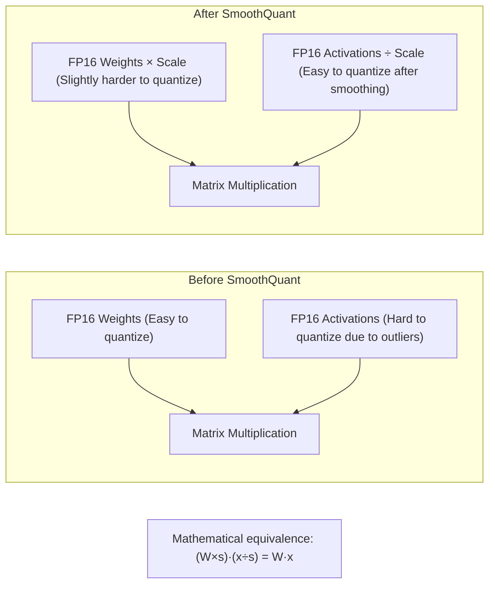
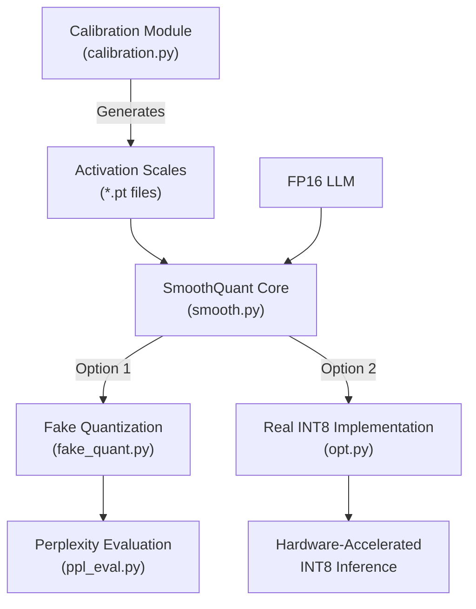
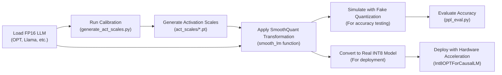

<!-- source: DeepWiki mcp.deepwiki.com · repo mit-han-lab/smoothquant · page 1 Overview · fetched 2026-10-30 -->

# Overview

Relevant source files

The following files were used as context for generating this wiki page:

- [README.md](README.md)
- [assets/SmoothQuant.pdf](assets/SmoothQuant.pdf)

## Purpose and Scope

SmoothQuant is a post-training quantization (PTQ) technique specifically designed for efficient 8-bit weight, 8-bit activation (W8A8) quantization of large language models (LLMs). This document provides an introduction to SmoothQuant, its core concepts, and its key components. For detailed information about specific implementation aspects, refer to other sections in this wiki.

- For information about the core technical concepts, see [Core Concepts](#2)
- For implementation details and workflow, see [Workflow](#4)
- For supported model architectures, see [Model Support](#5)

Sources: [README.md:15-26]()

## What is SmoothQuant?

SmoothQuant is a training-free, accuracy-preserving, general-purpose post-training quantization solution that enables W8A8 quantization for LLMs. The key innovation is that it **migrates quantization difficulty from activations to weights** through a mathematically equivalent transformation, making both components easier to quantize to INT8 with minimal accuracy loss.

SmoothQuant addresses a fundamental challenge in LLM quantization: while weights are relatively easy to quantize, activations contain systematic outliers that cause significant accuracy degradation when naively quantized to INT8.

Sources: [README.md:17-26](), [README.md:115-117]()

## Key Benefits

SmoothQuant offers several significant advantages for LLM deployment:

| Benefit | Details |
|---------|---------|
| Accuracy Preservation | Maintains model quality with negligible perplexity increase |
| Memory Efficiency | Reduces memory footprint by up to 2x compared to FP16 |
| Inference Speed | Provides up to 1.56x speedup over FP16 inference |
| Hardware Efficiency | Enables serving of larger models with fewer GPUs |
| Broad Model Support | Works with OPT, BLOOM, Llama, Falcon, Mistral, Mixtral, and more |
| No Training Required | Post-training technique requiring only calibration data |

Sources: [README.md:22-26](), [README.md:119-129]()

## System Architecture

The SmoothQuant system consists of the following key components:

### Core Components:

1. **Calibration Module** (`calibration.py`): Generates activation scales by analyzing model behavior on calibration data
2. **SmoothQuant Core** (`smooth.py`): Implements the smoothing algorithm to redistribute quantization difficulty
3. **Fake Quantization** (`fake_quant.py`): Simulates INT8 quantization while still using FP16 computation
4. **Real INT8 Implementation** (`opt.py`): Provides actual INT8 inference with hardware acceleration
5. **Evaluation** (`ppl_eval.py`): Measures performance of quantized models using perplexity

Sources: [smoothquant/calibration.py](), [smoothquant/smooth.py](), [smoothquant/fake_quant.py](), [smoothquant/opt.py](), [smoothquant/ppl_eval.py](), [README.md:41-54]()

## Workflow Overview

Using SmoothQuant involves the following high-level steps:

1. **Calibration**: Collect activation statistics using a small calibration dataset (typically 512 samples)
2. **Scaling**: Generate activation scales that will smooth out activation outliers
3. **Smoothing**: Apply the SmoothQuant transformation to the model using the generated scales
4. **Quantization**: Convert to INT8 representation (either simulated or real)
5. **Evaluation/Deployment**: Measure performance and deploy the quantized model

Sources: [README.md:56-69](), [examples/generate_act_scales.py](), [examples/export_int8_model.py](), [README.md:76-86]()

## Integration and Adoption

SmoothQuant has been integrated into several major frameworks and platforms:

- NVIDIA TensorRT-LLM
- Intel Neural-Compressor
- Microsoft ONNX Runtime
- Amazon SageMaker
- AMD Instinct MI300X (via Composable Kernel)

This wide adoption demonstrates the practical value and effectiveness of the SmoothQuant approach for real-world LLM deployment.

Sources: [README.md:6-13]()

## Quick Start Examples

The SmoothQuant repository includes several example notebooks and scripts to help users get started:

1. **OPT Demo**: [examples/smoothquant_opt_demo.ipynb]() demonstrates W8A8 quantization of OPT-13B
2. **Real INT8 OPT Demo**: [examples/smoothquant_opt_real_int8_demo.ipynb]() showcases latency and memory benefits
3. **Llama Demo**: [examples/smoothquant_llama_demo.ipynb]() shows quantization for Llama models
4. **Activation Scale Generation**: [examples/generate_act_scales.py]() helps generate scales for custom models
5. **INT8 Model Export**: [examples/export_int8_model.py]() demonstrates exporting quantized models

Sources: [README.md:71-74](), [README.md:53-54](), [README.md:58-69]()

## Conclusion

SmoothQuant represents a significant advancement in LLM quantization, enabling efficient INT8 inference while maintaining model quality. By addressing the fundamental challenge of activation outliers through its innovative difficulty migration approach, SmoothQuant provides a practical solution for deploying large language models with reduced hardware requirements.

For detailed information about implementation, model support, and specific components, refer to the other sections in this wiki.

Sources: [README.md:131-141]()

---

