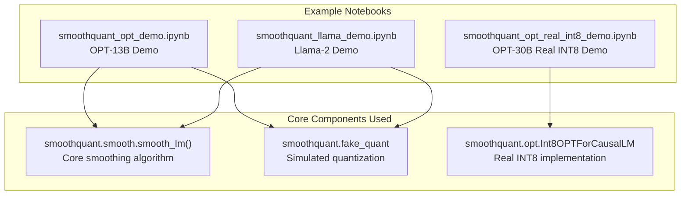
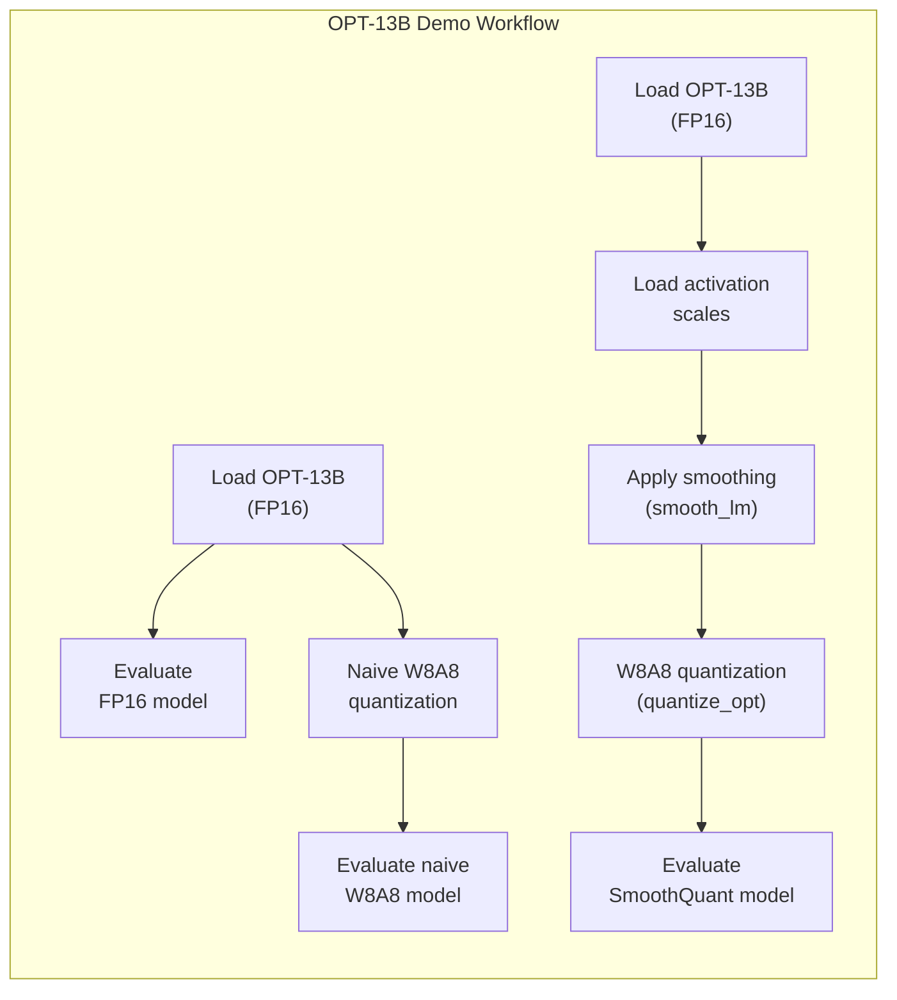
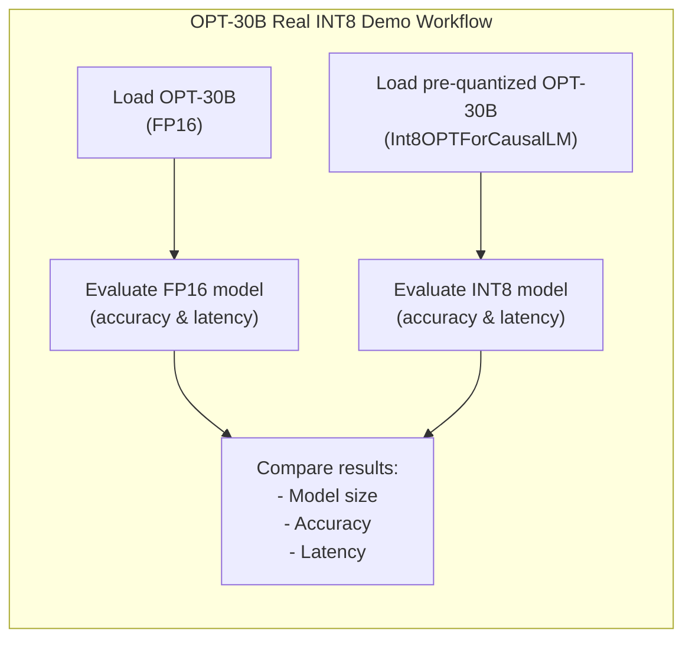
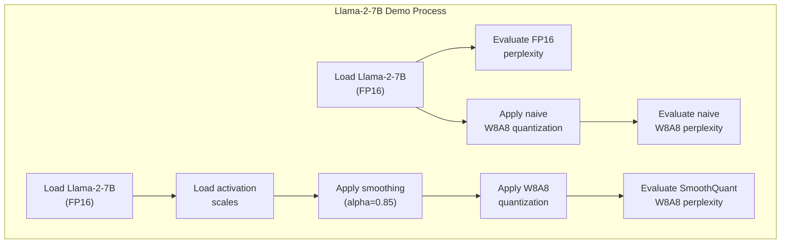
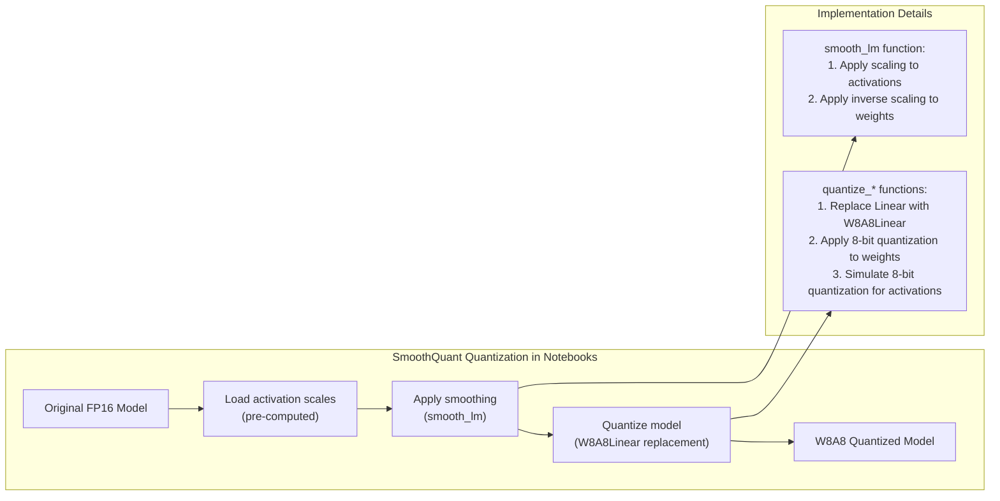

<!-- source: DeepWiki mcp.deepwiki.com · repo mit-han-lab/smoothquant · page 10 Example Notebooks · fetched 2026-10-30 -->

# Example Notebooks

<details>
<summary>Relevant source files</summary>

The following files were used as context for generating this wiki page:

- [examples/smoothquant_llama_demo.ipynb](examples/smoothquant_llama_demo.ipynb)
- [examples/smoothquant_opt_demo.ipynb](examples/smoothquant_opt_demo.ipynb)
- [examples/smoothquant_opt_real_int8_demo.ipynb](examples/smoothquant_opt_real_int8_demo.ipynb)

</details>


## Purpose and Scope

This page documents the example Jupyter notebooks provided in the SmoothQuant repository. These notebooks demonstrate how to apply SmoothQuant quantization to various large language models (LLMs) and evaluate the resulting model performance. They serve as both educational tools for understanding the SmoothQuant technique and practical examples of its implementation.

For information about the core SmoothQuant algorithm, see [Core Concepts](#2). For details on the overall workflow, see [Workflow](#4).

## Overview of Available Notebooks

SmoothQuant provides three main example notebooks, each demonstrating the technique on different model architectures:

1. **OPT-13B Demo** - Demonstrates fake quantization on the OPT-13B model
2. **OPT-30B Real INT8 Demo** - Demonstrates real INT8 inference on OPT-30B
3. **Llama-2-7B Demo** - Demonstrates fake quantization on Llama-2-7B

These notebooks follow a similar structure:
- Set up the model and evaluation dataset
- Evaluate the original FP16 model (baseline)
- Attempt naive W8A8 quantization and evaluate performance
- Apply SmoothQuant and evaluate the improved W8A8 quantized model



Sources: [examples/smoothquant_opt_demo.ipynb:46-47](), [examples/smoothquant_opt_real_int8_demo.ipynb:33-33](), [examples/smoothquant_llama_demo.ipynb:46-46]()

## OPT-13B Demo Notebook

The `smoothquant_opt_demo.ipynb` notebook demonstrates SmoothQuant on the OPT-13B model, showing how quantization to INT8 can be achieved without accuracy loss.

### Key Components

- **Evaluation Method**: Uses LAMBADA dataset's first 1,000 samples for "Last Token Prediction Accuracy"
- **Model Loading**: Loads OPT-13B from Hugging Face in FP16 precision
- **Quantization Workflow**: 
  1. Evaluate FP16 model (baseline)
  2. Perform naive W8A8 quantization with `quantize_opt` function
  3. Apply smoothing with `smooth_lm` using pre-computed activation scales
  4. Quantize the smoothed model with `quantize_opt`

### Performance Results

The notebook demonstrates:
- FP16 baseline accuracy: ~0.786
- Naive W8A8 quantized accuracy: ~0.048 (significant drop)
- SmoothQuant W8A8 accuracy: ~0.793 (maintained accuracy)



Sources: [examples/smoothquant_opt_demo.ipynb:144-146](), [examples/smoothquant_opt_demo.ipynb:187-188](), [examples/smoothquant_opt_demo.ipynb:236-242]()

## OPT-30B Real INT8 Demo Notebook

The `smoothquant_opt_real_int8_demo.ipynb` notebook demonstrates the latency and memory advantages of SmoothQuant using real INT8 inference with the OPT-30B model. This notebook uses actual INT8 computation rather than simulated quantization.

### Key Components

- **INT8 Implementation**: Uses CUTLASS INT8 GEMM kernels via the `torch-int` package
- **Model Loading**: Loads a pre-quantized OPT-30B model directly from Hugging Face
- **Evaluation**: Measures both accuracy and inference latency
- **Memory Usage**: Shows the significant memory reduction with INT8 quantization

### Performance Results

The notebook demonstrates:
- FP16 model size: ~57.2GB
- SmoothQuant INT8 model size: ~28.9GB (2× reduction)
- FP16 accuracy: ~0.807
- SmoothQuant INT8 accuracy: ~0.798 (minimal drop)
- Inference speedup: ~20% faster per sample



Sources: [examples/smoothquant_opt_real_int8_demo.ipynb:102-113](), [examples/smoothquant_opt_real_int8_demo.ipynb:150-151](), [examples/smoothquant_opt_real_int8_demo.ipynb:208-213]()

## Llama-2-7B Demo Notebook

The `smoothquant_llama_demo.ipynb` notebook demonstrates SmoothQuant on the Llama-2-7B model, using perplexity as the evaluation metric instead of accuracy.

### Key Components

- **Evaluation Method**: Uses WikiText-2 dataset for perplexity evaluation
- **Model Loading**: Loads Llama-2-7B from Hugging Face in FP16 precision
- **Quantization Workflow**:
  1. Evaluate FP16 model (baseline) 
  2. Perform naive W8A8 quantization with `quantize_llama_like`
  3. Apply smoothing with `smooth_lm` using pre-computed activation scales
  4. Quantize the smoothed model with `quantize_llama_like`

### Performance Results

The notebook demonstrates:
- FP16 baseline perplexity: ~5.823
- Naive W8A8 quantized perplexity: ~5.931 (higher/worse)
- SmoothQuant W8A8 perplexity: ~5.856 (closer to FP16 baseline)



Sources: [examples/smoothquant_llama_demo.ipynb:151-153](), [examples/smoothquant_llama_demo.ipynb:234-235](), [examples/smoothquant_llama_demo.ipynb:336-343]()

## Notebook Implementation Details

This section covers the common patterns and key implementation details across the example notebooks.

### Evaluation Methods

The notebooks use slightly different evaluation methods:

| Notebook | Dataset | Metric | Implementation |
|----------|---------|--------|----------------|
| OPT-13B Demo | LAMBADA (first 1,000) | Last Token Prediction Accuracy | Custom `Evaluator` class |
| OPT-30B Real INT8 Demo | LAMBADA (first 1,000) | Last Token Prediction Accuracy + Latency | Custom `Evaluator` class with timing |
| Llama-2-7B Demo | WikiText-2 test | Perplexity | Custom `Evaluator` class with cross-entropy loss |

All notebooks use simplified evaluation methods for demonstration purposes. For rigorous evaluation, users are advised to use the [lm-eval-harness](https://github.com/EleutherAI/lm-evaluation-harness) as mentioned in the notebooks.

### Model Quantization Process



Sources: [examples/smoothquant_opt_demo.ipynb:236-242](), [examples/smoothquant_llama_demo.ipynb:336-343]()

## Prerequisites and Dependencies

All example notebooks require the following dependencies:

- SmoothQuant (`smoothquant`)
- PyTorch
- Transformers
- Accelerate

The real INT8 demo additionally requires:
- torch-int

| Notebook | Additional Requirements |
|----------|-------------------------|
| OPT-13B Demo | Activation scales for OPT-13B |
| OPT-30B Real INT8 | torch-int (for INT8 GEMM kernels) |
| Llama-2-7B Demo | Activation scales for Llama-2-7B |

Sources: [examples/smoothquant_opt_demo.ipynb:25-31](), [examples/smoothquant_opt_real_int8_demo.ipynb:15-21](), [examples/smoothquant_llama_demo.ipynb:16-22]()

## Loading Pre-Quantized Models

For OPT models, pre-quantized versions are available on the Hugging Face Hub:

```python
from smoothquant.opt import Int8OPTForCausalLM
model = Int8OPTForCausalLM.from_pretrained("mit-han-lab/opt-30b-smoothquant")
```

Available model sizes include: `125m`, `1.3B`, `2.7B`, `6.7B`, `13B`, `30B`, and `66B`.

Sources: [examples/smoothquant_opt_real_int8_demo.ipynb:179-186](), [examples/smoothquant_opt_real_int8_demo.ipynb:208-209]()

---

