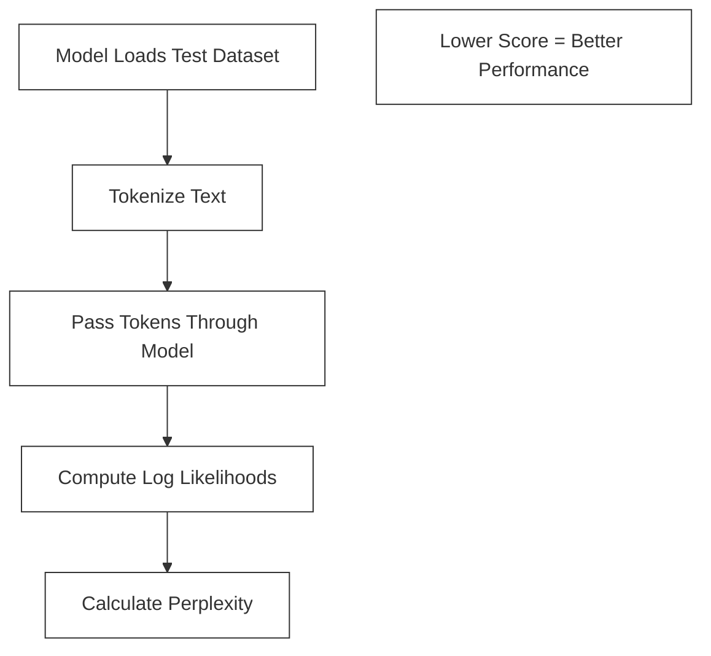
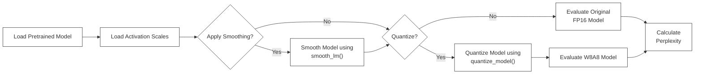
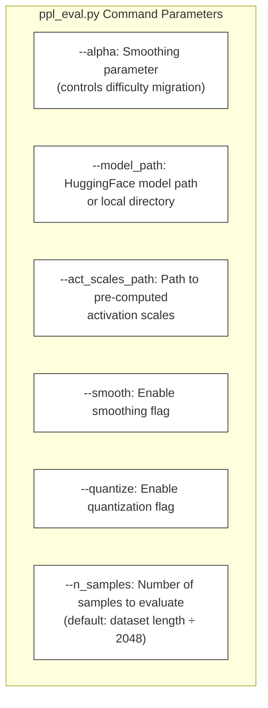
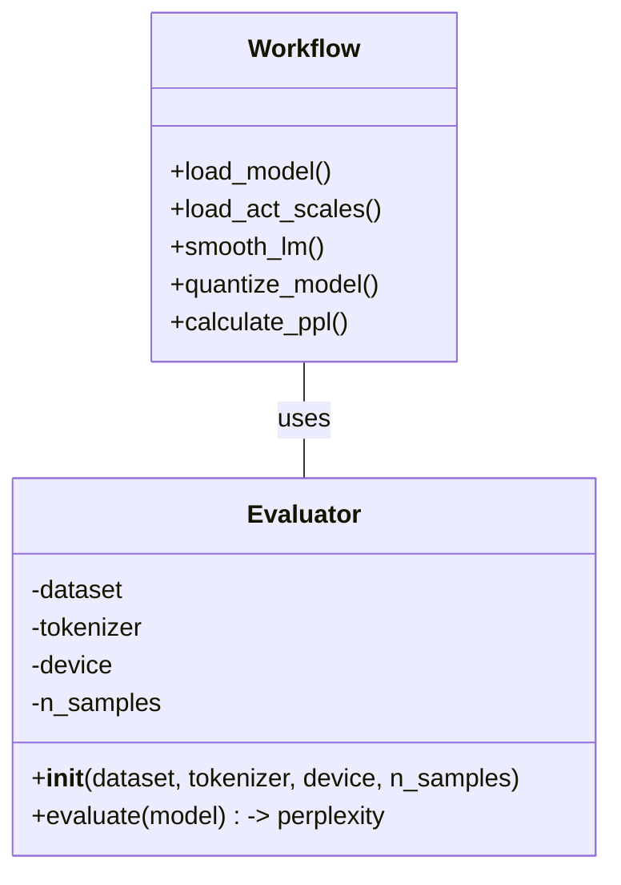
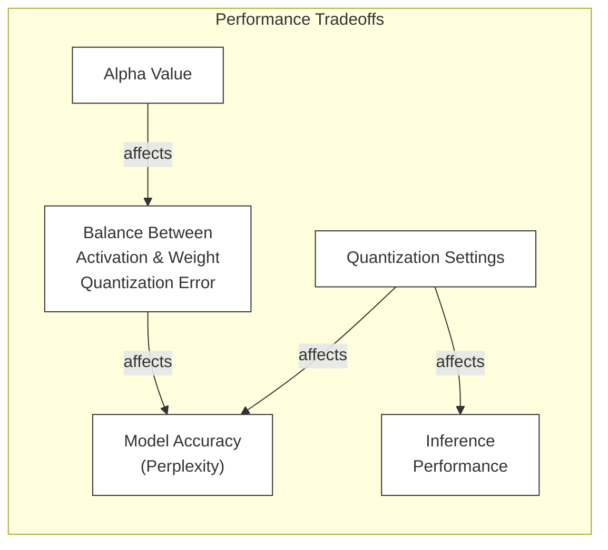

<!-- source: DeepWiki mcp.deepwiki.com · repo mit-han-lab/smoothquant · page 11 Performance Evaluation · fetched 2026-10-30 -->

# Performance Evaluation

<details>
<summary>Relevant source files</summary>

The following files were used as context for generating this wiki page:

- [examples/ppl_eval.sh](examples/ppl_eval.sh)
- [figures/accuracy.png](figures/accuracy.png)
- [figures/ft_latency_mem.png](figures/ft_latency_mem.png)
- [figures/migrate.jpg](figures/migrate.jpg)
- [figures/torch_latency_mem.png](figures/torch_latency_mem.png)
- [smoothquant/ppl_eval.py](smoothquant/ppl_eval.py)

</details>


This page explains how to evaluate the performance of models quantized using SmoothQuant. It covers methods for measuring model quality (perplexity) and computational efficiency (throughput/memory) after applying SmoothQuant's W8A8 quantization technique.

## Evaluation Metrics

SmoothQuant employs two key metrics to evaluate quantized models:

1. **Perplexity**: Measures language modeling quality preservation after quantization
2. **Throughput and Memory Usage**: Measures computational efficiency improvements

### Perplexity

Perplexity is the primary metric used to assess language model quality after quantization. It's calculated by:

1. Running the model on a test dataset (usually WikiText-2)
2. Computing the cross-entropy loss over the test tokens
3. Calculating perplexity as the exponentiation of this average negative log-likelihood

Lower perplexity scores indicate better language modeling performance. The goal is to achieve perplexity values close to the full-precision model.



Sources: [smoothquant/ppl_eval.py:44-62]()

### Throughput and Memory Usage

While not directly measured in the evaluation scripts, SmoothQuant's W8A8 quantization typically provides:

- Reduced memory usage (approximately 2x compared to FP16)
- Improved inference throughput (when using INT8 GEMM kernels)

These metrics can be measured separately after exporting INT8 models.

## Evaluation Workflow

The SmoothQuant repository provides scripts to evaluate model perplexity after quantization.



Sources: [smoothquant/ppl_eval.py:64-84]()

### Running the Evaluation

The repository includes a Python script (`ppl_eval.py`) and a shell script (`ppl_eval.sh`) to simplify evaluation across different models.



Sources: [smoothquant/ppl_eval.py:12-22](), [examples/ppl_eval.sh:1-71]()

#### Basic Usage Example

```bash
python smoothquant/ppl_eval.py \
    --alpha 0.85 \
    --model_path meta-llama/Llama-2-7b-hf \
    --act_scales_path act_scales/llama-2-7b.pt \
    --smooth \
    --quantize
```

This command:
1. Loads the Llama-2-7B model
2. Applies smoothing with α=0.85
3. Quantizes to W8A8 format
4. Evaluates perplexity on WikiText-2

Sources: [examples/ppl_eval.sh:1-7]()

## Model-Specific Alpha Values

Different models require different alpha values for optimal results. The table below shows recommended values:

| Model | Alpha Value | Command Example |
|-------|-------------|----------------|
| Llama-2-7B | 0.85 | `--alpha 0.85 --model_path meta-llama/Llama-2-7b-hf` |
| Llama-2-13B | 0.85 | `--alpha 0.85 --model_path meta-llama/Llama-2-13b-hf` |
| Llama-2-70B | 0.9 | `--alpha 0.9 --model_path meta-llama/Llama-2-70b-hf` |
| Mistral-7B | 0.8 | `--alpha 0.8 --model_path mistralai/Mistral-7B-v0.1` |
| Mixtral-8x7B | 0.8 | `--alpha 0.8 --model_path mistralai/Mixtral-8x7B-v0.1` |
| Falcon-7B | 0.6 | `--alpha 0.6 --model_path tiiuae/falcon-7b` |
| Falcon-40B | 0.7 | `--alpha 0.7 --model_path tiiuae/falcon-40b` |
| Meta-Llama-3-8B | 0.85 | `--alpha 0.85 --model_path meta-llama/Meta-Llama-3-8B` |
| Meta-Llama-3-70B | 0.85 | `--alpha 0.85 --model_path meta-llama/Meta-Llama-3-70B` |

Sources: [examples/ppl_eval.sh:1-71]()

## Evaluation Implementation

The core evaluation is handled by the `Evaluator` class in `ppl_eval.py`. Here's how it works:



The `evaluate()` method:
1. Processes chunks of 2048 tokens from the dataset
2. Computes language modeling loss for each chunk
3. Aggregates losses and computes the final perplexity score

Sources: [smoothquant/ppl_eval.py:32-62]()

## Typical Results

SmoothQuant typically achieves perplexity close to the original FP16 model, while enabling significant memory savings and performance improvements. The exact results depend on:

1. The model architecture
2. The alpha parameter value
3. The choice of quantization parameters (per_channel vs. per_tensor for weights)



## Advanced Evaluation Options

The evaluation script supports several advanced options:

### Weight and Activation Quantization Methods

The `quantize_model()` function in `fake_quant.py` allows configuring:

- `weight_quant`: Weight quantization granularity ("per_channel" or "per_tensor")
- `act_quant`: Activation quantization approach ("per_token" or "per_tensor")
- `quantize_bmm_input`: Whether to quantize batch matrix multiplication inputs

Example:
```python
model = quantize_model(
    model,
    weight_quant="per_channel",  # Quantize each output channel independently
    act_quant="per_token",       # Quantize each token independently
    quantize_bmm_input=True      # Quantize BMM inputs (important for attention)
)
```

Sources: [smoothquant/ppl_eval.py:76-82]()

### Custom Evaluation Datasets

While the default evaluation uses WikiText-2, you can customize the evaluation by modifying the dataset loading code:

```python
dataset = load_dataset("wikitext", "wikitext-2-raw-v1", split="test")
evaluator = Evaluator(dataset, tokenizer, "cuda", n_samples=n_samples)
```

Sources: [smoothquant/ppl_eval.py:66-67]()

## Multi-GPU Evaluation

For large models, you can distribute the model across multiple GPUs:

```bash
CUDA_VISIBLE_DEVICES=0,1,2 python smoothquant/ppl_eval.py \
    --alpha 0.9 \
    --model_path meta-llama/Llama-2-70b-hf \
    --act_scales_path act_scales/llama-2-70b.pt \
    --smooth \
    --quantize
```

This example uses three GPUs to evaluate the Llama-2-70B model.

Sources: [examples/ppl_eval.sh:17-23](), [examples/ppl_eval.sh:34-39](), [examples/ppl_eval.sh:66-71]()

## Related Pages

For more information on:
- Generating activation scales, see [Calibration Module](#6)
- Activation scales, see [Activation Scales](#6.1)
- The smoothing algorithm, see [Smoothing Algorithm](#7)
- Quantization techniques, see [Quantization Techniques](#8)

---

