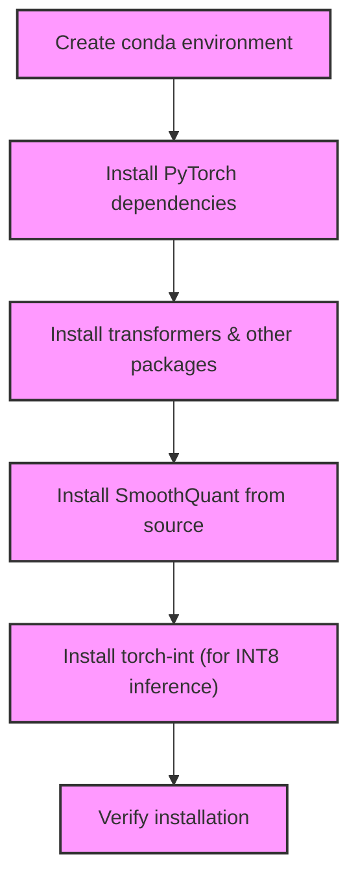
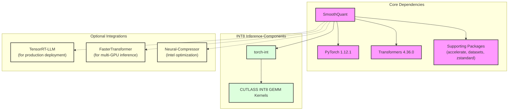
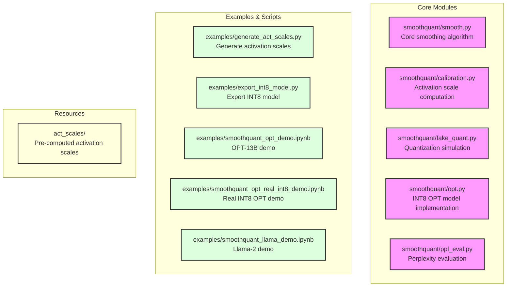

<!-- source: DeepWiki mcp.deepwiki.com · repo mit-han-lab/smoothquant · page 12 Installation and Setup · fetched 2026-10-30 -->

# Installation and Setup

<details>
<summary>Relevant source files</summary>

The following files were used as context for generating this wiki page:

- [README.md](README.md)
- [assets/SmoothQuant.pdf](assets/SmoothQuant.pdf)
- [setup.py](setup.py)

</details>


This document provides instructions for installing and setting up SmoothQuant, a post-training quantization solution for large language models. For information about the core concepts and technical details of SmoothQuant, see [Core Concepts](#2).

## Prerequisites

Before installing SmoothQuant, ensure you have:
- Git
- Python 3.8+
- CUDA-compatible hardware (for GPU acceleration)
- Sufficient disk space for model weights and activation scales

## Installation Process

SmoothQuant can be installed through a series of steps, beginning with environment setup and culminating in verifying the installation.



### Basic Installation

1. **Clone the repository**:
   ```bash
   git clone https://github.com/mit-han-lab/smoothquant.git
   cd smoothquant
   ```

2. **Create and activate a conda environment**:
   ```bash
   conda create -n smoothquant python=3.8
   conda activate smoothquant
   ```

3. **Install PyTorch and related packages**:
   ```bash
   pip install torch==1.12.1+cu113 torchvision==0.13.1+cu113 torchaudio==0.12.1 --extra-index-url https://download.pytorch.org/whl/cu113
   ```

4. **Install Hugging Face packages and utilities**:
   ```bash
   pip install transformers==4.36.0 accelerate datasets zstandard
   ```

5. **Install SmoothQuant**:
   ```bash
   python setup.py install
   ```

Sources: [README.md:28-37](), [setup.py:1-6]()

### Additional Setup for INT8 Inference

To enable real INT8 inference with PyTorch, you need to install the torch-int package:

1. **Install torch-int**:
   ```bash
   pip install git+https://github.com/Guangxuan-Xiao/torch-int.git
   ```

This package provides PyTorch modules that wrap CUTLASS INT8 GEMM kernels, which are essential for accelerated INT8 inference.

Sources: [README.md:41-43]()

## System Dependencies

SmoothQuant integrates with various components to provide its functionality. Understanding these dependencies helps with troubleshooting and optimization.



Sources: [README.md:28-37](), [README.md:41-43](), [README.md:9-13]()

## Package Structure

After installation, you'll work with the following key modules and scripts:



Sources: [README.md:45-54](), [README.md:57-69](), [README.md:71-73]()

## Verifying Installation

To verify your installation, you can run a simple test using the OPT demo notebook:

1. **Navigate to the examples directory**:
   ```bash
   cd examples
   ```

2. **Run the Jupyter notebook**:
   ```bash
   jupyter notebook smoothquant_opt_demo.ipynb
   ```

Alternatively, you can run the activation scale generation script with a small model:

```bash
python examples/generate_act_scales.py \
    --model-name facebook/opt-125m \
    --output-path ./test_scales.pt \
    --num-samples 8 \
    --seq-len 128
```

If these run without errors, your installation is successful.

Sources: [README.md:60-69]()

## Compatibility Table

SmoothQuant has been tested and is compatible with the following configurations:

| Component | Tested Versions | Notes |
|-----------|----------------|-------|
| Python | 3.8 | Primary supported version |
| PyTorch | 1.12.1+cu113 | CUDA 11.3 compatibility |
| transformers | 4.36.0 | For OPT, BLOOM, Llama, etc. |
| NVIDIA GPU | Ampere, Hopper | For hardware acceleration |
| CPU | x86_64 | Via Neural-Compressor integration |
| AMD GPU | MI300X | Via Composable Kernel |

Sources: [README.md:8](), [README.md:13](), [README.md:28-35]()

## Next Steps

After installation, you can:

1. **Try the demo notebooks** in the examples directory to understand how SmoothQuant works with various models
2. **Generate activation scales** for your specific models using the provided scripts
3. **Quantize and export INT8 models** for deployment

For detailed information on:
- Core concepts and algorithm, see [Core Concepts](#2)
- Workflow for applying SmoothQuant, see [Workflow](#4)
- Calibration process, see [Calibration Module](#6)

Sources: [README.md:39-53](), [README.md:57-69]()

## Troubleshooting

### Common Issues

1. **CUDA version mismatch**: If you encounter CUDA-related errors, ensure your installed PyTorch version matches your CUDA toolkit version.

2. **torch-int installation failure**: If torch-int fails to install, ensure you have the correct C++ compiler and CUDA toolkit. You may need to set environment variables:
   ```bash
   export CUDA_HOME=/path/to/cuda
   export PATH=$CUDA_HOME/bin:$PATH
   ```

3. **Out of memory errors**: When working with large models, ensure your GPU has sufficient memory. For models that don't fit in a single GPU, consider using multi-GPU setups or frameworks like FasterTransformer.

### Getting Help

If you encounter issues not covered here, check:
- GitHub issues in the SmoothQuant repository
- Documentation of integrated packages (torch-int, transformers, etc.)

Sources: [README.md:41-54](), [README.md:123-129]()