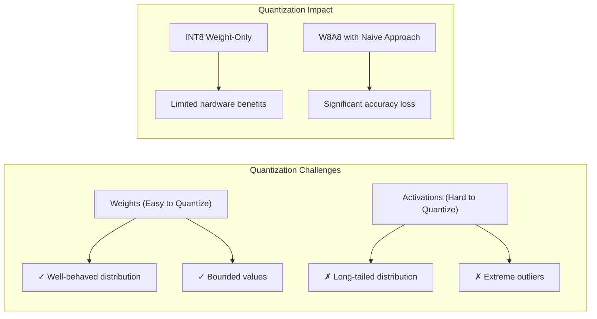
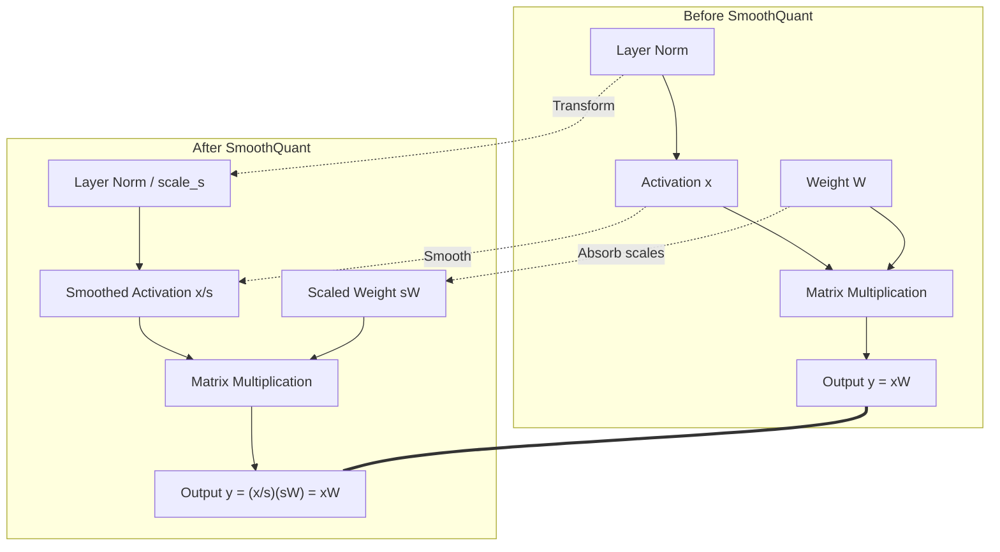
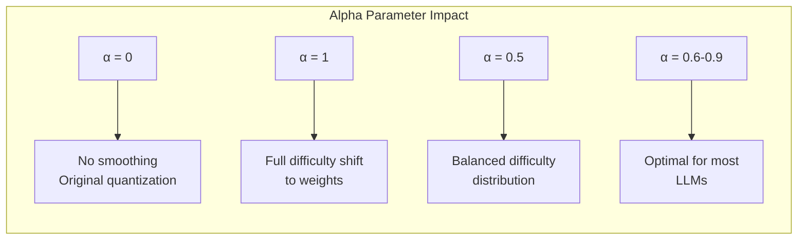
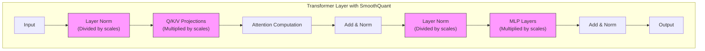
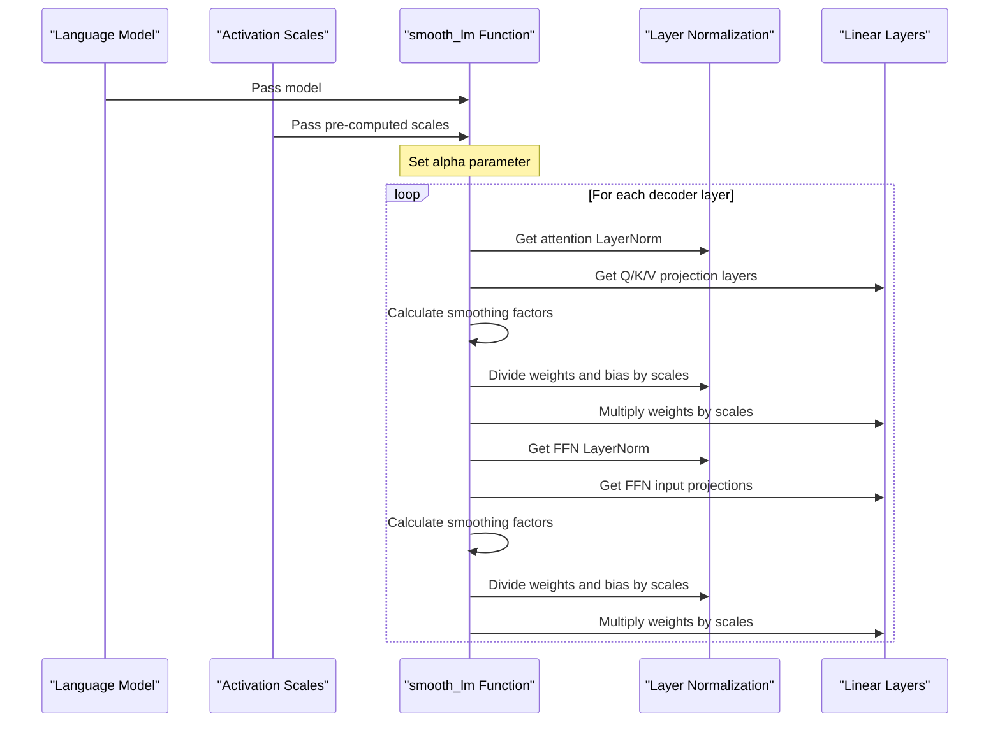

<!-- source: DeepWiki mcp.deepwiki.com · repo mit-han-lab/smoothquant · page 2 Core Concepts · fetched 2026-10-30 -->

# Core Concepts

<details>
<summary>Relevant source files</summary>

The following files were used as context for generating this wiki page:

- [README.md](README.md)
- [assets/SmoothQuant.pdf](assets/SmoothQuant.pdf)
- [smoothquant/smooth.py](smoothquant/smooth.py)

</details>


This page explains the fundamental technical concepts behind SmoothQuant, focusing on the mathematical principles and algorithmic approaches that enable efficient 8-bit quantization for large language models (LLMs). For information about the overall system architecture, see [System Architecture](#3), and for detailed implementation of the quantization techniques, see [Quantization Techniques](#8).

## The Challenge: Quantization-Unfriendly Activations

The core challenge that SmoothQuant addresses is the difficulty of quantizing both weights and activations in LLMs to INT8. While weights in LLMs are generally well-behaved and easy to quantize, activations present a significant challenge due to their long-tailed distributions with extreme outliers.



Sources: [README.md:15-22](README.md:15-22), [README.md:115-117](README.md:115-117)

## The Key Insight: Difficulty Migration

SmoothQuant's key insight is that quantization difficulty can be mathematically migrated from activations to weights without changing the model's behavior in full precision. This is possible because matrix multiplication allows for equivalent transformations where scaling factors can be moved between operands.



Sources: [README.md:21-22](README.md:21-22), [smoothquant/smooth.py:17-46](smoothquant/smooth.py:17-46)

## Mathematical Formulation

The SmoothQuant transformation operates on the following mathematical principle:

For a matrix multiplication operation `y = xW`, where:
- `x` is the activation (input)
- `W` is the weight matrix
- `y` is the output

SmoothQuant introduces a channel-wise scaling factor `s` and applies the transformation:

```
y = xW = (x/s)(sW)
```

This transformation is mathematically equivalent in full precision but changes the distributions of values that need to be quantized.

### The Alpha Parameter

SmoothQuant introduces an adjustable parameter `α` (alpha) that controls the distribution of quantization difficulty between weights and activations. The scaling factor is calculated as:

```
s = (act_scales^α / weight_scales^(1-α))
```

Where:
- `act_scales` are the per-channel maximum absolute values of activations
- `weight_scales` are the per-channel maximum absolute values of weights
- `α` is typically set between 0.5 and 0.9



Sources: [smoothquant/smooth.py:27-39](smoothquant/smooth.py:27-39)

## Implementation in Language Models

The smoothing transformation is applied to two critical components in LLM architectures:

1. **Attention Modules**: The Layer Normalization → Q/K/V projection path
2. **Feed-Forward Networks**: The Layer Normalization → MLP input path



Sources: [smoothquant/smooth.py:74-161](smoothquant/smooth.py:74-161)

## Model-Specific Implementations

SmoothQuant supports different model architectures through specialized implementations of the smoothing algorithm:

| Model Family | Smoothing Function | Key Differentiator |
|--------------|--------------------|--------------------|
| OPT, BLOOM   | `smooth_ln_fcs`    | Standard LayerNorm |
| Llama, Mistral | `smooth_ln_fcs_llama_like` | RMSNorm instead of LayerNorm |
| Mixtral | `smooth_ln_fcs_llama_like` | MoE architecture with multiple experts |
| Falcon | `smooth_ln_fcs` | Different architecture variants |

Sources: [smoothquant/smooth.py:74-161](smoothquant/smooth.py:74-161)

## The Smoothing Algorithm

The core smoothing algorithm works as follows:

1. **Compute Activation and Weight Scales**:
   - Determine the maximum absolute value for each input channel in activations
   - Calculate the maximum absolute value for each input channel across all weight matrices

2. **Calculate Smoothing Factors**:
   - Apply the alpha parameter to balance scales: `s = (act_scales^α / weight_scales^(1-α))`
   - Clamp values to ensure numerical stability

3. **Apply Transformation**:
   - Divide LayerNorm/RMSNorm weights and biases by scales
   - Multiply the weights of linear layers by scales



Sources: [smoothquant/smooth.py:17-46](smoothquant/smooth.py:17-46), [smoothquant/smooth.py:74-161](smoothquant/smooth.py:74-161)

## Code Example: OPT Model Smoothing

Here's how the smoothing algorithm is applied to an OPT decoder layer:

```
1. Get attention LayerNorm and Q/K/V projections
   - attn_ln = module.self_attn_layer_norm
   - qkv = [module.self_attn.q_proj, module.self_attn.k_proj, module.self_attn.v_proj]
   - qkv_input_scales = scales[name + ".self_attn.q_proj"]

2. Apply smoothing to attention path
   - smooth_ln_fcs(attn_ln, qkv, qkv_input_scales, alpha)

3. Get FFN LayerNorm and FC layer
   - ffn_ln = module.final_layer_norm
   - fc1 = module.fc1
   - fc1_input_scales = scales[name + ".fc1"]

4. Apply smoothing to FFN path
   - smooth_ln_fcs(ffn_ln, fc1, fc1_input_scales, alpha)
```

Sources: [smoothquant/smooth.py:77-90](smoothquant/smooth.py:77-90)

## Benefits of SmoothQuant

By redistributing quantization difficulty, SmoothQuant achieves several key benefits:

1. **Accuracy Preservation**: Maintains model quality close to FP16 baseline
2. **Hardware Efficiency**: Enables true INT8 GEMM operations on hardware
3. **Memory Reduction**: Reduces memory footprint by approximately 2x
4. **Inference Speedup**: Achieves up to 1.56x speedup compared to FP16
5. **No Training Required**: Works as a post-training transformation

Sources: [README.md:15-26](README.md:15-26), [README.md:115-129](README.md:115-129)

## Practical Applications

SmoothQuant has been integrated into multiple industry platforms, demonstrating its practicality and effectiveness:

- AMD Instinct MI300X using Composable Kernel
- Microsoft ONNX Runtime
- Amazon SageMaker
- NVIDIA TensorRT-LLM
- Intel Neural-Compressor

This widespread adoption validates SmoothQuant as a standardized approach for efficient LLM quantization.

Sources: [README.md:6-13](README.md:6-13)

---

