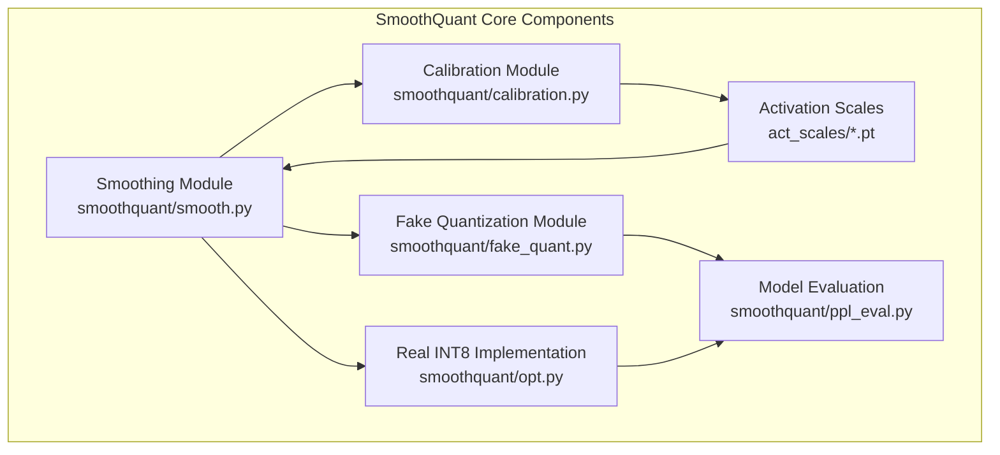
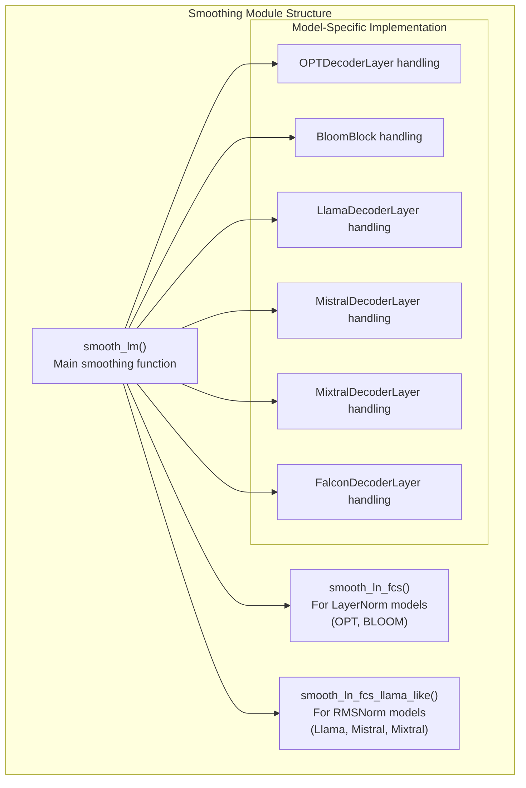
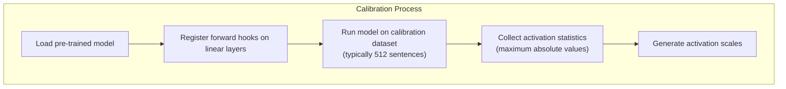
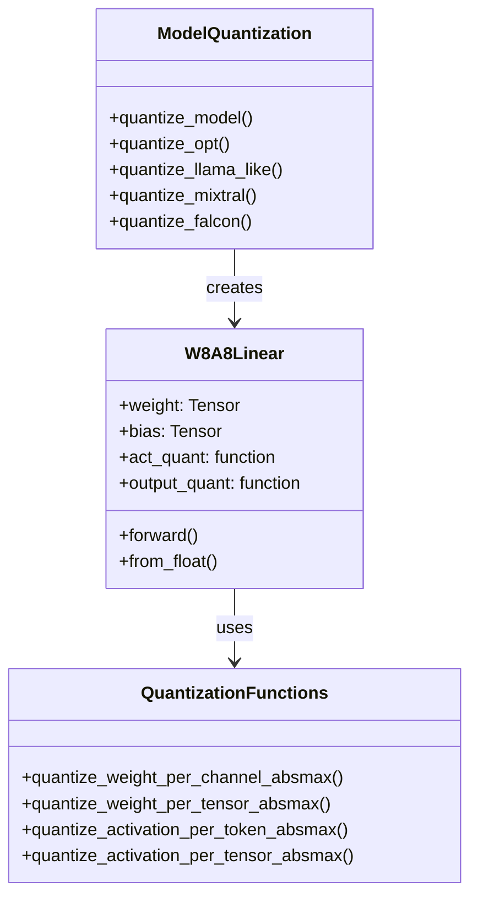
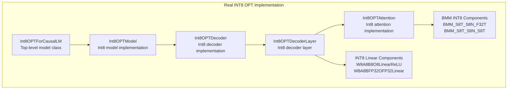
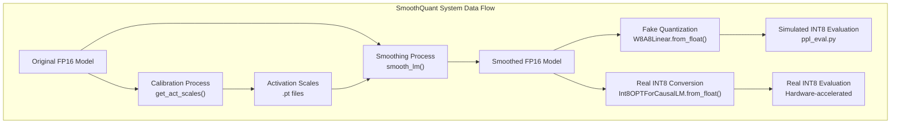

<!-- source: DeepWiki mcp.deepwiki.com · repo mit-han-lab/smoothquant · page 3 System Architecture · fetched 2026-10-30 -->

# System Architecture

<details>
<summary>Relevant source files</summary>

The following files were used as context for generating this wiki page:

- [README.md](README.md)
- [assets/SmoothQuant.pdf](assets/SmoothQuant.pdf)
- [smoothquant/calibration.py](smoothquant/calibration.py)
- [smoothquant/fake_quant.py](smoothquant/fake_quant.py)
- [smoothquant/opt.py](smoothquant/opt.py)
- [smoothquant/smooth.py](smoothquant/smooth.py)

</details>


This document describes the overall architecture of SmoothQuant, a post-training quantization (PTQ) framework designed to enable efficient 8-bit weight, 8-bit activation (W8A8) quantization for large language models (LLMs). For information about the theoretical concepts behind SmoothQuant, see [Core Concepts](#2). For details on the workflow of using SmoothQuant, see [Workflow](#4).

## Core Components Overview

SmoothQuant's architecture consists of four main components, each handling a specific part of the quantization process:



Sources:
- [smoothquant/smooth.py]()
- [smoothquant/calibration.py]()
- [smoothquant/fake_quant.py]()
- [smoothquant/opt.py]()

## Detailed Component Description

### 1. Smoothing Module

The smoothing module implements the core algorithm that redistributes quantization difficulty from activations to weights.



Key functions:
- `smooth_lm()` [smooth.py:75-161](): Applies smoothing to different model architectures
- `smooth_ln_fcs()` [smooth.py:19-46](): Smooths LayerNorm followed by Linear layers
- `smooth_ln_fcs_llama_like()` [smooth.py:49-72](): Similar function for RMSNorm-based models

Sources:
- [smoothquant/smooth.py:18-73]() - Core smoothing functions
- [smoothquant/smooth.py:75-161]() - Model-specific implementations

### 2. Calibration Module

The calibration module computes activation scales by analyzing model behavior on a calibration dataset.



Key functions:
- `get_act_scales()` [calibration.py:13-51](): Collects activation statistics from model forward pass
- `get_static_decoder_layer_scales()` [calibration.py:55-130](): Gets detailed scales for decoder layers

Sources:
- [smoothquant/calibration.py:13-51]() - Main calibration function
- [smoothquant/calibration.py:55-130]() - Detailed layer scales function

### 3. Fake Quantization Module

The fake quantization module simulates INT8 quantization while still performing computation in FP16. This allows quick evaluation of quantization effects without specialized hardware.



Key components:
- `W8A8Linear` [fake_quant.py:48-138](): Linear layer that simulates W8A8 quantization
- Quantization functions [fake_quant.py:6-45](): Methods for quantizing weights and activations
- Model-specific quantization [fake_quant.py:141-351](): Functions for different architectures

Sources:
- [smoothquant/fake_quant.py:6-45]() - Quantization functions
- [smoothquant/fake_quant.py:48-138]() - W8A8Linear implementation
- [smoothquant/fake_quant.py:141-351]() - Model-specific quantization functions

### 4. Real INT8 Implementation

SmoothQuant includes a real INT8 implementation for OPT models that uses INT8 GEMM kernels from the torch-int library for hardware acceleration.



Key components:
- `Int8OPTAttention` [opt.py:23-209](): INT8 implementation of OPT attention
- `Int8OPTDecoderLayer` [opt.py:212-316](): INT8 implementation of OPT decoder layer
- `Int8OPTForCausalLM` [opt.py:450-480](): Top-level class for INT8 OPT model

Sources:
- [smoothquant/opt.py:23-209]() - INT8 attention implementation
- [smoothquant/opt.py:212-316]() - INT8 decoder layer implementation
- [smoothquant/opt.py:450-480]() - Full INT8 model implementation

## System Integration and Data Flow

The following diagram illustrates how the components integrate to form the complete SmoothQuant system:



Sources:
- [smoothquant/calibration.py:13-51]()
- [smoothquant/smooth.py:75-161]()
- [smoothquant/fake_quant.py:48-138]()
- [smoothquant/opt.py:450-480]()

### Data Flow Description

1. **Calibration Phase**
   - The pre-trained FP16 model is run on a calibration dataset (typically 512 sentences)
   - Activation statistics are collected via hooks on linear layers
   - Maximum absolute values are stored as activation scales

2. **Smoothing Phase**
   - The FP16 model is loaded along with the activation scales
   - The `smooth_lm()` function applies the transformation with a parameter α
   - For each layer norm + linear layer pair:
     - Divide layer norm weights/biases by scales
     - Multiply linear weights by scales

3. **Quantization Phase**
   - **Option 1**: Fake quantization with `W8A8Linear`
     - Replaces linear layers with `W8A8Linear`
     - Simulates INT8 computation in FP16
   - **Option 2**: Real INT8 (OPT models only)
     - Converts model to `Int8OPTForCausalLM`
     - Uses INT8 GEMM kernels for hardware acceleration

4. **Evaluation Phase**
   - Perplexity evaluation on benchmark datasets
   - Throughput and memory usage measurements for real INT8 models

## Supported Model Architectures

SmoothQuant supports multiple LLM architectures through specialized handling in both the smoothing and quantization modules:

| Architecture | Smoothing Support | Fake Quantization | Real INT8 |
|--------------|------------------|-------------------|-----------|
| OPT          | ✓ (OPTDecoderLayer) | ✓ (quantize_opt) | ✓ (Int8OPTForCausalLM) |
| BLOOM        | ✓ (BloomBlock)    | ✓ (general)       | ✗ |
| Llama        | ✓ (LlamaDecoderLayer) | ✓ (quantize_llama_like) | ✗ |
| Mistral      | ✓ (MistralDecoderLayer) | ✓ (quantize_llama_like) | ✗ |
| Mixtral      | ✓ (MixtralDecoderLayer) | ✓ (quantize_mixtral) | ✗ |
| Falcon       | ✓ (FalconDecoderLayer) | ✓ (quantize_falcon) | ✗ |

Sources:
- [smoothquant/smooth.py:75-161]()
- [smoothquant/fake_quant.py:141-351]()
- [smoothquant/opt.py:450-480]()

## Core Algorithm Implementation

The core smoothing algorithm is implemented as follows:

```mermaid
flowchart LR
    subgraph "Smoothing Algorithm Implementation"
        start["Input: model, act_scales, alpha"] --> getScales["Get weight scales from linear layers"]
        getScales --> computeS["Compute smoothing scales:\n(act_scales^α / weight_scales^(1-α))"]
        computeS --> applyLN["Apply to LayerNorm:\ndivide weights & bias by scales"]
        applyLN --> applyLinear["Apply to Linear layers:\nmultiply weights by scales"]
        applyLinear --> end["Output: smoothed model"]
    end
```

The mathematical transformation is implemented in `smooth_ln_fcs()` [smooth.py:19-46]() and `smooth_ln_fcs_llama_like()` [smooth.py:49-72]():

1. Identify LayerNorm/RMSNorm and subsequent Linear layers
2. Calculate weight scales as maximum absolute value: `weight_scales = fc.weight.abs().max(dim=0)[0]`
3. Compute smoothing scales with formula: `scales = (act_scales^α / weight_scales^(1-α))`
4. Apply scales to LayerNorm/RMSNorm:
   - `ln.weight.div_(scales)`
   - `ln.bias.div_(scales)` (if applicable)
5. Apply inverse scales to Linear weights:
   - `fc.weight.mul_(scales.view(1, -1))`

This transformation is mathematically equivalent but redistributes the quantization difficulty from activations (which traditionally have outliers) to weights (which are easier to quantize).

Sources:
- [smoothquant/smooth.py:19-46]()
- [smoothquant/smooth.py:49-72]()

## Conclusion

SmoothQuant's architecture is designed to be modular and extensible, with components for calibration, smoothing, and quantization that can be applied to various LLM architectures. While the full INT8 implementation is currently only available for OPT models, the fake quantization approach can be used to evaluate the potential of SmoothQuant on any supported architecture.

The system offers both a simulated quantization pathway for evaluation and a real INT8 implementation for OPT models that delivers actual hardware acceleration. This flexibility makes SmoothQuant a versatile tool for efficient LLM deployment.

---

