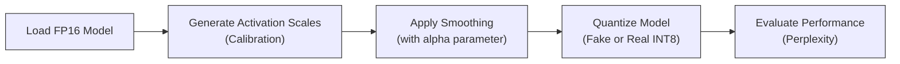
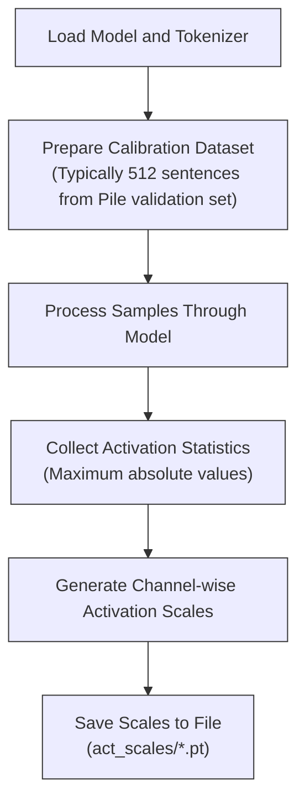
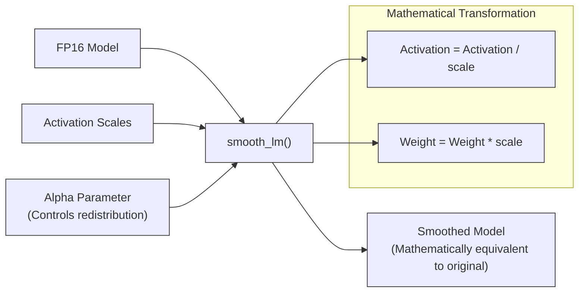
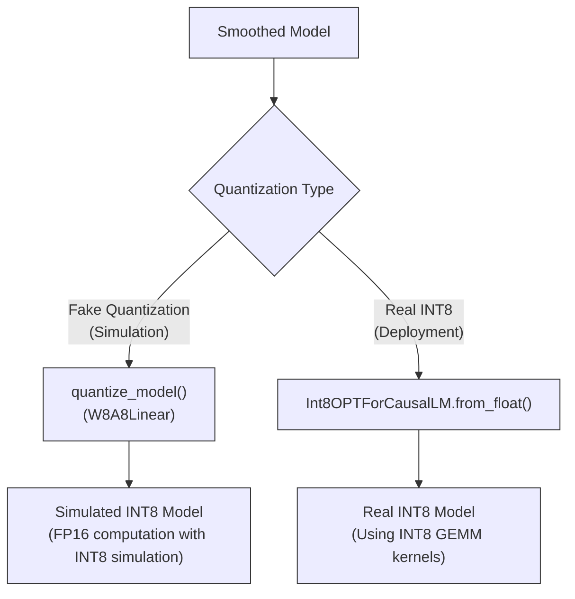
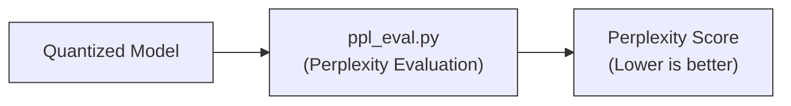
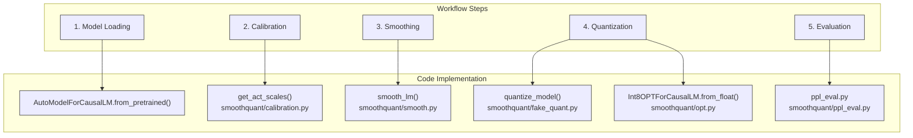
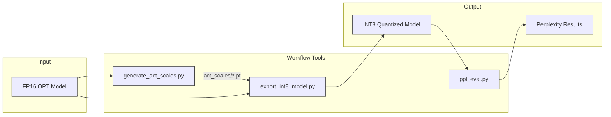

<!-- source: DeepWiki mcp.deepwiki.com · repo mit-han-lab/smoothquant · page 4 Workflow · fetched 2026-10-30 -->

# Workflow

<details>
<summary>Relevant source files</summary>

The following files were used as context for generating this wiki page:

- [README.md](README.md)
- [assets/SmoothQuant.pdf](assets/SmoothQuant.pdf)
- [examples/export_int8_model.py](examples/export_int8_model.py)
- [examples/generate_act_scales.py](examples/generate_act_scales.py)
- [examples/ppl_eval.sh](examples/ppl_eval.sh)

</details>


This document describes the end-to-end workflow for quantizing large language models (LLMs) using SmoothQuant. It covers the process from model loading through calibration, smoothing, quantization, and evaluation. For details about the underlying smoothing algorithm, see [Smoothing Algorithm](#7), and for information about activation scales, see [Activation Scales](#6.1).

## Overview of the SmoothQuant Workflow

SmoothQuant's workflow consists of several sequential steps that transform a floating-point (FP16) model into an efficient INT8 model while maintaining accuracy. The process systematically migrates quantization difficulties from activations to weights through a mathematically equivalent transformation.



Sources: [README.md:40-69](), [examples/generate_act_scales.py](), [examples/export_int8_model.py]()

## Detailed Workflow Steps

### 1. Loading the Model

The workflow begins by loading a pre-trained LLM in FP16 precision. SmoothQuant supports various model architectures including OPT, BLOOM, Llama, Mistral, Mixtral, and Falcon models.

```python
from transformers import AutoModelForCausalLM
import torch

# Load FP16 model
model = AutoModelForCausalLM.from_pretrained(
    "model_name",  # e.g., "facebook/opt-13b", "meta-llama/Llama-2-13b-hf"
    torch_dtype=torch.float16,
    device_map="auto"
)
```

Sources: [examples/generate_act_scales.py:13-17](), [examples/export_int8_model.py:28-29]()

### 2. Calibration Process

Activation scales are essential for the smoothing process. These scales are computed by running a calibration dataset through the model to capture statistics about activation outliers.



The activation scales can be generated using the provided script:

```bash
python examples/generate_act_scales.py \
    --model-name model_name_or_path \
    --output-path output_path_for_scales \
    --num-samples 512 \
    --seq-len 512 \
    --dataset-path path_to_calibration_dataset
```

SmoothQuant also provides pre-computed activation scales for popular models in the `act_scales/` directory.

Sources: [README.md:57-69](), [examples/generate_act_scales.py]()

### 3. Model Smoothing

Once activation scales are available, the smoothing process redistributes quantization difficulty from activations to weights:



The `alpha` parameter (typically between 0.5 and 0.9) controls how much of the quantization difficulty is migrated from activations to weights. This is applied using the `smooth_lm` function:

```python
from smoothquant.smooth import smooth_lm

# Load activation scales
act_scales = torch.load("path_to_act_scales.pt")

# Apply smoothing with alpha=0.5
smooth_lm(model, act_scales, alpha=0.5)
```

Sources: [README.md:115-117](), [examples/export_int8_model.py:30-31]()

### 4. Model Quantization

After smoothing, the model can be quantized using one of two approaches:

1. **Fake Quantization**: Simulates INT8 operations in FP16 for accuracy evaluation
2. **Real INT8 Quantization**: Converts the model to actual INT8 format for hardware acceleration



#### Fake Quantization

Used primarily for experimentation and accuracy evaluation:

```python
from smoothquant.fake_quant import quantize_model

# Apply fake INT8 quantization
quantize_model(model)
```

#### Real INT8 Quantization

For deploying optimized models (currently implemented for OPT):

```python
from smoothquant.opt import Int8OPTForCausalLM

# Convert to real INT8 model
int8_model = Int8OPTForCausalLM.from_float(model, decoder_layer_scales)

# Save quantized model
int8_model.save_pretrained("path_to_save_model")
```

A complete example of exporting an INT8 model is available in [examples/export_int8_model.py]().

Sources: [README.md:42-56](), [examples/export_int8_model.py:54-56]()

### 5. Model Evaluation

The final step is evaluating the quantized model to ensure it maintains accuracy close to the original FP16 model. Perplexity is the most common evaluation metric:



SmoothQuant provides scripts to evaluate perplexity:

```bash
python smoothquant/ppl_eval.py \
    --model_path model_name_or_path \
    --act_scales_path act_scales_file_path \
    --smooth \
    --alpha 0.8 \
    --quantize
```

The [examples/ppl_eval.sh]() script contains commands to evaluate various models with model-specific alpha parameters.

Sources: [README.md:77-110](), [examples/ppl_eval.sh]()

## Code Entities Mapped to Workflow Steps

This diagram connects the natural language workflow steps to the specific code implementations:



Sources: [examples/generate_act_scales.py](), [examples/export_int8_model.py](), [README.md:42-56](), [examples/ppl_eval.sh]()

## Example End-to-End Workflow

Below is a typical end-to-end workflow for quantizing an OPT model:



Sources: [README.md:40-110](), [examples/generate_act_scales.py](), [examples/export_int8_model.py](), [examples/ppl_eval.sh]()

## Command Reference for SmoothQuant Workflow

Here's a summary table of the key commands used in the SmoothQuant workflow:

| Step | Command/Script | Purpose | Key Parameters |
|------|----------------|---------|----------------|
| Calibration | `examples/generate_act_scales.py` | Generate activation scales | `--model-name`, `--output-path`, `--num-samples`, `--seq-len` |
| Export INT8 Model | `examples/export_int8_model.py` | Export INT8 quantized model | `--model-name`, `--act-scales`, `--output-path` |
| Perplexity Evaluation | `smoothquant/ppl_eval.py` | Evaluate model accuracy | `--model_path`, `--act_scales_path`, `--alpha`, `--smooth`, `--quantize` |

Sources: [README.md:57-69](), [examples/generate_act_scales.py](), [examples/export_int8_model.py](), [examples/ppl_eval.sh]()

## Supported Model Architectures and Alpha Values

Each model architecture may require a specific alpha value for optimal results:

| Model | Recommended Alpha | Script Reference |
|-------|-------------------|------------------|
| Llama-2-7B | 0.85 | [examples/ppl_eval.sh:1-7]() |
| Llama-2-13B | 0.85 | [examples/ppl_eval.sh:9-15]() |
| Llama-2-70B | 0.9 | [examples/ppl_eval.sh:17-23]() |
| Llama-3-8B | 0.85 | [examples/ppl_eval.sh:58-63]() |
| Llama-3-70B | 0.85 | [examples/ppl_eval.sh:66-71]() |
| Mistral-7B | 0.8 | [examples/ppl_eval.sh:25-31]() |
| Mixtral-8x7B | 0.8 | [examples/ppl_eval.sh:33-39]() |
| Falcon-7B | 0.6 | [examples/ppl_eval.sh:41-47]() |
| Falcon-40B | 0.7 | [examples/ppl_eval.sh:49-55]() |

Sources: [README.md:88-109](), [examples/ppl_eval.sh]()

---

