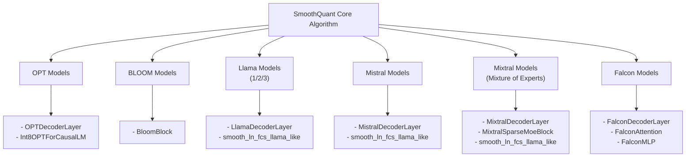
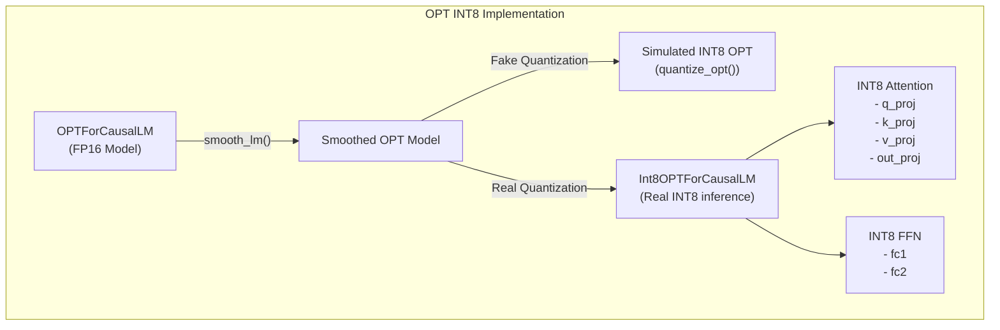
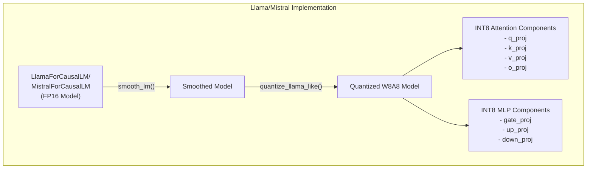
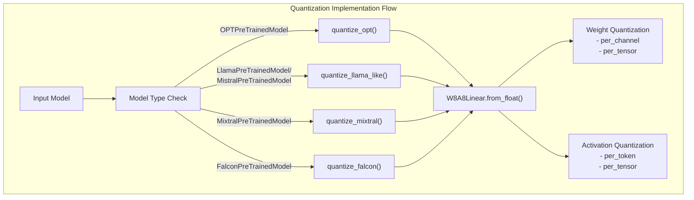
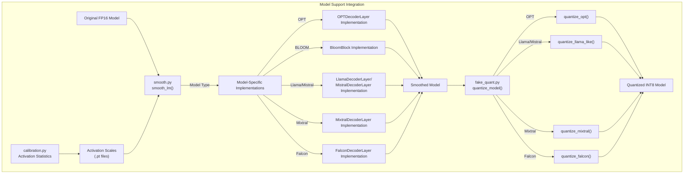

<!-- source: DeepWiki mcp.deepwiki.com · repo mit-han-lab/smoothquant · page 5 Model Support · fetched 2026-10-30 -->

# Model Support

Relevant source files

The following files were used as context for generating this wiki page:

- [README.md](README.md)
- [assets/SmoothQuant.pdf](assets/SmoothQuant.pdf)
- [smoothquant/fake_quant.py](smoothquant/fake_quant.py)
- [smoothquant/smooth.py](smoothquant/smooth.py)

This page documents the model architectures and families supported by SmoothQuant's quantization techniques. It covers which Large Language Models (LLMs) are compatible with SmoothQuant's W8A8 (8-bit weight, 8-bit activation) quantization algorithm, how they are implemented, and the technical details for each model family.

## Supported Model Architectures

SmoothQuant currently supports several major LLM architecture families, each with model-specific implementation details to account for architectural differences.

Sources: [smoothquant/smooth.py:1-161](), [smoothquant/fake_quant.py:141-351](), [README.md:87-109]()

## Model Implementation Details

### OPT (Open Pre-trained Transformer)

OPT models have the most complete implementation in SmoothQuant, including real INT8 inference support:

- **Smoothing**: Implemented for `OPTDecoderLayer` by applying smoothing to both attention and feedforward components
- **Quantization**: Supports both fake quantization (for simulation) and real INT8 inference
- **Real INT8 Support**: Available through the `Int8OPTForCausalLM` class which uses optimized INT8 GEMM kernels via [torch-int](https://github.com/Guangxuan-Xiao/torch-int)
- **Tested Sizes**: 125M, 1.3B, 2.7B, 6.7B, 13B, 30B, 66B, 175B

Sources: [smoothquant/opt.py](), [smoothquant/smooth.py:75-90](), [smoothquant/fake_quant.py:141-180](), [README.md:41-54]()

### BLOOM Models

BLOOM models are supported through:

- **Smoothing**: Implemented for `BloomBlock` modules
- **Quantization**: Supported via fake quantization for simulation
- **Components**: Handles `input_layernorm`, `self_attention.query_key_value`, `post_attention_layernorm`, and `mlp.dense_h_to_4h`

Sources: [smoothquant/smooth.py:91-100]()

### Llama and Mistral Models

Llama (1/2/3) and Mistral models share architectural similarities and are handled similarly:

- **Smoothing**: Uses a specialized `smooth_ln_fcs_llama_like` function that handles RMSNorm instead of LayerNorm
- **Components**: 
  - Attention: `q_proj`, `k_proj`, `v_proj`, `o_proj`
  - MLP: `gate_proj`, `up_proj`, `down_proj`
- **Quantization**: Implemented in `quantize_llama_like` function
- **Tested Versions**: 
  - Llama-2: 7B, 13B, 70B
  - Llama-3: 8B, 70B
  - Mistral: 7B

Sources: [smoothquant/smooth.py:48-71](), [smoothquant/smooth.py:126-141](), [smoothquant/fake_quant.py:183-230](), [README.md:87-103]()

### Mixtral Models (Mixture of Experts)

Mixtral models extend the Llama-like architecture with Mixture of Experts (MoE):

- **Smoothing**: Uses `smooth_ln_fcs_llama_like` but with special handling for the MoE components
- **Components**:
  - Regular attention components (`q_proj`, `k_proj`, `v_proj`)
  - MoE-specific: `block_sparse_moe.gate` and expert weights (`w1`, `w2`, `w3`)
- **Quantization**: Implemented in `quantize_mixtral` function
- **Tested Versions**: Mixtral-8x7B

Sources: [smoothquant/smooth.py:142-160](), [smoothquant/fake_quant.py:233-280](), [README.md:104-106]()

### Falcon Models

Falcon models have a unique architecture handled specifically:

- **Smoothing**: Special handling for different Falcon architecture variations (new decoder architecture, parallel attention)
- **Components**:
  - Attention: `self_attention.query_key_value`, `dense`
  - MLP: `dense_h_to_4h`, `dense_4h_to_h`
- **Quantization**: Implemented in `quantize_falcon` function
- **Tested Versions**: Falcon-7B, Falcon-40B

Sources: [smoothquant/smooth.py:101-125](), [smoothquant/fake_quant.py:283-310](), [README.md:107-109]()

## Quantization Implementation Architecture

SmoothQuant provides a unified interface for quantizing all supported models through the `quantize_model` function, which automatically selects the appropriate model-specific implementation.

Sources: [smoothquant/fake_quant.py:313-351](), [smoothquant/fake_quant.py:48-139]()

## Model Size Support and Performance

SmoothQuant has been tested and shows strong results across multiple model sizes:

| Model Type | Tested Model Sizes | Performance |
|------------|-------------------|-------------|
| OPT        | 125M to 175B      | Negligible loss (Real INT8 support) |
| Llama-2    | 7B, 13B, 70B      | PPL difference < 0.05 |
| Llama-3    | 8B, 70B           | PPL difference < 0.13 |
| Mistral    | 7B                | PPL difference < 0.03 |
| Mixtral    | 8x7B              | PPL difference < 0.06 |
| Falcon     | 7B, 40B           | PPL difference < 0.04 |

The quantization is particularly effective on larger models where memory constraints are most severe, enabling inference with significantly reduced memory requirements. For example, OPT-175B and BLOOM-176B can be quantized with negligible accuracy loss while achieving up to 2x memory reduction.

Sources: [README.md:87-110](), [README.md:119-121]()

## Model Integration Architecture

The following diagram illustrates how the model support components integrate with the rest of the SmoothQuant system:

Sources: [smoothquant/smooth.py:18-161](), [smoothquant/fake_quant.py:313-351]()

## Adding Support for New Models

When adding support for a new model architecture to SmoothQuant, developers need to:

1. **Implement smoothing support** in `smooth_lm` function in `smoothquant/smooth.py`
2. **Implement quantization support** by creating a new quantization function (like `quantize_opt` or `quantize_llama_like`)
3. **Update the model identification logic** in `quantize_model` function to recognize and route the new model type

The general pattern is to identify key components (attention, MLP/FFN) and apply the appropriate smoothing and quantization transformations for each.

Sources: [smoothquant/smooth.py:75-161](), [smoothquant/fake_quant.py:313-351]()

---

