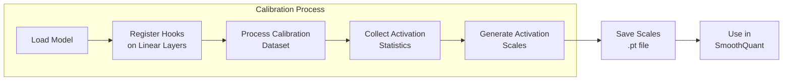
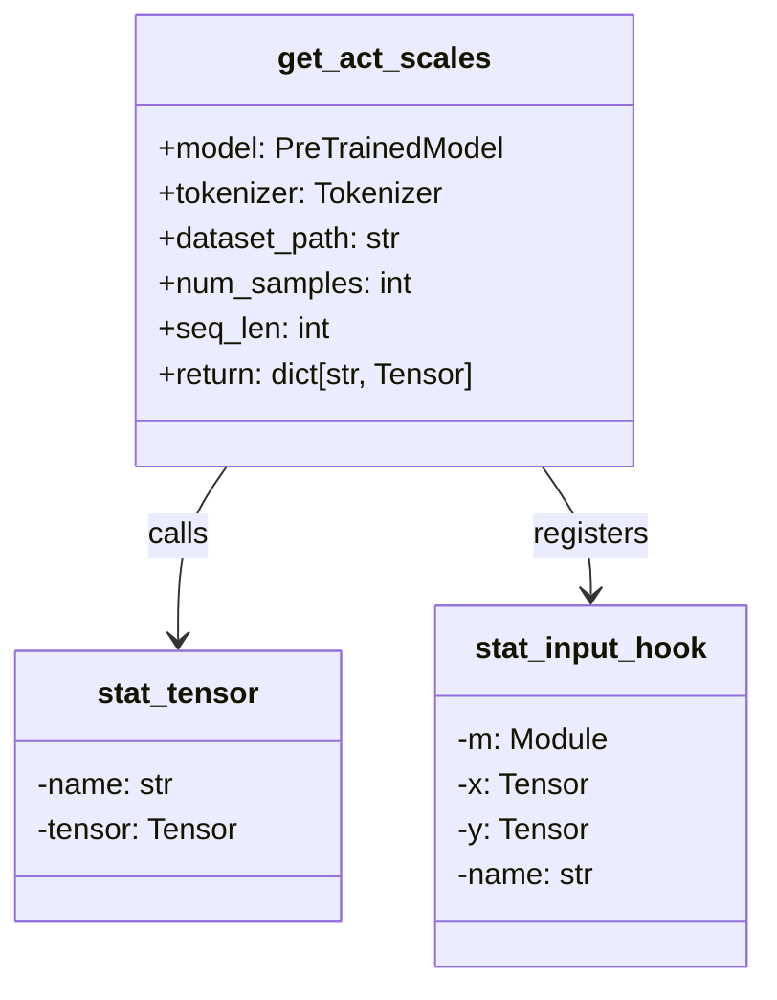
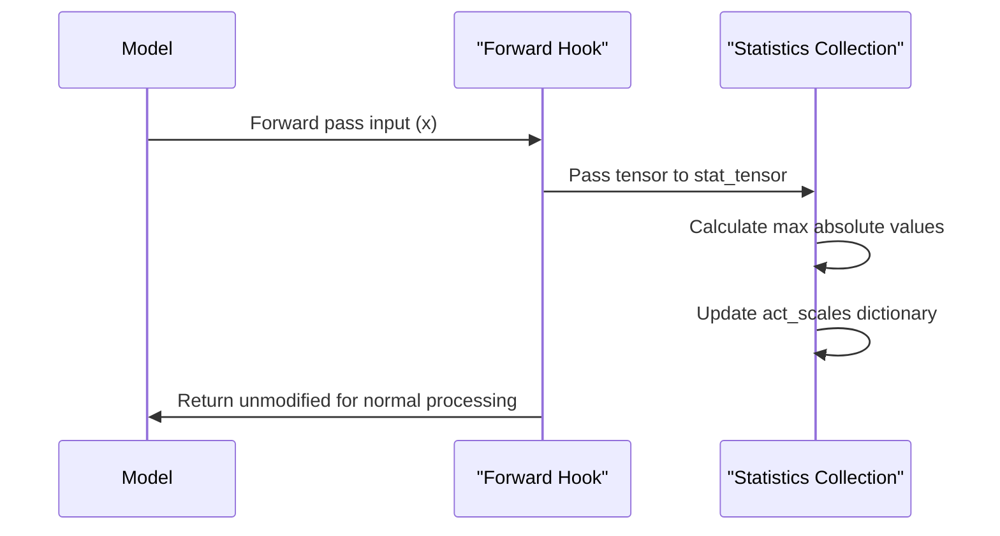
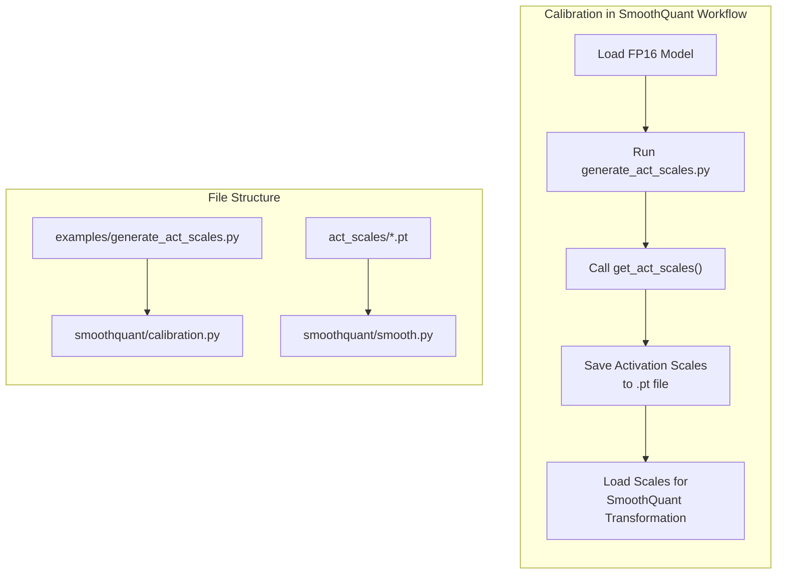
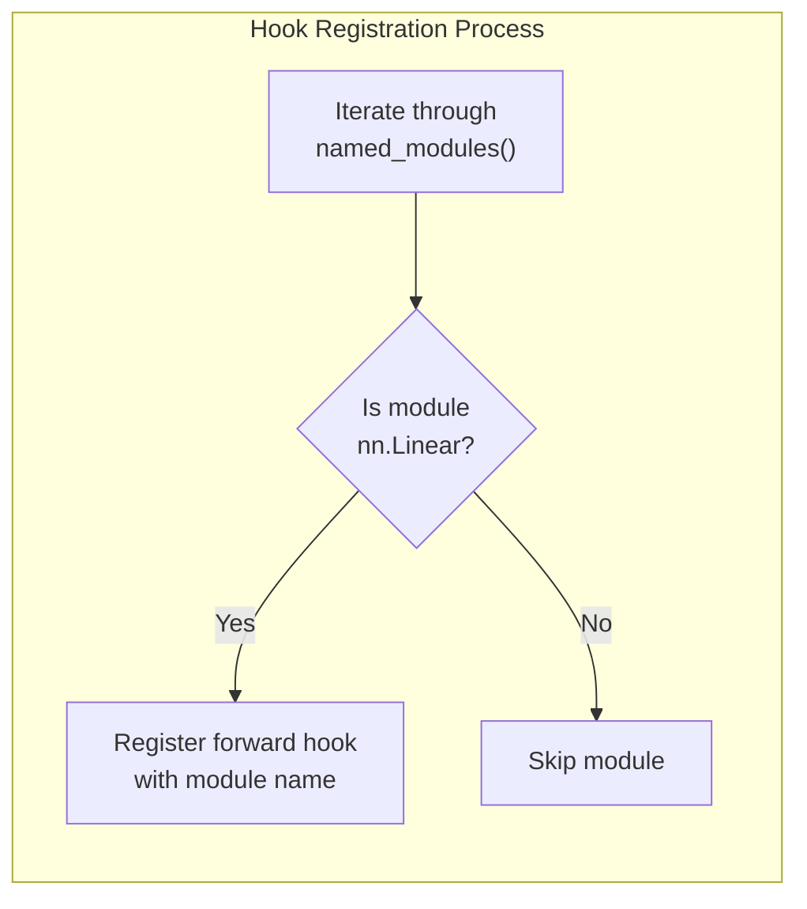

<!-- source: DeepWiki mcp.deepwiki.com · repo mit-han-lab/smoothquant · page 6 Calibration Module · fetched 2026-10-30 -->

# Calibration Module

<details>
<summary>Relevant source files</summary>

The following files were used as context for generating this wiki page:

- [act_scales/README.md](act_scales/README.md)
- [examples/generate_act_scales.py](examples/generate_act_scales.py)
- [smoothquant/calibration.py](smoothquant/calibration.py)

</details>


The Calibration Module is a critical component of SmoothQuant that collects activation statistics from pre-trained large language models. These statistics are used to generate activation scales, which are essential for the smoothing process that redistributes quantization difficulty from activations to weights. For information about how these scales are used in the smoothing algorithm, see [Smoothing Algorithm](#7).

## Purpose and Function

The Calibration Module analyzes a model's behavior on a calibration dataset to identify the maximum absolute values of activations at each linear layer. These values help determine how to best "smooth" the activation outliers that typically cause quantization issues in LLMs.



Sources: [smoothquant/calibration.py:13-51](). [examples/generate_act_scales.py:56-58]()

## Core Functions

The module provides two key functions:

1. **`get_act_scales`**: Collects activation statistics across all linear layers in a model.
2. **`get_static_decoder_layer_scales`**: Specialized function that collects both input and output activation statistics for transformer decoder layers.

### `get_act_scales` Function

The primary calibration function takes a model, tokenizer, and calibration dataset as input and returns a dictionary of activation scales for each linear layer.



Sources: [smoothquant/calibration.py:13-51]()

### `get_static_decoder_layer_scales` Function

This specialized function collects more detailed statistics for decoder layers, tracking both input and output scales for specific components like attention modules and feed-forward networks.

Sources: [smoothquant/calibration.py:54-130]()

## Hook Mechanism for Collecting Statistics

The Calibration Module uses PyTorch's hook mechanism to intercept the forward pass of linear layers and collect activation statistics without modifying the model architecture.



Sources: [smoothquant/calibration.py:18-30](). [smoothquant/calibration.py:33-37]()

## Calibration Process Flow

The complete calibration process follows these steps:

1. Register forward hooks on all linear layers in the model
2. Load and shuffle a calibration dataset (typically from the Pile dataset)
3. Process a specified number of samples through the model
4. At each linear layer, collect maximum absolute values of activations
5. Compile these statistics into activation scales
6. Remove the hooks to restore normal model behavior
7. Return the collected activation scales

Sources: [smoothquant/calibration.py:13-51](). [examples/generate_act_scales.py:43-61]()

## Integration with SmoothQuant Workflow

The Calibration Module is typically used through the `generate_act_scales.py` script, which handles loading the model, running the calibration, and saving the resulting scales for later use.



Sources: [examples/generate_act_scales.py:1-65](). [act_scales/README.md:1-4]()

## Technical Implementation Details

### Activation Statistics Collection

The module tracks the maximum absolute values across the hidden dimension of each activation tensor:

```python
def stat_tensor(name, tensor):
    hidden_dim = tensor.shape[-1]
    tensor = tensor.view(-1, hidden_dim).abs().detach()
    comming_max = torch.max(tensor, dim=0)[0].float().cpu()
    if name in act_scales:
        act_scales[name] = torch.max(act_scales[name], comming_max)
    else:
        act_scales[name] = comming_max
```

This function reshapes the activation tensor to expose the hidden dimension, calculates the maximum absolute values along that dimension, and maintains a running maximum across all processed samples.

Sources: [smoothquant/calibration.py:18-25]()

### Hook Registration

The module registers hooks on each linear layer in the model:



Sources: [smoothquant/calibration.py:33-37](). [smoothquant/calibration.py:86-88]()

## Command-Line Usage

The Calibration Module is typically used through the `generate_act_scales.py` script with the following parameters:

| Parameter | Description | Default |
|-----------|-------------|---------|
| `--model-name` | Name of the pre-trained model | facebook/opt-1.3b |
| `--output-path` | Path to save activation scales | act_scales/opt-1.3b.pt |
| `--dataset-path` | Location of calibration dataset | dataset/val.jsonl.zst |
| `--num-samples` | Number of samples to process | 512 |
| `--seq-len` | Maximum sequence length | 512 |

Example usage:
```bash
python examples/generate_act_scales.py --model-name facebook/opt-6.7b --output-path act_scales/opt-6.7b.pt
```

Sources: [examples/generate_act_scales.py:20-40](). [examples/generate_act_scales.py:43-61]()

## Pre-computed Activation Scales

SmoothQuant provides pre-computed activation scales for popular models like OPT and BLOOM. These scales are generated using 512 random sentences from the Pile validation set and are available on Hugging Face.

Sources: [act_scales/README.md:1-4]()

## Relationship to Activation Scales

The Calibration Module generates the activation scales that are essential for the SmoothQuant process. For more detailed information about activation scales themselves and how they're used, see [Activation Scales](#6.1).

---

