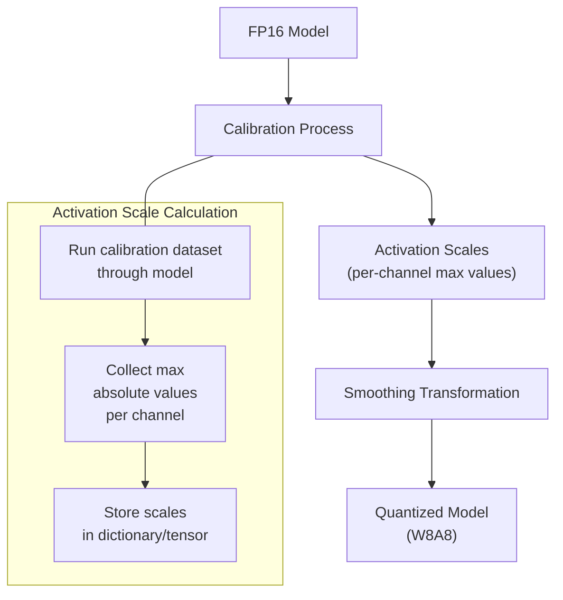
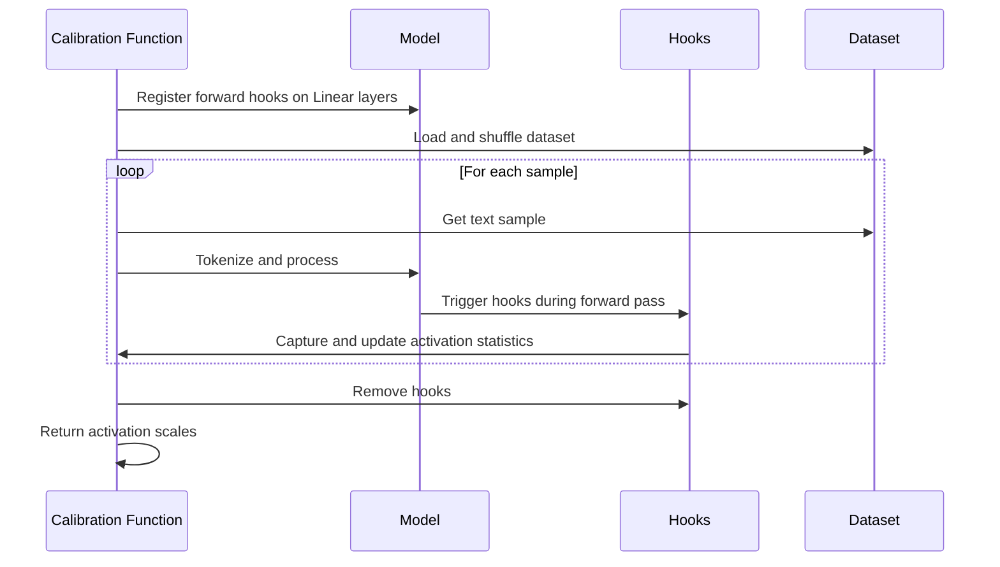
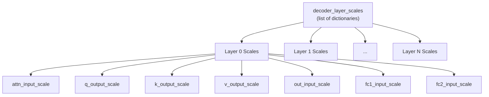
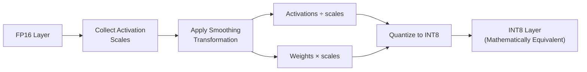
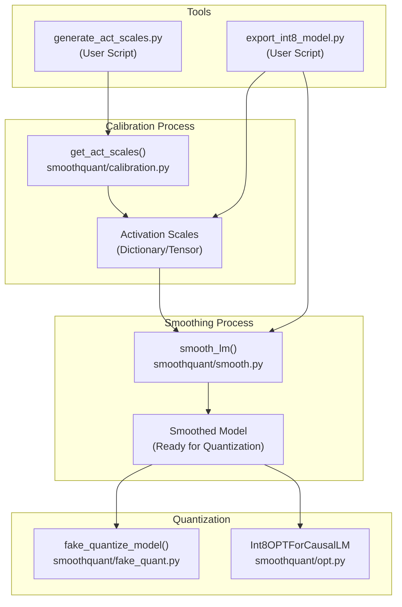

<!-- source: DeepWiki mcp.deepwiki.com · repo mit-han-lab/smoothquant · page 6.1 Activation Scales · fetched 2026-10-30 -->

# Activation Scales

<details>
<summary>Relevant source files</summary>

The following files were used as context for generating this wiki page:

- [act_scales/README.md](act_scales/README.md)
- [figures/quantization_flow.png](figures/quantization_flow.png)
- [smoothquant/calibration.py](smoothquant/calibration.py)

</details>


## Purpose and Scope

This document explains activation scales, a fundamental component in SmoothQuant's quantization process. Activation scales are numerical values that capture the dynamic range of activations in different parts of a large language model (LLM). They are essential for the smoothing transformation that redistributes quantization difficulty from activations to weights. For information about the overall smoothing algorithm, see [Smoothing Algorithm](#7).

## What Are Activation Scales?

Activation scales are per-channel (or per-neuron) scaling factors that represent the maximum absolute values observed in activation tensors during model inference. They serve as a calibration mechanism that enables SmoothQuant to:

1. Identify activation outliers that cause quantization challenges
2. Apply appropriate scaling to smooth these outliers
3. Redistribute quantization difficulty between activations and weights



Sources: [smoothquant/calibration.py:13-51]()

## Calibration Process

Activation scales are computed through a calibration process that analyzes the numerical patterns in a model's internal activations when processing representative text data.

### Data Collection

The calibration process typically:
1. Uses 512 random sentences from a dataset (default is a subset of The Pile)
2. Processes each sentence through the model
3. Captures the maximum absolute values of activations at each linear layer



Sources: [smoothquant/calibration.py:13-51]()

### Implementation Details

The calibration is implemented in two main functions:

1. `get_act_scales()`: Collects per-channel maximum activation values for all linear layers
2. `get_static_decoder_layer_scales()`: Provides more detailed statistics for transformer decoder layers

#### Key steps in `get_act_scales()`:

1. Register forward hooks on all linear layers in the model
2. When each hook is triggered, extract activation tensors
3. Compute the absolute values and maximum per channel
4. Update the running maximum in the `act_scales` dictionary

The resulting activation scales are organized by layer name, with each scale being a tensor matching the hidden dimension size of that layer.

Sources: [smoothquant/calibration.py:13-51]()

## Structure of Activation Scales

The activation scales are stored as a dictionary with the following structure:

```
{
    "module.layer1.linear": tensor([scale_1, scale_2, ..., scale_n]),
    "module.layer2.linear": tensor([scale_1, scale_2, ..., scale_n]),
    ...
}
```

Where each tensor contains the per-channel maximum absolute values observed during calibration, and the keys correspond to the full path of each linear layer in the model.

For decoder-specific scales (from `get_static_decoder_layer_scales()`), a more structured format is used:



Sources: [smoothquant/calibration.py:104-128]()

## How Activation Scales Are Used

Activation scales serve as the foundation for the smoothing transformation. Their primary uses include:

1. **Identifying Quantization Difficulty**: The magnitude of activation scales indicates where quantization would be most challenging
2. **Facilitating Smoothing**: During the smoothing process, activations are divided by these scales, while corresponding weights are multiplied by them
3. **Scaling for INT8 Range**: The scales are often normalized by 127 to properly adjust for the INT8 range (-128 to 127)



Sources: [smoothquant/calibration.py:13-51](), [smoothquant/calibration.py:104-128]()

## Pre-computed Activation Scales

For convenience, SmoothQuant provides pre-computed activation scales for popular model architectures:

- Available for OPT and BLOOM models on Hugging Face
- Generated using 512 random sentences from The Pile validation set
- Stored as `.pt` files that can be loaded directly into the smoothing process

These pre-computed scales allow users to apply SmoothQuant without running the calibration process themselves.

Sources: [act_scales/README.md:1-4]()

## Technical Example: Computing Activation Scales

Below is a simplified example of how the activation scale computation works:

1. Register forward hooks on all linear layers
2. Process calibration data through the model
3. During each forward pass, capture and update the maximum absolute values

The key implementation is in the `stat_tensor` function, which processes each activation tensor:

```python
def stat_tensor(name, tensor):
    hidden_dim = tensor.shape[-1]
    tensor = tensor.view(-1, hidden_dim).abs().detach()
    comming_max = torch.max(tensor, dim=0)[0].float().cpu()
    if name in act_scales:
        act_scales[name] = torch.max(act_scales[name], comming_max)
    else:
        act_scales[name] = comming_max
```

This function:
1. Reshapes the tensor to a 2D matrix (batch_size × hidden_dimension)
2. Takes the absolute value of all elements
3. Finds the maximum value along each column (per channel)
4. Updates the running maximum in the `act_scales` dictionary

Sources: [smoothquant/calibration.py:18-25]()

## Relationship to Other Components

Activation scales connect to other SmoothQuant components as follows:



Sources: [smoothquant/calibration.py:13-51]()

## Summary

Activation scales are a critical component in SmoothQuant's approach to quantizing LLMs. They:

1. Provide a per-channel representation of activation ranges throughout the model
2. Enable the smoothing transformation that makes W8A8 quantization viable for LLMs
3. Are computed through a calibration process using representative text data
4. Can be pre-computed and reused for common model architectures

By accurately capturing the dynamic range of activations, these scales allow SmoothQuant to effectively redistribute quantization difficulty between activations and weights, leading to minimal accuracy loss during quantization.

---

