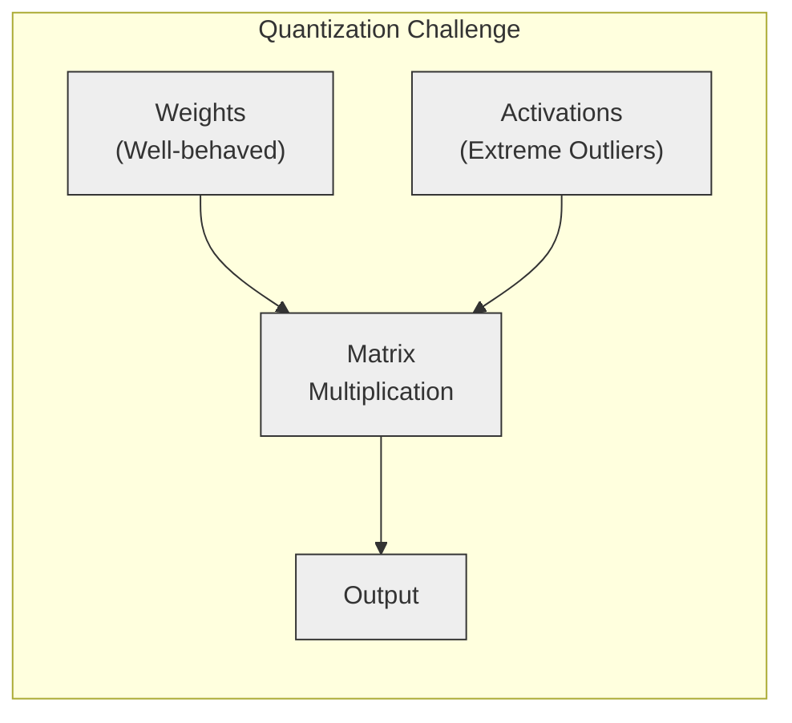
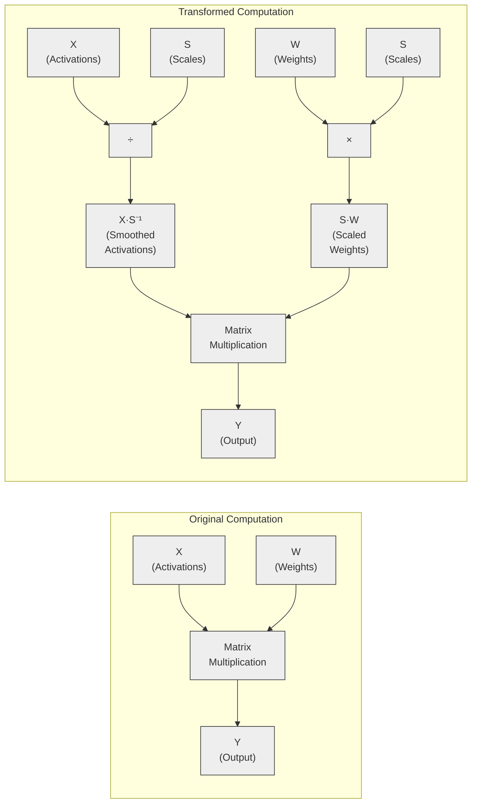
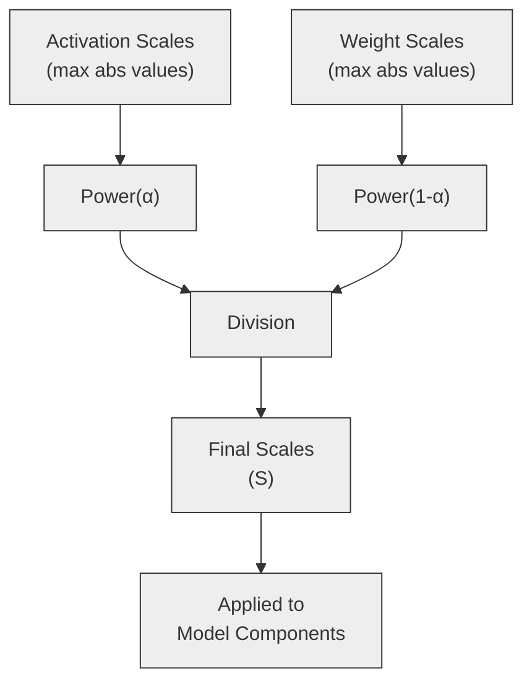
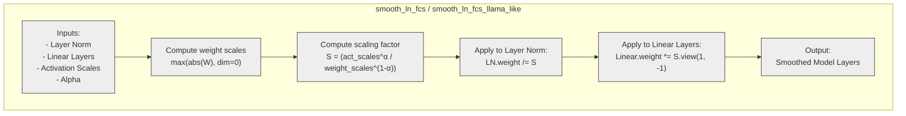
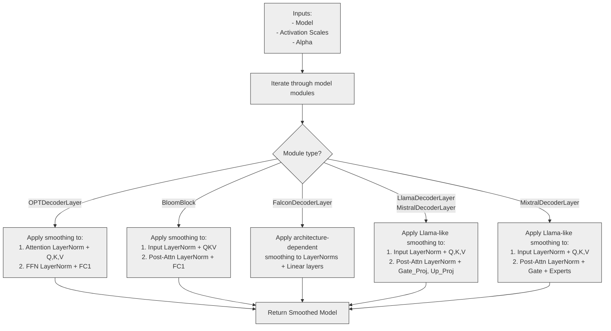
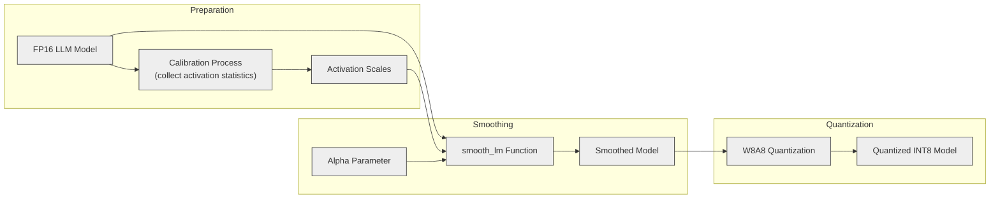

<!-- source: DeepWiki mcp.deepwiki.com · repo mit-han-lab/smoothquant · page 7 Smoothing Algorithm · fetched 2026-10-30 -->

# Smoothing Algorithm

<details>
<summary>Relevant source files</summary>

The following files were used as context for generating this wiki page:

- [README.md](README.md)
- [assets/SmoothQuant.pdf](assets/SmoothQuant.pdf)
- [smoothquant/smooth.py](smoothquant/smooth.py)

</details>


## Purpose and Scope

The Smoothing Algorithm is the core component of SmoothQuant that redistributes quantization difficulty from activations to weights. This page explains the mathematical principles behind the smoothing transformation, its implementation details, and how it's applied to different model architectures. For information about generating activation scales needed by this algorithm, see [Calibration Module](#6) and [Activation Scales](#6.1).

## Problem: Activation Outliers in LLMs

Large language models suffer from extreme outliers in activation distributions, making standard INT8 quantization challenging without significant accuracy degradation. While weights tend to be relatively well-behaved for quantization, activations contain systematic outliers that lead to substantial quantization errors.



Sources: [README.md:17-22](https://github.com/mit-han-lab/smoothquant/blob/main/README.md)

## Mathematical Transformation

The Smoothing Algorithm performs a mathematically equivalent transformation that "smooths" activation outliers by partially migrating quantization difficulty from activations to weights.

### Transformation Principle

For a linear layer operation Y = X·W, where X represents activations and W represents weights, the algorithm applies a diagonal scaling matrix S:

Y = X·W = (X·S⁻¹)·(S·W)

This transformation introduces scaled activations (X·S⁻¹) and scaled weights (S·W) while preserving the mathematical equivalence of the original computation.



Sources: [smoothquant/smooth.py:18-46](https://github.com/mit-han-lab/smoothquant/blob/main/smoothquant/smooth.py)

### Alpha Parameter

The scaling factor S is computed using a hyperparameter alpha (α) that controls the balance between scaling activations and weights:

S = (activation_scale^α / weight_scale^(1-α))

- When α = 0: All scaling is applied to weights
- When α = 1: All scaling is applied to activations
- When 0 < α < 1: Scaling is distributed between weights and activations

The default value is typically α = 0.5, which provides a balanced distribution.



Sources: [smoothquant/smooth.py:32-39](https://github.com/mit-han-lab/smoothquant/blob/main/smoothquant/smooth.py)

## Implementation Details

### Core Scaling Functions

The smoothing algorithm is implemented through two primary functions:

1. `smooth_ln_fcs`: For standard LayerNorm-based models (OPT, BLOOM, Falcon)
2. `smooth_ln_fcs_llama_like`: For RMSNorm-based models (Llama, Mistral, Mixtral)

Both functions perform similar operations:
- Compute weight scales (maximum absolute value along the input dimension)
- Compute the combined scaling factor using the activation scales and alpha parameter
- Apply the inverse scaling to the normalization layer weights
- Apply the scaling to the linear layer weights



Sources: [smoothquant/smooth.py:18-71](https://github.com/mit-han-lab/smoothquant/blob/main/smoothquant/smooth.py)

### Differences Between Implementations

The main differences between `smooth_ln_fcs` and `smooth_ln_fcs_llama_like`:

| Function | Target Models | Normalization Type | Bias Handling |
|----------|---------------|-------------------|---------------|
| `smooth_ln_fcs` | OPT, BLOOM, Falcon | LayerNorm | Scales both `ln.weight` and `ln.bias` |
| `smooth_ln_fcs_llama_like` | Llama, Mistral, Mixtral | RMSNorm | Scales only `ln.weight` (no bias in RMSNorm) |

Sources: [smoothquant/smooth.py:18-71](https://github.com/mit-han-lab/smoothquant/blob/main/smoothquant/smooth.py)

## Model Architecture Support

The main function `smooth_lm` handles the application of smoothing to various model architectures. It iterates through model modules and applies the appropriate smoothing function based on the module type.



Sources: [smoothquant/smooth.py:74-160](https://github.com/mit-han-lab/smoothquant/blob/main/smoothquant/smooth.py)

### Per-Architecture Smoothing Details

The table below shows which components are smoothed for each architecture:

| Architecture | First Normalization | First Linear Layers | Second Normalization | Second Linear Layers |
|--------------|---------------------|---------------------|----------------------|----------------------|
| OPT | `self_attn_layer_norm` | `q_proj`, `k_proj`, `v_proj` | `final_layer_norm` | `fc1` |
| BLOOM | `input_layernorm` | `query_key_value` | `post_attention_layernorm` | `dense_h_to_4h` |
| Falcon | Architecture-dependent | `query_key_value` | Architecture-dependent | `dense_h_to_4h` |
| Llama/Mistral | `input_layernorm` | `q_proj`, `k_proj`, `v_proj` | `post_attention_layernorm` | `gate_proj`, `up_proj` |
| Mixtral | `input_layernorm` | `q_proj`, `k_proj`, `v_proj` | `post_attention_layernorm` | `gate` + all expert `w1` and `w3` |

Sources: [smoothquant/smooth.py:74-160](https://github.com/mit-han-lab/smoothquant/blob/main/smoothquant/smooth.py)

## Workflow Integration

The smoothing algorithm is integrated into the overall SmoothQuant workflow as follows:



Sources: [README.md:40-53](https://github.com/mit-han-lab/smoothquant/blob/main/README.md)

## Usage Example

To apply the smoothing algorithm to a model, you need:

1. Pre-computed activation scales
2. The model to be smoothed
3. An optional alpha parameter (default is 0.5)

```python
from smoothquant.smooth import smooth_lm

# Load model and activation scales
# ...

# Apply smoothing
smooth_lm(model, activation_scales, alpha=0.5)

# The model is now smoothed and ready for quantization
```

For complete examples of using the smoothing algorithm in practice, see:
- [examples/generate_act_scales.py](https://github.com/mit-han-lab/smoothquant/blob/main/examples/generate_act_scales.py) - For generating activation scales
- [examples/export_int8_model.py](https://github.com/mit-han-lab/smoothquant/blob/main/examples/export_int8_model.py) - For exporting smoothed INT8 models
- [examples/smoothquant_opt_demo.ipynb](https://github.com/mit-han-lab/smoothquant/blob/main/examples/smoothquant_opt_demo.ipynb) - For a demonstration with OPT-13B
- [examples/smoothquant_llama_demo.ipynb](https://github.com/mit-han-lab/smoothquant/blob/main/examples/smoothquant_llama_demo.ipynb) - For a demonstration with Llama models

Sources: [README.md:51-64](https://github.com/mit-han-lab/smoothquant/blob/main/README.md)

## Performance Impact

The smoothing algorithm enables W8A8 quantization of LLMs with negligible loss in accuracy. The performance improvements include:

1. Up to 1.56x speedup compared to FP16
2. 2x memory reduction
3. Ability to serve large models (like 530B parameters) on half the number of GPUs

For more details on quantization techniques and performance evaluation after applying the smoothing algorithm, see [Quantization Techniques](#8) and [Performance Evaluation](#11).

Sources: [README.md:115-129](https://github.com/mit-han-lab/smoothquant/blob/main/README.md)

---

