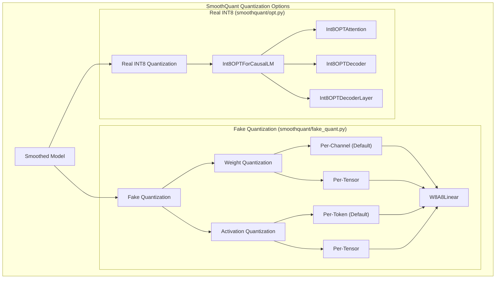
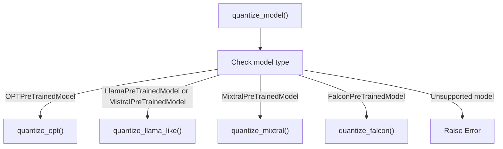
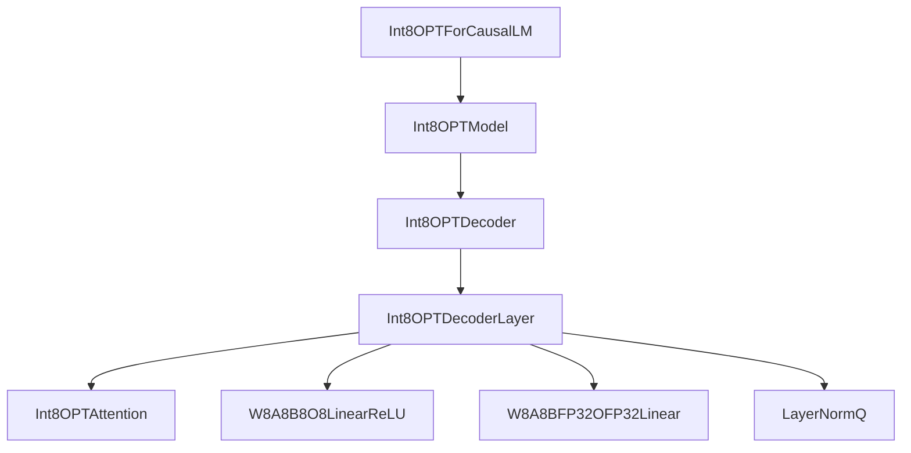
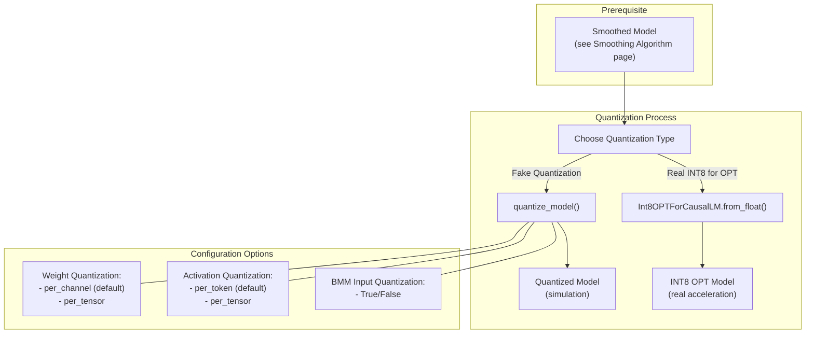

<!-- source: DeepWiki mcp.deepwiki.com · repo mit-han-lab/smoothquant · page 8 Quantization Techniques · fetched 2026-10-30 -->

# Quantization Techniques

<details>
<summary>Relevant source files</summary>

The following files were used as context for generating this wiki page:

- [smoothquant/fake_quant.py](smoothquant/fake_quant.py)
- [smoothquant/opt.py](smoothquant/opt.py)

</details>


This page documents the quantization techniques used in SmoothQuant to achieve efficient 8-bit weight, 8-bit activation (W8A8) quantization for large language models. It covers both simulation-based quantization ("fake quantization") and real INT8 implementation approaches.

For information about the SmoothQuant algorithm itself, see [Smoothing Algorithm](#7). For details on the calibration process needed before quantization, see [Calibration Module](#6).

## Overview of Quantization Approaches

SmoothQuant implements two main approaches to quantization:

1. **Fake Quantization**: Simulates the effects of quantization while still using floating-point computation. This is primarily implemented in the `W8A8Linear` class.

2. **Real INT8 Implementation**: Uses actual INT8 operations for computational efficiency. Currently implemented for OPT models in the `Int8OPTForCausalLM` class.



Sources: [smoothquant/fake_quant.py:6-45](), [smoothquant/fake_quant.py:313-351](), [smoothquant/opt.py:23-481]()

## Weight Quantization Methods

SmoothQuant implements two primary methods for weight quantization, both using 8-bit integer precision:

### Per-Channel Quantization

Per-channel quantization computes a separate scaling factor for each output channel of a weight matrix, providing better accuracy at the cost of slightly more complex implementation.

```python
# Scale computation for per-channel quantization
scales = w.abs().max(dim=-1, keepdim=True)[0]
q_max = 2 ** (n_bits - 1) - 1  # 127 for 8-bit
scales.clamp_(min=1e-5).div_(q_max)
w.div_(scales).round_().mul_(scales)
```

### Per-Tensor Quantization

Per-tensor quantization uses a single scaling factor for the entire weight tensor, resulting in simpler implementation but potentially lower accuracy.

```python
# Scale computation for per-tensor quantization
scales = w.abs().max()
q_max = 2 ** (n_bits - 1) - 1  # 127 for 8-bit
scales.clamp_(min=1e-5).div_(q_max)
w.div_(scales).round_().mul_(scales)
```

Sources: [smoothquant/fake_quant.py:6-23]()

## Activation Quantization Methods

Similar to weight quantization, SmoothQuant provides two methods for activation quantization:

### Per-Token Quantization

Computes scaling factors for each token individually, maintaining better accuracy for varying token magnitudes.

```python
# Scale computation for per-token quantization
scales = t.abs().max(dim=-1, keepdim=True)[0]
q_max = 2 ** (n_bits - 1) - 1  # 127 for 8-bit
scales.clamp_(min=1e-5).div_(q_max)
t.div_(scales).round_().mul_(scales)
```

### Per-Tensor Quantization

Uses a single scaling factor for the entire activation tensor, offering computational simplicity at the potential cost of precision.

```python
# Scale computation for per-tensor quantization
scales = t.abs().max()
q_max = 2 ** (n_bits - 1) - 1  # 127 for 8-bit
scales.clamp_(min=1e-5).div_(q_max)
t.div_(scales).round_().mul_(scales)
```

Sources: [smoothquant/fake_quant.py:26-45]()

## Fake Quantization Implementation

### W8A8Linear Class

The core of fake quantization is implemented in the `W8A8Linear` class, which simulates 8-bit weight and 8-bit activation quantization while still performing computation in floating-point.

```mermaid
classDiagram
    class "W8A8Linear" {
        +weight : torch.Tensor
        +bias : torch.Tensor
        +act_quant : function
        +output_quant : function
        +forward(x) : torch.Tensor
        +from_float(module, weight_quant, act_quant, quantize_output) : W8A8Linear
    }
```

Key aspects of the `W8A8Linear` implementation:

1. **Configurable Quantization**: Supports different quantization strategies for weights and activations.
2. **Simulated Quantization Flow**:
   - Quantizes input activations
   - Performs a linear operation with pre-quantized weights
   - Optionally quantizes outputs
3. **Construction from Float Module**: Creates a quantized module from a standard floating-point `nn.Linear` module.

Sources: [smoothquant/fake_quant.py:48-138]()

## Model-Specific Quantization

SmoothQuant implements specialized quantization functions for different model architectures:

| Model Architecture | Function | Special Considerations |
|--------------------|----------|------------------------|
| OPT | `quantize_opt` | Handling for OPT-specific layer organization |
| Llama/Mistral | `quantize_llama_like` | Unified handling for Llama-style models |
| Mixtral | `quantize_mixtral` | Support for MoE architecture |
| Falcon | `quantize_falcon` | Handles different attention implementation |

The `quantize_model` function automatically applies the appropriate quantization function based on the model architecture:



Sources: [smoothquant/fake_quant.py:141-351]()

## Real INT8 Implementation for OPT

SmoothQuant provides a real INT8 implementation for OPT models using INT8 computation kernels:

### Int8OPTAttention

This class implements attention mechanisms using 8-bit integer matrix multiplication (BMM) operations:

```mermaid
classDiagram
    class "Int8OPTAttention" {
        +embed_dim : int
        +num_heads : int
        +head_dim : int
        +k_proj : W8A8B8O8Linear
        +v_proj : W8A8B8O8Linear
        +q_proj : W8A8B8O8Linear
        +out_proj : W8A8BFP32OFP32Linear
        +qk_bmm : BMM_S8T_S8N_F32T
        +pv_bmm : BMM_S8T_S8N_S8T
        +from_float(module, input_scale, q_output_scale, etc.) : Int8OPTAttention
        +forward(...) : Tuple
    }
```

The implementation:

1. Uses specialized linear layers from `torch_int.nn.linear`:
   - `W8A8B8O8Linear`: 8-bit weights, 8-bit activations, 8-bit bias, 8-bit output
   - `W8A8BFP32OFP32Linear`: 8-bit weights, 8-bit activations, FP32 bias, FP32 output

2. Uses specialized BMM (batch matrix multiplication) implementations:
   - `BMM_S8T_S8N_F32T`: 8-bit × 8-bit → FP32 BMM 
   - `BMM_S8T_S8N_S8T`: 8-bit × 8-bit → 8-bit BMM

Sources: [smoothquant/opt.py:23-209]()

### INT8 OPT Model Hierarchy



Key aspects of the real INT8 implementation:

1. **INT8 Computation**: Uses actual INT8 operations for faster inference and reduced memory usage.
2. **Scale Propagation**: Carefully manages quantization scales throughout the network.
3. **Precision Control**: Strategic use of FP32 for outputs when needed for numerical stability.
4. **Conversion from Float**: Each class provides a `from_float` method to convert from float models.

Sources: [smoothquant/opt.py:212-480]()

## Quantization Flow

The end-to-end process for applying quantization in SmoothQuant:



Important considerations when applying quantization:

1. **Weight Quantization Selection**:
   - `per_channel` (default): Better accuracy, slightly more complex
   - `per_tensor`: Simpler, potentially lower accuracy

2. **Activation Quantization Selection**:
   - `per_token` (default): Better accuracy for varying magnitudes
   - `per_tensor`: Simpler, potentially lower accuracy

3. **BMM Input Quantization**:
   - Controls whether outputs of projection matrices in attention are quantized
   - Important for end-to-end INT8 inference

Sources: [smoothquant/fake_quant.py:313-351](), [smoothquant/opt.py:450-480]()

---

