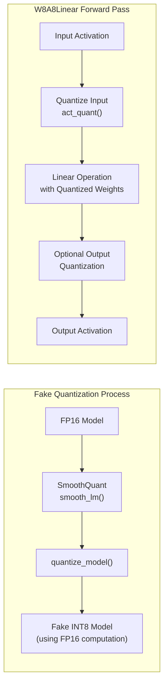
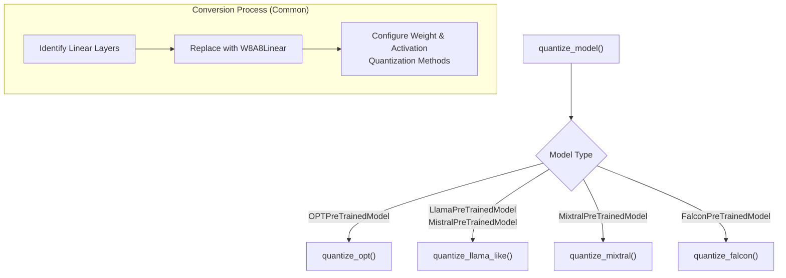

<!-- source: DeepWiki mcp.deepwiki.com · repo mit-han-lab/smoothquant · page 8.1 Fake Quantization · fetched 2026-10-30 -->

# Fake Quantization

<details>
<summary>Relevant source files</summary>

The following files were used as context for generating this wiki page:

- [examples/smoothquant_opt_demo.ipynb](examples/smoothquant_opt_demo.ipynb)
- [smoothquant/fake_quant.py](smoothquant/fake_quant.py)

</details>


## Purpose and Scope

This document describes the fake quantization system within SmoothQuant, which simulates INT8 quantization effects while still using FP16 computation. This approach allows for testing the quantization impact on model accuracy without implementing hardware-specific INT8 kernels. For information about the actual INT8 implementation used in real hardware acceleration, see [Real INT8 Implementation](#8.2).

## Overview of Fake Quantization

Fake quantization is a simulation technique that converts model weights and activations to their INT8 equivalent representations (using quantization and dequantization operations) while still performing all computations in FP16. This provides an efficient way to validate quantization strategies before implementing specialized INT8 kernels.



Sources: [smoothquant/fake_quant.py:103-108](), [examples/smoothquant_opt_demo.ipynb:54-55]()

## Quantization Methods

The fake quantization system implements several quantization strategies for both weights and activations:

### Weight Quantization Methods

| Method | Description | Function | 
|--------|-------------|----------|
| Per-channel | Each output channel has its own scaling factor | `quantize_weight_per_channel_absmax` |
| Per-tensor | The entire weight tensor uses a single scaling factor | `quantize_weight_per_tensor_absmax` |

### Activation Quantization Methods

| Method | Description | Function |
|--------|-------------|----------|
| Per-token | Each token has its own scaling factor | `quantize_activation_per_token_absmax` |
| Per-tensor | The entire activation tensor uses a single scaling factor | `quantize_activation_per_tensor_absmax` |

All quantization methods follow the same general process:
1. Calculate scaling factors based on the maximum absolute values
2. Clamp the scale to a minimum value (1e-5) and divide by the integer range (2^7 - 1 = 127)
3. Divide the tensor by the scaling factor
4. Round to the nearest integer
5. Multiply by the scaling factor to restore the scale

Sources: [smoothquant/fake_quant.py:6-45]()

## W8A8Linear: Core Fake Quantization Component

The `W8A8Linear` class is the central component of the fake quantization system, replacing standard `nn.Linear` layers with quantization-aware equivalents.

```mermaid
classDiagram
    class "W8A8Linear" {
        +weight: Tensor
        +bias: Tensor
        +act_quant: Function
        +output_quant: Function
        +weight_quant_name: String
        +act_quant_name: String
        +output_quant_name: String
        +forward(x): Tensor
        +from_float(module, weight_quant, act_quant, quantize_output): W8A8Linear
    }
    class "torch.nn.Module" {
        +forward()
        +to()
    }
    "torch.nn.Module" <|-- "W8A8Linear"
```

### Key Features

- **Configurable quantization methods**: Supports different quantization strategies for weights and activations
- **Optional output quantization**: Can quantize outputs for layers that feed into non-linear operations
- **Static conversion**: Provides a `from_float` method to convert a standard `nn.Linear` layer to its quantized equivalent

### Forward Pass Flow

During inference, the `W8A8Linear` layer:
1. Quantizes input activations using the specified method (per-token or per-tensor)
2. Performs the linear operation with pre-quantized weights
3. Optionally quantizes the output

Sources: [smoothquant/fake_quant.py:48-138]()

## Model Quantization Process

The fake quantization system provides model-specific functions to convert pre-trained models to their fake quantized versions:



Each model-specific function:
1. Traverses the model architecture to find linear layers
2. Replaces them with `W8A8Linear` instances
3. Configures appropriate quantization methods

The high-level `quantize_model` function automatically dispatches to the appropriate model-specific function based on the model type.

Sources: [smoothquant/fake_quant.py:141-351]()

## Supported Model Architectures

Fake quantization supports various model architectures with specialized quantization functions:

| Model Type | Function | Specialized Handling |
|------------|----------|---------------------|
| OPT | `quantize_opt` | Handles `OPTDecoderLayer` and `OPTAttention` |
| Llama/Mistral | `quantize_llama_like` | Handles `LlamaMLP`/`MistralMLP` and `LlamaAttention`/`MistralAttention` |
| Mixtral | `quantize_mixtral` | Handles `MixtralBLockSparseTop2MLP` and `MixtralAttention` |
| Falcon | `quantize_falcon` | Handles `FalconMLP` and `FalconAttention` |

Each function has model-specific logic to identify and replace the appropriate linear layers.

Sources: [smoothquant/fake_quant.py:141-310]()

## Usage in SmoothQuant Workflow

Fake quantization is typically used after applying the SmoothQuant smoothing transformation:

```mermaid
flowchart LR
    FP16["FP16 Model"] --> |"1. Load Model"| Load["model = OPTForCausalLM.from_pretrained()"]
    Load --> |"2. Load Scales"| Scales["act_scales = torch.load()"]
    Scales --> |"3. Apply Smoothing"| Smooth["smooth_lm(model, act_scales, alpha)"]
    Smooth --> |"4. Apply Fake Quantization"| Quantize["model_w8a8 = quantize_model(model)"]
    Quantize --> |"5. Evaluate"| Eval["evaluator.evaluate(model_w8a8)"]
```



As demonstrated in the example notebooks, this workflow allows comparison between:
- Original FP16 models
- Naively quantized W8A8 models (without smoothing)
- SmoothQuant W8A8 models (with smoothing)

Sources: [examples/smoothquant_opt_demo.ipynb:123-146](), [examples/smoothquant_opt_demo.ipynb:181-248]()

## Limitations and Considerations

- Fake quantization only simulates the effects of quantization - it doesn't provide acceleration or memory savings since computation still occurs in FP16
- The primary purpose is to evaluate accuracy impacts of quantization before implementing real INT8 kernels
- BMM (batch matrix multiplication) input quantization is configurable via the `quantize_bmm_input` parameter, which controls whether outputs of attention projection layers are quantized
- Different quantization methods (per-channel vs. per-tensor for weights, per-token vs. per-tensor for activations) offer different accuracy-performance tradeoffs

Sources: [smoothquant/fake_quant.py:312-351](), [examples/smoothquant_opt_demo.ipynb:54-55]()

---

