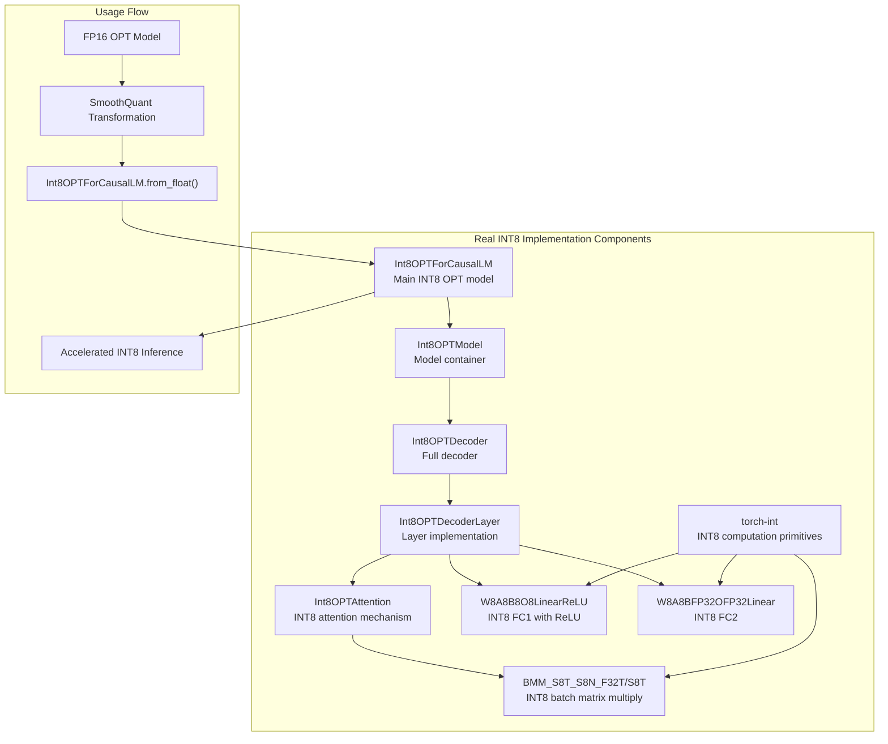
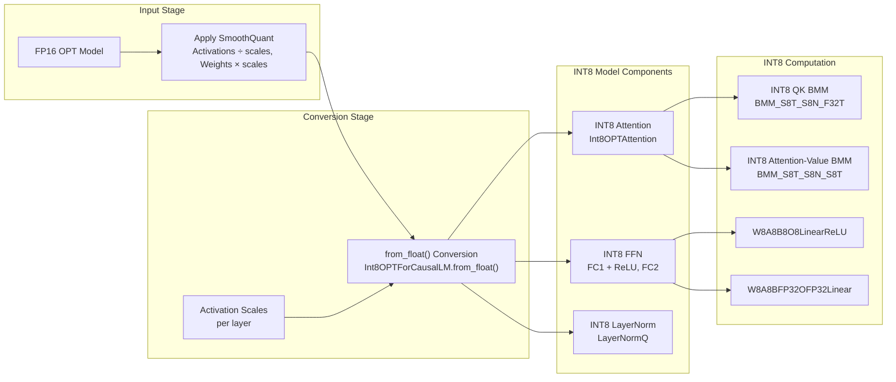
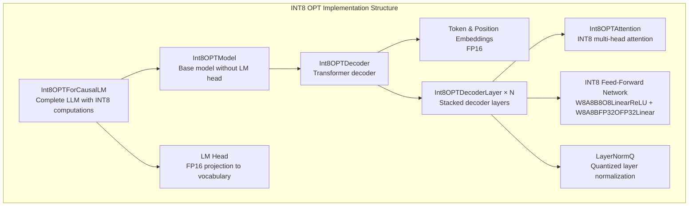

<!-- source: DeepWiki mcp.deepwiki.com · repo mit-han-lab/smoothquant · page 8.2 Real INT8 Implementation · fetched 2026-10-30 -->

# Real INT8 Implementation

<details>
<summary>Relevant source files</summary>

The following files were used as context for generating this wiki page:

- [examples/smoothquant_opt_real_int8_demo.ipynb](examples/smoothquant_opt_real_int8_demo.ipynb)
- [smoothquant/opt.py](smoothquant/opt.py)

</details>


## Purpose and Scope

This document describes the real INT8 implementation of SmoothQuant, which provides hardware-accelerated 8-bit integer (INT8) inference for large language models. Unlike fake quantization (simulated INT8) covered in [Fake Quantization](#8.1), this implementation uses actual INT8 GEMM (General Matrix Multiplication) kernels, leading to significant improvements in memory efficiency and inference speed. Currently, the real INT8 implementation in SmoothQuant is specifically designed for OPT (Open Pre-trained Transformer) models.

Sources: [examples/smoothquant_opt_real_int8_demo.ipynb:1-21]()

## System Architecture Overview

The real INT8 implementation relies on NVIDIA's CUTLASS library for INT8 GEMM operations, accessed through the `torch-int` package. This package provides PyTorch modules that enable efficient INT8 computation while maintaining model accuracy.



Sources: [smoothquant/opt.py:1-20](), [examples/smoothquant_opt_real_int8_demo.ipynb:10-19]()

## INT8 Linear Layers and Operations

The real INT8 implementation uses specialized linear layer variants from the `torch-int` package:

| Layer Type | Description | Used For |
|------------|-------------|----------|
| `W8A8B8O8Linear` | 8-bit weights, 8-bit activations, 8-bit bias, 8-bit output | K, Q, V projections |
| `W8A8B8O8LinearReLU` | Same as above with fused ReLU | First FFN layer (FC1) |
| `W8A8BFP32OFP32Linear` | 8-bit weights, 8-bit activations, FP32 bias, FP32 output | Output projection, Second FFN layer (FC2) |
| `BMM_S8T_S8N_F32T` | 8-bit batch matrix multiply with FP32 output | Query-Key attention scoring |
| `BMM_S8T_S8N_S8T` | 8-bit batch matrix multiply with 8-bit output | Attention-Value computation |
| `LayerNormQ` | Quantized layer normalization | All LayerNorm operations |

Sources: [smoothquant/opt.py:23-51](), [smoothquant/opt.py:221-223]()

## Quantization Flow

The real INT8 implementation follows this quantization process:



Sources: [smoothquant/opt.py:450-470](), [examples/smoothquant_opt_real_int8_demo.ipynb:186-190]()

## Implementation Details

### INT8 Attention Mechanism

The `Int8OPTAttention` class implements the multi-headed attention mechanism using INT8 computation:

1. Linear projections for query, key, and value are implemented with `W8A8B8O8Linear`
2. Query-Key multiplication uses `BMM_S8T_S8N_F32T` to maintain precision for attention scores
3. Softmax remains in floating point for numerical stability
4. Attention probabilities are quantized to INT8 (scaled by 127) before being applied to values
5. Attention-Value multiplication uses `BMM_S8T_S8N_S8T` for INT8 output
6. Final output projection uses `W8A8BFP32OFP32Linear` to maintain FP32 output

Sources: [smoothquant/opt.py:23-209]()

### INT8 Decoder Layer

Each `Int8OPTDecoderLayer` contains:

1. Layer normalization (`LayerNormQ`) before self-attention
2. INT8 self-attention mechanism
3. LayerNorm before FFN
4. First FFN layer with INT8 weights/activations and fused ReLU (`W8A8B8O8LinearReLU`)
5. Second FFN layer with INT8 weights/activations and FP32 output (`W8A8BFP32OFP32Linear`)
6. Residual connections staying in FP16 for precision

Sources: [smoothquant/opt.py:212-316]()

### Full INT8 Model Structure

The complete model hierarchy follows:



Sources: [smoothquant/opt.py:319-480]()

## Conversion from FP16 to INT8

The conversion from a floating-point OPT model to the INT8 version is performed via static `from_float` methods:

1. `Int8OPTForCausalLM.from_float()` - Entry point for conversion
2. This cascades down through model components:
   - `Int8OPTModel.from_float()`
   - `Int8OPTDecoder.from_float()`
   - `Int8OPTDecoderLayer.from_float()`
   - `Int8OPTAttention.from_float()`

Each conversion step takes appropriate scaling factors for the layer's activations, calculated during the SmoothQuant process.

Sources: [smoothquant/opt.py:52-85](), [smoothquant/opt.py:226-257](), [smoothquant/opt.py:378-389](), [smoothquant/opt.py:442-447](), [smoothquant/opt.py:465-470]()

## Performance Benefits

Real INT8 implementation delivers significant performance improvements:

| Metric | FP16 | INT8 (SmoothQuant) | Improvement |
|--------|------|---------------------|-------------|
| Model Size | ~57 GB | ~29 GB | ~50% reduction |
| Inference Latency | Higher | Lower | ~20% faster |
| Accuracy | Baseline | Minimal degradation | ~1% relative drop |

The INT8 implementation can run models on half the memory, enabling larger models to fit on a single GPU or reducing the number of GPUs needed for multi-GPU inference.

Sources: [examples/smoothquant_opt_real_int8_demo.ipynb:142-146](), [examples/smoothquant_opt_real_int8_demo.ipynb:198-213]()

## Input Requirements and Padding

The real INT8 implementation requires inputs to be padded to multiples of 16 tokens for efficient computation. This is handled automatically in the `Int8OPTDecoder.forward()` method:

1. Input tensors are checked for alignment to 16-token boundaries
2. If not aligned, padding is added with pad token ID 1
3. After processing, outputs are trimmed back to the original length

This padding requirement is due to the optimized INT8 GEMM kernels that perform best with aligned memory access.

Sources: [smoothquant/opt.py:391-426]()

## Usage Example

To use the real INT8 implementation for inference, you load a pre-quantized model from Hugging Face:

```python
from smoothquant.opt import Int8OPTForCausalLM

# Load pre-quantized INT8 model
model = Int8OPTForCausalLM.from_pretrained(
    "mit-han-lab/opt-30b-smoothquant", 
    torch_dtype=torch.float16, 
    device_map="auto"
)

# Use for inference like a normal model
outputs = model(input_ids)
```

Alternatively, you can convert your own smoothed model to INT8 using the `from_float` method with appropriate activation scales.

Sources: [examples/smoothquant_opt_real_int8_demo.ipynb:208-213]()

## Limitations and Considerations

The current real INT8 implementation has the following limitations:

1. Only supports OPT models (no Llama, BLOOM, etc. real INT8 implementations yet)
2. Requires the `torch-int` package which depends on NVIDIA's CUTLASS
3. Performance gains are hardware-dependent (requires GPUs with good INT8 support)
4. For models larger than OPT-30B, multi-GPU deployment is needed

For larger models requiring multi-GPU deployments, NVIDIA's FasterTransformer implementation of SmoothQuant is recommended.

Sources: [examples/smoothquant_opt_real_int8_demo.ipynb:11-13]()

---

