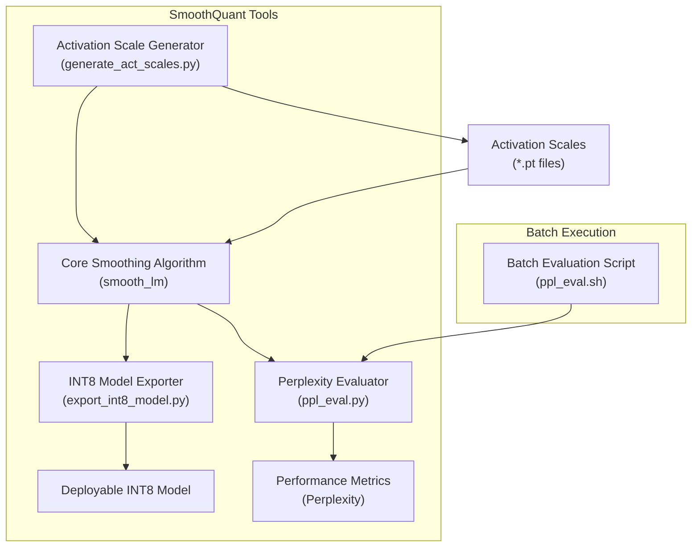
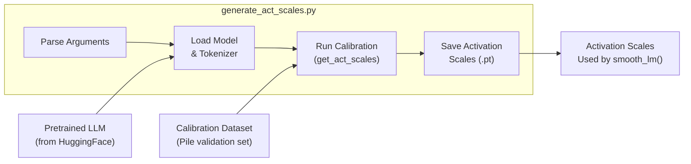
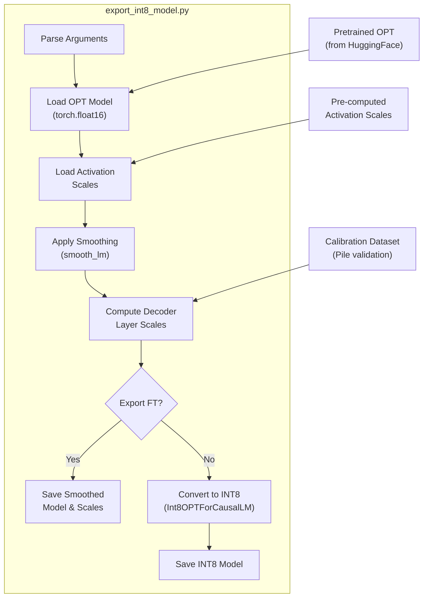
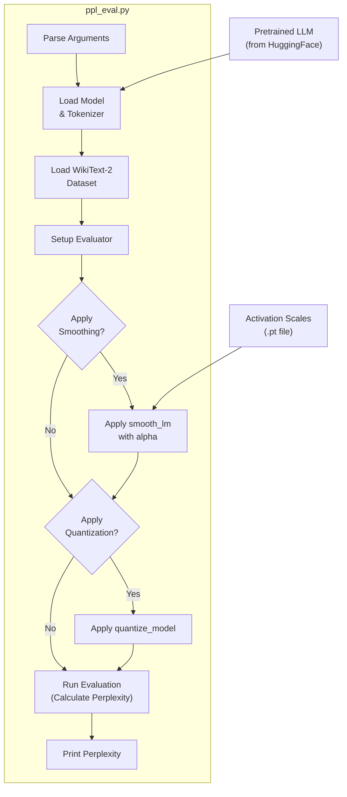
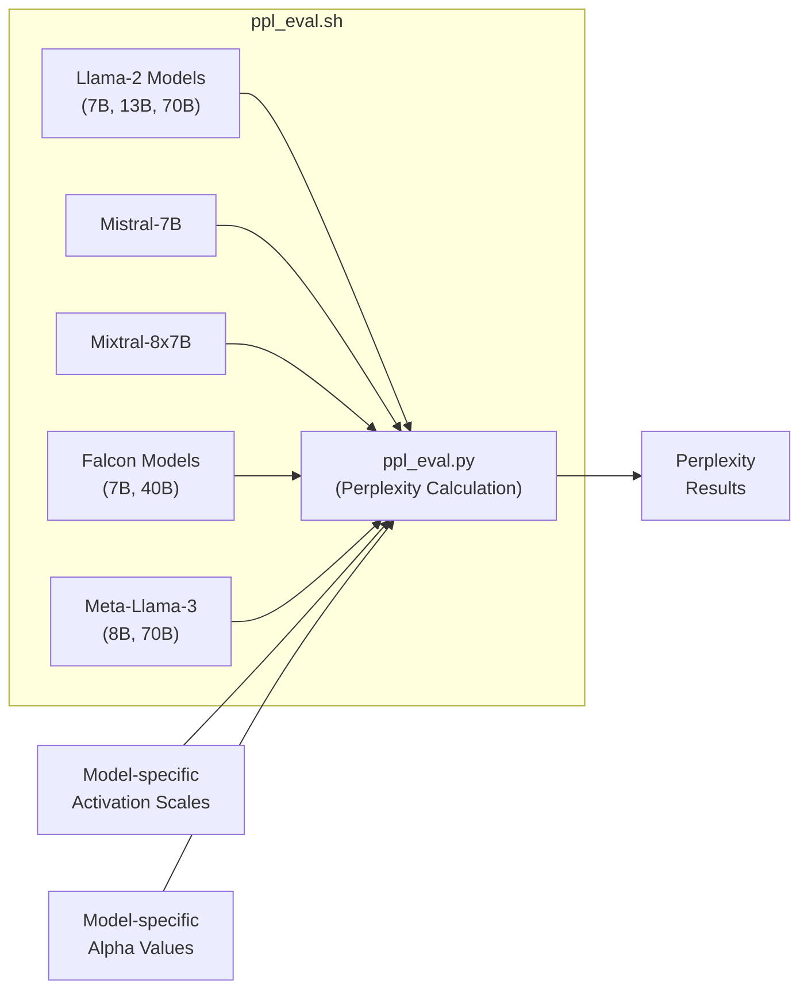
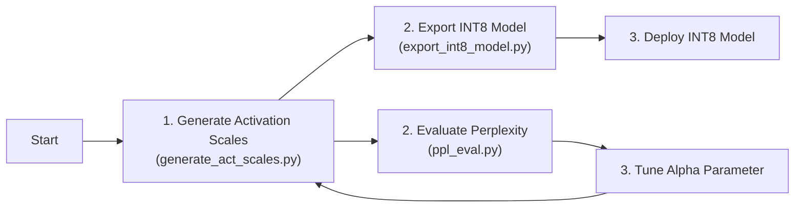

<!-- source: DeepWiki mcp.deepwiki.com · repo mit-han-lab/smoothquant · page 9 Tools and Scripts · fetched 2026-10-30 -->

# Tools and Scripts

<details>
<summary>Relevant source files</summary>

The following files were used as context for generating this wiki page:

- [examples/export_int8_model.py](examples/export_int8_model.py)
- [examples/generate_act_scales.py](examples/generate_act_scales.py)
- [examples/ppl_eval.sh](examples/ppl_eval.sh)
- [smoothquant/ppl_eval.py](smoothquant/ppl_eval.py)

</details>


This page documents the utility tools and scripts provided in the SmoothQuant repository for working with quantized language models. These tools enable users to generate activation scales, export INT8 models, and evaluate model performance. For information about the core SmoothQuant algorithm, see [Core Concepts](#2), and for details on example notebooks, see [Example Notebooks](#10).

## Overview of Available Tools

SmoothQuant provides three main command-line tools to facilitate the quantization workflow:

1. **Activation Scale Generator** - Creates activation scale files needed for the smoothing process
2. **INT8 Model Exporter** - Converts smoothed models to deployable INT8 format
3. **Perplexity Evaluation Tools** - Evaluates quantized model performance



Sources: [examples/generate_act_scales.py:1-65](), [examples/export_int8_model.py:1-56](), [smoothquant/ppl_eval.py:1-85](), [examples/ppl_eval.sh:1-71]()

## Activation Scale Generator

The `generate_act_scales.py` script analyzes a model with a calibration dataset to compute activation scales needed for the SmoothQuant process.

### Usage

```bash
python examples/generate_act_scales.py \
    --model-name MODEL_NAME \
    --output-path OUTPUT_PATH \
    --dataset-path DATASET_PATH \
    --num-samples NUM_SAMPLES \
    --seq-len SEQ_LEN
```

### Parameters

| Parameter | Description | Default |
|-----------|-------------|---------|
| `--model-name` | Hugging Face model identifier | `"facebook/opt-1.3b"` |
| `--output-path` | Path to save activation scales | `"act_scales/opt-1.3b.pt"` |
| `--dataset-path` | Path to calibration dataset | `"dataset/val.jsonl.zst"` |
| `--num-samples` | Number of samples to use for calibration | `512` |
| `--seq-len` | Sequence length for tokenization | `512` |

The script loads the specified model, runs the calibration dataset through it, and collects activation statistics to generate scale factors. These scale factors are used to smooth activation outliers.



Sources: [examples/generate_act_scales.py:1-65]()

## INT8 Model Exporter

The `export_int8_model.py` script takes a pretrained model and activation scales, applies the SmoothQuant algorithm, and exports it as an INT8 model.

### Usage

```bash
python examples/export_int8_model.py \
    --model-name MODEL_NAME \
    --act-scales ACT_SCALES_PATH \
    --output-path OUTPUT_PATH \
    --num-samples NUM_SAMPLES \
    --seq-len SEQ_LEN \
    [--export-FT]
```

### Parameters

| Parameter | Description | Default |
|-----------|-------------|---------|
| `--model-name` | Hugging Face model identifier | `"facebook/opt-13b"` |
| `--act-scales` | Path to activation scales file | `"act_scales/opt-13b.pt"` |
| `--output-path` | Directory to save INT8 model | `"int8_models"` |
| `--num-samples` | Number of samples for scale computation | `512` |
| `--seq-len` | Sequence length for tokenization | `512` |
| `--export-FT` | Export in FasterTransformer format | `False` |
| `--dataset-path` | Path to calibration dataset | `"dataset/val.jsonl.zst"` |

The script performs these key operations:
1. Loads the pretrained model in FP16
2. Loads activation scales
3. Applies the smoothing algorithm with alpha=0.5
4. Computes decoder layer scales for INT8 conversion
5. Exports the model in INT8 format (or FasterTransformer format if specified)



Sources: [examples/export_int8_model.py:1-56]()

## Perplexity Evaluation

SmoothQuant provides tools for evaluating the perplexity of quantized models:

1. `ppl_eval.py` - Python script for evaluating a single model
2. `ppl_eval.sh` - Shell script for batch evaluation of multiple models with different configurations

### Python Evaluator (ppl_eval.py)

The `ppl_eval.py` script loads a model, optionally applies SmoothQuant smoothing and quantization, and evaluates perplexity on the WikiText-2 dataset.

#### Usage

```bash
python smoothquant/ppl_eval.py \
    --model_path MODEL_PATH \
    --act_scales_path ACT_SCALES_PATH \
    --alpha ALPHA \
    [--smooth] \
    [--quantize] \
    [--n_samples N_SAMPLES]
```

#### Parameters

| Parameter | Description | Default |
|-----------|-------------|---------|
| `--model_path` | Hugging Face model identifier | `"meta-llama/Llama-2-7b-hf"` |
| `--act_scales_path` | Path to activation scales file | `"act_scales/llama-2-7b.pt"` |
| `--alpha` | Smoothing coefficient | `0.5` |
| `--smooth` | Apply smoothing transformation | `False` |
| `--quantize` | Apply fake quantization | `False` |
| `--n_samples` | Number of samples for evaluation | `None` (all) |

The script implements the `Evaluator` class to perform perplexity calculation on the WikiText-2 dataset.



Sources: [smoothquant/ppl_eval.py:1-85]()

### Batch Evaluation Script (ppl_eval.sh)

The `ppl_eval.sh` script provides a convenient way to evaluate perplexity across multiple model architectures. It contains predefined commands for evaluating:

- Llama-2 (7B, 13B, 70B)
- Mistral-7B
- Mixtral-8x7B
- Falcon (7B, 40B)
- Meta-Llama-3 (8B, 70B)

Each command specifies:
1. The model path
2. Alpha value (smoothing coefficient)
3. GPU device allocation
4. Activation scales path

Example for Llama-2-7B:
```bash
CUDA_VISIBLE_DEVICES=0 python smoothquant/ppl_eval.py \
    --alpha 0.85 \
    --model_path meta-llama/Llama-2-7b-hf \
    --act_scales_path act_scales/llama-2-7b.pt \
    --smooth \
    --quantize
```

The script provides a quick way to reproduce the perplexity results across different model architectures with their recommended alpha values.



Sources: [examples/ppl_eval.sh:1-71]()

## Typical Workflow with SmoothQuant Tools

The tools are designed to be used in sequence to implement the full SmoothQuant workflow:



A typical workflow involves:

1. **Generate activation scales** for your model using `generate_act_scales.py`
2. **Choose evaluation or deployment path**:
   - For evaluation: Use `ppl_eval.py` to test performance with different alpha values
   - For deployment: Use `export_int8_model.py` to create a deployable INT8 model
3. **Iteratively optimize** the alpha parameter based on evaluation results

Sources: [examples/generate_act_scales.py:1-65](), [examples/export_int8_model.py:1-56](), [smoothquant/ppl_eval.py:1-85](), [examples/ppl_eval.sh:1-71]()

## Tool Dependencies and Requirements

All the tools rely on:

1. PyTorch for tensor operations
2. Transformers library for model loading and tokenization
3. Calibration dataset (The Pile validation set is recommended)

For model-specific operations:
- OPT models use the `Int8OPTForCausalLM` implementation
- Other models use the more generic fake quantization approach

Make sure to download the required calibration dataset before using the tools. The repository references the Pile validation dataset which can be downloaded from:
```
https://huggingface.co/datasets/mit-han-lab/pile-val-backup/resolve/main/val.jsonl.zst
```

Sources: [examples/generate_act_scales.py:46-54](), [examples/export_int8_model.py:34-38]()

---

