# Page: Overview

# Overview

<details>
<summary>Relevant source files</summary>

The following files were used as context for generating this wiki page:

- [README.md](README.md)
- [assets/SmoothQuant.pdf](assets/SmoothQuant.pdf)

</details>


## Purpose and Scope

SmoothQuant is a post-training quantization (PTQ) technique specifically designed for efficient 8-bit weight, 8-bit activation (W8A8) quantization of large language models (LLMs). This document provides an introduction to SmoothQuant, its core concepts, and its key components. For detailed information about specific implementation aspects, refer to other sections in this wiki.

- For information about the core technical concepts, see [Core Concepts](#2)
- For implementation details and workflow, see [Workflow](#4)
- For supported model architectures, see [Model Support](#5)

Sources: [README.md:15-26]()

## What is SmoothQuant?

SmoothQuant is a training-free, accuracy-preserving, general-purpose post-training quantization solution that enables W8A8 quantization for LLMs. The key innovation is that it **migrates quantization difficulty from activations to weights** through a mathematically equivalent transformation, making both components easier to quantize to INT8 with minimal accuracy loss.

SmoothQuant addresses a fundamental challenge in LLM quantization: while weights are relatively easy to quantize, activations contain systematic outliers that cause significant accuracy degradation when naively quantized to INT8.

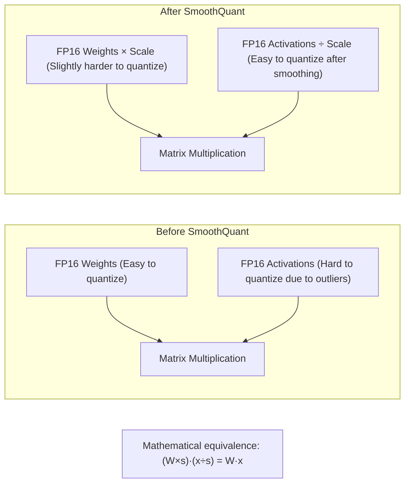

Sources: [README.md:17-26](), [README.md:115-117]()

## Key Benefits

SmoothQuant offers several significant advantages for LLM deployment:

| Benefit | Details |
|---------|---------|
| Accuracy Preservation | Maintains model quality with negligible perplexity increase |
| Memory Efficiency | Reduces memory footprint by up to 2x compared to FP16 |
| Inference Speed | Provides up to 1.56x speedup over FP16 inference |
| Hardware Efficiency | Enables serving of larger models with fewer GPUs |
| Broad Model Support | Works with OPT, BLOOM, Llama, Falcon, Mistral, Mixtral, and more |
| No Training Required | Post-training technique requiring only calibration data |

Sources: [README.md:22-26](), [README.md:119-129]()

## System Architecture

The SmoothQuant system consists of the following key components:

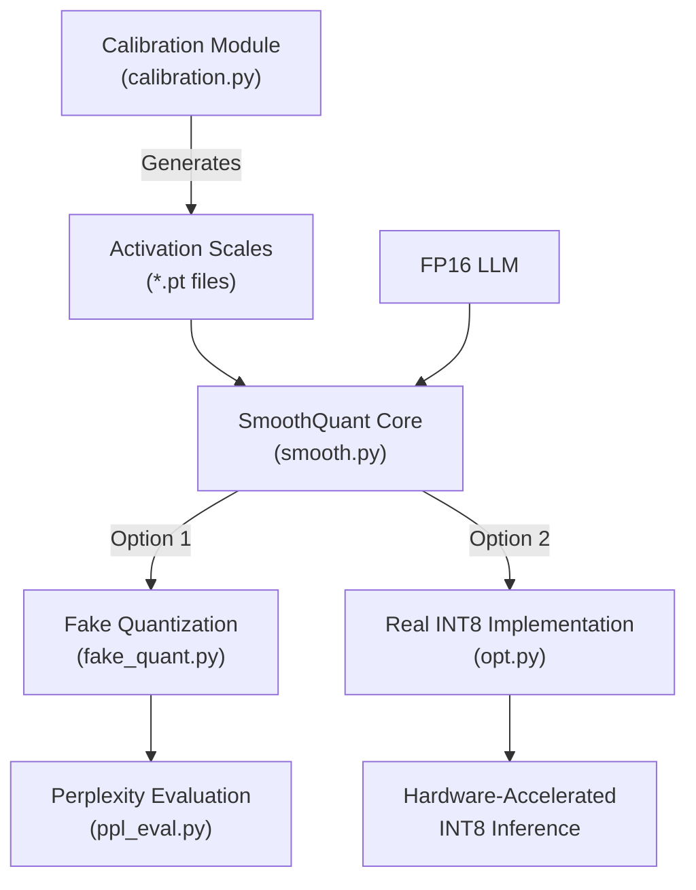

### Core Components:

1. **Calibration Module** (`calibration.py`): Generates activation scales by analyzing model behavior on calibration data
2. **SmoothQuant Core** (`smooth.py`): Implements the smoothing algorithm to redistribute quantization difficulty
3. **Fake Quantization** (`fake_quant.py`): Simulates INT8 quantization while still using FP16 computation
4. **Real INT8 Implementation** (`opt.py`): Provides actual INT8 inference with hardware acceleration
5. **Evaluation** (`ppl_eval.py`): Measures performance of quantized models using perplexity

Sources: [smoothquant/calibration.py](), [smoothquant/smooth.py](), [smoothquant/fake_quant.py](), [smoothquant/opt.py](), [smoothquant/ppl_eval.py](), [README.md:41-54]()

## Workflow Overview

Using SmoothQuant involves the following high-level steps:

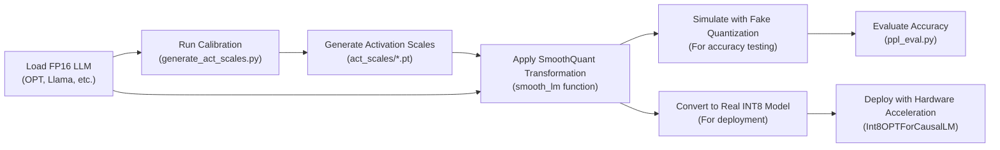

1. **Calibration**: Collect activation statistics using a small calibration dataset (typically 512 samples)
2. **Scaling**: Generate activation scales that will smooth out activation outliers
3. **Smoothing**: Apply the SmoothQuant transformation to the model using the generated scales
4. **Quantization**: Convert to INT8 representation (either simulated or real)
5. **Evaluation/Deployment**: Measure performance and deploy the quantized model

Sources: [README.md:56-69](), [examples/generate_act_scales.py](), [examples/export_int8_model.py](), [README.md:76-86]()

## Integration and Adoption

SmoothQuant has been integrated into several major frameworks and platforms:

- NVIDIA TensorRT-LLM
- Intel Neural-Compressor
- Microsoft ONNX Runtime
- Amazon SageMaker
- AMD Instinct MI300X (via Composable Kernel)

This wide adoption demonstrates the practical value and effectiveness of the SmoothQuant approach for real-world LLM deployment.

Sources: [README.md:6-13]()

## Quick Start Examples

The SmoothQuant repository includes several example notebooks and scripts to help users get started:

1. **OPT Demo**: [examples/smoothquant_opt_demo.ipynb]() demonstrates W8A8 quantization of OPT-13B
2. **Real INT8 OPT Demo**: [examples/smoothquant_opt_real_int8_demo.ipynb]() showcases latency and memory benefits
3. **Llama Demo**: [examples/smoothquant_llama_demo.ipynb]() shows quantization for Llama models
4. **Activation Scale Generation**: [examples/generate_act_scales.py]() helps generate scales for custom models
5. **INT8 Model Export**: [examples/export_int8_model.py]() demonstrates exporting quantized models

Sources: [README.md:71-74](), [README.md:53-54](), [README.md:58-69]()

## Conclusion

SmoothQuant represents a significant advancement in LLM quantization, enabling efficient INT8 inference while maintaining model quality. By addressing the fundamental challenge of activation outliers through its innovative difficulty migration approach, SmoothQuant provides a practical solution for deploying large language models with reduced hardware requirements.

For detailed information about implementation, model support, and specific components, refer to the other sections in this wiki.

Sources: [README.md:131-141]()

---

# Page: Core Concepts

# Core Concepts

<details>
<summary>Relevant source files</summary>

The following files were used as context for generating this wiki page:

- [README.md](README.md)
- [assets/SmoothQuant.pdf](assets/SmoothQuant.pdf)
- [smoothquant/smooth.py](smoothquant/smooth.py)

</details>


This page explains the fundamental technical concepts behind SmoothQuant, focusing on the mathematical principles and algorithmic approaches that enable efficient 8-bit quantization for large language models (LLMs). For information about the overall system architecture, see [System Architecture](#3), and for detailed implementation of the quantization techniques, see [Quantization Techniques](#8).

## The Challenge: Quantization-Unfriendly Activations

The core challenge that SmoothQuant addresses is the difficulty of quantizing both weights and activations in LLMs to INT8. While weights in LLMs are generally well-behaved and easy to quantize, activations present a significant challenge due to their long-tailed distributions with extreme outliers.

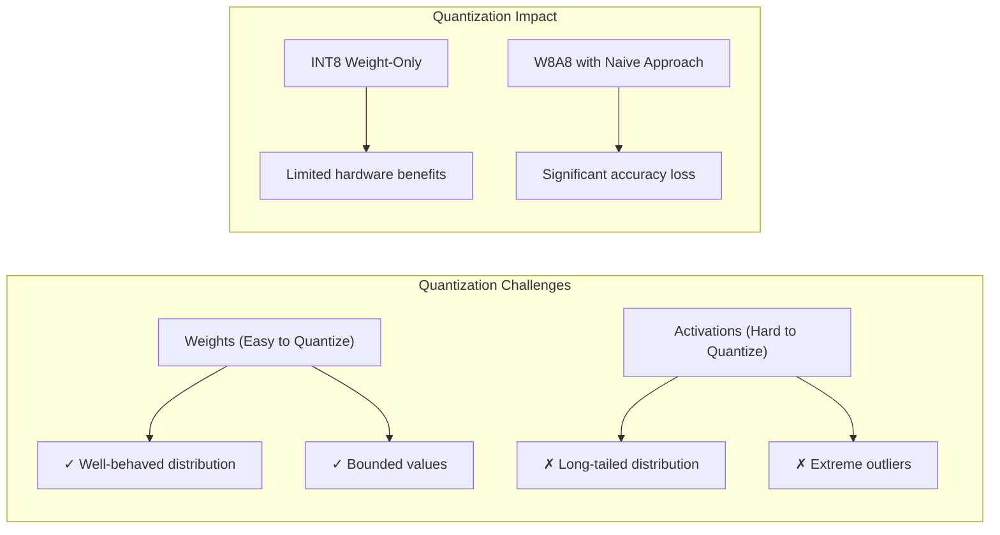

Sources: [README.md:15-22](README.md:15-22), [README.md:115-117](README.md:115-117)

## The Key Insight: Difficulty Migration

SmoothQuant's key insight is that quantization difficulty can be mathematically migrated from activations to weights without changing the model's behavior in full precision. This is possible because matrix multiplication allows for equivalent transformations where scaling factors can be moved between operands.

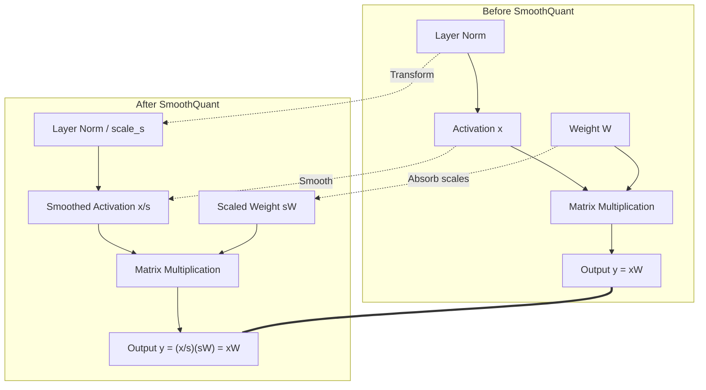

Sources: [README.md:21-22](README.md:21-22), [smoothquant/smooth.py:17-46](smoothquant/smooth.py:17-46)

## Mathematical Formulation

The SmoothQuant transformation operates on the following mathematical principle:

For a matrix multiplication operation `y = xW`, where:
- `x` is the activation (input)
- `W` is the weight matrix
- `y` is the output

SmoothQuant introduces a channel-wise scaling factor `s` and applies the transformation:

```
y = xW = (x/s)(sW)
```

This transformation is mathematically equivalent in full precision but changes the distributions of values that need to be quantized.

### The Alpha Parameter

SmoothQuant introduces an adjustable parameter `α` (alpha) that controls the distribution of quantization difficulty between weights and activations. The scaling factor is calculated as:

```
s = (act_scales^α / weight_scales^(1-α))
```

Where:
- `act_scales` are the per-channel maximum absolute values of activations
- `weight_scales` are the per-channel maximum absolute values of weights
- `α` is typically set between 0.5 and 0.9

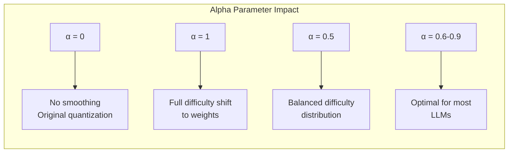

Sources: [smoothquant/smooth.py:27-39](smoothquant/smooth.py:27-39)

## Implementation in Language Models

The smoothing transformation is applied to two critical components in LLM architectures:

1. **Attention Modules**: The Layer Normalization → Q/K/V projection path
2. **Feed-Forward Networks**: The Layer Normalization → MLP input path

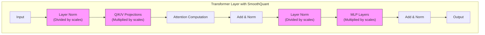

Sources: [smoothquant/smooth.py:74-161](smoothquant/smooth.py:74-161)

## Model-Specific Implementations

SmoothQuant supports different model architectures through specialized implementations of the smoothing algorithm:

| Model Family | Smoothing Function | Key Differentiator |
|--------------|--------------------|--------------------|
| OPT, BLOOM   | `smooth_ln_fcs`    | Standard LayerNorm |
| Llama, Mistral | `smooth_ln_fcs_llama_like` | RMSNorm instead of LayerNorm |
| Mixtral | `smooth_ln_fcs_llama_like` | MoE architecture with multiple experts |
| Falcon | `smooth_ln_fcs` | Different architecture variants |

Sources: [smoothquant/smooth.py:74-161](smoothquant/smooth.py:74-161)

## The Smoothing Algorithm

The core smoothing algorithm works as follows:

1. **Compute Activation and Weight Scales**:
   - Determine the maximum absolute value for each input channel in activations
   - Calculate the maximum absolute value for each input channel across all weight matrices

2. **Calculate Smoothing Factors**:
   - Apply the alpha parameter to balance scales: `s = (act_scales^α / weight_scales^(1-α))`
   - Clamp values to ensure numerical stability

3. **Apply Transformation**:
   - Divide LayerNorm/RMSNorm weights and biases by scales
   - Multiply the weights of linear layers by scales

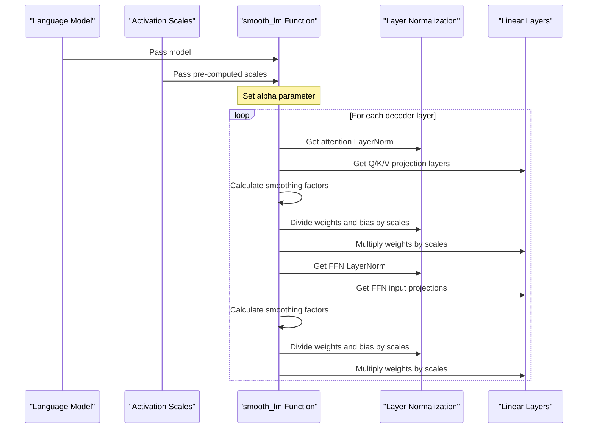

Sources: [smoothquant/smooth.py:17-46](smoothquant/smooth.py:17-46), [smoothquant/smooth.py:74-161](smoothquant/smooth.py:74-161)

## Code Example: OPT Model Smoothing

Here's how the smoothing algorithm is applied to an OPT decoder layer:

```
1. Get attention LayerNorm and Q/K/V projections
   - attn_ln = module.self_attn_layer_norm
   - qkv = [module.self_attn.q_proj, module.self_attn.k_proj, module.self_attn.v_proj]
   - qkv_input_scales = scales[name + ".self_attn.q_proj"]

2. Apply smoothing to attention path
   - smooth_ln_fcs(attn_ln, qkv, qkv_input_scales, alpha)

3. Get FFN LayerNorm and FC layer
   - ffn_ln = module.final_layer_norm
   - fc1 = module.fc1
   - fc1_input_scales = scales[name + ".fc1"]

4. Apply smoothing to FFN path
   - smooth_ln_fcs(ffn_ln, fc1, fc1_input_scales, alpha)
```

Sources: [smoothquant/smooth.py:77-90](smoothquant/smooth.py:77-90)

## Benefits of SmoothQuant

By redistributing quantization difficulty, SmoothQuant achieves several key benefits:

1. **Accuracy Preservation**: Maintains model quality close to FP16 baseline
2. **Hardware Efficiency**: Enables true INT8 GEMM operations on hardware
3. **Memory Reduction**: Reduces memory footprint by approximately 2x
4. **Inference Speedup**: Achieves up to 1.56x speedup compared to FP16
5. **No Training Required**: Works as a post-training transformation

Sources: [README.md:15-26](README.md:15-26), [README.md:115-129](README.md:115-129)

## Practical Applications

SmoothQuant has been integrated into multiple industry platforms, demonstrating its practicality and effectiveness:

- AMD Instinct MI300X using Composable Kernel
- Microsoft ONNX Runtime
- Amazon SageMaker
- NVIDIA TensorRT-LLM
- Intel Neural-Compressor

This widespread adoption validates SmoothQuant as a standardized approach for efficient LLM quantization.

Sources: [README.md:6-13](README.md:6-13)

---

# Page: System Architecture

# System Architecture

<details>
<summary>Relevant source files</summary>

The following files were used as context for generating this wiki page:

- [README.md](README.md)
- [assets/SmoothQuant.pdf](assets/SmoothQuant.pdf)
- [smoothquant/calibration.py](smoothquant/calibration.py)
- [smoothquant/fake_quant.py](smoothquant/fake_quant.py)
- [smoothquant/opt.py](smoothquant/opt.py)
- [smoothquant/smooth.py](smoothquant/smooth.py)

</details>


This document describes the overall architecture of SmoothQuant, a post-training quantization (PTQ) framework designed to enable efficient 8-bit weight, 8-bit activation (W8A8) quantization for large language models (LLMs). For information about the theoretical concepts behind SmoothQuant, see [Core Concepts](#2). For details on the workflow of using SmoothQuant, see [Workflow](#4).

## Core Components Overview

SmoothQuant's architecture consists of four main components, each handling a specific part of the quantization process:

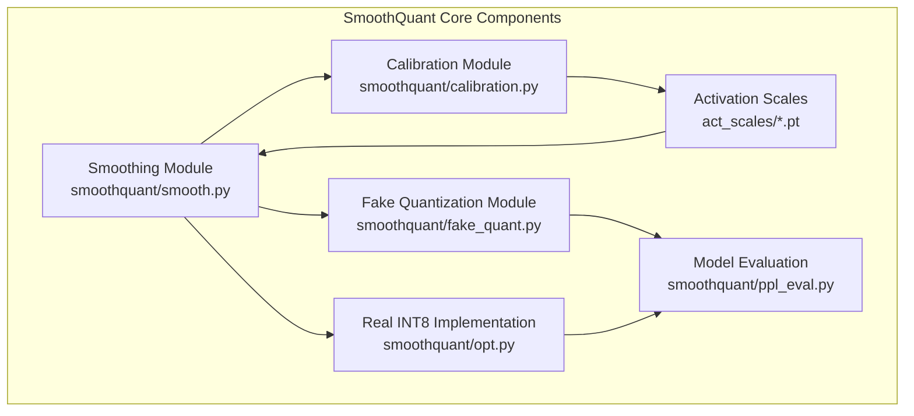

Sources:
- [smoothquant/smooth.py]()
- [smoothquant/calibration.py]()
- [smoothquant/fake_quant.py]()
- [smoothquant/opt.py]()

## Detailed Component Description

### 1. Smoothing Module

The smoothing module implements the core algorithm that redistributes quantization difficulty from activations to weights.

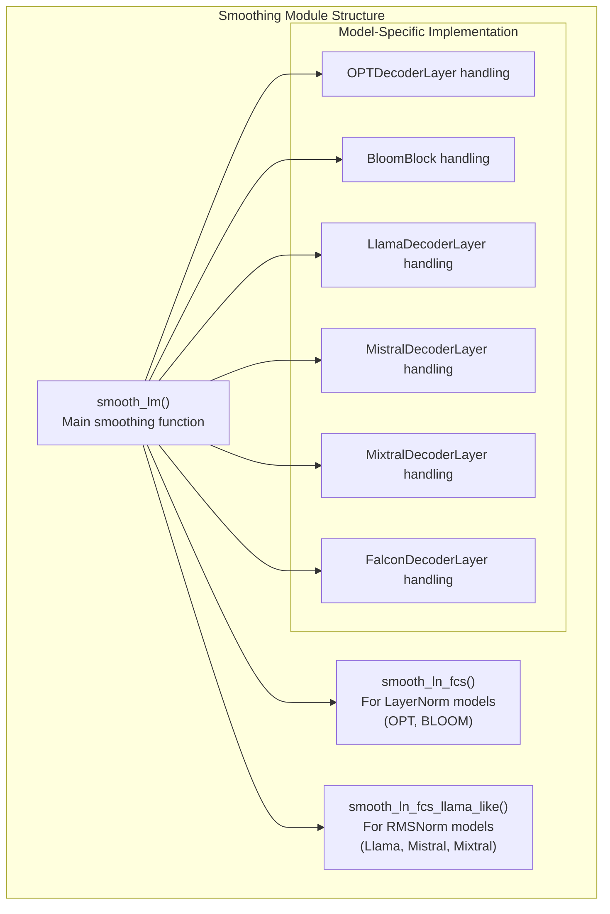

Key functions:
- `smooth_lm()` [smooth.py:75-161](): Applies smoothing to different model architectures
- `smooth_ln_fcs()` [smooth.py:19-46](): Smooths LayerNorm followed by Linear layers
- `smooth_ln_fcs_llama_like()` [smooth.py:49-72](): Similar function for RMSNorm-based models

Sources:
- [smoothquant/smooth.py:18-73]() - Core smoothing functions
- [smoothquant/smooth.py:75-161]() - Model-specific implementations

### 2. Calibration Module

The calibration module computes activation scales by analyzing model behavior on a calibration dataset.

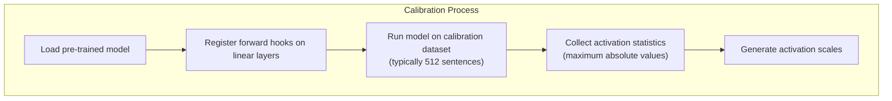

Key functions:
- `get_act_scales()` [calibration.py:13-51](): Collects activation statistics from model forward pass
- `get_static_decoder_layer_scales()` [calibration.py:55-130](): Gets detailed scales for decoder layers

Sources:
- [smoothquant/calibration.py:13-51]() - Main calibration function
- [smoothquant/calibration.py:55-130]() - Detailed layer scales function

### 3. Fake Quantization Module

The fake quantization module simulates INT8 quantization while still performing computation in FP16. This allows quick evaluation of quantization effects without specialized hardware.

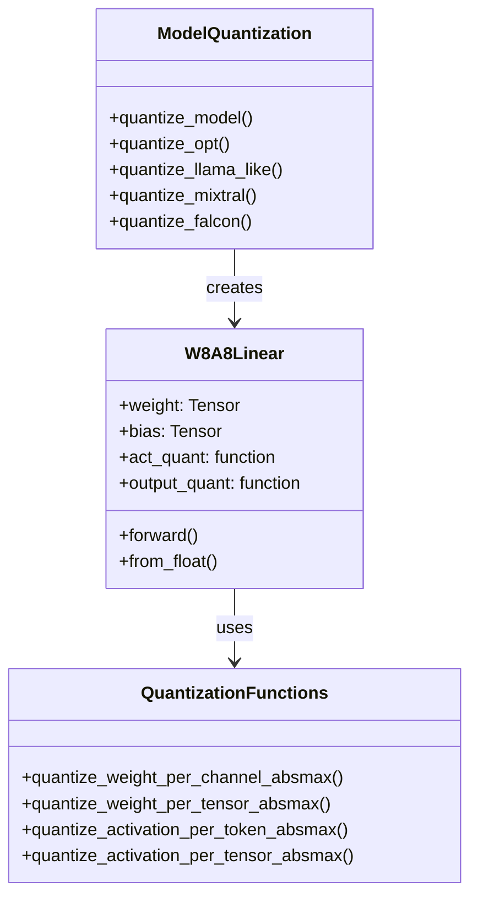

Key components:
- `W8A8Linear` [fake_quant.py:48-138](): Linear layer that simulates W8A8 quantization
- Quantization functions [fake_quant.py:6-45](): Methods for quantizing weights and activations
- Model-specific quantization [fake_quant.py:141-351](): Functions for different architectures

Sources:
- [smoothquant/fake_quant.py:6-45]() - Quantization functions
- [smoothquant/fake_quant.py:48-138]() - W8A8Linear implementation
- [smoothquant/fake_quant.py:141-351]() - Model-specific quantization functions

### 4. Real INT8 Implementation

SmoothQuant includes a real INT8 implementation for OPT models that uses INT8 GEMM kernels from the torch-int library for hardware acceleration.

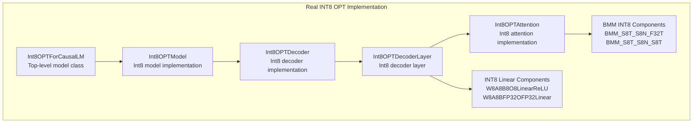

Key components:
- `Int8OPTAttention` [opt.py:23-209](): INT8 implementation of OPT attention
- `Int8OPTDecoderLayer` [opt.py:212-316](): INT8 implementation of OPT decoder layer
- `Int8OPTForCausalLM` [opt.py:450-480](): Top-level class for INT8 OPT model

Sources:
- [smoothquant/opt.py:23-209]() - INT8 attention implementation
- [smoothquant/opt.py:212-316]() - INT8 decoder layer implementation
- [smoothquant/opt.py:450-480]() - Full INT8 model implementation

## System Integration and Data Flow

The following diagram illustrates how the components integrate to form the complete SmoothQuant system:

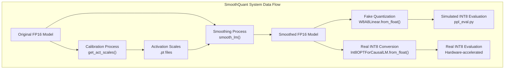

Sources:
- [smoothquant/calibration.py:13-51]()
- [smoothquant/smooth.py:75-161]()
- [smoothquant/fake_quant.py:48-138]()
- [smoothquant/opt.py:450-480]()

### Data Flow Description

1. **Calibration Phase**
   - The pre-trained FP16 model is run on a calibration dataset (typically 512 sentences)
   - Activation statistics are collected via hooks on linear layers
   - Maximum absolute values are stored as activation scales

2. **Smoothing Phase**
   - The FP16 model is loaded along with the activation scales
   - The `smooth_lm()` function applies the transformation with a parameter α
   - For each layer norm + linear layer pair:
     - Divide layer norm weights/biases by scales
     - Multiply linear weights by scales

3. **Quantization Phase**
   - **Option 1**: Fake quantization with `W8A8Linear`
     - Replaces linear layers with `W8A8Linear`
     - Simulates INT8 computation in FP16
   - **Option 2**: Real INT8 (OPT models only)
     - Converts model to `Int8OPTForCausalLM`
     - Uses INT8 GEMM kernels for hardware acceleration

4. **Evaluation Phase**
   - Perplexity evaluation on benchmark datasets
   - Throughput and memory usage measurements for real INT8 models

## Supported Model Architectures

SmoothQuant supports multiple LLM architectures through specialized handling in both the smoothing and quantization modules:

| Architecture | Smoothing Support | Fake Quantization | Real INT8 |
|--------------|------------------|-------------------|-----------|
| OPT          | ✓ (OPTDecoderLayer) | ✓ (quantize_opt) | ✓ (Int8OPTForCausalLM) |
| BLOOM        | ✓ (BloomBlock)    | ✓ (general)       | ✗ |
| Llama        | ✓ (LlamaDecoderLayer) | ✓ (quantize_llama_like) | ✗ |
| Mistral      | ✓ (MistralDecoderLayer) | ✓ (quantize_llama_like) | ✗ |
| Mixtral      | ✓ (MixtralDecoderLayer) | ✓ (quantize_mixtral) | ✗ |
| Falcon       | ✓ (FalconDecoderLayer) | ✓ (quantize_falcon) | ✗ |

Sources:
- [smoothquant/smooth.py:75-161]()
- [smoothquant/fake_quant.py:141-351]()
- [smoothquant/opt.py:450-480]()

## Core Algorithm Implementation

The core smoothing algorithm is implemented as follows:

```mermaid
flowchart LR
    subgraph "Smoothing Algorithm Implementation"
        start["Input: model, act_scales, alpha"] --> getScales["Get weight scales from linear layers"]
        getScales --> computeS["Compute smoothing scales:\n(act_scales^α / weight_scales^(1-α))"]
        computeS --> applyLN["Apply to LayerNorm:\ndivide weights & bias by scales"]
        applyLN --> applyLinear["Apply to Linear layers:\nmultiply weights by scales"]
        applyLinear --> end["Output: smoothed model"]
    end
```

The mathematical transformation is implemented in `smooth_ln_fcs()` [smooth.py:19-46]() and `smooth_ln_fcs_llama_like()` [smooth.py:49-72]():

1. Identify LayerNorm/RMSNorm and subsequent Linear layers
2. Calculate weight scales as maximum absolute value: `weight_scales = fc.weight.abs().max(dim=0)[0]`
3. Compute smoothing scales with formula: `scales = (act_scales^α / weight_scales^(1-α))`
4. Apply scales to LayerNorm/RMSNorm:
   - `ln.weight.div_(scales)`
   - `ln.bias.div_(scales)` (if applicable)
5. Apply inverse scales to Linear weights:
   - `fc.weight.mul_(scales.view(1, -1))`

This transformation is mathematically equivalent but redistributes the quantization difficulty from activations (which traditionally have outliers) to weights (which are easier to quantize).

Sources:
- [smoothquant/smooth.py:19-46]()
- [smoothquant/smooth.py:49-72]()

## Conclusion

SmoothQuant's architecture is designed to be modular and extensible, with components for calibration, smoothing, and quantization that can be applied to various LLM architectures. While the full INT8 implementation is currently only available for OPT models, the fake quantization approach can be used to evaluate the potential of SmoothQuant on any supported architecture.

The system offers both a simulated quantization pathway for evaluation and a real INT8 implementation for OPT models that delivers actual hardware acceleration. This flexibility makes SmoothQuant a versatile tool for efficient LLM deployment.

---

# Page: Workflow

# Workflow

<details>
<summary>Relevant source files</summary>

The following files were used as context for generating this wiki page:

- [README.md](README.md)
- [assets/SmoothQuant.pdf](assets/SmoothQuant.pdf)
- [examples/export_int8_model.py](examples/export_int8_model.py)
- [examples/generate_act_scales.py](examples/generate_act_scales.py)
- [examples/ppl_eval.sh](examples/ppl_eval.sh)

</details>


This document describes the end-to-end workflow for quantizing large language models (LLMs) using SmoothQuant. It covers the process from model loading through calibration, smoothing, quantization, and evaluation. For details about the underlying smoothing algorithm, see [Smoothing Algorithm](#7), and for information about activation scales, see [Activation Scales](#6.1).

## Overview of the SmoothQuant Workflow

SmoothQuant's workflow consists of several sequential steps that transform a floating-point (FP16) model into an efficient INT8 model while maintaining accuracy. The process systematically migrates quantization difficulties from activations to weights through a mathematically equivalent transformation.

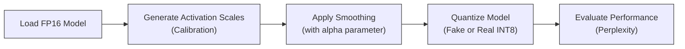

Sources: [README.md:40-69](), [examples/generate_act_scales.py](), [examples/export_int8_model.py]()

## Detailed Workflow Steps

### 1. Loading the Model

The workflow begins by loading a pre-trained LLM in FP16 precision. SmoothQuant supports various model architectures including OPT, BLOOM, Llama, Mistral, Mixtral, and Falcon models.

```python
from transformers import AutoModelForCausalLM
import torch

# Load FP16 model
model = AutoModelForCausalLM.from_pretrained(
    "model_name",  # e.g., "facebook/opt-13b", "meta-llama/Llama-2-13b-hf"
    torch_dtype=torch.float16,
    device_map="auto"
)
```

Sources: [examples/generate_act_scales.py:13-17](), [examples/export_int8_model.py:28-29]()

### 2. Calibration Process

Activation scales are essential for the smoothing process. These scales are computed by running a calibration dataset through the model to capture statistics about activation outliers.

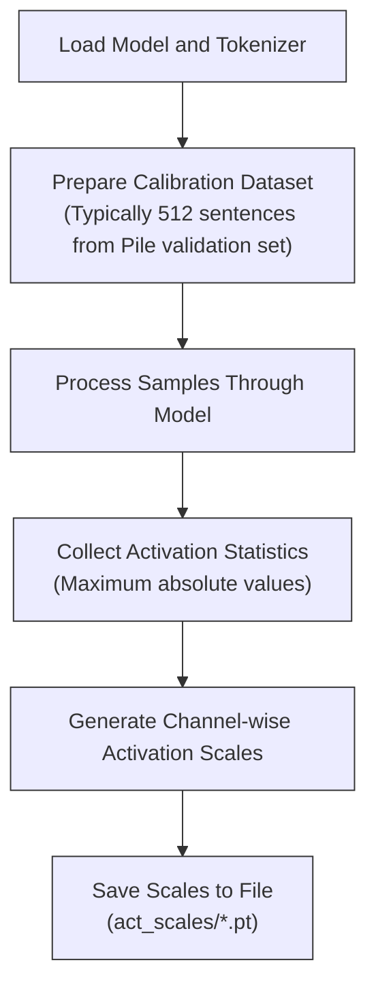

The activation scales can be generated using the provided script:

```bash
python examples/generate_act_scales.py \
    --model-name model_name_or_path \
    --output-path output_path_for_scales \
    --num-samples 512 \
    --seq-len 512 \
    --dataset-path path_to_calibration_dataset
```

SmoothQuant also provides pre-computed activation scales for popular models in the `act_scales/` directory.

Sources: [README.md:57-69](), [examples/generate_act_scales.py]()

### 3. Model Smoothing

Once activation scales are available, the smoothing process redistributes quantization difficulty from activations to weights:

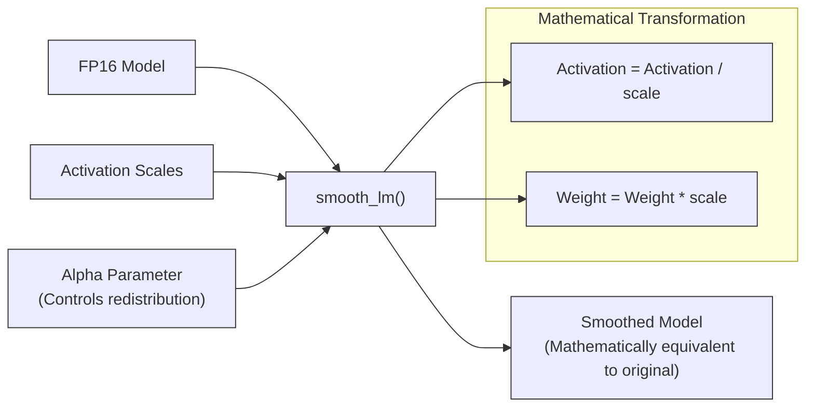

The `alpha` parameter (typically between 0.5 and 0.9) controls how much of the quantization difficulty is migrated from activations to weights. This is applied using the `smooth_lm` function:

```python
from smoothquant.smooth import smooth_lm

# Load activation scales
act_scales = torch.load("path_to_act_scales.pt")

# Apply smoothing with alpha=0.5
smooth_lm(model, act_scales, alpha=0.5)
```

Sources: [README.md:115-117](), [examples/export_int8_model.py:30-31]()

### 4. Model Quantization

After smoothing, the model can be quantized using one of two approaches:

1. **Fake Quantization**: Simulates INT8 operations in FP16 for accuracy evaluation
2. **Real INT8 Quantization**: Converts the model to actual INT8 format for hardware acceleration

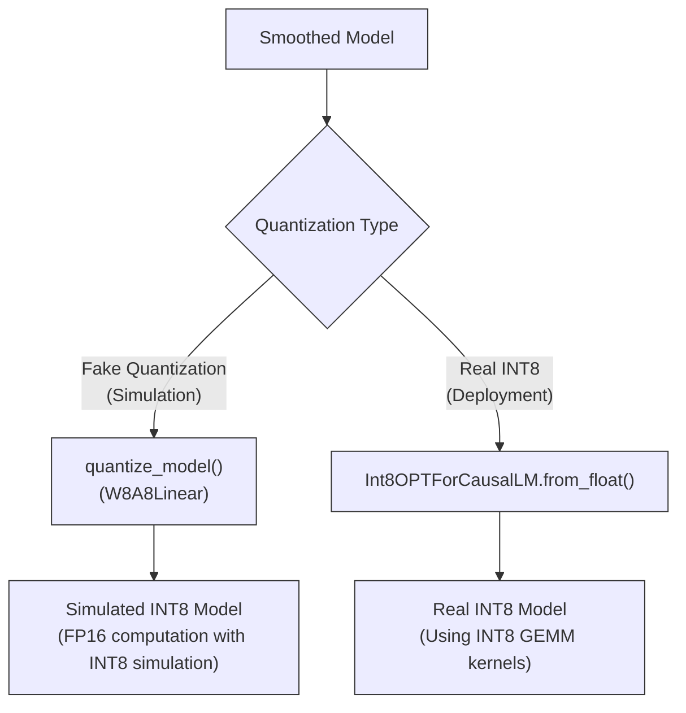

#### Fake Quantization

Used primarily for experimentation and accuracy evaluation:

```python
from smoothquant.fake_quant import quantize_model

# Apply fake INT8 quantization
quantize_model(model)
```

#### Real INT8 Quantization

For deploying optimized models (currently implemented for OPT):

```python
from smoothquant.opt import Int8OPTForCausalLM

# Convert to real INT8 model
int8_model = Int8OPTForCausalLM.from_float(model, decoder_layer_scales)

# Save quantized model
int8_model.save_pretrained("path_to_save_model")
```

A complete example of exporting an INT8 model is available in [examples/export_int8_model.py]().

Sources: [README.md:42-56](), [examples/export_int8_model.py:54-56]()

### 5. Model Evaluation

The final step is evaluating the quantized model to ensure it maintains accuracy close to the original FP16 model. Perplexity is the most common evaluation metric:

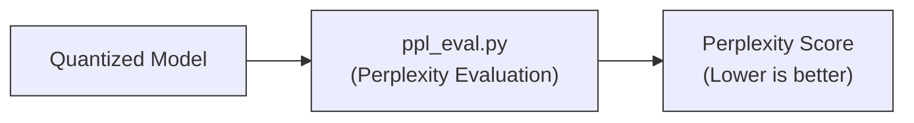

SmoothQuant provides scripts to evaluate perplexity:

```bash
python smoothquant/ppl_eval.py \
    --model_path model_name_or_path \
    --act_scales_path act_scales_file_path \
    --smooth \
    --alpha 0.8 \
    --quantize
```

The [examples/ppl_eval.sh]() script contains commands to evaluate various models with model-specific alpha parameters.

Sources: [README.md:77-110](), [examples/ppl_eval.sh]()

## Code Entities Mapped to Workflow Steps

This diagram connects the natural language workflow steps to the specific code implementations:

```mermaid
flowchart TD
    subgraph "Workflow Steps"
        A["1. Model Loading"] 
        B["2. Calibration"]
        C["3. Smoothing"]
        D["4. Quantization"]
        E["5. Evaluation"]
    end
    
    subgraph "Code Implementation"
        F["AutoModelForCausalLM.from_pretrained()"]
        G["get_act_scales()<br/>smoothquant/calibration.py"]
        H["smooth_lm()<br/>smoothquant/smooth.py"]
        I["quantize_model()<br/>smoothquant/fake_quant.py"]
        J["Int8OPTForCausalLM.from_float()<br/>smoothquant/opt.py"]
        K["ppl_eval.py<br/>smoothquant/ppl_eval.py"]
    end
    
    A --> F
    B --> G
    C --> H
    D --> I
    D --> J
    E --> K
    
    classDef workflow stroke:#333,stroke-width:1px
    classDef code stroke:#333,stroke-width:1px
    class A,B,C,D,E workflow
    class F,G,H,I,J,K code
```

Sources: [examples/generate_act_scales.py](), [examples/export_int8_model.py](), [README.md:42-56](), [examples/ppl_eval.sh]()

## Example End-to-End Workflow

Below is a typical end-to-end workflow for quantizing an OPT model:

```mermaid
flowchart LR
    subgraph "Input"
        A["FP16 OPT Model"]
    end
    
    subgraph "Workflow Tools"
        B["generate_act_scales.py"]
        C["export_int8_model.py"]
        D["ppl_eval.py"]
    end
    
    subgraph "Output"
        E["INT8 Quantized Model"]
        F["Perplexity Results"]
    end
    
    A --> B
    B --> |"act_scales/*.pt"| C
    A --> C
    C --> E
    E --> D
    D --> F
    
    classDef entity stroke:#333,stroke-width:1px
    classDef tool stroke:#333,stroke-width:1px
    classDef result stroke:#333,stroke-width:1px
    class A,E,F entity
    class B,C,D tool
```

Sources: [README.md:40-110](), [examples/generate_act_scales.py](), [examples/export_int8_model.py](), [examples/ppl_eval.sh]()

## Command Reference for SmoothQuant Workflow

Here's a summary table of the key commands used in the SmoothQuant workflow:

| Step | Command/Script | Purpose | Key Parameters |
|------|----------------|---------|----------------|
| Calibration | `examples/generate_act_scales.py` | Generate activation scales | `--model-name`, `--output-path`, `--num-samples`, `--seq-len` |
| Export INT8 Model | `examples/export_int8_model.py` | Export INT8 quantized model | `--model-name`, `--act-scales`, `--output-path` |
| Perplexity Evaluation | `smoothquant/ppl_eval.py` | Evaluate model accuracy | `--model_path`, `--act_scales_path`, `--alpha`, `--smooth`, `--quantize` |

Sources: [README.md:57-69](), [examples/generate_act_scales.py](), [examples/export_int8_model.py](), [examples/ppl_eval.sh]()

## Supported Model Architectures and Alpha Values

Each model architecture may require a specific alpha value for optimal results:

| Model | Recommended Alpha | Script Reference |
|-------|-------------------|------------------|
| Llama-2-7B | 0.85 | [examples/ppl_eval.sh:1-7]() |
| Llama-2-13B | 0.85 | [examples/ppl_eval.sh:9-15]() |
| Llama-2-70B | 0.9 | [examples/ppl_eval.sh:17-23]() |
| Llama-3-8B | 0.85 | [examples/ppl_eval.sh:58-63]() |
| Llama-3-70B | 0.85 | [examples/ppl_eval.sh:66-71]() |
| Mistral-7B | 0.8 | [examples/ppl_eval.sh:25-31]() |
| Mixtral-8x7B | 0.8 | [examples/ppl_eval.sh:33-39]() |
| Falcon-7B | 0.6 | [examples/ppl_eval.sh:41-47]() |
| Falcon-40B | 0.7 | [examples/ppl_eval.sh:49-55]() |

Sources: [README.md:88-109](), [examples/ppl_eval.sh]()

---

# Page: Model Support

# Model Support

<details>
<summary>Relevant source files</summary>

The following files were used as context for generating this wiki page:

- [README.md](README.md)
- [assets/SmoothQuant.pdf](assets/SmoothQuant.pdf)
- [smoothquant/fake_quant.py](smoothquant/fake_quant.py)
- [smoothquant/smooth.py](smoothquant/smooth.py)

</details>


This page documents the model architectures and families supported by SmoothQuant's quantization techniques. It covers which Large Language Models (LLMs) are compatible with SmoothQuant's W8A8 (8-bit weight, 8-bit activation) quantization algorithm, how they are implemented, and the technical details for each model family.

## Supported Model Architectures

SmoothQuant currently supports several major LLM architecture families, each with model-specific implementation details to account for architectural differences.

```mermaid
graph TD
    SQ["SmoothQuant Core Algorithm"]
    
    SQ --> OPT["OPT Models"]
    SQ --> BLOOM["BLOOM Models"]
    SQ --> LLAMA["Llama Models\n(1/2/3)"]
    SQ --> MISTRAL["Mistral Models"]
    SQ --> MIXTRAL["Mixtral Models\n(Mixture of Experts)"]
    SQ --> FALCON["Falcon Models"]
    
    OPT --> OPT_IMPL["- OPTDecoderLayer\n- Int8OPTForCausalLM"]
    BLOOM --> BLOOM_IMPL["- BloomBlock"]
    LLAMA --> LLAMA_IMPL["- LlamaDecoderLayer\n- smooth_ln_fcs_llama_like"]
    MISTRAL --> MISTRAL_IMPL["- MistralDecoderLayer\n- smooth_ln_fcs_llama_like"]
    MIXTRAL --> MIXTRAL_IMPL["- MixtralDecoderLayer\n- MixtralSparseMoeBlock\n- smooth_ln_fcs_llama_like"]
    FALCON --> FALCON_IMPL["- FalconDecoderLayer\n- FalconAttention\n- FalconMLP"]
    
    class SQ,OPT,BLOOM,LLAMA,MISTRAL,MIXTRAL,FALCON,OPT_IMPL,BLOOM_IMPL,LLAMA_IMPL,MISTRAL_IMPL,MIXTRAL_IMPL,FALCON_IMPL main;
```

Sources: [smoothquant/smooth.py:1-161](), [smoothquant/fake_quant.py:141-351](), [README.md:87-109]()

## Model Implementation Details

### OPT (Open Pre-trained Transformer)

OPT models have the most complete implementation in SmoothQuant, including real INT8 inference support:

- **Smoothing**: Implemented for `OPTDecoderLayer` by applying smoothing to both attention and feedforward components
- **Quantization**: Supports both fake quantization (for simulation) and real INT8 inference
- **Real INT8 Support**: Available through the `Int8OPTForCausalLM` class which uses optimized INT8 GEMM kernels via [torch-int](https://github.com/Guangxuan-Xiao/torch-int)
- **Tested Sizes**: 125M, 1.3B, 2.7B, 6.7B, 13B, 30B, 66B, 175B

```mermaid
graph TD
    subgraph "OPT INT8 Implementation"
        OPT_FP16["OPTForCausalLM\n(FP16 Model)"] -- "smooth_lm()" --> OPT_SMOOTH["Smoothed OPT Model"]
        
        OPT_SMOOTH -- "Fake Quantization" --> OPT_SIM["Simulated INT8 OPT\n(quantize_opt())"]
        OPT_SMOOTH -- "Real Quantization" --> OPT_INT8["Int8OPTForCausalLM\n(Real INT8 inference)"]
        
        OPT_INT8 --> ATTENTION["INT8 Attention\n- q_proj\n- k_proj\n- v_proj\n- out_proj"]
        OPT_INT8 --> FFN["INT8 FFN\n- fc1\n- fc2"]
    end
```

Sources: [smoothquant/opt.py](), [smoothquant/smooth.py:75-90](), [smoothquant/fake_quant.py:141-180](), [README.md:41-54]()

### BLOOM Models

BLOOM models are supported through:

- **Smoothing**: Implemented for `BloomBlock` modules
- **Quantization**: Supported via fake quantization for simulation
- **Components**: Handles `input_layernorm`, `self_attention.query_key_value`, `post_attention_layernorm`, and `mlp.dense_h_to_4h`

Sources: [smoothquant/smooth.py:91-100]()

### Llama and Mistral Models

Llama (1/2/3) and Mistral models share architectural similarities and are handled similarly:

- **Smoothing**: Uses a specialized `smooth_ln_fcs_llama_like` function that handles RMSNorm instead of LayerNorm
- **Components**: 
  - Attention: `q_proj`, `k_proj`, `v_proj`, `o_proj`
  - MLP: `gate_proj`, `up_proj`, `down_proj`
- **Quantization**: Implemented in `quantize_llama_like` function
- **Tested Versions**: 
  - Llama-2: 7B, 13B, 70B
  - Llama-3: 8B, 70B
  - Mistral: 7B

```mermaid
graph TD
    subgraph "Llama/Mistral Implementation"
        LM_FP16["LlamaForCausalLM/\nMistralForCausalLM\n(FP16 Model)"] -- "smooth_lm()" --> LM_SMOOTH["Smoothed Model"]
        
        LM_SMOOTH -- "quantize_llama_like()" --> LM_QUANT["Quantized W8A8 Model"]
        
        LM_QUANT --> LM_ATTN["INT8 Attention Components\n- q_proj\n- k_proj\n- v_proj\n- o_proj"]
        LM_QUANT --> LM_MLP["INT8 MLP Components\n- gate_proj\n- up_proj\n- down_proj"]
    end
```

Sources: [smoothquant/smooth.py:48-71](), [smoothquant/smooth.py:126-141](), [smoothquant/fake_quant.py:183-230](), [README.md:87-103]()

### Mixtral Models (Mixture of Experts)

Mixtral models extend the Llama-like architecture with Mixture of Experts (MoE):

- **Smoothing**: Uses `smooth_ln_fcs_llama_like` but with special handling for the MoE components
- **Components**:
  - Regular attention components (`q_proj`, `k_proj`, `v_proj`)
  - MoE-specific: `block_sparse_moe.gate` and expert weights (`w1`, `w2`, `w3`)
- **Quantization**: Implemented in `quantize_mixtral` function
- **Tested Versions**: Mixtral-8x7B

Sources: [smoothquant/smooth.py:142-160](), [smoothquant/fake_quant.py:233-280](), [README.md:104-106]()

### Falcon Models

Falcon models have a unique architecture handled specifically:

- **Smoothing**: Special handling for different Falcon architecture variations (new decoder architecture, parallel attention)
- **Components**:
  - Attention: `self_attention.query_key_value`, `dense`
  - MLP: `dense_h_to_4h`, `dense_4h_to_h`
- **Quantization**: Implemented in `quantize_falcon` function
- **Tested Versions**: Falcon-7B, Falcon-40B

Sources: [smoothquant/smooth.py:101-125](), [smoothquant/fake_quant.py:283-310](), [README.md:107-109]()

## Quantization Implementation Architecture

SmoothQuant provides a unified interface for quantizing all supported models through the `quantize_model` function, which automatically selects the appropriate model-specific implementation.

```mermaid
graph TD
    subgraph "Quantization Implementation Flow"
        MODEL["Input Model"] --> MODEL_CHECK["Model Type Check"]
        
        MODEL_CHECK -- "OPTPreTrainedModel" --> OPT_QUANT["quantize_opt()"]
        MODEL_CHECK -- "LlamaPreTrainedModel/\nMistralPreTrainedModel" --> LLAMA_QUANT["quantize_llama_like()"]
        MODEL_CHECK -- "MixtralPreTrainedModel" --> MIXTRAL_QUANT["quantize_mixtral()"]
        MODEL_CHECK -- "FalconPreTrainedModel" --> FALCON_QUANT["quantize_falcon()"]
        
        OPT_QUANT --> W8A8["W8A8Linear.from_float()"]
        LLAMA_QUANT --> W8A8
        MIXTRAL_QUANT --> W8A8
        FALCON_QUANT --> W8A8
        
        W8A8 --> QUANT_WEIGHT["Weight Quantization\n- per_channel\n- per_tensor"]
        W8A8 --> QUANT_ACT["Activation Quantization\n- per_token\n- per_tensor"]
    end
```

Sources: [smoothquant/fake_quant.py:313-351](), [smoothquant/fake_quant.py:48-139]()

## Model Size Support and Performance

SmoothQuant has been tested and shows strong results across multiple model sizes:

| Model Type | Tested Model Sizes | Performance |
|------------|-------------------|-------------|
| OPT        | 125M to 175B      | Negligible loss (Real INT8 support) |
| Llama-2    | 7B, 13B, 70B      | PPL difference < 0.05 |
| Llama-3    | 8B, 70B           | PPL difference < 0.13 |
| Mistral    | 7B                | PPL difference < 0.03 |
| Mixtral    | 8x7B              | PPL difference < 0.06 |
| Falcon     | 7B, 40B           | PPL difference < 0.04 |

The quantization is particularly effective on larger models where memory constraints are most severe, enabling inference with significantly reduced memory requirements. For example, OPT-175B and BLOOM-176B can be quantized with negligible accuracy loss while achieving up to 2x memory reduction.

Sources: [README.md:87-110](), [README.md:119-121]()

## Model Integration Architecture

The following diagram illustrates how the model support components integrate with the rest of the SmoothQuant system:

```mermaid
graph TD
    subgraph "Model Support Integration"
        CALIB["calibration.py\nActivation Statistics"] --> SCALES["Activation Scales\n(.pt files)"]
        MODEL["Original FP16 Model"] --> SMOOTH["smooth.py\nsmooth_lm()"]
        SCALES --> SMOOTH
        
        SMOOTH -- "Model Type" --> BRANCHES["Model-Specific Implementations"]
        
        BRANCHES -- "OPT" --> OPT_IMPL["OPTDecoderLayer Implementation"]
        BRANCHES -- "BLOOM" --> BLOOM_IMPL["BloomBlock Implementation"]
        BRANCHES -- "Llama/Mistral" --> LLAMA_IMPL["LlamaDecoderLayer/\nMistralDecoderLayer Implementation"]
        BRANCHES -- "Mixtral" --> MIX_IMPL["MixtralDecoderLayer Implementation"]
        BRANCHES -- "Falcon" --> FALCON_IMPL["FalconDecoderLayer Implementation"]
        
        OPT_IMPL --> SMOOTHED["Smoothed Model"]
        BLOOM_IMPL --> SMOOTHED
        LLAMA_IMPL --> SMOOTHED
        MIX_IMPL --> SMOOTHED
        FALCON_IMPL --> SMOOTHED
        
        SMOOTHED --> QUANT["fake_quant.py\nquantize_model()"]
        
        QUANT -- "OPT" --> OPT_FQ["quantize_opt()"]
        QUANT -- "Llama/Mistral" --> LLAMA_FQ["quantize_llama_like()"]
        QUANT -- "Mixtral" --> MIX_FQ["quantize_mixtral()"]
        QUANT -- "Falcon" --> FALCON_FQ["quantize_falcon()"]
        
        OPT_FQ --> INT8["Quantized INT8 Model"]
        LLAMA_FQ --> INT8
        MIX_FQ --> INT8
        FALCON_FQ --> INT8
    end
```

Sources: [smoothquant/smooth.py:18-161](), [smoothquant/fake_quant.py:313-351]()

## Adding Support for New Models

When adding support for a new model architecture to SmoothQuant, developers need to:

1. **Implement smoothing support** in `smooth_lm` function in `smoothquant/smooth.py`
2. **Implement quantization support** by creating a new quantization function (like `quantize_opt` or `quantize_llama_like`)
3. **Update the model identification logic** in `quantize_model` function to recognize and route the new model type

The general pattern is to identify key components (attention, MLP/FFN) and apply the appropriate smoothing and quantization transformations for each.

Sources: [smoothquant/smooth.py:75-161](), [smoothquant/fake_quant.py:313-351]()

---

# Page: Calibration Module

# Calibration Module

<details>
<summary>Relevant source files</summary>

The following files were used as context for generating this wiki page:

- [act_scales/README.md](act_scales/README.md)
- [examples/generate_act_scales.py](examples/generate_act_scales.py)
- [smoothquant/calibration.py](smoothquant/calibration.py)

</details>


The Calibration Module is a critical component of SmoothQuant that collects activation statistics from pre-trained large language models. These statistics are used to generate activation scales, which are essential for the smoothing process that redistributes quantization difficulty from activations to weights. For information about how these scales are used in the smoothing algorithm, see [Smoothing Algorithm](#7).

## Purpose and Function

The Calibration Module analyzes a model's behavior on a calibration dataset to identify the maximum absolute values of activations at each linear layer. These values help determine how to best "smooth" the activation outliers that typically cause quantization issues in LLMs.

```mermaid
flowchart LR
    subgraph "Calibration Process"
        direction LR
        A["Load Model"] --> B["Register Hooks<br/>on Linear Layers"]
        B --> C["Process Calibration<br/>Dataset"]
        C --> D["Collect Activation<br/>Statistics"]
        D --> E["Generate Activation<br/>Scales"]
    end
    
    E --> F["Save Scales<br/>.pt file"]
    F --> G["Use in<br/>SmoothQuant"]
```

Sources: [smoothquant/calibration.py:13-51](). [examples/generate_act_scales.py:56-58]()

## Core Functions

The module provides two key functions:

1. **`get_act_scales`**: Collects activation statistics across all linear layers in a model.
2. **`get_static_decoder_layer_scales`**: Specialized function that collects both input and output activation statistics for transformer decoder layers.

### `get_act_scales` Function

The primary calibration function takes a model, tokenizer, and calibration dataset as input and returns a dictionary of activation scales for each linear layer.

```mermaid
classDiagram
    class get_act_scales {
        +model: PreTrainedModel
        +tokenizer: Tokenizer
        +dataset_path: str
        +num_samples: int
        +seq_len: int
        +return: dict[str, Tensor]
    }
    
    class stat_tensor {
        -name: str
        -tensor: Tensor
    }
    
    class stat_input_hook {
        -m: Module
        -x: Tensor
        -y: Tensor
        -name: str
    }
    
    get_act_scales --> stat_tensor: calls
    get_act_scales --> stat_input_hook: registers
```

Sources: [smoothquant/calibration.py:13-51]()

### `get_static_decoder_layer_scales` Function

This specialized function collects more detailed statistics for decoder layers, tracking both input and output scales for specific components like attention modules and feed-forward networks.

Sources: [smoothquant/calibration.py:54-130]()

## Hook Mechanism for Collecting Statistics

The Calibration Module uses PyTorch's hook mechanism to intercept the forward pass of linear layers and collect activation statistics without modifying the model architecture.

```mermaid
sequenceDiagram
    participant Model
    participant Hook as "Forward Hook"
    participant Stats as "Statistics Collection"
    
    Model->>Hook: Forward pass input (x)
    Hook->>Stats: Pass tensor to stat_tensor
    Stats->>Stats: Calculate max absolute values
    Stats->>Stats: Update act_scales dictionary
    Hook->>Model: Return unmodified for normal processing
```

Sources: [smoothquant/calibration.py:18-30](). [smoothquant/calibration.py:33-37]()

## Calibration Process Flow

The complete calibration process follows these steps:

1. Register forward hooks on all linear layers in the model
2. Load and shuffle a calibration dataset (typically from the Pile dataset)
3. Process a specified number of samples through the model
4. At each linear layer, collect maximum absolute values of activations
5. Compile these statistics into activation scales
6. Remove the hooks to restore normal model behavior
7. Return the collected activation scales

Sources: [smoothquant/calibration.py:13-51](). [examples/generate_act_scales.py:43-61]()

## Integration with SmoothQuant Workflow

The Calibration Module is typically used through the `generate_act_scales.py` script, which handles loading the model, running the calibration, and saving the resulting scales for later use.

```mermaid
flowchart TD
    subgraph "Calibration in SmoothQuant Workflow"
        direction TB
        A["Load FP16 Model"] --> B["Run generate_act_scales.py"]
        B --> C["Call get_act_scales()"]
        C --> D["Save Activation Scales<br/>to .pt file"]
        D --> E["Load Scales for<br/>SmoothQuant Transformation"]
    end
    
    subgraph "File Structure"
        direction TB
        F["examples/generate_act_scales.py"] --> G["smoothquant/calibration.py"]
        H["act_scales/*.pt"] --> I["smoothquant/smooth.py"]
    end
```

Sources: [examples/generate_act_scales.py:1-65](). [act_scales/README.md:1-4]()

## Technical Implementation Details

### Activation Statistics Collection

The module tracks the maximum absolute values across the hidden dimension of each activation tensor:

```python
def stat_tensor(name, tensor):
    hidden_dim = tensor.shape[-1]
    tensor = tensor.view(-1, hidden_dim).abs().detach()
    comming_max = torch.max(tensor, dim=0)[0].float().cpu()
    if name in act_scales:
        act_scales[name] = torch.max(act_scales[name], comming_max)
    else:
        act_scales[name] = comming_max
```

This function reshapes the activation tensor to expose the hidden dimension, calculates the maximum absolute values along that dimension, and maintains a running maximum across all processed samples.

Sources: [smoothquant/calibration.py:18-25]()

### Hook Registration

The module registers hooks on each linear layer in the model:

```mermaid
flowchart LR
    subgraph "Hook Registration Process"
        A["Iterate through<br/>named_modules()"] --> B{"Is module<br/>nn.Linear?"}
        B -->|Yes| C["Register forward hook<br/>with module name"]
        B -->|No| D["Skip module"]
    end
```

Sources: [smoothquant/calibration.py:33-37](). [smoothquant/calibration.py:86-88]()

## Command-Line Usage

The Calibration Module is typically used through the `generate_act_scales.py` script with the following parameters:

| Parameter | Description | Default |
|-----------|-------------|---------|
| `--model-name` | Name of the pre-trained model | facebook/opt-1.3b |
| `--output-path` | Path to save activation scales | act_scales/opt-1.3b.pt |
| `--dataset-path` | Location of calibration dataset | dataset/val.jsonl.zst |
| `--num-samples` | Number of samples to process | 512 |
| `--seq-len` | Maximum sequence length | 512 |

Example usage:
```bash
python examples/generate_act_scales.py --model-name facebook/opt-6.7b --output-path act_scales/opt-6.7b.pt
```

Sources: [examples/generate_act_scales.py:20-40](). [examples/generate_act_scales.py:43-61]()

## Pre-computed Activation Scales

SmoothQuant provides pre-computed activation scales for popular models like OPT and BLOOM. These scales are generated using 512 random sentences from the Pile validation set and are available on Hugging Face.

Sources: [act_scales/README.md:1-4]()

## Relationship to Activation Scales

The Calibration Module generates the activation scales that are essential for the SmoothQuant process. For more detailed information about activation scales themselves and how they're used, see [Activation Scales](#6.1).

---

# Page: Activation Scales

# Activation Scales

<details>
<summary>Relevant source files</summary>

The following files were used as context for generating this wiki page:

- [act_scales/README.md](act_scales/README.md)
- [figures/quantization_flow.png](figures/quantization_flow.png)
- [smoothquant/calibration.py](smoothquant/calibration.py)

</details>


## Purpose and Scope

This document explains activation scales, a fundamental component in SmoothQuant's quantization process. Activation scales are numerical values that capture the dynamic range of activations in different parts of a large language model (LLM). They are essential for the smoothing transformation that redistributes quantization difficulty from activations to weights. For information about the overall smoothing algorithm, see [Smoothing Algorithm](#7).

## What Are Activation Scales?

Activation scales are per-channel (or per-neuron) scaling factors that represent the maximum absolute values observed in activation tensors during model inference. They serve as a calibration mechanism that enables SmoothQuant to:

1. Identify activation outliers that cause quantization challenges
2. Apply appropriate scaling to smooth these outliers
3. Redistribute quantization difficulty between activations and weights

```mermaid
graph TD
    A["FP16 Model"] --> B["Calibration Process"]
    B --> C["Activation Scales<br/>(per-channel max values)"]
    C --> D["Smoothing Transformation"]
    D --> E["Quantized Model<br/>(W8A8)"]
    
    subgraph "Activation Scale Calculation"
        B1["Run calibration dataset<br/>through model"] --> B2["Collect max<br/>absolute values<br/>per channel"]
        B2 --> B3["Store scales<br/>in dictionary/tensor"]
    end
    
    B --- B1
```

Sources: [smoothquant/calibration.py:13-51]()

## Calibration Process

Activation scales are computed through a calibration process that analyzes the numerical patterns in a model's internal activations when processing representative text data.

### Data Collection

The calibration process typically:
1. Uses 512 random sentences from a dataset (default is a subset of The Pile)
2. Processes each sentence through the model
3. Captures the maximum absolute values of activations at each linear layer

```mermaid
sequenceDiagram
    participant C as Calibration Function
    participant M as Model
    participant H as Hooks
    participant D as Dataset
    
    C->>M: Register forward hooks on Linear layers
    C->>D: Load and shuffle dataset
    loop For each sample
        C->>D: Get text sample
        C->>M: Tokenize and process
        M->>H: Trigger hooks during forward pass
        H->>C: Capture and update activation statistics
    end
    C->>H: Remove hooks
    C->>C: Return activation scales
```

Sources: [smoothquant/calibration.py:13-51]()

### Implementation Details

The calibration is implemented in two main functions:

1. `get_act_scales()`: Collects per-channel maximum activation values for all linear layers
2. `get_static_decoder_layer_scales()`: Provides more detailed statistics for transformer decoder layers

#### Key steps in `get_act_scales()`:

1. Register forward hooks on all linear layers in the model
2. When each hook is triggered, extract activation tensors
3. Compute the absolute values and maximum per channel
4. Update the running maximum in the `act_scales` dictionary

The resulting activation scales are organized by layer name, with each scale being a tensor matching the hidden dimension size of that layer.

Sources: [smoothquant/calibration.py:13-51]()

## Structure of Activation Scales

The activation scales are stored as a dictionary with the following structure:

```
{
    "module.layer1.linear": tensor([scale_1, scale_2, ..., scale_n]),
    "module.layer2.linear": tensor([scale_1, scale_2, ..., scale_n]),
    ...
}
```

Where each tensor contains the per-channel maximum absolute values observed during calibration, and the keys correspond to the full path of each linear layer in the model.

For decoder-specific scales (from `get_static_decoder_layer_scales()`), a more structured format is used:

```mermaid
graph TD
    A["decoder_layer_scales<br/>(list of dictionaries)"] --> B1["Layer 0 Scales"]
    A --> B2["Layer 1 Scales"]
    A --> B3["..."]
    A --> Bn["Layer N Scales"]
    
    B1 --> C1["attn_input_scale"]
    B1 --> C2["q_output_scale"]
    B1 --> C3["k_output_scale"]
    B1 --> C4["v_output_scale"]
    B1 --> C5["out_input_scale"]
    B1 --> C6["fc1_input_scale"]
    B1 --> C7["fc2_input_scale"]
```

Sources: [smoothquant/calibration.py:104-128]()

## How Activation Scales Are Used

Activation scales serve as the foundation for the smoothing transformation. Their primary uses include:

1. **Identifying Quantization Difficulty**: The magnitude of activation scales indicates where quantization would be most challenging
2. **Facilitating Smoothing**: During the smoothing process, activations are divided by these scales, while corresponding weights are multiplied by them
3. **Scaling for INT8 Range**: The scales are often normalized by 127 to properly adjust for the INT8 range (-128 to 127)

```mermaid
graph LR
    A["FP16 Layer"] --> B["Collect Activation<br/>Scales"]
    B --> C["Apply Smoothing<br/>Transformation"]
    C --> D1["Activations ÷ scales"]
    C --> D2["Weights × scales"]
    D1 --> E["Quantize to INT8"]
    D2 --> E
    E --> F["INT8 Layer<br/>(Mathematically Equivalent)"]
```

Sources: [smoothquant/calibration.py:13-51](), [smoothquant/calibration.py:104-128]()

## Pre-computed Activation Scales

For convenience, SmoothQuant provides pre-computed activation scales for popular model architectures:

- Available for OPT and BLOOM models on Hugging Face
- Generated using 512 random sentences from The Pile validation set
- Stored as `.pt` files that can be loaded directly into the smoothing process

These pre-computed scales allow users to apply SmoothQuant without running the calibration process themselves.

Sources: [act_scales/README.md:1-4]()

## Technical Example: Computing Activation Scales

Below is a simplified example of how the activation scale computation works:

1. Register forward hooks on all linear layers
2. Process calibration data through the model
3. During each forward pass, capture and update the maximum absolute values

The key implementation is in the `stat_tensor` function, which processes each activation tensor:

```python
def stat_tensor(name, tensor):
    hidden_dim = tensor.shape[-1]
    tensor = tensor.view(-1, hidden_dim).abs().detach()
    comming_max = torch.max(tensor, dim=0)[0].float().cpu()
    if name in act_scales:
        act_scales[name] = torch.max(act_scales[name], comming_max)
    else:
        act_scales[name] = comming_max
```

This function:
1. Reshapes the tensor to a 2D matrix (batch_size × hidden_dimension)
2. Takes the absolute value of all elements
3. Finds the maximum value along each column (per channel)
4. Updates the running maximum in the `act_scales` dictionary

Sources: [smoothquant/calibration.py:18-25]()

## Relationship to Other Components

Activation scales connect to other SmoothQuant components as follows:

```mermaid
graph TD
    subgraph "Calibration Process"
        A["get_act_scales()<br/>smoothquant/calibration.py"] --> B["Activation Scales<br/>(Dictionary/Tensor)"]
    end
    
    subgraph "Smoothing Process"
        B --> C["smooth_lm()<br/>smoothquant/smooth.py"]
        C --> D["Smoothed Model<br/>(Ready for Quantization)"]
    end
    
    subgraph "Quantization"
        D --> E1["fake_quantize_model()<br/>smoothquant/fake_quant.py"]
        D --> E2["Int8OPTForCausalLM<br/>smoothquant/opt.py"]
    end
    
    subgraph "Tools"
        F["generate_act_scales.py<br/>(User Script)"] --> A
        G["export_int8_model.py<br/>(User Script)"] --> B
        G --> C
    end
```

Sources: [smoothquant/calibration.py:13-51]()

## Summary

Activation scales are a critical component in SmoothQuant's approach to quantizing LLMs. They:

1. Provide a per-channel representation of activation ranges throughout the model
2. Enable the smoothing transformation that makes W8A8 quantization viable for LLMs
3. Are computed through a calibration process using representative text data
4. Can be pre-computed and reused for common model architectures

By accurately capturing the dynamic range of activations, these scales allow SmoothQuant to effectively redistribute quantization difficulty between activations and weights, leading to minimal accuracy loss during quantization.

---

# Page: Smoothing Algorithm

# Smoothing Algorithm

<details>
<summary>Relevant source files</summary>

The following files were used as context for generating this wiki page:

- [README.md](README.md)
- [assets/SmoothQuant.pdf](assets/SmoothQuant.pdf)
- [smoothquant/smooth.py](smoothquant/smooth.py)

</details>


## Purpose and Scope

The Smoothing Algorithm is the core component of SmoothQuant that redistributes quantization difficulty from activations to weights. This page explains the mathematical principles behind the smoothing transformation, its implementation details, and how it's applied to different model architectures. For information about generating activation scales needed by this algorithm, see [Calibration Module](#6) and [Activation Scales](#6.1).

## Problem: Activation Outliers in LLMs

Large language models suffer from extreme outliers in activation distributions, making standard INT8 quantization challenging without significant accuracy degradation. While weights tend to be relatively well-behaved for quantization, activations contain systematic outliers that lead to substantial quantization errors.

```mermaid
graph LR
    subgraph "Quantization Challenge"
        W["Weights<br/>(Well-behaved)"] --> M["Matrix<br/>Multiplication"]
        A["Activations<br/>(Extreme Outliers)"] --> M
        M --> O["Output"]
        
        classDef challenge fill:#eee,stroke:#333,stroke-width:1px
        class W,A,M,O challenge
    end
```

Sources: [README.md:17-22](https://github.com/mit-han-lab/smoothquant/blob/main/README.md)

## Mathematical Transformation

The Smoothing Algorithm performs a mathematically equivalent transformation that "smooths" activation outliers by partially migrating quantization difficulty from activations to weights.

### Transformation Principle

For a linear layer operation Y = X·W, where X represents activations and W represents weights, the algorithm applies a diagonal scaling matrix S:

Y = X·W = (X·S⁻¹)·(S·W)

This transformation introduces scaled activations (X·S⁻¹) and scaled weights (S·W) while preserving the mathematical equivalence of the original computation.

```mermaid
graph LR
    subgraph "Original Computation"
        X1["X<br/>(Activations)"] --> MM1["Matrix<br/>Multiplication"]
        W1["W<br/>(Weights)"] --> MM1
        MM1 --> Y1["Y<br/>(Output)"]
    end
    
    subgraph "Transformed Computation"
        X2["X<br/>(Activations)"] --> DIV["÷"]
        S1["S<br/>(Scales)"] --> DIV
        DIV --> XS["X·S⁻¹<br/>(Smoothed<br/>Activations)"] --> MM2["Matrix<br/>Multiplication"]
        W2["W<br/>(Weights)"] --> MUL["×"]
        S2["S<br/>(Scales)"] --> MUL
        MUL --> WS["S·W<br/>(Scaled<br/>Weights)"] --> MM2
        MM2 --> Y2["Y<br/>(Output)"]
    end
    
    classDef comp fill:#eee,stroke:#333,stroke-width:1px
    class X1,W1,MM1,Y1,X2,S1,DIV,XS,W2,S2,MUL,WS,MM2,Y2 comp
```

Sources: [smoothquant/smooth.py:18-46](https://github.com/mit-han-lab/smoothquant/blob/main/smoothquant/smooth.py)

### Alpha Parameter

The scaling factor S is computed using a hyperparameter alpha (α) that controls the balance between scaling activations and weights:

S = (activation_scale^α / weight_scale^(1-α))

- When α = 0: All scaling is applied to weights
- When α = 1: All scaling is applied to activations
- When 0 < α < 1: Scaling is distributed between weights and activations

The default value is typically α = 0.5, which provides a balanced distribution.

```mermaid
flowchart TD
    AS["Activation Scales<br/>(max abs values)"] --> POW1["Power(α)"]
    WS["Weight Scales<br/>(max abs values)"] --> POW2["Power(1-α)"]
    POW1 --> DIV["Division"]
    POW2 --> DIV
    DIV --> S["Final Scales<br/>(S)"]
    S --> A["Applied to<br/>Model Components"]
    
    classDef comp fill:#eee,stroke:#333,stroke-width:1px
    class AS,WS,POW1,POW2,DIV,S,A comp
```

Sources: [smoothquant/smooth.py:32-39](https://github.com/mit-han-lab/smoothquant/blob/main/smoothquant/smooth.py)

## Implementation Details

### Core Scaling Functions

The smoothing algorithm is implemented through two primary functions:

1. `smooth_ln_fcs`: For standard LayerNorm-based models (OPT, BLOOM, Falcon)
2. `smooth_ln_fcs_llama_like`: For RMSNorm-based models (Llama, Mistral, Mixtral)

Both functions perform similar operations:
- Compute weight scales (maximum absolute value along the input dimension)
- Compute the combined scaling factor using the activation scales and alpha parameter
- Apply the inverse scaling to the normalization layer weights
- Apply the scaling to the linear layer weights

```mermaid
flowchart TD
    subgraph "smooth_ln_fcs / smooth_ln_fcs_llama_like"
        I["Inputs:<br/>- Layer Norm<br/>- Linear Layers<br/>- Activation Scales<br/>- Alpha"] --> WS["Compute weight scales<br/>max(abs(W), dim=0)"]
        WS --> SF["Compute scaling factor<br/>S = (act_scales^α / weight_scales^(1-α))"]
        SF --> P1["Apply to Layer Norm:<br/>LN.weight /= S"]
        P1 --> P2["Apply to Linear Layers:<br/>Linear.weight *= S.view(1, -1)"]
        P2 --> O["Output:<br/>Smoothed Model Layers"]
    end
    
    classDef comp fill:#eee,stroke:#333,stroke-width:1px
    class I,WS,SF,P1,P2,O comp
```

Sources: [smoothquant/smooth.py:18-71](https://github.com/mit-han-lab/smoothquant/blob/main/smoothquant/smooth.py)

### Differences Between Implementations

The main differences between `smooth_ln_fcs` and `smooth_ln_fcs_llama_like`:

| Function | Target Models | Normalization Type | Bias Handling |
|----------|---------------|-------------------|---------------|
| `smooth_ln_fcs` | OPT, BLOOM, Falcon | LayerNorm | Scales both `ln.weight` and `ln.bias` |
| `smooth_ln_fcs_llama_like` | Llama, Mistral, Mixtral | RMSNorm | Scales only `ln.weight` (no bias in RMSNorm) |

Sources: [smoothquant/smooth.py:18-71](https://github.com/mit-han-lab/smoothquant/blob/main/smoothquant/smooth.py)

## Model Architecture Support

The main function `smooth_lm` handles the application of smoothing to various model architectures. It iterates through model modules and applies the appropriate smoothing function based on the module type.

```mermaid
flowchart TB
    I["Inputs:<br/>- Model<br/>- Activation Scales<br/>- Alpha"]
    I --> M["Iterate through model modules"]
    
    M --> C1{"Module type?"}
    C1 -->|"OPTDecoderLayer"| O["Apply smoothing to:<br/>1. Attention LayerNorm + Q,K,V<br/>2. FFN LayerNorm + FC1"]
    C1 -->|"BloomBlock"| B["Apply smoothing to:<br/>1. Input LayerNorm + QKV<br/>2. Post-Attn LayerNorm + FC1"]
    C1 -->|"FalconDecoderLayer"| F["Apply architecture-dependent<br/>smoothing to LayerNorms + Linear layers"]
    C1 -->|"LlamaDecoderLayer<br/>MistralDecoderLayer"| L["Apply Llama-like smoothing to:<br/>1. Input LayerNorm + Q,K,V<br/>2. Post-Attn LayerNorm + Gate_Proj, Up_Proj"]
    C1 -->|"MixtralDecoderLayer"| MX["Apply Llama-like smoothing to:<br/>1. Input LayerNorm + Q,K,V<br/>2. Post-Attn LayerNorm + Gate + Experts"]
    
    O --> R["Return Smoothed Model"]
    B --> R
    F --> R
    L --> R
    MX --> R
    
    classDef comp fill:#eee,stroke:#333,stroke-width:1px
    class I,M,C1,O,B,F,L,MX,R comp
```

Sources: [smoothquant/smooth.py:74-160](https://github.com/mit-han-lab/smoothquant/blob/main/smoothquant/smooth.py)

### Per-Architecture Smoothing Details

The table below shows which components are smoothed for each architecture:

| Architecture | First Normalization | First Linear Layers | Second Normalization | Second Linear Layers |
|--------------|---------------------|---------------------|----------------------|----------------------|
| OPT | `self_attn_layer_norm` | `q_proj`, `k_proj`, `v_proj` | `final_layer_norm` | `fc1` |
| BLOOM | `input_layernorm` | `query_key_value` | `post_attention_layernorm` | `dense_h_to_4h` |
| Falcon | Architecture-dependent | `query_key_value` | Architecture-dependent | `dense_h_to_4h` |
| Llama/Mistral | `input_layernorm` | `q_proj`, `k_proj`, `v_proj` | `post_attention_layernorm` | `gate_proj`, `up_proj` |
| Mixtral | `input_layernorm` | `q_proj`, `k_proj`, `v_proj` | `post_attention_layernorm` | `gate` + all expert `w1` and `w3` |

Sources: [smoothquant/smooth.py:74-160](https://github.com/mit-han-lab/smoothquant/blob/main/smoothquant/smooth.py)

## Workflow Integration

The smoothing algorithm is integrated into the overall SmoothQuant workflow as follows:

```mermaid
flowchart LR
    subgraph "Preparation"
        FP16["FP16 LLM Model"] --> CAL["Calibration Process<br/>(collect activation statistics)"]
        CAL --> AS["Activation Scales"]
    end
    
    subgraph "Smoothing"
        FP16 --> SM["smooth_lm Function"]
        AS --> SM
        ALP["Alpha Parameter"] --> SM
        SM --> SMM["Smoothed Model"]
    end
    
    subgraph "Quantization"
        SMM --> Q["W8A8 Quantization"]
        Q --> QM["Quantized INT8 Model"]
    end
    
    classDef prep fill:#eee,stroke:#333,stroke-width:1px
    classDef smooth fill:#eee,stroke:#333,stroke-width:1px
    classDef quant fill:#eee,stroke:#333,stroke-width:1px
    class FP16,CAL,AS prep
    class SM,ALP,SMM smooth
    class Q,QM quant
```

Sources: [README.md:40-53](https://github.com/mit-han-lab/smoothquant/blob/main/README.md)

## Usage Example

To apply the smoothing algorithm to a model, you need:

1. Pre-computed activation scales
2. The model to be smoothed
3. An optional alpha parameter (default is 0.5)

```python
from smoothquant.smooth import smooth_lm

# Load model and activation scales
# ...

# Apply smoothing
smooth_lm(model, activation_scales, alpha=0.5)

# The model is now smoothed and ready for quantization
```

For complete examples of using the smoothing algorithm in practice, see:
- [examples/generate_act_scales.py](https://github.com/mit-han-lab/smoothquant/blob/main/examples/generate_act_scales.py) - For generating activation scales
- [examples/export_int8_model.py](https://github.com/mit-han-lab/smoothquant/blob/main/examples/export_int8_model.py) - For exporting smoothed INT8 models
- [examples/smoothquant_opt_demo.ipynb](https://github.com/mit-han-lab/smoothquant/blob/main/examples/smoothquant_opt_demo.ipynb) - For a demonstration with OPT-13B
- [examples/smoothquant_llama_demo.ipynb](https://github.com/mit-han-lab/smoothquant/blob/main/examples/smoothquant_llama_demo.ipynb) - For a demonstration with Llama models

Sources: [README.md:51-64](https://github.com/mit-han-lab/smoothquant/blob/main/README.md)

## Performance Impact

The smoothing algorithm enables W8A8 quantization of LLMs with negligible loss in accuracy. The performance improvements include:

1. Up to 1.56x speedup compared to FP16
2. 2x memory reduction
3. Ability to serve large models (like 530B parameters) on half the number of GPUs

For more details on quantization techniques and performance evaluation after applying the smoothing algorithm, see [Quantization Techniques](#8) and [Performance Evaluation](#11).

Sources: [README.md:115-129](https://github.com/mit-han-lab/smoothquant/blob/main/README.md)

---

# Page: Quantization Techniques

# Quantization Techniques

<details>
<summary>Relevant source files</summary>

The following files were used as context for generating this wiki page:

- [smoothquant/fake_quant.py](smoothquant/fake_quant.py)
- [smoothquant/opt.py](smoothquant/opt.py)

</details>


This page documents the quantization techniques used in SmoothQuant to achieve efficient 8-bit weight, 8-bit activation (W8A8) quantization for large language models. It covers both simulation-based quantization ("fake quantization") and real INT8 implementation approaches.

For information about the SmoothQuant algorithm itself, see [Smoothing Algorithm](#7). For details on the calibration process needed before quantization, see [Calibration Module](#6).

## Overview of Quantization Approaches

SmoothQuant implements two main approaches to quantization:

1. **Fake Quantization**: Simulates the effects of quantization while still using floating-point computation. This is primarily implemented in the `W8A8Linear` class.

2. **Real INT8 Implementation**: Uses actual INT8 operations for computational efficiency. Currently implemented for OPT models in the `Int8OPTForCausalLM` class.

```mermaid
flowchart TD
    subgraph "SmoothQuant Quantization Options"
        SM["Smoothed Model"]
        
        SM --> FQ["Fake Quantization"]
        SM --> RI["Real INT8 Quantization"]
        
        subgraph "Fake Quantization (smoothquant/fake_quant.py)"
            FQ --> WQ["Weight Quantization"]
            FQ --> AQ["Activation Quantization"] 
            
            WQ --> WPC["Per-Channel (Default)"]
            WQ --> WPT["Per-Tensor"]
            
            AQ --> APT["Per-Token (Default)"]
            AQ --> APTe["Per-Tensor"]
            
            WPC & WPT & APT & APTe --> WAL["W8A8Linear"]
        end
        
        subgraph "Real INT8 (smoothquant/opt.py)"
            RI --> INT8OPT["Int8OPTForCausalLM"]
            INT8OPT --> INT8A["Int8OPTAttention"]
            INT8OPT --> INT8D["Int8OPTDecoder"]
            INT8OPT --> INT8L["Int8OPTDecoderLayer"]
        end
    end
```

Sources: [smoothquant/fake_quant.py:6-45](), [smoothquant/fake_quant.py:313-351](), [smoothquant/opt.py:23-481]()

## Weight Quantization Methods

SmoothQuant implements two primary methods for weight quantization, both using 8-bit integer precision:

### Per-Channel Quantization

Per-channel quantization computes a separate scaling factor for each output channel of a weight matrix, providing better accuracy at the cost of slightly more complex implementation.

```python
# Scale computation for per-channel quantization
scales = w.abs().max(dim=-1, keepdim=True)[0]
q_max = 2 ** (n_bits - 1) - 1  # 127 for 8-bit
scales.clamp_(min=1e-5).div_(q_max)
w.div_(scales).round_().mul_(scales)
```

### Per-Tensor Quantization

Per-tensor quantization uses a single scaling factor for the entire weight tensor, resulting in simpler implementation but potentially lower accuracy.

```python
# Scale computation for per-tensor quantization
scales = w.abs().max()
q_max = 2 ** (n_bits - 1) - 1  # 127 for 8-bit
scales.clamp_(min=1e-5).div_(q_max)
w.div_(scales).round_().mul_(scales)
```

Sources: [smoothquant/fake_quant.py:6-23]()

## Activation Quantization Methods

Similar to weight quantization, SmoothQuant provides two methods for activation quantization:

### Per-Token Quantization

Computes scaling factors for each token individually, maintaining better accuracy for varying token magnitudes.

```python
# Scale computation for per-token quantization
scales = t.abs().max(dim=-1, keepdim=True)[0]
q_max = 2 ** (n_bits - 1) - 1  # 127 for 8-bit
scales.clamp_(min=1e-5).div_(q_max)
t.div_(scales).round_().mul_(scales)
```

### Per-Tensor Quantization

Uses a single scaling factor for the entire activation tensor, offering computational simplicity at the potential cost of precision.

```python
# Scale computation for per-tensor quantization
scales = t.abs().max()
q_max = 2 ** (n_bits - 1) - 1  # 127 for 8-bit
scales.clamp_(min=1e-5).div_(q_max)
t.div_(scales).round_().mul_(scales)
```

Sources: [smoothquant/fake_quant.py:26-45]()

## Fake Quantization Implementation

### W8A8Linear Class

The core of fake quantization is implemented in the `W8A8Linear` class, which simulates 8-bit weight and 8-bit activation quantization while still performing computation in floating-point.

```mermaid
classDiagram
    class "W8A8Linear" {
        +weight : torch.Tensor
        +bias : torch.Tensor
        +act_quant : function
        +output_quant : function
        +forward(x) : torch.Tensor
        +from_float(module, weight_quant, act_quant, quantize_output) : W8A8Linear
    }
```

Key aspects of the `W8A8Linear` implementation:

1. **Configurable Quantization**: Supports different quantization strategies for weights and activations.
2. **Simulated Quantization Flow**:
   - Quantizes input activations
   - Performs a linear operation with pre-quantized weights
   - Optionally quantizes outputs
3. **Construction from Float Module**: Creates a quantized module from a standard floating-point `nn.Linear` module.

Sources: [smoothquant/fake_quant.py:48-138]()

## Model-Specific Quantization

SmoothQuant implements specialized quantization functions for different model architectures:

| Model Architecture | Function | Special Considerations |
|--------------------|----------|------------------------|
| OPT | `quantize_opt` | Handling for OPT-specific layer organization |
| Llama/Mistral | `quantize_llama_like` | Unified handling for Llama-style models |
| Mixtral | `quantize_mixtral` | Support for MoE architecture |
| Falcon | `quantize_falcon` | Handles different attention implementation |

The `quantize_model` function automatically applies the appropriate quantization function based on the model architecture:

```mermaid
flowchart TD
    QM["quantize_model()"]
    QM --> CHK["Check model type"]
    CHK -->|OPTPreTrainedModel| QO["quantize_opt()"]
    CHK -->|LlamaPreTrainedModel or MistralPreTrainedModel| QL["quantize_llama_like()"]
    CHK -->|MixtralPreTrainedModel| QMX["quantize_mixtral()"]
    CHK -->|FalconPreTrainedModel| QF["quantize_falcon()"]
    CHK -->|Unsupported model| ERR["Raise Error"]
```

Sources: [smoothquant/fake_quant.py:141-351]()

## Real INT8 Implementation for OPT

SmoothQuant provides a real INT8 implementation for OPT models using INT8 computation kernels:

### Int8OPTAttention

This class implements attention mechanisms using 8-bit integer matrix multiplication (BMM) operations:

```mermaid
classDiagram
    class "Int8OPTAttention" {
        +embed_dim : int
        +num_heads : int
        +head_dim : int
        +k_proj : W8A8B8O8Linear
        +v_proj : W8A8B8O8Linear
        +q_proj : W8A8B8O8Linear
        +out_proj : W8A8BFP32OFP32Linear
        +qk_bmm : BMM_S8T_S8N_F32T
        +pv_bmm : BMM_S8T_S8N_S8T
        +from_float(module, input_scale, q_output_scale, etc.) : Int8OPTAttention
        +forward(...) : Tuple
    }
```

The implementation:

1. Uses specialized linear layers from `torch_int.nn.linear`:
   - `W8A8B8O8Linear`: 8-bit weights, 8-bit activations, 8-bit bias, 8-bit output
   - `W8A8BFP32OFP32Linear`: 8-bit weights, 8-bit activations, FP32 bias, FP32 output

2. Uses specialized BMM (batch matrix multiplication) implementations:
   - `BMM_S8T_S8N_F32T`: 8-bit × 8-bit → FP32 BMM 
   - `BMM_S8T_S8N_S8T`: 8-bit × 8-bit → 8-bit BMM

Sources: [smoothquant/opt.py:23-209]()

### INT8 OPT Model Hierarchy

```mermaid
flowchart TD
    I8FM["Int8OPTForCausalLM"] --> I8M["Int8OPTModel"]
    I8M --> I8D["Int8OPTDecoder"]
    I8D --> I8DL["Int8OPTDecoderLayer"]
    I8DL --> I8A["Int8OPTAttention"]
    I8DL --> FC1["W8A8B8O8LinearReLU"]
    I8DL --> FC2["W8A8BFP32OFP32Linear"]
    I8DL --> LNQ["LayerNormQ"]
```

Key aspects of the real INT8 implementation:

1. **INT8 Computation**: Uses actual INT8 operations for faster inference and reduced memory usage.
2. **Scale Propagation**: Carefully manages quantization scales throughout the network.
3. **Precision Control**: Strategic use of FP32 for outputs when needed for numerical stability.
4. **Conversion from Float**: Each class provides a `from_float` method to convert from float models.

Sources: [smoothquant/opt.py:212-480]()

## Quantization Flow

The end-to-end process for applying quantization in SmoothQuant:

```mermaid
flowchart TD
    subgraph "Prerequisite"
        SM["Smoothed Model<br/>(see Smoothing Algorithm page)"]
    end
    
    subgraph "Quantization Process"
        SM --> QC["Choose Quantization Type"]
        
        QC -->|Fake Quantization| FQ["quantize_model()"]
        QC -->|Real INT8 for OPT| RI["Int8OPTForCausalLM.from_float()"]
        
        FQ --> FQO["Quantized Model<br/>(simulation)"]
        RI --> RIO["INT8 OPT Model<br/>(real acceleration)"]
    end
    
    subgraph "Configuration Options"
        FQ --- WQ["Weight Quantization:<br/>- per_channel (default)<br/>- per_tensor"]
        FQ --- AQ["Activation Quantization:<br/>- per_token (default)<br/>- per_tensor"]
        FQ --- BQ["BMM Input Quantization:<br/>- True/False"]
    end
```

Important considerations when applying quantization:

1. **Weight Quantization Selection**:
   - `per_channel` (default): Better accuracy, slightly more complex
   - `per_tensor`: Simpler, potentially lower accuracy

2. **Activation Quantization Selection**:
   - `per_token` (default): Better accuracy for varying magnitudes
   - `per_tensor`: Simpler, potentially lower accuracy

3. **BMM Input Quantization**:
   - Controls whether outputs of projection matrices in attention are quantized
   - Important for end-to-end INT8 inference

Sources: [smoothquant/fake_quant.py:313-351](), [smoothquant/opt.py:450-480]()

---

# Page: Fake Quantization

# Fake Quantization

<details>
<summary>Relevant source files</summary>

The following files were used as context for generating this wiki page:

- [examples/smoothquant_opt_demo.ipynb](examples/smoothquant_opt_demo.ipynb)
- [smoothquant/fake_quant.py](smoothquant/fake_quant.py)

</details>


## Purpose and Scope

This document describes the fake quantization system within SmoothQuant, which simulates INT8 quantization effects while still using FP16 computation. This approach allows for testing the quantization impact on model accuracy without implementing hardware-specific INT8 kernels. For information about the actual INT8 implementation used in real hardware acceleration, see [Real INT8 Implementation](#8.2).

## Overview of Fake Quantization

Fake quantization is a simulation technique that converts model weights and activations to their INT8 equivalent representations (using quantization and dequantization operations) while still performing all computations in FP16. This provides an efficient way to validate quantization strategies before implementing specialized INT8 kernels.

```mermaid
flowchart LR
    subgraph "Fake Quantization Process"
        FP16["FP16 Model"] --> Smooth["SmoothQuant<br/>smooth_lm()"]
        Smooth --> Replace["quantize_model()"]
        Replace --> FakeINT8["Fake INT8 Model<br/>(using FP16 computation)"]
    end
    
    subgraph "W8A8Linear Forward Pass"
        Input["Input Activation"] --> QuantInput["Quantize Input<br/>act_quant()"]
        QuantInput --> Linear["Linear Operation<br/>with Quantized Weights"]
        Linear --> QuantOutput["Optional Output<br/>Quantization"]
        QuantOutput --> Output["Output Activation"]
    end
```

Sources: [smoothquant/fake_quant.py:103-108](), [examples/smoothquant_opt_demo.ipynb:54-55]()

## Quantization Methods

The fake quantization system implements several quantization strategies for both weights and activations:

### Weight Quantization Methods

| Method | Description | Function | 
|--------|-------------|----------|
| Per-channel | Each output channel has its own scaling factor | `quantize_weight_per_channel_absmax` |
| Per-tensor | The entire weight tensor uses a single scaling factor | `quantize_weight_per_tensor_absmax` |

### Activation Quantization Methods

| Method | Description | Function |
|--------|-------------|----------|
| Per-token | Each token has its own scaling factor | `quantize_activation_per_token_absmax` |
| Per-tensor | The entire activation tensor uses a single scaling factor | `quantize_activation_per_tensor_absmax` |

All quantization methods follow the same general process:
1. Calculate scaling factors based on the maximum absolute values
2. Clamp the scale to a minimum value (1e-5) and divide by the integer range (2^7 - 1 = 127)
3. Divide the tensor by the scaling factor
4. Round to the nearest integer
5. Multiply by the scaling factor to restore the scale

Sources: [smoothquant/fake_quant.py:6-45]()

## W8A8Linear: Core Fake Quantization Component

The `W8A8Linear` class is the central component of the fake quantization system, replacing standard `nn.Linear` layers with quantization-aware equivalents.

```mermaid
classDiagram
    class "W8A8Linear" {
        +weight: Tensor
        +bias: Tensor
        +act_quant: Function
        +output_quant: Function
        +weight_quant_name: String
        +act_quant_name: String
        +output_quant_name: String
        +forward(x): Tensor
        +from_float(module, weight_quant, act_quant, quantize_output): W8A8Linear
    }
    class "torch.nn.Module" {
        +forward()
        +to()
    }
    "torch.nn.Module" <|-- "W8A8Linear"
```

### Key Features

- **Configurable quantization methods**: Supports different quantization strategies for weights and activations
- **Optional output quantization**: Can quantize outputs for layers that feed into non-linear operations
- **Static conversion**: Provides a `from_float` method to convert a standard `nn.Linear` layer to its quantized equivalent

### Forward Pass Flow

During inference, the `W8A8Linear` layer:
1. Quantizes input activations using the specified method (per-token or per-tensor)
2. Performs the linear operation with pre-quantized weights
3. Optionally quantizes the output

Sources: [smoothquant/fake_quant.py:48-138]()

## Model Quantization Process

The fake quantization system provides model-specific functions to convert pre-trained models to their fake quantized versions:

```mermaid
flowchart TD
    quantize_model["quantize_model()"] --> ModelType{"Model Type"}
    ModelType -->|"OPTPreTrainedModel"| quantize_opt["quantize_opt()"]
    ModelType -->|"LlamaPreTrainedModel<br/>MistralPreTrainedModel"| quantize_llama_like["quantize_llama_like()"]
    ModelType -->|"MixtralPreTrainedModel"| quantize_mixtral["quantize_mixtral()"]
    ModelType -->|"FalconPreTrainedModel"| quantize_falcon["quantize_falcon()"]
    
    subgraph "Conversion Process (Common)"
        id1["Identify Linear Layers"] --> id2["Replace with W8A8Linear"] 
        id2 --> id3["Configure Weight & Activation<br/>Quantization Methods"]
    end
```

Each model-specific function:
1. Traverses the model architecture to find linear layers
2. Replaces them with `W8A8Linear` instances
3. Configures appropriate quantization methods

The high-level `quantize_model` function automatically dispatches to the appropriate model-specific function based on the model type.

Sources: [smoothquant/fake_quant.py:141-351]()

## Supported Model Architectures

Fake quantization supports various model architectures with specialized quantization functions:

| Model Type | Function | Specialized Handling |
|------------|----------|---------------------|
| OPT | `quantize_opt` | Handles `OPTDecoderLayer` and `OPTAttention` |
| Llama/Mistral | `quantize_llama_like` | Handles `LlamaMLP`/`MistralMLP` and `LlamaAttention`/`MistralAttention` |
| Mixtral | `quantize_mixtral` | Handles `MixtralBLockSparseTop2MLP` and `MixtralAttention` |
| Falcon | `quantize_falcon` | Handles `FalconMLP` and `FalconAttention` |

Each function has model-specific logic to identify and replace the appropriate linear layers.

Sources: [smoothquant/fake_quant.py:141-310]()

## Usage in SmoothQuant Workflow

Fake quantization is typically used after applying the SmoothQuant smoothing transformation:

```mermaid
flowchart LR
    FP16["FP16 Model"] --> |"1. Load Model"| Load["model = OPTForCausalLM.from_pretrained()"]
    Load --> |"2. Load Scales"| Scales["act_scales = torch.load()"]
    Scales --> |"3. Apply Smoothing"| Smooth["smooth_lm(model, act_scales, alpha)"]
    Smooth --> |"4. Apply Fake Quantization"| Quantize["model_w8a8 = quantize_model(model)"]
    Quantize --> |"5. Evaluate"| Eval["evaluator.evaluate(model_w8a8)"]
```

As demonstrated in the example notebooks, this workflow allows comparison between:
- Original FP16 models
- Naively quantized W8A8 models (without smoothing)
- SmoothQuant W8A8 models (with smoothing)

Sources: [examples/smoothquant_opt_demo.ipynb:123-146](), [examples/smoothquant_opt_demo.ipynb:181-248]()

## Limitations and Considerations

- Fake quantization only simulates the effects of quantization - it doesn't provide acceleration or memory savings since computation still occurs in FP16
- The primary purpose is to evaluate accuracy impacts of quantization before implementing real INT8 kernels
- BMM (batch matrix multiplication) input quantization is configurable via the `quantize_bmm_input` parameter, which controls whether outputs of attention projection layers are quantized
- Different quantization methods (per-channel vs. per-tensor for weights, per-token vs. per-tensor for activations) offer different accuracy-performance tradeoffs

Sources: [smoothquant/fake_quant.py:312-351](), [examples/smoothquant_opt_demo.ipynb:54-55]()

---

# Page: Real INT8 Implementation

# Real INT8 Implementation

<details>
<summary>Relevant source files</summary>

The following files were used as context for generating this wiki page:

- [examples/smoothquant_opt_real_int8_demo.ipynb](examples/smoothquant_opt_real_int8_demo.ipynb)
- [smoothquant/opt.py](smoothquant/opt.py)

</details>


## Purpose and Scope

This document describes the real INT8 implementation of SmoothQuant, which provides hardware-accelerated 8-bit integer (INT8) inference for large language models. Unlike fake quantization (simulated INT8) covered in [Fake Quantization](#8.1), this implementation uses actual INT8 GEMM (General Matrix Multiplication) kernels, leading to significant improvements in memory efficiency and inference speed. Currently, the real INT8 implementation in SmoothQuant is specifically designed for OPT (Open Pre-trained Transformer) models.

Sources: [examples/smoothquant_opt_real_int8_demo.ipynb:1-21]()

## System Architecture Overview

The real INT8 implementation relies on NVIDIA's CUTLASS library for INT8 GEMM operations, accessed through the `torch-int` package. This package provides PyTorch modules that enable efficient INT8 computation while maintaining model accuracy.

```mermaid
flowchart TD
    subgraph "Real INT8 Implementation Components"
        int8opt["Int8OPTForCausalLM<br/>Main INT8 OPT model"]
        int8model["Int8OPTModel<br/>Model container"]
        int8decoder["Int8OPTDecoder<br/>Full decoder"]
        int8layer["Int8OPTDecoderLayer<br/>Layer implementation"]
        int8attn["Int8OPTAttention<br/>INT8 attention mechanism"]
        torchint["torch-int<br/>INT8 computation primitives"]
        
        int8opt --> int8model
        int8model --> int8decoder
        int8decoder --> int8layer
        int8layer --> int8attn
        int8layer --> w8a8b8o8["W8A8B8O8LinearReLU<br/>INT8 FC1 with ReLU"]
        int8layer --> w8a8bfp32["W8A8BFP32OFP32Linear<br/>INT8 FC2"]
        int8attn --> bmm["BMM_S8T_S8N_F32T/S8T<br/>INT8 batch matrix multiply"]
        
        torchint --> w8a8b8o8
        torchint --> w8a8bfp32
        torchint --> bmm
    end
    
    subgraph "Usage Flow"
        fp16model["FP16 OPT Model"] --> smooth["SmoothQuant Transformation"]
        smooth --> from_float["Int8OPTForCausalLM.from_float()"]
        from_float --> int8opt
        int8opt --> inference["Accelerated INT8 Inference"]
    end
```

Sources: [smoothquant/opt.py:1-20](), [examples/smoothquant_opt_real_int8_demo.ipynb:10-19]()

## INT8 Linear Layers and Operations

The real INT8 implementation uses specialized linear layer variants from the `torch-int` package:

| Layer Type | Description | Used For |
|------------|-------------|----------|
| `W8A8B8O8Linear` | 8-bit weights, 8-bit activations, 8-bit bias, 8-bit output | K, Q, V projections |
| `W8A8B8O8LinearReLU` | Same as above with fused ReLU | First FFN layer (FC1) |
| `W8A8BFP32OFP32Linear` | 8-bit weights, 8-bit activations, FP32 bias, FP32 output | Output projection, Second FFN layer (FC2) |
| `BMM_S8T_S8N_F32T` | 8-bit batch matrix multiply with FP32 output | Query-Key attention scoring |
| `BMM_S8T_S8N_S8T` | 8-bit batch matrix multiply with 8-bit output | Attention-Value computation |
| `LayerNormQ` | Quantized layer normalization | All LayerNorm operations |

Sources: [smoothquant/opt.py:23-51](), [smoothquant/opt.py:221-223]()

## Quantization Flow

The real INT8 implementation follows this quantization process:

```mermaid
flowchart LR
    subgraph "Input Stage"
        float["FP16 OPT Model"] --> smooth["Apply SmoothQuant<br/>Activations ÷ scales, Weights × scales"]
    end
    
    subgraph "Conversion Stage"
        smooth --> from_float["from_float() Conversion<br/>Int8OPTForCausalLM.from_float()"]
        scales["Activation Scales<br/>per layer"] --> from_float
    end
    
    subgraph "INT8 Model Components"
        from_float --> attn["INT8 Attention<br/>Int8OPTAttention"]
        from_float --> ffn["INT8 FFN<br/>FC1 + ReLU, FC2"]
        from_float --> ln["INT8 LayerNorm<br/>LayerNormQ"]
    end
    
    subgraph "INT8 Computation"
        attn --> qk["INT8 QK BMM<br/>BMM_S8T_S8N_F32T"]
        attn --> pv["INT8 Attention-Value BMM<br/>BMM_S8T_S8N_S8T"]
        ffn --> fc1["W8A8B8O8LinearReLU"]
        ffn --> fc2["W8A8BFP32OFP32Linear"]
    end
```

Sources: [smoothquant/opt.py:450-470](), [examples/smoothquant_opt_real_int8_demo.ipynb:186-190]()

## Implementation Details

### INT8 Attention Mechanism

The `Int8OPTAttention` class implements the multi-headed attention mechanism using INT8 computation:

1. Linear projections for query, key, and value are implemented with `W8A8B8O8Linear`
2. Query-Key multiplication uses `BMM_S8T_S8N_F32T` to maintain precision for attention scores
3. Softmax remains in floating point for numerical stability
4. Attention probabilities are quantized to INT8 (scaled by 127) before being applied to values
5. Attention-Value multiplication uses `BMM_S8T_S8N_S8T` for INT8 output
6. Final output projection uses `W8A8BFP32OFP32Linear` to maintain FP32 output

Sources: [smoothquant/opt.py:23-209]()

### INT8 Decoder Layer

Each `Int8OPTDecoderLayer` contains:

1. Layer normalization (`LayerNormQ`) before self-attention
2. INT8 self-attention mechanism
3. LayerNorm before FFN
4. First FFN layer with INT8 weights/activations and fused ReLU (`W8A8B8O8LinearReLU`)
5. Second FFN layer with INT8 weights/activations and FP32 output (`W8A8BFP32OFP32Linear`)
6. Residual connections staying in FP16 for precision

Sources: [smoothquant/opt.py:212-316]()

### Full INT8 Model Structure

The complete model hierarchy follows:

```mermaid
graph TD
    subgraph "INT8 OPT Implementation Structure"
        int8optlm["Int8OPTForCausalLM<br/>Complete LLM with INT8 computations"]
        int8optmodel["Int8OPTModel<br/>Base model without LM head"]
        int8decoder["Int8OPTDecoder<br/>Transformer decoder"]
        int8layers["Int8OPTDecoderLayer × N<br/>Stacked decoder layers"]
        lmhead["LM Head<br/>FP16 projection to vocabulary"]
        
        int8optlm --> int8optmodel
        int8optlm --> lmhead
        int8optmodel --> int8decoder
        int8decoder --> embeddings["Token & Position Embeddings<br/>FP16"]
        int8decoder --> int8layers
        int8layers --> attention["Int8OPTAttention<br/>INT8 multi-head attention"]
        int8layers --> ffn["INT8 Feed-Forward Network<br/>W8A8B8O8LinearReLU + W8A8BFP32OFP32Linear"]
        int8layers --> layernorm["LayerNormQ<br/>Quantized layer normalization"]
    end
```

Sources: [smoothquant/opt.py:319-480]()

## Conversion from FP16 to INT8

The conversion from a floating-point OPT model to the INT8 version is performed via static `from_float` methods:

1. `Int8OPTForCausalLM.from_float()` - Entry point for conversion
2. This cascades down through model components:
   - `Int8OPTModel.from_float()`
   - `Int8OPTDecoder.from_float()`
   - `Int8OPTDecoderLayer.from_float()`
   - `Int8OPTAttention.from_float()`

Each conversion step takes appropriate scaling factors for the layer's activations, calculated during the SmoothQuant process.

Sources: [smoothquant/opt.py:52-85](), [smoothquant/opt.py:226-257](), [smoothquant/opt.py:378-389](), [smoothquant/opt.py:442-447](), [smoothquant/opt.py:465-470]()

## Performance Benefits

Real INT8 implementation delivers significant performance improvements:

| Metric | FP16 | INT8 (SmoothQuant) | Improvement |
|--------|------|---------------------|-------------|
| Model Size | ~57 GB | ~29 GB | ~50% reduction |
| Inference Latency | Higher | Lower | ~20% faster |
| Accuracy | Baseline | Minimal degradation | ~1% relative drop |

The INT8 implementation can run models on half the memory, enabling larger models to fit on a single GPU or reducing the number of GPUs needed for multi-GPU inference.

Sources: [examples/smoothquant_opt_real_int8_demo.ipynb:142-146](), [examples/smoothquant_opt_real_int8_demo.ipynb:198-213]()

## Input Requirements and Padding

The real INT8 implementation requires inputs to be padded to multiples of 16 tokens for efficient computation. This is handled automatically in the `Int8OPTDecoder.forward()` method:

1. Input tensors are checked for alignment to 16-token boundaries
2. If not aligned, padding is added with pad token ID 1
3. After processing, outputs are trimmed back to the original length

This padding requirement is due to the optimized INT8 GEMM kernels that perform best with aligned memory access.

Sources: [smoothquant/opt.py:391-426]()

## Usage Example

To use the real INT8 implementation for inference, you load a pre-quantized model from Hugging Face:

```python
from smoothquant.opt import Int8OPTForCausalLM

# Load pre-quantized INT8 model
model = Int8OPTForCausalLM.from_pretrained(
    "mit-han-lab/opt-30b-smoothquant", 
    torch_dtype=torch.float16, 
    device_map="auto"
)

# Use for inference like a normal model
outputs = model(input_ids)
```

Alternatively, you can convert your own smoothed model to INT8 using the `from_float` method with appropriate activation scales.

Sources: [examples/smoothquant_opt_real_int8_demo.ipynb:208-213]()

## Limitations and Considerations

The current real INT8 implementation has the following limitations:

1. Only supports OPT models (no Llama, BLOOM, etc. real INT8 implementations yet)
2. Requires the `torch-int` package which depends on NVIDIA's CUTLASS
3. Performance gains are hardware-dependent (requires GPUs with good INT8 support)
4. For models larger than OPT-30B, multi-GPU deployment is needed

For larger models requiring multi-GPU deployments, NVIDIA's FasterTransformer implementation of SmoothQuant is recommended.

Sources: [examples/smoothquant_opt_real_int8_demo.ipynb:11-13]()

---

# Page: Tools and Scripts

# Tools and Scripts

<details>
<summary>Relevant source files</summary>

The following files were used as context for generating this wiki page:

- [examples/export_int8_model.py](examples/export_int8_model.py)
- [examples/generate_act_scales.py](examples/generate_act_scales.py)
- [examples/ppl_eval.sh](examples/ppl_eval.sh)
- [smoothquant/ppl_eval.py](smoothquant/ppl_eval.py)

</details>


This page documents the utility tools and scripts provided in the SmoothQuant repository for working with quantized language models. These tools enable users to generate activation scales, export INT8 models, and evaluate model performance. For information about the core SmoothQuant algorithm, see [Core Concepts](#2), and for details on example notebooks, see [Example Notebooks](#10).

## Overview of Available Tools

SmoothQuant provides three main command-line tools to facilitate the quantization workflow:

1. **Activation Scale Generator** - Creates activation scale files needed for the smoothing process
2. **INT8 Model Exporter** - Converts smoothed models to deployable INT8 format
3. **Perplexity Evaluation Tools** - Evaluates quantized model performance

```mermaid
flowchart TD
    subgraph "SmoothQuant Tools"
        ACT["Activation Scale Generator<br>(generate_act_scales.py)"] --> SMOOTH["Core Smoothing Algorithm<br>(smooth_lm)"]
        SMOOTH --> EXPORT["INT8 Model Exporter<br>(export_int8_model.py)"]
        SMOOTH --> EVAL["Perplexity Evaluator<br>(ppl_eval.py)"]
        EXPORT --> DEPLOY["Deployable INT8 Model"]
        EVAL --> METRICS["Performance Metrics<br>(Perplexity)"]
    end
    
    subgraph "Batch Execution"
        BATCH_EVAL["Batch Evaluation Script<br>(ppl_eval.sh)"] --> EVAL
    end
    
    ACT_SCALES["Activation Scales<br>(*.pt files)"] --> SMOOTH
    ACT --> ACT_SCALES
```

Sources: [examples/generate_act_scales.py:1-65](), [examples/export_int8_model.py:1-56](), [smoothquant/ppl_eval.py:1-85](), [examples/ppl_eval.sh:1-71]()

## Activation Scale Generator

The `generate_act_scales.py` script analyzes a model with a calibration dataset to compute activation scales needed for the SmoothQuant process.

### Usage

```bash
python examples/generate_act_scales.py \
    --model-name MODEL_NAME \
    --output-path OUTPUT_PATH \
    --dataset-path DATASET_PATH \
    --num-samples NUM_SAMPLES \
    --seq-len SEQ_LEN
```

### Parameters

| Parameter | Description | Default |
|-----------|-------------|---------|
| `--model-name` | Hugging Face model identifier | `"facebook/opt-1.3b"` |
| `--output-path` | Path to save activation scales | `"act_scales/opt-1.3b.pt"` |
| `--dataset-path` | Path to calibration dataset | `"dataset/val.jsonl.zst"` |
| `--num-samples` | Number of samples to use for calibration | `512` |
| `--seq-len` | Sequence length for tokenization | `512` |

The script loads the specified model, runs the calibration dataset through it, and collects activation statistics to generate scale factors. These scale factors are used to smooth activation outliers.

```mermaid
flowchart LR
    subgraph "generate_act_scales.py"
        ARGS["Parse Arguments"] --> LOAD["Load Model<br>& Tokenizer"]
        LOAD --> CALIBRATE["Run Calibration<br>(get_act_scales)"]
        CALIBRATE --> SAVE["Save Activation<br>Scales (.pt)"]
    end
    
    DATASET["Calibration Dataset<br>(Pile validation set)"] --> CALIBRATE
    MODEL["Pretrained LLM<br>(from HuggingFace)"] --> LOAD
    SAVE --> SCALES["Activation Scales<br>Used by smooth_lm()"]
```

Sources: [examples/generate_act_scales.py:1-65]()

## INT8 Model Exporter

The `export_int8_model.py` script takes a pretrained model and activation scales, applies the SmoothQuant algorithm, and exports it as an INT8 model.

### Usage

```bash
python examples/export_int8_model.py \
    --model-name MODEL_NAME \
    --act-scales ACT_SCALES_PATH \
    --output-path OUTPUT_PATH \
    --num-samples NUM_SAMPLES \
    --seq-len SEQ_LEN \
    [--export-FT]
```

### Parameters

| Parameter | Description | Default |
|-----------|-------------|---------|
| `--model-name` | Hugging Face model identifier | `"facebook/opt-13b"` |
| `--act-scales` | Path to activation scales file | `"act_scales/opt-13b.pt"` |
| `--output-path` | Directory to save INT8 model | `"int8_models"` |
| `--num-samples` | Number of samples for scale computation | `512` |
| `--seq-len` | Sequence length for tokenization | `512` |
| `--export-FT` | Export in FasterTransformer format | `False` |
| `--dataset-path` | Path to calibration dataset | `"dataset/val.jsonl.zst"` |

The script performs these key operations:
1. Loads the pretrained model in FP16
2. Loads activation scales
3. Applies the smoothing algorithm with alpha=0.5
4. Computes decoder layer scales for INT8 conversion
5. Exports the model in INT8 format (or FasterTransformer format if specified)

```mermaid
flowchart TD
    subgraph "export_int8_model.py"
        ARGS["Parse Arguments"] --> LOAD["Load OPT Model<br>(torch.float16)"]
        LOAD --> LOAD_SCALES["Load Activation<br>Scales"]
        LOAD_SCALES --> SMOOTH["Apply Smoothing<br>(smooth_lm)"]
        SMOOTH --> COMPUTE["Compute Decoder<br>Layer Scales"]
        COMPUTE --> DECISION{"Export FT?"}
        DECISION -->|Yes| SAVE_FT["Save Smoothed<br>Model & Scales"]
        DECISION -->|No| CONVERT["Convert to INT8<br>(Int8OPTForCausalLM)"]
        CONVERT --> SAVE_INT8["Save INT8 Model"]
    end
    
    MODEL["Pretrained OPT<br>(from HuggingFace)"] --> LOAD
    ACT_SCALES["Pre-computed<br>Activation Scales"] --> LOAD_SCALES
    DATASET["Calibration Dataset<br>(Pile validation)"] --> COMPUTE
```

Sources: [examples/export_int8_model.py:1-56]()

## Perplexity Evaluation

SmoothQuant provides tools for evaluating the perplexity of quantized models:

1. `ppl_eval.py` - Python script for evaluating a single model
2. `ppl_eval.sh` - Shell script for batch evaluation of multiple models with different configurations

### Python Evaluator (ppl_eval.py)

The `ppl_eval.py` script loads a model, optionally applies SmoothQuant smoothing and quantization, and evaluates perplexity on the WikiText-2 dataset.

#### Usage

```bash
python smoothquant/ppl_eval.py \
    --model_path MODEL_PATH \
    --act_scales_path ACT_SCALES_PATH \
    --alpha ALPHA \
    [--smooth] \
    [--quantize] \
    [--n_samples N_SAMPLES]
```

#### Parameters

| Parameter | Description | Default |
|-----------|-------------|---------|
| `--model_path` | Hugging Face model identifier | `"meta-llama/Llama-2-7b-hf"` |
| `--act_scales_path` | Path to activation scales file | `"act_scales/llama-2-7b.pt"` |
| `--alpha` | Smoothing coefficient | `0.5` |
| `--smooth` | Apply smoothing transformation | `False` |
| `--quantize` | Apply fake quantization | `False` |
| `--n_samples` | Number of samples for evaluation | `None` (all) |

The script implements the `Evaluator` class to perform perplexity calculation on the WikiText-2 dataset.

```mermaid
flowchart TD
    subgraph "ppl_eval.py"
        ARGS["Parse Arguments"] --> LOAD["Load Model<br>& Tokenizer"]
        LOAD --> LOAD_DATASET["Load WikiText-2<br>Dataset"]
        LOAD_DATASET --> SETUP["Setup Evaluator"]
        
        SETUP --> SMOOTH{"Apply<br>Smoothing?"}
        SMOOTH -->|Yes| DO_SMOOTH["Apply smooth_lm<br>with alpha"]
        SMOOTH -->|No| QUANT
        DO_SMOOTH --> QUANT{"Apply<br>Quantization?"}
        
        QUANT -->|Yes| DO_QUANT["Apply quantize_model"]
        QUANT -->|No| EVALUATE
        DO_QUANT --> EVALUATE["Run Evaluation<br>(Calculate Perplexity)"]
        
        EVALUATE --> OUTPUT["Print Perplexity"]
    end
    
    MODEL["Pretrained LLM<br>(from HuggingFace)"] --> LOAD
    ACT_SCALES["Activation Scales<br>(.pt file)"] --> DO_SMOOTH
```

Sources: [smoothquant/ppl_eval.py:1-85]()

### Batch Evaluation Script (ppl_eval.sh)

The `ppl_eval.sh` script provides a convenient way to evaluate perplexity across multiple model architectures. It contains predefined commands for evaluating:

- Llama-2 (7B, 13B, 70B)
- Mistral-7B
- Mixtral-8x7B
- Falcon (7B, 40B)
- Meta-Llama-3 (8B, 70B)

Each command specifies:
1. The model path
2. Alpha value (smoothing coefficient)
3. GPU device allocation
4. Activation scales path

Example for Llama-2-7B:
```bash
CUDA_VISIBLE_DEVICES=0 python smoothquant/ppl_eval.py \
    --alpha 0.85 \
    --model_path meta-llama/Llama-2-7b-hf \
    --act_scales_path act_scales/llama-2-7b.pt \
    --smooth \
    --quantize
```

The script provides a quick way to reproduce the perplexity results across different model architectures with their recommended alpha values.

```mermaid
flowchart LR
    subgraph "ppl_eval.sh"
        LLAMA2["Llama-2 Models<br>(7B, 13B, 70B)"] --> EVAL["ppl_eval.py<br>(Perplexity Calculation)"]
        MISTRAL["Mistral-7B"] --> EVAL
        MIXTRAL["Mixtral-8x7B"] --> EVAL
        FALCON["Falcon Models<br>(7B, 40B)"] --> EVAL
        LLAMA3["Meta-Llama-3<br>(8B, 70B)"] --> EVAL
    end
    
    ACT_SCALES["Model-specific<br>Activation Scales"] --> EVAL
    ALPHA["Model-specific<br>Alpha Values"] --> EVAL
    EVAL --> RESULTS["Perplexity<br>Results"]
```

Sources: [examples/ppl_eval.sh:1-71]()

## Typical Workflow with SmoothQuant Tools

The tools are designed to be used in sequence to implement the full SmoothQuant workflow:

```mermaid
flowchart LR
    START["Start"] --> GEN["1. Generate Activation Scales<br>(generate_act_scales.py)"]
    GEN --> EXPORT["2. Export INT8 Model<br>(export_int8_model.py)"]
    GEN --> EVAL["2. Evaluate Perplexity<br>(ppl_eval.py)"]
    EXPORT --> DEPLOY["3. Deploy INT8 Model"]
    EVAL --> TUNE["3. Tune Alpha Parameter"]
    TUNE --> GEN
```

A typical workflow involves:

1. **Generate activation scales** for your model using `generate_act_scales.py`
2. **Choose evaluation or deployment path**:
   - For evaluation: Use `ppl_eval.py` to test performance with different alpha values
   - For deployment: Use `export_int8_model.py` to create a deployable INT8 model
3. **Iteratively optimize** the alpha parameter based on evaluation results

Sources: [examples/generate_act_scales.py:1-65](), [examples/export_int8_model.py:1-56](), [smoothquant/ppl_eval.py:1-85](), [examples/ppl_eval.sh:1-71]()

## Tool Dependencies and Requirements

All the tools rely on:

1. PyTorch for tensor operations
2. Transformers library for model loading and tokenization
3. Calibration dataset (The Pile validation set is recommended)

For model-specific operations:
- OPT models use the `Int8OPTForCausalLM` implementation
- Other models use the more generic fake quantization approach

Make sure to download the required calibration dataset before using the tools. The repository references the Pile validation dataset which can be downloaded from:
```
https://huggingface.co/datasets/mit-han-lab/pile-val-backup/resolve/main/val.jsonl.zst
```

Sources: [examples/generate_act_scales.py:46-54](), [examples/export_int8_model.py:34-38]()

---

# Page: Example Notebooks

# Example Notebooks

<details>
<summary>Relevant source files</summary>

The following files were used as context for generating this wiki page:

- [examples/smoothquant_llama_demo.ipynb](examples/smoothquant_llama_demo.ipynb)
- [examples/smoothquant_opt_demo.ipynb](examples/smoothquant_opt_demo.ipynb)
- [examples/smoothquant_opt_real_int8_demo.ipynb](examples/smoothquant_opt_real_int8_demo.ipynb)

</details>


## Purpose and Scope

This page documents the example Jupyter notebooks provided in the SmoothQuant repository. These notebooks demonstrate how to apply SmoothQuant quantization to various large language models (LLMs) and evaluate the resulting model performance. They serve as both educational tools for understanding the SmoothQuant technique and practical examples of its implementation.

For information about the core SmoothQuant algorithm, see [Core Concepts](#2). For details on the overall workflow, see [Workflow](#4).

## Overview of Available Notebooks

SmoothQuant provides three main example notebooks, each demonstrating the technique on different model architectures:

1. **OPT-13B Demo** - Demonstrates fake quantization on the OPT-13B model
2. **OPT-30B Real INT8 Demo** - Demonstrates real INT8 inference on OPT-30B
3. **Llama-2-7B Demo** - Demonstrates fake quantization on Llama-2-7B

These notebooks follow a similar structure:
- Set up the model and evaluation dataset
- Evaluate the original FP16 model (baseline)
- Attempt naive W8A8 quantization and evaluate performance
- Apply SmoothQuant and evaluate the improved W8A8 quantized model

```mermaid
flowchart TD
    subgraph "Example Notebooks"
        opt_demo["smoothquant_opt_demo.ipynb<br/>OPT-13B Demo"]
        opt_real["smoothquant_opt_real_int8_demo.ipynb<br/>OPT-30B Real INT8 Demo"]
        llama_demo["smoothquant_llama_demo.ipynb<br/>Llama-2 Demo"]
    end
    
    subgraph "Core Components Used"
        smooth["smoothquant.smooth.smooth_lm()<br/>Core smoothing algorithm"]
        fake_quant["smoothquant.fake_quant<br/>Simulated quantization"]
        opt_int8["smoothquant.opt.Int8OPTForCausalLM<br/>Real INT8 implementation"]
    end
    
    opt_demo --> smooth
    opt_demo --> fake_quant
    llama_demo --> smooth
    llama_demo --> fake_quant
    opt_real --> opt_int8
```

Sources: [examples/smoothquant_opt_demo.ipynb:46-47](), [examples/smoothquant_opt_real_int8_demo.ipynb:33-33](), [examples/smoothquant_llama_demo.ipynb:46-46]()

## OPT-13B Demo Notebook

The `smoothquant_opt_demo.ipynb` notebook demonstrates SmoothQuant on the OPT-13B model, showing how quantization to INT8 can be achieved without accuracy loss.

### Key Components

- **Evaluation Method**: Uses LAMBADA dataset's first 1,000 samples for "Last Token Prediction Accuracy"
- **Model Loading**: Loads OPT-13B from Hugging Face in FP16 precision
- **Quantization Workflow**: 
  1. Evaluate FP16 model (baseline)
  2. Perform naive W8A8 quantization with `quantize_opt` function
  3. Apply smoothing with `smooth_lm` using pre-computed activation scales
  4. Quantize the smoothed model with `quantize_opt`

### Performance Results

The notebook demonstrates:
- FP16 baseline accuracy: ~0.786
- Naive W8A8 quantized accuracy: ~0.048 (significant drop)
- SmoothQuant W8A8 accuracy: ~0.793 (maintained accuracy)

```mermaid
flowchart LR
    subgraph "OPT-13B Demo Workflow"
        load["Load OPT-13B<br/>(FP16)"] --> eval_fp16["Evaluate<br/>FP16 model"]
        load --> naive["Naive W8A8<br/>quantization"]
        naive --> eval_naive["Evaluate naive<br/>W8A8 model"]
        
        load_smooth["Load OPT-13B<br/>(FP16)"] --> act_scales["Load activation<br/>scales"]
        act_scales --> smooth["Apply smoothing<br/>(smooth_lm)"]
        smooth --> quant["W8A8 quantization<br/>(quantize_opt)"]
        quant --> eval_sq["Evaluate<br/>SmoothQuant model"]
    end
```

Sources: [examples/smoothquant_opt_demo.ipynb:144-146](), [examples/smoothquant_opt_demo.ipynb:187-188](), [examples/smoothquant_opt_demo.ipynb:236-242]()

## OPT-30B Real INT8 Demo Notebook

The `smoothquant_opt_real_int8_demo.ipynb` notebook demonstrates the latency and memory advantages of SmoothQuant using real INT8 inference with the OPT-30B model. This notebook uses actual INT8 computation rather than simulated quantization.

### Key Components

- **INT8 Implementation**: Uses CUTLASS INT8 GEMM kernels via the `torch-int` package
- **Model Loading**: Loads a pre-quantized OPT-30B model directly from Hugging Face
- **Evaluation**: Measures both accuracy and inference latency
- **Memory Usage**: Shows the significant memory reduction with INT8 quantization

### Performance Results

The notebook demonstrates:
- FP16 model size: ~57.2GB
- SmoothQuant INT8 model size: ~28.9GB (2× reduction)
- FP16 accuracy: ~0.807
- SmoothQuant INT8 accuracy: ~0.798 (minimal drop)
- Inference speedup: ~20% faster per sample

```mermaid
flowchart LR
    subgraph "OPT-30B Real INT8 Demo Workflow"
        fp16["Load OPT-30B<br/>(FP16)"] --> eval_fp16["Evaluate FP16 model<br/>(accuracy & latency)"]
        int8["Load pre-quantized OPT-30B<br/>(Int8OPTForCausalLM)"] --> eval_int8["Evaluate INT8 model<br/>(accuracy & latency)"]
        
        compare["Compare results:<br/>- Model size<br/>- Accuracy<br/>- Latency"]
        
        eval_fp16 --> compare
        eval_int8 --> compare
    end
```

Sources: [examples/smoothquant_opt_real_int8_demo.ipynb:102-113](), [examples/smoothquant_opt_real_int8_demo.ipynb:150-151](), [examples/smoothquant_opt_real_int8_demo.ipynb:208-213]()

## Llama-2-7B Demo Notebook

The `smoothquant_llama_demo.ipynb` notebook demonstrates SmoothQuant on the Llama-2-7B model, using perplexity as the evaluation metric instead of accuracy.

### Key Components

- **Evaluation Method**: Uses WikiText-2 dataset for perplexity evaluation
- **Model Loading**: Loads Llama-2-7B from Hugging Face in FP16 precision
- **Quantization Workflow**:
  1. Evaluate FP16 model (baseline) 
  2. Perform naive W8A8 quantization with `quantize_llama_like`
  3. Apply smoothing with `smooth_lm` using pre-computed activation scales
  4. Quantize the smoothed model with `quantize_llama_like`

### Performance Results

The notebook demonstrates:
- FP16 baseline perplexity: ~5.823
- Naive W8A8 quantized perplexity: ~5.931 (higher/worse)
- SmoothQuant W8A8 perplexity: ~5.856 (closer to FP16 baseline)

```mermaid
flowchart TD
    subgraph "Llama-2-7B Demo Process"
        load["Load Llama-2-7B<br/>(FP16)"] --> eval_fp16["Evaluate FP16<br/>perplexity"]
        load --> naive["Apply naive<br/>W8A8 quantization"]
        naive --> eval_naive["Evaluate naive<br/>W8A8 perplexity"]
        
        load2["Load Llama-2-7B<br/>(FP16)"] --> scales["Load activation<br/>scales"]
        scales --> smooth["Apply smoothing<br/>(alpha=0.85)"]
        smooth --> quant["Apply W8A8<br/>quantization"]
        quant --> eval_sq["Evaluate SmoothQuant<br/>W8A8 perplexity"]
    end
```

Sources: [examples/smoothquant_llama_demo.ipynb:151-153](), [examples/smoothquant_llama_demo.ipynb:234-235](), [examples/smoothquant_llama_demo.ipynb:336-343]()

## Notebook Implementation Details

This section covers the common patterns and key implementation details across the example notebooks.

### Evaluation Methods

The notebooks use slightly different evaluation methods:

| Notebook | Dataset | Metric | Implementation |
|----------|---------|--------|----------------|
| OPT-13B Demo | LAMBADA (first 1,000) | Last Token Prediction Accuracy | Custom `Evaluator` class |
| OPT-30B Real INT8 Demo | LAMBADA (first 1,000) | Last Token Prediction Accuracy + Latency | Custom `Evaluator` class with timing |
| Llama-2-7B Demo | WikiText-2 test | Perplexity | Custom `Evaluator` class with cross-entropy loss |

All notebooks use simplified evaluation methods for demonstration purposes. For rigorous evaluation, users are advised to use the [lm-eval-harness](https://github.com/EleutherAI/lm-evaluation-harness) as mentioned in the notebooks.

### Model Quantization Process

```mermaid
flowchart LR
    subgraph "SmoothQuant Quantization in Notebooks"
        fp16["Original FP16 Model"] --> act_scales["Load activation scales<br/>(pre-computed)"]
        act_scales --> smooth["Apply smoothing<br/>(smooth_lm)"]
        smooth --> quant["Quantize model<br/>(W8A8Linear replacement)"]
        quant --> int8["W8A8 Quantized Model"]
    end
    
    subgraph "Implementation Details"
        smooth_impl["smooth_lm function:<br/>1. Apply scaling to activations<br/>2. Apply inverse scaling to weights"]
        quant_impl["quantize_* functions:<br/>1. Replace Linear with W8A8Linear<br/>2. Apply 8-bit quantization to weights<br/>3. Simulate 8-bit quantization for activations"]
    end
    
    smooth --> smooth_impl
    quant --> quant_impl
```

Sources: [examples/smoothquant_opt_demo.ipynb:236-242](), [examples/smoothquant_llama_demo.ipynb:336-343]()

## Prerequisites and Dependencies

All example notebooks require the following dependencies:

- SmoothQuant (`smoothquant`)
- PyTorch
- Transformers
- Accelerate

The real INT8 demo additionally requires:
- torch-int

| Notebook | Additional Requirements |
|----------|-------------------------|
| OPT-13B Demo | Activation scales for OPT-13B |
| OPT-30B Real INT8 | torch-int (for INT8 GEMM kernels) |
| Llama-2-7B Demo | Activation scales for Llama-2-7B |

Sources: [examples/smoothquant_opt_demo.ipynb:25-31](), [examples/smoothquant_opt_real_int8_demo.ipynb:15-21](), [examples/smoothquant_llama_demo.ipynb:16-22]()

## Loading Pre-Quantized Models

For OPT models, pre-quantized versions are available on the Hugging Face Hub:

```python
from smoothquant.opt import Int8OPTForCausalLM
model = Int8OPTForCausalLM.from_pretrained("mit-han-lab/opt-30b-smoothquant")
```

Available model sizes include: `125m`, `1.3B`, `2.7B`, `6.7B`, `13B`, `30B`, and `66B`.

Sources: [examples/smoothquant_opt_real_int8_demo.ipynb:179-186](), [examples/smoothquant_opt_real_int8_demo.ipynb:208-209]()

---

# Page: Performance Evaluation

# Performance Evaluation

<details>
<summary>Relevant source files</summary>

The following files were used as context for generating this wiki page:

- [examples/ppl_eval.sh](examples/ppl_eval.sh)
- [figures/accuracy.png](figures/accuracy.png)
- [figures/ft_latency_mem.png](figures/ft_latency_mem.png)
- [figures/migrate.jpg](figures/migrate.jpg)
- [figures/torch_latency_mem.png](figures/torch_latency_mem.png)
- [smoothquant/ppl_eval.py](smoothquant/ppl_eval.py)

</details>


This page explains how to evaluate the performance of models quantized using SmoothQuant. It covers methods for measuring model quality (perplexity) and computational efficiency (throughput/memory) after applying SmoothQuant's W8A8 quantization technique.

## Evaluation Metrics

SmoothQuant employs two key metrics to evaluate quantized models:

1. **Perplexity**: Measures language modeling quality preservation after quantization
2. **Throughput and Memory Usage**: Measures computational efficiency improvements

### Perplexity

Perplexity is the primary metric used to assess language model quality after quantization. It's calculated by:

1. Running the model on a test dataset (usually WikiText-2)
2. Computing the cross-entropy loss over the test tokens
3. Calculating perplexity as the exponentiation of this average negative log-likelihood

Lower perplexity scores indicate better language modeling performance. The goal is to achieve perplexity values close to the full-precision model.

```mermaid
flowchart TD
    id1["Model Loads Test Dataset"] --> id2["Tokenize Text"]
    id2 --> id3["Pass Tokens Through Model"]
    id3 --> id4["Compute Log Likelihoods"]
    id4 --> id5["Calculate Perplexity"]
    id6["Lower Score = Better Performance"] 
    
    classDef default fill:white,stroke:#333,stroke-width:1px;
```

Sources: [smoothquant/ppl_eval.py:44-62]()

### Throughput and Memory Usage

While not directly measured in the evaluation scripts, SmoothQuant's W8A8 quantization typically provides:

- Reduced memory usage (approximately 2x compared to FP16)
- Improved inference throughput (when using INT8 GEMM kernels)

These metrics can be measured separately after exporting INT8 models.

## Evaluation Workflow

The SmoothQuant repository provides scripts to evaluate model perplexity after quantization.

```mermaid
flowchart LR
    id1["Load Pretrained Model"] --> id2["Load Activation Scales"]
    id2 --> id3{"Apply Smoothing?"}
    id3 -- "Yes" --> id4["Smooth Model using\nsmooth_lm()"]
    id3 -- "No" --> id5{"Quantize?"}
    id4 --> id5
    id5 -- "Yes" --> id6["Quantize Model using\nquantize_model()"]
    id5 -- "No" --> id7["Evaluate Original\nFP16 Model"]
    id6 --> id8["Evaluate W8A8 Model"]
    id7 --> id9["Calculate\nPerplexity"]
    id8 --> id9
    
    classDef default fill:white,stroke:#333,stroke-width:1px;
```

Sources: [smoothquant/ppl_eval.py:64-84]()

### Running the Evaluation

The repository includes a Python script (`ppl_eval.py`) and a shell script (`ppl_eval.sh`) to simplify evaluation across different models.

```mermaid
flowchart TD
    subgraph "ppl_eval.py Command Parameters"
        param1["--alpha: Smoothing parameter\n(controls difficulty migration)"]
        param2["--model_path: HuggingFace model path\nor local directory"]
        param3["--act_scales_path: Path to pre-computed\nactivation scales"]
        param4["--smooth: Enable smoothing flag"]
        param5["--quantize: Enable quantization flag"]
        param6["--n_samples: Number of samples to evaluate\n(default: dataset length ÷ 2048)"]
    end
    
    classDef default fill:white,stroke:#333,stroke-width:1px;
```

Sources: [smoothquant/ppl_eval.py:12-22](), [examples/ppl_eval.sh:1-71]()

#### Basic Usage Example

```bash
python smoothquant/ppl_eval.py \
    --alpha 0.85 \
    --model_path meta-llama/Llama-2-7b-hf \
    --act_scales_path act_scales/llama-2-7b.pt \
    --smooth \
    --quantize
```

This command:
1. Loads the Llama-2-7B model
2. Applies smoothing with α=0.85
3. Quantizes to W8A8 format
4. Evaluates perplexity on WikiText-2

Sources: [examples/ppl_eval.sh:1-7]()

## Model-Specific Alpha Values

Different models require different alpha values for optimal results. The table below shows recommended values:

| Model | Alpha Value | Command Example |
|-------|-------------|----------------|
| Llama-2-7B | 0.85 | `--alpha 0.85 --model_path meta-llama/Llama-2-7b-hf` |
| Llama-2-13B | 0.85 | `--alpha 0.85 --model_path meta-llama/Llama-2-13b-hf` |
| Llama-2-70B | 0.9 | `--alpha 0.9 --model_path meta-llama/Llama-2-70b-hf` |
| Mistral-7B | 0.8 | `--alpha 0.8 --model_path mistralai/Mistral-7B-v0.1` |
| Mixtral-8x7B | 0.8 | `--alpha 0.8 --model_path mistralai/Mixtral-8x7B-v0.1` |
| Falcon-7B | 0.6 | `--alpha 0.6 --model_path tiiuae/falcon-7b` |
| Falcon-40B | 0.7 | `--alpha 0.7 --model_path tiiuae/falcon-40b` |
| Meta-Llama-3-8B | 0.85 | `--alpha 0.85 --model_path meta-llama/Meta-Llama-3-8B` |
| Meta-Llama-3-70B | 0.85 | `--alpha 0.85 --model_path meta-llama/Meta-Llama-3-70B` |

Sources: [examples/ppl_eval.sh:1-71]()

## Evaluation Implementation

The core evaluation is handled by the `Evaluator` class in `ppl_eval.py`. Here's how it works:

```mermaid
classDiagram
    class Evaluator {
        -dataset
        -tokenizer
        -device
        -n_samples
        +__init__(dataset, tokenizer, device, n_samples)
        +evaluate(model) -> perplexity
    }
    
    class Workflow {
        +load_model()
        +load_act_scales()
        +smooth_lm()
        +quantize_model()
        +calculate_ppl()
    }
    
    Workflow -- Evaluator : uses
```

The `evaluate()` method:
1. Processes chunks of 2048 tokens from the dataset
2. Computes language modeling loss for each chunk
3. Aggregates losses and computes the final perplexity score

Sources: [smoothquant/ppl_eval.py:32-62]()

## Typical Results

SmoothQuant typically achieves perplexity close to the original FP16 model, while enabling significant memory savings and performance improvements. The exact results depend on:

1. The model architecture
2. The alpha parameter value
3. The choice of quantization parameters (per_channel vs. per_tensor for weights)

```mermaid
flowchart LR
    subgraph "Performance Tradeoffs"
        a["Alpha Value"] -->|affects| balance["Balance Between\nActivation & Weight\nQuantization Error"]
        balance -->|affects| acc["Model Accuracy\n(Perplexity)"]
        quant["Quantization Settings"] -->|affects| acc
        quant -->|affects| perf["Inference\nPerformance"]
    end
    
    classDef default fill:white,stroke:#333,stroke-width:1px;
```

## Advanced Evaluation Options

The evaluation script supports several advanced options:

### Weight and Activation Quantization Methods

The `quantize_model()` function in `fake_quant.py` allows configuring:

- `weight_quant`: Weight quantization granularity ("per_channel" or "per_tensor")
- `act_quant`: Activation quantization approach ("per_token" or "per_tensor")
- `quantize_bmm_input`: Whether to quantize batch matrix multiplication inputs

Example:
```python
model = quantize_model(
    model,
    weight_quant="per_channel",  # Quantize each output channel independently
    act_quant="per_token",       # Quantize each token independently
    quantize_bmm_input=True      # Quantize BMM inputs (important for attention)
)
```

Sources: [smoothquant/ppl_eval.py:76-82]()

### Custom Evaluation Datasets

While the default evaluation uses WikiText-2, you can customize the evaluation by modifying the dataset loading code:

```python
dataset = load_dataset("wikitext", "wikitext-2-raw-v1", split="test")
evaluator = Evaluator(dataset, tokenizer, "cuda", n_samples=n_samples)
```

Sources: [smoothquant/ppl_eval.py:66-67]()

## Multi-GPU Evaluation

For large models, you can distribute the model across multiple GPUs:

```bash
CUDA_VISIBLE_DEVICES=0,1,2 python smoothquant/ppl_eval.py \
    --alpha 0.9 \
    --model_path meta-llama/Llama-2-70b-hf \
    --act_scales_path act_scales/llama-2-70b.pt \
    --smooth \
    --quantize
```

This example uses three GPUs to evaluate the Llama-2-70B model.

Sources: [examples/ppl_eval.sh:17-23](), [examples/ppl_eval.sh:34-39](), [examples/ppl_eval.sh:66-71]()

## Related Pages

For more information on:
- Generating activation scales, see [Calibration Module](#6)
- Activation scales, see [Activation Scales](#6.1)
- The smoothing algorithm, see [Smoothing Algorithm](#7)
- Quantization techniques, see [Quantization Techniques](#8)

---

# Page: Installation and Setup

# Installation and Setup

<details>
<summary>Relevant source files</summary>

The following files were used as context for generating this wiki page:

- [README.md](README.md)
- [assets/SmoothQuant.pdf](assets/SmoothQuant.pdf)
- [setup.py](setup.py)

</details>


This document provides instructions for installing and setting up SmoothQuant, a post-training quantization solution for large language models. For information about the core concepts and technical details of SmoothQuant, see [Core Concepts](#2).

## Prerequisites

Before installing SmoothQuant, ensure you have:
- Git
- Python 3.8+
- CUDA-compatible hardware (for GPU acceleration)
- Sufficient disk space for model weights and activation scales

## Installation Process

SmoothQuant can be installed through a series of steps, beginning with environment setup and culminating in verifying the installation.

```mermaid
flowchart TD
    A["Create conda environment"] --> B["Install PyTorch dependencies"]
    B --> C["Install transformers & other packages"]
    C --> D["Install SmoothQuant from source"]
    D --> E["Install torch-int (for INT8 inference)"]
    E --> F["Verify installation"]

    classDef process fill:#f9f,stroke:#333,stroke-width:2px
    class A,B,C,D,E,F process
```

### Basic Installation

1. **Clone the repository**:
   ```bash
   git clone https://github.com/mit-han-lab/smoothquant.git
   cd smoothquant
   ```

2. **Create and activate a conda environment**:
   ```bash
   conda create -n smoothquant python=3.8
   conda activate smoothquant
   ```

3. **Install PyTorch and related packages**:
   ```bash
   pip install torch==1.12.1+cu113 torchvision==0.13.1+cu113 torchaudio==0.12.1 --extra-index-url https://download.pytorch.org/whl/cu113
   ```

4. **Install Hugging Face packages and utilities**:
   ```bash
   pip install transformers==4.36.0 accelerate datasets zstandard
   ```

5. **Install SmoothQuant**:
   ```bash
   python setup.py install
   ```

Sources: [README.md:28-37](), [setup.py:1-6]()

### Additional Setup for INT8 Inference

To enable real INT8 inference with PyTorch, you need to install the torch-int package:

1. **Install torch-int**:
   ```bash
   pip install git+https://github.com/Guangxuan-Xiao/torch-int.git
   ```

This package provides PyTorch modules that wrap CUTLASS INT8 GEMM kernels, which are essential for accelerated INT8 inference.

Sources: [README.md:41-43]()

## System Dependencies

SmoothQuant integrates with various components to provide its functionality. Understanding these dependencies helps with troubleshooting and optimization.

```mermaid
graph TD
    subgraph "Core Dependencies"
        SQ["SmoothQuant"] --> PyTorch["PyTorch 1.12.1"]
        SQ --> Transformers["Transformers 4.36.0"]
        SQ --> Other["Supporting Packages<br>(accelerate, datasets, zstandard)"]
    end
    
    subgraph "INT8 Inference Components"
        SQ --> TorchInt["torch-int"]
        TorchInt --> CUTLASS["CUTLASS INT8 GEMM Kernels"]
    end
    
    subgraph "Optional Integrations"
        SQ -.-> TRT["TensorRT-LLM<br>(for production deployment)"]
        SQ -.-> FT["FasterTransformer<br>(for multi-GPU inference)"]
        SQ -.-> NC["Neural-Compressor<br>(Intel optimization)"]
    end

    classDef core fill:#f9f,stroke:#333,stroke-width:2px
    classDef int8 fill:#dfd,stroke:#333,stroke-width:2px
    classDef opt fill:#ffd,stroke:#333,stroke-width:2px
    
    class SQ,PyTorch,Transformers,Other core
    class TorchInt,CUTLASS int8
    class TRT,FT,NC opt
```

Sources: [README.md:28-37](), [README.md:41-43](), [README.md:9-13]()

## Package Structure

After installation, you'll work with the following key modules and scripts:

```mermaid
graph TD
    subgraph "Core Modules"
        smooth["smoothquant/smooth.py<br/>Core smoothing algorithm"]
        calibration["smoothquant/calibration.py<br/>Activation scale computation"]
        fake_quant["smoothquant/fake_quant.py<br/>Quantization simulation"]
        opt["smoothquant/opt.py<br/>INT8 OPT model implementation"]
        ppl_eval["smoothquant/ppl_eval.py<br/>Perplexity evaluation"]
    end
    
    subgraph "Examples & Scripts"
        gen_scales["examples/generate_act_scales.py<br/>Generate activation scales"]
        export["examples/export_int8_model.py<br/>Export INT8 model"]
        opt_demo["examples/smoothquant_opt_demo.ipynb<br/>OPT-13B demo"]
        opt_real_demo["examples/smoothquant_opt_real_int8_demo.ipynb<br/>Real INT8 OPT demo"]
        llama_demo["examples/smoothquant_llama_demo.ipynb<br/>Llama-2 demo"]
    end
    
    subgraph "Resources"
        act_scales["act_scales/<br/>Pre-computed activation scales"]
    end

    classDef core fill:#f9f,stroke:#333,stroke-width:2px
    classDef examples fill:#dfd,stroke:#333,stroke-width:2px
    classDef resources fill:#ffd,stroke:#333,stroke-width:2px
    
    class smooth,calibration,fake_quant,opt,ppl_eval core
    class gen_scales,export,opt_demo,opt_real_demo,llama_demo examples
    class act_scales resources
```

Sources: [README.md:45-54](), [README.md:57-69](), [README.md:71-73]()

## Verifying Installation

To verify your installation, you can run a simple test using the OPT demo notebook:

1. **Navigate to the examples directory**:
   ```bash
   cd examples
   ```

2. **Run the Jupyter notebook**:
   ```bash
   jupyter notebook smoothquant_opt_demo.ipynb
   ```

Alternatively, you can run the activation scale generation script with a small model:

```bash
python examples/generate_act_scales.py \
    --model-name facebook/opt-125m \
    --output-path ./test_scales.pt \
    --num-samples 8 \
    --seq-len 128
```

If these run without errors, your installation is successful.

Sources: [README.md:60-69]()

## Compatibility Table

SmoothQuant has been tested and is compatible with the following configurations:

| Component | Tested Versions | Notes |
|-----------|----------------|-------|
| Python | 3.8 | Primary supported version |
| PyTorch | 1.12.1+cu113 | CUDA 11.3 compatibility |
| transformers | 4.36.0 | For OPT, BLOOM, Llama, etc. |
| NVIDIA GPU | Ampere, Hopper | For hardware acceleration |
| CPU | x86_64 | Via Neural-Compressor integration |
| AMD GPU | MI300X | Via Composable Kernel |

Sources: [README.md:8](), [README.md:13](), [README.md:28-35]()

## Next Steps

After installation, you can:

1. **Try the demo notebooks** in the examples directory to understand how SmoothQuant works with various models
2. **Generate activation scales** for your specific models using the provided scripts
3. **Quantize and export INT8 models** for deployment

For detailed information on:
- Core concepts and algorithm, see [Core Concepts](#2)
- Workflow for applying SmoothQuant, see [Workflow](#4)
- Calibration process, see [Calibration Module](#6)

Sources: [README.md:39-53](), [README.md:57-69]()

## Troubleshooting

### Common Issues

1. **CUDA version mismatch**: If you encounter CUDA-related errors, ensure your installed PyTorch version matches your CUDA toolkit version.

2. **torch-int installation failure**: If torch-int fails to install, ensure you have the correct C++ compiler and CUDA toolkit. You may need to set environment variables:
   ```bash
   export CUDA_HOME=/path/to/cuda
   export PATH=$CUDA_HOME/bin:$PATH
   ```

3. **Out of memory errors**: When working with large models, ensure your GPU has sufficient memory. For models that don't fit in a single GPU, consider using multi-GPU setups or frameworks like FasterTransformer.

### Getting Help

If you encounter issues not covered here, check:
- GitHub issues in the SmoothQuant repository
- Documentation of integrated packages (torch-int, transformers, etc.)

Sources: [README.md:41-54](), [README.md:123-129]()