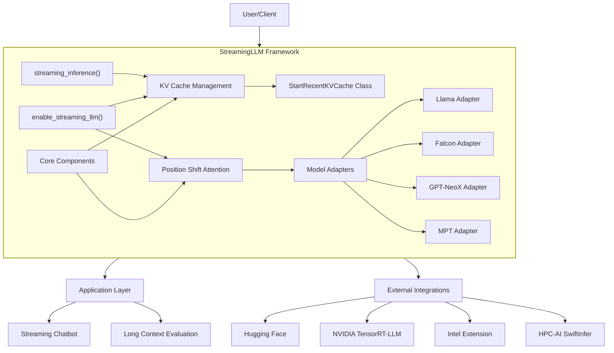
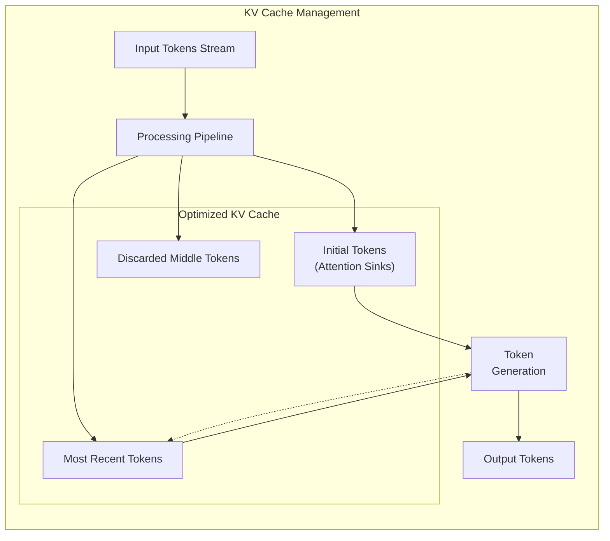
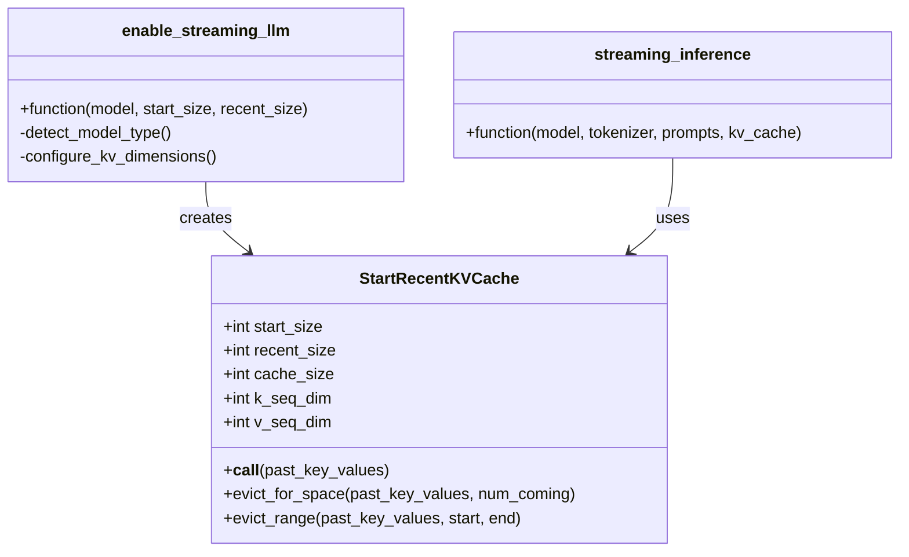
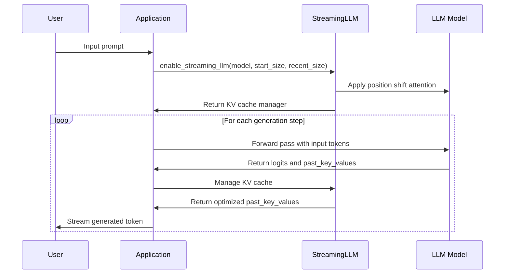

<!-- source: DeepWiki mcp.deepwiki.com · repo mit-han-lab/streaming-llm · page 1 Overview · fetched 2026-10-30 -->

# Overview

Relevant source files

The following files were used as context for generating this wiki page:

- [README.md](README.md)
- [assets/StreamingLLM.pdf](assets/StreamingLLM.pdf)
- [figures/schemes.png](figures/schemes.png)

This document provides a comprehensive introduction to StreamingLLM, a framework that enables Large Language Models (LLMs) to efficiently process and generate text from extremely long or infinite-length input sequences without sacrificing performance or requiring retraining. The core innovation of StreamingLLM is the attention sink mechanism, which maintains model coherence while discarding most intermediate tokens in the key-value cache.

For detailed installation instructions, see [Installation & Setup](#1.1).
For in-depth explanation of the attention sink mechanism, see [Attention Sink Mechanism](#2.1).

## Purpose and Key Features

StreamingLLM addresses two critical challenges in deploying LLMs for streaming applications:

1. Memory efficiency: Reduces the extensive memory consumption required for caching previous tokens' Key and Value states.
2. Context length generalization: Enables models to handle sequences much longer than their training context length.

Key features include:

- Support for processing sequences of up to 4 million tokens or more
- Up to 22.2x speedup compared to sliding window recomputation
- No fine-tuning required to extend context handling capability
- Compatible with multiple model architectures (Llama, MPT, Falcon, Pythia)
- Integration with popular frameworks (Hugging Face, TensorRT-LLM, Intel Extensions)

Sources: [README.md:1-22]()

## System Architecture

The following diagram illustrates the core components of StreamingLLM and their relationships:

Sources: [README.md:14-18]()

## Attention Sink Mechanism

The key innovation in StreamingLLM is the attention sink mechanism. This approach was developed after observing that LLMs tend to allocate strong attention to initial tokens in a sequence, even when those tokens aren't semantically important.

The diagram illustrates how StreamingLLM manages the KV cache:
1. Initial tokens are preserved as "attention sinks"
2. Most recent tokens are preserved for contextual relevance
3. Middle tokens are discarded to save memory
4. This pattern enables processing sequences far beyond the model's training context length

Sources: [README.md:21-22](), [README.md:46-49]()

## Core Components

### KV Cache Management

The `StartRecentKVCache` class is the central component that implements the attention sink mechanism:

The main parameters that control the KV cache management are:
- `start_size`: Number of initial tokens to keep as attention sinks
- `recent_size`: Number of most recent tokens to keep
- `cache_size`: Total cache size (typically equal to model's context window)

Sources: [README.md:46-49]()

### Model Adaptation

StreamingLLM provides position shifting techniques for different model architectures:

| Model Architecture | Adapter Function | Description |
|-------------------|------------------|-------------|
| Llama | enable_llama_pos_shift_attention | Modifies Llama's attention mechanism for streaming |
| Falcon | enable_falcon_pos_shift_attention | Adapts Falcon's attention computation |
| GPT-NeoX | enable_gpt_neox_pos_shift_attention | Enables streaming for GPT-NeoX-based models (like Pythia) |
| MPT | enable_mpt_pos_shift_attention | Adapts MPT's attention mechanism |

Each adapter function modifies the attention mechanism of the respective model to enable efficient streaming without retraining.

Sources: [README.md:69]()

## Usage Flow

The typical usage flow for StreamingLLM follows this sequence:

This diagram illustrates how applications interact with StreamingLLM to enable efficient processing of long sequences.

Sources: [README.md:38-42]()

## Integration Ecosystem

StreamingLLM has been integrated with several external frameworks, expanding its availability and usability:

| Framework | Description | Status |
|-----------|-------------|--------|
| Hugging Face Transformers | Popular ML library for NLP models | Integrated (Dec 2023) |
| NVIDIA TensorRT-LLM | High-performance inference for LLMs | Integrated (Jan 2024) |
| Intel Extension for Transformers | Optimizations for Intel hardware | Integrated (Oct 2023) |
| HPC-AI Tech SwiftInfer | Framework for infinite length LLM inference | Integrated (Jan 2024) |
| Attention Sinks | Third-party implementation for more Hugging Face models | Available (Oct 2023) |

These integrations make StreamingLLM's capabilities accessible through multiple platforms and optimization frameworks.

Sources: [README.md:12-19]()

## Use Cases and Limitations

### Ideal Use Cases

StreamingLLM is particularly well-suited for:
- Multi-round dialogues and chatbots
- Continuous operation scenarios where cache resets would be disruptive
- Applications that require processing long sequences efficiently

### Limitations

Important limitations to understand:
1. StreamingLLM does not expand the model's context window - it simply enables efficient streaming
2. Only the retained tokens (attention sinks + recent tokens) influence the generation
3. Not suitable for tasks that require understanding the entire document (e.g., summarizing a complete book)

Sources: [README.md:46-64]()

## Conclusion

StreamingLLM provides an efficient framework for enabling LLMs to process infinite-length inputs without sacrificing efficiency or performance. By leveraging the attention sink mechanism, models can maintain coherent generation while discarding most intermediate tokens from the KV cache. This approach requires no fine-tuning and is compatible with multiple model architectures and external frameworks.

For more detailed information on the core concepts, see [Core Concepts](#2), and for implementation details, see [Implementation](#4).

Sources: [README.md:8-9](), [README.md:21-22]()

---

