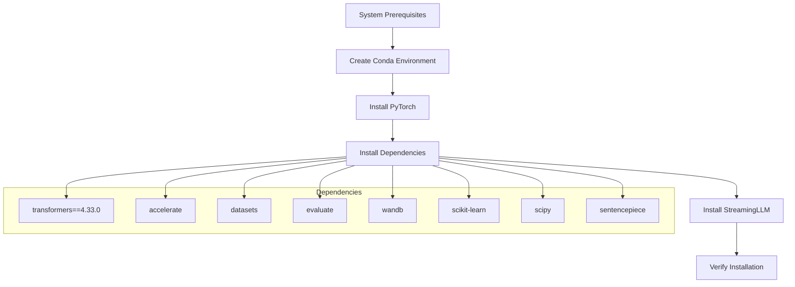
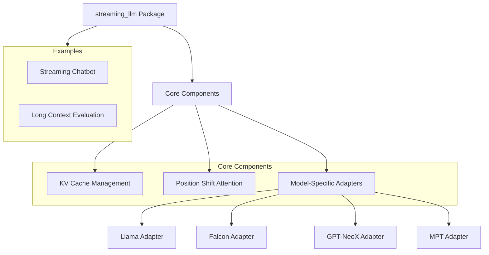

<!-- source: DeepWiki mcp.deepwiki.com · repo mit-han-lab/streaming-llm · page 1.1 Installation & Setup · fetched 2026-10-30 -->

# Installation & Setup

<details>
<summary>Relevant source files</summary>

The following files were used as context for generating this wiki page:

- [.gitignore](.gitignore)
- [README.md](README.md)
- [setup.py](setup.py)

</details>


This page provides instructions for installing and setting up the StreamingLLM environment. StreamingLLM is a framework that enables large language models (LLMs) to process infinite-length inputs without sacrificing efficiency or performance. This guide covers the prerequisites, installation steps, and verification process to ensure your environment is ready for running StreamingLLM.

For information about core concepts and system architecture, see the [Overview](#1) and [Core Concepts](#2) pages.

## System Requirements

Before installing StreamingLLM, ensure your system meets the following requirements:

| Requirement | Minimum Specification |
|-------------|------------------------|
| Python      | 3.8 or newer           |
| CUDA        | CUDA 11.7+ (for GPU acceleration) |
| GPU Memory  | At least 16GB for 7B models |
| RAM         | 16GB+ recommended |
| Disk Space  | 2GB for code and dependencies, plus model storage (10-30GB per model) |

Sources: [README.md:1-10]()

## Installation Process

The installation of StreamingLLM can be visualized as follows:



Sources: [README.md:26-36]()

### Step 1: Create a Conda Environment

The recommended approach is to use a dedicated conda environment for StreamingLLM:

```bash
conda create -yn streaming python=3.8
conda activate streaming
```

Sources: [README.md:28-31]()

### Step 2: Install PyTorch

Install PyTorch and its related packages:

```bash
pip install torch torchvision torchaudio
```

Note: For specific CUDA versions or CPU-only installations, refer to the [PyTorch official installation guide](https://pytorch.org/get-started/locally/).

Sources: [README.md:32]()

### Step 3: Install Dependencies

Install the required dependencies:

```bash
pip install transformers==4.33.0 accelerate datasets evaluate wandb scikit-learn scipy sentencepiece
```

Sources: [README.md:33]()

### Step 4: Install StreamingLLM

Install the StreamingLLM package in development mode:

```bash
python setup.py develop
```

This command installs the package in a way that reflects changes to the source code immediately without needing to reinstall.

Sources: [README.md:35](), [setup.py:1-6]()

## Package Structure

The StreamingLLM installation creates the following package structure:



Sources: [setup.py:1-6]()

## Verifying Installation

To verify that StreamingLLM has been installed correctly, you can run the included Streaming Llama Chatbot example:

```bash
CUDA_VISIBLE_DEVICES=0 python examples/run_streaming_llama.py --enable_streaming
```

If the installation was successful, this command will start the chatbot interface. The first run will download the required model weights if they aren't already present.

Sources: [README.md:38-42]()

## Installation Options and Configurations

The installation process allows for several customization options depending on your specific requirements:

### Environment Variables

These environment variables can be set to customize the behavior of StreamingLLM:

| Variable | Purpose | Example |
|----------|---------|---------|
| CUDA_VISIBLE_DEVICES | Control which GPUs are used | `export CUDA_VISIBLE_DEVICES=0,1` |
| TRANSFORMERS_CACHE | Specify model cache location | `export TRANSFORMERS_CACHE=/path/to/cache` |
| TOKENIZERS_PARALLELISM | Control tokenizer parallelism | `export TOKENIZERS_PARALLELISM=false` |

### Development Installation

For contributors or developers who want to modify the StreamingLLM code, the development installation is recommended:

1. Clone the repository:
   ```bash
   git clone https://github.com/mit-han-lab/streaming-llm.git
   cd streaming-llm
   ```

2. Install in development mode:
   ```bash
   python setup.py develop
   ```

This setup allows changes to the source code to be immediately reflected without reinstallation.

Sources: [README.md:35](), [setup.py:1-6]()

## Troubleshooting

Here are solutions to common installation issues:

| Issue | Possible Cause | Solution |
|-------|----------------|----------|
| `ImportError: No module named streaming_llm` | Package not installed correctly | Re-run `python setup.py develop` |
| CUDA out of memory errors | GPU has insufficient memory | Use a smaller model or reduce batch size |
| Version conflicts | Dependency version mismatch | Create a fresh environment and follow the installation steps exactly |
| Model download failures | Network issues or insufficient disk space | Check your internet connection and available disk space |

If you encounter persistent issues, check the GitHub repository's issues section for similar problems and solutions.

Sources: [README.md:26-36](), [.gitignore:1-161]()

## Next Steps

After successful installation, you may want to:

1. Try the [Streaming Llama Chatbot example](#5.1)
2. Explore the [Core Concepts](#2) behind StreamingLLM
3. Learn about [Evaluating Long Context Performance](#5.2)

Sources: [README.md:38-42]()

---

