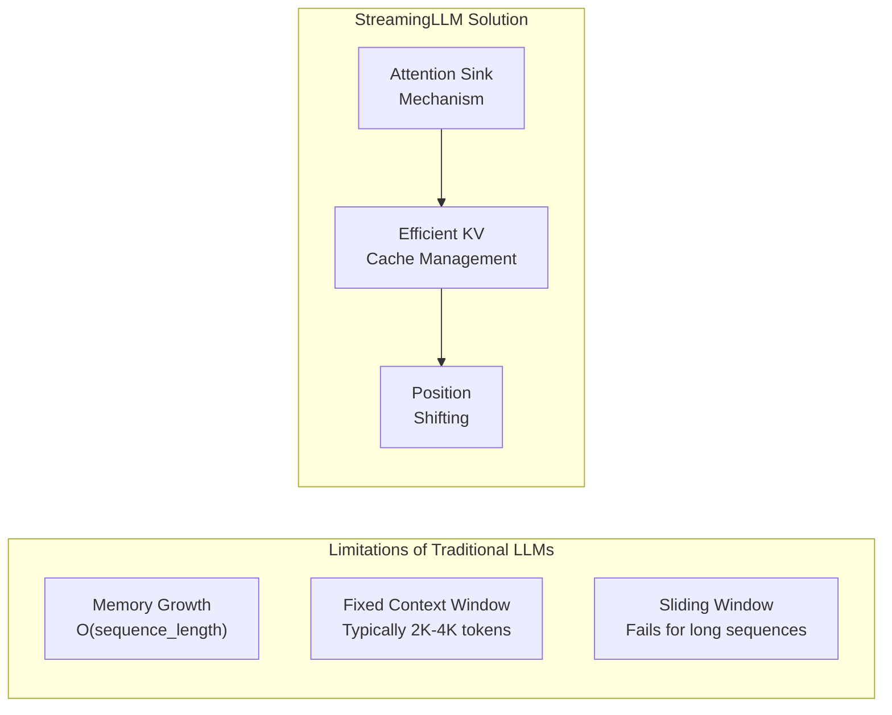
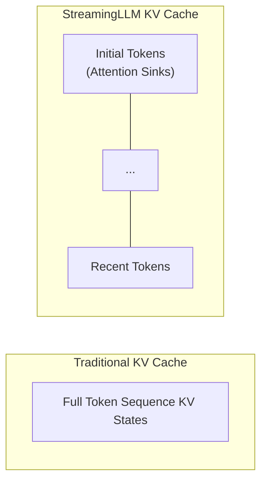
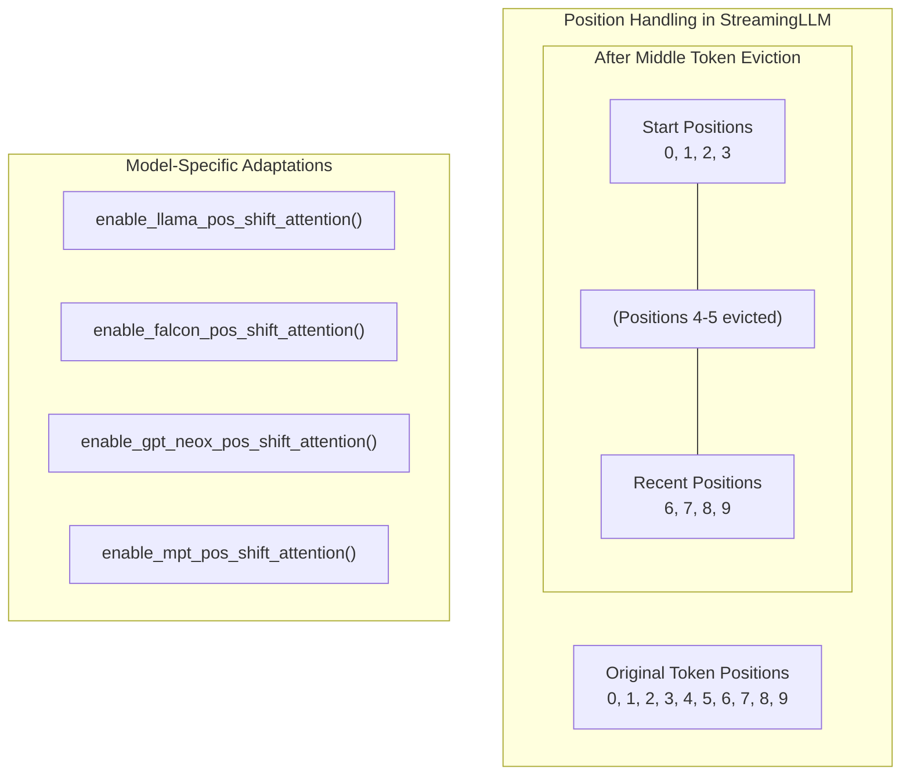
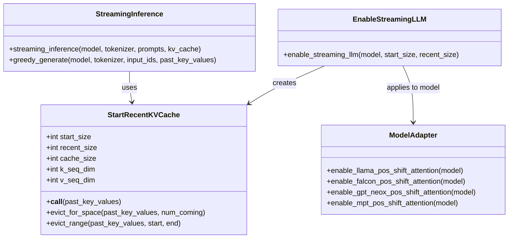

<!-- source: DeepWiki mcp.deepwiki.com · repo mit-han-lab/streaming-llm · page 2 Core Concepts · fetched 2026-10-30 -->

# Core Concepts

<details>
<summary>Relevant source files</summary>

The following files were used as context for generating this wiki page:

- [README.md](README.md)
- [assets/StreamingLLM.pdf](assets/StreamingLLM.pdf)
- [streaming_llm/kv_cache.py](streaming_llm/kv_cache.py)

</details>


This page explains the fundamental concepts that power StreamingLLM, a framework enabling Large Language Models (LLMs) to efficiently process infinitely long input sequences without degradation. We'll focus on the key innovations that allow models to handle streaming text far beyond their training context lengths without requiring model fine-tuning.

For detailed implementation specifics, see [Implementation](#4). For practical usage examples, see [Usage Examples](#5).

## The Challenge of Long Sequences in LLMs

Traditional LLMs face two significant limitations when processing long sequences:

1. **Memory Constraints**: Storing Key-Value (KV) states for all previous tokens requires substantial memory that scales linearly with sequence length
2. **Context Window Limitations**: Models struggle to generate coherent text beyond their training sequence length

A natural solution would be to use a sliding window approach, keeping only recent tokens. However, this approach fails when the sequence length exceeds the cache size, resulting in degraded performance.



Sources: [README.md:21-22]()

## Attention Sink Mechanism

The core innovation of StreamingLLM is the **attention sink mechanism**, based on a key observation about attention patterns in LLMs: models strongly attend to initial tokens in a sequence, even when these tokens have limited semantic importance. These initial tokens function as "attention sinks" that stabilize the model's behavior.

```mermaid
flowchart TB
    subgraph "Attention Sink Pattern"
        Direction LR
        input["Input Token Sequence"]
        
        subgraph "Attention Distribution"
            initial["Initial Tokens"]
            middle["Middle Tokens"]
            recent["Recent Tokens"]
            
            initial --> |"Strong Attention\n(Attention Sinks)"| generation
            middle --> |"Variable Attention\n(Can be discarded)"| generation
            recent --> |"High Relevance\n(Must be retained)"| generation
            
            generation["Token Generation"]
        end
    end
```

By preserving the attention sinks (initial tokens) along with recent tokens and discarding the middle tokens, StreamingLLM maintains model performance while drastically reducing memory requirements and enabling processing of potentially infinite sequences.

Sources: [README.md:21-22]()

## Key-Value Cache Management

The `StartRecentKVCache` class handles the efficient management of the KV cache with the following principles:

1. Retain the first `start_size` tokens (attention sinks)
2. Retain the most recent `recent_size` tokens
3. Discard tokens in between when the sequence length exceeds `start_size + recent_size`



The `StartRecentKVCache` class implements this management through three key methods:

| Method | Purpose |
|--------|---------|
| `__call__` | Processes existing KV cache to retain only start and recent tokens |
| `evict_for_space` | Creates space in the cache for new incoming tokens |
| `evict_range` | Removes a specific range of tokens from the cache |

When the KV cache length exceeds the allocated cache size (`start_size + recent_size`), the middle tokens are automatically discarded while preserving the attention sinks and recent context.

Sources: [streaming_llm/kv_cache.py:23-64]()

## Position Shifting

Transformer-based LLMs rely heavily on position information. When middle tokens are discarded, position embeddings need adjustment to maintain the model's understanding of sequence structure.



StreamingLLM modifies the attention computation for different model architectures through model-specific adapter functions. These adaptations ensure that even with a discontinuous token sequence (start + recent tokens only), the model properly processes position information and maintains generation quality.

Sources: [README.md:21-22]()

## Integrated Architecture

The StreamingLLM framework integrates these concepts into a cohesive system:



Sources: [streaming_llm/kv_cache.py:23-119]()

## Practical Benefits

The key advantages of StreamingLLM include:

1. **Memory Efficiency**: Only stores a fraction of tokens in the KV cache
2. **Infinite Context Processing**: Can handle sequences of arbitrary length
3. **No Fine-tuning Required**: Works with pre-trained models out of the box
4. **Model Flexibility**: Supports various model architectures (Llama, MPT, Falcon, Pythia)
5. **Performance**: Up to 22.2x speedup compared to sliding window recomputation

```mermaid
flowchart TB
    subgraph "StreamingLLM Applications"
        Chatbot["Streaming Chatbots\nUnlimited conversation length"]
        LongDoc["Long Document Processing\nWithout context resets"]
        Constrained["Resource-Constrained Environments\nMobile/Edge devices"]
    end
    
    subgraph "External Integrations"
        HF["Hugging Face\nTransformers"]
        TensorRT["NVIDIA\nTensorRT-LLM"]
        Intel["Intel Extension\nfor Transformers"]
        Swift["SwiftInfer"]
    end
```



Sources: [README.md:8-19]()

StreamingLLM represents a significant advancement in efficient LLM deployment, enabling continuous text generation without the typical limitations of fixed context windows or memory constraints. By understanding these core concepts, developers can leverage StreamingLLM to build applications that require processing of arbitrarily long text sequences.

---

