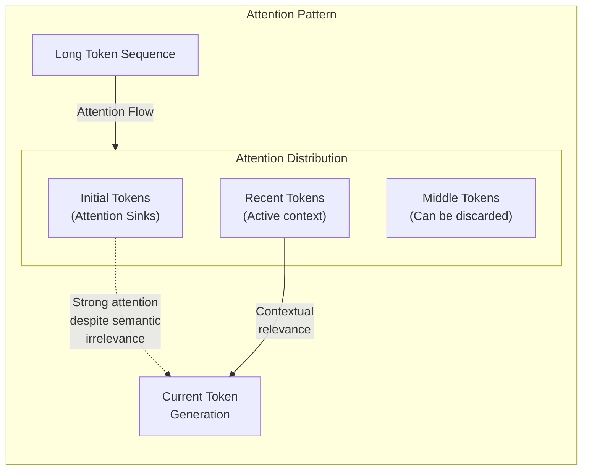
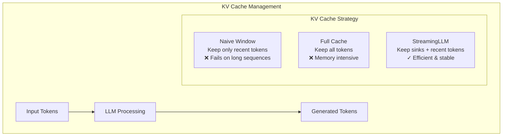
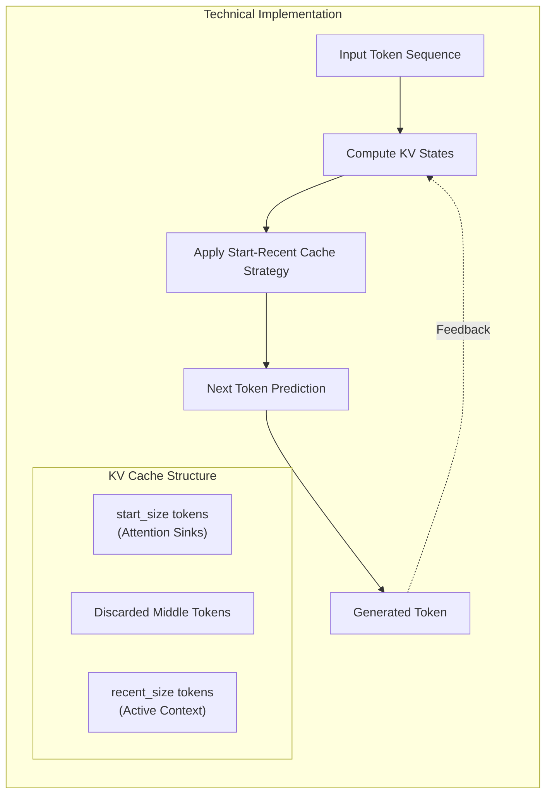
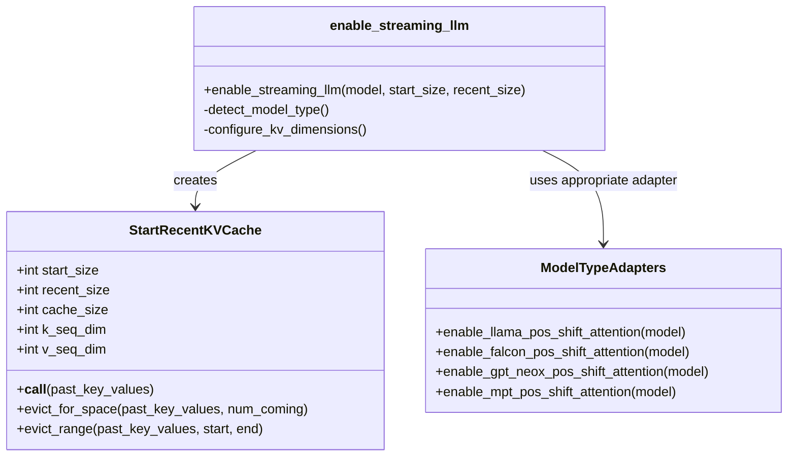
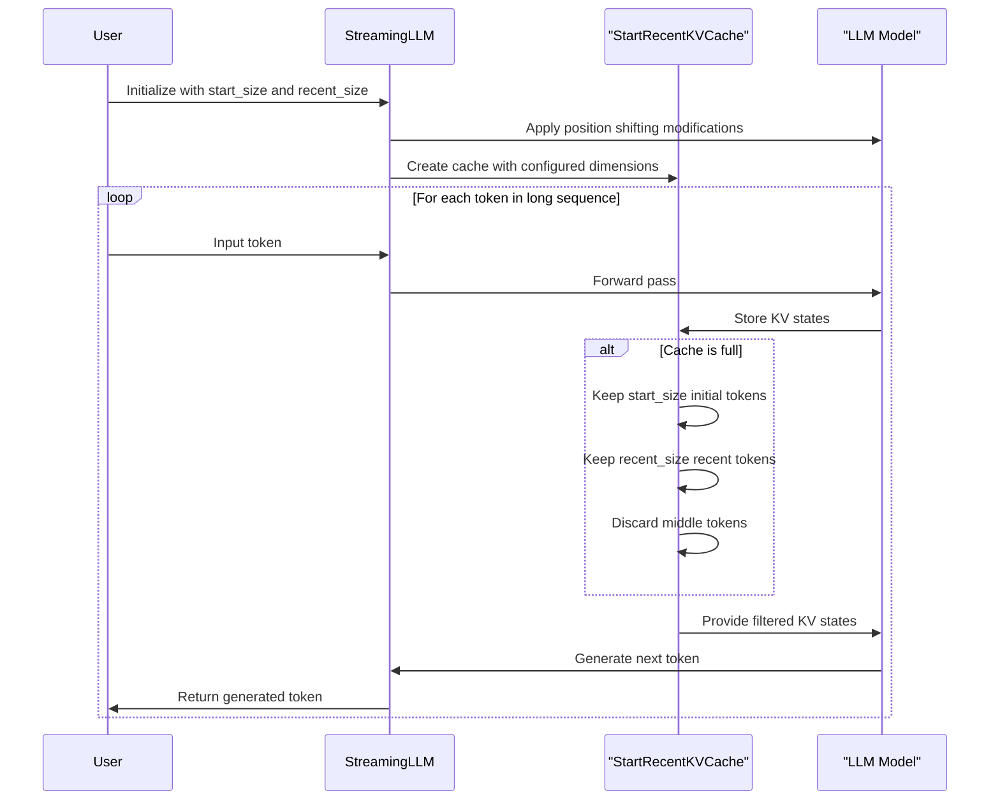

<!-- source: DeepWiki mcp.deepwiki.com · repo mit-han-lab/streaming-llm · page 2.1 Attention Sink Mechanism · fetched 2026-10-30 -->

# Attention Sink Mechanism

<details>
<summary>Relevant source files</summary>

The following files were used as context for generating this wiki page:

- [README.md](README.md)
- [assets/StreamingLLM.pdf](assets/StreamingLLM.pdf)

</details>


## Purpose and Scope

This document explains the Attention Sink Mechanism, a core innovation in StreamingLLM that enables language models to process sequences of virtually unlimited length without requiring model fine-tuning. The mechanism addresses the key challenge of memory consumption and performance degradation when processing sequences longer than a model's training context window.

For information about the specific implementation of cache management based on this mechanism, see [Key-Value Cache Management](#2.2). For details on position shift implementation, see [Position Shifting](#2.3).

## Concept Overview

The attention sink mechanism is based on a key observation: by preserving the key-value (KV) states of initial tokens along with recent tokens in the attention cache, language models can maintain coherent generation even when processing sequences that far exceed their training context length.



Sources: [README.md:21-22]()

### The Problem of Long Sequences

Traditional language models face two critical challenges when processing long sequences:

1. **Memory Consumption**: Storing KV states for all previous tokens requires memory that scales linearly with sequence length
2. **Performance Degradation**: Models trained on fixed context windows (e.g., 4096 tokens) tend to lose coherence when generating beyond this length

The naive approach of simply keeping a sliding window of the most recent tokens (window attention) fails when sequence length exceeds the cache size. Models begin to produce degraded outputs due to losing the ability to attend to important tokens earlier in the sequence.

### The Attention Sink Phenomenon

The key insight of StreamingLLM is that transformer-based LLMs exhibit a consistent pattern: they disproportionately attend to the very first tokens in a sequence, regardless of the semantic importance of those tokens. These initial tokens act as "attention sinks" that stabilize the model's behavior.



Sources: [README.md:21-22](), [README.md:46-49]()

## Technical Details

### How Attention Sinks Work

The attention sink mechanism exploits the attention pattern in transformer models by:

1. Preserving KV states for the initial tokens in a sequence ("sinks")
2. Preserving KV states for the most recent tokens (active context)
3. Strategically discarding KV states for middle tokens to save memory

This approach allows for efficient processing of arbitrarily long sequences while maintaining generation quality comparable to using the full attention context.



Sources: [README.md:21-22]()

### Mathematical Basis

The attention sink mechanism works because of how attention is computed in transformer models. In self-attention, the attention score between tokens is calculated as:

| Component | Mathematical Representation | Description |
|-----------|---------------------------|-------------|
| Query | Q | Representation of the current token |
| Key | K | Representation of context tokens |
| Value | V | Information from context tokens |
| Attention Weights | softmax(QK^T/√d) | How much to attend to each token |
| Output | softmax(QK^T/√d)V | Contextual representation |

The attention sink phenomenon occurs because initial tokens consistently receive high attention weights even when they aren't semantically relevant to the current generation task. By preserving these tokens, the model maintains stable generation patterns.

## Implementation in StreamingLLM

The attention sink mechanism is implemented through two primary components:

1. **StartRecentKVCache**: Manages the KV cache to retain only initial (sink) tokens and recent tokens
2. **Position Shift Attention**: Modifies positional embeddings to accommodate the discontinuity in the token sequence



Sources: [README.md:69]()

### Configuration Parameters

The attention sink mechanism is configured with two key parameters:

1. **`start_size`**: Number of initial tokens to keep as attention sinks (typically 4-8 tokens)
2. **`recent_size`**: Number of most recent tokens to keep in the cache (depends on task requirements)

Together, these parameters determine the total cache size: `cache_size = start_size + recent_size`, which must not exceed the model's training context length.

### Cache Management Strategy

The cache management strategy follows this process:

1. Process initial tokens normally until the cache reaches capacity
2. When new tokens arrive and the cache is full:
   - Keep the first `start_size` tokens (the attention sinks)
   - Keep the most recent `recent_size` tokens
   - Discard the middle tokens to make space
3. When generating, use this selective cache for attention computation



Sources: [README.md:46-49]()

## Performance Characteristics

### Benefits

1. **Memory Efficiency**: Reduces memory requirements from O(L) to O(start_size + recent_size), where L is the sequence length
2. **Unlimited Input Length**: Enables processing sequences of arbitrary length without recomputation
3. **No Fine-tuning Required**: Works with pre-trained models without modification of weights
4. **Stable Performance**: Maintains coherent generation quality comparable to full-context models

### Performance Comparison

| Approach | Memory Usage | Processing Speed | Quality on Long Sequences |
|----------|-------------|-----------------|--------------------------|
| Full Context | High (O(L)) | Slow for long sequences | High but limited by context window |
| Sliding Window | Low (O(window_size)) | Fast | Degrades beyond window size |
| Naive Recomputation | Low (O(window_size)) | Very slow | High but computationally expensive |
| StreamingLLM (Attention Sink) | Low (O(start_size + recent_size)) | Fast | High and stable for arbitrary length |

According to the StreamingLLM paper, this approach outperforms sliding window recomputation baselines by up to 22.2x in terms of processing speed.

Sources: [README.md:21-22]()

## Usage Examples

To enable the attention sink mechanism in a pre-trained model:

```python
# Initialize a model with attention sink mechanism
from streaming_llm import enable_streaming_llm

# Configure attention sinks and recent context size
start_size = 4  # Number of initial tokens to keep as attention sinks
recent_size = 1020  # Number of recent tokens to keep

# Apply attention sink mechanism to model
model = enable_streaming_llm(model, start_size=start_size, recent_size=recent_size)
```

The mechanism works with several model architectures including Llama-2, MPT, Falcon, and Pythia models.

Sources: [README.md:38-42]()

## Limitations and Considerations

While the attention sink mechanism is highly effective, users should be aware of:

1. The mechanism doesn't expand the effective context window - it enables processing of unlimited sequences but still only "pays attention" to the most recent tokens
2. For tasks requiring deep understanding of full context (like book summarization), this approach may not be optimal as middle tokens are discarded
3. Performance may vary slightly across different model architectures due to differences in attention patterns

Sources: [README.md:50-56]()

---

