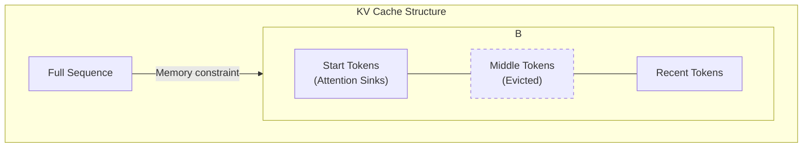
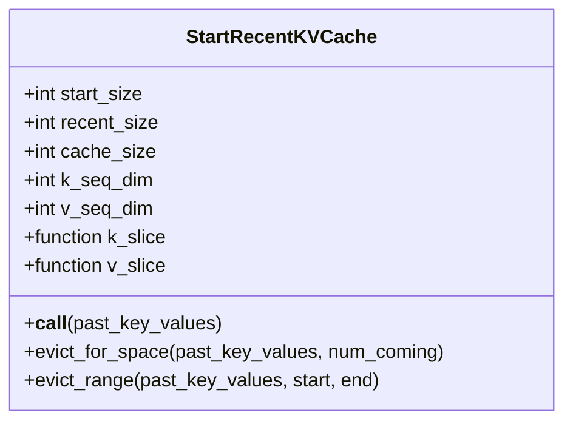
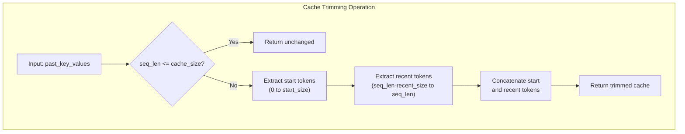
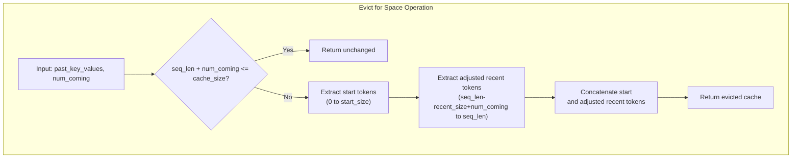
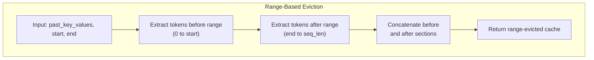
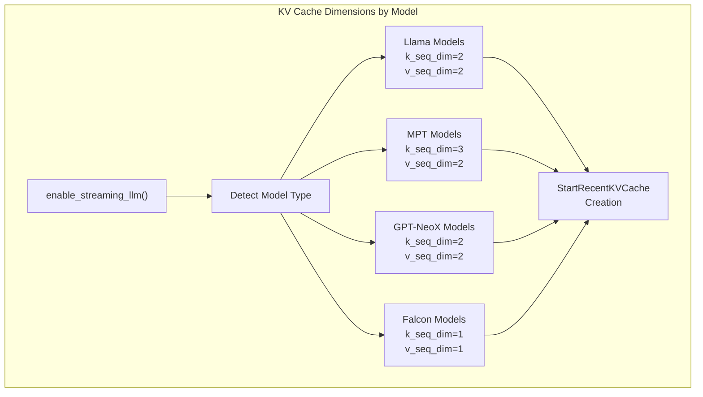
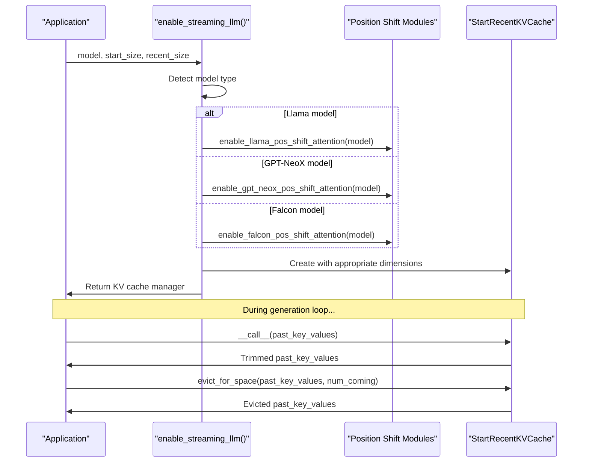
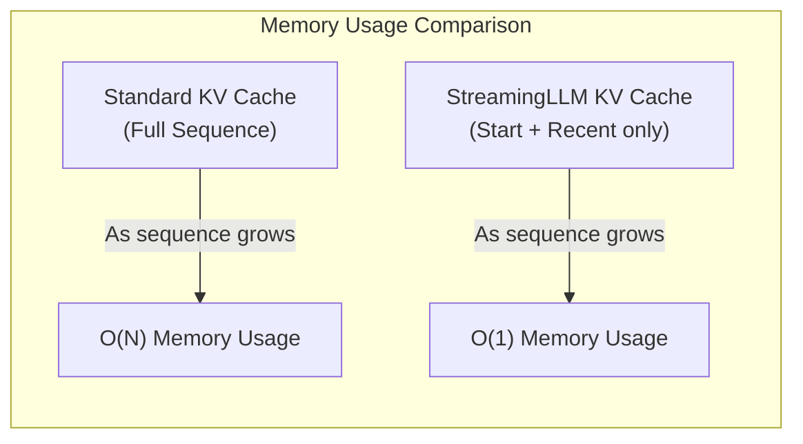

<!-- source: DeepWiki mcp.deepwiki.com · repo mit-han-lab/streaming-llm · page 2.2 Key-Value Cache Management · fetched 2026-10-30 -->

# Key-Value Cache Management

<details>
<summary>Relevant source files</summary>

The following files were used as context for generating this wiki page:

- [streaming_llm/enable_streaming_llm.py](streaming_llm/enable_streaming_llm.py)
- [streaming_llm/kv_cache.py](streaming_llm/kv_cache.py)

</details>


This document describes how StreamingLLM efficiently manages the Key-Value (KV) cache to enable processing of arbitrarily long sequences with limited memory resources. The KV cache management system works in tandem with the attention sink mechanism to maintain only the most important tokens in memory. For more information about the attention sink concept itself, see [Attention Sink Mechanism](#2.1).

## KV Cache Management Concept

In Large Language Models (LLMs), the Key-Value cache stores the computed key and value tensors for each token position during inference, allowing reuse of previously computed values to avoid redundant calculations. However, as sequence length increases, the KV cache grows proportionally, quickly exhausting available memory.

StreamingLLM's innovation is in selectively managing which tokens are kept in the KV cache through a "start-recent" strategy:



Sources: [streaming_llm/kv_cache.py:23-39](), [streaming_llm/enable_streaming_llm.py:4-38]()

## The StartRecentKVCache Class

The core of the KV cache management system is implemented in the `StartRecentKVCache` class, which maintains two critical segments of the sequence:

1. **Start tokens** (attention sinks): The initial tokens in the sequence that serve as anchors for attention
2. **Recent tokens**: The most recently processed tokens that provide immediate context



Sources: [streaming_llm/kv_cache.py:23-39]()

The class is initialized with these key parameters:

| Parameter | Purpose | Default |
|-----------|---------|---------|
| `start_size` | Number of initial tokens to retain | 4 |
| `recent_size` | Number of most recent tokens to retain | 512 |
| `k_seq_dim` | Dimension of sequence in key tensors | 2 (model-dependent) |
| `v_seq_dim` | Dimension of sequence in value tensors | 2 (model-dependent) |

The `cache_size` is calculated as `start_size + recent_size` and represents the total number of tokens kept in the cache.

Sources: [streaming_llm/kv_cache.py:23-39]()

## Cache Operations

The `StartRecentKVCache` class provides three primary operations for managing the KV cache:

### 1. Basic Cache Trimming (`__call__`)

This operation trims the KV cache to maintain only the start and recent tokens when the sequence length exceeds the cache size.



Sources: [streaming_llm/kv_cache.py:40-64]()

### 2. Eviction for Space (`evict_for_space`)

This operation makes space in the KV cache for new incoming tokens by evicting middle tokens.



Sources: [streaming_llm/kv_cache.py:66-94]()

### 3. Range-Based Eviction (`evict_range`)

This operation allows evicting a specific range of tokens from the KV cache.



Sources: [streaming_llm/kv_cache.py:96-119]()

## Model-Specific Cache Dimensions

Different LLM architectures organize their key and value tensors differently, requiring model-specific handling of sequence dimensions:



The dimension parameters determine how slicing operations are performed:

| Model Type | k_seq_dim | v_seq_dim | Slicing Functions |
|------------|-----------|-----------|-------------------|
| Llama | 2 | 2 | slice2d for both |
| MPT | 3 | 2 | slice3d for keys, slice2d for values |
| GPT-NeoX | 2 | 2 | slice2d for both |
| Falcon | 1 | 1 | slice1d for both |

The `DIM_TO_SLICE` dictionary maps these dimension values to the appropriate slicing function:

```
DIM_TO_SLICE = {
    1: slice1d,
    2: slice2d,
    3: slice3d,
}
```

Sources: [streaming_llm/kv_cache.py:4-20](), [streaming_llm/enable_streaming_llm.py:4-38]()

## System Integration 

The KV cache management system integrates with the broader StreamingLLM framework through the `enable_streaming_llm` function, which:

1. Detects the model type
2. Configures the appropriate KV cache dimensions
3. Applies model-specific position shift attention modifications
4. Creates and returns a `StartRecentKVCache` instance



Sources: [streaming_llm/enable_streaming_llm.py:4-38]()

## Memory Efficiency 

The KV cache management approach provides significant memory efficiency benefits:



By maintaining only the start tokens (attention sinks) and the most recent tokens, StreamingLLM achieves constant memory usage regardless of input sequence length. This allows processing arbitrarily long sequences without exceeding memory constraints.

Sources: [streaming_llm/kv_cache.py:23-119]()

## Implementation Details

The actual implementation uses PyTorch tensor operations to efficiently perform the slicing and concatenation operations. The key operations are:

1. **Slicing**: Using the appropriate slice function based on the model's tensor dimensions
2. **Concatenation**: Using `torch.cat()` to join the start tokens and recent tokens
3. **Dimension-specific operations**: Managing different tensor shapes across model architectures

The performance of these operations is critical to the overall efficiency of StreamingLLM, especially for real-time applications that require low-latency responses.

Sources: [streaming_llm/kv_cache.py:4-20](), [streaming_llm/kv_cache.py:40-119]()

---

