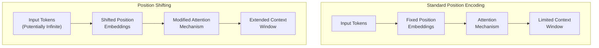
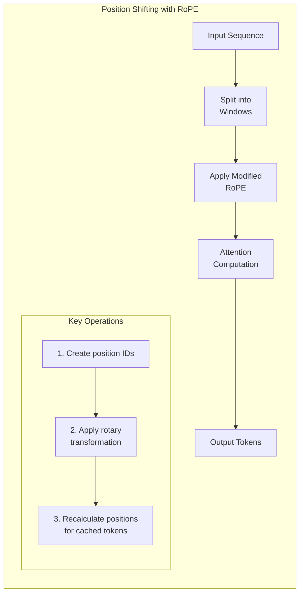
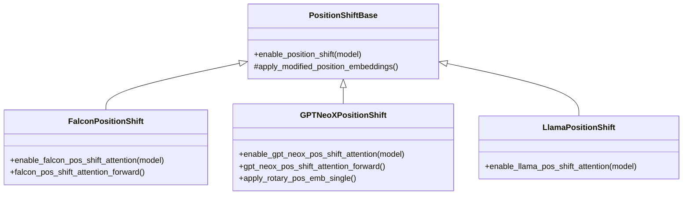
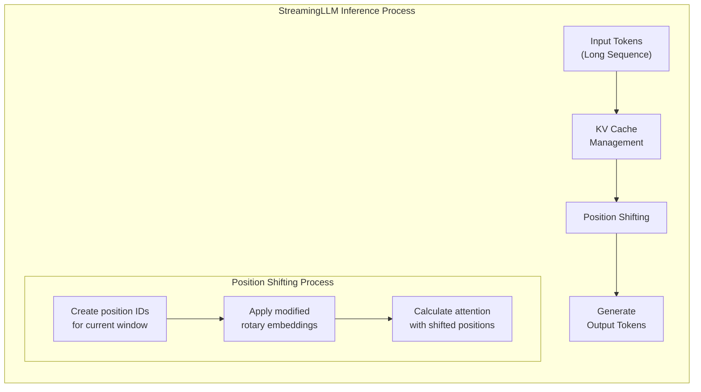
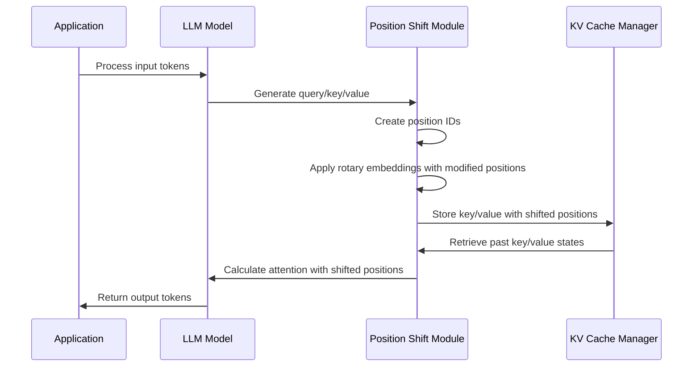

<!-- source: DeepWiki mcp.deepwiki.com · repo mit-han-lab/streaming-llm · page 2.3 Position Shifting · fetched 2026-10-30 -->

# Position Shifting

<details>
<summary>Relevant source files</summary>

The following files were used as context for generating this wiki page:

- [streaming_llm/pos_shift/__init__.py](streaming_llm/pos_shift/__init__.py)
- [streaming_llm/pos_shift/modify_falcon.py](streaming_llm/pos_shift/modify_falcon.py)
- [streaming_llm/pos_shift/modify_gpt_neox.py](streaming_llm/pos_shift/modify_gpt_neox.py)

</details>


Position shifting is a critical technique in StreamingLLM that enables language models to process sequences longer than their training context window. This page explains how position shifting works in the context of attention mechanisms and how it's implemented for different model architectures.

For information about KV cache management, which works in conjunction with position shifting, see [Key-Value Cache Management](#2.2).

## What is Position Shifting?

Position shifting refers to the technique of modifying how positional embeddings are applied in transformer models during inference. In standard transformer models, positional embeddings encode the absolute or relative positions of tokens in a sequence. However, when processing sequences longer than the training context window, these embeddings can produce unexpected results since the model was never trained on such long positions.



Sources: [streaming_llm/pos_shift/modify_falcon.py:19-150](), [streaming_llm/pos_shift/modify_gpt_neox.py:20-96]()

## Key Concept: Rotary Position Embeddings

Most modern LLMs use rotary position embeddings (RoPE) to encode positional information. Position shifting modifies how these embeddings are applied, especially when combining cached past tokens with new tokens.



Sources: [streaming_llm/pos_shift/modify_gpt_neox.py:20-27](), [streaming_llm/pos_shift/modify_falcon.py:57-74]()

## Position Shifting Implementation

StreamingLLM implements model-specific position shifting adaptations since different model architectures handle positional embeddings differently. The implementation follows a consistent pattern:

1. Create custom forward pass functions for attention modules
2. Modify how position IDs are generated and applied
3. Apply special handling for cached past key-value states
4. Replace the original forward methods with the modified versions



Sources: [streaming_llm/pos_shift/modify_falcon.py:152-162](), [streaming_llm/pos_shift/modify_gpt_neox.py:99-110]()

## Model-Specific Implementations

### Falcon Implementation

The Falcon implementation modifies how rotary embeddings and alibi (attention with linear biases) are applied. A key aspect is handling both falcon-7b and falcon-40b model variants, which have different attention implementations.

Key components of the Falcon implementation:

1. Custom forward function that handles both alibi and non-alibi cases
2. Special handling for key-value caching and past context
3. Proper application of rotary embeddings with shifted positions

The implementation uses monkey patching to replace the original forward method:

```python
def enable_falcon_pos_shift_attention(model):
    for name, module in reversed(model._modules.items()):
        if len(list(module.children())) > 0:
            enable_falcon_pos_shift_attention(module)
        if "self_attention" == name[-14:]:
            model._modules[name].forward = types.MethodType(
                falcon_pos_shift_attention_forward, model._modules[name]
            )
```

Sources: [streaming_llm/pos_shift/modify_falcon.py:152-162]()

### GPT-NeoX Implementation

The GPT-NeoX implementation focuses on properly handling rotary position embeddings with cached states. It introduces a helper function `apply_rotary_pos_emb_single` that applies rotary embeddings with specific position IDs.

Key aspects of the GPT-NeoX implementation:

1. Custom application of rotary embeddings for queries and keys
2. Special handling of position IDs when extending context with cached states
3. Proper sequence length tracking when combining past and current contexts

```python
def apply_rotary_pos_emb_single(x, cos, sin, position_ids):
    gather_indices = position_ids[:, None, :, None]  # [bs, 1, seq_len, 1]
    gather_indices = gather_indices.repeat(1, cos.shape[1], 1, cos.shape[3])
    cos = torch.gather(cos.repeat(gather_indices.shape[0], 1, 1, 1), 2, gather_indices)
    sin = torch.gather(sin.repeat(gather_indices.shape[0], 1, 1, 1), 2, gather_indices)
    x_embed = (x * cos) + (rotate_half(x) * sin)
    return x_embed
```

Sources: [streaming_llm/pos_shift/modify_gpt_neox.py:20-27]()

## Position Shifting and Attention Sinks

Position shifting works hand-in-hand with the attention sink mechanism to enable processing of sequences longer than the training context window:



Sources: [streaming_llm/pos_shift/modify_falcon.py:19-150](), [streaming_llm/pos_shift/modify_gpt_neox.py:29-96]()

## Key Technical Details

Position shifting addresses several technical challenges in LLM streaming:

1. **Position Embedding Limitation**: LLMs are typically trained with fixed-length position embeddings (e.g., up to 2048 or 4096 tokens). Position shifting enables them to handle much longer sequences.

2. **Rotary Position Embedding (RoPE) Modification**: The core of position shifting is modifying RoPE application to maintain proper relative positioning information while using a sliding window approach.

3. **Position Reset**: For key vectors in the KV cache, positions are essentially "reset" to maintain proper relative positioning within the attention window.

| Model Architecture | Position Embedding Type | Modified Function | Key Adaptation |
|-------------------|-------------------------|-------------------|---------------|
| Falcon            | Rotary + Optional Alibi | `falcon_pos_shift_attention_forward` | Handles both alibi and non-alibi cases |
| GPT-NeoX          | Rotary                  | `gpt_neox_pos_shift_attention_forward` | Custom position ID handling for extended context |
| Llama             | Rotary                  | `enable_llama_pos_shift_attention` | Mentioned but implementation not shown in provided files |

Sources: [streaming_llm/pos_shift/modify_falcon.py:19-150](), [streaming_llm/pos_shift/modify_gpt_neox.py:29-96]()

## Implementation Flow

The following diagram illustrates how position shifting is applied during the inference process:



Sources: [streaming_llm/pos_shift/modify_falcon.py:19-150](), [streaming_llm/pos_shift/modify_gpt_neox.py:29-96]()

## Summary

Position shifting is a core technique in StreamingLLM that enables language models to process sequences longer than their training context window. By modifying how positional embeddings are applied, especially for rotary position embeddings, StreamingLLM can effectively maintain proper relative positioning information while using a sliding window approach with attention sinks. This technique is implemented differently for different model architectures but follows the same core principles of modified position ID handling and proper integration with KV cache management.

---

