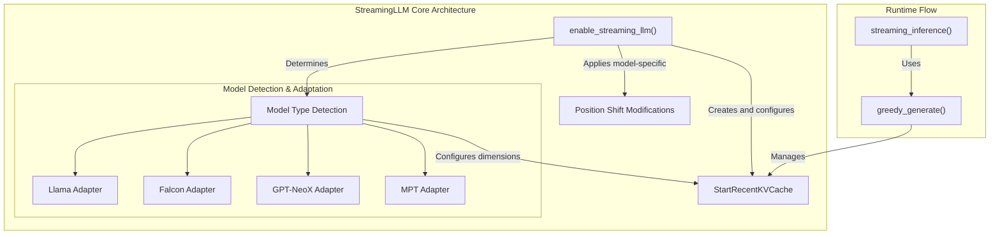
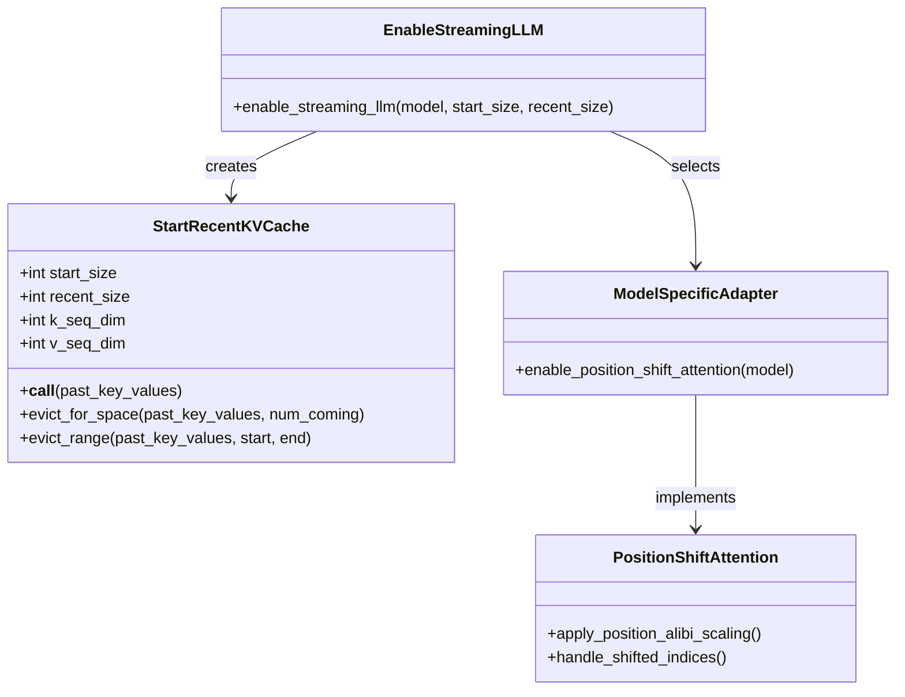
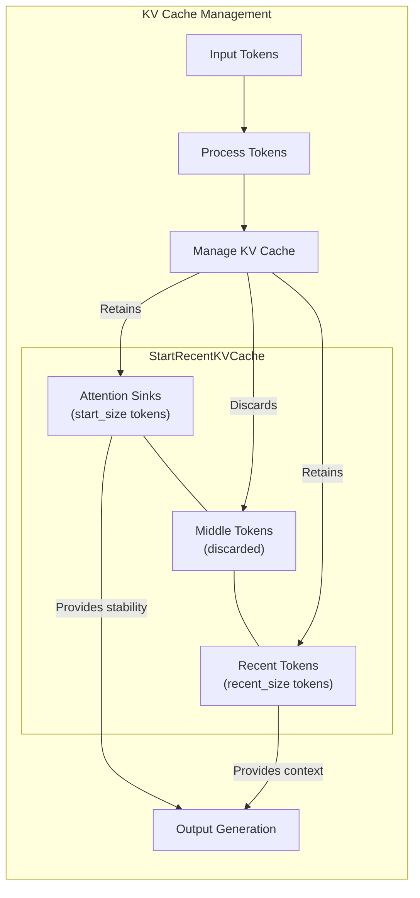
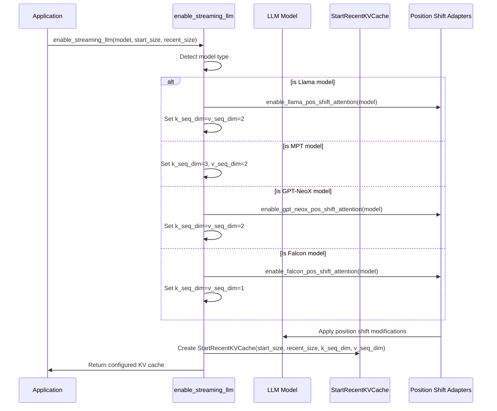
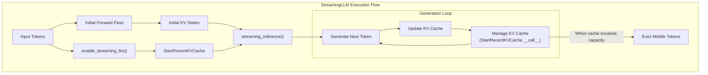
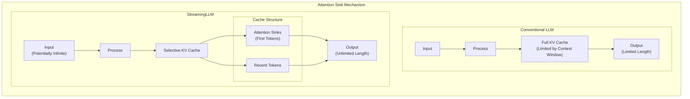
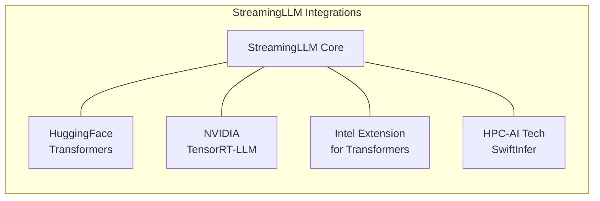

<!-- source: DeepWiki mcp.deepwiki.com · repo mit-han-lab/streaming-llm · page 3 System Architecture · fetched 2026-10-30 -->

# System Architecture

Relevant source files

The following files were used as context for generating this wiki page:

- [README.md](README.md)
- [figures/schemes.png](figures/schemes.png)
- [streaming_llm/enable_streaming_llm.py](streaming_llm/enable_streaming_llm.py)

This document provides a technical overview of the StreamingLLM architecture, its key components, and their interactions. It describes how the system enables language models to process arbitrarily long input sequences without recomputation or performance degradation. For more information about specific model implementations, see [Supported Models](#3.1), and for details on integrations with external frameworks, see [External Integrations](#3.2).

## System Overview

StreamingLLM's architecture is designed to efficiently manage attention mechanisms and key-value caches in transformer-based language models, allowing them to handle sequences much longer than their training context window. The core innovation is the "attention sink" mechanism, which preserves only the most important tokens in the KV cache.

Sources: [streaming_llm/enable_streaming_llm.py:1-38]()

## Core Components

The StreamingLLM architecture consists of two primary components:

1. **KV Cache Management** - Handles selective retention and eviction of tokens in the key-value cache
2. **Position Shift Attention** - Model-specific modifications to handle position indices for arbitrarily long sequences

These components work together to enable efficient streaming of language model outputs without performance degradation over long sequences.

Sources: [streaming_llm/enable_streaming_llm.py:1-38]()

### KV Cache Management

The `StartRecentKVCache` class is responsible for managing which parts of the key-value cache are retained and which are discarded. It implements the attention sink mechanism by:

1. Keeping the initial tokens (the "attention sinks")
2. Keeping the most recent tokens
3. Discarding intermediate tokens to save memory

This approach allows the model to maintain coherence over long sequences without exhausting memory resources.

Sources: [streaming_llm/enable_streaming_llm.py:1-38]()

### Position Shift Attention

The position shift attention mechanism modifies how the model handles position indices in the attention mechanism. Since transformer models typically expect position indices to start from 0 and increase sequentially, modifications are needed to handle arbitrary sequence lengths effectively.

The implementation varies by model architecture:

| Model Type | Key Sequence Dimension | Value Sequence Dimension | Position Shift Implementation |
|------------|------------------------|--------------------------|------------------------------|
| Llama      | 2                      | 2                        | `enable_llama_pos_shift_attention` |
| MPT        | 3                      | 2                        | Uses default position handling |
| GPT-NeoX   | 2                      | 2                        | `enable_gpt_neox_pos_shift_attention` |
| Falcon     | 1                      | 1                        | `enable_falcon_pos_shift_attention` |

These model-specific implementations ensure that position information is correctly handled when the KV cache is selectively retained.

Sources: [streaming_llm/enable_streaming_llm.py:5-29]()

## Initialization and Configuration

The initialization of StreamingLLM involves configuring the KV cache management and applying the appropriate position shift attention modifications to the model.

The function `enable_streaming_llm` serves as the entry point for configuring a model for streaming:

1. It detects the model type based on `model.config.model_type`
2. It sets the appropriate dimensions for key and value tensors based on the model architecture
3. It applies model-specific position shift modifications through dedicated functions
4. It creates and returns a `StartRecentKVCache` instance configured for the specific model

Sources: [streaming_llm/enable_streaming_llm.py:4-38]()

## Execution Flow

The execution flow in StreamingLLM involves a continuous process of token generation and KV cache management.

During execution:

1. The model is first configured with `enable_streaming_llm`
2. Initial input tokens are processed to generate initial KV states
3. The generation loop continues, producing tokens and updating the KV cache
4. The `StartRecentKVCache` class manages the KV cache, retaining attention sinks and recent tokens
5. When the cache exceeds capacity, middle tokens are evicted to maintain efficiency

This flow allows the model to process arbitrarily long input sequences without performance degradation.

Sources: [streaming_llm/enable_streaming_llm.py:1-38]()

## Attention Sink Mechanism

The attention sink mechanism is the key innovation that enables StreamingLLM to handle long sequences efficiently.

Key characteristics:

1. **Attention Sinks**: The initial tokens in the sequence serve as "attention sinks" - even though they may not be semantically important, the model's attention mechanism tends to assign them high attention scores
2. **Selective Retention**: By keeping only the attention sinks and the most recent tokens, the model can maintain coherence while discarding less important middle tokens
3. **Memory Efficiency**: This approach allows for processing sequences much longer than the model's training context window without increasing memory requirements

The attention sink mechanism is implemented through the `StartRecentKVCache` class, which manages the selection and retention of tokens in the KV cache.

Sources: [README.md:21-22]()

## Integration with the Model Pipeline

StreamingLLM integrates into the model execution pipeline by intercepting and managing the KV cache during the generation process.

```mermaid
flowchart TD
    subgraph "Model Pipeline Integration"
        Input["Input Sequence"] --> Tokenizer["Tokenizer"]
        Tokenizer --> Tokens["Tokenized Input"]
        
        Tokens --> ModelForward["Model Forward Pass"]
        ModelForward --> PKV["past_key_values"]
        PKV --> KVCache["StartRecentKVCache.__call__"]
        
        KVCache -->|"Manages"| RetainedKV["Retained KV Cache"]
        RetainedKV --> NextForward["Next Forward Pass"]
        
        NextForward --> Logits["Output Logits"]
        Logits --> TokenGen["Token Generation"]
        TokenGen --> Output["Output Token"]
        
        Output -->|"Feedback for next step"| NextForward
    end
```

The integration process:

1. Input sequence is tokenized and passed to the model
2. Model performs a forward pass and generates key-value states
3. `StartRecentKVCache` intercepts and manages these KV states, retaining only the attention sinks and recent tokens
4. The managed KV cache is used for subsequent forward passes
5. This process continues, allowing for efficient streaming of output tokens

This integration allows StreamingLLM to work with existing model architectures without requiring changes to the core model implementation.

Sources: [streaming_llm/enable_streaming_llm.py:1-38]()

## Supported Model Architectures

StreamingLLM supports several transformer-based language model architectures, with model-specific implementations for each:

| Model Architecture | Support Status | Implementation Details |
|-------------------|----------------|------------------------|
| Llama             | Fully supported | Uses `enable_llama_pos_shift_attention` |
| MPT               | Supported      | Uses default position handling with custom dimensions |
| GPT-NeoX          | Fully supported | Uses `enable_gpt_neox_pos_shift_attention` |
| Falcon            | Fully supported | Uses `enable_falcon_pos_shift_attention` |

Each model architecture requires specific handling due to differences in how their attention mechanisms and position embeddings work.

Sources: [streaming_llm/enable_streaming_llm.py:5-29](), [README.md:69]()

## External Framework Integrations

StreamingLLM has been integrated with various external frameworks:

These integrations allow StreamingLLM to be used with popular frameworks and hardware acceleration technologies, enhancing its applicability in various deployment scenarios.

Sources: [README.md:13-18]()

## System Limitations and Considerations

While StreamingLLM enables processing of arbitrarily long sequences, it has some limitations to consider:

1. **Attention Window**: The model's effective context window remains limited by its training - only the most recent tokens and attention sinks are retained
2. **Information Retrieval**: The model cannot retrieve information from discarded middle tokens
3. **Cache Size**: The total cache size (start_size + recent_size) should not exceed the model's maximum training sequence length

These considerations are important when deciding whether StreamingLLM is appropriate for specific use cases.

Sources: [README.md:46-60]()

## Summary

StreamingLLM's architecture provides an efficient solution for processing arbitrarily long input sequences with transformer-based language models. By implementing the attention sink mechanism and model-specific position shift modifications, it enables models to maintain coherence over long sequences without increasing memory requirements or requiring retraining.

The key components - KV cache management and position shift attention - work together to create a system that can be integrated with various model architectures and external frameworks, making it versatile and widely applicable.

---

