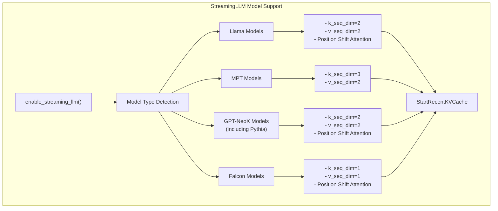
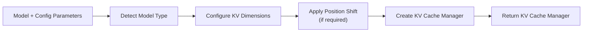
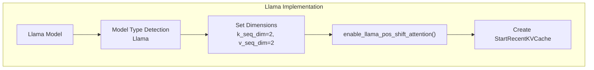
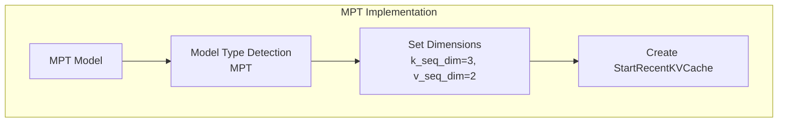
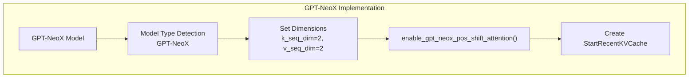
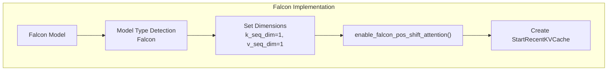
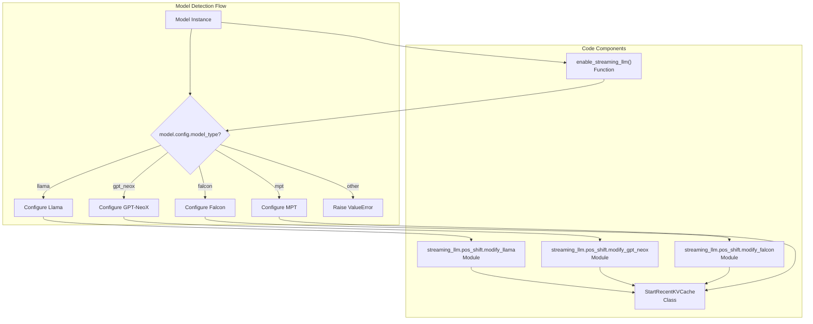

<!-- source: DeepWiki mcp.deepwiki.com · repo mit-han-lab/streaming-llm · page 3.1 Supported Models · fetched 2026-10-30 -->

# Supported Models

<details>
<summary>Relevant source files</summary>

The following files were used as context for generating this wiki page:

- [README.md](README.md)
- [streaming_llm/enable_streaming_llm.py](streaming_llm/enable_streaming_llm.py)

</details>


This page documents the language model architectures officially supported by StreamingLLM and how each model type is specifically implemented within the framework. For information about external integrations with other frameworks, see [External Integrations](#3.2).

## Model Compatibility Overview

StreamingLLM supports several popular open-source large language model architectures. Each model type requires specific adaptations to enable the attention sink mechanism and proper KV cache management.



*Model support architecture in StreamingLLM*

Sources: [streaming_llm/enable_streaming_llm.py:1-38](), [README.md:21-22]()

## Supported Model Types

StreamingLLM officially supports the following model architectures:

| Model Type | KV Dimensions | Position Shift Required | Notable Models |
|------------|---------------|-------------------------|----------------|
| Llama      | k_seq_dim=2, v_seq_dim=2 | Yes | Llama, Llama-2, Llama-2-7B-32K-Instruct |
| MPT        | k_seq_dim=3, v_seq_dim=2 | No  | MPT-7B, MPT-30B |
| GPT-NeoX   | k_seq_dim=2, v_seq_dim=2 | Yes | Pythia-7B, Pythia-12B |
| Falcon     | k_seq_dim=1, v_seq_dim=1 | Yes | Falcon-7B, Falcon-40B |

Sources: [streaming_llm/enable_streaming_llm.py:4-38](), [README.md:21-22](), [README.md:69]()

## Implementation Details

### Model Detection and Configuration

The `enable_streaming_llm` function serves as the primary entry point for enabling any supported model for streaming. It takes a model instance, along with parameters for attention sink configuration:



*Model detection and configuration flow*

Sources: [streaming_llm/enable_streaming_llm.py:4-38]()

### Model-Specific Implementations

#### Llama Models

Llama models require position shift attention modification to work effectively with streaming. The key and value tensors both use sequence dimension 2 (0-indexed).



*Llama model implementation*

Sources: [streaming_llm/enable_streaming_llm.py:5-11]()

#### MPT Models

MPT models have a different tensor structure compared to other models, with key tensors using sequence dimension 3 and value tensors using dimension 2.



*MPT model implementation*

Sources: [streaming_llm/enable_streaming_llm.py:12-14]()

#### GPT-NeoX Models (including Pythia)

GPT-NeoX-based models, including the Pythia family, require position shift attention modification similar to Llama. Both key and value tensors use sequence dimension 2.



*GPT-NeoX model implementation*

Sources: [streaming_llm/enable_streaming_llm.py:15-21]()

#### Falcon Models

Falcon models have a unique tensor structure with both key and value tensors using sequence dimension 1. They also require position shift attention modification.



*Falcon model implementation*

Sources: [streaming_llm/enable_streaming_llm.py:22-29]()

## Position Shift Attention

Three of the four supported model architectures require position shift attention modifications:

1. Llama - `enable_llama_pos_shift_attention()`
2. GPT-NeoX - `enable_gpt_neox_pos_shift_attention()`
3. Falcon - `enable_falcon_pos_shift_attention()`

Position shift attention is a critical component that allows these models to work with the attention sink mechanism. For more details on position shifting, see [Position Shifting](#2.3).

Sources: [streaming_llm/enable_streaming_llm.py:7-11](), [streaming_llm/enable_streaming_llm.py:17-21](), [streaming_llm/enable_streaming_llm.py:25-29]()

## KV Cache Configuration

After model detection and necessary modifications, a `StartRecentKVCache` instance is created with model-specific parameters:

```python
kv_cache = StartRecentKVCache(
    start_size=start_size,
    recent_size=recent_size,
    k_seq_dim=k_seq_dim,
    v_seq_dim=v_seq_dim,
)
```

The `start_size` and `recent_size` parameters control the attention sink behavior:
- `start_size`: Number of initial tokens to retain (attention sinks)
- `recent_size`: Number of most recent tokens to retain

For detailed information about KV cache management, see [Key-Value Cache Management](#2.2).

Sources: [streaming_llm/enable_streaming_llm.py:32-37]()

## Code to Model Integration Flow

The following diagram illustrates how the model detection and configuration system integrates with the actual code components:



*Code to model integration flow*

Sources: [streaming_llm/enable_streaming_llm.py:1-38]()

## Adding Support for New Models

To add support for a new model architecture in StreamingLLM, the following steps would be needed:

1. Determine the correct sequence dimensions for key and value tensors
2. Implement position shift attention if required
3. Add detection for the new model type in `enable_streaming_llm`

Support for new models would require modifications to the `enable_streaming_llm` function to handle the new model type and potentially the creation of a new module for position shift attention implementation.

Sources: [streaming_llm/enable_streaming_llm.py:4-38]()

---

