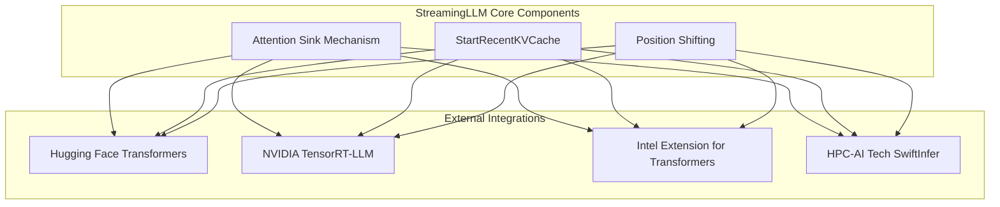
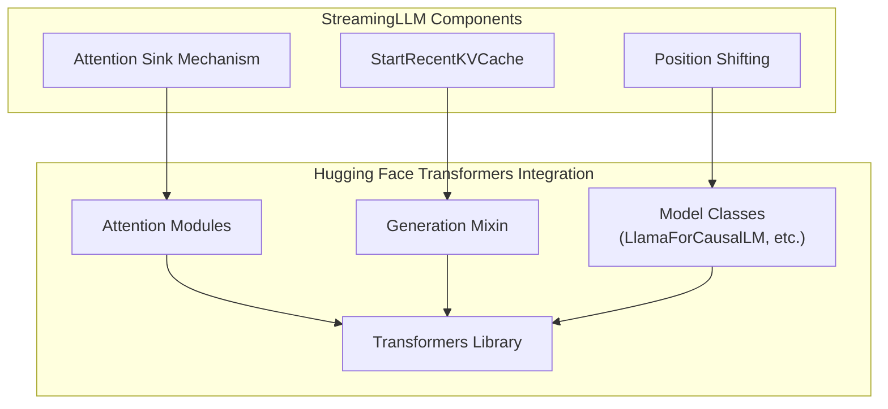
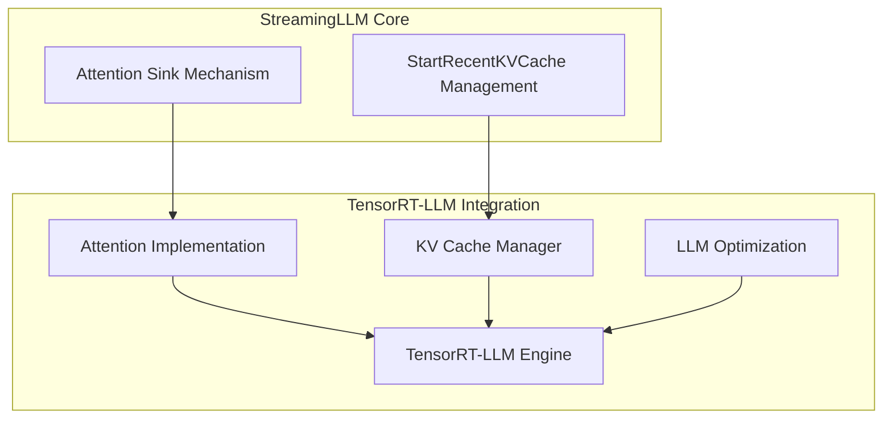
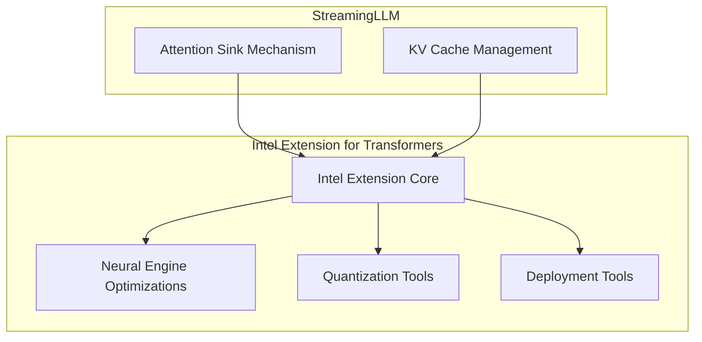
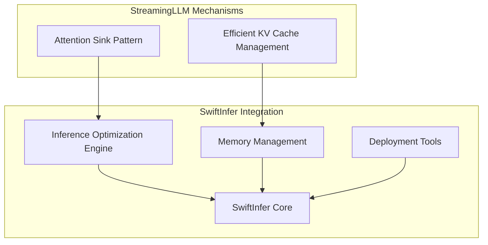
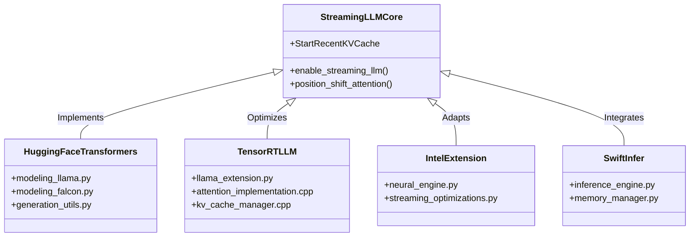
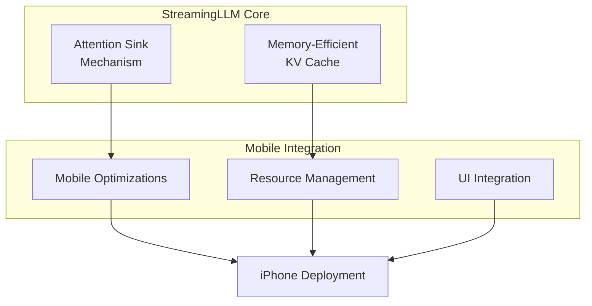

<!-- source: DeepWiki mcp.deepwiki.com · repo mit-han-lab/streaming-llm · page 3.2 External Integrations · fetched 2026-10-30 -->

# External Integrations

Relevant source files

The following files were used as context for generating this wiki page:

- [README.md](README.md)

This document provides a technical overview of how StreamingLLM integrates with external frameworks and libraries. StreamingLLM's architecture is designed with extensibility in mind, allowing it to be integrated into various machine learning frameworks and deployment environments. For information on the core architecture of StreamingLLM, see [System Architecture](#3) and for specific model implementations, see [Supported Models](#3.1).

## Integration Overview

StreamingLLM has been adopted by several major machine learning frameworks and acceleration libraries. These integrations demonstrate the practical applicability of the attention sink mechanism and extend the reach of StreamingLLM's capabilities to different deployment scenarios.

*Diagram: StreamingLLM Integration Overview*

Sources: [README.md:14-18]()

## Hugging Face Transformers Integration

The Hugging Face Transformers library is one of the most widely used frameworks for working with transformer-based models. The integration of StreamingLLM into Transformers allows users to leverage the attention sink mechanism within the familiar Hugging Face ecosystem.

*Diagram: Hugging Face Transformers Integration*

The integration with Hugging Face Transformers was completed in December 2023 (PR #26681). This integration allows users to:

1. Use StreamingLLM's attention sink mechanism directly with Hugging Face model implementations
2. Take advantage of the infinite-context capabilities while maintaining compatibility with the Transformers API
3. Apply the technique to various model architectures supported by both frameworks

Sources: [README.md:17]()

## NVIDIA TensorRT-LLM Integration

TensorRT-LLM is NVIDIA's framework for optimizing and deploying LLMs on NVIDIA GPUs. The integration of StreamingLLM with TensorRT-LLM enables efficient streaming capabilities with hardware-accelerated inference.

*Diagram: NVIDIA TensorRT-LLM Integration*

The TensorRT-LLM integration was announced in January 2024. Key aspects of this integration include:

1. Hardware-optimized implementation of the attention sink mechanism
2. Efficient KV cache management optimized for NVIDIA GPUs
3. Support for Llama models with streaming capabilities
4. Significant performance improvements for long-context generation

This integration is particularly valuable for production deployments where latency and throughput are critical concerns.

Sources: [README.md:15]()

## Intel Extension for Transformers Integration

The Intel Extension for Transformers is a toolkit designed to optimize transformer-based models for Intel hardware. The integration of StreamingLLM with this extension provides optimized performance on Intel processors.

*Diagram: Intel Extension for Transformers Integration*

This integration, announced in October 2023, provides:

1. Optimized implementation of StreamingLLM for Intel hardware
2. Integration with Intel's quantization tools for model compression
3. Enhanced performance on Intel CPUs and accelerators
4. Compatibility with Intel's deployment ecosystem

Sources: [README.md:18]()

## HPC-AI Tech SwiftInfer Integration

SwiftInfer is an inference optimization framework developed by HPC-AI Tech. The integration with StreamingLLM extends SwiftInfer's capabilities to handle infinite-length inputs.

*Diagram: SwiftInfer Integration*

The integration with SwiftInfer, announced in January 2024, provides:

1. Support for infinite input length during LLM inference
2. Optimized memory management for streaming scenarios
3. Enhanced performance for continuous dialogue applications
4. Compatibility with SwiftInfer's deployment ecosystem

Sources: [README.md:14]()

## Integration Architecture

The following diagram illustrates how external frameworks interact with StreamingLLM's core components:

*Diagram: StreamingLLM Integration Architecture*

The core StreamingLLM functionality provides the foundation for all integrations. Each external framework implements these core mechanisms in a way that is compatible with their specific architecture and optimized for their target hardware.

Sources: [README.md:14-18]()

## Integration Benefits and Use Cases

Each integration brings unique benefits and is suited for different deployment scenarios:

| Integration | Key Benefits | Best For |
|-------------|--------------|----------|
| Hugging Face Transformers | Easy to use, wide model support, research-friendly | Research, experimentation, model fine-tuning |
| NVIDIA TensorRT-LLM | GPU-optimized, high throughput, production-ready | Production deployments, high-performance applications |
| Intel Extension for Transformers | CPU-optimized, efficient on Intel hardware | Edge deployments, CPU-based inference |
| HPC-AI Tech SwiftInfer | Optimized for long sequences, memory-efficient | Long-context applications, continuous dialogue systems |

## Mobile and Edge Device Integration

StreamingLLM's efficient memory management makes it particularly suitable for resource-constrained environments such as mobile devices. As mentioned in the README, integration work has been done to enable StreamingLLM on iPhones through collaboration with CMU, UW, and OctoAI.

*Diagram: Mobile Integration Architecture*

The mobile integration showcases how StreamingLLM's efficient design enables LLM deployment in environments where memory and computational resources are limited.

Sources: [README.md:16]()

## Integration Implementation Notes

When integrating StreamingLLM with external frameworks, developers typically need to:

1. Implement the attention sink mechanism in the framework's attention implementation
2. Adapt the KV cache management to work with the framework's memory management system
3. Modify position encoding to support the position shift technique
4. Ensure compatibility with the framework's inference pipeline

These integrations demonstrate the versatility and practical applicability of the StreamingLLM approach, enabling efficient streaming capabilities across a wide range of deployment scenarios.

---

