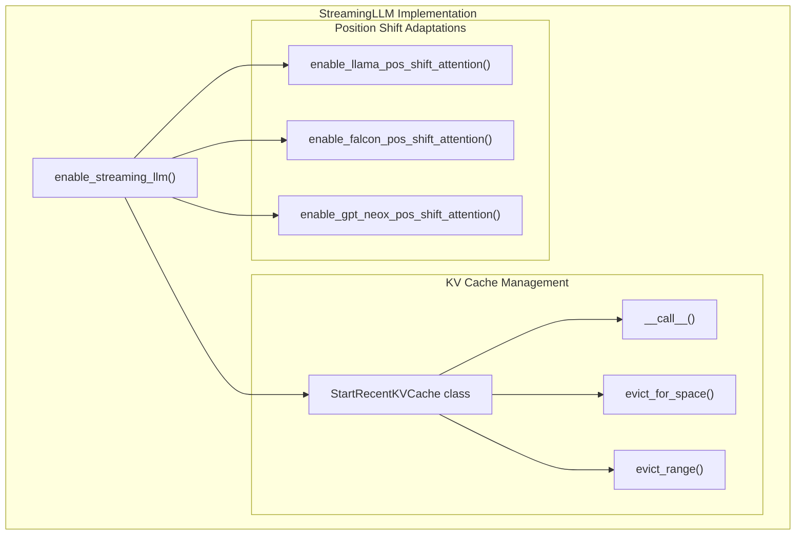
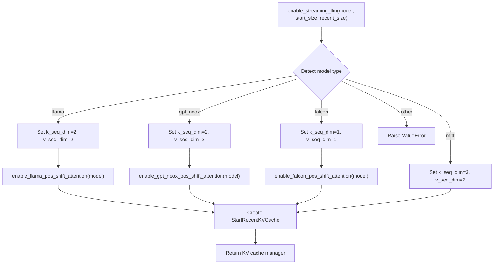
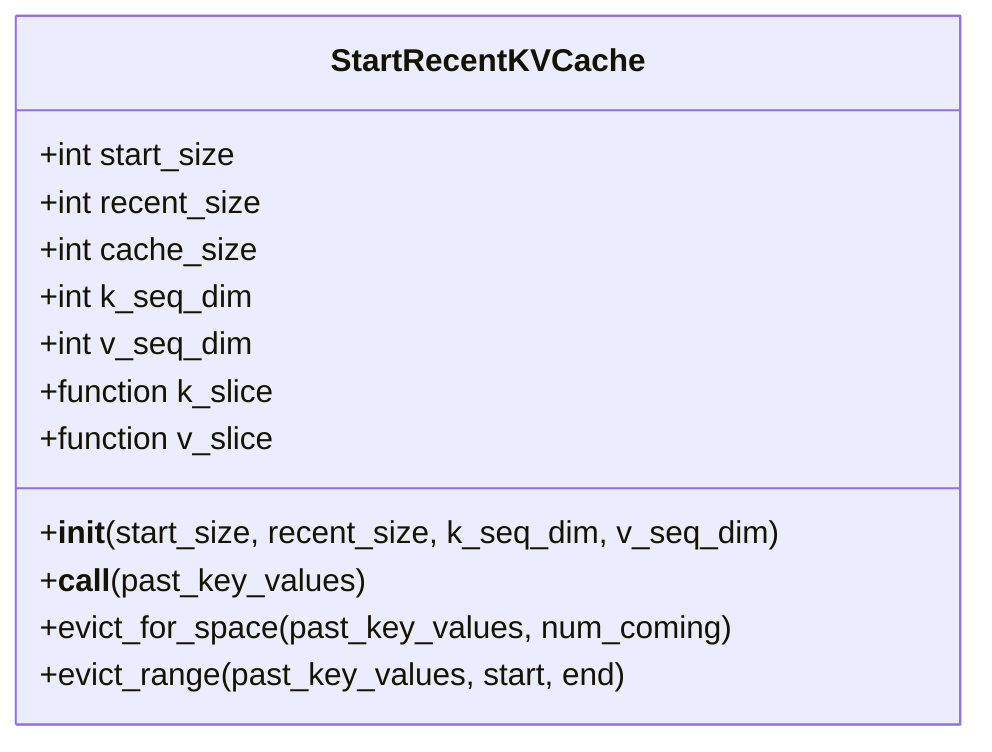
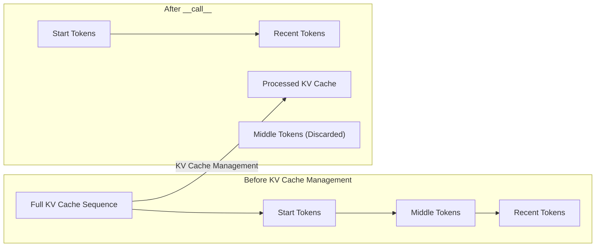
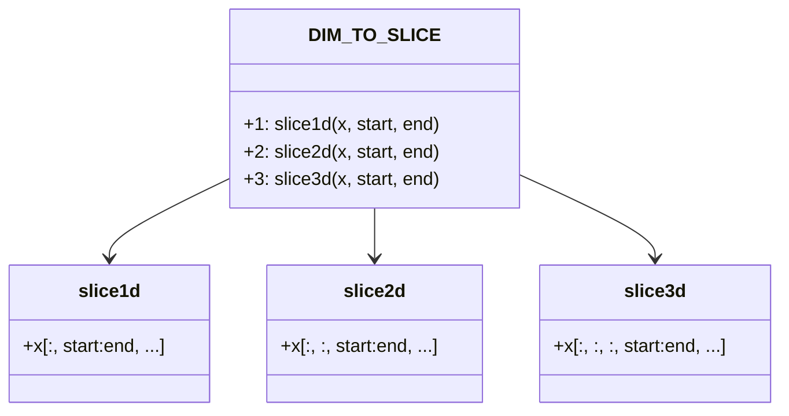
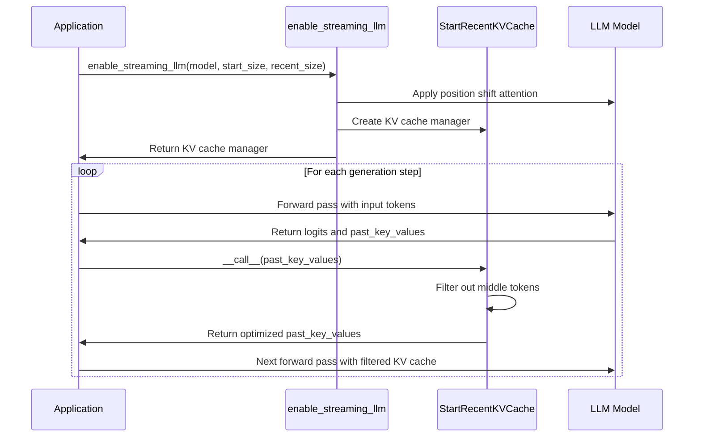
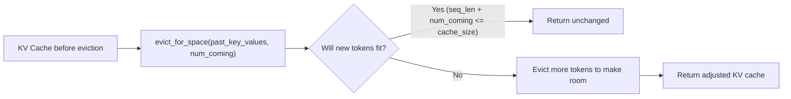
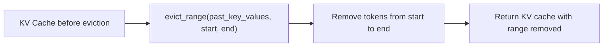

<!-- source: DeepWiki mcp.deepwiki.com · repo mit-han-lab/streaming-llm · page 4 Implementation · fetched 2026-10-30 -->

# Implementation

<details>
<summary>Relevant source files</summary>

The following files were used as context for generating this wiki page:

- [streaming_llm/__init__.py](streaming_llm/__init__.py)
- [streaming_llm/enable_streaming_llm.py](streaming_llm/enable_streaming_llm.py)
- [streaming_llm/kv_cache.py](streaming_llm/kv_cache.py)

</details>


This page explains the low-level implementation details of StreamingLLM, focusing on the core code structures that enable efficient long context processing through attention sink mechanisms and KV cache management. For core concepts behind these techniques, see [Core Concepts](#2), and for usage examples, see [Usage Examples](#5).

## Core Implementation Structure

StreamingLLM's implementation consists of two primary components:

1. **Key-Value Cache Management** - Handles selective retention of tokens in the KV cache
2. **Position Shift Attention** - Adapts different model architectures to work with the modified KV cache



Sources: [streaming_llm/enable_streaming_llm.py](), [streaming_llm/kv_cache.py]()

## Entry Point: enable_streaming_llm

The main entry point for enabling streaming capabilities is the `enable_streaming_llm()` function. This function:

1. Detects the model type
2. Configures the appropriate attention mechanism
3. Creates a KV cache manager with proper dimensions
4. Returns the cache manager for later use



Sources: [streaming_llm/enable_streaming_llm.py:4-38]()

The function determines the appropriate sequence dimensions for key and value tensors based on the model architecture, which is critical for correctly manipulating the KV cache tensors.

## StartRecentKVCache Implementation

The `StartRecentKVCache` class implements the core attention sink mechanism by managing which tokens are kept in the KV cache.

### Class Structure and Initialization



Sources: [streaming_llm/kv_cache.py:23-36]()

The `StartRecentKVCache` is initialized with:
- `start_size`: Number of initial tokens to keep (attention sinks)
- `recent_size`: Number of most recent tokens to keep
- `k_seq_dim`: Dimension for key tensors in the KV cache (varies by model architecture)
- `v_seq_dim`: Dimension for value tensors in the KV cache (varies by model architecture)

### KV Cache Operations

The class provides three main operations:

1. **Basic Cache Filtering** (`__call__`): Filters the KV cache to keep only start tokens and recent tokens
2. **Preemptive Eviction** (`evict_for_space`): Makes space for new tokens before they're generated
3. **Range Eviction** (`evict_range`): Removes a specific range of tokens from the cache



Sources: [streaming_llm/kv_cache.py:40-64]()

The `__call__` method implementation:
1. Checks if the sequence length exceeds the cache size (start + recent)
2. If not, returns the cache unchanged
3. If yes, slices and concatenates the key and value tensors to keep only the initial `start_size` tokens and the last `recent_size` tokens

```python
# Pseudo-implementation of __call__ method
def __call__(self, past_key_values):
    if past_key_values is None or seq_len <= self.cache_size:
        return past_key_values
    
    # For each layer's key and value
    return [
        [
            # Keep start tokens and recent tokens for keys
            torch.cat([k[:,:,0:start_size], k[:,:,seq_len-recent_size:seq_len]], dim=seq_dim),
            # Keep start tokens and recent tokens for values
            torch.cat([v[:,:,0:start_size], v[:,:,seq_len-recent_size:seq_len]], dim=seq_dim),
        ]
        for k, v in past_key_values
    ]
```

### Dimension-Specific Slicing

An important implementation detail is how tensor slicing is handled for different model architectures. The class uses the `DIM_TO_SLICE` dictionary to map sequence dimensions to the appropriate slicing function:



Sources: [streaming_llm/kv_cache.py:4-20]()

This abstraction allows the cache management code to work with different model architectures where the sequence dimension may be at different positions in the tensor.

## Model-Specific Adaptations

StreamingLLM implements model-specific position-shift adaptations for various architectures:

| Model Architecture | K Sequence Dimension | V Sequence Dimension | Position Shift Function |
|--------------------|----------------------|----------------------|------------------------|
| Llama              | 2                    | 2                    | `enable_llama_pos_shift_attention` |
| MPT                | 3                    | 2                    | (No specific adaptation) |
| GPT-NeoX           | 2                    | 2                    | `enable_gpt_neox_pos_shift_attention` |
| Falcon             | 1                    | 1                    | `enable_falcon_pos_shift_attention` |

Sources: [streaming_llm/enable_streaming_llm.py:4-29]()

These adaptations modify the attention mechanism of each model to work with a non-contiguous KV cache (with attention sinks and recent tokens only).

## Implementation Workflow

The following sequence diagram shows how the StreamingLLM implementation handles a typical inference workflow:



Sources: [streaming_llm/enable_streaming_llm.py](), [streaming_llm/kv_cache.py]()

## Handling Special Cases in KV Cache Management

The `evict_for_space` and `evict_range` methods handle special cases in KV cache management:

### Preemptive Eviction

The `evict_for_space` method makes room for new tokens before they're added:



Sources: [streaming_llm/kv_cache.py:66-94]()

### Range Eviction

The `evict_range` method removes a specific range of tokens:



Sources: [streaming_llm/kv_cache.py:96-119]()

This method can be useful for applications that need more control over which tokens to keep or discard.

## Implementation Details Summary

The StreamingLLM implementation achieves efficient long context processing through:

1. **Selective KV Cache Management**: Implemented in `StartRecentKVCache` to keep only the most important tokens
2. **Model-Specific Adaptations**: Position shift functions that modify attention mechanisms for different architectures
3. **Dimension-Agnostic Operations**: Helper functions that handle tensor slicing regardless of architecture-specific tensor dimensions

The implementation is designed to be:
- Modular: Works with multiple model architectures
- Efficient: Minimizes memory usage while maintaining model performance
- Simple: Easy to integrate with existing LLM pipelines

For more information on using these implementations, see [Usage Examples](#5).

---

