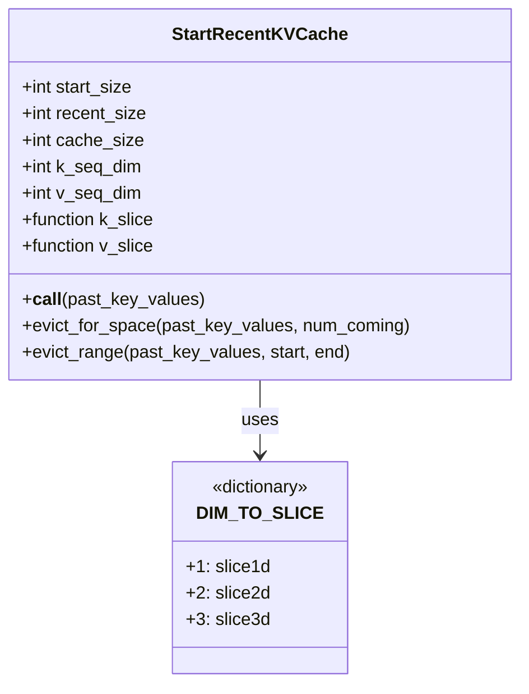
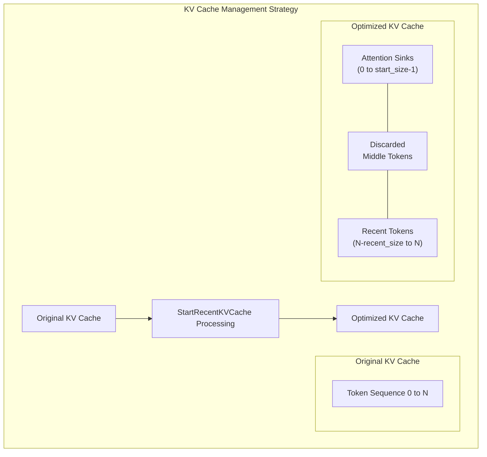
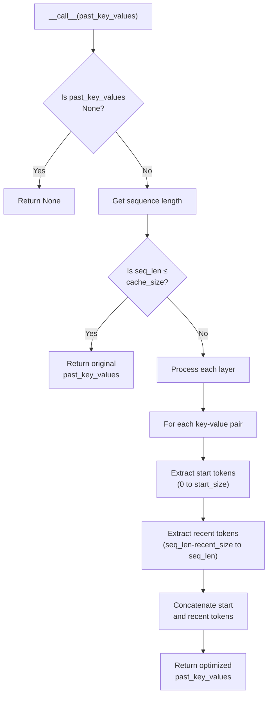
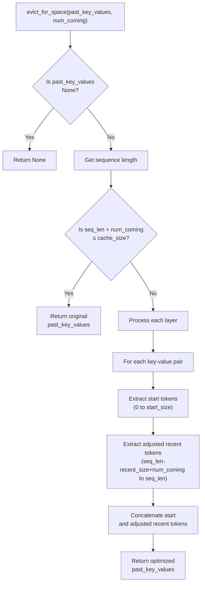
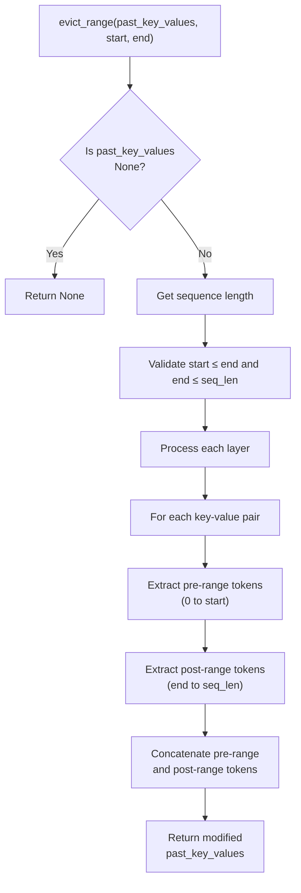
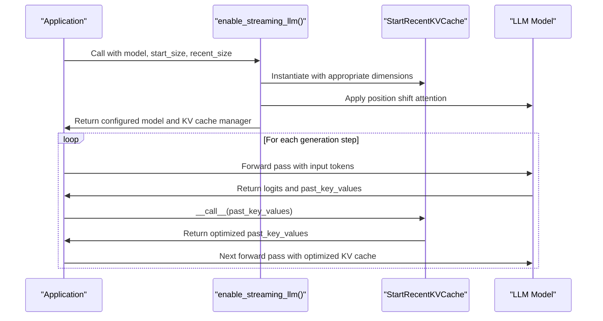

<!-- source: DeepWiki mcp.deepwiki.com · repo mit-han-lab/streaming-llm · page 4.1 StartRecentKVCache Implementation · fetched 2026-10-30 -->

# StartRecentKVCache Implementation

<details>
<summary>Relevant source files</summary>

The following files were used as context for generating this wiki page:

- [streaming_llm/kv_cache.py](streaming_llm/kv_cache.py)

</details>


## Purpose and Overview

This document details the implementation of the `StartRecentKVCache` class, which is the core component responsible for efficient key-value cache management in the StreamingLLM framework. This class enables processing of sequences much longer than the model's training context by selectively retaining only the most important tokens in the KV cache.

For information about the general concept of attention sinks and KV cache management, see [Key-Value Cache Management](#2.2) and [Attention Sink Mechanism](#2.1).

## Class Architecture

The `StartRecentKVCache` class is implemented in the `kv_cache.py` file and maintains two critical portions of the key-value cache:

1. **Attention Sinks**: The initial `start_size` tokens that serve as anchors for attention
2. **Recent Context**: The most recent `recent_size` tokens that provide immediate context



Sources: [streaming_llm/kv_cache.py:23-39]()

## KV Cache Management Strategy

The core innovation in `StartRecentKVCache` is the strategy of keeping only the essential portions of the sequence while discarding the middle portion, which is less critical for maintaining coherent generation.



Sources: [streaming_llm/kv_cache.py:40-64]()

## Initialization

The `StartRecentKVCache` is initialized with parameters that define its behavior:

```python
StartRecentKVCache(
    start_size=4,     # Number of initial tokens to keep (attention sinks)
    recent_size=512,  # Number of recent tokens to keep
    k_seq_dim=2,      # Dimension of the sequence in key tensor
    v_seq_dim=2       # Dimension of the sequence in value tensor
)
```

The initialization sets up:
- The sizes for the attention sinks and recent tokens
- The total cache size (`start_size + recent_size`)
- The appropriate slicing functions based on tensor dimensions

Sources: [streaming_llm/kv_cache.py:23-38]()

## Core Methods

### 1. `__call__` Method

The `__call__` method is the primary interface for managing the KV cache. It takes the current `past_key_values` and returns an optimized version by:

1. Checking if the sequence length exceeds the cache size
2. If it does, trimming the KV cache to retain only:
   - The first `start_size` tokens
   - The most recent `recent_size` tokens



Sources: [streaming_llm/kv_cache.py:40-64]()

### 2. `evict_for_space` Method

The `evict_for_space` method is used to preemptively make space for new tokens to be added to the KV cache:

1. Takes the current `past_key_values` and `num_coming` (number of new tokens)
2. If the combined length would exceed the cache size, it evicts more tokens from the recent portion
3. Returns a modified KV cache with sufficient space for the new tokens



Sources: [streaming_llm/kv_cache.py:66-94]()

### 3. `evict_range` Method

The `evict_range` method provides a more flexible approach to KV cache management by allowing the removal of a specific range of tokens:

1. Takes the current `past_key_values` and a range defined by `start` and `end`
2. Removes all tokens between the specified `start` and `end` indices
3. Returns a modified KV cache with the specified range removed



Sources: [streaming_llm/kv_cache.py:96-119]()

## Tensor Slicing Utilities

The `StartRecentKVCache` uses helper functions for slicing tensors with different dimensionality structures. These functions are necessary because different model architectures (Llama, Falcon, etc.) may have different tensor shapes for their key and value states.

```mermaid
classDiagram
    class "DIM_TO_SLICE Dictionary" {
        +1: slice1d()
        +2: slice2d()
        +3: slice3d()
    }
    
    class "slice1d" {
        +function(x, start, end)
        Returns x[:, start:end, ...]
    }
    
    class "slice2d" {
        +function(x, start, end)
        Returns x[:, :, start:end, ...]
    }
    
    class "slice3d" {
        +function(x, start, end)
        Returns x[:, :, :, start:end, ...]
    }
    
    "DIM_TO_SLICE Dictionary" --> "slice1d" : maps dimension 1 to
    "DIM_TO_SLICE Dictionary" --> "slice2d" : maps dimension 2 to
    "DIM_TO_SLICE Dictionary" --> "slice3d" : maps dimension 3 to
```

Sources: [streaming_llm/kv_cache.py:4-20]()

## Integration in the StreamingLLM Framework

The `StartRecentKVCache` class is a critical component in the StreamingLLM framework. It is typically instantiated by the `enable_streaming_llm` function and then used during the inference process to efficiently manage the KV cache.



## Memory Efficiency Analysis

The memory savings from using `StartRecentKVCache` are substantial when processing long sequences. For a sequence of length N, a traditional LLM would store the entire KV cache of size N, while StreamingLLM with `StartRecentKVCache` only stores `start_size + recent_size` tokens.

| Sequence Length | Traditional KV Cache Size | StartRecentKVCache Size (start_size=4, recent_size=512) | Memory Reduction |
|----------------:|--------------------------:|--------------------------------------------------------:|----------------:|
| 1,000           | 1,000                     | 516                                                      | 48.4%           |
| 10,000          | 10,000                    | 516                                                      | 94.8%           |
| 100,000         | 100,000                   | 516                                                      | 99.5%           |
| 1,000,000       | 1,000,000                 | 516                                                      | 99.9%           |

Sources: [streaming_llm/kv_cache.py:23-39]()

## Implementation Considerations

When using `StartRecentKVCache`, there are several important considerations:

1. **Model Compatibility**: Different models require different values for `k_seq_dim` and `v_seq_dim` based on their architecture.

2. **Attention Sink Size**: The `start_size` parameter should be tuned based on the model. Typically, 4 tokens are sufficient, but some models may benefit from different values.

3. **Recent Context Size**: The `recent_size` parameter determines how much recent context is available to the model. Larger values provide more context but consume more memory.

4. **Performance Impact**: While `StartRecentKVCache` reduces memory usage, the concatenation operations introduce some computational overhead. However, this is generally negligible compared to the benefits of processing longer sequences.

Sources: [streaming_llm/kv_cache.py:23-39]()

## Conclusion

The `StartRecentKVCache` class is a fundamental component of the StreamingLLM framework, enabling efficient management of the KV cache for processing sequences of arbitrary length. By selectively retaining only the attention sinks and most recent tokens, it dramatically reduces memory usage while maintaining generation quality.

This implementation demonstrates how simple yet effective techniques can overcome the context length limitations of large language models without requiring model retraining or architectural changes.

---

