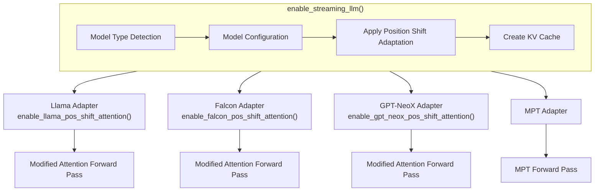
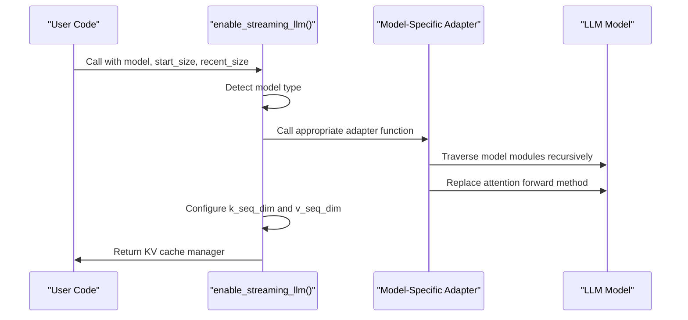
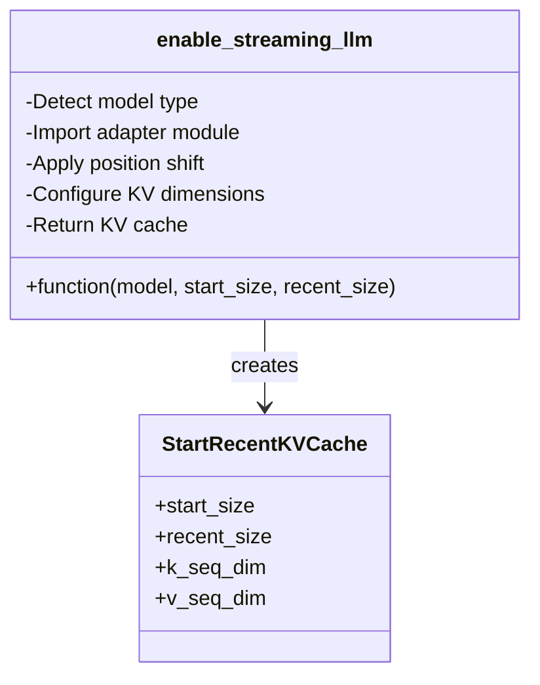
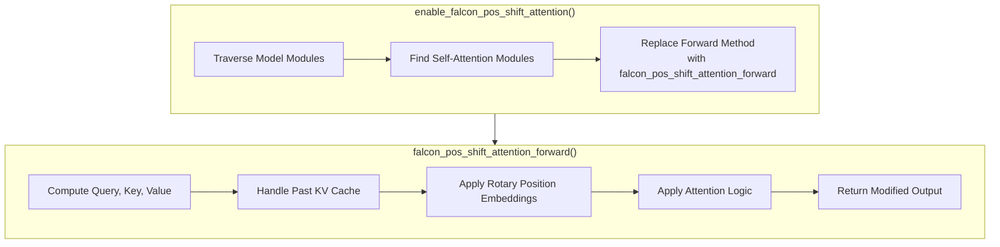
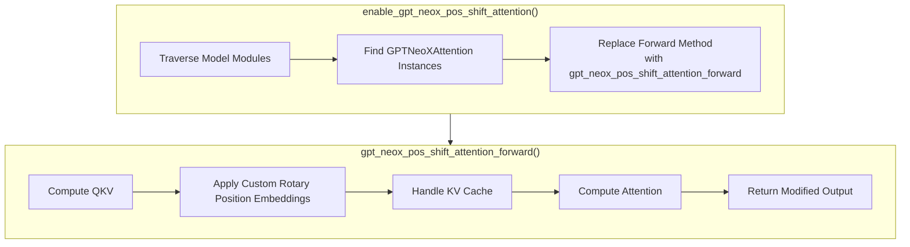
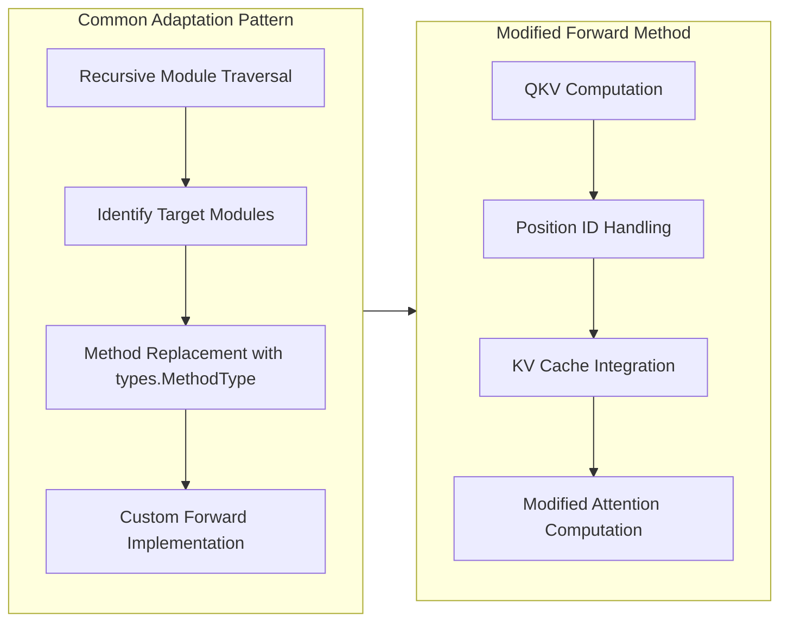

<!-- source: DeepWiki mcp.deepwiki.com · repo mit-han-lab/streaming-llm · page 4.2 Model-Specific Adaptations · fetched 2026-10-30 -->

# Model-Specific Adaptations

Relevant source files

The following files were used as context for generating this wiki page:

- [streaming_llm/enable_streaming_llm.py](streaming_llm/enable_streaming_llm.py)
- [streaming_llm/pos_shift/modify_falcon.py](streaming_llm/pos_shift/modify_falcon.py)
- [streaming_llm/pos_shift/modify_gpt_neox.py](streaming_llm/pos_shift/modify_gpt_neox.py)

This document covers how StreamingLLM adapts to different model architectures to implement its long-context streaming capabilities. The framework supports several LLM architectures, each requiring specific modifications to work with the attention sink mechanism. For information about the attention sink mechanism itself, see [Attention Sink Mechanism](#2.1) and for KV cache management, see [Key-Value Cache Management](#2.2).

## Adaptation Overview

StreamingLLM needs to make low-level modifications to each supported model's attention mechanism to implement position shifting and attention sink handling. These adaptations are necessary to properly maintain attention states when processing sequences longer than the model's training context window.

Sources: [streaming_llm/enable_streaming_llm.py:4-38]()

## Supported Models and Configurations

StreamingLLM currently supports the following model architectures, each with specific key-value cache dimension configurations:

| Model Architecture | K Sequence Dimension | V Sequence Dimension | Implementation File |
|-------------------|----------------------|----------------------|---------------------|
| Llama / Llama-2   | 2                    | 2                    | modify_llama.py     |
| MPT               | 3                    | 2                    | (special handling)  |
| GPT-NeoX / Pythia | 2                    | 2                    | modify_gpt_neox.py  |
| Falcon            | 1                    | 1                    | modify_falcon.py    |

These dimensions are crucial for properly managing the key-value cache when implementing the attention sink mechanism.

Sources: [streaming_llm/enable_streaming_llm.py:4-31]()

## Adaptation Implementation Pattern

StreamingLLM follows a consistent pattern to adapt different model architectures:

Sources: [streaming_llm/enable_streaming_llm.py:4-38](), [streaming_llm/pos_shift/modify_falcon.py:152-162](), [streaming_llm/pos_shift/modify_gpt_neox.py:99-109]()

## Main Adaptation Entrypoint

The `enable_streaming_llm` function serves as the central entrypoint for applying model adaptations. It:

1. Detects the model type from `model.config.model_type`
2. Imports and applies the appropriate position shift adapter
3. Configures the key-value sequence dimensions
4. Creates and returns a `StartRecentKVCache` instance

Sources: [streaming_llm/enable_streaming_llm.py:4-38]()

## Model-Specific Adapters

### Llama Adapter

For Llama models, StreamingLLM imports `enable_llama_pos_shift_attention` from `streaming_llm.pos_shift.modify_llama` and applies it to the model. The Llama models use k_seq_dim and v_seq_dim both set to 2.

Sources: [streaming_llm/enable_streaming_llm.py:5-11]()

### Falcon Adapter

Falcon models use a unique attention implementation that requires special handling:

Key adaptations for Falcon models:
- k_seq_dim and v_seq_dim are both set to 1
- Includes special handling for different Falcon model sizes (7B vs 40B)
- Supports both alibi and non-alibi attention variants
- Specifically modifies modules that end with "self_attention"

Sources: [streaming_llm/enable_streaming_llm.py:22-29](), [streaming_llm/pos_shift/modify_falcon.py:19-149](), [streaming_llm/pos_shift/modify_falcon.py:152-162]()

### GPT-NeoX Adapter

GPT-NeoX models (including Pythia) have their attention mechanism modified as follows:

Key adaptations for GPT-NeoX models:
- k_seq_dim and v_seq_dim are both set to 2
- Implements a custom `apply_rotary_pos_emb_single` function
- Requires special handling of rotary embeddings for both query and key

Sources: [streaming_llm/enable_streaming_llm.py:15-21](), [streaming_llm/pos_shift/modify_gpt_neox.py:20-96](), [streaming_llm/pos_shift/modify_gpt_neox.py:99-109]()

### MPT Adapter

MPT models have special key-value cache dimensions (k_seq_dim=3, v_seq_dim=2) but don't require the same level of position shifting adaptations as other models.

Sources: [streaming_llm/enable_streaming_llm.py:12-14]()

## Common Adaptation Patterns

Despite architectural differences, there are common patterns in the model adaptations:

1. **Module Traversal** - Each adapter recursively traverses the model modules to find attention components
2. **Forward Method Replacement** - The original attention forward method is replaced with a custom implementation
3. **Position ID Handling** - Special handling for position IDs to support longer-than-trained contexts
4. **KV Cache Integration** - Integration with the past_key_values mechanism for efficient caching
5. **Model-Specific Dimensions** - Each model requires specific key-value sequence dimensions

Sources: [streaming_llm/pos_shift/modify_falcon.py:152-162](), [streaming_llm/pos_shift/modify_gpt_neox.py:99-109]()

## Extending to New Model Architectures

To add support for a new model architecture, you would need to:

1. Create a new module in `streaming_llm/pos_shift/` (e.g., `modify_new_model.py`)
2. Implement an `enable_new_model_pos_shift_attention` function
3. Create a custom forward implementation for the model's attention mechanism
4. Update `enable_streaming_llm` to detect the new model type and set appropriate KV dimensions
5. Import and call your new adaptation function

This extensible design allows StreamingLLM to support a wide range of model architectures while maintaining a consistent interface.

Sources: [streaming_llm/enable_streaming_llm.py:4-38](), [streaming_llm/pos_shift/modify_falcon.py:152-162](), [streaming_llm/pos_shift/modify_gpt_neox.py:99-109]()

---

