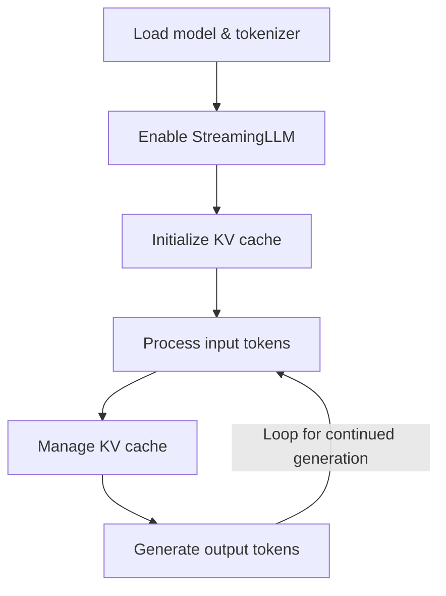
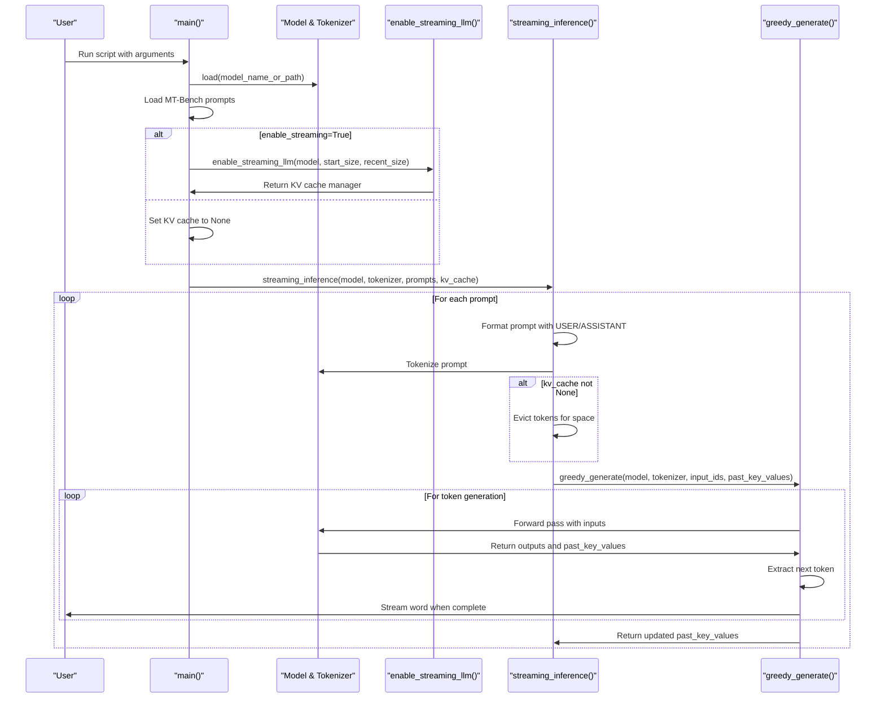
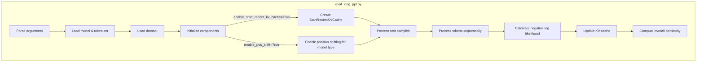
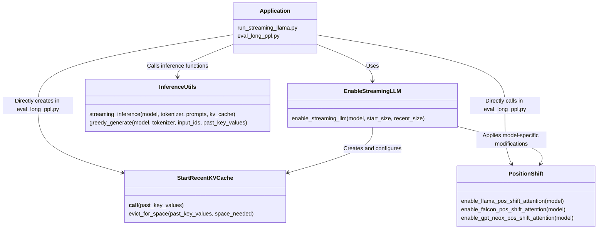

<!-- source: DeepWiki mcp.deepwiki.com · repo mit-han-lab/streaming-llm · page 5 Usage Examples · fetched 2026-10-30 -->

# Usage Examples

<details>
<summary>Relevant source files</summary>

The following files were used as context for generating this wiki page:

- [examples/eval_long_ppl.py](examples/eval_long_ppl.py)
- [examples/run_streaming_llama.py](examples/run_streaming_llama.py)

</details>


This page provides practical examples of how to use StreamingLLM in real-world applications. These examples demonstrate the implementation of StreamingLLM's core concepts and components in specific scenarios, showing you how to leverage the framework's capabilities for different use cases.

For information about the core concepts behind StreamingLLM, see [Core Concepts](#2). For details on the specific implementation of components, see [Implementation](#4).

## Basic Usage Pattern

Before diving into specific examples, let's understand the general pattern for using StreamingLLM:



The typical usage pattern involves:

1. Loading a model and tokenizer
2. Enabling StreamingLLM for the model with appropriate parameters
3. Processing inputs and managing the KV cache efficiently
4. Generating output tokens while maintaining only the necessary tokens in memory

Sources: [examples/run_streaming_llama.py:96-108](), [examples/eval_long_ppl.py:22-42]()

## Example 1: Streaming Llama Chatbot

The `run_streaming_llama.py` example demonstrates how to build a streaming chatbot using StreamingLLM with Llama (or any other supported model).



### Key Components

1. **Model Loading**: The script first loads the specified model and tokenizer:
   ```python
   model, tokenizer = load(model_name_or_path)
   ```

2. **Enabling StreamingLLM**: If streaming is enabled, the model is configured with StreamingLLM:
   ```python
   kv_cache = enable_streaming_llm(model, start_size=args.start_size, recent_size=args.recent_size)
   ```
   - `start_size`: Number of initial tokens to keep as attention sinks
   - `recent_size`: Number of recent tokens to keep in the KV cache

3. **Streaming Inference**: The main generation loop processes prompts and generates responses:
   ```python
   streaming_inference(model, tokenizer, prompts, kv_cache)
   ```

4. **KV Cache Management**: For long contexts, the KV cache evicts tokens as needed:
   ```python
   past_key_values = kv_cache.evict_for_space(past_key_values, space_needed)
   ```

5. **Token Generation**: Tokens are generated greedily and streamed to the output:
   ```python
   past_key_values = greedy_generate(model, tokenizer, input_ids, past_key_values, max_gen_len)
   ```

### Running the Example

To run the streaming Llama chatbot:

```bash
# Without streaming (standard KV cache)
python examples/run_streaming_llama.py --model_name_or_path lmsys/vicuna-13b-v1.3

# With streaming enabled
python examples/run_streaming_llama.py --model_name_or_path lmsys/vicuna-13b-v1.3 --enable_streaming --start_size 4 --recent_size 2000
```

Sources: [examples/run_streaming_llama.py:1-123]()

## Example 2: Evaluating Long Context Performance

The `eval_long_ppl.py` example demonstrates how to evaluate language model performance on long contexts using perplexity metrics. This example is particularly useful for testing how well a model handles sequences much longer than its training context window.



### Key Components

1. **Initialization**: The script loads a model, tokenizer, and dataset:
   ```python
   model, tokenizer = load(args.model_name_or_path)
   data = load_dataset(args.dataset_name, args.task, split=args.split)
   ```

2. **KV Cache Configuration**: Model-specific configuration for the KV cache:
   ```python
   kv_cache = StartRecentKVCache(
       start_size=args.start_size,
       recent_size=args.recent_size,
       k_seq_dim=k_seq_dim,
       v_seq_dim=v_seq_dim,
   )
   ```

3. **Position Shift Enabling**: Model-specific position shifting is enabled:
   ```python
   # For Llama models
   enable_llama_pos_shift_attention(model)
   
   # For Falcon models
   enable_falcon_pos_shift_attention(model)
   
   # For GPT-NeoX models
   enable_gpt_neox_pos_shift_attention(model)
   ```

4. **Token-by-Token Processing**: The script processes text token by token, calculating perplexity:
   ```python
   for idx in pbar:
       input_ids = encodings.input_ids[:, idx : idx + 1].to(device)
       with torch.no_grad():
           outputs = model(input_ids, past_key_values=past_key_values, use_cache=True)
           # Calculate loss and update KV cache
           if kv_cache is not None:
               past_key_values = kv_cache(past_key_values)
   ```

5. **Perplexity Calculation**: Final perplexity is computed from the negative log likelihoods:
   ```python
   ppl = torch.exp(torch.stack(nlls).mean())
   ```

### Running the Example

To evaluate a model on long contexts:

```bash
python examples/eval_long_ppl.py \
    --model_name_or_path meta-llama/Llama-2-7b-hf \
    --dataset_name lm-eval \
    --task wikitext \
    --enable_start_recent_kv_cache \
    --enable_pos_shift \
    --start_size 4 \
    --recent_size 2000 \
    --output_dir results/llama-2-7b-streaming
```

Sources: [examples/eval_long_ppl.py:1-111]()

## Common Usage Patterns

Here's a comparison of key parameters and settings when using StreamingLLM in different scenarios:

| Parameter | Streaming Chatbot | Long Context Evaluation | Description |
|-----------|-------------------|-------------------------|-------------|
| `start_size` | 4 | 4 | Number of initial tokens to keep as attention sinks |
| `recent_size` | 2000 | 2000 | Number of recent tokens to maintain in KV cache |
| Position Shift | Applied via `enable_streaming_llm` | Manually enabled | Modification of attention mechanism |
| KV Cache | Created via `enable_streaming_llm` | Manually created | Management of key-value cache |
| Model Support | Automatic detection | Manual configuration | Handling of model-specific parameters |

### Key Implementation Components

The diagram below shows how the example applications interact with the core StreamingLLM components:



Sources: [examples/run_streaming_llama.py:96-101](), [examples/eval_long_ppl.py:22-42](), [examples/eval_long_ppl.py:44-64]()

## Best Practices and Tips

When using StreamingLLM in your applications, consider the following best practices:

1. **Parameter Tuning**:
   - Adjust `start_size` and `recent_size` based on your specific use case
   - For most applications, `start_size=4` works well as an attention sink
   - Set `recent_size` based on available memory and the nature of your task

2. **Model Selection**:
   - StreamingLLM works with various model architectures (Llama, Falcon, GPT-NeoX, MPT)
   - Each model may have different optimal settings

3. **Memory Management**:
   - For extremely long contexts, monitor memory usage and adjust parameters accordingly
   - Use `evict_for_space` when processing very long sequences

4. **Integration Flow**:
   - First load your model
   - Enable StreamingLLM with appropriate parameters
   - Process inputs and manage the KV cache efficiently
   - Generate outputs while maintaining only necessary tokens in memory

By following these examples and best practices, you can effectively implement StreamingLLM in your applications for efficient processing of long context sequences.

Sources: [examples/run_streaming_llama.py:60-76](), [examples/eval_long_ppl.py:70-103]()

---

