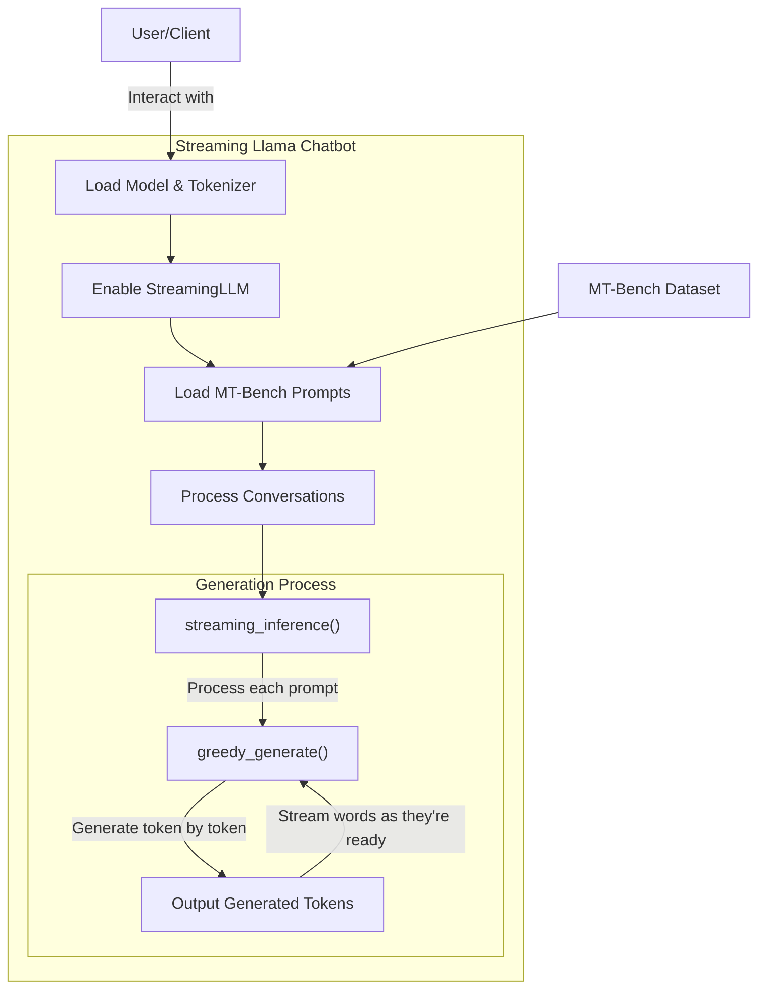
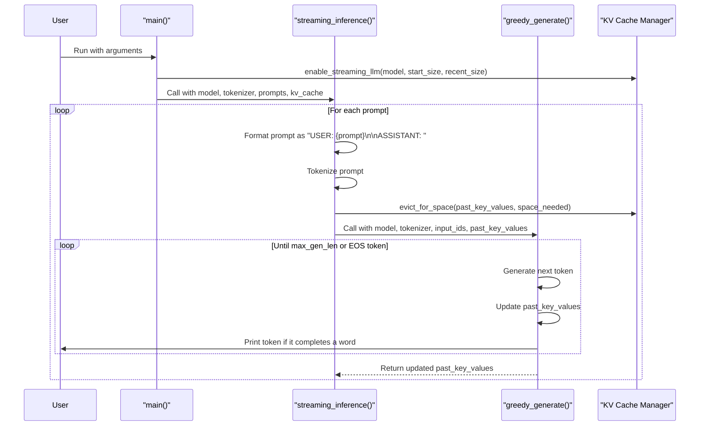
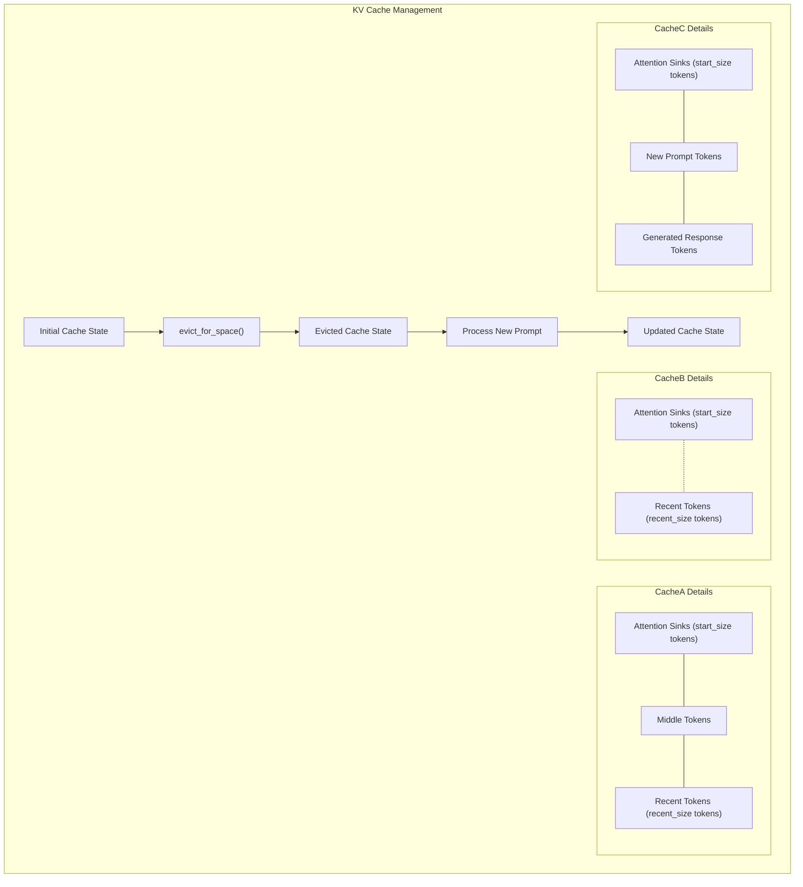
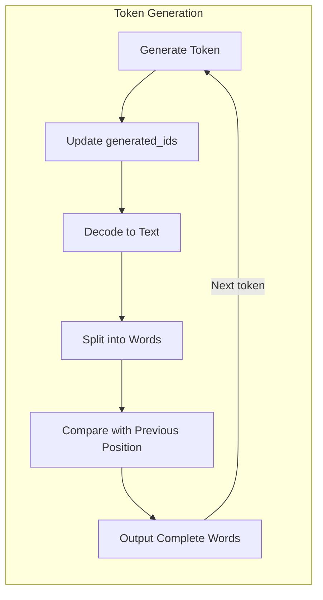
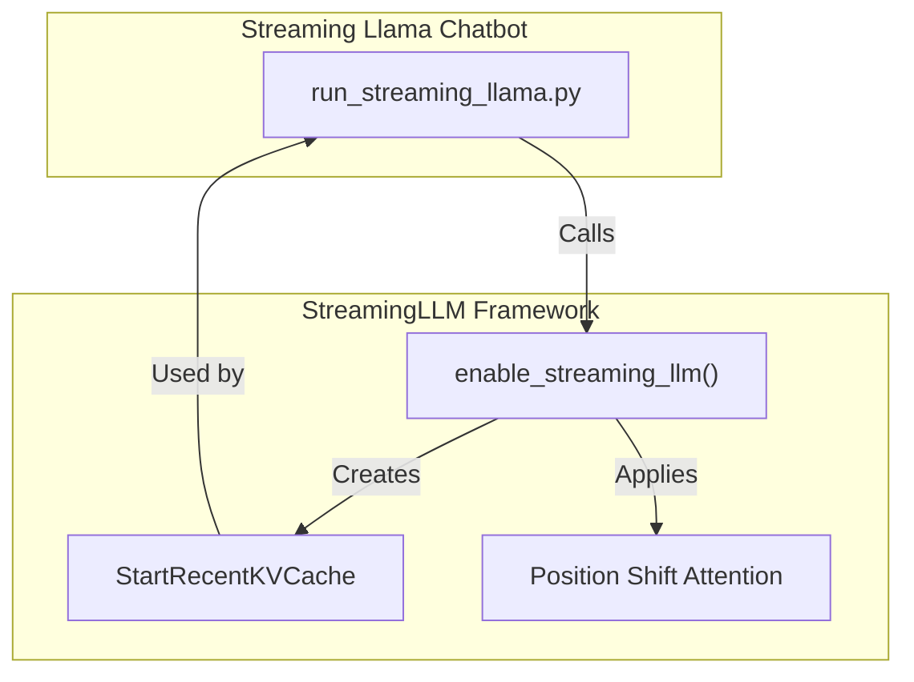

<!-- source: DeepWiki mcp.deepwiki.com · repo mit-han-lab/streaming-llm · page 5.1 Streaming Llama Chatbot · fetched 2026-10-30 -->

# Streaming Llama Chatbot

<details>
<summary>Relevant source files</summary>

The following files were used as context for generating this wiki page:

- [README.md](README.md)
- [examples/run_streaming_llama.py](examples/run_streaming_llama.py)

</details>


## Purpose and Scope

This document describes the Streaming Llama Chatbot, an example application that demonstrates how to implement an interactive chatbot using the StreamingLLM framework. The chatbot showcases how StreamingLLM can enable efficient processing of long conversations without running into memory limitations or context window constraints.

For information about the core StreamingLLM framework and its attention sink mechanism, see [Core Concepts](#2) and [Attention Sink Mechanism](#2.1). For details on evaluating long context performance, see [Evaluating Long Context Performance](#5.2).

Sources: [README.md:38-42](), [examples/run_streaming_llama.py:1-122]()

## System Overview

The Streaming Llama Chatbot is implemented as a command-line application that loads a language model, enables StreamingLLM's efficient KV cache management, and processes a series of conversation turns. It demonstrates how StreamingLLM allows language models to handle potentially infinite-length conversations without requiring cache resets or full recomputation.



Sources: [examples/run_streaming_llama.py:78-108]()

## Key Components

### main() Function

The entry point of the application that:
1. Loads the specified language model and tokenizer
2. Downloads the MT-Bench dataset if not present
3. Enables StreamingLLM if requested via command line arguments
4. Initiates the conversation process

Sources: [examples/run_streaming_llama.py:78-108]()

### streaming_inference() Function

This function is responsible for:
1. Processing a list of prompts as conversation turns
2. Formatting each prompt for the assistant
3. Managing the KV cache between conversation turns
4. Calling the token generation function for each prompt



Sources: [examples/run_streaming_llama.py:60-76]()

### greedy_generate() Function

This function implements the token-by-token generation process:
1. Performs greedy decoding (selecting the most likely next token)
2. Updates the KV cache after each token generation
3. Streams the output word-by-word as tokens form complete words
4. Stops generation when reaching max length or the EOS token

Sources: [examples/run_streaming_llama.py:19-57]()

## KV Cache Management

The key innovation demonstrated by the chatbot is efficient KV cache management using StreamingLLM's attention sink mechanism. When streaming is enabled, the chatbot creates a KV cache manager that:

1. Retains only a small number of initial tokens (attention sinks)
2. Maintains the most recent tokens for coherent generation
3. Discards middle tokens to save memory

Before processing each new prompt, the cache manager evicts tokens as needed to ensure there's enough space for both the new prompt and the expected response.



Sources: [examples/run_streaming_llama.py:69-71]()

## Usage Guide

### Running the Chatbot

The Streaming Llama Chatbot can be executed from the command line:

```bash
CUDA_VISIBLE_DEVICES=0 python examples/run_streaming_llama.py --enable_streaming
```

### Command-Line Arguments

The script accepts several command-line arguments to customize its behavior:

| Argument | Default | Description |
|----------|---------|-------------|
| `--model_name_or_path` | `lmsys/vicuna-13b-v1.3` | The Hugging Face model to load |
| `--data_root` | `data/` | Directory for storing datasets |
| `--enable_streaming` | (flag) | Enable StreamingLLM's efficient KV cache management |
| `--start_size` | `4` | Number of initial tokens to keep as attention sinks |
| `--recent_size` | `2000` | Number of recent tokens to maintain in the cache |

Sources: [examples/run_streaming_llama.py:111-120](), [README.md:38-42]()

## Implementation Details

### Prompt Formatting

The chatbot formats each input prompt in a consistent way to indicate user and assistant roles:

```
USER: {prompt}

ASSISTANT: 
```

This formatting helps the model understand the conversation context and respond appropriately.

Sources: [examples/run_streaming_llama.py:64]()

### Word-Level Streaming

One of the key usability features of the chatbot is word-level streaming. While the model generates text one token at a time, the output is buffered and displayed only when complete words are formed, creating a more natural reading experience:



This is implemented in the `greedy_generate` function by tracking the position in the generated text and only outputting completed words.

Sources: [examples/run_streaming_llama.py:38-52]()

## Performance Considerations

### Memory Efficiency

The primary benefit of using StreamingLLM in the chatbot is memory efficiency. By maintaining only attention sinks and recent tokens, the chatbot can process conversations of unlimited length without running out of memory.

### Conversation Context

While the chatbot can process unlimited conversation length, it's important to note that it can only "remember" information from:
1. The initial tokens (attention sinks)
2. The recent tokens (defined by `recent_size`)

This means that while the conversation can continue indefinitely, the model will gradually lose access to information from the middle of the conversation. However, this tradeoff enables efficient processing of long-running conversations without requiring a cache reset or recomputation.

### Start Size and Recent Size

The `start_size` and `recent_size` parameters can be adjusted to balance memory usage and context retention:

- Larger `start_size` may improve stability but uses more memory
- Larger `recent_size` allows the model to access more recent context but increases memory usage

For most use cases, small values like 4 for `start_size` are sufficient, while `recent_size` can be set based on the available memory and desired context retention.

Sources: [examples/run_streaming_llama.py:118-119]()

## Integration with StreamingLLM Framework

The Streaming Llama Chatbot integrates with the core StreamingLLM framework through the `enable_streaming_llm` function, which modifies the model's attention mechanism to support streaming and creates a KV cache manager to handle token eviction.



This integration allows the chatbot to leverage the core innovations of StreamingLLM while providing a simple and intuitive interface for users.

Sources: [examples/run_streaming_llama.py:97-99]()

---

