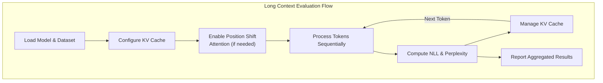
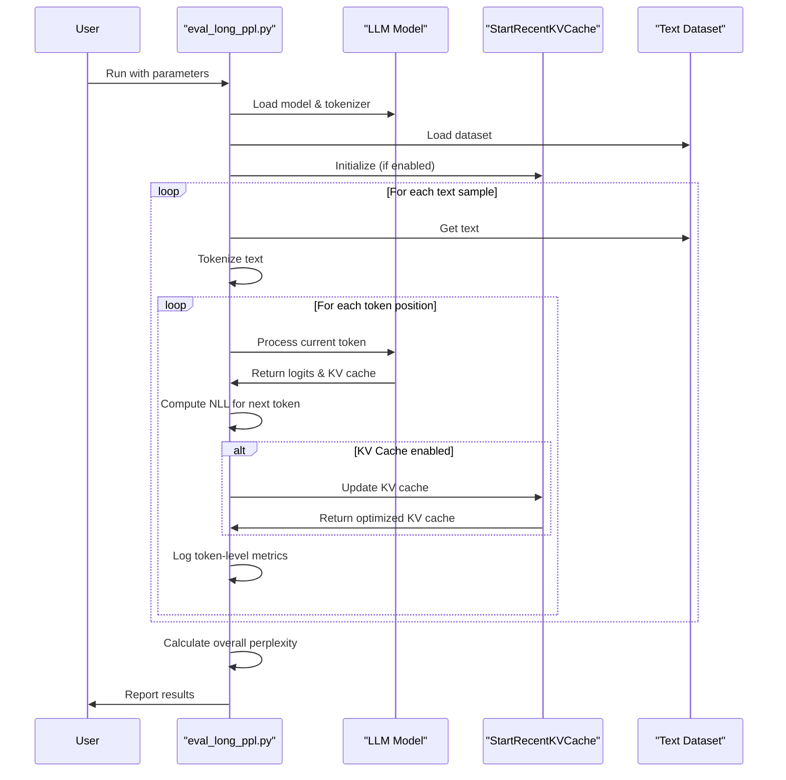
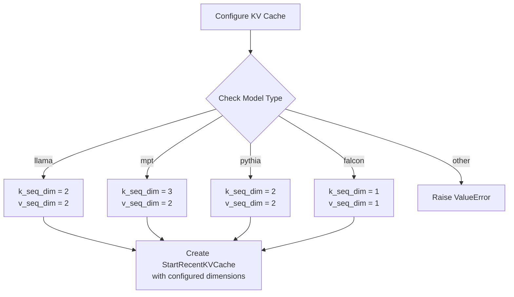
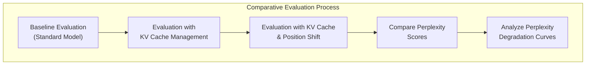

<!-- source: DeepWiki mcp.deepwiki.com · repo mit-han-lab/streaming-llm · page 5.2 Evaluating Long Context Performance · fetched 2026-10-30 -->

# Evaluating Long Context Performance

<details>
<summary>Relevant source files</summary>

The following files were used as context for generating this wiki page:

- [examples/eval_long_ppl.py](examples/eval_long_ppl.py)

</details>


## Purpose

This document provides a detailed technical guide for evaluating Large Language Model (LLM) performance on long contexts using StreamingLLM. It covers the methodology, implementation, and interpretation of perplexity-based evaluation for assessing how well models maintain coherence and accuracy over sequences that extend beyond their training context window.

For information about using StreamingLLM in interactive chat applications, see [Streaming Llama Chatbot](#5.1).

## Evaluation Methodology

StreamingLLM enables efficient evaluation of LLMs on long contexts by leveraging its KV cache management and position shift attention techniques. The primary evaluation metric used is perplexity (PPL), which quantifies how well a language model predicts a sample of text.



Sources: [examples/eval_long_ppl.py:67-110]()

### Perplexity Calculation

Perplexity is calculated as the exponentiated average negative log-likelihood (NLL) across all predictions:

1. For each token position, the model predicts the next token
2. The negative log-likelihood (NLL) of the correct token is computed
3. These NLLs are averaged across all positions
4. The final perplexity is calculated as `exp(average_nll)`

Lower perplexity indicates better model performance.

Sources: [examples/eval_long_ppl.py:18-19](), [examples/eval_long_ppl.py:91](), [examples/eval_long_ppl.py:107-110]()

## Evaluation Script

The StreamingLLM repository provides `eval_long_ppl.py` for evaluating long context performance. This script processes long documents token-by-token, maintaining the KV cache according to the StreamingLLM approach.



Sources: [examples/eval_long_ppl.py:10-43](), [examples/eval_long_ppl.py:70-103]()

### Key Parameters

The script accepts several parameters to customize the evaluation:

| Parameter | Description |
|-----------|-------------|
| `--model_name_or_path` | Path or Hugging Face identifier of the model to evaluate |
| `--dataset_name` | Name of the dataset to use for evaluation |
| `--task` | Specific task or subset of the dataset |
| `--split` | Dataset split to evaluate on (train/validation/test) |
| `--num_samples` | Number of text samples to evaluate |
| `--num_eval_tokens` | Maximum number of tokens to evaluate (optional limit) |
| `--enable_start_recent_kv_cache` | Enable StreamingLLM's KV cache management |
| `--start_size` | Size of the attention sink context to preserve |
| `--recent_size` | Size of the recent context to preserve |
| `--enable_pos_shift` | Enable position shifting for attention mechanism |
| `--output_dir` | Directory to save evaluation results |

Sources: [examples/eval_long_ppl.py:12](), [examples/eval_long_ppl.py:14-16](), [examples/eval_long_ppl.py:22-42](), [examples/eval_long_ppl.py:67-68](), [examples/eval_long_ppl.py:100-103]()

## Technical Implementation

### KV Cache Configuration

The script configures the `StartRecentKVCache` based on the model architecture, with different sequence dimensions for different model types:



Sources: [examples/eval_long_ppl.py:22-42]()

### Position Shift Adaptation

For each supported model architecture, the script applies the appropriate position shift attention modification:

| Model Type | Position Shift Implementation |
|------------|-------------------------------|
| `llama` | `enable_llama_pos_shift_attention` |
| `falcon` | `enable_falcon_pos_shift_attention` |
| `gpt_neox` | `enable_gpt_neox_pos_shift_attention` |
| `mpt` | No modification needed |

Sources: [examples/eval_long_ppl.py:44-64]()

### Evaluation Process

The token-by-token evaluation process works as follows:

1. Each token is processed individually
2. For each token:
   - Forward pass with the current token and existing KV cache
   - Get logits and updated KV cache
   - Compute loss against the next token in the sequence
   - Apply KV cache management if enabled
   - Log the NLL and perplexity for the current token

Sources: [examples/eval_long_ppl.py:80-97]()

## Running the Evaluation

### Example Command

```bash
python examples/eval_long_ppl.py \
  --model_name_or_path meta-llama/Llama-2-7b-hf \
  --dataset_name openwebtext \
  --enable_start_recent_kv_cache \
  --start_size 4 \
  --recent_size 1020 \
  --enable_pos_shift \
  --num_samples 10 \
  --num_eval_tokens 20000 \
  --output_dir eval_results
```

This would evaluate the Llama-2-7b model on 20,000 tokens from 10 OpenWebText samples, using StreamingLLM's KV cache management with 4 attention sink tokens and 1020 recent tokens.

### Output and Interpretation

The evaluation script produces several outputs:

1. `log.txt` - Contains the token-level negative log likelihood values
2. `ppl.txt` - Contains the final perplexity score

During evaluation, the script also displays token-by-token metrics:

```
nll: 2.34, ppl: 10.38
```

The final perplexity represents how well the model predicts the evaluation text, with lower values indicating better performance. When comparing evaluations with and without StreamingLLM techniques, similar perplexity values on long contexts indicate successful adaptation for streaming.

Sources: [examples/eval_long_ppl.py:67-68](), [examples/eval_long_ppl.py:95-97](), [examples/eval_long_ppl.py:107-110]()

## Comparative Analysis

To demonstrate the effectiveness of StreamingLLM for long context modeling, you can run multiple evaluations with different configurations:

1. Standard model without StreamingLLM techniques
2. Model with KV cache management but no position shift
3. Model with both KV cache management and position shift

This allows you to quantify the impact of StreamingLLM's techniques on long context understanding.



The effectiveness of StreamingLLM is demonstrated when the model with both KV cache management and position shift maintains similar perplexity to the baseline, even on sequences much longer than the model's training context window.

Sources: [examples/eval_long_ppl.py:22-64]()

## Considerations for Long Context Evaluation

When evaluating long context performance:

1. **Context Length**: Test with sequences significantly longer than the model's training context window
2. **Document Coherence**: Use coherent documents rather than random concatenations
3. **Compute Resources**: Be aware that evaluation on very long contexts may require significant GPU memory
4. **Perplexity Trends**: Analyze how perplexity changes as context length increases
5. **Cache Parameters**: Experiment with different `start_size` and `recent_size` values to find optimal configurations

Sources: [examples/eval_long_ppl.py:70-103]()

---

