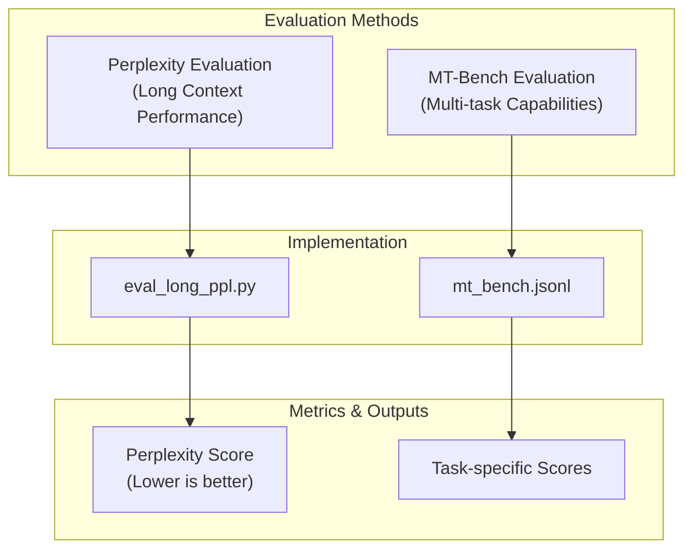
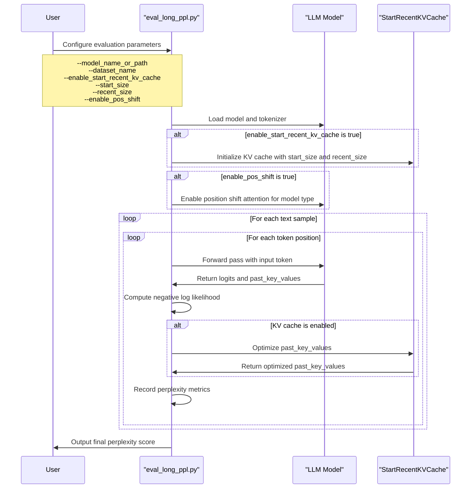
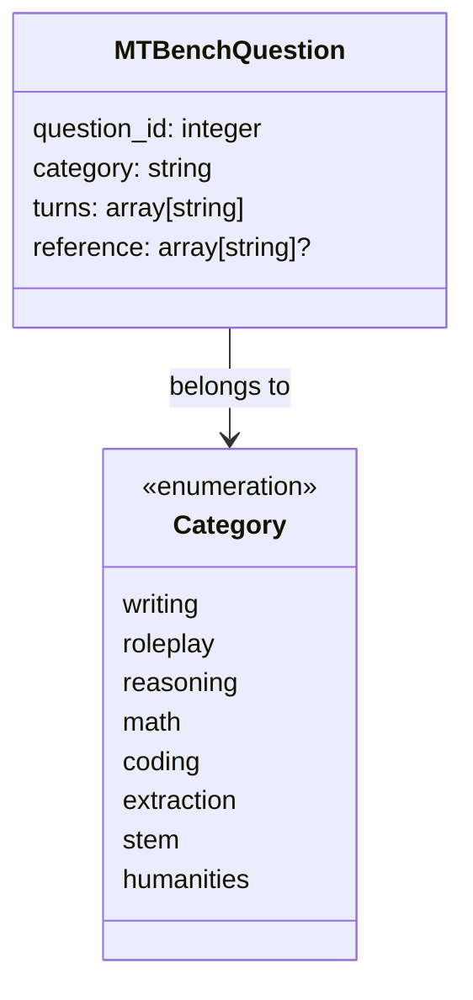
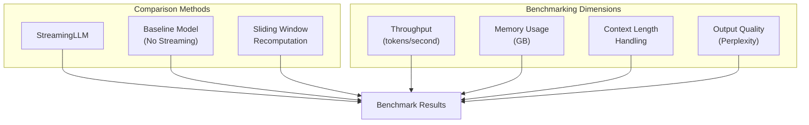

<!-- source: DeepWiki mcp.deepwiki.com · repo mit-han-lab/streaming-llm · page 6 Evaluation & Benchmarking · fetched 2026-10-30 -->

# Evaluation & Benchmarking

<details>
<summary>Relevant source files</summary>

The following files were used as context for generating this wiki page:

- [README.md](README.md)
- [data/mt_bench.jsonl](data/mt_bench.jsonl)
- [examples/eval_long_ppl.py](examples/eval_long_ppl.py)

</details>


This document explains how to evaluate StreamingLLM performance, interpret evaluation results, and use the benchmarking tools provided in the repository. The focus is on assessing how effectively the system handles long contexts, maintains coherence during streaming, and performs compared to baseline approaches.

For information about implementing streaming applications, see [Usage Examples](#5).

## Overview of Evaluation Approaches

StreamingLLM can be evaluated using two primary methods:

1. **Perplexity Evaluation**: Measures how well the model predicts the next token in long sequences
2. **MT-Bench Evaluation**: Assesses the model's capabilities on a diverse set of tasks across multiple domains



Sources: [examples/eval_long_ppl.py](), [data/mt_bench.jsonl]()

## Long Context Perplexity Evaluation

Perplexity is a standard metric for evaluating language models, measuring how "surprised" the model is by new text. Lower perplexity indicates better performance.

### Running the Evaluation Script

The repository provides a script for evaluating model perplexity on long sequences. The script supports StreamingLLM's key features including attention sinks and efficient KV cache management:



Sources: [examples/eval_long_ppl.py:67-110]()

### Key Parameters for Evaluation

To run the perplexity evaluation script:

```bash
python examples/eval_long_ppl.py \
    --model_name_or_path [MODEL_PATH] \
    --dataset_name [DATASET] \
    --enable_start_recent_kv_cache \
    --start_size [N] \
    --recent_size [M] \
    --enable_pos_shift
```

Parameters explained:

| Parameter | Description | Default |
|-----------|-------------|---------|
| `--model_name_or_path` | Path to model or model identifier from HuggingFace | Required |
| `--dataset_name` | Name of the dataset to use | Required |
| `--task` | Name of the task to use from dataset | None |
| `--split` | Which split of the dataset to use | "train" |
| `--enable_start_recent_kv_cache` | Whether to use StartRecentKVCache | False |
| `--start_size` | Number of initial tokens to keep | 4 |
| `--recent_size` | Number of recent tokens to keep | 512 |
| `--enable_pos_shift` | Whether to enable position shift attention | False |
| `--num_samples` | Number of samples to evaluate | 1 |
| `--num_eval_tokens` | Maximum number of tokens to evaluate | None |
| `--output_dir` | Directory to save outputs | "output" |

Sources: [examples/eval_long_ppl.py:1-41]()

### Interpreting Perplexity Results

The script outputs several files:

- `output/log.txt`: Per-token negative log likelihood values
- `output/ppl.txt`: Final perplexity score

Lower perplexity scores indicate better model performance. When comparing configurations:

1. Compare StreamingLLM with and without attention sinks to see the impact on long context performance
2. Experiment with different `start_size` and `recent_size` parameters to find the optimal configuration
3. Compare against baseline models without streaming optimizations

## MT-Bench Evaluation

MT-Bench (Multi-turn Benchmark) is a dataset designed to evaluate language models across diverse tasks with multi-turn conversations.

### Dataset Structure



The MT-Bench dataset includes questions across 8 categories, with one or two conversational turns. Some questions have reference answers for precise evaluation.

Sample categories include:
- Writing: Creative writing, email composition, content adaptation
- Reasoning: Logical problems, puzzles, analytical thinking
- Math: Arithmetic, algebra, probability, geometry
- Coding: Programming problems, debugging, algorithm design
- Extraction: Information retrieval from text
- STEM: Science, technology, engineering, and mathematics
- Humanities: Philosophy, economics, social sciences

Sources: [data/mt_bench.jsonl:1-80]()

### Using MT-Bench for Evaluation

MT-Bench can be used to evaluate StreamingLLM by:

1. Passing questions to the model and collecting responses
2. Comparing responses to reference answers where available
3. Evaluating the model's accuracy, coherence, and relevance

The repository plans to release a complete StreamEval dataset and evaluation code as mentioned in the README:

```
- [ ] Release StreamEval dataset and evaluation code.
```

## Benchmarking Methodology

StreamingLLM can be benchmarked against baseline approaches by:

1. **Speed comparison**: Measure throughput (tokens/second) with and without StreamingLLM optimizations
2. **Memory efficiency**: Compare memory usage during processing of long sequences
3. **Context handling**: Evaluate performance as sequence length increases beyond training context window



According to the paper, StreamingLLM outperforms the sliding window recomputation baseline by up to 22.2x speedup in streaming settings.

Sources: [README.md:22-22]()

## Integration with External Benchmarking Systems

StreamingLLM has been integrated with several external frameworks, which can be used for benchmarking:

| Integration | Status | Details |
|-------------|--------|---------|
| HuggingFace Transformers | ✅ Integrated | PR #26681 |
| NVIDIA TensorRT-LLM | ✅ Integrated | Examples available for Llama with StreamingLLM |
| Intel Extension for Transformers | ✅ Integrated | Enables optimizations for Intel hardware |
| SwiftInfer | ✅ Integrated | Supports infinite input length for LLM inference |

These integrations can be leveraged to benchmark StreamingLLM performance on different hardware platforms and deployment scenarios.

Sources: [README.md:13-18]()

## Interpreting Evaluation Results

When evaluating StreamingLLM, consider:

1. **Baseline Comparison**: Compare against the same model without streaming optimizations
2. **Attention Sink Effect**: Observe how keeping initial tokens as attention sinks affects performance
3. **Cache Size Impact**: Test different combinations of `start_size` and `recent_size`
4. **Sequence Length Scaling**: Evaluate how performance changes as input length increases beyond training length

The FAQ in the README highlights that StreamingLLM is especially effective for streaming applications like multi-round dialogues, where it enables continuous operation without cache resets.

Sources: [README.md:45-64]()

## Future Evaluation Plans

The StreamingLLM team plans to release additional evaluation resources:

1. StreamEval dataset - A specialized dataset for evaluating streaming language models
2. Comprehensive evaluation code - Tools for benchmarking StreamingLLM against baselines

These resources will provide standardized methods for evaluating StreamingLLM implementations and comparing different streaming approaches.

Sources: [README.md:66-73]()

---

