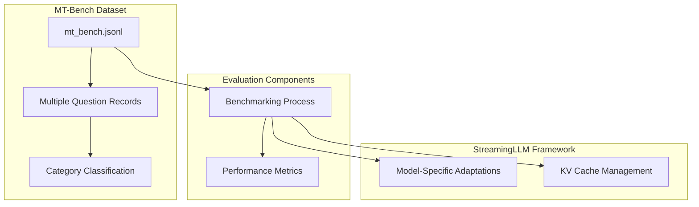
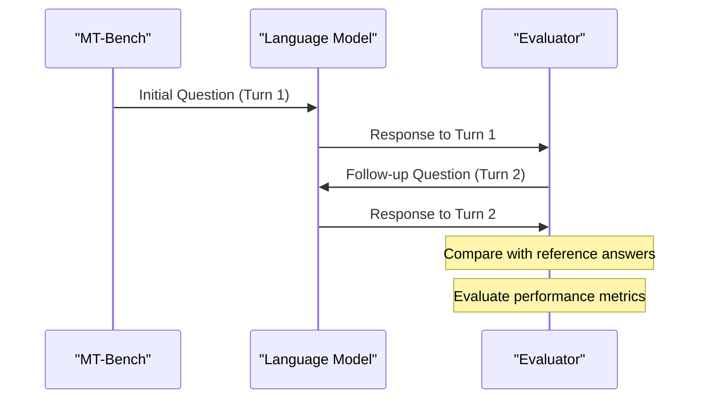
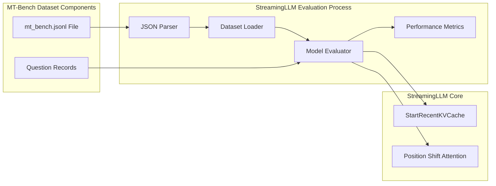

<!-- source: DeepWiki mcp.deepwiki.com · repo mit-han-lab/streaming-llm · page 6.1 MT-Bench Dataset · fetched 2026-10-30 -->

# MT-Bench Dataset

<details>
<summary>Relevant source files</summary>

The following files were used as context for generating this wiki page:

- [data/mt_bench.jsonl](data/mt_bench.jsonl)

</details>


This page documents the MT-Bench dataset used for evaluating StreamingLLM performance. MT-Bench serves as a comprehensive benchmarking dataset designed to assess language model capabilities across diverse task categories with multi-turn conversations. It's primarily used in the evaluation components of the StreamingLLM framework to measure model performance under streaming conditions.

For information about the general evaluation and benchmarking process, see [Evaluation & Benchmarking](#6).

## Dataset Overview

The MT-Bench (Multi-Turn Benchmark) dataset consists of a collection of carefully crafted questions and tasks stored in JSONL format. It enables systematic evaluation of large language models through diverse scenarios that require reasoning, knowledge, and conversational abilities.



Sources: [data/mt_bench.jsonl]()

## Dataset Structure

Each entry in the MT-Bench dataset follows a consistent JSON structure with specific fields that define the question, its category, and the expected interaction pattern.

```mermaid
classDiagram
    class "Question Record" {
        +int question_id
        +string category
        +array turns
        +array reference (optional)
    }
    
    class "Turns Array" {
        +string prompt1
        +string prompt2
        +...
    }
    
    class "Reference Array" {
        +string expected_answer1
        +string expected_answer2
        +...
    }
    
    "Question Record" --> "Turns Array" : contains
    "Question Record" --> "Reference Array" : may contain
```

Example of a question record from the dataset:

```json
{
  "question_id": 101,
  "category": "reasoning",
  "turns": [
    "Imagine you are participating in a race with a group of people. If you have just overtaken the second person, what's your current position? Where is the person you just overtook?",
    "If the \"second person\" is changed to \"last person\" in the above question, what would the answer be?"
  ],
  "reference": [
    "You are in second place.",
    "Uncertain."
  ]
}
```

Sources: [data/mt_bench.jsonl]()

## Question Categories

MT-Bench contains questions across multiple categories, each designed to test different aspects of a language model's capabilities:

| Category   | Description                                          | Example Question IDs |
|------------|------------------------------------------------------|---------------------|
| Writing    | Creative writing, emails, content creation           | 81-90               |
| Roleplay   | Character impersonation, persona-based responses     | 91-100              |
| Reasoning  | Logical puzzles, deduction, analytical thinking      | 101-110             |
| Math       | Mathematical calculations and problem-solving        | 111-120             |
| Coding     | Programming, debugging, algorithm development        | 121-130             |
| Extraction | Information retrieval from text                      | 131-140             |
| STEM       | Science, technology, engineering, mathematics topics | 141-150             |
| Humanities | History, philosophy, arts, culture                   | 151-160             |

Sources: [data/mt_bench.jsonl]()

## Multi-Turn Evaluation Structure

A distinctive feature of MT-Bench is its multi-turn structure, which tests a model's ability to maintain context and respond appropriately to follow-up questions:



The multi-turn structure challenges models in several ways:
- Maintaining context across turns
- Adapting to new constraints or information
- Demonstrating flexible thinking
- Following instructions that build upon previous interactions

Sources: [data/mt_bench.jsonl]()

## Integration with StreamingLLM Evaluation

MT-Bench plays a crucial role in the evaluation pipeline for StreamingLLM, particularly for assessing how well the streaming mechanism handles conversational scenarios:



Sources: [data/mt_bench.jsonl]()

## Question Examples by Category

### Writing Tasks
Writing tasks evaluate a model's ability to generate creative, coherent, and adaptable content:

Example: "Compose an engaging travel blog post about a recent trip to Hawaii, highlighting cultural experiences and must-see attractions." (followed by) "Rewrite your previous response. Start every sentence with the letter A."

### Reasoning Tasks
Reasoning questions test logical thinking and problem-solving:

Example: "David has three sisters. Each of them has one brother. How many brothers does David have?" (followed by) "If we change the previous question and assume that each sister of David has two brothers, how many brothers would David have?"

### Coding Challenges
These tasks assess the model's programming knowledge and debugging skills:

Example: "Write a function to find the majority element in a given integer array using the Boyer-Moore Voting Algorithm." (followed by) "How about finding the top-2 most occurring elements?"

Sources: [data/mt_bench.jsonl]()

## Using MT-Bench for Evaluation

To use MT-Bench for evaluating a StreamingLLM model:

1. Load the MT-Bench dataset file
2. Configure the model with appropriate streaming parameters
3. Present each question to the model sequentially
4. For multi-turn questions, feed follow-up prompts after receiving initial responses
5. Compare responses against reference answers (when available)
6. Generate metrics across different question categories

This structured evaluation approach provides insights into how StreamingLLM performs across diverse tasks, particularly in maintaining context across conversational turns while using the attention sink mechanism.

Sources: [data/mt_bench.jsonl]()