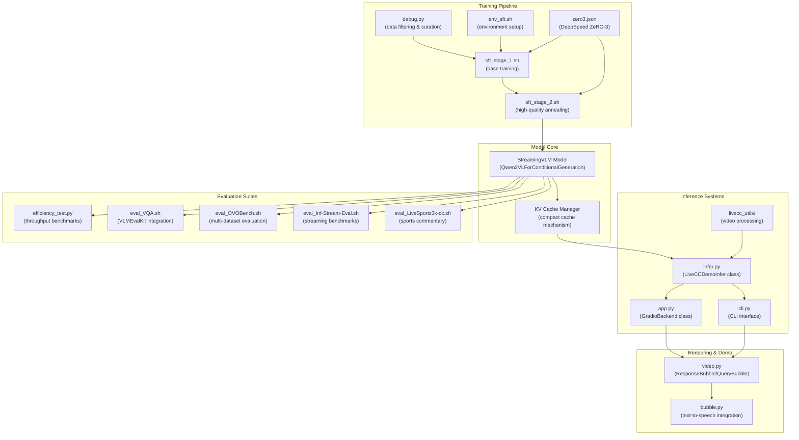
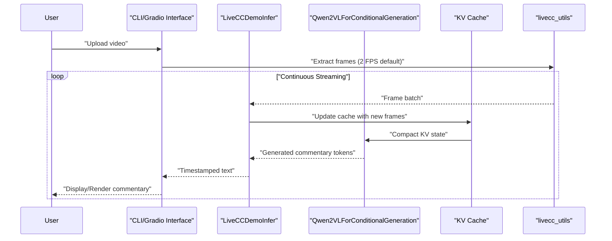
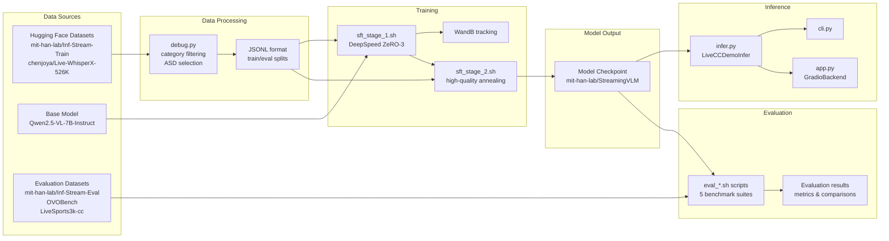

<!-- source: DeepWiki mcp.deepwiki.com · repo mit-han-lab/streaming-vlm · page 1 Overview · fetched 2026-10-30 -->

# Overview

Relevant source files

The following files were used as context for generating this wiki page:

- [.gitignore](.gitignore)
- [assets/StreamingVLM_slides.pdf](assets/StreamingVLM_slides.pdf)
- [readme.md](readme.md)

## Purpose and Scope

This document provides a high-level introduction to the StreamingVLM system, its architecture, and core components. StreamingVLM is a real-time video understanding system designed to process effectively infinite video streams with constant memory and low latency.

This overview covers the system's purpose, architectural components, operational modes, and data flow. For detailed information about specific subsystems, see:
- Key technical innovations and performance characteristics: [Key Innovations](#1.1)
- Repository organization and directory structure: [Repository Structure](#1.2)
- Model architecture and KV cache mechanism: [Model Architecture](#3)
- Training procedures: [Training Pipeline](#4)
- Inference implementation: [Inference Systems](#5)
- Benchmark evaluations: [Evaluation Framework](#6)

**Sources:** [readme.md:1-183]()

## What is StreamingVLM?

StreamingVLM is a vision-language model optimized for real-time processing of continuous video streams. Unlike traditional video understanding models that face quadratic memory complexity or use sliding windows that lose long-term context, StreamingVLM maintains a **compact KV (key-value) cache** that grows sub-linearly with video length while preserving temporal coherence.

The system is built on the Qwen2.5-VL-7B-Instruct base model and achieves:
- **8 FPS throughput** on a single NVIDIA H100 GPU
- **66.18% win rate** vs GPT-4o-mini on the Inf-Stream-Eval benchmark
- Superior performance on standard VQA benchmarks (Video-MME, MVBench, LongVideoBench) without task-specific fine-tuning

StreamingVLM aligns training with streaming inference, ensuring consistent behavior between training and deployment scenarios.

**Sources:** [readme.md:9-11]()

## System Architecture

The following diagram illustrates the major components of the StreamingVLM system and their relationships using actual file and module names:

**Sources:** [readme.md:21-183](), [.gitignore:1-81]()

## Core Components

The StreamingVLM system consists of the following primary components:

| Component | Key Files | Primary Classes/Functions | Purpose |
|-----------|-----------|---------------------------|---------|
| **Model Core** | Model loaded from `mit-han-lab/StreamingVLM` on Hugging Face | `Qwen2VLForConditionalGeneration` | Base vision-language model with streaming optimization |
| **KV Cache** | Integrated within model inference | Cache compression logic | Maintains compact temporal context |
| **Inference Engine** | [streaming_vlm/inference/infer.py]() | `LiveCCDemoInfer` | Orchestrates streaming inference and multi-turn QA |
| **Training System** | [scripts/sft_stage_1.sh](), [scripts/sft_stage_2.sh]() | Two-stage SFT pipeline | Supervised fine-tuning with DeepSpeed |
| **Data Processing** | [streaming_vlm/training/debug.py]() | Category filtering, ASD selection | Dataset curation and preprocessing |
| **CLI Interface** | [streaming_vlm/demo/cli.py]() | CLI argument parsing and inference loop | Command-line video processing |
| **Web Interface** | [streaming_vlm/demo/app.py]() | `GradioBackend` | Browser-based interactive demo |
| **Video Processing** | [streaming_vlm/demo/livecc_utils/]() | Frame extraction, video readers | Video loading and frame management |
| **Evaluation** | [scripts/eval_*.sh]() | Multiple evaluation scripts | Comprehensive benchmark suite |
| **Rendering** | [streaming_vlm/demo/video.py](), [streaming_vlm/demo/bubble.py]() | `ResponseBubble`, `QueryBubble` | Visual output generation with TTS |

**Sources:** [readme.md:21-166]()

## Operational Modes

StreamingVLM supports two primary operational modes, implemented in the `LiveCCDemoInfer` class [streaming_vlm/inference/infer.py]():

### Real-Time Commentary Mode

In this mode, the system continuously processes video frames at 2 FPS (configurable), generates timestamped commentary, and maintains a growing temporal context via the compact KV cache. The output is a stream of commentary segments aligned to video timestamps.

### Video Question Answering Mode

In QA mode, the system loads a complete video segment, processes user queries, and supports multi-turn conversations. The `LiveCCDemoInfer` class manages conversation state and provides context-aware responses based on the full video content.

**Sources:** [readme.md:30-42]()

## Data Flow Architecture

The following diagram shows how data flows through the system from raw inputs to final outputs, using actual file paths and dataset names:

**Sources:** [readme.md:45-166]()

## Key Entry Points

The following table lists the primary entry points for interacting with the StreamingVLM system:

| Purpose | Script/File | Key Parameters | Environment |
|---------|-------------|----------------|-------------|
| **Inference (Interactive)** | [streaming_vlm/inference/inference.py]() | Model path, video input | `streamingvlm-infer` |
| **CLI Inference** | [streaming_vlm/demo/cli.py]() | Video path, mode selection | `streamingvlm-infer` |
| **Web Demo** | [streaming_vlm/demo/app.py]() | Model path, share settings | `streamingvlm-infer` |
| **Stage 1 Training** | [scripts/sft_stage_1.sh]() | `$DATASET_PATH`, GPU count | `streamingvlm-sft` |
| **Stage 2 Training** | [scripts/sft_stage_2.sh]() | Stage 1 checkpoint path | `streamingvlm-sft` |
| **Efficiency Eval** | [scripts/eval_efficiency.sh]() | Model path, test modes | `streamingvlm-infer` |
| **VQA Eval** | [scripts/eval_VQA.sh]() | Dataset selection | `streamingvlm-infer` |
| **OVOBench Eval** | [scripts/eval_OVOBench.sh]() | OVOBench data path | `streamingvlm-ovo` |
| **Inf-Stream Eval** | [scripts/eval_Inf-Stream-Eval.sh]() | `$EVAL_DATASET_PATH` | `streamingvlm-infer` |
| **LiveSports3k Eval** | [scripts/eval_LiveSports3k-cc.sh]() | `$LIVESPORTS3K_PATH` | `streamingvlm-infer` |
| **Data Preparation** | [streaming_vlm/training/debug.py]() | Dataset filtering params | `streamingvlm-sft` |

**Sources:** [readme.md:21-166]()

## Environment Configuration

StreamingVLM requires three distinct conda environments, each configured by dedicated setup scripts:

| Environment | Setup Script | Purpose | Key Dependencies |
|-------------|--------------|---------|------------------|
| `streamingvlm-infer` | [scripts/env_infer.sh]() | Inference and most evaluations | PyTorch, transformers, flash-attn, qwen-vl-utils |
| `streamingvlm-sft` | [scripts/env_sft.sh]() | Training pipeline | DeepSpeed, accelerate, wandb |
| `streamingvlm-ovo` | [scripts/env_ovo.sh]() | OVOBench evaluation | VLMEvalKit dependencies |

These environments are isolated to prevent dependency conflicts between training, inference, and specialized evaluation tasks. See [Environment Setup](#2.1) for detailed configuration instructions.

**Sources:** [readme.md:21-26]()

## Performance Characteristics

StreamingVLM achieves the following performance metrics:

- **Throughput**: 8 FPS on NVIDIA H100 GPU for streaming inference
- **Memory Efficiency**: Sub-linear KV cache growth with video length
- **Benchmark Results**:
  - 66.18% win rate vs GPT-4o-mini on Inf-Stream-Eval
  - Competitive or superior performance on Video-MME, MVBench, and LongVideoBench
  - Real-time sports commentary generation on LiveSports3k-cc

Detailed efficiency benchmarks and evaluation results are documented in [Evaluation Framework](#6).

**Sources:** [readme.md:9-11](), [readme.md:83-92]()

---

