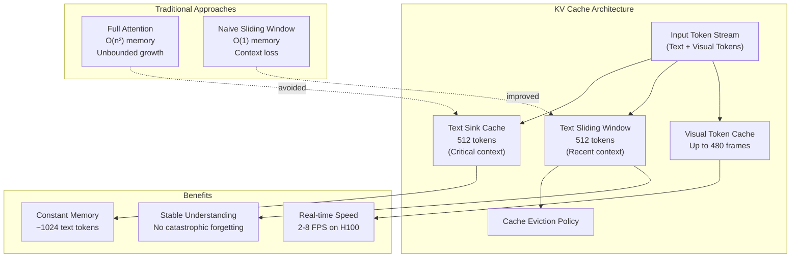
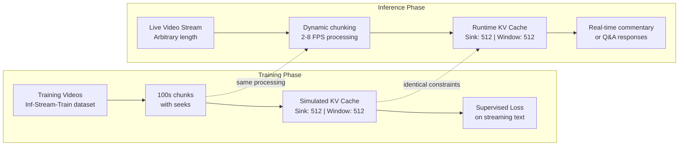
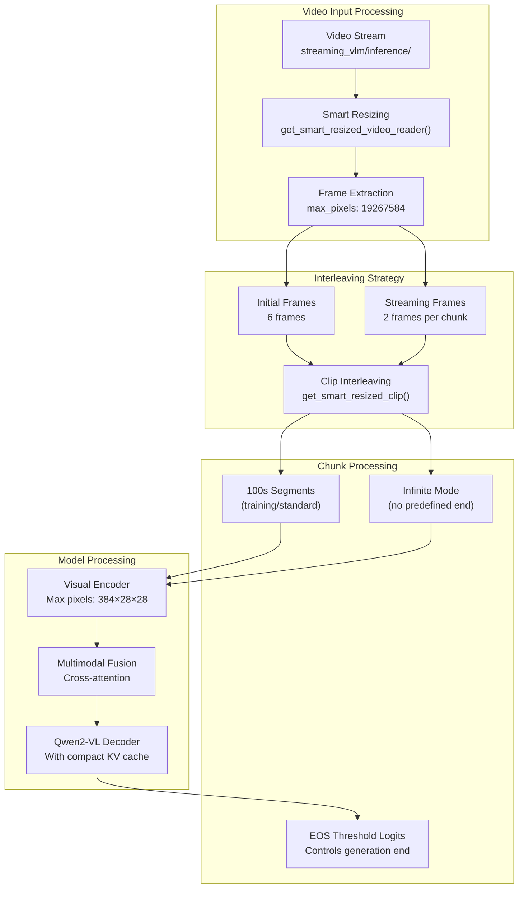
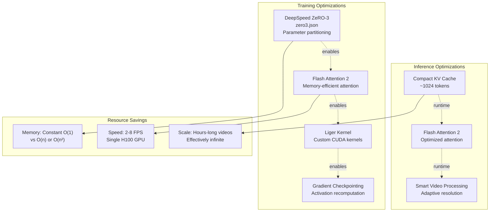
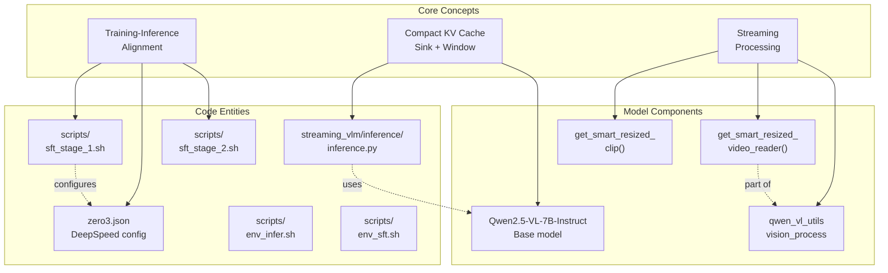

<!-- source: DeepWiki mcp.deepwiki.com · repo mit-han-lab/streaming-vlm · page 1.1 Key Innovations · fetched 2026-10-30 -->

# Key Innovations

Relevant source files

The following files were used as context for generating this wiki page:

- [assets/StreamingVLM_slides.pdf](assets/StreamingVLM_slides.pdf)
- [readme.md](readme.md)

## Purpose and Scope

This page describes the core technical innovations that enable StreamingVLM to achieve real-time understanding of effectively infinite video streams. These innovations include the compact KV cache architecture, training-inference alignment methodology, streaming processing pipeline, and memory optimization strategies. For the overall system architecture and repository organization, see [Overview](#1). For details on model architecture and components, see [Model Architecture](#3).

---

## Compact KV Cache System

The fundamental innovation in StreamingVLM is its **compact KV cache** design that maintains constant memory usage while processing arbitrarily long video streams. Unlike full-attention mechanisms that grow quadratically with sequence length, or naive sliding windows that lose long-term context, StreamingVLM uses a hybrid approach.

### Architecture Design

**KV Cache Components**

| Component | Size | Purpose | Eviction |
|-----------|------|---------|----------|
| Text Sink | 512 tokens | Preserve critical long-term context (e.g., video topic, instructions) | Never evicted |
| Text Sliding Window | 512 tokens | Maintain recent conversational context | FIFO when full |
| Visual Tokens | Up to 480 frames | Store frame embeddings for current processing chunk | Chunk-based |

The text sink acts as a "semantic anchor," retaining the most important context tokens throughout the entire video stream. This prevents the catastrophic forgetting problem that occurs with pure sliding windows, where early critical information is lost.

**Sources**: [readme.md:11](), [assets/StreamingVLM_slides.pdf]() (architectural diagrams)

---

## Training-Inference Alignment

The critical breakthrough enabling stable infinite-stream processing is **training-inference alignment**. StreamingVLM trains the model using the same KV cache constraints that will be applied during inference.

### Alignment Strategy

**Why Alignment Matters**

Traditional video-language models train on complete videos with full attention, then deploy with truncated context windows. This train-test mismatch causes:
- **Context Confusion**: Model expects information that was truncated
- **Instability**: Performance degrades unpredictably on long videos
- **Hallucinations**: Model fills gaps with invented content

StreamingVLM eliminates this mismatch by enforcing identical KV cache constraints during both training and inference. The model learns to operate effectively within a fixed context budget from the start.

**Two-Stage Training Process**

| Stage | Learning Rate | Data | Purpose |
|-------|---------------|------|---------|
| Stage 1 | 1e-5 | Full Inf-Stream-Train dataset | Learn streaming video understanding with KV cache constraints |
| Stage 2 | 1e-6 | High-quality subset (annealing) | Refine quality and stability on curated examples |

**Sources**: [readme.md:67-78](), [scripts/sft_stage_1.sh](), [scripts/sft_stage_2.sh]()

---

## Streaming Processing Pipeline

StreamingVLM processes video as a continuous stream rather than discrete clips, enabling real-time commentary and unbounded video understanding.

### Frame Processing Flow

**Frame Budget Management**

StreamingVLM maintains a maximum of **480 frames** in memory at any time. The interleaving strategy balances initial context with ongoing streaming:

1. **Initial Phase**: Extract 6 frames to establish visual context
2. **Streaming Phase**: Process 2 frames per chunk continuously
3. **Smart Resizing**: Dynamically adjust spatial resolution to stay within pixel budget (19,267,584 pixels total)

This approach allows processing hours-long videos on a single GPU while maintaining temporal coherence.

**Sources**: [readme.md:36-41](), Diagram 5 in system overview

---

## Memory and Computational Optimizations

StreamingVLM employs multiple optimization strategies to achieve real-time performance on a single H100 GPU.

### Optimization Stack

**Optimization Techniques**

| Technique | Component | Benefit |
|-----------|-----------|---------|
| DeepSpeed ZeRO-3 | Training | Partition parameters and optimizer states across GPUs; enables large batch training |
| Flash Attention 2 | Training & Inference | Memory-efficient attention computation; ~2-4x speedup |
| Liger Kernel | Training | Custom CUDA kernels for specific operations; reduce memory overhead |
| Gradient Checkpointing | Training | Trade computation for memory; enables larger models/batches |
| Compact KV Cache | Inference | Constant memory regardless of video length; enables infinite streams |
| Smart Resizing | Inference | Adaptive spatial resolution; maximize frames within pixel budget |

**DeepSpeed ZeRO-3 Configuration**

The training pipeline uses ZeRO Stage 3 parameter partitioning, which shards model parameters, gradients, and optimizer states across all available GPUs. This enables training with:
- **Gradient Accumulation**: 64 steps per update
- **Mixed Precision**: BF16 for reduced memory
- **Overlap Communication**: Computation and communication overlap for efficiency

**Sources**: [scripts/sft_stage_1.sh](), [scripts/sft_stage_2.sh](), Diagram 6 in system overview

---

## Performance Characteristics

### Efficiency Comparison

StreamingVLM's innovations deliver measurable performance advantages over baseline approaches:

| Metric | Full Attention | Sliding Window | StreamingVLM |
|--------|----------------|----------------|--------------|
| Memory Growth | O(n²) | O(1) | O(1) |
| Context Preservation | Full | Limited | Critical + Recent |
| Processing Speed (FPS) | <1 FPS | 4-6 FPS | 2-8 FPS |
| Max Video Length | Minutes | Unbounded | Unbounded |
| Stability on Long Videos | High | Low (forgetting) | High |

**Benchmark Results**

- **Inf-Stream-Eval**: 66.18% win rate vs. GPT-4o mini on long-video tasks
- **Real-time Processing**: 2-8 FPS on single H100 GPU (configurable via `QWENVL_FPS` environment variable)
- **General VQA Improvement**: Boosts performance on Video-MME, MVBench, LongVideoBench without task-specific finetuning
- **LiveSports3k-cc**: Competitive with commercial models (GPT-4o, Gemini) on live commentary

The efficiency script benchmarks these characteristics:

**Sources**: [readme.md:82-93](), [scripts/eval_efficiency.sh](), [readme.md:157-164]()

---

## Code-to-Concept Mapping

### Key Implementation Components

**File Path References**

| Innovation | Primary Files | Configuration |
|------------|---------------|---------------|
| Compact KV Cache | `streaming_vlm/inference/inference.py` | Implemented in base Qwen2-VL model |
| Training Alignment | `scripts/sft_stage_1.sh`, `scripts/sft_stage_2.sh` | Learning rates: 1e-5, 1e-6; Gradient accumulation: 64 |
| Streaming Processing | `qwen_vl_utils/vision_process.py` | FPS: 2-8 (configurable); Max frames: 480 |
| DeepSpeed Optimization | `zero3.json` | Stage 3 partitioning; BF16 precision |
| Environment Setup | `scripts/env_infer.sh`, `scripts/env_sft.sh` | Python 3.11, PyTorch 2.7.1 |

**Sources**: [readme.md:23-29](), [readme.md:67-78](), [readme.md:157-164]()

---

## Summary

StreamingVLM's key innovations work in concert to enable real-time understanding of infinite video streams:

1. **Compact KV Cache** eliminates quadratic memory growth while preserving critical context
2. **Training-Inference Alignment** ensures stable performance by using identical constraints during training and deployment
3. **Streaming Processing Pipeline** handles arbitrarily long videos through intelligent chunking and frame management
4. **Memory Optimizations** leverage DeepSpeed ZeRO-3, Flash Attention 2, and other techniques to achieve real-time speeds

These innovations are implemented across the training pipeline (Stage 1 and 2 SFT scripts), inference engine (`streaming_vlm/inference/`), and model architecture (Qwen2.5-VL-7B-Instruct base). The result is a system that processes video streams at 2-8 FPS on a single H100 GPU while maintaining stable, high-quality understanding over effectively infinite video lengths.

For implementation details of the inference system, see [Inference Systems](#5). For training procedures, see [Training Pipeline](#4). For evaluation benchmarks demonstrating these innovations, see [Evaluation Framework](#6).

**Sources**: [readme.md:9-11](), All diagrams in system architecture overview

---

