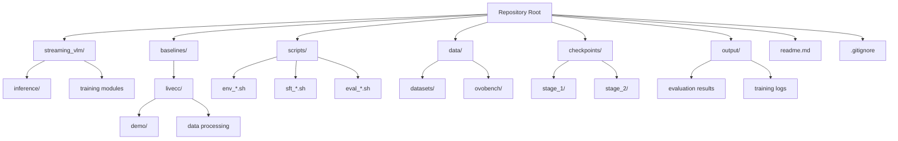
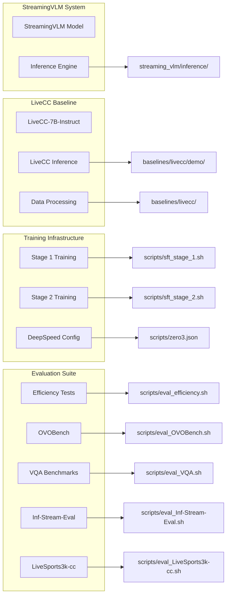
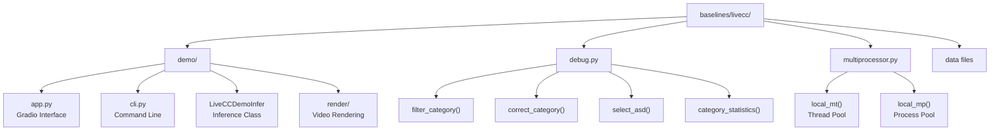
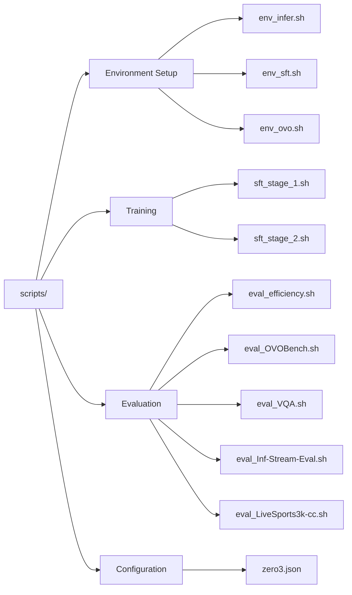
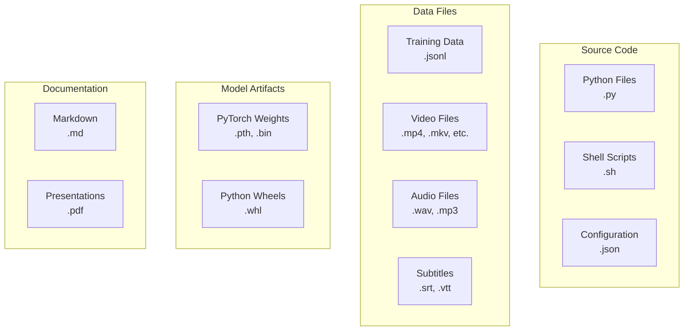

<!-- source: DeepWiki mcp.deepwiki.com · repo mit-han-lab/streaming-vlm · page 1.2 Repository Structure · fetched 2026-10-30 -->

# Repository Structure

<details>
<summary>Relevant source files</summary>

The following files were used as context for generating this wiki page:

- [.gitignore](.gitignore)
- [readme.md](readme.md)

</details>


This document describes the organization of the StreamingVLM codebase, including the directory hierarchy, major components, and file types. For details about specific subsystems, see the following pages:
- For model architecture details, see [Model Architecture](#3)
- For training pipeline components, see [Training Pipeline](#4)
- For inference systems, see [Inference Systems](#5)
- For evaluation benchmarks, see [Evaluation Framework](#6)

## Overview

The repository is organized into distinct directories for core model implementation, baseline comparisons, scripts, and evaluation tools. The structure separates concerns between:
- Model implementations (`streaming_vlm/`, `baselines/`)
- Operational scripts (`scripts/`)
- Data and artifacts (`data/`, `checkpoints/`, `output/`)
- User interfaces (Gradio demo, CLI tools)

## Top-Level Directory Structure

The repository follows a modular organization with clear separation between implementation, configuration, and artifacts.

**Directory Structure Diagram**



**Main Directory Purposes**

| Directory | Purpose | Git Tracking |
|-----------|---------|--------------|
| `streaming_vlm/` | Core StreamingVLM model implementation and inference engine | Tracked |
| `baselines/` | Baseline model implementations (LiveCC) | Tracked |
| `scripts/` | Shell scripts for environment setup, training, and evaluation | Tracked |
| `data/` | Dataset storage and benchmark data | Ignored |
| `checkpoints/` | Model checkpoints from training stages | Ignored |
| `output/` | Evaluation results, logs, and generated outputs | Ignored |
| `wandb/` | Weights & Biases experiment tracking | Ignored |

Sources: [.gitignore:1-81](), [readme.md:1-184]()

## Core Component Organization

**Component to Directory Mapping**



Sources: [readme.md:20-184]()

## StreamingVLM Core (`streaming_vlm/`)

The `streaming_vlm/` directory contains the core implementation of the StreamingVLM model and inference engine.

**Key Components**

| Component | Location | Description |
|-----------|----------|-------------|
| Inference Engine | `streaming_vlm/inference/` | Main inference implementation with `LiveCCDemoInfer` class |
| Model Implementation | `streaming_vlm/` (root) | Core model architecture, KV cache, and streaming logic |
| Training Modules | `streaming_vlm/` | Training utilities, data loaders, and model configurations |

The inference directory contains:
- `inference.py` - Main entry point for running inference
- `LiveCCDemoInfer` class - Core inference engine supporting both real-time commentary and video QA modes
- Video processing utilities for frame extraction and smart resizing

Sources: [readme.md:30-41]()

## Baselines (`baselines/`)

The `baselines/` directory contains alternative model implementations and data processing pipelines.

**LiveCC Baseline Structure**



**LiveCC Components**

| File | Purpose |
|------|---------|
| `baselines/livecc/demo/app.py` | Gradio web interface for LiveCC model |
| `baselines/livecc/demo/cli.py` | Command-line interface for batch evaluation |
| `baselines/livecc/debug.py` | Data curation tools for filtering and processing |
| `baselines/livecc/multiprocessor.py` | Parallel processing utilities with 16-64 workers |

Sources: Inferred from system architecture diagrams

## Scripts Directory (`scripts/`)

The `scripts/` directory contains shell scripts organized by function: environment setup, training, and evaluation.

**Script Organization**



**Script Categories**

| Category | Scripts | Purpose |
|----------|---------|---------|
| Environment Setup | `env_infer.sh`, `env_sft.sh`, `env_ovo.sh` | Create conda environments with dependencies |
| Training | `sft_stage_1.sh`, `sft_stage_2.sh` | Two-stage supervised fine-tuning |
| Evaluation | `eval_*.sh` (5 scripts) | Run different evaluation benchmarks |
| Configuration | `zero3.json` | DeepSpeed ZeRO-3 configuration for distributed training |

Sources: [readme.md:23-26](), [readme.md:74-78](), [readme.md:84-155]()

## Data and Model Artifacts

Artifact directories are excluded from git tracking to manage repository size. These directories are created during data preparation and training.

**Artifact Directory Structure**

| Directory | Contents | Creation Method |
|-----------|----------|-----------------|
| `data/` | Downloaded datasets and benchmarks | Manual download or script |
| `data/ovobench/` | OVOBench evaluation data | Manual organization (see README structure) |
| `datasets/` | Processed training datasets | Data processing scripts |
| `checkpoints/` | Model checkpoints from training | Training scripts output |
| `output/`, `outputs/` | Evaluation results, logs | Evaluation scripts output |
| `wandb/` | Weights & Biases experiment tracking | Automatic during training |

**Dataset Paths**

The repository expects datasets at specific paths set via environment variables:

```bash
export DATASET_PATH=/path/to/your/Inf-Stream-Train
export EVAL_DATASET_PATH=/path/to/your/Inf-Stream-Eval
export LIVESPORTS3K_PATH=/path/to/your/LiveSports-3K/videos
```

**Required Datasets**

| Dataset | Hugging Face ID | Local Path |
|---------|----------------|------------|
| Inf-Stream-Train | `mit-han-lab/Inf-Stream-Train` | `$DATASET_PATH` |
| Live-WhisperX-526K | `chenjoya/Live-WhisperX-526K` | `$DATASET_PATH/Livecc_sft` |
| Inf-Stream-Eval | `mit-han-lab/Inf-Stream-Eval` | `$EVAL_DATASET_PATH` |
| OVOBench | Manual organization | `data/ovobench/` |

Sources: [readme.md:45-63](), [readme.md:97-114](), [readme.md:150-151](), [.gitignore:1-81]()

## File Types and Formats

**File Type Usage**



**Ignored File Extensions**

The `.gitignore` configuration excludes large files and generated artifacts:

| File Type | Extensions | Reason |
|-----------|-----------|--------|
| Video files | `.mp4`, `.mkv`, `.webm`, `.mov`, `.ts`, `.avi`, `.m4v` | Large binary files |
| Audio files | `.wav`, `.mp3`, `.flac` | Large binary files |
| Subtitles | `.srt`, `.vtt`, `.ass` | Generated/downloaded content |
| Data files | `.jsonl`, large JSON files | Dataset files |
| Python artifacts | `.pyc`, `.pyo`, `.pyd`, `__pycache__/` | Compiled bytecode |
| Wheels | `.whl*` | Package builds |

Sources: [.gitignore:39-62]()

## Configuration Files

**Root-Level Configuration**

| File | Purpose |
|------|---------|
| `.gitignore` | Specifies untracked files and directories |
| `readme.md` | Main documentation and quick start guide |

**Training Configuration**

| File | Purpose | Usage |
|------|---------|-------|
| `scripts/zero3.json` | DeepSpeed ZeRO-3 settings | Referenced by `sft_stage_1.sh` and `sft_stage_2.sh` |

The DeepSpeed configuration enables:
- Stage 3 parameter partitioning
- Optimizer state sharding
- Gradient accumulation (64 steps)
- Memory-efficient distributed training

Sources: [readme.md:1-184](), [.gitignore:1-81]()

## Environment-Specific Directories

Different environments create different temporary and output directories:

**Inference Environment**
- Creates temporary video files during processing
- Generates JSON output files with model responses
- May create rendered videos with overlays

**Training Environment**
- Creates `checkpoints/` directory for model weights
- Generates `wandb/` directory for experiment tracking
- Produces `output/` directory for training logs

**Evaluation Environment**
- Creates benchmark-specific output directories
- Generates result JSON/JSONL files
- May create visualization outputs

Sources: [.gitignore:1-81]()

## Special Directories

**Gradio Demo Directory**

The `streaming-vlm-demo/server/` directory (if present) contains:
- Temporary VTT files: `tmp_*.vtt`
- Server logs: `*.log`
- Upload directory: `uploads/` (with `.gitkeep` to preserve structure)

These are excluded from git tracking as they are runtime artifacts.

Sources: [.gitignore:73-81]()

## Summary

The repository structure separates implementation code (tracked in git) from data and artifacts (ignored). The key organizational principles are:

1. **Modularity**: Core model (`streaming_vlm/`) separate from baselines (`baselines/`)
2. **Script-based operations**: All major tasks (setup, training, eval) via `scripts/`
3. **Artifact isolation**: Data and outputs in dedicated ignored directories
4. **Environment separation**: Different conda environments for different tasks

This structure supports the development workflow where users:
1. Clone the repository (small, code-only)
2. Run environment setup scripts
3. Download datasets to designated paths
4. Execute training/evaluation scripts
5. Access outputs in clearly defined directories

Sources: [readme.md:1-184](), [.gitignore:1-81]()

---

