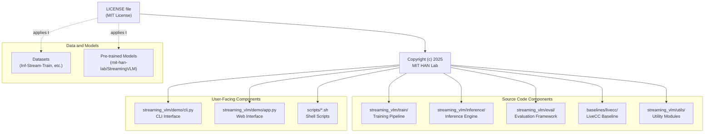
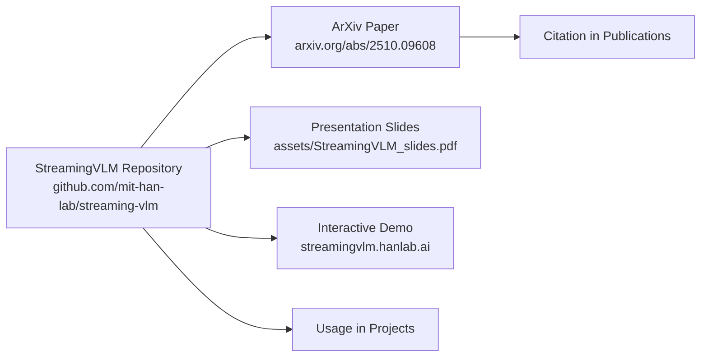
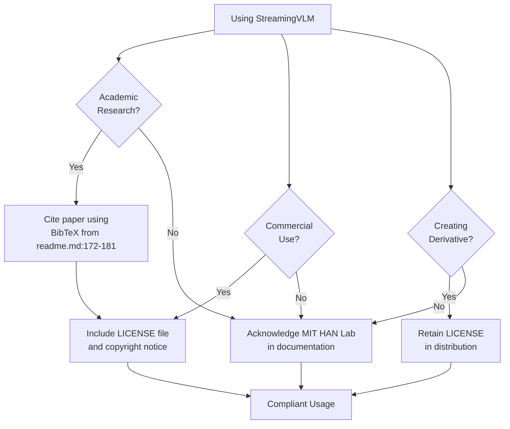

<!-- source: DeepWiki mcp.deepwiki.com · repo mit-han-lab/streaming-vlm · page 1.3 License and Citation · fetched 2026-10-30 -->

# License and Citation

<details>
<summary>Relevant source files</summary>

The following files were used as context for generating this wiki page:

- [LICENSE](LICENSE)
- [readme.md](readme.md)

</details>


This document provides the legal framework and academic attribution information for StreamingVLM. It covers the MIT License terms, copyright details, and proper citation format for academic work using this codebase.

For information about the overall project purpose and architecture, see [Overview](#1). For getting started with the codebase, see [Getting Started](#2).

---

## License Overview

StreamingVLM is distributed under the **MIT License**, which grants broad permissions for use, modification, and distribution. The copyright is held by **MIT HAN Lab** with a copyright year of **2025**.

### License Location and Terms

The full license text is located in [LICENSE:1-22](). This is the canonical legal document governing the use of this software.

**Sources:** [LICENSE:1-22]()

---

## MIT License Terms

The MIT License grants the following permissions **free of charge** to any person obtaining a copy of the software:

| Permission | Description |
|------------|-------------|
| **Use** | Run the software for any purpose without restriction |
| **Copy** | Create copies of the software and documentation |
| **Modify** | Make changes to the source code |
| **Merge** | Combine with other software projects |
| **Publish** | Make the software publicly available |
| **Distribute** | Share copies with others |
| **Sublicense** | Grant licenses to derivative works |
| **Sell** | Commercialize copies or derivatives |

### Requirements and Limitations

The license requires that:

1. **Copyright Notice**: The copyright notice from [LICENSE:3]() must be included in all copies or substantial portions of the software
2. **License Notice**: The full license text from [LICENSE:1-22]() must be included in distributions

The software is provided **"AS IS"** with no warranties of any kind (express or implied), including but not limited to warranties of merchantability, fitness for a particular purpose, and non-infringement. See [LICENSE:15-20]() for the complete disclaimer.

**Sources:** [LICENSE:1-22]()

---

## License Propagation in Repository

The following diagram illustrates how the MIT License applies to different components of the StreamingVLM codebase:



**All source code files** in the repository are covered by the MIT License. When distributing or modifying any component, users must include the copyright notice and license text from [LICENSE:3]() and [LICENSE:1-22]().

**Sources:** [LICENSE:1-22](), [readme.md:1-184]()

---

## Citation Information

### Academic Attribution

When using StreamingVLM in academic research, proper citation is required. The canonical citation format is provided in BibTeX format in [readme.md:168-182]().

### BibTeX Entry

```bibtex
@misc{xu2025streamingvlmrealtimeunderstandinginfinite,
      title={StreamingVLM: Real-Time Understanding for Infinite Video Streams}, 
      author={Ruyi Xu and Guangxuan Xiao and Yukang Chen and Liuning He and Kelly Peng and Yao Lu and Song Han},
      year={2025},
      eprint={2510.09608},
      archivePrefix={arXiv},
      primaryClass={cs.CV},
      url={https://arxiv.org/abs/2510.09608}, 
}
```

### Citation Components

| Component | Value |
|-----------|-------|
| **Citation Key** | `xu2025streamingvlmrealtimeunderstandinginfinite` |
| **Paper Title** | StreamingVLM: Real-Time Understanding for Infinite Video Streams |
| **Authors** | Ruyi Xu, Guangxuan Xiao, Yukang Chen, Liuning He, Kelly Peng, Yao Lu, Song Han |
| **Year** | 2025 |
| **ArXiv ID** | 2510.09608 |
| **Primary Class** | cs.CV (Computer Vision and Pattern Recognition) |
| **Archive** | arXiv |

**Sources:** [readme.md:168-182]()

---

## Related Resources

The following resources complement the codebase and should be referenced when appropriate:



### Resource Locations

| Resource | Location | Purpose |
|----------|----------|---------|
| **Paper** | [https://arxiv.org/abs/2510.09608](https://arxiv.org/abs/2510.09608) | Technical details and experimental results |
| **Slides** | [assets/StreamingVLM_slides.pdf]() | Presentation materials |
| **Demo** | [https://streamingvlm.hanlab.ai](https://streamingvlm.hanlab.ai) | Live interactive demonstration |

Links to these resources are provided in [readme.md:4-6]().

**Sources:** [readme.md:1-6]()

---

## Citation Workflow

The following diagram shows when and how to properly cite StreamingVLM in different usage scenarios:



### Usage Scenarios

1. **Academic Research**: Always cite using the BibTeX entry from [readme.md:172-181](). Include in publications, presentations, and derived research.

2. **Commercial Applications**: Include the full license text from [LICENSE:1-22]() in your software distribution.

3. **Derivative Works**: Retain the copyright notice [LICENSE:3]() and license text [LICENSE:1-22]() in all derivative software.

4. **Non-Commercial Personal Use**: Acknowledgment of MIT HAN Lab is appreciated but not legally required under the MIT License.

**Sources:** [LICENSE:1-22](), [readme.md:168-182]()

---

## File-Level License Attribution

### Key Files with License Information

| File Path | License Relevance | Lines |
|-----------|-------------------|-------|
| [LICENSE]() | Complete license text | 1-22 |
| [readme.md]() | Citation information | 168-182 |

### Copyright Headers

While not all Python files in the repository contain explicit copyright headers, the **LICENSE file at the repository root** applies to all source code. When creating derivative works or redistributing code, users should either:

1. Keep the original LICENSE file in the distribution, or
2. Include copyright notices in modified files referencing MIT HAN Lab (2025)

**Sources:** [LICENSE:1-22]()

---

## Summary

| Aspect | Details |
|--------|---------|
| **License Type** | MIT License |
| **Copyright Holder** | MIT HAN Lab |
| **Copyright Year** | 2025 |
| **License File** | [LICENSE:1-22]() |
| **Citation Format** | BibTeX in [readme.md:172-181]() |
| **Paper DOI** | arXiv:2510.09608 |
| **Permissions** | Use, copy, modify, merge, publish, distribute, sublicense, sell |
| **Requirements** | Include copyright notice and license text in distributions |
| **Warranty** | None (AS IS) |

**Sources:** [LICENSE:1-22](), [readme.md:1-184]()

---

