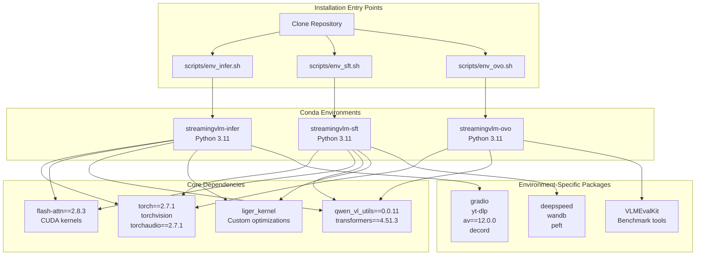
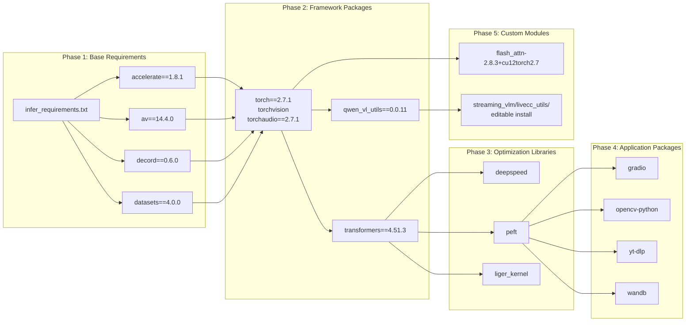
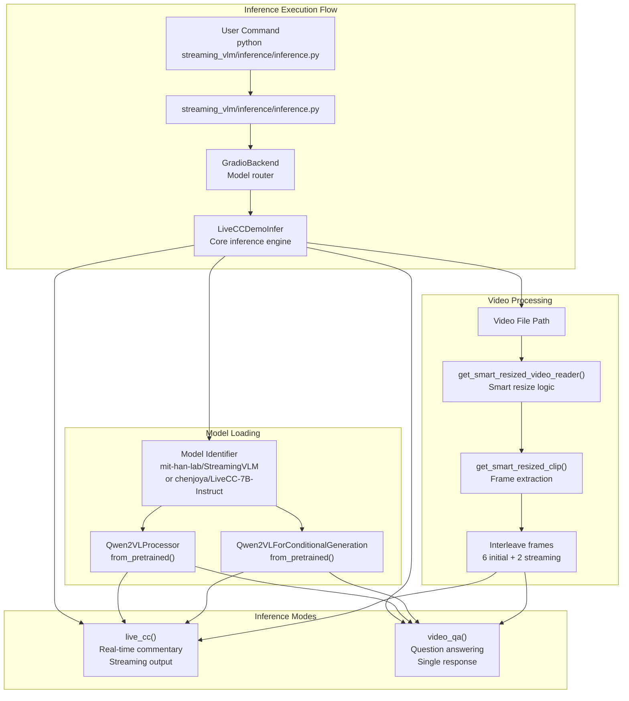

<!-- source: DeepWiki mcp.deepwiki.com · repo mit-han-lab/streaming-vlm · page 2 Getting Started · fetched 2026-10-30 -->

# Getting Started

<details>
<summary>Relevant source files</summary>

The following files were used as context for generating this wiki page:

- [readme.md](readme.md)
- [scripts/env_infer.sh](scripts/env_infer.sh)
- [scripts/env_ovo.sh](scripts/env_ovo.sh)
- [scripts/env_sft.sh](scripts/env_sft.sh)

</details>


This page guides users through initial setup and installation of the StreamingVLM system, from installing dependencies to running the first inference. It covers the prerequisite requirements, environment creation, and basic verification steps needed to begin using StreamingVLM for real-time video stream understanding.

For detailed environment configuration, see [Environment Setup](#2.1). For dependency explanations, see [Dependencies](#2.2). For comprehensive usage examples, see [Quick Start Guide](#2.3).

## Prerequisites

StreamingVLM requires the following system prerequisites:

| Component | Requirement | Purpose |
|-----------|-------------|---------|
| Python | 3.11 | Runtime environment |
| CUDA | 12.x compatible | GPU acceleration |
| GPU | H100 or equivalent (80GB recommended) | Model inference and training |
| Conda | Latest version | Environment management |
| FFmpeg | System package | Video processing |
| Storage | 50GB+ available | Model checkpoints and datasets |

The system supports three primary use cases, each with different environment requirements:

1. **Inference**: Running pre-trained models for video understanding and commentary
2. **Training**: Supervised fine-tuning on custom datasets
3. **Evaluation**: Benchmarking on OVOBench, VQA tasks, and custom metrics

**Sources:** [readme.md:21-28]()

## Installation Overview

The repository provides automated environment setup scripts for different use cases. The installation process follows a modular approach where each environment is isolated in its own conda environment.



**Sources:** [readme.md:21-28](), [scripts/env_infer.sh:1-14]()

## Basic Installation

### Inference Environment

For users who want to run pre-trained StreamingVLM models for inference, the inference environment is the primary requirement:

```bash
# Clone the repository
git clone https://github.com/mit-han-lab/streaming-vlm.git
cd streaming-vlm

# Create inference environment
./scripts/env_infer.sh
```

The `env_infer.sh` script performs the following operations:

1. Creates conda environment `streamingvlm-infer` with Python 3.11
2. Installs FFmpeg via conda
3. Installs base dependencies from `infer_requirements.txt`
4. Installs PyTorch 2.7.1 with CUDA 12 support
5. Installs Qwen VL utilities and transformers
6. Installs Flash Attention 2 compiled for CUDA 12 and PyTorch 2.7
7. Installs LiveCC utilities in editable mode from `streaming_vlm/livecc_utils/`

**Sources:** [scripts/env_infer.sh:1-14](), [readme.md:21-28]()

### Training Environment

For users planning to perform supervised fine-tuning:

```bash
# Create training environment
./scripts/env_sft.sh
```

The training environment extends the inference environment with additional packages for distributed training, including DeepSpeed for ZeRO-3 optimization and Weights & Biases for experiment tracking.

**Sources:** [readme.md:21-28]()

### Evaluation Environment

For running OVOBench evaluations specifically:

```bash
# Create OVOBench evaluation environment
./scripts/env_ovo.sh
```

This environment includes VLMEvalKit and benchmark-specific dependencies.

**Sources:** [readme.md:117-122]()

## Environment Activation and Verification

After installation, activate the appropriate environment and verify the setup:

```bash
# Activate inference environment
conda activate streamingvlm-infer

# Verify Python version
python --version  # Should output Python 3.11.x

# Verify PyTorch and CUDA
python -c "import torch; print(f'PyTorch: {torch.__version__}'); print(f'CUDA Available: {torch.cuda.is_available()}')"

# Verify transformers and qwen_vl_utils
python -c "import transformers; import qwen_vl_utils; print('Core packages installed successfully')"
```

Expected output:
- Python version: 3.11.x
- PyTorch version: 2.7.1
- CUDA Available: True
- Core packages confirmation message

**Sources:** [scripts/env_infer.sh:1-14]()

## Dependency Installation Details

The inference environment installs packages in a specific order to ensure compatibility:



**Key Dependencies by Category:**

| Category | Packages | Purpose |
|----------|----------|---------|
| Deep Learning Framework | `torch==2.7.1`, `torchvision`, `torchaudio==2.7.1` | Core PyTorch ecosystem |
| Model Architecture | `transformers==4.51.3`, `qwen_vl_utils==0.0.11` | Transformer models and Qwen utilities |
| Memory Optimization | `flash_attn==2.8.3`, `liger_kernel` | Flash Attention 2 and custom CUDA kernels |
| Video Processing | `av==14.4.0`, `decord==0.6.0`, `opencv-python` | Video frame extraction and processing |
| Distributed Training | `deepspeed`, `accelerate==1.8.1` | ZeRO optimization and multi-GPU support |
| Data Handling | `datasets==4.0.0`, `huggingface-hub` | Dataset loading and HuggingFace integration |
| User Interface | `gradio` | Web-based demo interface |
| Utilities | `yt-dlp`, `wandb`, `tqdm` | Video download, experiment tracking, progress bars |

**Sources:** [scripts/env_infer.sh:5-14](), [infer_requirements.txt:1-121]()

## Flash Attention Installation

Flash Attention 2 requires a pre-compiled wheel matching the specific CUDA and PyTorch versions. The installation script downloads the appropriate wheel from the official Flash Attention GitHub releases:

```bash
# Example from env_infer.sh
wget https://github.com/Dao-AILab/flash-attention/releases/download/v2.8.3/flash_attn-2.8.3+cu12torch2.7cxx11abiTRUE-cp311-cp311-linux_x86_64.whl
pip install flash_attn-2.8.3+cu12torch2.7cxx11abiTRUE-cp311-cp311-linux_x86_64.whl
```

The wheel filename components:
- `2.8.3`: Flash Attention version
- `cu12`: CUDA 12.x compatibility
- `torch2.7`: PyTorch 2.7.x compatibility
- `cxx11abiTRUE`: C++11 ABI enabled
- `cp311`: CPython 3.11

Users must select the wheel matching their system configuration from https://github.com/Dao-AILab/flash-attention/releases.

**Sources:** [scripts/env_infer.sh:9-13]()

## First Inference Test

After environment setup, verify the system works by running a basic inference test:

```bash
# Activate inference environment
conda activate streamingvlm-infer

# Run inference script
python streaming_vlm/inference/inference.py
```

The `inference.py` script provides an entry point to the inference engine. By default, it loads a pre-trained model and processes video input.



**Sources:** [readme.md:30-41]()

## Model Download

On first run, the inference system automatically downloads the pre-trained model from HuggingFace Hub:

| Model | HuggingFace ID | Size | Purpose |
|-------|---------------|------|---------|
| StreamingVLM | `mit-han-lab/StreamingVLM` | ~14GB | Main StreamingVLM model |
| LiveCC Baseline | `chenjoya/LiveCC-7B-Instruct` | ~14GB | Comparison baseline |
| Qwen2.5-VL Base | `Qwen/Qwen2.5-VL-7B-Instruct` | ~14GB | Base model for evaluation |

The models are cached in the HuggingFace cache directory (typically `~/.cache/huggingface/hub/`). Ensure sufficient disk space before running inference.

**Sources:** [readme.md:30-41]()

## Common Installation Issues

### Flash Attention Compilation Errors

If Flash Attention installation fails, verify:
1. CUDA toolkit version matches the wheel (12.x for cu12 wheels)
2. PyTorch version matches exactly (2.7.1)
3. Python version is 3.11
4. The downloaded wheel is for the correct architecture (x86_64)

Alternative: Install from source if pre-compiled wheels are incompatible:
```bash
pip install flash-attn --no-build-isolation
```

### CUDA Out of Memory

For GPUs with less than 80GB VRAM:
- Use model quantization (not covered in basic setup)
- Reduce batch size or frame count
- Enable gradient checkpointing for training

### Missing FFmpeg

If video processing fails with FFmpeg errors:
```bash
# Verify FFmpeg installation
ffmpeg -version

# Reinstall if missing
conda install -c conda-forge ffmpeg -y
```

**Sources:** [scripts/env_infer.sh:1-14]()

## Environment Configuration Files

The system uses requirements files to specify exact dependency versions:

| File | Purpose | Usage |
|------|---------|-------|
| `infer_requirements.txt` | Base inference dependencies | Installed by `env_infer.sh` |
| (Training requirements embedded in script) | Training-specific packages | Installed by `env_sft.sh` |

The `infer_requirements.txt` file contains 121 pinned package versions to ensure reproducibility. Key sections include:

- Lines 1-10: Acceleration and async libraries
- Lines 14-29: Video and audio processing
- Lines 31-45: HuggingFace ecosystem
- Lines 62-75: NVIDIA CUDA libraries
- Lines 94-110: Core ML frameworks

**Sources:** [infer_requirements.txt:1-121](), [scripts/env_infer.sh:5]()

## Next Steps

After successful installation and verification:

1. **For Inference Users**: Proceed to [Quick Start Guide](#2.3) for running inference on your videos
2. **For Training Users**: Review [Data Preparation](#4.1) before starting the training pipeline
3. **For Evaluation Users**: See [Evaluation Framework](#6) for benchmark setup instructions

Additional configuration options:
- **FPS Adjustment**: See [readme.md:157-166]() for modifying inference frame rate
- **Dataset Setup**: See [readme.md:45-65]() for downloading and preparing training datasets
- **Distributed Training**: Review [DeepSpeed Configuration](#4.4) for multi-GPU setup

**Sources:** [readme.md:30-156]()

---

