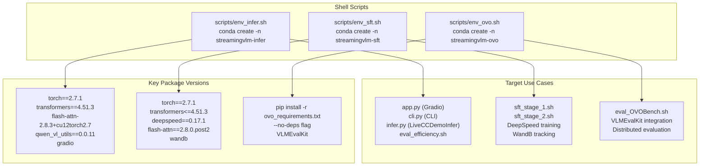
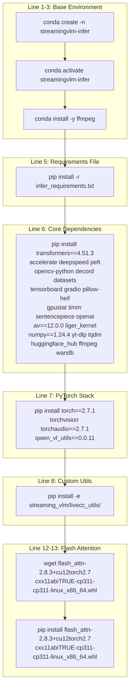
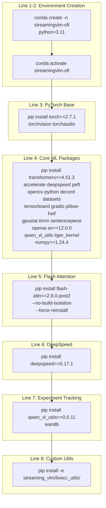
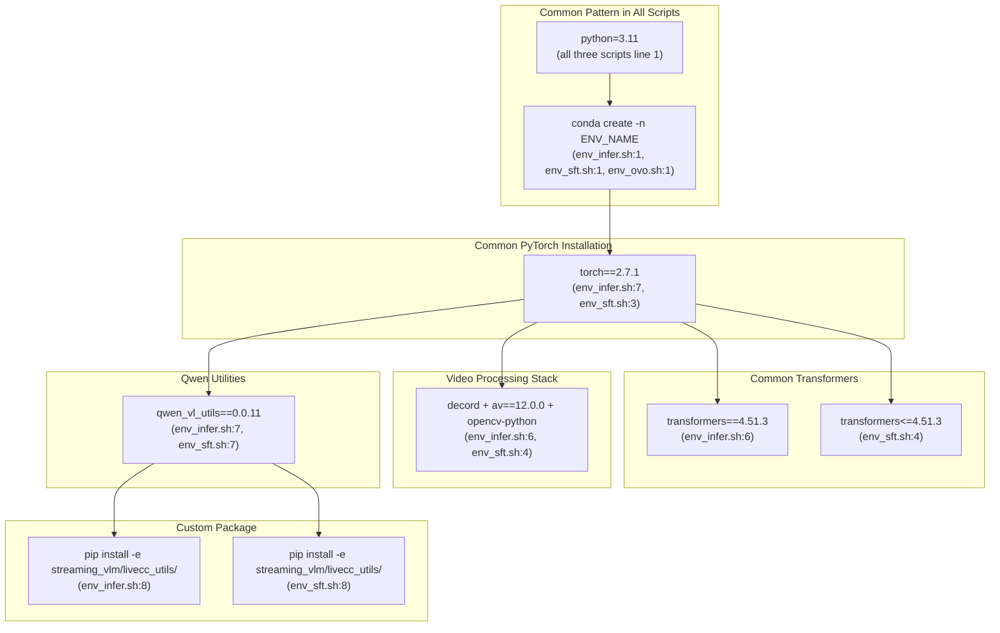
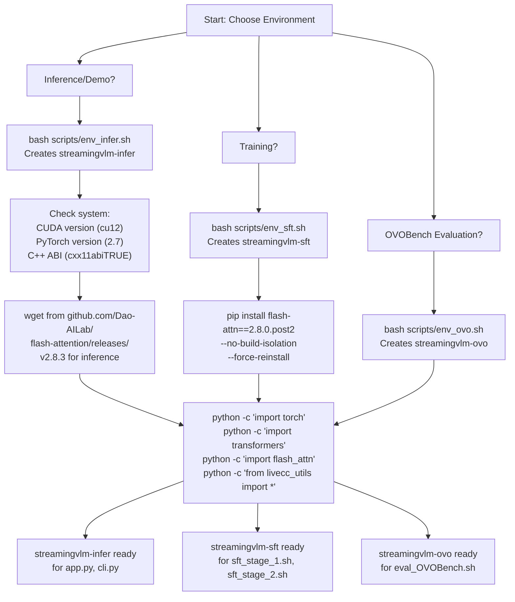

<!-- source: DeepWiki mcp.deepwiki.com · repo mit-han-lab/streaming-vlm · page 2.1 Environment Setup · fetched 2026-10-30 -->

# Environment Setup

<details>
<summary>Relevant source files</summary>

The following files were used as context for generating this wiki page:

- [scripts/env_infer.sh](scripts/env_infer.sh)
- [scripts/env_ovo.sh](scripts/env_ovo.sh)
- [scripts/env_sft.sh](scripts/env_sft.sh)

</details>


## Purpose and Scope

This document details the environment configuration required to run different components of the StreamingVLM system. The repository provides three separate conda environments optimized for different tasks: inference, training (supervised fine-tuning), and OVOBench evaluation. Each environment is defined by a shell script that automates the installation of Python packages, system dependencies, and CUDA-specific libraries.

For information about installing dependencies and their purposes, see [Dependencies](#2.2). For running inference after environment setup, see [Quick Start Guide](#2.3).

## Environment Overview

The StreamingVLM system separates concerns across three isolated conda environments to avoid dependency conflicts and optimize for specific workloads:

**Environment Diagram: Three Isolated Environments**



**Sources:** [scripts/env_infer.sh:1-14](), [scripts/env_sft.sh:1-15](), [scripts/env_ovo.sh:1-4]()

| Environment | Script | Python Version | Primary Purpose | Key Optimizations |
|-------------|--------|----------------|-----------------|-------------------|
| `streamingvlm-infer` | `scripts/env_infer.sh` | 3.11 | Inference, demos | Flash Attention 2.8.3, Gradio UI |
| `streamingvlm-sft` | `scripts/env_sft.sh` | 3.11 | Training | DeepSpeed 0.17.1, Liger kernels |
| `streamingvlm-ovo` | `scripts/env_ovo.sh` | 3.11 | OVOBench evaluation | VLMEvalKit integration |

**Sources:** [scripts/env_infer.sh:1](), [scripts/env_sft.sh:1](), [scripts/env_ovo.sh:1]()

## Inference Environment (streamingvlm-infer)

The inference environment supports running StreamingVLM and LiveCC models for real-time video commentary and question-answering tasks. This environment is used by the Gradio web demo, CLI tools, and evaluation scripts.

### Installation Steps

```bash
# Create environment
conda create -n streamingvlm-infer python=3.11 -y
conda activate streamingvlm-infer

# Install system dependencies
conda install -y ffmpeg

# Install Python packages
pip install -r infer_requirements.txt
pip install transformers==4.51.3 accelerate deepspeed peft opencv-python \
    decord datasets tensorboard gradio pillow-heif gpustat timm \
    sentencepiece openai av==12.0.0 liger_kernel numpy==1.24.4 \
    yt-dlp tqdm huggingface_hub ffmpeg wandb

# Install PyTorch and vision utilities
pip install torch==2.7.1 torchvision torchaudio==2.7.1 qwen_vl_utils==0.0.11

# Install livecc_utils package
pip install -e streaming_vlm/livecc_utils/

# Install Flash Attention (CUDA-specific)
wget https://github.com/Dao-AILab/flash-attention/releases/download/v2.8.3/flash_attn-2.8.3+cu12torch2.7cxx11abiTRUE-cp311-cp311-linux_x86_64.whl
pip install flash_attn-2.8.3+cu12torch2.7cxx11abiTRUE-cp311-cp311-linux_x86_64.whl
```

**Sources:** [scripts/env_infer.sh:1-14]()

### Critical Dependencies

**Dependency Installation Flow for env_infer.sh**



**Sources:** [scripts/env_infer.sh:1-13]()

| Package | Version | Purpose |
|---------|---------|---------|
| `torch` | 2.7.1 | PyTorch deep learning framework |
| `transformers` | 4.51.3 | Hugging Face model loading and inference |
| `qwen_vl_utils` | 0.0.11 | Qwen2.5-VL-specific utilities for video/image processing |
| `flash-attn` | 2.8.3 | Flash Attention 2 for memory-efficient attention operations |
| `gradio` | latest | Web UI for interactive demos |
| `decord` | latest | Efficient video frame extraction |
| `av` | 12.0.0 | PyAV for video codec handling |
| `numpy` | 1.24.4 | Pinned version for compatibility |

**Sources:** [scripts/env_infer.sh:6-8]()

### Flash Attention Installation

Flash Attention requires a pre-built wheel matching your CUDA version, PyTorch version, and C++ ABI. The `env_infer.sh` script demonstrates installation for CUDA 12, PyTorch 2.7, with C++11 ABI enabled:

```bash
# Download version-specific wheel (line 12)
wget https://github.com/Dao-AILab/flash-attention/releases/download/v2.8.3/flash_attn-2.8.3+cu12torch2.7cxx11abiTRUE-cp311-cp311-linux_x86_64.whl

# Install downloaded wheel (line 13)
pip install flash_attn-2.8.3+cu12torch2.7cxx11abiTRUE-cp311-cp311-linux_x86_64.whl
```

The wheel filename encodes critical version information:
- `cu12`: CUDA 12.x
- `torch2.7`: PyTorch 2.7.x
- `cxx11abiTRUE`: C++11 ABI enabled
- `cp311`: CPython 3.11

Users must select the appropriate wheel from the [Flash Attention releases page](https://github.com/Dao-AILab/flash-attention/releases) matching their system configuration.

**Sources:** [scripts/env_infer.sh:10-13]()

## Training Environment (streamingvlm-sft)

The training environment is optimized for two-stage supervised fine-tuning with DeepSpeed ZeRO-3 and distributed training capabilities. It includes Liger kernel optimizations for memory efficiency and Weights & Biases for experiment tracking.

### Installation Steps

```bash
# Create environment
conda create -n streamingvlm-sft python=3.11 -y
conda activate streamingvlm-sft

# Install PyTorch stack
pip install torch==2.7.1 torchvision torchaudio

# Install core dependencies
pip install "transformers<=4.51.3" accelerate deepspeed peft opencv-python \
    decord datasets tensorboard gradio pillow-heif gpustat timm \
    sentencepiece openai av==12.0.0 qwen_vl_utils liger_kernel numpy==1.24.4

# Install Flash Attention (pinned version for training stability)
pip install flash-attn==2.8.0.post2 --no-build-isolation --force-reinstall

# Install DeepSpeed (pinned version)
pip install deepspeed==0.17.1

# Install Qwen utilities and experiment tracking
pip install qwen_vl_utils==0.0.11 wandb

# Install livecc_utils package
pip install -e streaming_vlm/livecc_utils/
```

**Sources:** [scripts/env_sft.sh:1-9]()

### Training-Specific Dependencies

**Training Pipeline Dependencies from env_sft.sh**



**Sources:** [scripts/env_sft.sh:1-8]()

| Package | Version | Purpose |
|---------|---------|---------|
| `deepspeed` | 0.17.1 | ZeRO-3 parameter partitioning and distributed training |
| `flash-attn` | 2.8.0.post2 | Pinned for training stability (different from inference) |
| `liger_kernel` | latest | Custom CUDA kernels for memory efficiency |
| `wandb` | latest | Weights & Biases experiment tracking and logging |
| `peft` | latest | Parameter-Efficient Fine-Tuning (LoRA, adapters) |
| `datasets` | latest | Hugging Face datasets library for data loading |
| `tensorboard` | latest | TensorBoard logging for training metrics |

**Sources:** [scripts/env_sft.sh:4-7]()

### Version Pinning Differences

The training environment (`env_sft.sh`) uses different version pins than inference (`env_infer.sh`):

| Package | Inference (env_infer.sh) | Training (env_sft.sh) | Reason |
|---------|--------------------------|----------------------|--------|
| Flash Attention | `2.8.3` (line 12-13) | `2.8.0.post2` (line 5) | Older version for training stability with DeepSpeed |
| Transformers | `==4.51.3` (line 6) | `<=4.51.3` (line 4) | Training allows minor updates |
| Flash Attention flags | Standard install | `--no-build-isolation --force-reinstall` (line 5) | Ensures compatibility with DeepSpeed |
| DeepSpeed | Not installed | `==0.17.1` (line 6) | Only needed for training |

The `--no-build-isolation --force-reinstall` flags in `env_sft.sh:5` ensure that Flash Attention is properly compiled against the installed PyTorch and CUDA versions before DeepSpeed is installed in line 6.

**Sources:** [scripts/env_sft.sh:5-6](), [scripts/env_infer.sh:6-7](), [scripts/env_infer.sh:12-13]()

## OVOBench Evaluation Environment (streamingvlm-ovo)

The OVOBench evaluation environment is minimal and uses a `--no-deps` installation strategy to avoid conflicts with VLMEvalKit requirements.

### Installation Steps

```bash
# Create environment
conda create -n streamingvlm-ovo python=3.11 -y
conda activate streamingvlm-ovo

# Install dependencies without transitive dependencies
pip install -r ovo_requirements.txt --no-deps
```

**Sources:** [scripts/env_ovo.sh:1-4]()

### Dependency Isolation Strategy

The `--no-deps` flag prevents pip from automatically installing transitive dependencies, giving fine-grained control over the package versions. This is critical for OVOBench evaluation because:

1. VLMEvalKit has specific version requirements that may conflict with StreamingVLM's training/inference dependencies
2. The evaluation environment only needs to run inference (no training), reducing the dependency footprint
3. Manual dependency specification via `ovo_requirements.txt` ensures reproducible evaluation results

The `ovo_requirements.txt` file (not shown in provided files) contains the exact packages needed for OVOBench evaluation, including VLMEvalKit and its compatible versions of transformers, torch, and other dependencies.

**Sources:** [scripts/env_ovo.sh:4]()

## Common Components Across Environments

All three environments share certain base requirements and installation patterns:

**Shared Infrastructure Across Environment Scripts**



**Sources:** [scripts/env_infer.sh:1-8](), [scripts/env_sft.sh:1-8](), [scripts/env_ovo.sh:1]()

### The livecc_utils Package

Both inference and training environments install the custom `streaming_vlm/livecc_utils/` package in editable mode:

```bash
# From env_infer.sh line 8 and env_sft.sh line 8
pip install -e streaming_vlm/livecc_utils/
```

The `-e` flag creates an editable installation, allowing code changes in the `livecc_utils` directory to be immediately reflected without reinstalling. This package contains shared utilities for video processing, frame extraction, and streaming inference that are used by:
- `infer.py` (`LiveCCDemoInfer` class)
- `cli.py` (command-line interface)
- `app.py` (Gradio web demo)
- Training scripts (`sft_stage_1.sh`, `sft_stage_2.sh`)

**Sources:** [scripts/env_infer.sh:8](), [scripts/env_sft.sh:8]()

## Hardware Requirements

While not explicitly documented in the setup scripts, the system requirements can be inferred from the dependencies:

| Component | Requirement | Rationale |
|-----------|-------------|-----------|
| GPU | NVIDIA GPU with CUDA 12.x support | Flash Attention wheels target CUDA 12 |
| GPU Memory | 24GB+ (single GPU inference), 80GB+ recommended (H100 for training) | StreamingVLM inference runs on single H100; training uses ZeRO-3 across multiple GPUs |
| RAM | 32GB+ | Video decoding and frame buffering |
| Storage | 100GB+ | Model checkpoints, datasets, and video files |
| CUDA | 12.x | PyTorch 2.7.1 and Flash Attention compiled for CUDA 12 |

**Sources:** [scripts/env_infer.sh:12]() (Flash Attention wheel filename indicates CUDA 12)

## Installation Workflow

**Complete Setup Process**



**Sources:** [scripts/env_infer.sh:1-14](), [scripts/env_sft.sh:1-15](), [scripts/env_ovo.sh:1-4]()

### Typical Usage Pattern

Users typically need only one environment for their use case:

1. **Researchers/Developers**: Use `streamingvlm-sft` for training experiments
2. **End Users**: Use `streamingvlm-infer` for running demos and inference
3. **Benchmark Testers**: Use `streamingvlm-ovo` specifically for OVOBench evaluation

The environments are kept separate to prevent dependency conflicts and ensure reproducible results across different tasks.

**Sources:** All environment setup scripts

---

